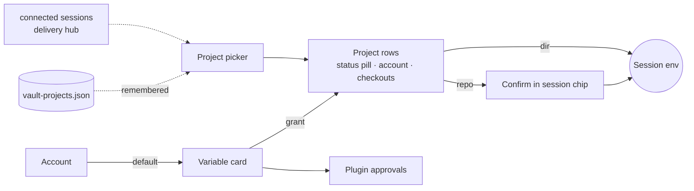

## Context

`add-credential-vault` (#882, archived 2026-10-13) shipped the vault page and the session chip with no mockup. This change follows the retro method of `retro-ux-identity-connectivity` design D1–D4: an as-built replica built from source next to the proposed version, measured with `tests/e2e/helpers/computed-contrast.ts`, approved by the user, then folded. Board: `mockups/vault.html`. Findings F1–F23 and the approval record: `mockups/audit.md`.

Grounding (paths verified 2026-10-13):
- **Client:**
  - `settings/vault/{VaultSection,VaultAccountsPanel,VaultBindingsPanel,VaultImportPanel,VaultPluginsPanel,vault-ui}.tsx`
  - `session/VaultBindingsChip.tsx` (polls every 2.5 s, renders nothing at 0 bindings, `:65`)
  - `lib/vault/vault-api.ts`: `call()` swallows non-JSON with `.catch(() => ({}))` (`:84-92`); `VaultResult` has no `code` (`:70-75`)
  - `lib/api/fetch-json.ts`: `fetchJsonResponse`, a content-type guard only (`:87-101`)
- **Server:**
  - `vault/vault-routes.ts`: `canManageVault` (`:84-88`), the `manage` preHandler (`:102-110`), `GET /api/session/:id/vault-bindings` (`:204`)
  - `vault/vault-delivery-hub.ts`:
    - `deliver()` is synchronous and resolves `{deviceId, dir, repoKey}` only for trusted sessions (`:144-158`)
    - `withdraw()` clears the project (`:134-141`)
    - pushes are debounced 150 ms on every store change (`:190-199`)
  - `vault/vault-bindings.ts:93` (`deleteBinding` also drops grants and plugin approvals)
  - `vault/vault-import.ts:146-160` (created accounts carry `label === name`)
  - `server.ts`: three not-found branches (dev `:2997`, production `:3021`, no build `:3026`); `registerVaultRoutes` (`:2461`)
  - `auth/localhost-guard.ts`: `parseGuardTarget(url)` (`:550`) returns the guard's two path views `{ raw, resolved }` (`decodeURI`, then dot-segment resolution)
  - `auth/locked-json-file.ts` (creates the file on open, `:130`; `CheckedJsonRead`, `:162`)
- **Specs:**
  - `credential-vault` ("Values never leave the hub through management surfaces" limits what a listing may expose)
  - `credential-delivery` ("Rotation, revocation and reconciliation": changes reach connected sessions within 5 s)
  - `url-routing` "SPA fallback on server"
  - `packaging` "SPA fallback" (already excludes `/api/*`)
  - `client-api-response-validation` ("Status-branching helpers retain their semantics": `fetchJsonResponse` reads JSON from non-2xx replies)
  - `trusted-networks` (the guard refuses before routing)
  - `ui-i18n-coverage` (zh-CN and hu for every key; `src/lib/i18n-en-source.json`)
  - `qa/tests/20-tunnel-readiness-perf.sh:55-70` (relies on unknown `/api` paths answering `200 text/html`)
- **Sibling in-flight changes:**
  - `surface-operate-required-remedy` (owns the 403 `operate_required` callout on `VaultSection` and adds `code` / `remedies` to `VaultResult`)
  - `add-vault-llm-delivery` (OAuth / LLM UI, task 7.0 added by D10)
  - `absorb-service-secrets-into-vault` (`service:<id>` grant subjects, a "Services" account group)

## Goals / Non-Goals

**Goals:** carry out the approved decisions D1–D10 with no change to vault semantics; fix the "HTTP 200" failure at both ends; keep every test-referenced `data-testid` and every existing i18n key.

**Non-goals:** see proposal.

## Decisions

### D1. Tabs and variable cards
`VaultSection` renders an APG tablist (`Variables`, `Accounts`, `Import`; automatic activation, arrow keys, `aria-controls`). The selected tab is component state. It is not written to the URL, because URL persistence was not on the approved board. All three tabpanels stay mounted; inactive ones carry the `hidden` attribute, so their state survives a tab switch and tests that query their content keep working.

The default tab is Variables. When the vault has no accounts and no bindings, the first-run guide (D8) replaces the tab content. With accounts but no bindings, Variables shows its empty text and the "New variable" action.

The Variables panel renders one `VaultVariableCard` per env binding:
- **Default-account select.** Changing it to another account shows the impact line "Used by N projects that don't pick their own account" before saving.
- **Project rows** for grants naming that binding. Each row shows the subject kind and the account used:
  - repository: its key;
  - folder: device and path;
  - any other subject (for example the `service:<id>` subjects of `absorb-service-secrets-into-vault`, which `createGrant` does not accept yet, `vault-grants.ts:176`): its subject text through `describeSubject` kind `other`, with a neutral "Not delivered to sessions" pill instead of a delivery status.
- **"Grant to a project".**
- **Plugin declarations** of that name. The approval control stays an `<input type="checkbox" role="switch">`, styled as a switch, so its checked state and the existing tests keep working.

A plugin declaration whose binding name does not exist is shown above the cards as a request row: `data-testid="vault-plugin-<pluginId>-<NAME>"`, the same checkbox switch (`vault-plugin-approve`, so an existing approval can still be revoked, as the base spec requires), and a "Create <NAME>" action.

Confirmed checkouts are listed under the repository grant they unlock: a `
`, collapsed by default, inside the row. Confirmations with no matching grant are still listed under "Other confirmed checkouts" at the end of the tab, so a revoke path always exists.

*Why:* one card answers "who gets this key", which is F5. *Rejected:* project-centric tabs (direction C) as the primary view; C lives in the session dialog (D4).

Testids:
- Every testid a test references stays on the element with the same meaning:
  - `vault-grants-list` wraps the card list, so every `vault-grant-row` is inside it.
  - `vault-grant-row` keeps `data-state` as the server's grant state (`ok` | `no-account`), the domain `VaultSection.test.tsx:77-81` pins. The settings-page status shown by the pill (D9) goes in a separate `data-status` attribute.
  - `vault-grant-no-account` stays on the no-account pill.
  - `vault-plugin-<pluginId>-<NAME>` goes on the approval row, and `vault-plugin-approve` on its checkbox switch.
  - The `vault-account-*`, `vault-accounts-other`, `vault-import-*` and `vault-corrupt` testids are unchanged.
- Unreferenced ids keep a home where one exists:
  - `vault-bindings-list` goes on the outer card wrapper, `vault-binding-<NAME>` on the card, `vault-binding-repair` on the no-default pill.
  - `vault-panel-bindings`, `vault-panel-accounts` and `vault-panel-import` go on the three tabpanels.
- `vault-panel-grants`, `vault-panel-confirmations` and `vault-panel-plugins` have no single home and are retired.
- `mockups/ui-plan.md` lists every old → new location.

### D2. Project picker from connected and remembered projects (option B)
- **Store** `packages/server/src/vault/vault-projects.ts`, file `~/.pi/dashboard/vault-projects.json`, mode `0600`, written through `locked-json-file`. Reads (`list()`) pass `createIfMissing: false`, and `record()` validates its input before opening the file, so the file appears only when a valid project is first recorded.
  - **Entries:** `{ deviceId, dir, repoKey?, lastSeenAt }`, keyed by `(deviceId, dir)`.
  - **Bounds:** at most 200 entries; past the cap the least recently seen go first. Entries older than 90 days are dropped on write and also filtered out by `list()`, so an idle hub never serves them.
  - **Content:** no values and no binding names. `dir` is capped at 4096 characters and `repoKey` at 512; longer reports are not recorded.
  - **Per-device cap:** at most 100 entries per `deviceId`, so one device cannot evict the others.
  - **Corrupt file:** read through `readJsonChecked` (`CheckedJsonRead`), which keeps a byte copy as `vault-projects.json.corrupt-<stamp>` and leaves the original. `list()` then returns empty, and the next `record()` replaces the corrupt original with a fresh document. `[vault] projects file corrupt, copy kept as <basename>` is logged. The list holds no secret, so losing it is acceptable.
- **Recording:** `deliver()` stays synchronous. After it resolves a project for a trusted session it calls `projects.record(project)`, fire-and-forget with `.catch`.
  - `record()` never throws synchronously (its body runs inside a promise), so `deliver()` cannot be interrupted by it. It keeps an in-memory `Map<key, lastWrittenAt>` and writes only for a new key or when the last write for that key is more than 1 h old. A store-change push across many sessions then costs no file I/O. The map is bounded like the file (200 entries, 100 per device, least recently written evicted). After a restart the map is empty, so the first sync of each project writes once (at most one write per connected project).
  - On failure it logs `[vault] project record failed: <error name>` (no path, no message body) and never affects delivery.
- **Connected projects:** the hub exposes `listOpenProjects()`. It takes session records that are connected now (`deps.isSessionConnected`, as `getSessionState` already does) and maps each by its outcome:
  - `delivered`: grouped by the resolved project `(deviceId, dir)`, carrying `repoKey` and a session count. Grantable. A repository key from a trusted session is offered under the usual rule: delivery still waits for the checkout confirmation.
  - `untrusted`, `transport-insecure`: no `deviceId`. Listed by `cwd` (truncated to 4096 characters) as `blocked: <outcome>`, never grantable. No repository key is shown, because an origin reported by a session the hub does not trust is not evidence.
  - `disabled`, `vault-unavailable`, `no-project`: left out (delivery is off, the vault is unreadable, or there is no directory).
- **Keys and display:** both lists are keyed by `(deviceId, dir)`; the option kind is repository when the entry has a `repoKey`, else folder. The display name is the last path segment of the repository key, else of `dir`; search matches the name, the repository key and `dir`. `dir` is shown as recorded (the bridge reports a real path).
- **Route:** `GET /api/vault/projects` behind the `manage` preHandler (operate tier in `route-tiers.ts`) returns `{ open: ProjectView[], recent: ProjectView[] }`. `recent` excludes keys present in `open` and is sorted by `lastSeenAt` descending. A blocked open entry does not hide a remembered entry: the remembered entry was recorded from a trusted session, and the trust gate still decides delivery. `ProjectView = { kind: "repo" | "dir", deviceId?, dir, repoKey?, sessions?, lastSeenAt?, blocked? }`.
- **Picker UI:**
  - A radio group; options contain no interactive content.
  - "Already granted" is computed client-side from `overview.grants` for the card's binding, comparing subjects built the same way the grant would be (`repo:<repoKey>` with the hub-normalised key, or `dir:<deviceId>:<dir>`). Already-granted and blocked options are disabled with their reason.
  - Manual repository entry is normalised with the shared `normalizeOrigin` (`packages/shared/src/vault-project-key.ts`) before the comparison and the grant. When the subject already has a grant for this binding, the picker says so and does not send a second grant: `createGrant` upserts, and an upsert without an account would drop an existing per-project account (`vault-grants.ts:180-184`).
  - Search filters by name, repository key or path.
  - "Not listed?" switches to manual repository / folder entry: the old form, with visible labels and help text.
  - A repository choice shows the checkout-confirmation note.
- **Older server:** an older server answers `GET /api/vault/projects` with `index.html` (the F1 failure), which D7 maps to `server_outdated`; a server that has the D7 not-found fix but not this route answers `404` with `error: "not_found"`. On either result the picker hides both lists, says the server can't list projects yet, and opens manual entry directly.

*Why B:* the user approved remembering projects so the picker is useful when no session is open. *Rejected:* storing the list in `vault.json`. That file must not exist before the first account (`credential-vault` "No file before the first account"), and keeping secrets apart from activity data keeps the vault file's purpose narrow.

*Trade-off (accepted, recorded for the user):*
- The remembered list also names projects that were never granted, and keeps them after their sessions end. The working directory of each session in the dashboard's session list is already served to observe-tier callers (`GET /api/sessions`, `route-tiers.ts:225`). The remembered list adds the device id and a last-seen history, for vault managers only.
- A trusted session reports its own directory and origin, so a compromised trusted session could plant an entry. Choosing it still shows the full directory, device and repository key, and a repository grant still waits for a checkout confirmation.
- There is no per-entry delete ("forget" was not approved). Entries expire at 90 days, and deleting the file clears the list.
- *Authority:* the route and `ungranted` sit behind the tightened vault predicate of D11.

### D3. Combined creation is client-side
- **Add key.** After `addAccount` succeeds, the form proposes the variable `<PROVIDER>_API_KEY`: the provider upper-cased with every character outside `[A-Z0-9]` replaced by `_`, checked with the shared name rule (`isDeliverableEnvName`, `packages/shared/src/vault-delivery.ts`). If the derived name is invalid or reserved, the option is not shown. Otherwise:
  - no binding of that name exists → "Create the variable X with this key as its default" (checked by default), calling `createBinding`;
  - it exists → "Make it the default of X instead of <current>" (unchecked by default, with the D1 impact line), calling `setBindingDefault`. The option is shown only when the current default is missing or has the same provider, so a key of one provider never silently becomes the default of another provider's variable.
- **Partial failure.** If the account was created and the second call fails, the account stays and the form shows "Key saved; the variable wasn't created: <reason>" with Retry. A retry that finds the binding already present with this account as default counts as success, which covers a lost response.
- **Import.** The variable option applies only to names that pass `isDeliverableEnvName`; the review shows which names will not get a variable and why. `confirmImport` returns the created account views; imported accounts carry the env name as their `label` (`vault-import.ts:152`), unique within one import, so the client maps them by `label`. For each created name with no binding, `createBinding({ name, defaultAccountId })` runs. The done callout names the created variables and any that failed.

*Why:* no new endpoint, and each step already enforces its own rules. *Accepted:* not atomic; partial success is reported, never hidden.

### D4. Grant from the session dialog
`GET /api/session/:id/vault-bindings` adds `ungranted: string[]`, the env-binding names with no grant for the session's resolved project:
- It is present only when `canManageVault(request, localTrust)` holds; other callers get no such field.
- It is `[]` when the session has no resolved project: untrusted, `transport-insecure`, `no-project`, or a corrupt vault.

The chip renders when `bindings.length > 0 || (ungranted ?? []).length > 0`; an older server sends no `ungranted`. The dialog section has `data-testid="vault-ungranted"`, and each Grant button `data-testid="vault-grant-from-session"`; the rows are not `vault-binding-row`.

Grant calls `createGrant` with `repo:<repoKey>` when the session has a repository key, else `dir:<deviceId>:<dir>`. The dialog's project line is shown when the session has a resolved project; otherwise it says the vault does not deliver to this session and why (its outcome). After a repository grant, the next poll (≤ 2.5 s) shows the binding as `pending-confirmation`, and the D5 callout appears in the same dialog. The Grant row says so before it is pressed: "Repository grants need this checkout confirmed".

*Security:* binding names only, behind the same authority as `GET /api/vault`.

### D5. Checkout confirmation
When any binding is `pending-confirmation`, the dialog shows a severity-warning callout naming the repository key, the directory and the device. It says any clone can claim an origin. Its primary button reads "Confirm and deliver N keys", where N is the number of this session's bindings in `pending-confirmation` (`data-testid="vault-confirm"` kept). The callout adds "Applies to every session in this checkout", because a confirmation is per checkout, not per session. The chip shows "Vault: confirm" with a clock icon while a confirmation is pending (`data-pending="true"` kept).

### D6. Two-step destructive actions with impact
Delete variable and Revoke account first re-fetch the vault overview, then open an inline `role="alertdialog"` callout (`data-testid="vault-confirm-impact"`) whose impact list comes from that fresh overview:
- **Delete variable:**
  - the projects whose grants are removed;
  - the plugin approvals that are removed;
  - "connected sessions lose it within seconds; processes already running keep the old value".
- **Revoke account:**
  - the bindings that lose their default;
  - the grants whose override becomes `no-account`;
  - the no-fallback rule;
  - plugin approvals that read this binding's default, which then read nothing;
  - the running-process note.

If the re-fetch fails, the callout shows the error and the confirm button stays disabled; Cancel and Retry remain. The confirm button is a danger button and Cancel takes focus. Esc cancels and returns focus to the trigger. Rotate shows the running-process note inline.

The impact list is a best-effort preview: a change made elsewhere between the two steps is applied by the server as it stands then (accepted; the server stays the source of truth).

The timing matches `credential-delivery` "Rotation, revocation and reconciliation": the hub pushes within 150 ms of a store change, well inside the 5 s budget.

### D7. Non-JSON replies and the `/api/*` not-found answer
- **Client.** `vault-api.ts` `call()` uses `fetchJsonResponse` and returns `VaultResult` extended with `code?: string`. If `surface-operate-required-remedy` lands first it already adds `code` (from `error`) and `remedies`; this change adds the client-only code values below. Mapping:

  | Reply | Result |
  |---|---|
  | `ApiHttpError` with a 2xx status | `code: "server_outdated"` (the server served HTML for an `/api` route) |
  | `ApiHttpError` with a non-2xx status | `code: "transport"`, message `HTTP <status> <statusText>` |
  | `fetch` rejection | `code: "network"`, message "Can't reach the dashboard server" |
  | JSON envelope with `success: false` | `code` = the envelope's `error`, message from it (a missing route on a server with the D7 fix gives `not_found`, status 404) |
  | `fetchJsonResponse` throws a `SyntaxError` (JSON content-type, invalid body) | `code: "transport"`, message "The server sent an unreadable reply" |
  | JSON success | data |

- **Rendering:**
  - `server_outdated`: the stale-server callout with "Restart server" (`POST /api/restart`, the Settings header's action) and "Try again". If the restart is refused, the callout shows the refusal message inline instead of looping. A same-origin 2xx HTML reply is the dashboard's own SPA shell in practice; a proxy or captive page answering with 200 HTML would show the same callout, whose Try again still applies (accepted).
  - `operate_required`: rendered as `surface-operate-required-remedy` specifies (its callout when the body has `remedies`, else the load-error line). This change adds no 403 copy of its own; the board's `page-load-error` proposed column is superseded by that change.
  - Any other code: its message in the load-error line (`vault-error`).
- **Server.** One check runs at the top of all three not-found branches, before the Vite proxy, `index.html` and the no-build error. It calls the guard's own `parseGuardTarget(request.url)`. If its `raw` or `resolved` view is `/api` or starts with `/api/`, the reply is `404 { success: false, error: "not_found", message: "No API route for <METHOD> <path>" }`. Using the guard's views keeps the two in agreement, so `/%61pi/x` and `/x/../api/y` cannot reach `index.html` either. A `null` target (for example `//api/x` or a malformed escape) is refused by the network guard (403) before routing; the handler's `null` branch is defensive. With a client build, `@fastify/static` refuses dot-segment spellings (403) before the not-found handler; neither path reaches `index.html` or Vite (found at implementation). The message names the raw path, truncated to 200 characters. Limit: `decodeURI` leaves `%2F`, `%3F` and `%23` encoded, so `/api%2Fx` is not under `/api/` in either view and still gets `index.html`; it matches no route and exposes nothing. In `--dev` the request must not be forwarded: the Vite dev server proxies `/api` back to the dashboard (`packages/client/vite.config.ts`), so forwarding an unknown `/api` path would loop.

*Why both ends:* the client fix covers any older server, and the server fix makes every client fail loudly. Routes are registered before `listen` (plugin routes included), so the not-found handler sees only unmatched paths. A network-guard refusal (`trusted-networks`) still happens first.

*Search recorded:* no client, electron or e2e code expects HTML from an `/api` path (`rg "fetch\(.*/api/"` and `rg "text/html"` over `packages/client/src`, `packages/electron/src`, `tests`, 2026-10-13). One QA script does: `qa/tests/20-tunnel-readiness-perf.sh:55-70` explains an unknown `/api` path as "200 text/html". Its JSON-shape gate still fails safe after this change, but its comment and diagnostic must be updated (task 2.6).

### D8. Page states
- **Loading:** a skeleton with `aria-busy`.
- **First run** (no accounts, no bindings): the three-step guide, with Import as primary when import candidates exist, otherwise "Add a key" as primary.
- **Corrupt:** an error callout with the backup path, and every write control disabled (`disabled`, not hidden), including the chip dialog's Grant and Confirm while its session state reports `vault-unavailable`.
- **Field validation:** visible labels; inline errors (`aria-invalid` + `aria-describedby`) for a reserved or invalid variable name and for a value shorter than 8 characters, checked client-side before the call. Server errors still render in the form they came from.

### D9. Status pills
One pill recipe (severity bg, fg and border; icon plus text; 12 px inside controls) is used in variable cards, picker options and the chip dialog.

Settings-page project status (`data-status`):

| Status | Pill | Meaning |
|---|---|---|
| `delivering` ("Delivering") | success | grant `ok`; the binding or the override has an account; a folder grant, or a repository grant with at least one confirmed checkout |
| `pending` | warning | repository grant, no confirmed checkout |
| `no-default` | warning | no override and the binding has no default |
| `no-account` | error | the override account is missing |

Chip states:

| State | Pill |
|---|---|
| `delivered` | success |
| `pending-confirmation`, `revoked`, `hub-unreachable`, `vault-unavailable` | warning |
| `no-account`, `blocked-name` | error |
| `local-override`, `inherited` | neutral |
| any state not listed | neutral, with its label as the explanation |

Each chip row adds a one-line explanation from `vault.stateHelp.<state>` in a sibling element. The pill's icon also sits outside the `vault-binding-state` element, so that element keeps exactly the state label (`VaultBindingsChip.test.tsx:66`). Chip rows, explanations and the last-contact line are at least 12 px; a missing key falls back to the state label. `data-state` attributes stay the machine-readable hook.

### D11. Vault authority requires operate for every caller kind (approved option B)
`canManageVault` (`vault-routes.ts:84-88`) admits a `device` caller only at `operate`, but returns `true` for any `session` or `principal` caller, whatever its tier. The global route-tier gate (`auth/route-tier-gate.ts:76-90`) refuses a `session` caller below `operate` on the vault routes (`ROUTE_TIERS` lists them as `operate`), but it exempts locally trusted and trusted-network sources. A `principal` (identity plane) carries no tier (`shared/src/identity.ts:18-24`). As a result, an observe-tier login session from a trusted network, or any identity principal, can manage the vault today. That contradicts the base `credential-vault` requirement "Every vault management route SHALL accept only a caller with `operate` authority, or a locally trusted caller".

Approved fix, for every vault route (the existing ones, `GET /api/vault/projects`, and the `ungranted` field):
- `device`: `principalTier === "operate"` (unchanged).
- `session`: `principalTier === "operate"`, checked here regardless of network position. A claim-less JWT already resolves to `operate` (`auth-plugin.ts:469`, `effectiveTier`), so existing operator logins keep access.
- `principal`: admitted only when the identity host policy authorises it to manage the vault (`HostPolicy.authorize`, `identity/host-access.ts`), with an action named in implementation and pinned by a test. Operator principals are authorised for everything; any other principal is refused unless the policy grants the action.
- No marker: unchanged (`isLocallyTrusted` with the strict local-proof context).

The `ungranted` field follows the same predicate; `GET /api/session/:id/vault-bindings` itself keeps session-read authority.

*Overlap:* `surface-operate-required-remedy` moves this predicate verbatim into `hasOperateAuthority` and adds refusal reasons. If it lands first, this change tightens `hasOperateAuthority` and adds a `tier-too-low` reason for `session` callers; if this change lands first, that change moves the tightened predicate. `services/routes.ts` `canMutateServices` has the same shape and is out of scope (recorded for a separate fix).
*Compatibility:* a login session below `operate`, or a non-operator principal, loses vault access it should never have had. Rollback: revert the predicate.

### D10. Reserved sections
The Accounts tab renders accounts grouped by kind, `key` first. "Sign-in accounts" (oauth) and "Services" (`service:*` namespace) render only when such accounts exist, using the same row recipe: label, provider pill, usage line, never a token. Until then `vault-accounts-other` keeps its current text for unknown kinds.

`add-vault-llm-delivery` carries a `Mockup:` line and task 7.0 to add its OAuth, link, enrolment, pool and failover states to this board and get approval before its 7.6; its 7.6 is unbuilt, so there is no existing UI to reconcile. Landing order works both ways: if this change lands first, 7.6 builds inside the Accounts tab and the variable cards; if `add-vault-llm-delivery` lands first, its UI is moved into these sections here.

## Risks / Trade-offs

- **`/api/*` 404 changes a server-wide default** → the spec delta, plus an E2E check of a registered plugin route, an unknown path and an encoded path, in dev and production modes.
- **Remembered paths are new persisted data** → bounded (200 entries, 90 days enforced on read and write), `0600`, manage-only route, no values; trade-off D2.
- **Combined creation is not atomic** → partial results reported, with an idempotent retry.
- **Remembered-list retention numbers** (200 entries, 100 per device, 90 days, 1 h write throttle) were confirmed by the user on 2026-10-13 (`mockups/audit.md`).
- **D11 narrows existing access** → an operator login or operator principal is unaffected; tests pin each caller kind, including an observe-tier session from a trusted network.
- **Overlap with `surface-operate-required-remedy`** on `vault-api.ts` and `VaultSection.tsx` → that change owns the 403 path; this one adds `server_outdated`, `transport` and `network`. Whichever lands second rebases onto the other's `code` field.
- **Restructure breaks tests that query by panel** → testids preserved (D1); tests whose fetch stubs lack `headers` need a `content-type: application/json` header once `fetchJsonResponse` is used (`VaultSection.test.tsx:14`, `VaultBindingsChip.test.tsx:19-23`).
- **Board ≠ spec drift** → board states, testids and copy are re-checked after each spec fix.

## Migration Plan

No data migration. `vault-projects.json` is created by the first recorded project. Rollback: revert; the file is inert and can be deleted.

## Open Questions

None. D2 was resolved to B at approval. Authority was resolved to option B after the doubt review (D11). The retention numbers were confirmed. The 403 copy belongs to `surface-operate-required-remedy`.
