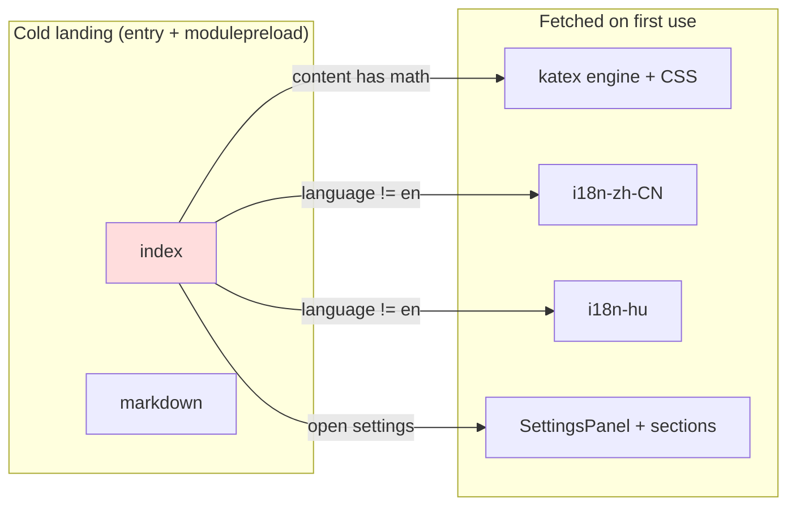

# Design — shrink the client entry chunk with three lazy islands

## Context

Measurement (local `vite build --sourcemap`, entry `index-*.js`, 3,167,941 B raw / 940,548 B gz). Per-source spans from the source map, grouped:

| Group | raw KB | standalone gz KB |
|---|---|---|
| client `lib/` (i18n 243 of 467) | 467 | 159 |
| client `components/settings` | 296 | 76 |
| `katex` | 254 | 75 |
| plugin packages (registry) | ~560 | ~170 → `lazy-plugin-claim-modules` |
| `yaml` | 96 | 30 (out of scope) |

`index.html` modulepreloads `react-vendor`, `markdown`, `util`, `jsdiff`, `dnd`. So moving katex into `markdown` (option A alone) only frees room under the cap; the first-load win needs on-demand loading (A+).



## Decisions

### D1 — Math engine module; detection stays static

New `lib/preview/math-engine.ts`:

```ts
export interface MathEngine { rehypeKatex: Pluggable; katex: typeof import("katex").default }
export function loadMathEngine(): Promise<MathEngine>   // memoized promise; imports katex, rehype-katex, "katex/dist/katex.min.css"
export function useMathEngine(needed: boolean): MathEngine | null  // useSyncExternalStore over the memoized state
```

- `MarkdownContent` computes `needed` with a cheap delimiter regex (`$`, `\(`, `\[`) on the pre-processed content; `remark-math` stays static (6 KB) so math nodes are parsed identically before and after load. Before load the hast `code.math-inline` / `math-display` nodes render as text — no throw, no layout jump beyond typesetting.
- Streaming safety unchanged: `throwOnError: false` is kept when `rehypeKatex` is inserted.
- `AsciiDocPreview` swaps `import("katex")` for `loadMathEngine()` → one shared chunk.
- `manualChunks` gains `"katex": ["katex", "rehype-katex"]` so Rollup cannot fold the engine into `markdown` or `index`. KaTeX CSS is imported inside the lazy module → emitted as its own CSS asset, removed from the entry stylesheet.
- A failed load resolves the hook to `null` permanently for the page (logged once); content stays literal.

Rejected: dropping `remark-math` from the static path too — then `$` text would render differently pre/post load (paragraph re-flow) and the delimiter regex would need to replicate micromark rules.

### D2 — Per-language catalog modules, awaited before first paint

- `i18n.tsx` keeps `en` (empty; fallbacks live at call sites) and `LEGACY_ALIASES` (needed synchronously for key resolution). `zhCN` moves verbatim to `i18n-zh-CN.ts` (`export const zhCNCatalog`).
- `loadCatalog(lang): Promise<void>` — memoized per language; `import("./i18n-hu.js")` / `import("./i18n-zh-CN.js")`; on success assigns `dictionaries[lang]` then merges buffered plugin blocks.
- `registerPluginCatalog` writes into loaded dictionaries immediately and **also** appends to a per-language pending buffer consumed by `loadCatalog`.
- `main.tsx`: `await loadCatalog(detectInitialLanguage())` (no-op for `en`) before `createRoot().render`. Cost: one extra round-trip before first paint for non-English users only; failure → English, logged.
- `I18nProvider.setLanguage(lang)`: `loadCatalog(lang).finally(() => setLanguageState(lang))` — the UI flips once, translated.

Rejected: rendering English then swapping (visible flash, rejected by spec scenario); a JSON fetch from the server (adds a server route and cache semantics for no gain over Vite's hashed chunk).

### D3 — `React.lazy` Settings panel

`const SettingsPanel = lazy(() => import("./components/settings/SettingsPanel.js").then(m => ({ default: m.SettingsPanel })))`, one `Suspense` boundary per call site (2 in `App.tsx`) with an in-panel spinner, wrapped in the existing `ErrorBoundary` primitive with a retry that clears the memoized import. Verified: only `App.tsx` imports `SettingsPanel.tsx`, so no static path pins it. `route-builders.ts` / `mobile-depth.ts` already own settings page-id/URL logic outside the panel module.

Settings sections shared with the always-on shell (e.g. `ThemeProvider`, possibly `ModelSelector`) stay in `index` automatically — Rollup keeps shared modules in the importer's chunk; only panel-exclusive code moves. The ~65 KB gz estimate is an upper bound; the measurement task records the real figure.

### D4 — `translationsOf` reads a build-time label table, not runtime dictionaries

`settings-promotions.ts` computes `RESERVED_SETTINGS_LABELS` at module init from `translationsOf(key)` over all dictionaries. With lazy catalogs that would silently drop `zh-CN`/`hu` values. Fix: `i18n.tsx` exports a small static `RESERVED_LABEL_TRANSLATIONS` table (only the `BUILT_IN_SETTINGS_LABELS` keys × `zh-CN`/`hu`), generated and verified by `i18n-parity.mjs` (`--check` fails on drift). `translationsOf` reads that table. Size: a few dozen strings.

Alternative considered: make the reserved set lazy/recomputed on load — rejected; it is a build-time collision rule, not a display concern, and must not depend on which language the current user happens to load.

### D5 — Guard and cap

`mdi-chunk-size.test.ts` already computes the landing graph. Add one `it` per subsystem asserting (a) no landing-graph chunk contains its marker and (b) some non-landing chunk does:

| Subsystem | Marker (survives minification) |
|---|---|
| katex | `"KaTeX parse error"` |
| `hu` | a long Hungarian-only catalog value (picked during apply, asserted unique) |
| `zh-CN` | a long zh-CN-only catalog value |
| Settings | a string literal only `SettingsPanel.tsx` contains (picked during apply) |

Plus: entry stylesheet contains no `.katex`. Cap: `INDEX_GZ_CAP_BYTES = ceil(measured / 10 KiB) * 10 KiB`, ≤ 800 KiB; comment records date + measured bytes.

## Risks / Trade-offs

- **[Non-English startup latency]** one extra chunk (~30 KB gz) before first paint → acceptable; it is hashed/immutable-cached after first visit.
- **[First math message re-renders]** typeset appears a moment after text → literal-source placeholder avoids errors; KaTeX chunk is cached afterwards.
- **[Plugin catalogs registered mid-load]** buffer + merge-on-load covers ordering; unit test both orders.
- **[Markers drift]** a catalog edit could remove the marker → test asserts the marker exists somewhere in the build (b), so drift fails loudly instead of passing vacuously.
- **[jsdom tests]** components that render `SettingsPanel` through `App` need `await findBy…` — update affected tests rather than eager-import in tests.

## Measurement protocol

Before/after on the same commit base: `npm run build`, then gzip size of `index-*.js` and total bytes of the landing graph (entry + modulepreload closure). Record both in the test comment and `tasks.md` 4.x. Landing-graph total must drop, not just the entry.
