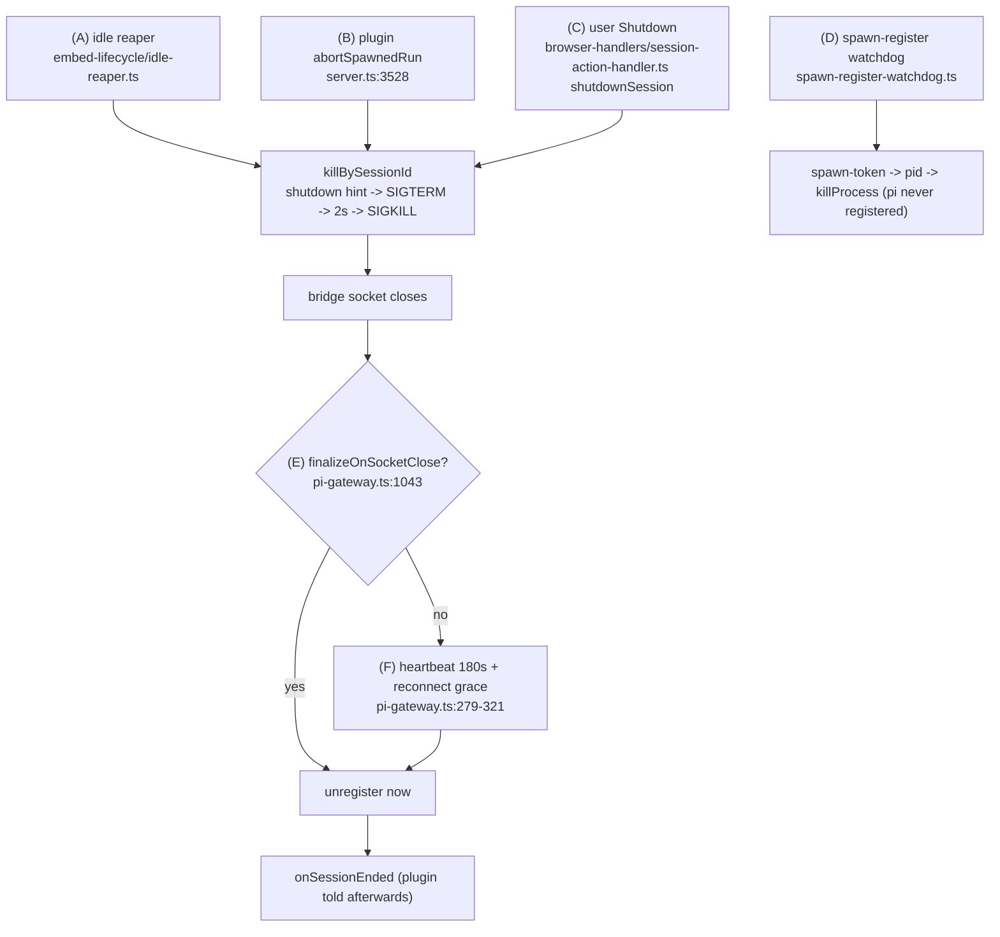

## Context

How a pi session ends today (every path traced in code):

- (A) `createIdleReaper` (`packages/server/src/embed-lifecycle/idle-reaper.ts:76`) sweeps on `sweepIntervalSeconds`. `sweepOnce` returns early when `config().enabled` is false and skips every non-`ephemeral` session. `decideReap` (`packages/server/src/embed-lifecycle/quiescence.ts:150`) vetoes on watcher + grace window, then gear 1 idle (vetoes: `currentTool`, pending ask, follow-up/steering queues, terminal in cwd, live child, idle age), gear 2 `stop-after-turn`, gear 3 phantom. `onReap` feeds metrics only (`packages/server/src/embed-lifecycle/embed-lifecycle-controller.ts:96`).
- Caps (`packages/server/src/embed-lifecycle/caps.ts`) are a shared-layer module; `server.ts` does not construct them live.
- Default config: `DEFAULT_EMBED_LIFECYCLE` (`packages/shared/src/config.ts`) `enabled:false`, `idleTimeoutSeconds:1800`, `graceWindowSeconds:30`, `hardCeilingSeconds:3600`, `sweepIntervalSeconds:60`.
- Wiring: `createEmbedLifecycleController` built at `packages/server/src/server.ts:2399`, started at `server.ts:4462`. Plugin server entries are loaded and awaited earlier in the same startup sequence (`server.ts:3252`), so a closer registered during plugin activation exists before the first sweep.
- Trust gate: control-plane plugin ctx members (`spawnSession`, `abortSpawnedRun`, …) are no-ops for plugins with `manifest.priority > 100` (`server.ts:3346`, `3504`, `3529`).
- Spawn lifecycle declaration: `PluginSessionLifecycle` (`packages/dashboard-plugin-runtime/src/server/server-context.ts:239`) = `recover`, `finalizeOnSocketClose`, `hidden`, `archiveOnEnd`. Keys handled in `packages/server/src/pending/pending-plugin-ref-registry.ts:36-60`; `CORE_RESERVED_REF_KEYS` (`:27`) stops a `pluginRef` body from setting lifecycle fields. Applied once at first register in `packages/server/src/event-wiring.ts:1695-1800` (`archiveOnEnd` persisted via `mergeSessionMeta`; `finalizeOnSocketClose` in-memory only; reattach never re-applies). Persisted fields round-trip via `packages/server/src/session/session-to-meta.ts`, `packages/server/src/session/session-scanner.ts`, `packages/server/src/session/memory-session-manager.ts:402`.
- Team: `sweepIdle` (`packages/team-plugin/src/server/conversations.ts:263-279`) on a 5-min `setInterval` (`conversations.ts:229`) ends any non-`streaming`, non-ended session whose `lastAgentEndAt` is older than `idleMinutes`, via `abortSpawnedRun({graceful:true})`. Team spawns declare `lifecycle: { recover:false, finalizeOnSocketClose:true }` (`conversations.ts:554`) and no `lifecyclePolicy`, so (A) never sees team sessions.
- Team app subscribes to its session over the browser WS (`packages/team-app/src/agent/chat-session.ts:63`), so the reaper's watcher veto sees a team user who has the conversation open.
- Spec constraint: `dashboard-plugin-loader` "Core lifecycle decisions read a generic flag, not the plugin name".

## Goals / Non-Goals

**Goals:**
- A plugin can opt its sessions into the quiescence reaper, choose the idle threshold and close mode, and veto an idle close.
- A plugin can request a safe close of its own session for its own domain events.
- Team user-bound sessions stop being ended while watched, blocked on a question, or mid-tool.
- Zero behavior change for any plugin or session that does not opt in.

**Non-Goals:**
- Closer on paths (B)–(F). (B) is the plugin's own decision. (C) is human intent and never vetoable. (D)/(E)/(F) concern a process that never registered or already disconnected: there is nothing to approve, and a veto would only leak it.
- Migrating automation (`reapStaleRuns`) or goal. They keep their timers.
- Changing `embedLifecycle` defaults, caps, or acquire.
- Changing team's explicit kill sites (persona delete, restart-to-apply, spawn-timeout cleanup). They stay `abortSpawnedRun`.

## Decisions

### D1 — Opt-in is a per-session declaration, not the global switch
`PluginSessionLifecycle.close?: { idle?: { afterMs: number }; mode?: "sleep" | "archive" }`.

Terms: a session is **declared** when it carries a `closePolicy`. It is **governed** (idle-reaped) when that policy has `idleAfterMs`. A mode-only block is declared (can use `requestSessionClose`) but not governed.

- **Validation** happens where the declaration is filed (`pendingPluginRefRegistry.file`, `packages/server/src/pending/pending-plugin-ref-registry.ts:200`, which knows the plugin id and spawn token but no session id yet). An invalid block is dropped with a warning naming the plugin id and spawn token.
- **Capture.** At first register, `event-wiring.ts` stores `closePolicy = { owner, idleAfterMs?, mode }` on the session and persists it (same path as `archiveOnEnd`). `owner` is the `ownerId` the pending registry already carries for the spawning plugin.
- **Forgery guard.** `"closePolicy"` is added to `CORE_RESERVED_REF_KEYS`, so a `pluginRef` body can never set or forge it.
- **Trust.** Enforced at the server ctx layer, not the registry: `spawnSession` is already a no-op for untrusted plugins (`priority > 100`, `server.ts:3380-3384`), so an untrusted plugin can never file a `close` declaration. `registerSessionCloser` and `requestSessionClose` get the same gate in `server.ts`.
- **Plugin identity.** `owner` is used only to route the closer callback and to authorize `requestSessionClose`, the same use as the existing owner-notify on register. Whether a session is governed, its threshold and its mode come only from the declared `closePolicy` fields. Core never branches on a specific plugin name and never reads `pluginRef`.
- **Reaper change.** `LifecycleSignals` gains `governed: boolean`, `idleTimeoutMs?: number` (per-session override) and `closeRequested: boolean`. `decideReap` treats `governed || isEphemeral || closeRequested` as in scope (else `skip("not-governed")`). The idle-age comparison uses `s.idleTimeoutMs ?? t.idleTimeoutMs`. `closeRequested` treats idle age as expired while every other veto stays, so it also works for a mode-only (declared, not governed) session. In `sweepOnce`, `if (!cfg.enabled) return` becomes: return early when `!cfg.enabled` AND no live session is governed or close-requested (keeps today's no-work path); otherwise a per-session filter `(cfg.enabled && isEphemeral(s)) || governed || closeRequested`.

*Rejected:* require `embedLifecycle.enabled`. The team fix would then depend on an operator flag that defaults off, and enabling it would also turn on reaping for every ephemeral session, a global behavior change.
*Rejected:* mark team sessions `ephemeral`. `ephemeral` also drives caps; it conflates "disposable" with "close when idle".

### D2 — Closer verdict is `"close" | "keep"`, reaper path only
`registerSessionCloser((req: { sessionId; cwd; reason: ReapReason; idleMs }) => "close" | "keep" | Promise<…>)`. Trusted plugins only, at most one per plugin (a second call replaces the first and is logged).

- The closer gets this minimal view, not the `DashboardSession`, so it never sees other plugins' `pluginRefs` or `principalOwner`.
- In `reapOne`, after `decideReap` returns `reap` for a governed session that is NOT close-requested, core calls the owner's closer with a 1 s bound. A close-requested session is never sent to the closer (D3: the plugin already decided).
- `"keep"` → skip this sweep; re-evaluated next sweep.
- Throw / timeout / unknown value → `"keep"` + warn + `closerFailures` counter.
- No closer registered → `"close"`.
- Ephemeral-only sessions never reach a closer.
- Each sweep has a 5 s total closer budget. Once it is spent, the remaining governed reap candidates are deferred to the next sweep, so slow closers cannot stall the sweep.

*Rejected:* richer verdict `{ abortTurnFirst, graceMs }`. The reaper only kills at rest (gear 1) or via `stop_after_turn` (gear 2); there is no turn to abort.
*Rejected:* fail-open (throw ⇒ close). A buggy plugin must not end a user's session; a stuck "keep" is visible in logs and metrics.

### D3 — `requestSessionClose({ sessionId, reason, when })`
- Trusted plugins only, and only for declared sessions whose `closePolicy.owner` is the calling plugin; otherwise returns `false` with no effect.
- `when:"now"` → shutdown hint + `killBySessionId` (same ladder as graceful `abortSpawnedRun`).
- `when:"idle"` → sets an in-memory `closeRequested` mark. The reaper then treats the session as idle-expired but keeps every other veto (watcher, grace, pending ask, queues, tool, child), and does not consult the closer: the plugin already decided.
- The mark is in-memory; a server restart drops it. The plugin may re-request.

### D4 — Close mode
- `sleep` (default) = today's kill: history kept, conversation resumable.
- `archive` = kill, then `archiveOnEnd = true`, so the existing archive sweeper (`packages/server/src/session/archive-sweeper.ts`) archives it after its grace window, subject to the existing `sessionList.archiveServiceSessionsOnEnd` gate.

### D5 — Caps
Caps reclaim never closes a declared session. Caps are not live-wired today; the exclusion is stated so a future wiring cannot bypass the closer.

### D6 — Team migration
- Spawn adds `close: { idle: { afterMs: idleMinutes*60_000 }, mode: "sleep" }` when `idleMinutes > 0`; nothing when `0` (idle ending disabled, as today).
- Remove `sweepIdle`, its interval and `sweepEveryMs`.
- Register a closer: `records.locate(sessionId)` (`packages/team-plugin/src/server/records.ts:147`) → conversation key → `"keep"` if that key is in the `inFlight` ensure map (`conversations.ts:162`), else `"close"`. This closes the reuse-vs-reap race.
- `restartConversation` stays an explicit `abortSpawnedRun` kill and is unaffected.
- `sweepIdle`'s multi-user owner check is no longer needed: the reaper acts on the session itself and never resolves a record across users.

### D7 — Observability
- One log line per closer verdict and per `requestSessionClose`: `sessionId`, owner, reason, verdict.
- `lifecycle-metrics` gains `closerKeeps`, `closerFailures`, `pluginCloseRequests`.
- Reap reasons stay `idle` / `stop-after-turn` / `phantom`; each reap record gains `declared: true` and the owner id when the session is governed, so it is distinguishable from ephemeral reaping.

## Risks / Trade-offs

- [A forgotten open browser tab keeps a team session alive indefinitely (watcher veto)] → Intended: "nobody watching" is a requirement of a safe close. Memory stays bounded by the per-user conversation limit.
- [Reaper loop with `enabled:false`] → Still returns early when no session is governed or close-requested; otherwise it filters undeclared sessions before any probe, so probe work is proportional to declared sessions only.
- [Idle anchor moves from team's `lastAgentEndAt` to core `lastActivityAt`] → Covered by the team spec delta. Restart survival comes from the persisted `closePolicy` plus restored `lastActivityAt` / `lastSettledAt`.
- [Plugin disabled while its sessions carry `closePolicy`] → Its closer is skipped at consult time (`isPluginEnabled` gate; the registry keeps it so re-enable needs no restart); no closer ⇒ `"close"` once every quiescence veto clears. Accepted: the declared policy still holds and the close is still lossless. Keeping them forever would leak a disabled plugin's sessions.
- [Reaper sweeps before the closer registers] → Not reachable at boot: plugin entries load (awaited) before the reaper starts (`server.ts:3252` vs `:4462`). The spec requires registration during plugin activation.
- [Closer adds up to 1 s per candidate] → Only for sessions already judged reapable, capped by the 5 s per-sweep budget.

## Migration Plan

Additive types; absent `closePolicy` ⇒ unchanged behavior; old `.meta.json` loads unchanged. The team change ships in the same release. Rollback = revert; persisted `closePolicy` fields are ignored by the old server.

## Open Questions

- None blocking. The exploration sketch's `close.on` (a declarative list of event names) is replaced by `requestSessionClose`: only the plugin observes its own domain events, so an imperative call is simpler than a declared list core cannot raise.
