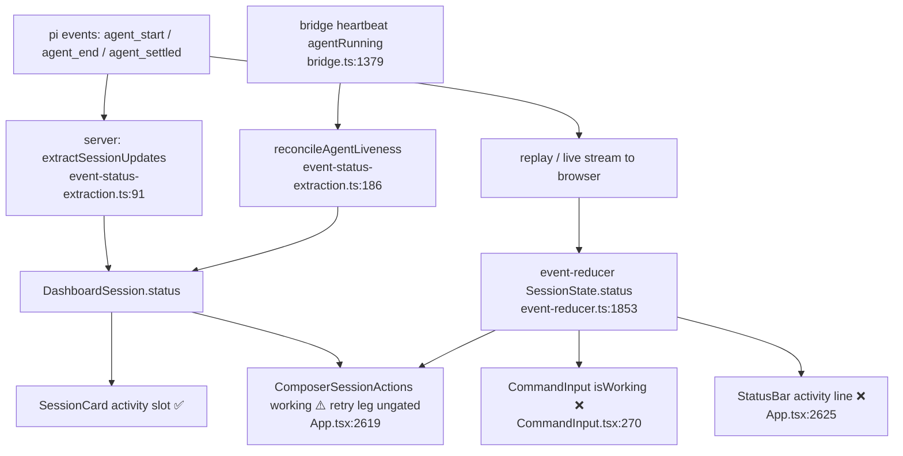

# Design — fix-composer-liveness-on-reload

## Context

Two independent liveness truths exist for one session, and the composer reads
the weaker one.

**Client (event-sourced).** `SessionState.status` is produced only by chat
events: seeded `"idle"` in `createInitialState()`
(`packages/client/src/lib/chat/event-reducer.ts:655`), set `"streaming"` on
`agent_start` (`event-reducer.ts:1853-1855`), `"ended"` on `agent_end`
(`event-reducer.ts:1878-1887`), `"idle"` on `agent_settled`
(`event-reducer.ts:1908-1916`). The composer reads it through one prop:
`sessionStatus={selectedState.status}` (`packages/client/src/App.tsx:2653`) →
`isWorking = sessionStatus === "streaming" || retrying === true`
(`packages/client/src/components/chat/CommandInput.tsx:270`). The same prop also
resets the Stop/Force-Stop machine (`CommandInput.tsx:319`), resets
stop-after-turn (`CommandInput.tsx:327`), and is handed to plugin composer
panels (`CommandInput.tsx:1285`).

**Server (event-sourced + reconciled).** `DashboardSession.status`
(`packages/shared/src/types.ts:58`, domain `active | idle | streaming | ended`)
is set from the same run-boundary events
(`packages/server/src/session/event-status-extraction.ts:91-95`) and is
additionally repaired against bridge-reported agent liveness by
`reconcileAgentLiveness` (`event-status-extraction.ts:186`), applied in
`packages/server/src/event-wiring.ts:1469-1491`. It does not depend on what a
browser replay happens to contain.

A browser reload does not re-trigger the bridge's mid-turn `agent_start`
re-assert — that fires on BRIDGE reconnect only
(`packages/extension/src/bridge.ts:1353-1356`). So after a reload the reducer
sees only replayed events; when the live run's `agent_start` is outside the
replay window the composer stays `idle` while the server still holds
`"streaming"`.

The divergence is already visible INSIDE the composer strip: the sibling
`ComposerSessionActions` mixes sources
(`App.tsx:2619`: `working={selectedSession.status === "streaming" || retrySessionIds.has(...)}`)
— server status for the streaming leg, but a reducer-derived, terminal-ungated
retry leg (`packages/client/src/lib/session/retry-projection.ts:31-33`) —
while `CommandInput` two elements lower is driven by the reducer only.



## Goals

- After a reload of a running session, the composer shows Stop/Force-Stop.
- Card and composer never disagree about "this session is running".
- The transcript keeps its event-sourced semantics (no fabricated streaming).

## Non-goals

- Repairing the replay window / per-session trim so `agent_start` survives
  (separate change, see issue #690 spike comment).
- Any server or protocol change.
- Changing `ChatView` turn rendering or `SessionState.isStreaming`.
- Adding a stop affordance to the mobile action menu. `mobileActions`
  (`App.tsx:2357-2367`) carries archive / resume / shutdown / prompt / refresh
  and has NO `onAbort` or `onForceKill` to re-point, so there is nothing for
  this change to reconcile there. Known gap, separate work.

## Decisions

### Human-approved decisions (C1–C3)

- **C1** — Keep the pending-prompt cancel (`pendingIdle`) on an ended session;
  `openspec/specs/optimistic-prompt/spec.md` "Cancel via Stop button" requires it.
  Realised by D6. Pinned by test-plan #E8.
- **C2** — Accept a ≤ 15 s missing Stop after a server restart mid-run (record
  re-seeded `active` until the next beat). Realised by D3 + Risks row "Server
  restart mid-run". Recovery pinned by test-plan #F5; no timing assertion on
  the window itself.
- **C3** — Include the `SessionCard` `working` fix
  (`packages/client/src/components/session/SessionCard.tsx:930`) in this change.
  Realised by D7. Pinned by test-plan #E13.

### D1 — The authoritative signal is `DashboardSession.status === "streaming"`, not `"active"`

The issue text suggests gating on `SessionSummary.status === "active"`. That is
wrong on two counts. There is no `SessionSummary` type for live sessions — the
entity is `DashboardSession` (`packages/shared/src/types.ts:161`;
`ArchivedSessionSummary` at `packages/shared/src/browser-protocol.ts:592` is the
archived-listing shape). And `"active"` is the routine resting state of a
registered session: the reconcile table treats `active` + `agentRunning:false`
as inert precisely because "correcting it would rewrite status on every beat of
every idle session" (`openspec/specs/event-status-extraction/spec.md`,
Requirement "Session status reconciled against reported agent liveness"). Gating
on `"active"` would show a Stop button on every connected idle session.

`"streaming"` is the only member that means "the agent is running", and it is
the member the heartbeat reconcile repairs in both directions
(`event-status-extraction.ts:186`).

Alternatives rejected:
- `lastRunStartedAt > lastSettledAt` (`types.ts`, the documented mid-run test):
  it is explicitly NOT persisted and NOT cold-start seeded, so it is blind
  exactly after a server restart; `status` already folds the same information.
- A new `isStreaming` / `agentRunning` field on `DashboardSession`: duplicates
  `status`, adds protocol surface and a second thing to keep reconciled.

### D2 — Fold at the App render site into ONE derived status, not a second prop on `CommandInput`

`CommandInput` reads `sessionStatus` at four places (`:270` isWorking, `:319`
stop-machine reset, `:327` stop-after-turn reset, `:1285` plugin slot). Adding a
second `serverStreaming` prop would force every one of them to re-derive the
OR, and any missed site drifts (e.g. Stop visible but the stop-state machine
resetting underneath it). Deriving once in `renderSessionDetail`
(`App.tsx:2316`, where both `selectedSession` and `selectedState` are already in
scope, `App.tsx:2324-2328`) keeps `CommandInput` single-source and leaves its
prop type `"idle" | "streaming" | "ended"` (`CommandInput.tsx:74`) unchanged, so
plugin composer panels inherit the fix for free. The "is working" gate built on
top of that status lives in the same module (D7).

The derivation lives in a pure, unit-testable helper in
`packages/client/src/lib/chat/` (sibling of `event-reducer.ts`), not inline in
JSX.

**Implementation hazard — a NEW local, never an in-place override.** The derived
value must be bound to its own `const` inside `renderSessionDetail`. It must NOT
be written back onto `selectedState` (e.g. `selectedState = {...selectedState,
status: derived}`), because the same object is handed to the transcript:
`<ChatView … state={selectedState} …>` (`App.tsx:2524`). Mutating it there would
feed the server-derived `"streaming"` into `turnActive` / message rendering and
fabricate exactly the transcript activity D2's rejected alternative avoids. A
task pins `ChatView`'s input as unchanged.

**Unknown server status.** `selectedSession` is `sessions.get(selectedId) ?? …`
(`App.tsx:2324-2326`) and is `undefined` before the connect snapshot populates
the map (and for the synthesized archived row, which never reaches the
composer). The selector takes `serverStatus: SessionStatus | undefined` and
returns the reducer status untouched when it is `undefined` — with no server
record, the reducer is the only source. Once a server record exists it is
authoritative in both directions (D3).

Alternative rejected — inject a synthetic `agent_start` into the reducer on
reconnect: `agent_start` also sets `isStreaming = true`, clears `streamingText`
and drops `pendingPrompt` (`event-reducer.ts:1853-1864`), which would fabricate
an empty streaming assistant bubble and destroy pending-prompt state. The
reducer must stay a function of real events.

### D3 — Precedence ladder: a KNOWN server status wins; the reducer is the fallback only when the server status is unknown

```
composerStatus =
  serverStatus === undefined              ? reducerStatus  // no server record yet
  : serverStatus === "ended"              ? "ended"        // terminal
  : serverStatus === "streaming"          ? "streaming"    // the backstop
  : /* serverStatus is "idle" | "active" */ "idle"         // server says not running
```

The server record is the authoritative liveness source once it exists: it is
written from the same run-boundary events the reducer sees
(`event-status-extraction.ts:91-95`), it survives browser replay gaps, and it is
the ONLY side repaired by `reconcileAgentLiveness`
(`event-status-extraction.ts:186`, applied at `event-wiring.ts:1469-1491`). A
ladder that let a reducer `"streaming"` beat a server `"idle"` (the cycle-1
draft) leaves a browser that missed an `agent_end` showing Stop FOREVER: the
heartbeat heal rewrites the server record, never the reducer. So reducer
`"streaming"` is overridden by server `"idle"` / `"active"` as well as by
server `"ended"`.

The reducer can be latched at `"streaming"` on a dead session: `agent_start`
sets `status: "streaming"` (`event-reducer.ts:1853-1855`) and only `agent_end` /
`agent_settled` leave it (`event-reducer.ts:1878-1887` → `"ended"`,
`event-reducer.ts:1908-1916` → `"idle"`). Server `"ended"` is written at the
terminal transition (`event-wiring.ts:690-700`, `:2106-2109`) and
`reconcileAgentLiveness` never leaves it (`event-status-extraction.ts:192`).

**`"active"` maps to `"idle"`.** `"active"` is the registered resting state
(`reconcileAgentLiveness` table, `event-status-extraction.ts:174-178`), so it
never means "running". It still beats a reducer `"streaming"`: a heartbeat with
`agentRunning:true` corrects `active → streaming` (`event-status-extraction.ts:193-195`),
so a genuinely running agent behind an `"active"` record is restored within one
beat (see Risks).

**Composer `"ended"` means terminal.** When the server status is known, the
reducer's INTERMEDIATE `"ended"` (set per attempt at `agent_end`,
`event-reducer.ts:1878-1887`, resolved at `agent_settled`) collapses to
`"idle"`, because server `idle` already says "between runs". The composer value
`"ended"` is therefore produced only by a server-terminal session (or, with no
server record, by the reducer passthrough). `CommandInput` uses that to gate its
`retrying` Stop leg — see D6.

**Full cell table** (reducer × server → composer status; Stop column assumes no
retry and no pending prompt):

| reducer \ server | (unknown) | `active` | `idle` | `streaming` | `ended` |
|---|---|---|---|---|---|
| `idle` | idle | idle | idle | **streaming** (Stop) | ended |
| `streaming` | streaming (Stop) | idle | idle | streaming (Stop) | ended |
| `ended` | ended | idle | idle | **streaming** (Stop) | ended |

With `retryState` set: Stop shows in every cell except the `ended` column (and
the unknown/`ended` cell), per D6.

**Broadcast ordering (verified, not assumed).** The server does NOT update the
browser's view of `status` before the event: in the live event path it
broadcasts the event (`event-wiring.ts:1129-1132`) and THEN applies + broadcasts
`session_updated` (`event-wiring.ts:1191-1197`), synchronously in the same
handler with no `await` between. So the browser receives `agent_start` /
`agent_end` one WS frame BEFORE the matching status update. Consequence for the
ladder: at a run start the composer turns to Stop on the `session_updated`
frame rather than on the `agent_start` frame; at a run end, Stop persists for
that one frame. Both frames are emitted back-to-back in one tick — accepted (see
Risks); no ordering change is made server-side.

**(reducer `"ended"`, server `"streaming"`) → Stop.** The server reads `idle`
between `agent_end` and the next run, so this pair means a NEW run the client
missed, where Stop is the correct control. A force-killed session ends up
server-`"ended"`, which the ladder resolves to `"ended"`, so "Killing state
clears on session end" holds; that requirement is carried as a MODIFIED delta so
the status it names is unambiguously the reconciled value.

### D4 — Continuous derivation, not a one-shot seed

Alternative rejected: seed `createInitialState()` (or the post-replay reset
sites) from `selectedSession.status`. A seed is a point-in-time copy: if the
session's `sessions` map entry arrives after the state is built (or the run
starts during the replay), the seed is already stale and nothing repairs it.
A derived value recomputes on every render from whichever source is currently
true, with no new state to keep in sync.

### D5 — Apply the derived status to `StatusBar` as well as `CommandInput`

`StatusBar` (`App.tsx:2625-2629`) sits directly above the composer and is fed
the same `selectedState.status`. Leaving it on the raw reducer status would keep
a visible contradiction one element above the Stop button ("idle" line + Stop
button). `currentTool` / `streamingText` stay reducer-sourced, so the bar
degrades to the generic "Thinking…" presentation when the client genuinely has
no tool detail — which is the truthful rendering of "running, details not
replayed".

The transcript (`ChatView` `turnActive={state.status === "streaming"}`,
`packages/client/src/components/chat/ChatView.tsx:1941`) is deliberately NOT
switched: it drives message rendering, and that must stay event-sourced.

The mobile info strip (`App.tsx:2389-2394`, rendered only when `isMobile`)
shows the same working label (`⚡ <tool>` / `Thinking...`) gated on
`selectedState.status === "streaming"`. It is a liveness presentation of the
same session one row above the transcript, so it is switched to the derived
value too (only its two `status === "streaming"` checks; `currentTool`, model,
cost stay reducer-sourced). Leaving it raw would break "card and composer agree"
on mobile, where it is the only working indicator above the transcript.

### D6 — Terminal gate on the retry Stop leg

`isWorking` is not only the status: `isWorking = sessionStatus === "streaming"
|| retrying === true` (`CommandInput.tsx:270`), and a second leg
`pendingIdle = pendingPrompt === "sending" && !isWorking`
(`CommandInput.tsx:793`) also renders the Stop glyph (`CommandInput.tsx:820`:
`(isWorking || pendingIdle) && canStop`). A force-killed session in retry sleep
keeps `retryState` (cleared only at `auto_retry_end` / `agent_start` /
`agent_settled`, `event-reducer.ts:489-492`), so the D3 ladder alone would
still show Stop on a server-`"ended"` session via `retrying`.

Decision: inside `CommandInput`, `sessionStatus === "ended"` (which, per D3,
means terminal) suppresses the `retrying` leg:

```
const terminal  = sessionStatus === "ended";
const isWorking = !terminal && (sessionStatus === "streaming" || retrying === true);
```

`pendingIdle` is deliberately NOT gated (approved, C1). Its click is the pending-prompt CANCEL
(`CommandInput.tsx:824-825` → `onCancelPending`), not a liveness claim, and
`openspec/specs/optimistic-prompt/spec.md` ("Cancel pending prompt" → "Cancel
via Stop button") requires that control whenever `pendingPrompt` exists;
gating it would strand a `sending` bubble with the input disabled on an ended
session until the safety timeout. Because `pendingIdle = … && !isWorking`, on a
terminal session it can only render the cancel action, never Force-Stop
(the Force-Stop / Killing branches at `:797` / `:809` require `isWorking`).
`canStop = !!(onAbort || onCancelPending)` (`CommandInput.tsx:794`) only
reports that a handler exists and is always AND-ed with `isWorking` /
`pendingIdle` at `:820`; it needs no gate. Keeping the gate in `CommandInput`
(rather than zeroing `retrying` in `App`) keeps D2's single prop as the only
liveness input.

The same gate applies to every other consumer of the retry leg — see D7.

Cost: with NO server record (unknown column) the reducer passthrough can yield
the intermediate `"ended"` between retry attempts, and the gate then hides
Stop for that attempt gap. The unknown column exists only before the first
connect snapshot; accepted (Risks).

### D7 — One working predicate for every composer control

The reconciled STATUS (D3) and the WORKING predicate are distinct values:
during a retry gap the status reads `idle` while the agent is still "working".
Every composer surface that gates on "the agent is working" uses one pure
predicate, exported from the D2 selector module next to the ladder:

```
isComposerWorking(composerStatus, retrying) =
  composerStatus === "streaming" || (retrying && composerStatus !== "ended")
```

Consumers:
- `CommandInput` `isWorking` (`CommandInput.tsx:270`) — Stop / Force-Stop (D6
  is this predicate inlined).
- Stop-after-turn VISIBILITY (`CommandInput.tsx:859`,
  `showStopAfterTurn = isWorking && …`): visible iff the predicate holds, so it
  appears and disappears with Stop — including a non-terminal retry, where the
  reconciled status reads `idle`. The optimistic PILL keeps its existing clear
  rule on the reconciled STATUS leaving `streaming` (`CommandInput.tsx:327`);
  the flow-controls delta states both.
- `ComposerSessionActions` `working` (`App.tsx:2619`), fed
  `isComposerWorking(composerStatus, retrySessionIds.has(id))`.
  `retrySessionIds.has(id)` and `CommandInput`'s `retrying`
  (`selectedState.retryState !== undefined`, `App.tsx:2654`) are the same
  reducer fact (`retry-projection.ts:31-33`). Today the retry leg is ungated:
  `retryState` survives a force-kill in retry sleep (cleared only at
  `auto_retry_end` / `agent_start` / `agent_settled`,
  `event-reducer.ts:489-492`), so the strip reads working (Archive / tasks /
  status group disabled) while Stop is hidden. The predicate closes that.
  The streaming leg is unchanged in effect: `ComposerSessionActions` renders
  only with a server record, where `composerStatus === "streaming"` iff
  server `streaming` (D3).

- `SessionCard` `working` (`packages/client/src/components/session/SessionCard.tsx:930`,
  `session.status === "streaming" || isRetrying === true`; in scope per C3) has the same
  ungated retry leg, and `openspec/specs/chat-view/spec.md` (Requirement
  "Composer is a unified container…") requires the card to apply the SAME
  working-state definition as the strip. It is fed
  `isComposerWorking(session.status, isRetrying === true)`. The predicate is
  typed over `SessionStatus` (the composer union is a subset), so the card
  passes its server status directly; `active` behaves like `idle`.

chat-view defines working as "`streaming` or auto-retrying a provider error".
That text is NOT modified: a session the server reports `ended` is not
auto-retrying — its `retryState` is a stale reducer remnant — so the gate
brings code in line with the existing wording rather than changing it.

`StatusBar` and the mobile info strip keep reading the reconciled STATUS (D5):
they present the run activity line, not the stop affordances, and never read
`retrying` today. Out of scope.

## Risks / Trade-offs

| Risk | Mitigation |
|---|---|
| Server status latched `"streaming"` after a lost `agent_end` → stale composer Stop | Pre-existing on the card and `ComposerSessionActions`. Healing is NOT reconnect-only: the bridge sends `session_heartbeat{agentRunning}` every `HEARTBEAT_INTERVAL = 15_000` ms (`packages/extension/src/bridge-handlers/lifecycle.ts:52`, sent at `:831-880`), plus one post-flush idle beat on reconnect (`bridge.ts:1379`); the server reconciles `streaming → idle` from it (`event-wiring.ts:1469-1491`). Worst case ≈ 15 s of stale Stop. Because D3 lets a known server status beat the reducer, the heal also clears a reducer latched at `"streaming"` (browser missed `agent_end`) — the cycle-1 ladder could not. |
| The heal never runs → stale Stop until the watchdog | Two real gaps: the server SKIPS the reconcile while the session is bridge-replaying (`event-wiring.ts:1469`, `!replayingSessions.has(sessionId)`), and a dead or disconnected bridge sends no beats at all. The second is bounded by the gateway heartbeat watchdog: `HEARTBEAT_TIMEOUT = 180_000` ms (`packages/server/src/pi/pi-gateway.ts:40`, used at `:205`; on expiry `sessionManager.unregister` at `:355-360`), after which the terminal transition broadcasts `status: "ended"` (`event-wiring.ts:690-700`) and D3 resolves `"ended"` → Stop disappears. Worst case ≈ 180 s of stale Stop on a silently dead bridge (same as the card today). Suppressing the backstop on a merely-disconnected bridge was rejected: it would hide Stop during exactly the WS churn this change exists to survive, and disagree with the card. **Spec/code drift (follow-up, not fixed here):** `openspec/specs/shared-protocol/spec.md` ("Heartbeat timeout", lines 29/41) states 45 s; code uses 180 s. |
| Stop shown while the transcript shows nothing in flight | Truthful: the agent IS running; the client merely lacks the replayed detail. The alternative (no Stop) is unrecoverable for the user. |
| `retrying` double-counts with server `"streaming"` | Both only ever widen `isWorking`; no interaction. Both are cut by the D6 terminal gate when the server says `"ended"`. |
| One-frame lag from broadcast ordering | The server broadcasts the event before `session_updated` (`event-wiring.ts:1129-1132` then `:1191-1197`, same sync handler). With a known server status winning, Stop appears on the `session_updated` frame after `agent_start` (not on `agent_start` itself) and lingers one frame after `agent_end`. Back-to-back frames in one tick; accepted. Reordering the server broadcast was rejected as out of scope (server change). |
| Server restart mid-run hides Stop until the first beat | After a restart the record can read `active` (re-seeded) while the agent runs; D3 maps `active` → `"idle"` even over a replayed reducer `"streaming"`, so Stop is hidden until the next beat flips `active → streaming` (`event-status-extraction.ts:193-195`), ≤ 15 s. This is a small regression vs reducer-only for that window, accepted (C2) as the price of making the server authoritative (the alternative — reducer wins over `active` — reintroduces an unhealable stale Stop, because `active` + `agentRunning:false` is inert by design). |
| Unknown server record + reducer intermediate `"ended"` + retry | D6 gate hides Stop for that retry gap. Window is pre-first-snapshot only. |
| Frozen / read-only archived panes | `readOnly` is computed at `App.tsx:2322` and gates the composer stack off at `App.tsx:2580` (session strip) and `App.tsx:2624` (`StatusBar` + `CommandInput`); archived sessions are not in the live `sessions` map, so the backstop is inert there. |
| A stale Stop click reaches an already-idle session | NOT a pure no-op, as the earlier draft claimed. The browser `abort` is forwarded to the bridge (`packages/server/src/server.ts:3506`), whose handler latches `AbortLatch.request(sessionId)` before calling `cachedCtx.abort()` (`packages/extension/src/bridge.ts:1459-1478`). The latch is cleared by the next user prompt (`noteUserPrompt`, pre-send) or a terminal `agent_end` (`packages/extension/src/abort-latch.ts.AGENTS.md`), so it cannot cancel the user's next turn — but it is extra state, not nothing. Accepted: the same click is already reachable from the card / `ComposerSessionActions` today. |
| Residual windows the backstop does NOT close | (a) A run whose `agent_start` the SERVER never received (bridge-side loss): server reads `idle` → no Stop until the next beat corrects the server (≤ 15 s). (b) A server restart (row above). (c) The transient `active → streaming` flip right after a (re-)register, which is a status correction, not a lost event (`event-wiring.ts:1480-1486`). All three are bounded by the same 15 s beat, and none is worse than today's reducer-only behaviour, which never recovers at all. Spec scenarios are written on states, never on these timings, so they stay deterministic. |

## Collateral surfaces (declared, not incidental)

The derived value replaces `selectedState.status` at `App.tsx:2653`, so every
consumer of the `sessionStatus` prop inherits it. Audited consumers:

| Consumer | Site | Effect of the reconciled value |
|---|---|---|
| Stop / Force-Stop visibility | `CommandInput.tsx:270` | The fix. |
| Stop-state machine reset | `CommandInput.tsx:319` | Resets only when the reconciled value leaves `"streaming"`, so a `Killing…` latch no longer clears while the session is still running. |
| Stop-after-turn pill reset + visibility | `CommandInput.tsx:327`, `:859` (`showStopAfterTurn = isWorking && …`) | Visibility = D7 working predicate (same as Stop, incl. non-terminal retry); pill clears on the reconciled status leaving `streaming`. Stop-after-turn becomes available on a reload-recovered run. Intended: the bridge-side flag is run-scoped and repeat requests are no-ops (`openspec/specs/flow-controls/spec.md`). Carried as a MODIFIED delta. |
| Plugin composer panels | `CommandInput.tsx:1285` → `packages/dashboard-plugin-runtime/src/slot-consumers.tsx:324-344` | The only shipped reader is grammar-check, which skips auto-check while `"streaming"` (`packages/grammar-plugin/src/useGrammarCheck.ts:171`). The skip now also applies to a reload-recovered run — correct, since the agent IS running. Carried as a MODIFIED delta. |
| Activity line above the composer | `App.tsx:2625-2629` (`StatusBar`) | D5. |
| Mobile info strip working label | `App.tsx:2389-2394` (two `selectedState.status === "streaming"` checks) | D5 — switched to the derived value; model / thinking level / cost / `currentTool` text stay reducer-sourced. |
| Retry Stop leg | `CommandInput.tsx:270` | D6 — suppressed when the composer status is `"ended"`. Pending-prompt cancel (`:793`) kept (optimistic-prompt spec). |
| Session-actions strip `working` | `App.tsx:2619` (`ComposerSessionActions`) | D7 — fed the shared working predicate; retry leg no longer reads working on a server-`ended` session. Streaming leg unchanged in effect. |
| Session card `working` | `SessionCard.tsx:930` | D7 — same predicate, keeping chat-view's "one working definition on both surfaces". Card dot / activity slot untouched. |

Not switched: `ChatView` (`App.tsx:2524`, keeps raw `selectedState`).

## Open Questions

- Should a composer Stop shown purely from the server backstop be visually
  distinguished (e.g. tooltip "state recovered from server")? Scoped out —
  extra UI for a transient condition.
