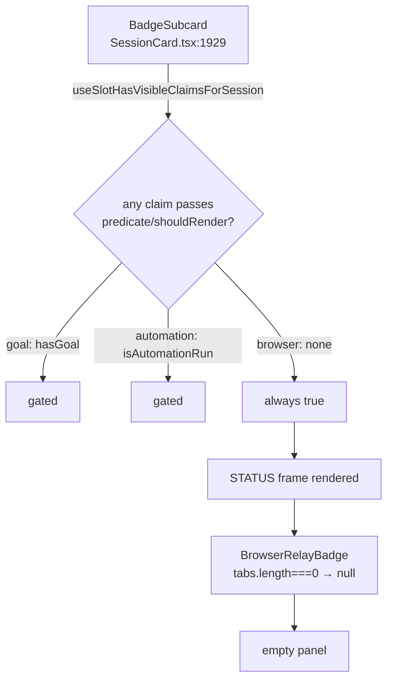

## Context

- **Gate scope.** The gate filters registry claims through `forSessionRendered` (`packages/dashboard-plugin-runtime/src/slot-registry.ts:239`). `SessionCardBadgeSlot` also renders intent contributions (`slot-consumers.tsx:196-224`). The gate ignores those.
- **Feed ownership.** `BrowserRelayBadge` is the only caller of `useRelayStatusFeed()` that is always mounted (`BrowserRelayBadge.tsx:34`). `BrowserPaneTab` and `BrowserTabLabel` call it only while a pane tab is open.
- **Relay store.** Relay status is held in a module store, `relay-store.ts`, and read through `useSyncExternalStore` (`relay-store.ts:44`). The store is never cleared. The REST seed runs once (deps `[]`) and only while the store is null (`relay-store.ts:65-83`).
- **No push on connect.** The server broadcasts `browser_relay_status` only when status changes. It does not send it on connect or subscribe (`packages/browser-plugin/src/server/status.ts:129-137`).
- **Runtime APIs available.** The plugin runtime offers the `usePluginMessage` hook (`plugin-context.tsx:460`) and `useShellConnectionStatus()` (`plugin-context.tsx:322`). There is no non-hook message API.
- **No suitable existing slot.** Every always-mounted slot is descriptor-only (`slot-types.ts:183-207`). `shell-overlay-route` and `command-route` render per route, so they are not always mounted.
- **App shell.** `App.tsx` builds the provider tree in `apiProvider(children)` (`App.tsx:3033`), which wraps the only `PluginContextProvider`. Three return branches call it (`App.tsx:3144,3162,3227`).
- **Second consumer: the composer.** The composer has its own STATUS group (`ComposerSessionActions.tsx:323,355,535`). It gates through `useSlotHasClaimsForSession`, without `isPluginVisible`. Its CSS fallback is `[data-group]:has(> [data-group-content]:empty)` (`index.css:1241-1247`), which does nothing in browsers that lack `:has()`.

## Goals / Non-Goals

**Goals:**
- No empty STATUS panel, on the card or in the composer, while there are zero relay tabs.
- The badge appears on idle cards as soon as a relay tab exists, including after a WS reconnect.
- A reusable, always-mounted host for plugin-wide hooks.
- A guard against un-gated first-party badge claims.

**Non-Goals:**
- Changing the badge's content, or whether it is scoped globally or per session.
- DOM-based empty detection.
- Counting intent contributions in the STATUS gate. An intent-only badge contribution stays hidden, as it is today.
- Making the composer honour the per-plugin visibility filter. That divergence already exists and is unchanged.
- Feeding relay status through session replay. Relay status is not a session event.
- Hardening `findRelayTab` (pane tab, label) and `BrowserSettings` reads against malformed frames. Those readers are unchanged.

## Decisions

### D1 — Gate via `shouldRender`, not DOM emptiness
`relay-store.ts` gains a single primitive, `relayTabsOf(status)`. It returns `[]` unless `instances` is an array, and it skips any instance whose `tabs` is not an array. `hasRelayTabs(status) := relayTabsOf(status).length > 0`. `BrowserRelayBadge` builds its menu from `relayTabsOf` and returns null when the result is empty. The gate and the component share one primitive, so a malformed payload cannot pass the gate and then throw inside the badge.

The client entry exports `hasRelayTabsForBadge = () => hasRelayTabs(getRelayStatus())`. The manifest's `session-card-badge` claim names it as `shouldRender`, following the named-export rule in `dashboard-plugin-loader`. The predicate ignores `session`, which keeps today's global behaviour.

*Rejected:* detecting emptiness in the DOM with CSS `:empty`/`:has()` or by measuring children.

### D2 — New `shell-headless` slot hosts the relay feed (user decision)
*Rejected alternatives:*
- A non-hook `onPluginMessage` API. It would be new API, and it would have no React lifecycle tied to plugin enable/disable.
- A feeder claim on `session-card-action-bar`. It would die whenever the action bar is hidden, and it only exists on desktop.
- Detecting emptiness in the DOM.

The `shell-headless` slot:
- It is react-only, multiplicity `many`, and left unclassified, so its predicate input is `never`.
- Predicates are still accepted by the type checker, because of method bivariance (see `dashboard-shell-slots` "Predicate-irrelevant slot maps to `never`"). They are never invoked, and plugins must not register one.

The `ShellHeadlessSlot` consumer:
- It calls `useSlotClaimsVersion()` and reads `registry.getClaims("shell-headless")`. Enabling or disabling a plugin at runtime (`usePluginEnabledSet` bumps the version) therefore mounts or unmounts its claim.
- It renders each claim through the existing `renderClaim` (`SlotErrorBoundary` + `Suspense` + `CurrentPluginLayer`), with no wrapper element and empty props.
- It does not render intent contributions.

The mount:
- `App.tsx` mounts it once inside the `apiProvider` body, as a sibling of `children`, inside `PluginContextProvider`.
- So it is mounted on every return branch, at the same tree position.

The browser plugin's claim:
- `BrowserRelayFeed` is the browser plugin's claim. It calls `useRelayStatusFeed()` and renders `null`.
- `BrowserRelayFeed` becomes the **sole** caller of `useRelayStatusFeed()`. `BrowserPaneTab` and `BrowserTabLabel` drop their calls and only read `useRelayStatus()`, because the always-mounted feed covers them. That avoids N parallel re-seeds and N duplicate `setRelayStatus` calls per frame.
- `manifest-validator.ts` rejects `predicate`/`shouldRender` on a `shell-headless` claim. That turns the "never invoked" convention into an enforced rule, which bivariance alone cannot do.
- The stale "registering a predicate is a type error" comments in `slot-types.ts` and in the `ClaimEntry.predicate` doc in `slot-registry.ts` are corrected to describe bivariance.

### D3 — Invalidate gates on tab-count flips only
`setRelayStatus(next)` does the following:
1. Compute `was = hasRelayTabs(current)`.
2. Assign `current = next`.
3. If `was !== hasRelayTabs(next)`, call `bumpSlotClaimsVersion()`.
4. Notify the store listeners.

The gate is bumped before the badge's store notify. When both fire in one unbatched task, an intermediate render can therefore only show the panel without the badge on a 1→0 flip, or the badge appearing slightly early on a 0→1 flip. React 18 automatic batching normally merges the two notifications, and any brief transient is accepted.

`__resetRelayStoreForTests` also bumps.

Blast radius: each bump re-renders every `useSlotClaimsVersion` consumer (`ChatView.tsx:999`, `CustomEntryRow.tsx:79`, `SplitWorkspaceContext.tsx:274`, all slot gates). That includes one ChatView re-render. It happens only on a 0↔1 flip. A relay tab that flaps open and closed will toggle the STATUS panel visibly, and re-render the chat once per flip. That is accepted; a debounce is a possible follow-up if flapping is reported.

`browser-plugin/vitest.config.ts` gains an alias for `@blackbelt-technology/dashboard-plugin-runtime`. The store and the gate must share one invalidation module instance (`slot-claims-invalidation.ts:14-17`).

### D4 — Contract test for badge claims
An L1 test goes over the generated registry's `session-card-badge` claims and asserts that each one has a `predicate` or `shouldRender`. Its named allow-list starts empty.

Coverage:
- It covers first-party registry claims only. Neither intent contributions nor third-party runtime claims are enforced. The manifest validator only type-checks the field.
- Registry skew (a manifest edited without regenerating the registry) is covered by `registry-hash-parity.test.ts`. The hash serialises `shouldRender` (`loader.ts:252-264`).

### D5 — Snapshot freshness across reconnect
The server does not push status on connect (see Context). `BrowserRelayFeed` reads `useShellConnectionStatus()`. The seed effect is keyed on the connection status, so it also fires on mount, including a re-mount after the plugin is re-enabled while the shell is already connected.

Whenever the status is `"connected"`, the effect re-seeds from `GET /api/browser/profiles` unconditionally:
- The `getRelayStatus() !== null` guard and the run-once deps are removed.
- The seed goes through `setRelayStatus`, so D3's flip bump applies.
- If the seed fails, the store is set to `null`, which hides the badge. A pre-disconnect snapshot therefore never survives a failed refresh. Hiding a live badge until the next push is preferred over showing a stale one.
- `BrowserRelayFeed` unmounting (the plugin is disabled) also clears the store to `null`.

A live push that arrives during the fetch wins. The seed result is dropped if a newer WS snapshot landed after the fetch began, tracked with a sequence counter in the store.

## Risks / Trade-offs

- **The new public slot is permanent within a major version.** Mitigations:
  - Keep it minimal: no props, and predicates are never invoked.
  - Add a CHANGELOG `Unreleased` entry. `release-cut` bumps the workspace versions together.
  - Document it in `docs/` through DocScribe.
- **A crash in a headless claim could take down every layout.** Mitigation: the per-claim `SlotErrorBoundary`, plus a test for it.
- **The composer STATUS group now hides when there are zero tabs.** This is intended. It matches `chat-view` "Empty Status group leaves no label", and it is pinned by a scenario in the `session-card-subcards` delta.
- **The STATUS rule is ADDED, not a MODIFY of "Subcards hide when their content is empty".** That keeps this change from re-asserting the FLOWS/WORKSPACE text, which conflicts with the `flows-plugin` spec and refers to a removed subcard. The overlap is accepted, and the canonical requirement is a candidate for a separate cleanup.
- **The badge guard is weaker than full matching.** D4 checks only that a gate is present. The "condition matches render" property is verified per claim only for the browser claim, by an agreement test. Goal and automation keep their existing tests.
- **Before `/api/health` resolves, every claim is active** (`slot-registry.ts:160,168`). So `BrowserRelayFeed` may fetch profiles at boot even when the plugin is disabled. The badge already did this before. Accepted.

## Open Questions

- Should the relay badge be per-session instead of global? It could show only on cards whose session owns the relay tab group, per `browser-relay` "Per-session isolation via tab groups". This could be a follow-up change.
