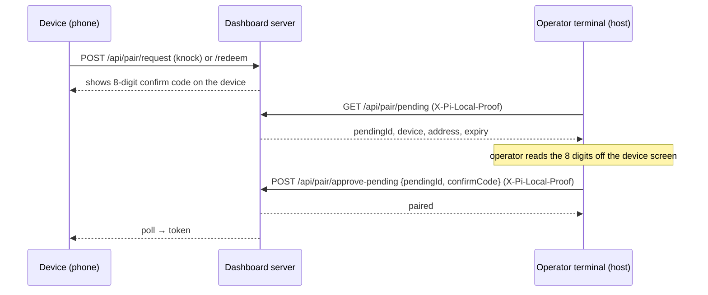
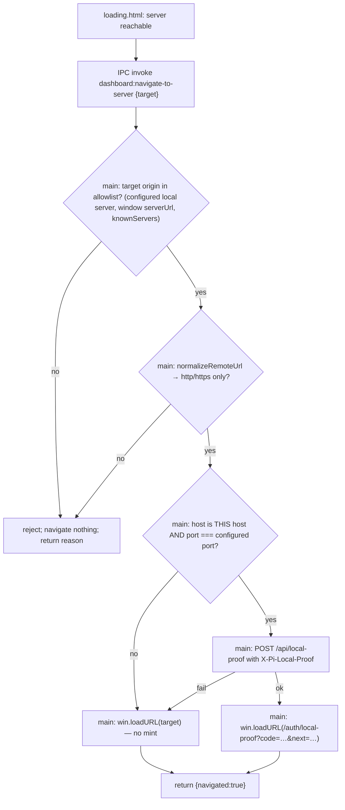

# Design — fix-pairing-approval-credential

## Context

### What the code actually does today

| Route | Guard | Bare-loopback tab (no proof) |
|---|---|---|
| `GET /api/pair/pending` | `operatorGuard` (`packages/server/src/routes/pairing-routes.ts:398`) | **admitted** — `isLocallyTrusted` branch, `pairing-routes.ts:121` |
| `POST /api/pair/deny` | `operatorGuard` (`pairing-routes.ts:434`) — moves to `approvalGuard` in this change (D11) | **admitted** today (violates main spec "Operator can deny…"); **401** after |
| `POST /api/pair/approve` | `approvalGuard` (`pairing-routes.ts:350`) | **401** |
| `POST /api/pair/approve-pending` | `approvalGuard` (`pairing-routes.ts:405`) | **401** |

`createOperatorGuard` is defined at `pairing-routes.ts:100`, `createApprovalGuard` at `pairing-routes.ts:142`. `createApprovalGuard` admits `via === "session" || hasLocalProof(headers, proofCtx)` (`pairing-routes.ts:155`). `hasLocalProof` is `hasLocalCredential(headers) || verifyLocalProofCookie(...)` (`packages/server/src/auth/local-proof.ts:73`) — i.e. a verified `X-Pi-Local-Proof` header passes **without** the cookie. This is the hinge of the whole design: **a host-side process that can read the 0600 local token can already approve, today, with no server change.**

The dead end is therefore a *client* dead end, not a server one. The dialog is raised on a tab that can list and deny but not approve, and `nextFromOutcome` (`packages/client/src/components/pairing-approval/PairingApprovalDialog.tsx:93`) turns the 401 into a sentence of prose because the body carries nothing else.

### Verified against the issue's audit table

- **"Electron, server not yet up"** — confirmed. `createMainWindow` calls `loadWithLocalProof` (`packages/electron/src/main.ts:569`); on failure `mintLocalProofUrl` returns `null` (`packages/electron/src/lib/local-proof-bootstrap.ts:68`) and the window loads the plain URL. The loading page then hands off with `location.href = serverUrl` (`packages/electron/resources/loading.html:154`) — a bare navigation, no proof.
- **"known servers picker"** — confirmed, `loading.html:97` (`location.href = "http://" + s.host + ":" + s.port`). For a *remote* known server this is correct and must stay proofless: `localDialUrl` returns `null` for a non-local host (`local-proof-bootstrap.ts:56`), which is the invariant to preserve.
- **"tunnel host / `*.ts.net`"** — confirmed. The cookie is set for the origin that redeemed the code, host-only (`reply.setCookie` with no `domain`, `local-proof-routes.ts:41-46`); `cmdOpen` always builds `http://localhost:<port>` (`packages/server/src/cli.ts:942`). **A `localhost` cookie is therefore not sent to a `127.0.0.1`, LAN or tunnel origin** — cookie host matching is by exact host string, and `localhost` ≠ `127.0.0.1`. This bounds the `authorize-browser` remedy; see D7.
- **"only `pi-dashboard open` and Electron mint the code"** — confirmed; `POST /api/local-proof` requires `hasLocalCredential` (`packages/server/src/routes/local-proof-routes.ts:28`).
- **Correction to the issue text:** the credential is no longer the raw `X-Pi-Local-Token`. Since `loopback-credential-proof`, callers send an endpoint-bound `X-Pi-Local-Proof` (`packages/server/src/auth/local-credential.ts:1-20`); the raw token is accepted only while `acceptLegacyToken` is on, and the active change `close-loopback-legacy-window` will turn that off. Anything new must mint a proof per request via `httpProofHeaders`, never send the raw token.
- **Correction to the issue text:** `pi-dashboard login --local` already exists (`cli.ts:839`) and yields an operator session that passes the approval guard — but only when identity is enforced, so it is not a general answer.

### CLI surface that exists today

`SUBCOMMANDS = ["start","stop","restart","status","runtime","open"]` (`cli.ts:90`), plus `token`, `service` and `login` dispatched before the switch (`cli.ts:1131`, `:1136`, `:1159`). The per-request credential helper is `localCredentialHeaders` (`cli.ts:895`); it defaults its token argument to `safeEnsureLocalToken()` (`cli.ts:977`), which calls `ensureLocalToken` (`packages/server/src/auth/local-token.ts:39-61`) — a function that **creates** the 0700 dir and **mints** a 0600 token file when absent. See D9. **There is no `pair` subcommand.** Proposing one is new surface; proposing `pi-dashboard open --approve` would not be, but see D3.

## Goals

1. Every supported OS/setup in the issue's table has a working, documented way to approve while the 4-minute request is still alive.
2. The dialog tells the operator exactly what to do and lets them retry in place.
3. `createApprovalGuard` admits exactly the same callers after this change as before.
4. `POST /api/pair/deny` admits exactly the callers `createApprovalGuard` admits (D11) — restoring the existing main-spec rule.

## Non-goals

As listed in the proposal: no in-dialog self-minting, no custom URL scheme, no admission change other than deny (D11), no Windows ACL work, no new QA harness.

## Decisions

### D1 — Keep the approval guard exactly as it is; move the fix to the client and the host

**Decision.** `createApprovalGuard` keeps `session || proof-cookie || verified-local-credential`. Only its 401 *body* changes.

**Alternatives rejected.**
- *Issue option A — "Authorize this browser" mints a code from a genuinely-local request.* Rejected. D6 removed the bare-loopback branch precisely because bare loopback is indistinguishable from a marker-less relay (`packages/server/src/auth/local-proof.ts:3-8`), and because the approving code runs **inside the browser**, which is the untrusted party: a DNS-rebinding page is same-origin with the dashboard and its GETs carry no `Origin` (`packages/server/src/auth/host-admission.ts:4-7`). Host admission in enforce mode narrows but does not close that: a rebound name resolving to `127.0.0.1` is an IP-literal-free `Host` the operator may have added to `allowedHosts`. SameSite+CSRF tokens do not help, because the attacker page would be driving a *first-party* flow, not a cross-site one. Net: option A converts "can read a 0600 file" into "can run JS in a local browser tab" — a strictly weaker bar.
- *Add a bare-loopback branch only when `requireLocalProof` is false.* Rejected: the `qr-device-pairing` spec states approval honors no loopback exemption **in any mode, regardless of `requireLocalProof`**, and the whole point of D6 was that this route is the one place where the loopback heuristic is not good enough.

### D2 — The universal path is a host-side CLI approval, not a browser flow

**Decision.** `pi-dashboard pair list | approve | deny`, using the existing routes with `localCredentialHeaders(method, url)` (`cli.ts:895`).

**Why this and not more browser plumbing.** It is the only option that covers the whole audit table at once — headless Linux over SSH, Docker (`docker exec … pi-dashboard pair approve`), WSL, a tunnel-origin tab, `127.0.0.1` vs `localhost`, and the `--dev` Vite port — because it does not involve a browser origin at all. It needs **zero** new routes and **zero** guard changes (D1's hinge), so its blast radius is the CLI process.

**It preserves the D12 compare-code invariant.** The operator still types the 8 digits shown on the device; the CLI never learns them from the server (`GET /api/pair/pending` returns no code — `packages/client/src/lib/pairing/pairing-approval-api.ts:19`, "never a code"), and the attempt budget is enforced server-side per pending device and is already specified as "shared by every approval entry point".

**Alternatives rejected.**
- *`pi-dashboard open --approve` that opens a proofed tab.* This is a strictly smaller subset of what `pi-dashboard open` + the app-wide dialog already do (the proofed tab raises the dialog by itself on `pair_pending_changed`), and it still requires a desktop browser — so it answers none of the headless/Docker/WSL rows.
- *Electron native approve prompt (issue option B).* Only covers the desktop-app row, which D4 fixes anyway, and adds a second code-entry UI to keep in sync with the dialog spec.
- *`pi-dashboard://approve?id=` deep link (issue option B).* An OS-registered scheme is invocable by any local app **and by web content**, so it would be a second approval entry point with a *weaker* precondition than reading the 0600 token. Rejected on threat-model grounds.

### D3 — `pair` is a new subcommand family, dispatched like `token`/`service`/`login`

**Decision.** Add `pair` to the pre-switch dispatch block in `main()` (`cli.ts:1131-1163`), not to `SUBCOMMANDS`, matching how every other verb-with-subverbs is already handled. Verbs: `list`, `approve <pendingId>`, `deny <pendingId>`. `--json` on `list` for scripting, consistent with `cmdService`.

**Confirm-code input.** `approve` prompts for the code on stdin by default. `--code <digits>` exists for scripting and is documented as argv-visible. Rationale in the threat model below.

**Code shape (P2).** Spaces and dashes are stripped; anything that is not then exactly 8 decimal digits is refused locally with exit `2` "expected 8 digits" and nothing is sent — a typo never spends one of the 5 shared attempts. Mirrors the dialog's "Enter all 8 digits".

**Non-TTY stdin (P3).** Without `--code` and with a non-terminal stdin (pipe, `docker exec` without `-t`), the CLI reads the first line of stdin as the code. EOF or an empty first line → exit `2`, nothing sent. Pipes are not refused: scripted `echo 12345678 | pi-dashboard pair approve` keeps the code out of argv and `ps`.

**Exit status (P1).** Grouped by class, each outcome with its own message:

| Exit | Class | Outcomes |
|---|---|---|
| `2` | usage / input | unknown verb or option, bad `--tier`, malformed code, empty stdin, zero or several pending with no id |
| `1` | local credential / config | token absent or unreadable, host-name `config.host` (no proof derivable) |
| `3` | server refused | `mismatch` (prints attempts left), `locked_out`, `expired`, `no_pending`, HTTP 401 |
| `4` | server unreachable | connection refused, no answer within the existing 5 s CLI fetch timeout |

**Tier.** `--tier observe|control|operate` is forwarded for knock-provenance entries (the route already accepts `tier`, `pairing-routes.ts:426`); omitted ⇒ server default, exactly like the dialog.

### D4 — Main navigates; the renderer never receives the bootstrap URL

**Decision.** The loading page stops assigning `location.href` for dashboard handoffs. It invokes **one new IPC channel, `dashboard:navigate-to-server`**, with the target it wants; the **main process performs the navigation itself** (`mainWindow.loadURL`, the same call `loadWithLocalProof` already makes, `local-proof-bootstrap.ts:97-105`) and returns only an acknowledgement (`{ navigated: true }` / `{ navigated: false, reason }`). **No URL carrying a `code=` is ever returned to the renderer.**

**Why returning the URL to the renderer is not acceptable.** `mintLocalProofUrl` (`local-proof-bootstrap.ts:68-91`) resolves to a *string containing the single-use code*. Handing that string back over IPC puts a live operator credential in the untrusted renderer and turns the IPC channel into a mint oracle: any script running in the loading page could call it in a loop and harvest proof cookies. That directly contradicts the `electron-shell` requirement "the renderer SHALL NOT receive the local credential itself". Keeping `loadURL` in main makes the renderer's only power "ask to go to server X" — a navigation request, not a credential request.

**Sender gate first — the channel is reachable from remote content.** The main window's preload is `preload-main.ts` (`getMainPreloadPath`, `main.ts:413-422`; attached at `main.ts:544`), NOT the wizard preload `preload.ts`. Its own header says it is attached while the window shows *untrusted remote content* in remote mode (`packages/electron/src/preload-main.ts:1-8`), so every member it exposes — including the new `navigateToServer` — is callable by a remote dashboard page. The handler is therefore registered as `trustedHandler("dashboard:navigate-to-server", isTrustedSender, …, logRejectedSender)`, exactly like `dashboard:request-launch` / `read-server-log` / `probe-server` (`main.ts:458-492`). `isTrustedSender` (`main.ts:443-448`) delegates to `isTrustedSenderUrl` (`packages/electron/src/lib/ipc-trust.ts:27-47`), which admits only the packaged `loading.html` file and an `http:` loopback origin on the **configured** port. A call from any other sender frame (remote/tunnel origin, LAN host, another local port) throws `UntrustedSenderError` (`ipc-trust.ts:64-80`) before any check below runs: **no navigation, no mint**. It must NOT follow the ungated `dashboard:check-app-update` precedent (`main.ts:474-475`) — that one carries no data and mints nothing; this one does.

**Target validation in main, four checks, in order (after the sender gate).**
0. **Target allowlist** — the sender gate admits the local dashboard origin too (`ipc-trust.ts:43-45`), and `loadURL` from main bypasses `will-navigate`/`decideWillNavigate` (`main.ts:555-565`), so without this check a dashboard-origin page could use the channel to replace the dashboard with an external site, contradicting main `electron-shell` "External links open in the system browser" (`openspec/specs/electron-shell/spec.md:192-200`, "SHALL never allow an external URL to (a) replace the dashboard"). The normalised target's **origin** must equal one of: the configured local server (`localhost`/`127.0.0.1`/`[::1]` on `loadMinimalConfig().port`), the `serverUrl` the main window was created with (`createMainWindow(serverUrl)` — the `remoteUrl` in remote mode, `main.ts:704-710`), or an `http://<host>:<port>` entry of `config.knownServers` (the same list main hands the loading page, `main.ts:519-522`). Anything else is refused — no navigation, no `openExternal`, `{ navigated:false, reason:"target-not-allowed" }`. Refusal (not `shell.openExternal`) — human-approved as P6 — because no legitimate caller sends one: the three loading-page call sites only ever name these targets.
1. **Scheme allowlist** — the target is normalised with the existing `normalizeRemoteUrl` (`packages/electron/src/lib/remote-probe.ts:22-27`, which already forces an `http://`/`https://` prefix) and then re-parsed; a target whose protocol is not `http:` or `https:` is refused outright (no navigation). This closes `file:`, `javascript:`, `data:` and custom schemes that the "navigate to the target unchanged" branch would otherwise honour.
2. **Host** — `localDialUrl` (`local-proof-bootstrap.ts:56-65`) decides locality; a non-local host is navigated to unchanged and mints nothing.
3. **Port** — `localDialUrl` keeps the *renderer-supplied* port (`u.port`, `:61`), so a tampered query string could aim a mint at `http://127.0.0.1:<attacker-port>` and deliver an `X-Pi-Local-Proof` header to a local listener. Main therefore pins the mint target to the **configured** `host`+`port` (`loadMinimalConfig()`, already read at `main.ts:340`/`:569`): a local target on any other port is navigated to unchanged and mints nothing. (The proof is endpoint-bound — address literal + method + target — so a leaked one is not replayable against the real port, but the mint must not be aimable at all.)

**What the move past `will-navigate` costs.** Today the loading page's `location.href` assignments are renderer-initiated, so they pass through the `will-navigate` listener and `decideWillNavigate` (`main.ts:555-565`). `webContents.loadURL` from main does not fire `will-navigate`, so routing these three navigations through main removes them from that classifier. That is acceptable only because the new handler performs a *stricter* check on the same input (target allowlist, scheme allowlist, then host, then port) before it navigates — the classifier's job for these targets was allow/cancel/open-external on a renderer-chosen URL, which the handler now decides explicitly. `decideWillNavigate` itself is untouched and still guards every navigation originating inside the loaded dashboard. Implementation must not silently drop the check: the handler is the replacement, and tasks 5.1 and 5.6 test it.

**Channel naming.** `dashboard:navigate-to-server`, matching the `dashboard:` prefix every existing loading-page channel uses (`registerPiDashboardIpc`, `main.ts:458-492`) and the `electron-shell` requirement "All channels SHALL be prefixed `dashboard:`".

**Alternative rejected.** Intercept `will-navigate` and rewrite the URL. Rejected: `decideWillNavigate` (`main.ts:557`) is a pure, unit-tested classifier whose contract is allow/cancel/open-external; turning it into a URL *rewriter* that also performs async I/O would break both its purity and the navigation it is guarding.

### D5 — The 401 body gains `reason` + `remedies`, reusing the operate-required vocabulary and disclosure rule

**Decision.** `{ success:false, error:"operator credential required", reason, remedies }`.

- `reason`: `"device-credential"` when the caller presented a paired-device bearer (`authVia === "device"`, refused first at `pairing-routes.ts:150`), else `"no-credential"`.
- `remedies` — ordered, duplicate-free, empty when `reason` is `device-credential`:
  1. `authorize-browser` — present iff the request is genuinely local, has no proof, AND its `Host` header passes the launcher origin rule (D7, `isLauncherOrigin`). "Run `pi-dashboard open`."
  2. `approve-on-host` — always present for `no-credential`. "Run `pi-dashboard pair approve <id>` on the host."
  3. `sign-in` — present iff a usable login method is configured, reusing the `loginAvailable` thunk already composed in `server.ts:2069` from `buildLoginAvailable` (`packages/server/src/auth/auth-plugin.ts:211`) and already passed to the vault and services routes (`server.ts:2471`, `:2480`).

**Which "local" the `authorize-browser` remedy tests.** `isLocallyTrusted({ip, headers})` called **without** a `LocalTrustContext` — exactly `isGenuinelyLocal`, i.e. loopback peer and no proxy-forwarding header (`packages/server/src/auth/localhost-guard.ts:80-97`). Passing the strict context would be circular: under `requireLocalProof` the predicate *also* requires the very proof whose absence caused the refusal, so the remedy that says "go get a proof" would never be offered to the caller who needs it. This is the same call shape `operate-required.ts:75` already uses for its `use-host` remedy, with the rationale recorded there (E18). The remedy is therefore a **transport-local** test, identical in both modes.

**Failure isolation and ordering.**
- The refusal body is best-effort. If the `loginAvailable` thunk throws or is absent, the `sign-in` remedy is omitted and the 401 is still sent — computing a remedy SHALL NOT turn a 401 into a 500. The helper wraps the thunk in `try/catch`.
- **Correction — host admission is NOT guaranteed to run first.** Two host checks exist: the global `onRequest` host gate (`packages/server/src/server.ts:1903`, `createHostGate` at `packages/server/src/auth/host-gate.ts:359-380`), which defaults to `enforce` but can be switched to `report` (log-and-proceed) by `PI_DASHBOARD_HOST_GATE=report` or `hostGate.mode` (`openspec/specs/host-admission/spec.md:132-145`; the "Report-only default" comment at `server.ts:1900-1902` is stale); and the approval guard's own `isHostAdmitted(request.headers.host, deps.hostAdmission())` in enforce semantics — which runs **after** the credential check (`packages/server/src/routes/pairing-routes.ts:148-165`: 401 at `:156-158`, host 403 at `:160-163`). So in `report` mode a non-admitted Host without a credential reaches the 401 today.
- **Decision (no guard reorder — admission semantics are a non-goal):** the remedy builder takes `hostAdmitted = isHostAdmitted(request.headers.host, deps.hostAdmission())` — the SAME predicate and options the guard already evaluates at `:160`. When `false`, the guard sends today's body unchanged: exactly `{ success:false, error:"operator credential required" }` — **no `reason`, no `remedies`**. Status code (401) and the admit/refuse decision are unchanged in every mode; only whether the new keys are attached depends on Host admission. Result: `enforce` → global gate 403 (`hostGateRefusalBody`), remedy builder never runs; `report` → 401 legacy two-key body. Either way a non-admitted Host learns nothing new about login-method existence or its own position.

**`error` keeps its exact string** so the existing client branch (`PairingApprovalDialog.tsx:102`) and its tests keep matching, and so an older client degrades to today's prose.

**No `message` key.** `operate-required` ships fixed English `message` strings because its callouts render server copy; the pairing dialog is fully i18n'd (`i18nT` throughout `PairingApprovalDialog.tsx`), so a server-side English sentence would be dead weight and a second source of truth for copy.

**Why a separate vocabulary rather than extending `operate-required-remedy`.** That capability is a 403 `operate_required` contract for the vault and services route families with an explicit "exactly five keys" disclosure requirement, and `add-request-access-remedy` is already queued to modify it. Overloading it would couple two in-flight changes for no gain. The value *names* are deliberately shared so the client can grow one renderer later.

**Disclosure.** The body discloses (a) whether the caller is itself genuinely local — which the caller knows — and (b) that a login method exists — already revealed by the public login surfaces, and the exact fact `operate-required-remedy` permits. It carries no pendingId, host, address, device id, network or posture data.

### D6 — `/auth/local-proof?next=` reuses the existing `sanitizeReturnUrl`, no second predicate

**Decision.** `next` is validated by the **existing** `sanitizeReturnUrl` (`packages/server/src/auth/auth-plugin.ts:99-110`), imported and called from `local-proof-routes.ts`. It returns the path or `/`, so the route becomes `return reply.redirect(sanitizeReturnUrl(query.next))`. **No new predicate is written.** The code remains single-use and 60 s (`packages/server/src/auth/local-proof.ts:87-105`); cookie attributes are untouched.

**Why reuse rather than a fresh `safeReturnPath`.** The naive "starts with `/`, not `//`, not `/\`" rule is not sufficient and a second copy of it would drift from the OAuth one. `sanitizeReturnUrl` already carries three checks a hand-rolled predicate misses:
- **first-character and prefix** (`raw[0] !== "/" || raw[1] === "/" || raw[1] === "\\"`);
- **control characters** `\u0000-\u001f` and `\u007f` — this is what rejects `/%09/evil.example` (TAB) and `/\r\nSet-Cookie: …`. Without it, the WHATWG `URL` parser strips TAB/CR/LF *before* parsing, so `/\t/evil.example` normalises to `//evil.example` — a protocol-relative off-origin redirect — and raw CR/LF in a `Location` value is header injection on a response that has just set a credential cookie;
- **origin re-parse** against a sentinel base, which catches the residue.

It also documents the no-extra-decode rule: Fastify has already decoded the query, so a double-encoded `%252F%252Fevil.example` stays the literal path `/%2F%2Fevil.example` and is same-origin. Having **one** predicate for both the OAuth `returnUrl` and this `next` is the point — the spec delta states the same rule for both.

**Why it needs constraining at all.** `GET /auth/local-proof` *sets a credential cookie*; an unvalidated `next` would make a cookie-setting GET an open redirector, the classic way to launder a credential-bearing navigation into an attacker-controlled page. The redirect carries no secret itself (the cookie is httpOnly, the code is already burned), so the residual risk after the check is a same-origin navigation the operator asked for.

### D7 — `authorize-browser` is offered only when `pi-dashboard open` would actually fix the tab

**Decision.** `pi-dashboard open` gains an optional `--url <origin>` (default unchanged: `http://localhost:<port>`), and the dialog's `authorize-browser` row renders the command **carrying the dialog's own origin** — `pi-dashboard open --url http://127.0.0.1:8000`. The server-side remedy stays position-based; the *client* fills in `window.location.origin`.

**Why.** The proof cookie is host-only and `cmdOpen` hard-codes `http://localhost:<port>` (`cli.ts:942`). A dialog open on `http://127.0.0.1:8000` therefore never receives the cookie the command mints, so "run `pi-dashboard open`, then press Approve again" is a dead loop for that tab — exactly the failure this change exists to remove. Two ways out were considered:

| Option | Verdict |
|---|---|
| Offer `authorize-browser` only when the dialog origin is literally `localhost:<port>` | Rejected — silently drops the remedy for the single most common alternate origin, leaving the operator with only the terminal path on a desktop that has a browser. |
| Let `open` target the caller's origin (`--url`) | **Chosen** (human-approved as P5: new CLI surface `pi-dashboard open --url <origin>`, port-pinned) — the operator pastes a command that fixes *this* tab. |

**Bounds on `--url` — scheme, host AND port.** The CLI accepts it only when it parses as `http`/`https`, its hostname is `localhost` or a loopback literal (`127.0.0.0/8`, `[::1]`), its effective port (explicit, else 80/443 by scheme) **equals `config.port`**, and it carries no userinfo, query or fragment and no path beyond `/`. Anything else exits non-zero **before** `POST /api/local-proof` is sent, so no code is minted. The port pin matters because the minted single-use code is a 60 s bearer for a proof cookie, delivered in the URL handed to the browser (`cli.ts:971`): without it, `--url http://localhost:9999` would hand that code to whatever listens on 9999. Mirrors D4's port pin for Electron.

**The server withholds `authorize-browser` unless the request's own origin passes the same rule.** The position test (D5, transport-only `isLocallyTrusted`, `localhost-guard.ts:63-97`) does not look at the origin. A genuinely-local request can arrive on a non-configured origin — an SSH `-L 9000:localhost:8000` forward, or a header-less same-host proxy — and the launcher would refuse the `--url` the dialog builds from it, a dead command. So the remedy builder additionally requires the request's `Host` header to pass the **launcher predicate**: hostname `localhost` or a loopback literal (`127.0.0.0/8`, `[::1]`), and port (explicit, else 80) equal to `config.port`. One pure helper — `isLauncherOrigin(hostname, port, configPort)` in `packages/shared/src/` — is used by both `cmdOpen --url` and the remedy builder, so the offer and the acceptance cannot drift. A Host that fails it gets `approve-on-host` (+ `sign-in`) only. The `Host` header is caller-controlled, but this only decides whether a *hint* is shown; it grants nothing and admission is unchanged.

**`--dev` / direct Vite port: documented non-support.** A tab on the Vite dev server's own port is not the server port, so `--url` refuses it with a message naming the configured port ("open the dashboard on http://localhost:<port>, or run `pi-dashboard pair approve`"). No opt-in flag — it would re-open the unpinned path for a dev-only convenience. The dialog omits the `authorize-browser` row in a development client build (`import.meta.env.DEV`), so it never offers a command the CLI will refuse; `approve-on-host` remains. Production builds unaffected. FAQ row states the gap. The browser is still launched argv-only (`openUrlInBrowser`, `cli.ts:912-925`). A tunnel or LAN origin stays out of reach by construction (the cookie must be set by a navigation the operator's browser makes to that origin, and the code is bound to nothing else) — those rows keep `approve-on-host` as the answer, which is why `approve-on-host` is unconditional.

### D8 — Terminal rendering of untrusted strings: one explicit character set and one cap

**Decision.** The CLI's pending-list renderer passes every server-supplied string through a pure `terminalSafe(value, maxChars)` that **removes** the following and then truncates:

| Removed | Code points |
|---|---|
| C0 controls + DEL | `U+0000`—`U+001F`, `U+007F` |
| C1 controls | `U+0080`—`U+009F` |
| Bidi overrides / isolates | `U+202A`—`U+202E`, `U+2066`—`U+2069` |
| Zero-width / format | `U+200B`—`U+200F`, `U+FEFF` |
| Line / paragraph separators | `U+2028`, `U+2029` |

This is the set the Unicode classes `\p{Cc}` (C0+DEL+C1) and `\p{Cf}` (bidi controls, zero-width, `U+FEFF`) plus `\p{Zl}`/`\p{Zp}` (`U+2028`/`U+2029`) already cover, so the implementation reuses the **same character class the server already applies to knock requester names** — `INVISIBLE_OR_SEPARATOR` (`packages/server/src/pairing/pairing.ts:145`), used by `normalizeRequesterName` (`pairing.ts:152-165`). Lifting that constant to a shared module and importing it in the CLI is preferred over a second regex.

**Caps (Unicode code points, after stripping — P4):** `requesterName` 64, `userAgent` 120, `viaHost` 64, `remoteAddress` 64, `pendingId` printed in full (it is a UUID the operator must paste back). Over-long values are truncated to `max - 1` code points plus a trailing `…`, so the `…` counts inside the cap; iterating by code point (`Array.from`) means a surrogate pair is never split. Graphemes are not used: the cap is a terminal-safety bound, not a typographic one, and code points need no `Intl.Segmenter`.

**Why the CLI must strip even though the server sanitises.** Only `requesterName` is cleaned server-side. `userAgent`, `viaHost`, `remoteAddress` and `forwardedFor` pass through `bound()` (`pairing.ts:167-171`), which only trims and truncates — **no control-character removal** — and `PendingDeviceView` copies them verbatim (`pairing.ts:492-507`). An attacker-chosen `User-Agent` containing `\u001b[2J` or a bidi override therefore reaches the terminal today. Stripping at the CLI print boundary is the correct place: it fixes the new surface without changing what the dialog and the API already return.

**This resolves design Open Q1:** yes, `pair list` prints address and User-Agent, through `terminalSafe`.

### D9 — The CLI reads the local token; it never creates one

**Decision.** `cmdPair` obtains the token through a **read-only** accessor — a new `readLocalTokenIfPresent(dir?)` exported from `packages/server/src/auth/local-token.ts` that reads the file and returns `null` when it is absent or unreadable, creating nothing. `cmdPair` passes the result explicitly to `localCredentialHeaders(method, url, token)`.

**No credential header → no request.** Reading the token is not sufficient: `localCredentialHeaders` returns `{}` — and only logs — when `httpProofHeaders` throws, which it does when the dial host is not an address literal (a host-name `config.host`; `cli.ts:895-909`). Today that yields a credential-less request answered 401. `cmdPair` therefore builds the headers first and, if they carry no `X-Pi-Local-Proof`, exits non-zero naming the cause ("server `host` is a name, not an IP address; set `host` in config.json to an IP literal") and **sends nothing**. Coverage narrowed accordingly: the CLI path covers servers whose configured bind host is unset (default) or an IP literal; a host-name bind is refused upfront.

**Why read-only.** `safeEnsureLocalToken()` (`cli.ts:977-983`) calls `ensureLocalToken` (`local-token.ts:39-61`), which `mkdirSync`s `~/.pi/dashboard/local` and **writes a fresh 0600 token when none exists**. For `pi-dashboard open` that is intended (it is the launcher). For `pair approve` it is wrong twice over: on a host where the server is not running, an approval attempt would leave a token file behind as a side effect; and worse, if the *server* holds a different token (another user, a container, a server started under a different HOME), minting a new file would not grant access but would silently replace the credential the real local tooling uses. The spec therefore says: refused when the credential cannot be **read**, and no file created.

### D10 — The copyable command carries the pendingId, never the confirmation code

**Decision.** The dialog's `approve-on-host` row renders `pi-dashboard pair approve <pendingId>` — identifier only. The code is never placed in a copyable string, an argv, or the same line as the identifier. `pair approve` with **no** identifier is accepted and resolves to the single pending request when exactly one exists; with none or more than one it prints the list and exits non-zero rather than guessing.

**Why this split.** The pendingId is not a credential: possessing it grants nothing without both the host-only local token and the 8 digits displayed on the device, and the server already treats it as semi-public (it is handed to every `operatorGuard` caller by `GET /api/pair/pending`, `pairing-routes.ts:398`). The *confirmation code* is the secret, and it is the thing that must stay out of shell history, clipboard managers and `ps` output — hence the stdin prompt by default and the `--code` flag documented as argv-visible. The no-argument form exists so the common single-pending case needs no copy/paste at all.

### D11 — Deny uses the approval guard (restores the existing contract)

**Decision.** `POST /api/pair/deny` (`pairing-routes.ts:433-449`) changes its `preHandler` from `operatorGuard` to `approvalGuard`. Its credential refusal is the same 401 with `reason`/`remedies` (D5), so the dialog renders the same rows for a refused Deny and keeps the request open.

**Why this is not a new decision.** Main `qr-device-pairing` "Operator can deny a pending device" (`openspec/specs/qr-device-pairing/spec.md:440-442`): "Denial SHALL require the same operator authentication as approval". The code violates it: `operatorGuard` admits any bare-loopback caller (`pairing-routes.ts:116-121`), so a local process or a rebinding page can burn any pairing code — a pairing DoS. The delta MODIFIES that requirement only to add scenarios pinning it; its text is unchanged.

**Compatibility.** CLI `pair deny` already sends `X-Pi-Local-Proof` (D2/D9) — passes `approvalGuard`. Server tests that deny through the `local()` helper (`packages/server/src/__tests__/pairing-approval-dialog.test.ts:81-88`) send `x-pi-local-token`, which `hasLocalProof` accepts while the legacy window is open; after `close-loopback-legacy-window` they must mint a proof (task 0.2 covers the rebase). `GET /api/pair/pending` is untouched.

### D12 — Human-approved decisions (P1–P6)

| Id | Decision | Lands in |
|---|---|---|
| P1 | CLI exit codes grouped: `2` usage, `1` credential/config, `3` server refused, `4` server unreachable; distinct message per outcome | D3 table; `qr-device-pairing` "Host-side pairing approval" + scenario "Exit status identifies the outcome class" |
| P2 | Non-8-digit code rejected locally (exit `2`, nothing sent); spaces/dashes stripped first | D3; scenario "Malformed code is refused locally" |
| P3 | Non-TTY stdin without `--code` → read first line; EOF/empty → exit `2`, nothing sent | D3; scenario "Code piped on standard input" |
| P4 | `terminalSafe` caps in code points, `…` inside the cap, never split a surrogate pair | D8; scenario "Truncation never splits a character" |
| P5 | Accept new CLI surface `pi-dashboard open --url <origin>`, port-pinned | D7 (scope unchanged) |
| P6 | Electron navigate to a non-allowlisted target → refuse, no `openExternal` | D4; `electron-shell` scenario "Dashboard page cannot replace itself with an external site" |

## Threat model

| Question | Answer |
|---|---|
| **Who can run `pi-dashboard pair approve`?** | Anyone who can read **the same** `~/.pi/dashboard/local/token` file the server wrote (dir 0700, file 0600) as the server's OS user. That principal can already `POST /api/local-proof` and mint a proof cookie, i.e. can already approve. **No authority is added**; an ergonomic wrapper is. On Windows the `chmod` is a best-effort no-op and confidentiality rests on the `%USERPROFILE%` ACL — the pre-existing exposure of every local-token consumer, unchanged here and tracked separately. |
| **Does the CLI leak the confirm code?** | `--code` puts 8 digits in argv, readable by other local users via `ps`. Mitigated by (a) defaulting to a stdin prompt, (b) the code being single-use, bound to one pendingId, burned on approval and budgeted to 5 attempts with lockout, (c) a ≤4-minute TTL, and (d) the fact that an observer still needs the local token to use it. Documented on the flag. |
| **Can the CLI approve a request it should not see?** | It reads the same `GET /api/pair/pending` feed the dialog uses, which carries no confirm code. The operator must read the digits off the physical device — the D12 invariant is structurally preserved, not re-asserted. |
| **CSRF?** | No new browser-reachable mutating route. `POST /api/local-proof` is unchanged and credential-gated; `GET /auth/local-proof` is idempotent-ish (single-use code) and its new `next` cannot leave the origin. **Correction to an earlier wording:** `SameSite=Strict` is an attribute of the **`pi_dash_local` proof cookie only** (`local-proof-routes.ts:41-46`) — it is not a blanket property of the approval routes, and it protects only the cookie-borne half of the approval credential. The actual CSRF defences for `POST /api/pair/approve*` are: a login **session** credential whose own cookie attributes are set by the auth plugin; a **proof cookie** that is `SameSite=Strict`, so a cross-site page cannot drive it; an **`X-Pi-Local-Proof` header**, which a browser cannot attach cross-origin without a preflight the server does not grant; and **host admission in enforce mode**. The same-site/DNS-rebinding case where all of these are first-party is exactly why D1 keeps the bare-loopback branch out of this guard. |
| **WSL / split-OS hosts?** | The CLI and the server must read the **same** token file. In WSL2 with the server on Windows (or vice versa) they do not: `$HOME` differs, so `defaultLocalTokenDir()` (`local-token.ts:30-32`) resolves to two different paths and `pair approve` is refused for want of a credential. That is correct behaviour (D9 forbids minting a replacement), but it means the CLI path answers the **same-OS** case only; the split-OS user must run the CLI on the OS that runs the server. Stated in the FAQ row, and the spec claim is scoped to "a shell on the host that runs the server" rather than "every setup". |
| **Can a renderer mint or see a credential?** | No. D4 keeps `loadURL` in main and returns only an acknowledgement, so no `code=` URL crosses the IPC boundary. Only a TRUSTED sender (`loading.html` or the local dashboard origin on the configured port — `isTrustedSender`, `main.ts:443-448`) can invoke the channel at all; remote content in remote mode is refused by `trustedHandler` before any navigation or mint. A trusted renderer can at most ask "navigate to X"; X must be the configured local server, the window's own `serverUrl`, or a `knownServers` entry (so a dashboard-origin page cannot swap the dashboard for an external site through `loadURL`, which skips `will-navigate`), is scheme-allowlisted to http/https, and the mint fires only when X's host **and** port match the configured server. |
| **Does the remedies body help an attacker?** | It tells an unauthenticated caller only its own network position and whether a login method exists — the same two facts `operate-required-remedy` already permits, and strictly less than the pending feed that `operatorGuard` hands the same caller. |
| **Electron proof re-mint?** | Main re-derives locality **and the port** and refuses to mint for anything but the configured local server, so a tampered loading-page query string cannot aim a credential at a remote host or at a local listener on another port. A proof is single-use and endpoint-bound (`local-credential.ts`), so an intercepted one is not replayable. |
| **Does anything become approvable without the operator?** | No. Every path still needs the 8 digits displayed on the requesting device. |

## Ordering and conflicts with in-flight changes

| Change | State | Interaction |
|---|---|---|
| `harden-trust-and-credential-boundaries` | archived | Source of D6 (approval guard). **Not weakened** — guard predicate untouched. |
| `2026-09-28-add-pairing-approval-dialog` | archived | Owns the "App-wide pairing approval dialog" requirement this change modifies. |
| `2026-10-14-add-lan-knock-pairing` | archived | Knock entries carry `provenance` + tier; the CLI must forward `--tier` for them. |
| `2026-10-13-surface-operate-required-remedy` | archived | `operate-required-remedy` main spec exists; the remedy vocabulary and `buildLoginAvailable` are reused but that capability is **not** modified here. |
| `add-request-access-remedy` | open | Modifies `operate-required-remedy`. **No delta overlap** with this change. Its proposal still says "Blocked on: `surface-operate-required-remedy` archiving" — that blocker has cleared; worth noting to its owner. Shared client remedy-row copy is the only touch point. |
| `retire-trusted-networks-bypass` | open | Modifies the requirement `Browser device credential is not JS-readable` in `trust-and-credential-boundaries`, while this change modifies a *different* requirement in the same file (`Opt-in local proof for loopback trust`) — verified: no textual overlap, but they must not be re-based blindly. **Sequencing:** that change makes this one more necessary (network-trusted tabs lose admission entirely), so ship this first or alongside. **Gate (task 0.1):** before merge, check whether it has landed and, if so, re-read its trust delta and re-base this one's `Opt-in local proof` delta on the shipped text. |
| `close-loopback-legacy-window` | open | Will set `acceptLegacyToken: false`. The new CLI verbs mint `X-Pi-Local-Proof` via `localCredentialHeaders`, never a raw token — so runtime is unaffected by that flip. **Correction (earlier "does not touch `qr-device-pairing`" was wrong):** its deltas are `bearer-device-auth`, `cross-site-request-gate`, `local-ipc-allowlist-token`, `pi-gateway-auth`, **`qr-device-pairing`** and **`trust-and-credential-boundaries`**, and it MODIFIES the **same two requirements** this change modifies: `Compare-code approval; code consumed on approval, not redemption` (`openspec/changes/close-loopback-legacy-window/specs/qr-device-pairing/spec.md:3-14` — drops the legacy-token clause, adds scenario "Raw local token cannot approve") and `Opt-in local proof for loopback trust` (`…/specs/trust-and-credential-boundaries/spec.md:3-23` — "valid local token" → "valid local credential proof", adds a token-rotation scenario). A MODIFIED block replaces the whole requirement, so whichever change archives SECOND would silently erase the other's text. **Coordination:** the change that archives second rebases both MODIFIED blocks onto the shipped text, keeping both sets of additions (theirs: proof-only wording + raw-token / rotation scenarios; ours: refusal `reason`/`remedies` paragraph + scenarios, `next=` paragraph + scenarios). If `close-loopback-legacy-window` lands first, this change drops its "(and, only while the legacy window … a valid `X-Pi-Local-Token`)" clause. Gate: task 0.2. |

## Risks and trade-offs

- **The CLI is a terminal answer to a GUI problem.** Accepted: it is the only answer that covers headless/Docker/WSL, and the GUI paths (Electron proof, `pi-dashboard open` + `next=`, sign-in) are fixed in the same change so the terminal is the *fallback*, not the primary.
- **New CLI surface is new attack surface in principle.** Bounded by D2: no new route, no new guard, no new secret, and the same authority as the token it reads.
- **`next=` on a cookie-setting route.** Mitigated by D6: the single shared `sanitizeReturnUrl` predicate, not a second inline regex.
- **Electron IPC addition.** One new channel in the main-window preload, which today exposes six members (`requestLaunch`, `openDoctor`, `readServerLog`, `onStatus`, `probeServer`, `checkAppUpdate` — `packages/electron/src/preload-main.ts:35-67`). The main `electron-shell` requirement "Loading page is loaded from a packaged HTML resource" still lists only the first four (`openspec/specs/electron-shell/spec.md:83`) — stale since `fix-remote-connect-cors-gates` / `electron-runtime-overlay-updates`. The delta MODIFIES it to the true CLOSED list of seven (the six + `navigateToServer`) with "no other members", so the enumeration stays an allowlist rather than prose.
- **A bare-loopback caller can still LIST pairings.** `GET /api/pair/pending` stays under `operatorGuard` (bare-loopback branch, `pairing-routes.ts:116-121`), so any local process — or a rebinding page on an admitted Host under lenient mode — can enumerate pending requests (name, UA, address). **Pre-existing**, inherited from `add-pairing-approval-dialog`; the main "Pending-request feed for operators" requirement permits it ("operator callers"). Residual risk accepted; tightening it belongs with `retire-trusted-networks-bypass` or a follow-up. The worse half — burning a code via deny — is closed by D11.
- **Deny regresses for a credential-less `localhost` tab.** After D11 such a tab can no longer Deny until it obtains a credential; it gets the same remedy rows as Approve. Accepted: the main spec already required this, and an un-denied request expires within its TTL anyway.
- **Non-admitted Host sees no remedies.** When the operator has opted the host gate into `report` mode, a tab on a Host the operator has not admitted gets the legacy two-key 401 (D5), so the dialog falls back to today's prose with no actionable rows. Accepted: attaching remedies there would disclose login-method existence to an unadmitted Host; the FAQ points such operators at admitting the Host or using `pi-dashboard pair approve`.
- **`authorize-browser` keyed on the `Host` header.** A spoofed `Host` can make the server *offer* the hint (or withhold it); it cannot make the launcher accept a bad origin or make the guard admit anyone. Worst case: a hint that does not help, with `approve-on-host` still present.
- **Navigation allowlist is strict.** A loading-page target not in the configured server / window `serverUrl` / `knownServers` set is refused rather than opened externally. Accepted: no current call site produces one; a future caller must extend the allowlist explicitly.
- **Dev builds lose `authorize-browser`.** D7 hides the row when `import.meta.env.DEV`, even if the dev tab happens to sit on the server port behind the `--dev` proxy. Accepted: dev-only, `approve-on-host` still shown.
- **`authorize-browser` depends on `pi-dashboard open --url`.** D7 adds a flag to an existing command rather than offering a remedy that cannot work. If that flag is dropped in implementation, the remedy must be withheld for non-`localhost` dialog origins instead of rendering a command that does nothing.
- **Terminal-safety is a print-boundary fix, not a data fix.** D8 strips at the CLI; `userAgent`/`viaHost`/`remoteAddress` remain un-stripped in the API payload and in `PendingDeviceView`. Any future non-browser consumer of that feed must strip too. The broader clean-up is `sanitize-untrusted-rendered-content`'s territory.

## Open questions

1. ~~Should `pi-dashboard pair list` print the pending device's address and User-Agent?~~ **Resolved in D8:** yes, through `terminalSafe` — the `INVISIBLE_OR_SEPARATOR` class (C0/DEL/C1, bidi controls, zero-width, `U+2028`/`U+2029`) plus per-field character caps.
2. ~~Should the dialog *auto-retry* the approval when it regains focus?~~ **Resolved by the spec delta:** no — "The dialog SHALL NOT retry an approval on its own"; an auto-retry would spend an attempt from the 5-attempt budget without the operator asking (test-plan F2).
5. ~~CLI exit codes, code shape, non-TTY stdin, `terminalSafe` cap unit, `open --url` surface, non-allowlisted Electron target~~ **Resolved — human-approved decisions P1–P6**, see D12.
3. ~~Does the FAQ need a `--dev` row?~~ **Resolved in D7:** documented non-support; `--url` refuses non-server ports; a dev client build omits the `authorize-browser` row.
4. ~~**DECISION FOR HUMAN — bare-loopback `GET /api/pair/pending` + `POST /api/pair/deny`.**~~ **Resolved by the existing contract (D11):** main `qr-device-pairing` "Operator can deny a pending device" already requires deny to use the same authentication as approval, so deny moves to `approvalGuard`; the pending list stays on `operatorGuard` (Risks). Original analysis kept below for history.
    Both run under `operatorGuard` (`pairing-routes.ts:399`, `:435`), whose `isLocallyTrusted` branch (`:118-121`) admits any bare-loopback caller when `requireLocalProof` is off. Any local process — or a rebinding page whose Host the operator admitted — can enumerate pending requests (requester name, UA, address) and deny them, which burns the pairing code. Options:
   - **(a) Keep out of scope** (current text, Risks). Pro: change stays "refusal body + CLI + Electron", no admission change, no dialog regression. Con: enumeration + pairing DoS remain; needs a named follow-up change and owner (candidates: fold into `retire-trusted-networks-bypass`, or a new `harden-pairing-deny-guard`).
   - **(b) Fold in:** move `POST /api/pair/deny` under `approvalGuard`; keep `GET /api/pair/pending` under `operatorGuard` but return a redacted view (pendingId, provenance, expiry; no name/UA/address) to callers lacking an approval credential. Pro: closes code-burn and PII enumeration in the same change whose remedies make recovery possible. Con: breaks this change's "no change to who is admitted" non-goal; a plain `localhost` tab loses Deny and sees less until it obtains a credential; widens the `qr-device-pairing` delta (pending/deny + dialog requirements) and the merge surface with `close-loopback-legacy-window`.
