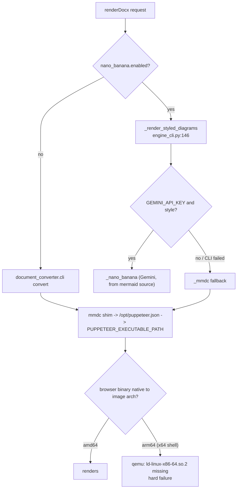

# Design — fix-doc-engine-arm64-chromium

## Context

`pi-doc-engine` is a self-contained image built from
`packages/document-converter/engine/` by `engine/build-image.sh:31`
(`docker build -t "$IMAGE_TAG" "$ENGINE_DIR"` — plain `docker build`, no
`buildx`, no `--platform`, so the image is always built *native* to the host).
No CI workflow builds or publishes it; `.github/workflows/publish.yml:378`
publishes only the npm facade package. The tag comes from
`engine/IMAGE_VERSION` (`0.1.0`), and the server resolves the image name from
`PI_DOC_ENGINE_IMAGE` with default `pi-doc-engine`
(`packages/server/src/lib/office-preview.ts:125`).

Browser wiring in the image today, all pinned to one path:

```
ENV PUPPETEER_EXECUTABLE_PATH=/opt/chrome-headless-shell/chrome-headless-shell   Dockerfile:22
RUN npx @puppeteer/browsers install chrome-headless-shell@stable …              Dockerfile:41-44
    ln -s <downloaded dir> /opt/chrome-headless-shell
RUN printf '{"executablePath":"$PUPPETEER_EXECUTABLE_PATH", …}' > /opt/puppeteer.json   Dockerfile:62-63
RUN printf '#!/bin/sh\nexec node …/mermaid-cli/src/cli.js -p /opt/puppeteer.json "$@"' > /usr/local/bin/mmdc   Dockerfile:64-65
```

The `mmdc` shim exists because the vendored renderer calls bare `mmdc` with only
`-c` (`document_converter/mermaid_renderer.py:279-292`) and Chrome refuses to run
as root without `--no-sandbox` (Dockerfile:58-61 comment).

Two call sites invoke `mmdc`:

| Call site | Path | Failure |
|---|---|---|
| `mermaid_renderer.render_diagram` | default produce path (`document_converter.cli convert`) | `RuntimeError` at `mermaid_renderer.py:299-301` → `_run_dc` → `PRODUCE_FAILED` (`engine_cli.py:229`) |
| `engine_cli._mmdc` | nano-banana fallback only | `EngineError("MMDC_FAILED", …)` (`engine_cli.py:217`) |

Both facade-map to `PRODUCE_FAILED` (`src/engine.ts:315-317`).



## Goals

- `pi-doc-engine` built on an arm64 host renders mermaid blocks.
- amd64 keeps the same browser mechanism and render args. Its provisioning
  changes deliberately (floating "@stable"/unpinned "mermaid-cli" become pinned,
  D7), so runtime output is expected unchanged *modulo the version pin*; the
  build gains a smoke step and can newly fail at build time.
- A broken browser is caught at *build* time, not at a user's first produce call.
- A browser-launch failure is distinguishable from a diagram-syntax failure.

## Non-goals

See `proposal.md` → `## Non-goals`. Notably: no multi-arch publishing, no change
to the nano-banana path's structure, no soft-fallback for unrenderable diagrams.

## Decisions

### D1 — arm64 uses the Debian `chromium` package; amd64 keeps chrome-headless-shell

Base image `python:3.12-slim` (Dockerfile:16) is a *floating* tag. It is
**expected** to resolve to `3.12-slim-trixie` (Debian 13) today, and Debian
trixie is **expected** to ship `chromium` for `arm64` in main
(<https://packages.debian.org/trixie/arm64/chromium>), landing at
`/usr/bin/chromium`. Both are upstream registry/archive state, not repo facts:
**task 2.0 verifies them** (`docker run --rm --platform linux/<arch>
python:3.12-slim cat /etc/os-release` on amd64 and arm64, and `apt-cache policy
chromium` in the arm64 container) and gates the pin; if the floating tag
resolves to another suite, the pin targets *that* suite instead, so the pin
remains a no-op for today's package set.

**apt lists are gone by the browser layer.** The system layer ends with
`rm -rf /var/lib/apt/lists/*` (Dockerfile:37), so the arm64 arm must run its own
`apt-get update && apt-get install -y --no-install-recommends chromium && rm -rf
/var/lib/apt/lists/*` inside the same `RUN`. (Alternative: move `chromium` into
the Dockerfile:26 layer under an arch `case`; rejected because it splits the
browser decision across two layers.)

Two consequences fold into this decision:

- **Pin the suite.** `FROM python:3.12-slim-trixie` (expected: the suite the floating tag
  resolves to today, confirmed by task 2.0, so no package-set change now) instead of letting a future
  Debian release silently swap the package set under the build.
- **Assert the package exists before relying on it.** The arm64 branch runs
  `apt-get update && apt-get install -y --no-install-recommends chromium && rm -rf /var/lib/apt/lists/*` and then verifies
  `/usr/bin/chromium` is executable, failing the `RUN` with a named message if
  not, so a rename/removal in a future suite is a loud build failure, not a
  broken image.

See D7 for the version-pinning standard applied to both arches.

Alternatives rejected:

- **Chrome for Testing arm64.** Chrome for Testing is reported to have added
  `chrome-headless-shell-linux-arm64` in recent builds (unverified here; not
  relied upon). Rejected as the
  primary mechanism: with CfT, arm64 support depends on the resolved build being
  ≥153 on every rebuild, and a version that resolves below that silently
  regresses to today's broken state (D7 pins the amd64 CfT build precisely to
  avoid the same class of drift there). The distro package is
  resolved by apt against the base image's own suite — it cannot resolve to a
  foreign architecture.
- **Use distro `chromium` on both arches.** Simpler (one code path, no npm
  browser download) but changes the renderer on the arch that works today, with a
  different Chromium build and therefore a different font/raster baseline.
  Rejected on blast radius; revisit only if the two-branch build becomes a
  maintenance problem.
- **Run the image under `--platform linux/amd64` on Apple Silicon.** Works via
  Rosetta/qemu but makes an already heavy image (docling ML + LibreOffice +
  pandoc) emulated end to end. Rejected as a user-facing workaround, not a fix.

### D2 — branch on `dpkg --print-architecture`, not on `ARG TARGETARCH`

`TARGETARCH` is a BuildKit-predefined build arg. `build-image.sh:31` calls plain
`docker build`; with the legacy builder (still selectable via `DOCKER_BUILDKIT=0`,
and the default on some older engines) `TARGETARCH` expands to the empty string
and the `if` silently takes the amd64 branch — reproducing the bug with no error.
Reading `dpkg --print-architecture` inside the `RUN` is builder-independent and
reads the architecture of the layer actually being built.

Rejected: `ARG TARGETARCH` with a `: "${TARGETARCH:?}"` guard — correct, but adds
a buildx requirement to a script that does not use buildx. Rejected: `uname -m`,
which returns `aarch64`/`x86_64` and would need its own mapping to Debian names
while apt already speaks `arm64`/`amd64`.

### D3 — keep `PUPPETEER_EXECUTABLE_PATH` constant; both arches populate the same path

The arm64 branch runs `mkdir -p /opt/chrome-headless-shell` and then symlinks
`/usr/bin/chromium` to `chrome-headless-shell` inside it (the amd64 arm gets the
directory implicitly from `@puppeteer/browsers install --path`, Dockerfile:41-44;
the arm64 arm has no such step, so without the `mkdir` the `ln -s` fails).
Consequence: `ENV PUPPETEER_EXECUTABLE_PATH` (Dockerfile:22) and
`/opt/puppeteer.json` (Dockerfile:62-63) are untouched, and the `mmdc` shim
(Dockerfile:64-66) is identical on both arches — its only edit is the
arch-independent render-attempt marker line (D6). The architecture difference
is confined to one `RUN`.

The actual launch chain is **`mmdc` shim -> `-p /opt/puppeteer.json` ->
`executablePath`**, which is what the `ENV` is interpolated into at build time
(Dockerfile:62-63). `engine_cli._mmdc`'s `shell = os.environ.get(
"PUPPETEER_EXECUTABLE_PATH")` (`engine_cli.py:207-209`) is **dead code**:
the value is read into a local that is never passed to `subprocess.run`
(`engine_cli.py:210-214` builds the argv and passes `env=dict(os.environ)`). An
earlier draft of this design cited that env read as part of the wiring; it is
not. Removing or keeping it is out of scope either way.

Rejected: a per-arch `ENV` / second puppeteer config — multiplies the number of
places where the two arches can drift.

### D4 — refute the issue's nano-banana claim; no change to that path

Issue #508 states the styled path "renders a base PNG with mmdc first". The code
does not: `_replace` (`engine_cli.py:154-166`) calls `_nano_banana(source, …)`
with the raw mermaid *source text* as the prompt and only calls `_mmdc` when
`GEMINI_API_KEY`/style is absent or the CLI returned non-zero
(`engine_cli.py:160-163`). What the reporter observed is the *fallback* firing —
their styled render failed (or ran with no key), which is the documented
"fall back to mmdc" behaviour of the existing spec requirement. Once D1 lands,
that fallback renders. No change is in scope here.

Note the second-order effect: with the browser fixed, a nano-banana failure stops
being fatal on arm64 *whenever mmdc can render*. That is weaker than the spec's
current unconditional "never hard-fail the document" clause, which the code never
implemented; the delta therefore *changes that contract* rather than rewording it
(see `proposal.md` -> Capabilities).

### D5 — build-time mermaid smoke render

**Placement:** the smoke `RUN` goes *after* the `mmdc` shim and
`/opt/puppeteer.json` layer (Dockerfile:62-66) — placed right after the browser
layer (Dockerfile:39-44) it would fail with `mmdc: not found` / no `-p` config.

**Argv coverage.** Two argv shapes reach `mmdc` at runtime:

| Path | argv | Source |
|---|---|---|
| default produce (`converter.py:560` → `render_all_diagrams` → `render_diagram`) | SVG pass `-b transparent` (+`-c` if config), then PNG `-b transparent -w <width> [-c cfg] -s <scale>` (defaults 1200/2) | `mermaid_renderer.py:258-293`, `:320-321` |
| nano-banana fallback (`_mmdc`) | `-b white -w 1400 -s 2` | `engine_cli.py:210-214` |

The smoke renders one two-node diagram with **all three invocations**: SVG
`-b transparent`, PNG `-b transparent -w 1200 -s 2`, PNG `-b white -w 1400 -s 2`.
`-c` is omitted (config file is per-document; it only changes theme JSON, not
the browser path). Preferred implementation: invoke the engine's own entry
(`python -c "from document_converter.mermaid_renderer import render_diagram ..."`)
for the default path so the argv cannot drift from the vendored code — this
requires placing the smoke after `COPY . /engine/` (Dockerfile:70); fallback is
the literal argv above. The build fails on a non-zero exit or a missing output
file. This is the only check that exercises the real browser on the real
architecture; cost is three short renders per build.

Alternatives rejected: **runtime self-check on first request** (moves the failure
back to the user and adds per-call latency); **a host-side smoke in
`build-image.sh` after `docker build`** (needs a working `docker run` with mounts
and still ships a broken image to the local daemon first); **relying on the opt-in
vitest integration test** (`src/__tests__/integration.test.ts:46`), which is
skipped unless `DOC_ENGINE_IMAGE` is set and so never gates a build.

A pytest sibling of `engine/tests/test_convert_pdf_output.py` pins the Dockerfile
*text* invariants (no unconditional `chrome-headless-shell` install; an arm64
branch exists; the smoke step exists) so the regression is caught in the normal
test run, where Docker is unavailable. **This guard is wording-only and proves
no behaviour**: it would still pass against a branch that maps the wrong arch or
installs a broken package. It is kept because it is nearly free and catches the
obvious revert. The only behavioural evidence is the build-time smoke running on
a real host of each architecture (tasks 6.1–6.3, manual: no CI builds this
image).

### D6 — `MMDC_UNAVAILABLE` as a distinct engine + facade code

**Decision: deterministic pre-flight probe, not stderr matching.** Puppeteer /
mermaid-cli stderr wording is an unverified upstream dependency, and a token
list (`mmdc`, `puppeteer`, `chromium`) can appear in a syntax-error trace too.
Instead, on a qualifying failure (see *Gating* below) the engine runs
`browser_launch_probe()`: a real headless launch with the same flags
`/opt/puppeteer.json` passes (Dockerfile:62-63):
`subprocess.run([PUPPETEER_EXECUTABLE_PATH, "--headless", "--no-sandbox",
"--disable-gpu", "--disable-dev-shm-usage", "--dump-dom", "about:blank"],
capture_output=True, timeout=10)`. An `OSError` (ENOENT / ENOEXEC), a non-zero
exit, a timeout, or stdout without `<html` → unavailable; otherwise available.
This launches the renderer process, so it catches exec-level failures (arch
mismatch, missing loader — under qemu with no x86-64 loader the exec fails
exactly as the mmdc launch did) *and* launch-level failures (root without
`--no-sandbox`, `/dev/shm`, missing shared libraries). It does **not** exercise
puppeteer's CDP handshake; a CDP-version mismatch passes the probe and keeps
today's code (Risks). An invalid diagram never trips the probe, so the spec's
invalid-diagram scenario depends on no stderr token. Probe argv acceptance by
both `chrome-headless-shell` and Debian `chromium` is confirmed by task 3.0 on
both arches before 3.x is written. Note `PUPPETEER_EXECUTABLE_PATH` is still
exported in the image (Dockerfile:22), so reading it is valid even though
`_mmdc`'s current read is dead code (D3).

**Gating — classify only when a diagram render was attempted in this call.**
A broken browser alone must not relabel an unrelated failure: a docx/pdf with
no mermaid block that fails in pandoc/LibreOffice must stay `PRODUCE_FAILED`.
The engine cannot see inside the `document_converter.cli` child process, so
the signal comes from the single choke point every `mmdc` call passes through,
the shim (Dockerfile:64-65): it gains `[ -n "$PI_DOC_MMDC_MARKER" ] && : >
"$PI_DOC_MMDC_MARKER"` before `exec`. `MMDC_UNAVAILABLE` ⇔ render attempted
**and** probe fails.

- `engine_cli._mmdc` (`engine_cli.py:216-217`): the failing subprocess *is*
  `mmdc`, so the attempt is given; it probes on failure.
- `_run_dc` (`engine_cli.py:225-230`) gains `classify_mmdc: bool = False`. Its
  callers are `cmd_render_docx` (L252), `cmd_render_pdf` (L266, `convert-pdf`;
  md/adoc inputs render diagrams), `cmd_extract_for_edit` (L273) and
  `cmd_merge_back` (L283). Only the two produce calls pass `True`;
  extract/merge keep `False`. (`fill`/`profile`, L292/L310, run their own
  subprocesses and never call `_run_dc`.) With `True`, `_run_dc` sets
  `PI_DOC_MMDC_MARKER` to a fresh temp path in the child env; on non-zero exit
  it probes only if the marker file exists, and deletes it either way.
- With the nano-banana pre-pass, `_mmdc` failures raise inside the pre-pass
  (before `_run_dc`); the rewritten `.styled.md` carries no mermaid block, so
  the subsequent `convert` touches no marker.

Residual: a call that renders a diagram *successfully*, then fails later for a
non-diagram reason, on an image whose probe fails — impossible in practice,
because a successful render means the browser launched.

**Probe executable fallback (review decision D3).** When
`PUPPETEER_EXECUTABLE_PATH` is unset or empty (outside the image, e.g. a unit
test host), `browser_launch_probe()` probes the image's fixed path
`/opt/chrome-headless-shell/chrome-headless-shell` instead — never
`subprocess.run([None, …])` (a `TypeError`, not an `OSError`). A missing file
at that path is then an ordinary `OSError` → unavailable.

**Message content (review decision D1).** The `MMDC_UNAVAILABLE` message
contains the probed executable path and `platform.machine()` (e.g.
`browser could not launch: /opt/chrome-headless-shell/chrome-headless-shell
(machine aarch64)`), so the caller sees *which* binary on *which* architecture
failed without parsing stderr.

**Render-attempt signal (review decision D5).** The one-line shim marker is
accepted as the definition of "diagram render attempted"; no finer-grained
signal from inside `document_converter.cli` is pursued.

Because the probe ignores stderr content, the earlier dependency on
`document_converter.cli` nesting the exception text (`cli.py:175-176`) and on
puppeteer's launch-error wording is removed. The raw stderr is still attached
to the error detail for humans.

Matching stays in the engine; the facade only extends `mapEngineCode`
(`src/engine.ts:306-326`) and the `DocConverterErrorCode` union
(`src/errors.ts:7-20`). The spec's abstract "browser-unavailable error code"
binds to the concrete name **`MMDC_UNAVAILABLE`** at both layers.

Rejected: **map it to the existing `PRODUCE_FAILED`** — fully non-breaking, but
then callers still have to parse stderr, which `errors.ts:1-3` explicitly exists
to prevent. Rejected: **classify in the facade by regex over stderr** — pushes
engine-internal string matching across the package boundary.

Trade-off accepted: the union gains a member, so a TypeScript consumer with an
exhaustive `switch` must add a case. Together with the weakened styled-fallback
SHALL this is a breaking contract change; the package is 0.x (`0.9.0`), where
SemVer §4 gives no stability promise and the minor component is the breaking
channel — 0.10.0 with explicit breaking notes (README, root CHANGELOG).

### D7 — pin the browser stack on both arches; stop floating

The arm64 branch was originally justified partly by rejecting Chrome for Testing
for floating on `@stable`, while the retained amd64 branch floats on exactly that
(`npx @puppeteer/browsers install chrome-headless-shell@stable`, Dockerfile:41)
and `@mermaid-js/mermaid-cli` is installed unpinned (Dockerfile:40). Applying one
standard:

| Component | Today | After |
|---|---|---|
| Base image | `python:3.12-slim` (floats; expected trixie, task 2.0) | `python:3.12-slim-<suite verified by task 2.0>` (expected `-trixie`) |
| mermaid-cli | `npm i -g @mermaid-js/mermaid-cli` | `@mermaid-js/mermaid-cli@<version resolved in task 2.0>` |
| amd64 browser | `chrome-headless-shell@stable` | pinned build id, recorded in `VENDOR.md` |
| arm64 browser | n/a | apt `chromium` from the pinned suite (version is whatever that suite ships; no cross-suite apt pin) |

The browser/puppeteer pairing matters: mermaid-cli bundles its own puppeteer,
which speaks CDP to whatever `executablePath` points at. A distro Chromium of a
different major than the bundled puppeteer expects is the supported configuration
in principle (that is what `PUPPETEER_EXECUTABLE_PATH` exists for) but is not
guaranteed; the suite's Chromium major (recorded by task 2.0) is expected to be within the range current puppeteer
releases target. The chosen mermaid-cli pin and the Chromium major it was
verified against are recorded in `engine/VENDOR.md`, and the build-time smoke
(D5) is what actually proves the pairing works on each arch.

The `<…>` cells are deliberately unresolved in this design: task 2.0 picks the
concrete suite, CfT build id and mermaid-cli version against upstream state at
implementation time, and `engine/VENDOR.md` (task 4.13) is the record. The suite
pin targets the suite the floating tag resolves to at task 2.0, so it changes
no amd64 package by construction.

Residual asymmetry, accepted: the arm64 browser version is a property of the
pinned Debian suite rather than an explicit version string. Pinning an apt
version would break the build the moment the suite publishes a security update,
a worse failure mode than a Chromium point release moving.

### D8 — `build-image.sh` tags `:latest` as well as `:<IMAGE_VERSION>`

The server resolves the image as `PI_DOC_ENGINE_IMAGE ?? "pi-doc-engine"`
(`packages/server/src/lib/office-preview.ts:125`), and an untagged name means
`:latest`. `build-image.sh:14,31` only ever tags `pi-doc-engine:<IMAGE_VERSION>`,
so on a default install *no* locally built image is reachable by the default
name, and bumping `IMAGE_VERSION` to `0.2.0` would change nothing for that path.
The script therefore tags both (`docker build -t <ver> -t pi-doc-engine:latest`)
— but only when `IMAGE_TAG` is unset or empty (review decision D2; matches the
`${IMAGE_TAG:-…}` expansion at `build-image.sh:14`, which treats empty as
unset). Any non-empty `IMAGE_TAG` — including an explicit
`IMAGE_TAG=pi-doc-engine:0.2.0` — builds only the requested tag, so a dev/experimental build never silently replaces the image
the server's default name resolves to. The docs state the two ways to pick up the fix: rebuild (the default name now
resolves to the new image) or set `PI_DOC_ENGINE_IMAGE=pi-doc-engine:0.2.0`.

Rejected: changing the server default to a hard-coded `pi-doc-engine:0.2.0`,
which pins a server constant to an engine artifact version and must be edited on
every image bump.

### D9 — engine pytests gate merges via the existing `music-pytest` CI job

Today no CI job runs `packages/document-converter/engine/tests`; `ci.yml`
`music-pytest` covers only `packages/music-production/tests` +
`packages/video-production/tests/redaction`, so the D5 text guard and the D6
probe/gating tests would never gate a merge. Review decision D4: add
`packages/document-converter/engine/tests` to that job's pytest invocation and
install the light pip set those tests import (python-docx and the
`document_converter.cli` import chain — no docling/torch), rather than adding a
new job. The existing contract test
`packages/shared/src/__tests__/ci-music-pytest.test.ts` is extended to pin the
new path. Tests that need Docker or a real browser stay out of CI (manual,
section 5).

Rejected: a separate `doc-engine-pytest` job — another runner + venv and
another `ci-result` `needs` entry for a sub-second stdlib suite.

## Risks / Trade-offs

| Risk | Mitigation |
|---|---|
| Debian `chromium` version differs from Chrome for Testing → different glyph/raster output on arm64 vs amd64 | Accepted; the spec promises successful rendering on both arches, not identical output. Diagrams are embedded raster images, not pixel-compared; `-w 1400 -s 2` (`engine_cli.py:211`) keeps sizing deterministic. Documented in `engine/README.md`. |
| Base image suite moves (`python:3.12-slim` retagged to a newer Debian) and `chromium` is renamed/absent | Suite pinned explicitly (`-trixie`, D1), so a move is a deliberate edit; the arm64 branch also asserts `/usr/bin/chromium` is executable, and the smoke render (D5) fails before any image is tagged. |
| Distro Chromium major differs from the major mermaid-cli's bundled puppeteer targets, so launch or the CDP handshake breaks | Both pinned (D7) and verified by the build-time smoke on a real arm64 host (task 6.1); the pair is recorded in `VENDOR.md`. Failure is loud at build time, not at a user's produce call. |
| Full distro `chromium` launched with `/opt/puppeteer.json` flags written for `chrome-headless-shell` (`--no-sandbox --disable-gpu --disable-dev-shm-usage`) | All three are plain Chromium flags accepted by both builds; mermaid-cli selects headless mode itself. Proven by the smoke render, which uses the same shim and config. |
| Build-time smoke makes amd64 builds newly fallible | Intended: it converts a silently broken image into a build failure. Stated in `proposal.md` -> Impact -> Compatibility. |
| Unknown architecture (`armhf`, `ppc64le`, empty) | The `case` has an explicit `*)` arm that fails the build naming the detected architecture (D2); no silent branch. |
| apt `chromium` pulls a large dependency set, growing the arm64 image | Accepted; the image already carries LibreOffice + docling models. `--no-install-recommends` as elsewhere in Dockerfile:26. |
| Probe (D6) passes but mmdc still cannot drive the browser (CDP/puppeteer version mismatch — the probe launches the browser but does not speak CDP) | Classified as today's `PRODUCE_FAILED`/`MMDC_FAILED` — status quo, not a regression. Version mismatch is caught at build time by the smoke (D5). |
| Produce fails for a non-diagram reason while the browser is also broken | Not misattributed: classification requires the shim's render-attempt marker (D6 *Gating*); a call that never reached `mmdc` keeps `PRODUCE_FAILED`. |
| The shim gains a line (marker touch) | Arch-independent, no-op when `PI_DOC_MMDC_MARKER` is unset; the build-time smoke runs through the same shim. |
| Probe adds latency | Only on an already-failed produce call that attempted a diagram; one headless `about:blank` launch, bounded by a 10 s timeout. |
| Existing `pi-doc-engine:0.1.0` / `:latest` images linger and keep failing | `build-image.sh` now also tags `:latest`, which is what the server's default untagged `pi-doc-engine` resolves to (D8), so a rebuild replaces the image the default path uses; `IMAGE_VERSION` → `0.2.0` so the fix has a distinguishable tag; README/faq tag references updated. |

## Open Questions

1. ~~Should `engine/build-image.sh` refuse to build on an arch that is neither
   `amd64` nor `arm64`?~~ **Decided (D2):** the Dockerfile `case` has an explicit
   `*)` arm that fails the build with the detected architecture in the message.
   No silent fall-through to either branch, and no need for a host-side check in
   `build-image.sh`.
2. Does any downstream consumer switch exhaustively over `DocConverterErrorCode`?
   Repo-internal use is `office-preview.ts`, which compares against
   `DOCKER_UNAVAILABLE` only — but external consumers of the published package
   are unknown. Resolved by treating it as breaking: 0.x minor bump (0.10.0) with explicit breaking notes (D6).
3. ~~What must the `MMDC_UNAVAILABLE` message contain?~~ **Decided (review
   D1):** the probed executable path and `platform.machine()` (D6).
4. ~~`:latest` rule — "default tag" or "`IMAGE_TAG` unset"?~~ **Decided (review
   D2):** `:latest` only when `IMAGE_TAG` is unset or empty; any explicit tag,
   even `pi-doc-engine:<IMAGE_VERSION>`, builds only that tag (D8).
5. ~~Probe behaviour with `PUPPETEER_EXECUTABLE_PATH` unset/empty?~~ **Decided
   (review D3):** fall back to `/opt/chrome-headless-shell/chrome-headless-shell` (D6).
6. ~~Engine pytests are not in CI.~~ **Decided (review D4):** add
   `packages/document-converter/engine/tests` to `music-pytest` (D9).
7. ~~Is the shim marker an acceptable "render attempted" signal?~~ **Decided
   (review D5):** yes (D6).
