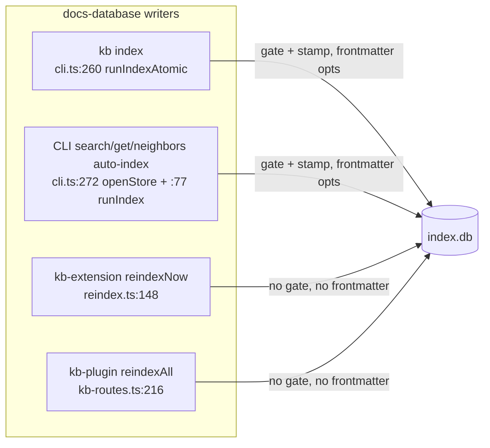
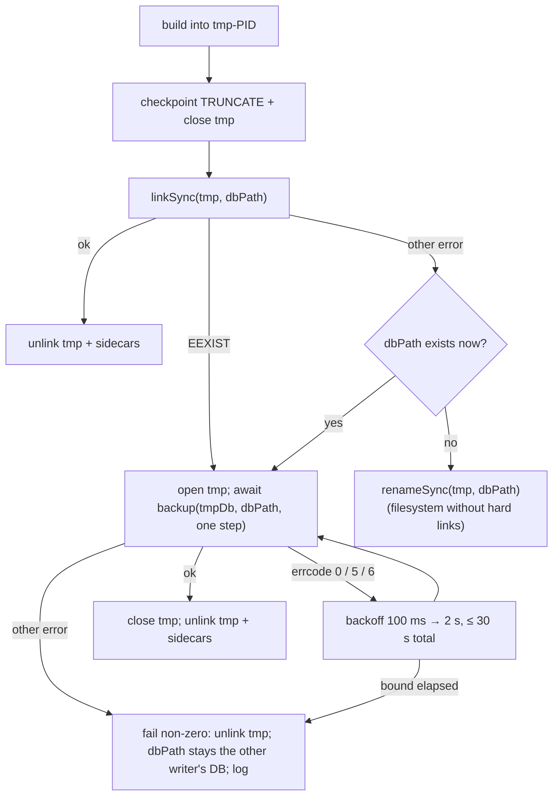

# Design — fix-kb-index-integrity

## Context

Four defects in the kb docs index, reproduced on develop (2026-10-17) against
`packages/kb/dist` built from HEAD. "Docs database" below means the database at a cwd's
resolved `dbPath`; the eval/verify harnesses (`packages/kb/eval/run-fixtures.ts:83`,
`packages/kb/verify.ts:12`) use their own cache DBs and are not docs-database writers. The
git scope uses its own per-repo database (`packages/kb/src/git-scope/repo.ts:107`).

### Defect 1 — rename-install over an open WAL database

- First index builds into `<dbPath>.tmp-<pid>` and installs with `finalizeRename`
  (`packages/kb/src/index-run.ts:93`, `:126`; `sqlite-store.ts:266-277`:
  `wal_checkpoint(TRUNCATE)` → `close` → `renameSync` → unlink tmp sidecars).
- `preexisting` is sampled once (`index-run.ts:93`). A process that creates `dbPath` later
  keeps it open with its own path-keyed `dbPath-wal`/`-shm`.
- Creators (all open `dbPath` in place today): `getKb` constructs a creating `SqliteFtsStore` on cache miss
  (`packages/kb-extension/src/reindex.ts:131-145`; the constructor `mkdir`s and opens,
  `sqlite-store.ts:117-119`); pull tools reach it via `ensurePopulated`
  (`reindex.ts:185-191`; `extension.ts:262`, `:308`, `:341`). Also the dashboard reindex
  route (`kb-routes.ts:169-174`, `:220`) and the CLI's non-index commands (`cli.ts:72-74`, `:272`).
- Pull-tool shape: each `execute` awaits `reindexNow`/`ensurePopulated` inside a try/catch,
  then calls `getKb` *outside* it (`extension.ts:257-262`, `:303-308`, `:336-341`).
- After the rename SQLite pairs the *new* main file with the *holder's* WAL by path.
  Observed: a 107 MB index renamed over a holder with 300 chunks in WAL reads 0 files / 300
  chunks, `quick_check` ok. Production repro (real `git worktree add`; `kb index`; a process
  doing exactly `getKb`'s open 5 s later): CLI reports `indexed 3031 files … 40192 chunks`, DB
  reads 0 files / 0 chunks / `user_version 0`, persisting after the holder exits.
- The archived `harden-kb-index-failure-atomicity` design (Out of scope) called concurrent
  indexers "benign; last successful `rename` wins" — true for DELETE-journal files, not WAL.

### Defect 2 — graph erosion and shared heading nodes

- `deleteByPath` (`sqlite-store.ts:301-311`) deletes `edges WHERE src=? OR dst=?` for every node
  with `path=?`, then those nodes. The re-added file node (`indexer.ts:172`) gets a new id; edges
  from unchanged files to the old id are gone. Main after a full rebuild + ~40 min of session
  edits: `references` 80 vs 175 in a first index of HEAD.
- Heading nodes are named by the bare heading path (`chunker.ts:113` joins titles with ` > `;
  `adoc-chunker.ts:203`; `indexer.ts:176` `addNode({type:'heading', name: headingPath, path: rel})`).
  `nodes` is `UNIQUE(type,name)` (`sqlite-store.ts:29-32`), `addNode` upserts `path`
  last-writer-wins (`:361`), `addEdge` resolves endpoints by name only (`:364-365`). On main,
  `Why` is one node for 83 files, `Purpose` for 99.
- `neighbors` excludes the origin by name (`sqlite-store.ts:657-667`, `n.name != :name`);
  `backlinks` matches the target by name (`:671-675`).
- git-scope already replaces outbound-only: `replaceItem` (`sqlite-store.ts:222-241`), pinned by
  `packages/kb/src/__tests__/git-scope-store.test.ts:14`.
- Tag nodes are path-less too (`indexer.ts:193`).

### Defect 3 — writers disagree

- Gate + stamp only in `runIndexAtomic` (`index-run.ts:101-124`) and `cli.ts runIndex`
  (`:77-92`). `reindexNow` (`reindex.ts:165-168`) and `reindexAll` (`kb-routes.ts:232-244`) call
  `indexSource` without gate, stamp or `frontmatter` (so `indexer.ts:198` uses `DEFAULT_*_KEYS`).
- Main's DB was `user_version 2` under `SCHEMA_VERSION = 3` (`sqlite-store.ts:12`; bump in
  `71cc2dc9e`, 2026-09-07).
- The gate hash is `frontmatterConfigHash` only (`config.ts:228-234`). `includeSourceMarkdown`
  changes an unchanged file's `doc_type` (`indexer.ts:98`, `:124`, `:167`).
- Writers walk different source sets: the extension walks `cfg.resolvedSources` (filesystem only,
  `config.ts:150`, `:376`), the plugin `cfg.allSourceSpecs` (`:374`) with per-source outcomes;
  missing dirs return `missing:true` without throwing (`indexer.ts:110-114`).

### Defect 4 — per-file deletes scan the FTS table

- `DELETE FROM chunks WHERE root=? AND path=?` (`sqlite-store.ts:304`) scans: `root`/`path` are
  `UNINDEXED` FTS5 columns. git-scope hit the same wall and added `item_rows(root,path,rid)`
  (`sqlite-store.ts:49-52`, used by `replaceItem`).
- Measured on a copy of main's DB (3063 files / 40 700 chunks): per-file scan deletes 17.3 s;
  backfilling `item_rows` 25 ms; per-file rowid deletes for all files 437 ms;
  `SELECT max(rowid) FROM chunks` 0.3 ms; `SELECT count(*) FROM chunks` 40 ms.
  Whole forced passes today: 145 s / 168 s vs 86 s first index.

## Goals / Non-Goals

**Goals**
- A successful index run's result is what every later reader sees, whatever else opened `dbPath`
  (one stated exception, D1).
- After any sequence of incremental passes the graph equals a first index of the same tree.
- Every docs writer applies the same options and gate; skipped sources stay due.
- Per-file replacement and forced passes cost about a first index; upgrading does not stall pull tools.

**Non-Goals**
- Seeding a worktree from the main checkout (`add-kb-worktree-seed`).
- Freshness budgets / cancellation (`bound-kb-search-freshness`).
- Merging requirements duplicated across `kb-indexing-pipeline` and `markdown-knowledge-base`.
- Staleness labels on pull-tool answers (`bound-kb-search-freshness`).
- Root-scoping `nodes`. Two sources holding the same relative path still share file and heading
  nodes; graph equality is stated for trees where no two sources share a relative path (true for
  the repo's own config: `.pi`, `docs`, `openspec`, `packages`).
- Version bumps — `release-cut` bumps every workspace `package.json` in lockstep
  (`.pi/skills/release-cut/SKILL.md`); dependents pin `^0.9.0`
  (`packages/kb-extension/package.json:42`, `packages/kb-plugin/package.json:71`).

## Decisions

### D1 — Install: no-clobber link, else online backup

- `linkSync` is an atomic no-clobber create (fails `EEXIST`), closing the existence-check→rename
  window. tmp and `dbPath` share a directory (same filesystem). On any other `link` error
  (filesystems without hard links: FAT/exFAT, some network mounts) re-check `dbPath`: absent →
  `renameSync` (a sub-millisecond check-then-rename race remains on those filesystems only; the
  branch is logged), present → the backup branch.
- `backup` is a **module function** of `node:sqlite`: `backup(sourceDb: DatabaseSync, path:
  string, options?) → Promise<number>` (pages copied); there is no `DatabaseSync#backup`. It is
  not declared in `packages/kb/src/node-sqlite.d.ts` today. Pass `rate` = the temp database's
  `PRAGMA page_count` so the copy is one step and the destination changes in a single write
  transaction (Node's default is 100 pages per step). Tests pin the exact busy and non-database
  error objects on the supported Node versions and that an interrupted backup leaves the
  destination's prior contents.
- Spike: 107 MB / 29 535 pages in 175 ms; WAL mode and `user_version` carried over; a holder's
  cached connection then read 3043 files / 40 415 chunks.
- Busy destination: `backup()` rejects at once, ignoring `busy_timeout`, with
  `code: 'ERR_SQLITE_ERROR', errcode: 0, errstr: 'not an error'`; a non-database destination
  rejects with `errcode: 26`. Retry only on `errcode` 0, 5 (`SQLITE_BUSY`) or 6 (`SQLITE_LOCKED`);
  any other error fails immediately.
- **Failure exception (decided):** a run never removes a file it did not create. So whenever a
  writer that ignores the marker (kb ≤0.9.0) created `dbPath` during the build, a failed run — the
  build throws, the 30 s backup bound elapses, or the backup fails otherwise — exits non-zero,
  removes its temp file, and leaves `dbPath` as that writer's database. Reachable only when a
  writer that ignores the live-build marker (kb ≤0.9.0) creates `dbPath` mid-build *and* holds a
  write lock for 30 s; that writer's own cold-start populate fills it. Specs state this exception.
- Logged, one stderr line per install: `[kb] install=<link|rename|backup> retries=<n> ms=<n>`, or on
  failure `[kb] install-failed=<busy-timeout|backup-error:<errcode>> retries=<n> ms=<n>` (K4).

### D2 — One creation path and the live-build marker

- **Only the atomic first-index path creates a docs database (decided).** Every writer that finds
  `dbPath` absent builds through it — `<dbPath>.tmp-<pid>` → install (D1) — instead of opening
  `dbPath` in place: `kb index`, the CLI's non-index commands' auto-index, the kb-extension's
  cold-start populate and debounced reindex, and the dashboard reindex job. `getKb` never creates;
  on an absent `dbPath` it returns no store. Consequence: during a cold populate, partial results
  are not queryable until the install (today they are, per 100-file commit).
- A present `dbPath` (populated, legitimately empty, or an old husk) is indexed in place as today.
- Live-build marker ⇔ a `<dbPath>.tmp-<pid>` exists, its PID is alive (`isProcessAlive`,
  `index-run.ts:40-47`), and the newest mtime of the tmp file or its `-wal` is within 120 s of now (up to 2 s ahead of the clock is tolerated for timestamp rounding; a mtime further ahead is not trusted).
  Heartbeat: the builder checks elapsed time in its
  per-file loop and calls `utimesSync` on the temp file every 30 s (a timer cannot fire inside a
  synchronous batch, `indexer.ts:55-61`, `:147-150`), in addition to the 100-file commits.
- Orphan sweep (`sweepOrphanTemps`, `index-run.ts:53-72`): removes a temp whose PID is dead (as
  today) or whose newest mtime is more than 1 h old (recycled PID on abandoned litter). A live build
  refreshes every 30 s, so it is never swept.
- One exported predicate `isFirstIndexLive(dbPath)`, consulted **only when `dbPath` is absent**;
  a builder ignores its own PID's marker.
- Absent `dbPath`, another process's marker live:
  - kb-extension pull tools return the line
    `(index is still being built — no results available yet; retry shortly)`; `kb_search` with
    `format: "json"` appends `[]` as the final line — the existing `BUILDING_LINE` of
    `reindex.ts` and the existing json shape of `kb_search` (`bound-kb-search-freshness`, archived).
    The check runs before any store work. `getKb` no longer creates a store: on an absent `dbPath`
    it returns `null`, and each `execute` treats a `null` store after its freshness wait as the
    building result (a first index that outlasts the freshness budget is thereby reported as
    building, as the cold-populate case is today). `freshnessStatus` likewise treats an absent
    store as `building` unless the pass completed.
  - the debounced reindex skips without a warning;
  - the CLI's non-index commands print the same line and exit 75 (`EX_TEMPFAIL`, K3);
  - the dashboard reindex job waits (poll 1 s) while the marker stays live — a wedged builder stops
    refreshing and goes stale within 120 s — reporting `jobStatus: "running"`, `indexing: true`
    throughout (K2), then walks the produced database or, if none was
    produced, builds through the first-index path. `202 {status:"running"}` and "completes with
    `chunks > 0`" hold unchanged.
- Absent `dbPath`, no live marker: the caller becomes the builder. Two simultaneous builders both
  build; the second installs by backup over the first (correct, wasteful).
- Inside one kb-extension process, a second pull tool during the process's own first index joins the
  in-flight build (`state.inflight`, `reindex.ts:160-161`) rather than seeing "building".

### D3 — Cached ranking statistics follow external commits

- `dfCache` (`sqlite-store.ts:411`) is cleared only on this connection's writes (`:203`, `:223`,
  `:252`, `:302`). Read `PRAGMA data_version` before using it; clear when it changed since the
  last read (`data_version` changes when any *other* connection commits). One pragma per search.

### D4 — Graph identity and ownership

- Heading node name := `<file path>#<heading path>` (`path` column = file path). `child_of` edges
  connect qualified names; the top-level heading's parent is the file node.
- Lookup (`neighbors`, `backlinks`): exact name match first. If no node has that exact name and
  the argument contains no `#`, resolve to every `type='heading'` node whose heading-path part equals
  the argument — compared exactly with `substr(name, length(path) + 2) = ?` (the node's own `path`
  column strips the `<file>#` prefix, so file paths containing `#` are handled), never `LIKE`.
  Traverse from the whole matched set and exclude the matched set from the result (by id, not by
  name). File paths resolve exactly as today.
- Output: neighbor/backlink node `name`s for headings become `file#heading` (visible to JSON
  consumers).
- Owned by file `F`: chunks, heading nodes (`type='heading' AND path=F` — now unique to `F`),
  edges whose `src` is `F`'s file node or one of its heading nodes, properties, file-state row.
- Re-chunk `F`: delete owned rows; keep `F`'s file node (its upsert reuses the id).
- Delete `F`: delete owned rows; set the file node's `path = NULL` (placeholder, the shape
  `ensureNode` writes, `sqlite-store.ts:217-219`). Inbound edges keep their target.
- End of each walk: delete every `path IS NULL` node (file placeholders and tag nodes) that no edge
  references.
- Graph equality := equal sets of `(type, name, path)` nodes and `(src name, dst name, rel)`
  edges; ids are not compared.

### D5 — Index-addressed per-file replacement

- Every docs chunk insert records `(root, path, rowid)` in `item_rows`. `deleteByPath` deletes
  chunks with `DELETE FROM chunks WHERE rowid=? AND root=? AND path=?` for each mapped rowid
  (verify-before-delete: a reused rowid now holding another file's chunk is never deleted), then the
  map rows.
- Map validity (exported as `reconcileChunkMap(store)`, callable on its own; `add-kb-worktree-seed`
  calls it before its acceptance step): the docs rows of `item_rows` are rebuilt from `chunks` (`DELETE` docs rows, then
  `INSERT OR IGNORE … SELECT root, path, rowid FROM chunks`, 25 ms on main) inside one
  `BEGIN IMMEDIATE` transaction at the start of a connection's first pass and of every pass where
  `PRAGMA data_version` shows another connection committed since this connection's last pass. A
  rebuild failure aborts the pass before any per-file delete.
- Legacy heading names: in the same step, files that own `heading` nodes whose name does not start
  with `<path>#` (written by kb ≤0.9.0, e.g. after a rollback) have their file-state rows removed,
  so the walk re-chunks them with qualified names; unchanged files would otherwise keep bare names
  forever because no gate record changes. This catches writes by kb ≤0.9.0 (rollback, stale installs),
  which insert unmapped chunks and can reuse rowids; a count/max signature was rejected because a
  top-of-table delete plus an equal-count insert leaves it unchanged. A long-lived session alone
  on its database pays it once; each CLI invocation pays it once (25 ms).
- `migrateChunksSchema` (`sqlite-store.ts:168-186`), which drops and recreates `chunks`, also
  clears the docs rows of `item_rows`.
- A forced pass stays per-file and in place: files in batches committed before a throw hold their
  re-chunked rows; the rest — including the open batch, which rolls back (`indexer.ts:225-228`) —
  hold their prior rows; no file is left without rows.
  **Rejected:** bulk clear per source (a mid-walk throw leaves files without rows; orphans missed);
  fresh tmp + install (loses failed sources' rows, widens D1's race surface).
- Vanished file: a `statSync`/`readFileSync` `ENOENT` (`indexer.ts:156`, `:159`) removes that path's
  stored rows and does not add it to the live set (today `live.add` precedes the stat,
  `indexer.ts:155`); other read errors still throw.

### D6 — One option derivation, per-source gate

- kb exports `indexOptionsFromConfig(cfg)` (the object `cli.ts:263` builds today, incl.
  `frontmatter`, `cwd`), `indexOptionsHash(cfg)` (sha256 over normalized frontmatter as
  `config.ts:229-232` plus `includeSourceMarkdown` normalized `undefined → true`, matching
  `indexer.ts:124`), `sourceGateIsStale(store, cfg, root)` and `stampSource(store, cfg, root)`.
- Per-source record: `kb_meta` key `gate:<root>` = `<SCHEMA_VERSION>:<indexOptionsHash>`, written
  only when that source's walk completed without throwing and `indexSource` did not report it
  `missing` (`indexer.ts:112-114`; the filesystem resolver does not check existence,
  `sources.ts:131-137`, so `reindexAll`'s `ok` outcome alone is not enough). A pass
  forces exactly the sources whose record is absent or differs. Skipped (missing, untrusted) and
  failed sources keep their record.
- Back-compat stamps after every successful pass: `PRAGMA user_version = SCHEMA_VERSION` and
  `facetConfigHash = frontmatterConfigHash(cfg.frontmatter)` — the *frontmatter-only* hash old code
  compares (`cli.ts:81-82`, `index-run.ts:103-104`), so old code does not force after a rollback.
  Consequence: after a rollback, old code does not force a source that failed under new code.
- **No non-awaiting path (re-baselined).** `bound-kb-search-freshness` (archived 2026-10-18) landed after this change was planned: `awaitFreshness` already bounds every pull tool's wait by the freshness budget (default 1500 ms), answers from the existing index on expiry with the stale line, and swallows a late rejection at pass creation (`reindexNow`'s `p.catch`). A gate-forced pass therefore stalls a pull tool for at most the budget — the stall this section originally removed — so no separate "start without awaiting" mode is added. The one-shot CLI awaits its gate-forced pass (it would otherwise exit mid-walk).
- Callers: `runIndexAtomic`, `cli.ts runIndex`, `reindexNow` (per-source try/catch: one source's
  throw no longer aborts the others), `reindexAll` (keeps its per-source outcomes, stamps `ok`
  sources only).
- A persistently throwing source is re-forced each pass; cost is bounded by how far it gets before
  throwing, and other sources are unaffected.

### D7 — Node floor, dist

- `packages/kb/package.json` `engines.node` `>=22.13.0` → `>=22.19.0`. Rationale: `backup`
  availability — verified present as a module function on 22.19.0, 22.22.x and 24.15.0. Matches the
  root floor today (`package.json:120`); the planned `raise-node-floor-to-26` does not affect it.
  Electron bundles 24.15.0 (`packages/electron/scripts/_node-version.sh:17`); Docker
  `node:24-bookworm-slim` (`docker/Dockerfile:13`).
- CHANGELOG **BREAKING** engines line; the version bump itself happens at `release-cut`.
- `packages/kb/src` edits require rebuilding `packages/kb` and committing
  `packages/kb/engine-fingerprint.json` (`scripts/check-kb-dist-fresh.mjs`, `ci.yml:167-172`).

## Risks / Trade-offs

- **Backup holds the destination write lock for the copy** (175 ms / 107 MB). Other writers wait
  on `busy_timeout` (5 s, `sqlite-store.ts:123`).
- **D1 failure exception** leaves `dbPath` as another writer's database; the worktree-init gate
  treats it as present (`worktree-init-hook` delta) while the failed run is reported failed. Requires
  a kb ≤0.9.0 writer creating `dbPath` mid-build, then a 30 s write lock or a backup error. Accepted
  (decided).
- **One forced pass per source after upgrade** (new per-source keys) ≈ a first index, in the
  background for pull tools; results are stale until it completes.
- **Writers ≤0.9.0** ignore the marker and the per-source records. Each file they re-chunk loses
  inbound edges from other files; D5 repairs the chunk map and re-chunks files with legacy heading
  names, but the lost inbound edges stay lost until the linking files are re-chunked or
  `kb index --force` runs. Documented.
- **Heading-path argument containing `#`** is treated as qualified (no bare fallback). Accepted.
- **Parallel first indexes** (e.g. worktree init and a session's cold populate start together):
  the second installs by backup over the first. Correct, wasteful.
- **Cold populate is no longer partially queryable**: until the session's first index installs, its
  own concurrent pull tools wait on the in-flight build, as cold populate is awaited today.
- **Re-baselined on `bound-kb-search-freshness`** (archived 2026-10-18, merged into develop after this
  change was planned): this change's deltas to "Cold-start populate and freshness reindex on pull
  tools" and "LLM-facing pull retrieval" are rebased onto the post-freshness text (all of its
  scenarios carried); the "Condensed default `kb_search` output" delta is dropped (the status-line
  rule is already in main).

## Migration Plan

1. Ship. No `SCHEMA_VERSION` bump.
2. First upgraded writer per source: `item_rows` rebuilt on its first pass; per-source record
   absent → forced pass (a pull tool waits at most the freshness budget) → qualified heading nodes, no erosion,
   per-source record + back-compat stamps.
3. No manual step; `kb index --force` remains the explicit heal.

**Rollback:** revert. Schema identical. Old code sees a matching `facetConfigHash` → no force;
ignores `gate:*` and `item_rows`; resumes rename-install, scan deletes, in-place creation and bare
heading names on its next re-chunk of each file. Until then, old-code bare-heading lookups miss
qualified nodes of unchanged files. Re-upgrading rebuilds the map and re-chunks legacy-named files
on the first pass.

## Open Questions

- None blocking.
