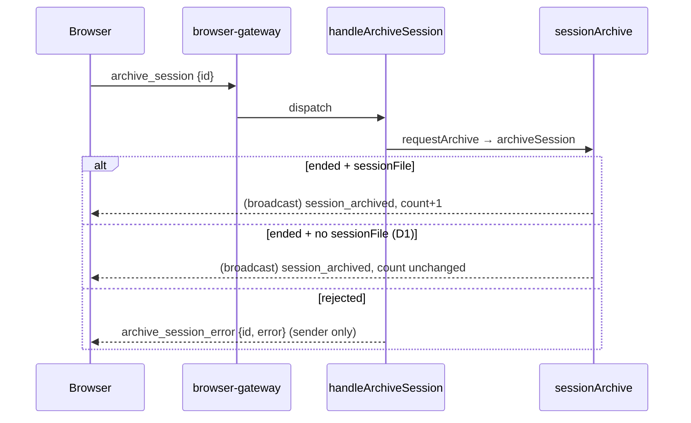

## Context

An ended session can get stuck as a card that cannot be archived. In the observed case, `01a13a6a…` was `ended` with `sessionFile: null` while its transcript `…_01a13a6a….jsonl` sat on disk. That file's header id was `01a13a7a…`, a later session that registered with the same file. The failure runs through three server spots:

| # | Site | Today |
|---|---|---|
| 1 | `packages/server/src/event-wiring.ts` register path (~L1639) | For every *other* resident session with the same `sessionFile`: `update(other, { sessionFile: undefined })` + `broadcastSessionUpdated(other, { sessionFile: null })`. The other session stays resident regardless of status. |
| 2 | `packages/server/src/session/session-archive.ts#archiveSession` (~L244) | `!session.sessionFile → { ok:false, error:"session file is unknown" }` |
| 3 | `packages/server/src/browser-handlers/session-meta-handler.ts#handleArchiveSession` | `await requestArchive(...)`, result discarded |

The `retry_session_error` precedent already exists (`session-action-handler.ts#handleRetrySession` → `ctx.sendTo(ctx.ws, …)`; client `useMessageHandler` toasts it), and so does the `plugin_action_error` "never a silent drop" convention.

## Goals / Non-Goals

**Goals:**
- No new orphan ended sessions from the register `sessionFile` dedup.
- Orphans that already exist in a running server can be archived with one click.
- Every WS archive rejection is visible to the user who clicked.

**Non-Goals:**
- Why pi re-headers a transcript with a new id (upstream pi).
- `closedReason: "unknown"` on explicit unregister (`session-death-attribution` follow-up).
- ENOSPC resilience of sidecar writes.
- Changing card archive-button gating (`canArchive`). The fix makes the button work rather than hiding it.

## Decisions

### D1: Fileless ended archive = evict, no persist, no index row (manual only)
Add a private `evict(session)` in `session-archive.ts`. It calls `sessionManager.remove(id)`, purges the id's in-memory events through a **new injected dep** `deleteEvents?: (id: string) => void`, and calls `emitter?.sessionArchived(id, key, countFor(key))`. Nothing can reload those events without a file.

- `SessionArchiveDeps` is `{ sessionManager, metaPersistence, getPinnedDirs }` today (`session-archive.ts:43-50`). `server.ts` wires `deleteEvents` to `eventStore.deleteEventsForSession`, the same call `event-wiring.ts:1612` uses. It's optional, so existing test harnesses compile unchanged.
- `key` comes from `groupKeyFor`. Its parameter narrows from `ArchivedSessionSummary` to `Pick<ArchivedSessionSummary, "cwd" | "gitWorktree">` (`session-archive.ts:137`), fed from the full live record, the same fields the normal path captures. The emitter's second argument is the group key, as at `session-archive.ts:288`. Nothing goes through `mergeSessionMeta` and nothing goes through `insertRow`. `memory-session-manager.ts:488-492` `remove` broadcasts nothing itself, so `session_archived` is the only client signal.

In `archiveSession` (`session-archive.ts:244`), after the existing `not found` / `live` / `not ended` guards, add one branch: `if (!session.sessionFile && reason === "manual") return evict(session)`. Other reasons (`sweep`, `service-end`, `migration`) keep the existing `"session file is unknown"` result, so `archive-sweeper.ts:126` (service-end) and `archive-sweeper.ts:162` (sweep) behave exactly as today. Neither ever silently drops a session that can't be restored.

- The `reason` parameter goes from unused (`_reason`) to used.
- **REST changes too.** `POST /api/session/:id/archive` shares `requestArchive` → `archiveSession(id, "manual")` (`session/session-api.ts`), so a fileless ended session goes from an error to `{ success: true }`. That's intended.
- **Idle-archive intent completion** (`event-wiring.ts:729-731`) also calls `archiveSession(id, "manual")`. A fileless idle session the user asked to archive is evicted once it ends. This is still a user-initiated archive, so it's intended.

- The key is computed with the existing `groupKeyFor` over a minimal summary (`cwd`, `gitWorktree`), so the client routes the eviction to the right folder. `countFor(key)` is unchanged because no row was inserted.
- *Alternative rejected:* insert an index row without a sidecar. The archived listing would show an entry that can't be restored and isn't backed by any file. It would also vanish on restart because the index is rebuilt from sidecars, which makes the count inconsistent.
- *Alternative rejected:* hide the archive button when `sessionFile` is missing. The user would be left with a permanent card and no affordance at all.
- **Ordering:** the `live === true` guard stays before the fileless branch, so a fileless interrupted session is still refused (spec scenario).

### D2: Supersede = existing clear + dedicated eviction, only for ended holders
In the event-wiring register loop (`event-wiring.ts:1639-1645`), branch **before** mutating each other holder of `F`:

- `other.status === "ended"` and `sessionArchive` present → call a new `sessionArchive.evictSuperseded(other.id, sessionId)` only. There's no intermediate clear + `session_updated { sessionFile: null }` frame.
- otherwise (non-ended holder, or no archive service) → today's clear-and-broadcast. A missing archive service logs `[archive] supersede skipped: archive unavailable`.

`evictSuperseded` re-fetches the session (`sessionManager.get`) and re-checks `status === "ended"` instead of trusting the loop's captured object. It skips the `live` guard, and calls D1's private `evict`. It writes nothing to `F`'s sidecar and inserts no index row.

- **Why `live` is not a guard here.** `live:true` on an in-memory session is copied from `F`'s sidecar (`session-scanner.ts:289`) and marks `F` as resumable. Once `S2` owns `F`, `S1` can't be resumed from it, and today's clear already removed that possibility. Supersede is an eviction, not an archive: no `archived` flag, no index row, no restore path. So "Interrupted session is never archived" (`session-archive` spec) isn't engaged. The identity delta states this explicitly.
- **Why only ended holders.** `ended` means no bridge is attached to `S1` (`memory-session-manager.ts:498-530` unregister). A non-ended holder is the two-live-bridges case, owned by "Session id maps to exactly one live bridge", and keeps today's behaviour.
- There's one eviction implementation (`evict`), with two entry points: the manual fileless archive and supersede. It logs `[archive] superseded <S1> by <S2>`.
- `ArchiveReason` is unchanged. `evictSuperseded` doesn't go through `archiveSession`.
- A non-ended holder is left as-is. That case is two live bridges contending for one file, and it's owned by the `session-identity` "one live bridge" and bridge-contention requirements.
- Same-id re-registers never enter the loop (`other.id !== sessionId`), so continue/reconnect is unaffected.
- *Alternative rejected:* `sessionManager.remove` + `session_removed` broadcast. Per spec, `session_removed` keeps the card as `ended` on the client, and only `session_archived` deletes it.

### D3: `archive_session_error` reply to the sender
- Shared: add `{ type: "archive_session_error"; sessionId: string; error: string }` to the server→browser union in `packages/shared/src/browser-protocol.ts`.
- Server: `handleArchiveSession` checks the `requestArchive` result. If `!res.ok`, it calls `ctx.sendTo(ctx.ws, { type: "archive_session_error", sessionId, error: res.error ?? "archive failed" })`. A pending result (`ok: true, pending: true`) sends nothing.
- Client: handle it in `useMessageHandler` next to `retry_session_error`, with an error toast showing the text. No state change.
- Gateway: classify `archive_session_error` as `{ cls: "state", key: "archive_session_error:" + sessionId }` in `frameClassOf` (`browser-gateway.ts:97+`). The default arm is the sheddable `transcript` class, which would drop the error under backpressure.
- The WS `archive_session` handler is already owner-gated (`identity/ws-message-scope.ts` `SESSION_OWNED_MESSAGES`), so the error reply needs no extra gate.
- Compatibility: the change is additive. Whether older client bundles ignore an unknown `type` without side effects is unverified. Task 4.3 pins the new client's handling, and an old client at worst shows no toast, which is today's behaviour.

## Risks / Trade-offs

- **[Risk] A legitimate flow registers a new id on an ended session's file, and the user wanted the old card kept.** → Pi's documented flows (`/new`, `/resume`, `/fork`, `--session` continue) either reuse the id or create a new file (session-identity spec). After the supersede, the transcript is shown under the new owner, so no history is lost. The doubt-driven review task must confirm this before landing.
- **[Risk] A supersede eviction races an in-flight `unarchive`/restore of `S1`.** → Restore re-adds from the archived index, and `S1` has no row because D1 inserts none, so there's nothing to race.
- **[Trade-off] An evicted fileless session is unrecoverable from the UI.** → It had no transcript reference to begin with, so nothing restorable is lost.
- **[Behaviour] Cold-start identity of `F` is filename-derived.** `session-scanner.ts:26-31` takes the id from `<ts>_<uuid>.jsonl`, so after a restart `F` hydrates as **one** session with id `S1` (the filename id) carrying `F`'s sidecar, which is `S2`'s state. That's still a single card, so neither the orphan nor a duplicate comes back. This pre-existing identity rule (in-memory `S2` vs cold-start `S1` for a re-headered file) stays out of scope. The eviction guarantees are scoped to the running server.
- **[Trade-off] Fileless manual archive has no undo and no confirm.** This matches the ended-card no-confirm rule. A fileless session has no transcript to view or restore. Remote sessions carry their remote `sessionFile` path, so they aren't fileless.
- **[Trade-off] Re-header supersede drops the `S1` card.** In the observed case, `S2` is the re-headered owner of the same transcript, so the history is still visible under `S2`. The name and tags live in `F`'s sidecar, which `S2` now owns.
- **[Contract] `session_archived` is reused as the eviction signal.** The client handler (`useMessageHandler.ts:769-805`) deletes the card and sets the count, which is exactly the effect wanted. The `session-archive` delta names the carved-out scenarios ("Archive an ended session", "Archived is a persisted flag", "Interrupted session is never archived"), so `session_archived` no longer implies `archived:true` on disk for these two eviction paths.
- **[Unchanged] Fileless idle-alive archive.** `requestArchive` still ends an idle session before archiving (`session-meta-handler.ts:127-165`), whether or not it has a file. This change doesn't touch that path; the only difference is that the final `ended` step now evicts instead of failing.
- **[Trade-off] No-archive-service fallback.** It clears `sessionFile` as today and logs. Production always wires `sessionArchive` (`server.ts`); only minimal test wirings lack it.
- **[Unchanged] `S2` inherits `F`'s sidecar name/tags.** Register merges only `isGitRepo`, `source` and `principalOwner`. This already happens today and is out of scope.
- **[Note] `archive_session_error` coalesces per session** under backpressure, so the latest error wins. That's acceptable for a toast.
- **[Trade-off] Debounced sidecar write keyed by `F`.** `meta-persistence.ts` keys pending writes by file path (`pending: Map<sessionFile, …>`), so `S2`'s next `save(F, …)` replaces any queued `S1` write. An `S1` write that fires first is overwritten by `S2`'s first save. Dropping the pending `F` entry at supersede time was rejected: the entry carries no owner id, so it could just as well be `S2`'s own queued write. This race already exists at today's clear step and isn't widened by this change.
- **[Unchanged] Sweeper and service-end archiving.** These never evict fileless sessions (D1 reason gate).

- **[Verdict] Doubt-driven review of D2 (task 2.10).** `/new` creates a new file (no shared holder). `/fork` creates a new file. `/resume` and `--session F` / `--continue` reuse the header id; the same-id guard (`other.id !== sessionId`) keeps them out of the loop, and a same-id reconnect is pinned by test #E10. The one path that registers a DIFFERENT id on an ended holder's file is the re-header case (the incident), where the new owner shows the same transcript and the predecessor is by definition a stale duplicate. Verdict: no legitimate path needs the ended holder kept visible.

## Migration Plan

There's no data migration. The change deploys as a server restart plus a client build. Rollback is a revert: the old behaviour (silent no-op) comes back and no persisted state is affected.

## Open Questions

None blocking. The follow-ups (closedReason on explicit unregister, pi re-header) are tracked as non-goals.
