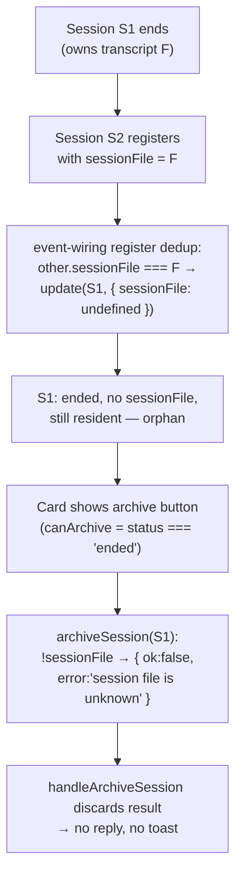

## Why

An ended session card can become impossible to archive: the archive button renders, clicking it does nothing, and the card stays in the list forever. Observed live on `fix-project-setup-completion-state` (session `01a13a6a…`, ended, `sessionFile: null`, `closedReason: "unknown"`).

Root cause is a three-link chain:

1. **Orphan creation** — the register-time `sessionFile` dedup (`packages/server/src/event-wiring.ts`) strips the file from the ended predecessor but leaves the record resident. Nothing can resume, archive, or restore it after that.
2. **Archive precondition** — `session-archive.ts#archiveSession` needs a `sessionFile` because the archive flag is persisted to `.meta.json`. A fileless session can never be archived.
3. **Silent failure** — the WS `archive_session` handler ignores the `{ ok:false, error }` from `requestArchive`, so every archive rejection (running, live, not found, fileless) is invisible to the user.

## What Changes

- **Supersede instead of orphan.** When a register claims a `sessionFile` that an *ended* resident session holds, the server SHALL drop that ended predecessor from the live set (broadcast as an eviction, including when it carries `live: true`), not just clear its `sessionFile`. The new registrant becomes the sole owner of `F` and of its `.meta.json`. A *non-ended* holder keeps today's behaviour (file cleared); that contention path is owned by `session-identity` / bridge contention.
- **Fileless ended sessions are archivable.** A *manual* archive of an `ended`, non-`live` session with no `sessionFile` SHALL succeed by evicting it from the live set (`session_archived` broadcast), with nothing persisted and nothing added to the archived index (there is no transcript to restore). This also clears orphans that already exist in running servers. Automatic archiving (sweep, service-end, migration) keeps refusing fileless sessions as it does today.
- **Archive failures are reported.** The WS `archive_session` handler SHALL reply to the requesting browser with a new `archive_session_error { sessionId, error }` message on any rejection, and the client SHALL surface it as a toast. REST `POST /api/session/:id/archive` already returns errors. Through the shared `requestArchive` path, a fileless ended session now returns `{ success: true }` there too.
- No change to the card's archive-button gating, the idle-archive confirm flow, the sweeper, restore, or cold-start hydration (where a transcript's id comes from its filename).

## Capabilities

### New Capabilities

_None._

### Modified Capabilities

- `session-archive`: "Only ended sessions can be archived" gains a fileless-ended scenario (evict, no persist, no index row). "Manual archive and restore verbs" gains the WS `archive_session_error` reply on rejection.
- `archived-session-listing`: adds an explicit exception to "Count updates on archive". An eviction that inserts no index row broadcasts `session_archived` with the unchanged folder count.
- `session-identity`: "Session file and directory tracking" gains the rule that a register claiming a file held by an *ended* resident session supersedes (evicts) that predecessor rather than leaving a fileless orphan.

## Impact

- **Server**: `packages/server/src/event-wiring.ts` (register `sessionFile` dedup loop), `packages/server/src/session/session-archive.ts` (`archiveSession` manual fileless branch, new `evictSuperseded`; `ArchiveReason` unchanged; new optional `deleteEvents` dep and narrowed `groupKeyFor` param), `packages/server/src/server.ts` (wire `deleteEvents`), `packages/server/src/browser-handlers/session-meta-handler.ts` (`handleArchiveSession` error reply), `packages/server/src/pairing/browser-gateway.ts` (classify `archive_session_error` as a non-sheddable `state` frame in `frameClassOf`).
- **Shared**: `packages/shared/src/browser-protocol.ts`, adding the `archive_session_error` server→browser message. The change is additive, and older clients ignore unknown types.
- **Client**: the WS message handler shows an error toast for `archive_session_error`.
- **Persistence**: no schema change. Fileless eviction writes nothing. Superseding an ended predecessor writes nothing to its (now foreign) `.meta.json`.
- **Compatibility/rollback**: the change is additive and server-local. Reverting it restores the old silent no-op behaviour, and no data needs migrating.
- **Out of scope**: (a) why pi re-headers a transcript with a new session id (`01a13a7a…` inside `…_01a13a6a….jsonl`), which is upstream pi behaviour; (b) `closedReason: "unknown"` on an explicit unregister (`session-death-attribution`), noted as a follow-up; (c) ENOSPC hardening of `.meta.json` writes.

## Discipline Skills

- `systematic-debugging`: reproduce the orphan with a failing test first (register S2 with S1's ended `sessionFile`, then archive S1), before any fix.
- `doubt-driven-review`: before landing the supersede rule, confirm no legitimate path (resume `--session F`, fork, `/new`, reconnect with the same id) registers a *different* id on a file whose ended holder must stay visible.
- `review-code`: inline review before commit.
- Not applicable: `security-hardening` (no untrusted input, auth, or secrets), `performance-optimization` (no latency budget), and `observability-instrumentation` (the change adds a user-visible error reply but no new endpoint, job, or external call).
