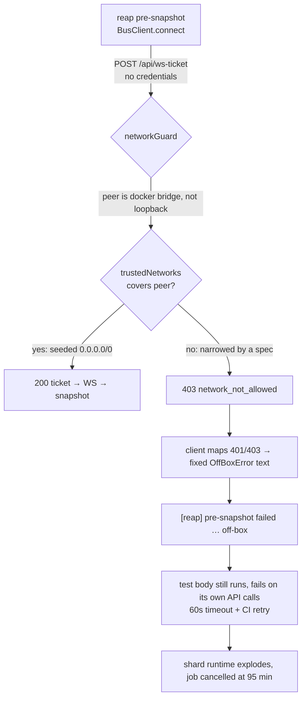
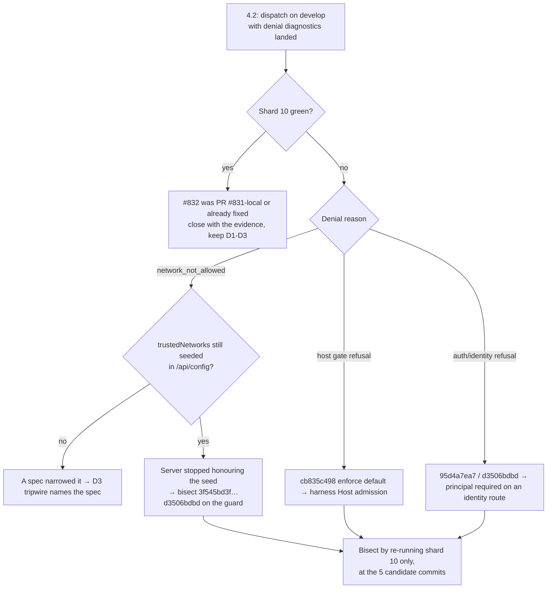

# Design — triage-browser-e2e-offbox-poison

## Context

### What the evidence actually says

`ci-e2e-browser.yml` shard 10 hangs: after `mcp-client-harness-integration.spec.ts:152` ("X23: a server toggle round-trips through the effective view") every later test fails and each one logs

```
[reap] pre-snapshot failed; skipping this test's reap: OffBoxError: ticket mint denied: off-box / untrusted network needs device pairing (loopback-only MVP)
```

That line is emitted at `tests/e2e/fixtures.ts:186` when `connectBus()` (`tests/e2e/fixtures.ts:92-96`) cannot mint a WS ticket.

**No browser-E2E run on `develop` has happened since the suspected regression.** The last `develop` dispatch is run 36343992345 (2026-09-27); `gh run list --workflow=ci-e2e-browser.yml --branch develop` returns exactly that one run, and every PR run since is `skipped` (label-gated) apart from 37430962491 / 37426842413 (2026-10-06, failures) and the three cancelled #831 runs. So the issue's "dispatch on develop to confirm" step is still open, and shard 10's hang is reproduced only on PR #831's runs.

### Why a mint denial is believable here, and why it is global

The harness is a container reached through a published port, so the server never sees a loopback peer — `docker/test-entrypoint.sh:186-197` documents that the observed peer address can even be public on a host running a VPN layer, and `tests/e2e/helpers/operator-session.ts:5-12` repeats it. The entrypoint therefore seeds `trustedNetworks: ["0.0.0.0/0"]` (`docker/test-entrypoint.sh:221`). `POST /api/ws-ticket` is gated by `networkGuard` as a `preHandler` (`packages/server/src/server.ts:2793-2795`) and is an identity route the identity road-gate never touches (`packages/server/src/identity/http-road-classification.ts:119`). The bus client sends no cookie, no bearer, no local-token (`packages/bus-client/src/client.ts:118-127`).

So for the suite's own client there is exactly ONE pass condition: the seeded trusted-network list. Narrow it and every credential-free caller is refused at once — permanently, because nothing re-widens it.



### The two structural defects, verified

**D-A — one global switch, no isolation.** Specs change trust-bearing keys (D3 set) on the shared harness and restore them only in `afterAll` (or, in-test, in a `finally`). The list below is the result of `grep -rnE '(trustedNetworks|bypassHosts|bypassUrls|allowedHosts|hostGate|requireLocalProof)' tests/e2e` filtered to server writes (route stubs such as `bind-reachability-advisory.spec.ts`'s `stubConfig` excluded — they never reach the server), plus the two specs that write a key through the UI's Save:

| Call site | Changes | Write path | Restores |
|---|---|---|---|
| `tests/e2e/mcp-tiered-token.spec.ts:38-46` | `trustedNetworks: []`, `auth.bypassUrls` | `PUT /api/config` | `:104-106` (`afterAll`) |
| `tests/e2e/helpers/operator-session.ts:43-55` (used by `vault-*`, `api-not-found`) | same | `PUT /api/config` | `:58-69`, called by each spec's own hook |
| `tests/e2e/mcp-token-settings.spec.ts:66-67` | same | `PUT /api/config` | own hook |
| `tests/e2e/lan-knock.spec.ts:101-105` | `trustedNetworks: NOBODY` in `beforeAll` (describe scope, serial) | `PUT /api/config` | `:108-111` (`afterAll`) |
| `tests/e2e/gateway-url-action.spec.ts:44-60` | `trustedNetworks` (and CORS/gateways) through the UI | UI Save → `PUT /api/config` | `afterAll` |
| `tests/e2e/host-gate-allow.spec.ts:171-173,216-217` | `allowedHosts` (F9, through the UI) | UI Save | `:166-174` (`afterAll`) |
| `tests/e2e/access-grant-dialog.spec.ts:162,257,440` | `hostGate.mode` (`beforeAll`), `trustedNetworks` (in-test) | in-container `config.json` write (`:54-66`) | `:165` (`afterAll`), in-test `finally` (`:271`, `:455`) |
| `tests/e2e/preview-denial-remedy.spec.ts:174,299` | `hostGate.mode` (`beforeAll`, in-test) | in-container `config.json` write (`:84-96`) | `:177` (`afterAll`), `finally` (`:307`) |

**Lint hit list (task 3.0, `analyzeTrustWriteSource` over `tests/e2e/**/*.ts` on the pre-migration tree — 19 findings, 9 files).** It reproduces the table above and adds one write the table missed: `host-gate-allow.spec.ts` F3 removes the `hostGate` key from the in-container `config.json` (`delete stripped.hostGate`), a write `PUT /api/config` cannot express — migrated with `narrowTrust(request, {}, {touches:["hostGate.mode"]})` plus the lint's justified marker `e2e-trust-write-ok(<reason>)`, honoured only in a file that also calls `narrowTrust(`. Hits by file: `access-grant-dialog` (5), `mcp-tiered-token` (2), `mcp-token-settings` (2), `preview-denial-remedy` (3), `helpers/operator-session` (2), `lan-knock` (2), `gateway-url-action` (1), `host-gate-allow` (2). Migrated all; tree now 0 findings.

`tests/e2e/network-guard.spec.ts:14-22` already states the hazard in prose: *"Clearing the list with auth off would therefore lock the harness for every sibling spec with no way back."* Playwright does not run `afterAll` when the worker is killed (CI cancellation, OOM, `globalTimeout`), and a hook that itself needs API access cannot recover a harness that refuses it. Every one of these specs is one timeout away from poisoning its whole shard.

**D-B — the latch probes the one immune endpoint.** `probeHarness()` reads `/api/health` (`tests/e2e/fixtures.ts:83-89`) and `decideGate` (`tests/e2e/reap-core.ts:247`) needs 3 consecutive failures to latch. But `/api/health` is an explicit in-namespace public exception to the guard (`packages/server/src/auth/localhost-guard.ts:466-480`), and `tests/e2e/network-guard.spec.ts:68-71` asserts it stays 200 for an untrusted peer. A refusing harness is 100% healthy by the latch's definition, so the run never short-circuits: with `workers: 1`, `timeout: 60_000` and `retries: 1` in CI (`playwright.config.ts:39`, `:49`, `:50`), ~50 remaining tests cost ~100 test-minutes — exactly the ">95 min, cancelled" symptom.

**D-C — the diagnostic is a guess.** `packages/bus-client/src/client.ts:131-133` maps *both* 401 and 403 to `new OffBoxError()` with a hard-coded message, discarding the guard's self-describing body (`{ success:false, error:"network_not_allowed", reason, hint }` — `packages/server/src/auth/localhost-guard.ts` denial path). Host-gate refusal, auth-enforced refusal and trust-narrowing are indistinguishable in the log, which is why #832 had to speculate.

### What changed in the window (candidate triggers, unproven)

Last green develop dispatch 2026-09-27 → first observed hang 2026-10-08. Commits touching the trust path in that window. Dates are `git log -1 --format=%ad --date=short <sha>`, listed chronologically (this is also task 4.6's bisect order):

| Commit | Date | Why it is a candidate |
|---|---|---|
| `3f545bd3f` | 2026-09-28 | relayed loopback never trusted by a trusted-network entry (#751) |
| `95d4a7ea7` | 2026-10-01 | multi-user identity plane, principal resolution, WS-ticket binding (#697) — the issue's suspect |
| `cb835c498` | 2026-10-04 | harden-server-request-surfaces: **host gate defaults to `enforce`** (#798) |
| `27d6391e7` | 2026-10-05 | strict local proof, httpOnly device cookie, **0600 config** (#808) |
| `d3506bdbd` | 2026-10-05 | identity break-glass, policy-gated roads (#811) |

A detail that matters for the bisect, and that is **assumed here, not verified** (shard membership depends on the run-time shard split; task 4.0 re-derives the real shard-10 file list and its ordered server-state mutations from the failing run's log before any weight is put on this): shard 10 runs `workers: 1`, `fullyParallel: false`, so file order is alphabetical and X23 is test #6-7. The only server-state mutation ahead of it in that shard is `POST /api/restart` in `tests/e2e/mcp-builtin-registration.spec.ts:49-69` (X2 restarts the dashboard and polls for a new pid). A restart that comes back with a different effective trust posture — seeded list not re-read, config now 0600 and unreadable, host gate now `enforce` — would poison everything downstream and is consistent with "the first few tests pass, then everything is refused".

## Goals

1. A harness that refuses the suite's own client by **harness policy** (the network guard's `network_not_allowed` or the host gate's `host_not_allowed`) ends the run in at most one extra failure, with the server's own reason in the message. Other refusals fail the observing test loudly but do not end the run.
2. No single spec can leave harness-global network trust narrowed for the next spec.
3. #832's trigger is named by a bisect that cannot be run from this desk, with the decision points written down beforehand.
4. #862's two budget failures go green.

## Non-goals

- Fixing #683's quarantine backlog (see the triage table below).
- Re-designing harness trust, pairing or the identity plane.

## Decisions

### D1 — Keep `OffBoxError`, make it carry the server's verdict in typed fields

`OffBoxError` stays the thrown type and `off-box` stays its code. It gains two optional readonly fields — `status` (number) and `error` (string) — and the *message* renders status + `error` + `reason`. Typed fields exist so the e2e gate (D2) classifies refusal vs transport without parsing a message string; the message is for humans only.

What each field actually is, verified at `packages/server/src/auth/localhost-guard.ts:364-372`:

| Body field | Nature | Used for |
|---|---|---|
| `error` | **stable machine-readable literal** — `"network_not_allowed"` for every network denial; the guard's own comment says so (`localhost-guard.ts:364-366`) | branch/latch key, copied to `OffBoxError.error` |
| `reason` | **human prose** (`"Source IP not loopback, not in trustedNetworks, …"`, or the token `local_proof_required` on the strict-local branch at `:355-361`) | message text only — never branched on |
| `hint` | human remedy, may name hosts | never copied |

Reading the denial body is **new behaviour**. Today the client throws a bare `OffBoxError` on 401/403 *before* any `res.json()` (`packages/bus-client/src/client.ts:131-135`), so a non-JSON denial cannot throw `SyntaxError` today — it simply loses the body. Once the denial path starts reading the body, a non-JSON 401/403 (a proxy or gateway page) must not turn into a parse failure: the denial path reads the body as text, attempts `JSON.parse` inside a try, and on failure throws a status-only `OffBoxError` with `error` left undefined.

*Alternatives rejected:* (a) a new `DeniedError` code — every consumer branch (`packages/bus-client/src/__tests__/offbox-ticket-denied.test.ts`, the e2e fixture) would need updating for no behavioural gain at the call sites, which all treat it as "cannot connect"; (b) logging the full body — the body may carry a `hint` with host details, so only the bounded `error`/`reason` pair is surfaced; (c) message-only (no typed fields) — D2 would have to regex the message, which is exactly the brittleness this change exists to remove.

### D2 — Latch on *harness-policy refusal*, not only on *death*

The pre-test gate keeps the `/api/health` probe (it is the only cheap liveness signal) and adds a second verdict: when the suite's own credential-free client is refused by a **harness policy**, the harness is declared **unusable** immediately — no 3-strike counter, because a policy refusal is a verdict, not a transient. The current test fails with a message naming the refusal; the rest of the run is skipped, exactly as for a dead harness.

**Where the refusal is observed (the hook).** `/api/health` passes under refusal (`tests/e2e/network-guard.spec.ts:68-71`), so the probe cannot see it. The only credential-free bus call before the body is the reap pre-snapshot (`tests/e2e/fixtures.ts:184-190`), which today catches every error and warns ("never fail a spec on reap bookkeeping"). That catch is the hook: it stops swallowing `OffBoxError`s that carry a `status` and routes them through the gate below; transport errors (no `status`) keep today's warn-and-continue. No extra probe request is added.

**One rule.** Latch on HTTP **403** whose `error` is in an explicit list of harness-policy literals; nothing else latches.

| Observed at pre-snapshot | Classification | Effect |
|---|---|---|
| 403, `error === "network_not_allowed"` (`packages/server/src/auth/localhost-guard.ts:358,370`) | network-guard refusal | **latch**; current test fails; rest skipped |
| 403, `error === "host_not_allowed"` (`packages/server/src/auth/host-gate.ts:264-266,376-378`) | host-gate refusal | **latch**; current test fails; rest skipped |
| 403 with any other / absent `error` — e.g. identity road-gate `forbidden` (`packages/server/src/identity/identity-road-gate.ts:63,71`) | unknown refusal | **no latch**; current test fails with status + `error` + `reason` |
| 401 (auth plane) | credential verdict | **no latch**; current test fails with status + `error` + `reason` |
| fetch threw / timeout (no `status`) | transport | no latch; warn as today; 3-strike liveness path |
| any refusal while disarmed (narrow boot baseline, or declared narrowing active) | expected | not observed / warn as today; never latches, never fails the test |

The policy-literal list is a single exported constant in `tests/e2e/reap-core.ts`. The OAuth email-allowlist 403 (`packages/server/src/auth/auth-plugin.ts:417`) is an HTML page on `/auth/*`, not a `/api/ws-ticket` answer, so it cannot reach this table; it would classify as "unknown refusal" if it ever did. Classification reads `OffBoxError.status` / `.error` (D1), never the message.

**The latch fires only on an *unexpected* refusal.** The pre-snapshot runs after `beforeAll` hooks (Playwright order: worker fixtures → `beforeAll` → test fixtures), so a refusal there is not always unintended. Two legitimate cases would otherwise latch and self-defeat:

- **Describe-scope narrowing** — `tests/e2e/lan-knock.spec.ts:101-105` narrows `trustedNetworks` to `NOBODY` in `beforeAll`; its first test's credential-free pre-snapshot (`tests/e2e/fixtures.ts:184-190`) is then refused.
- **A harness booted narrow** — `tests/e2e/network-guard.spec.ts:32` imports `test` from `fixtures.ts`, so the auto `reapSessions` fixture (`tests/e2e/fixtures.ts:136`, `auto: true` at `:243`) runs its pre-snapshot on the dedicated `PI_E2E_TRUSTED_NETWORKS=127.0.0.1/32` leg (`:14-22`), where refusal is the intended state.

So the refusal verdict is **armed** only when both hold:

1. **The boot baseline admits the credential-free client.** `globalSetup` (D3 L2) records, next to the trust baseline, `credentialFreeAdmitted` — the outcome of one credential-free ticket mint against the freshly booted harness. When `false` (a narrow-booted leg), the refusal verdict is disarmed for the whole run.
2. **No declared narrowing is active.** `narrowTrust` (D3 L1) registers every narrowing — test- or describe-scope — in the module registry until it is restored. While the registry holds an active entry, the pre-snapshot is **skipped** with the note `[reap] pre-snapshot skipped: declared narrowing active (<owner spec>)`; that test runs unreaped (the reap's existing "no baseline → no delta" path, `tests/e2e/fixtures.ts:194`). The pre-snapshot cannot use the credentialed path instead: the bus client sends no credentials at all (`packages/bus-client/src/client.ts:118-127`).

**The refusal latch is sticky (E4).** Unlike the liveness latch, which re-probes before it is consulted, a refusal declaration is never re-evaluated: under CI `retries: 1` the retry of the test that observed the refusal is reported **skipped**, like every later test. A policy refusal does not recover on retry, so re-running the pre-snapshot would only burn another timeout.

When the verdict is disarmed, a refusal at pre-snapshot keeps today's behaviour exactly — warn and continue unreaped, no failure, no latch. A spec's own credential-free calls *during* its narrowing are never classified by the gate.

*Alternatives rejected:* (a) widening the health probe to a guarded endpoint — `/api/health` is deliberately public and other consumers (tunnel watchdog) depend on that; (b) counting 3 refusals like the death latch — a policy refusal does not recover on retry, and the whole point is to stop burning 60 s timeouts; (c) auto-healing the config from the fixture on *every* refusal — a test fixture that silently re-widens a security switch on an unknown refusal would mask the very product bug under investigation (the bounded, declared re-assert in D3 is not that: it runs at worker start, from the harness's own recorded boot baseline, before any test body); (d) latching on any 403 — an identity-plane `forbidden` is a statement about a principal, not about the harness, and would skip a shard on a test-local auth bug.

### D3 — Restore inside the reap fixture (in-process) + re-assert the boot baseline at worker start (kill-proof), then tripwire

Fixture teardown is **not** kill-proof. It runs on failure and on timeout, but a worker killed by SIGKILL / OOM / CI job cancellation runs no user code at all — the same fate as `afterAll`. The observed #832 vector is precisely a cancellation (shard 10 cancelled at 95 min), so teardown alone would not have saved it. Two layers.

**Trust-bearing key set (resolves Open Q2).** Every config key that changes who the harness admits, read from `GET /api/config`:

- `trustedNetworks` (`packages/shared/src/config.ts:868`)
- `auth.bypassHosts` — unioned into the effective trust set (`packages/shared/src/config.ts:878`, `packages/shared/src/bind-reachability.ts:207-212`)
- `auth.bypassUrls` — narrowed by both call sites (`tests/e2e/mcp-tiered-token.spec.ts:38-46`, `tests/e2e/helpers/operator-session.ts:49-52`)
- `allowedHosts`, `hostGate.mode` — the host gate's admission inputs (`packages/shared/src/config.ts:851,858`; refusal at `packages/server/src/auth/host-gate.ts:376-378`)
- `requireLocalProof` — flips the guard to the strict-local branch (`packages/shared/src/config.ts:877`; `localhost-guard.ts:355-361`)
- `resolvedTrustedNetworks` (derived; compared read-only, so a seed that stops being *honoured* is visible too)

Specs *do* change the host-gate keys today — `allowedHosts` (`tests/e2e/host-gate-allow.spec.ts:171-173,216-217`) and `hostGate.mode` (`tests/e2e/access-grant-dialog.spec.ts:162,440`, `tests/e2e/preview-denial-remedy.spec.ts:174,299`); see the D-A table. No spec changes `requireLocalProof` today; it is in the set because changing it refuses the suite exactly as a narrowed `trustedNetworks` does. Task 3.5 confirms `GET /api/config` returns each of them; a key it does not return is dropped from the set with a note. Not the whole snapshot: `preferences`, `plugins` and `defaultModel` are legitimately written by specs and would make the tripwire noise.

**L1 — restore inside the reap fixture (covers failure + timeout), no ordering assumption.** Specs change trust-bearing keys only through `narrowTrust`, an exported helper in `tests/e2e/fixtures.ts` taking the `request` context (so it is callable from `beforeAll`, where only worker-scoped fixtures exist). It snapshots the trust-bearing keys, applies the patch, and pushes a restore record `{owner, scope, snapshot}` onto a module-level registry. Two shapes:

- `narrowTrust(request, patch)` — writes the patch itself.
- `narrowTrust(request, {}, { touches: [keys] })` — declares keys the test will change *through the UI* (`host-gate-allow` F9, `gateway-url-action`) without writing them; the snapshot still restores them.

Scope is **test** when called inside a test body, **describe** when called from `beforeAll`. Test-scope records are drained by the reap fixture after the test. Describe-scope records are drained by an `afterAll` the helper registers itself (`test.afterAll` inside `narrowTrust`), and survive between the describe's tests. Because the per-test pre-snapshot is skipped under an active narrowing (D2), a describe-scope `narrowTrust` takes one credential-free session snapshot *before* applying its patch, and its `afterAll` restores first and then reaps the group's session delta against that snapshot; that `afterAll` is not kill-proof, which is exactly what L2 covers. Neither shape has its own fixture teardown. The existing `reapSessions` auto fixture drains test-scope records itself, in straight-line code after `use()`:

```
reapSessions:  probe → pre-snapshot (gate, D2) → use() → drain narrowTrust registry (restore)
               → tripwire (compare vs pre-test read) → settle → reap → residual budget
```

Restore, tripwire and reap are sequential statements inside one fixture, so their order does not depend on Playwright's fixture teardown order, and the reap's credential-free bus client always runs against a restored harness.

**L2 — re-assert the harness's own boot baseline at worker start (covers kill).** `globalSetup` reads the trust-bearing keys once, right after the harness is up and before any spec runs, and writes them to a baseline file (`test-results/.trust-baseline.json`) together with `credential` and `credentialFreeAdmitted` (one credential-free ticket mint; arms or disarms D2's refusal verdict). When neither a credential nor credential-free access exists, the file records `baseline: null` and L2 is a no-op for the run. **Transport failure of the admission mint (E3):** if the credential-free ticket mint gets no HTTP answer (ECONNREFUSED, timeout — no `status`), `globalSetup` retries it within the existing harness health-wait budget and, if it still has no answer, aborts setup loudly naming the failure. It never records `credentialFreeAdmitted: false` from a transport failure — that would silently disarm D2's refusal verdict for the whole run. A **worker-scoped** auto fixture, once per worker before its first test, reads the live keys and, where they differ from the baseline file, writes the baseline back. It never writes the wide *seed* values: on a harness deliberately booted narrow (`PI_E2E_TRUSTED_NETWORKS=127.0.0.1/32`, `tests/e2e/network-guard.spec.ts:14-22`) the recorded baseline *is* narrow, and the re-assert is a no-op. Playwright starts a **fresh worker** after a worker crash within the same run, so the next worker heals a narrowing its predecessor was killed mid-way through. A cancelled CI **job** is not recoverable and does not need to be: the container is torn down with it.

**Credentialed access, and its precondition.** A narrowed harness refuses the credential-free bus client (`packages/bus-client/src/client.ts:118-127` sends no cookie, bearer or local-token), but still admits an authenticated caller (`packages/server/src/auth/localhost-guard.ts:450-456`). `tests/e2e/helpers/operator-session.ts:22-55` already mints such a cookie from the seeded e2e secret. `narrowTrust`, the L1 restore, L2 and the tripwire read/write through it. **Precondition:** that cookie exists only when the harness has `auth` configured — in managed runs that is `PI_E2E_OAUTH=1` (default at `tests/e2e/global-setup.ts:219`, seeded at `docker/test-entrypoint.sh:390-404`). Two fallbacks, both loud:

- **No credential** (auth not configured — e.g. the dedicated `network-guard` leg): `globalSetup` records the baseline file with `credential: false`. If the credential-free client is admitted, L2 and the tripwire use the credential-free read. If it is **not** admitted (`credentialFreeAdmitted: false` — the narrow-booted leg), `GET /api/config` is itself guarded and unreadable, so `globalSetup` records `baseline: null` and L2, the tripwire and the refusal verdict (D2) are all disarmed for the run; nothing can narrow at runtime there anyway. In both no-credential cases `narrowTrust` **fails the calling test** with "harness has no operator credential — this spec must declare itself unrestorable and run on a dedicated leg". A spec that narrows on such a harness therefore cannot pass silently.
- **Credential rejected** (cookie minted but `GET /api/config` with it is 401/403 — e.g. an identity-plane change invalidated the cookie shape): the L2 worker fixture fails its first test and latches the harness with the message "operator credential rejected: <status> <error>". Restore without a working credential is impossible, so the run must not continue pretending isolation holds.

**Tripwire.** After restore, the reap fixture compares the trust-bearing keys with the value it read before `use()`. Comparison semantics (E2): defaults are filled first — an absent list-valued key (e.g. `auth.bypassUrls` undefined) equals `[]` — then values must match exactly and in order; `["a","b"]` vs `["b","a"]` is a breach. The same helper serves the tripwire, the pre-read-vs-baseline check and L2's re-assert decision. A breach fails the **owning** test — the same attribution principle as the residual-session budget (`openspec/specs/playwright-e2e-qa/spec.md`, "Residual live sessions SHALL stay within a declared budget"). Under an active describe-scope narrowing both reads see the same narrowed value, so the describe's own tests do not breach. A describe-scope leak (its `afterAll` failed) is caught at the next test's pre-read: when the registry holds no active record, the pre-read must equal the recorded baseline; a difference re-asserts the baseline (as L2 does) and fails that test naming the last released owner. The reads are skipped when the harness is already latched or the baseline is `null`.

**Lint is the source of truth for the migration list.** The trust-write lint (test-plan E21/E22, ordered first by task 3.0) lands first in group 3: it greps `tests/e2e` for server writes of trust-bearing keys (`PUT /api/config`, `putConfig`, in-container `config.json` writes) outside `narrowTrust`; every hit is migrated, and the migration task list is that grep's output (today: the D-A table). UI-driven writes cannot be found by grep; the two known ones are migrated to `touches:`, and any future one is caught at runtime by the tripwire.

*Alternatives rejected:* (a) forbidding runtime trust mutation and booting a dedicated harness per such spec (the `network-guard.spec.ts` model) — correct but costs a workflow leg per spec and moves the eight D-A specs off the shared harness; keep it as the escape hatch for specs that cannot restore; (b) restoring from `globalTeardown` — too late, the damage is intra-shard, and it does not re-run after a worker crash; (c) trusting each spec's own hook — that is today's design and is what fails; (d) teardown-only, without L2 — leaves the observed kill/cancel vector uncovered; (e) comparing the whole config snapshot in the tripwire — see the key set above; (f) a separate trust fixture torn down before `reapSessions` — correct only under an assumption about Playwright's fixture teardown order, which the in-fixture drain makes unnecessary; (g) re-asserting the wide seed values at worker start — would silently widen a harness booted narrow on purpose.

### D4 — Task 4 is a bisect with written decision points, not a guess

The change does not pre-commit to a product fix.

**Dispatch order — baseline first, instrumentation second.** `develop` has had no browser-E2E dispatch since 2026-09-27, so its current state is itself unmeasured, and landing D1-D3 before the first dispatch would change fixture count, per-test work and teardown timing relative to the configuration that actually failed (observer effect). Task 4 therefore dispatches **twice**:

1. **Task 4.1 — baseline on unmodified `develop`.** Diagnostics-only at most (log lines, no behaviour change, no new fixture). This answers "does #832 reproduce on `develop` at all" against the code shape that produced the hang, and it is the question the issue leaves open.
2. **Task 4.2 — instrumented.** After tasks 1-3 land, dispatch again. D1/D2 are diagnostics plus a fail-fast latch; D3 adds per-test teardown work. The two runs are compared with that difference stated, and any divergence attributable to the instrumentation itself is recorded, not explained away.

The decision tree below is read on the **instrumented** run (4.2), the one that prints the denial reason:



If the verdict is R1 (not reproducible on develop), the change still lands D1-D3 and #832 closes as "cause removed or PR-local, guard rails added" — the spec deltas are written against the behaviour that must hold regardless. A **green 4.1 baseline together with a green 4.2 run** is the strongest form of R1: the failure is then not on `develop` at all, independently of this change's instrumentation.

*Alternatives rejected:* (a) bisecting first and instrumenting after — each bisect iteration costs a ~90 min sharded run, and without D1 every iteration produces the same uninformative message; (b) a single dispatch after D1-D3 land — that is the observer-effect problem above, and it leaves "was `develop` ever red?" permanently unanswerable.

### D5 — #862: bound the coverage scenario, state one publish budget

`scripts/__tests__/coverage-report.test.mjs:36-54` (E2) spawns `npm run test:coverage -- packages/extension/src/`. The path filter selects test *files*, but every project still loads under v8 instrumentation; CI measured 736 s against the test's own 600 s ceiling (`RUN_TIMEOUT_MS`, `:21`). The 736 s is **attributed, not proven**, to instrumentation load rather than to the path filter; task 6.0 measures the scoped replacement and records both numbers before the rescope is called a fix.

The behaviour E2 proves — an unloaded in-scope file is reported at 0% — does not need the whole repo: it needs a coverage run whose `include` glob reaches a file no test loads. X1's existing fixture (`scripts/__tests__/fixtures/coverage-failing/vitest.config.mjs:12-14`) does **not** qualify: its `coverage.include` is `["packages/shared/src/index.ts"]`, a file the repo loads everywhere. So a **new** fixture is created under `scripts/__tests__/fixtures/coverage-unloaded/` holding its own trivially-shaped source file that **no test anywhere imports**, with `coverage.include` pinned to it; the fixture directory is excluded from the root `coverage.include`/test globs so nothing can start loading it by accident, and a repo-lint case fails if any file outside the fixture imports it. The scoped run's ceiling (`RUN_TIMEOUT_MS` for this case) is **not pre-committed**: task 6.0 measures the scoped invocation on CI, and the ceiling is set to at least 1.5x that measurement and recorded in the test next to the measured number.

The full-repo guarantee stays where it belongs, in `coverage-config.test.mjs`'s pinned `include` — with the honest caveat that today that test *samples* (`packages/extension/src/bridge.ts` plus four exclusion cases, `scripts/__tests__/coverage-config.test.mjs:15-34`), it does not enumerate every `packages/*/src/**` file. The spec delta states exactly that sampled property (the named entry point is counted; the four named exclusions hold) and no universal one; widening the test to enumerate every file is optional follow-up, not promised here.

`scripts/__tests__/dependency-declarations.test.mjs:376` asserts `< 120 s`; the main spec says "under 60 seconds" (`openspec/specs/publish-correctness-verification/spec.md:171-180`); CI measured 122.2 s. The spec is restated as one budget that scales with the workspace count and names the CI contention allowance, and the test asserts that same number.

**The formula and the numbers behind it.** Two measured points exist, counted as `packages/*` non-private workspaces at the time. Only the first is in the repo (`scripts/__tests__/dependency-declarations.test.mjs:363-366` records 72.9 s at 37); the 122.2 s point comes from CI nightly run 38504381607 (job 115658811634) and is **not** recorded in the repo — task 6.3 records it in the test comment with the run id:

| `packages/*` non-private | Measured |
|---|---|
| 37 | 72.9 s |
| 56 | 122.2 s |

Slope = (122.2 − 72.9) / (56 − 37) = **2.595 s per workspace**, rounded **up** to 3. The formula is **not a fit**: a line through both points has intercept ≈ −23 s (72.9 − 2.595·37). The 30 s base is a **chosen** shared-runner contention allowance, not derived from the data:

```
budget_seconds = 30 + 3 * N
N = listWorkspaces().length + (rootPackage() ? 1 : 0)
```

`N` is exactly the set the checker walks (`scripts/verify-published-imports.mjs:672`: `[...listWorkspaces(root), ...(rootPkg ? [rootPkg] : [])]`); the root `package.json` declares no `"private"`, so `rootPackage()` is non-null and today **N = 57** (56 + root). A constant +1 offset does not change the slope. Budget at N = 57: **201 s** against a measured 122.2 s — 1.64x headroom, so routine runner contention passes while a 2x regression (~244 s) still trips. The test imports `listWorkspaces` / `rootPackage` from the checker module and computes `N` with the same expression, so a new workspace moves the ceiling by 3 s instead of breaching it, and a breach reports `measured Xs vs budget Ys (N workspaces)`.

*Alternatives rejected:* (a) raising E2's timeout to 20 min — the nightly job's wall clock is the real constraint and the run is pure waste; (b) deleting E2 — it pins the one coverage property the audit was about; (c) a flat higher publish ceiling — it drifts again at the next workspace, and the spec/test disagreement would survive.

*Local-repro caveat recorded for the implementer:* running E26 (`publish dry-run covers exactly the non-private set`) on a developer machine with an authenticated npm fails with `EPUBLISHCONFLICT` ("cannot publish over the previously published versions: 0.9.0") after previewing only the root, because `npm publish --dry-run` still contacts the registry. CI is unauthenticated and does not hit it. E26 is NOT part of #862 — do not "fix" it from a local red.

### D6 — Review decisions (E1–E6)

Human-approved at review; folded into D2/D3, the spec delta, `test-plan.md` and `tasks.md`.

| id | Question | Decision |
|---|---|---|
| E1 | Tripwire + pre-read per-test cost threshold | **Record only** — manual evidence in this design, no assertion (test-plan P1 manual-only). |
| E2 | Trust comparison semantics | **Fill defaults first** (absent list ≡ `[]`), then **exact in-order** match; a reordered list is a breach (test-plan E16). |
| E3 | `globalSetup` credential-free mint fails by transport | **Retry within the existing health-wait budget, then abort loudly**; never record `credentialFreeAdmitted: false` from a transport failure (test-plan X12). |
| E4 | Playwright retry of a test that latched on a policy refusal | **Skipped** — the refusal latch is sticky; it is not re-probed (test-plan X9). |
| E5 | Extra ~90 min baseline dispatch on unmodified `develop` | **Accepted** — task 4.1 runs (Open Q4 resolved). |
| E6 | Describe-scope narrowing releases sessions once per group | **Accepted** — `afterAll` drain reaps the group delta (test-plan F3). |

## Implementation notes (ship-it, verified against a local docker harness)

Deviations from the text above, each found by running the real harness, none changing a spec requirement:

1. **Describe scope is released lazily.** Playwright forbids `test.afterAll()` from inside a running hook, so `narrowTrust` cannot register its own `afterAll`. A describe-scope record (called from `beforeAll`) is instead released — restore, then reap the group's sessions — when the first test of a *different spec file* starts, before that test's snapshot. The delta's "restored when the group ends … before the next group's first test" holds; the group's end is detected at that boundary. Verified: `lan-knock` (describe scope) followed by `mcp-tiered-token` passes with a clean pre-snapshot.
2. **The operator credential is cookie + local token.** With `auth.bypassUrls: ["/"]` still seeded, the auth hook returns before the cookie branch, so after a `trustedNetworks`-only narrowing (lan-knock) the cookie alone is refused `403 network_not_allowed` and a restore is impossible. Reads/writes therefore also send the harness's local-IPC `X-Pi-Local-Token` (read once per worker from the container, re-read once on a refusal). "Has a credential" still means "auth configured" (the cookie exists), so the no-credential behaviour (E20) is unchanged.
3. **The refusal latch is persisted.** Playwright discards the worker after a failed test, so module state does not survive the very failure that raises the declaration. The verdict is written to `test-results/.harness-refused.json` (cleared by globalSetup) and re-read by every worker, which is what makes "sticky across retries" (E4) true in practice.
4. **Pre-test baseline check runs before the pre-snapshot.** On a harness holding an operator credential an undeclared network narrowing is therefore *healed and fails that test* (naming the last released owner) instead of latching the run; the refusal latch is the backstop for a refusal that cannot be healed (host gate, credential rejected). Consequently test-plan X3/X4/P5 (undeclared network / host-gate refusal latches the run at L3) are not reproducible on a credentialed harness and are pinned at L1 (E8, E9, X9). The L3 fault spec covers the recoverable faults instead (X8, X10, X14, X15) and was run green against a fresh harness.
5. **X2 has no client-side timeout to hit.** `BusClient.mintTicket` sets none; the test asserts that a fetch failing after a delay (a transport timeout) keeps the unreachable-shaped error.
6. **A reused, already-poisoned harness records the poison as its baseline** (`PW_E2E_USE_RUNNING=1` against a harness a previous run left narrowed). Managed runs boot fresh; fault runs must too.
7. **Local verification caveat.** In a worktree whose `node_modules` is the parent checkout's, `@blackbelt-technology/pi-dashboard-bus-client` resolves to the parent's package, so host-side Playwright would run the old bus client. A worktree-local symlink (`node_modules/@blackbelt-technology/pi-dashboard-bus-client → packages/bus-client`, untracked) was used for the verification runs; CI installs the workspace links to itself.

8. **Absent scalar trust keys are out of scope for restore.** `GET /api/config` always returns every trust key with its default (`hostGate.mode`, `requireLocalProof`, lists), so in practice no scalar is ever absent from a snapshot; if one were, `buildRestorePayload` does not write it back and `compareTrust` skips it (X16). No current spec narrows `requireLocalProof` or `hostGate.mode` by deleting it.

**Per-call cost (task 3.9, decision E1 — recorded, not asserted).** A credentialed `GET /api/config` against the local container measures **1.4 ms** (20 reads, token cached), so the tripwire plus the pre-test read add ≈ 2.8 ms per test, ≈ 0.1 s once per worker for the local-token `docker exec`. The full-shard on/off measurement (task 3.9) is still to be taken from the CI dispatch of task 4.

**Verified live (local harness, `PI_E2E_SEED=1 PI_TEST_PEERS=both PI_E2E_OAUTH=1`):** `api-not-found`, `gateway-url-action`, `host-gate-allow` F3, `lan-knock`, `mcp-tiered-token`, `mcp-token-settings`, `vault-settings` green (`host-gate-allow` F9 fails identically on the un-migrated original — pre-existing, unrelated); `lan-knock` logs `[reap] pre-snapshot skipped: declared narrowing active (lan-knock.spec.ts)` per test (F1) and the next spec reaps cleanly (F2/F3); `harness-isolation-faults` (X8, X10, X14, X15) recoveries green; narrow leg (`PI_E2E_TRUSTED_NETWORKS=127.0.0.1/32`, no auth) `network-guard` 6/6 incl. E20 and F6.

**#862 budgets (task 6.0, measured on CI — PR #955, run 39111480624, job `ci-scenarios`).** Scoped coverage scenario E2: **814 ms** spawn-to-exit on CI (0.35 s wall on a developer machine, vitest itself 74 ms), reporting `unloaded.ts` at 0% with 6 lines counted — against the **736 s** the full-repo invocation took on the nightly (run 38504381607, ceiling 600 s). `SCOPED_RUN_TIMEOUT_MS = 120_000 ≥ 1.5 × SCOPED_RUN_MEASURED_MS (814)`. Publish checker (P2): **75.1 s** for the live scenario in the same job (the nightly's 122.2 s ran alongside the whole suite), budget `30 + 3 × N` with N = 59 today → 207 s; both `ci-scenarios` files green (83 passed, 2 skipped). The old flat 120 s figure and the spec's "60 seconds" are gone.

## Bisect outcome

Recorded from the two dispatches of `ci-e2e-browser.yml` (tasks 4.1, 4.2) plus a local reproduction. Verdict: **R2 — a spec narrowed trust and never restored it; no product defect.** The decision path was D4's `network_not_allowed` / "trust no longer seeded" branch, resolved at the spec, so the product-fix group (task 5) does not apply.

| | Baseline (task 4.1) | Instrumented (task 4.2) |
|---|---|---|
| Run | 39103483317 on unmodified `develop` (a959ac206 + #895) | 39104241905 on `os/triage-browser-e2e-offbox-poison` |
| Shard holding the `mcp-*` block | shard 10, 77 tests: `mcp-session-token`, `mcp-tiered-token`, `mcp-token-settings`, `mermaid-*`, `mobile-viewport-bound`, …, `openspec-artifact-dialog` | shard 8, 75 tests |
| Outcome | **hung**: job cancelled by the 120-min cap (06:17 → 08:17Z), 120 results recorded | completed in **31.9 min**, 66 passed / 5 failed / 2 skipped |
| `OffBoxError` lines in that shard's log | 107 | 0 |

**First denial line, baseline, verbatim** (shard 10, 06:23:52Z, right after `mcp-session-token`, the first test of `mcp-tiered-token` passing in 67 ms):

```
[reap] teardown failed (diagnostic only): OffBoxError: ticket mint denied: off-box / untrusted network needs device pairing (loopback-only MVP)
```

Every later test then fails its pre-snapshot with the same line (the old bus client's fixed message — the unclassified 401/403 that D1 replaces), the `mermaid-*`, `mobile-viewport-bound` and `openspec-artifact-dialog` tests each burn a 60 s timeout plus a retry, and the shard never finishes. The instrumented run exercised the same files in the same order and had no refusal at all.

**Root cause, reproduced locally in 3.5 s** (`develop` code, a fresh harness): the pre-change `mcp-token-settings.spec.ts` calls `armOperatorSession` from `beforeEach`, and unlike `mcp-tiered-token.spec.ts` (which carries "capture the ORIGINAL snapshot ONCE") it re-snapshots the config on every call. Test 2's `beforeEach` therefore snapshots the *already narrowed* config, and the `afterAll` "restore" writes the narrowed values back: after the spec's three tests `GET /api/config` reads `trustedNetworks: []` and `auth.bypassUrls: ["/v1/"]` and a credential-free ticket mint is refused. The spec has had three tests since 2026-09-14, so the latent defect predates the window; the bisect candidates in the "What changed" table (host gate `enforce`, strict local proof, relayed-loopback trust) are what turned the leftover narrowing from tolerated into fatal, but none of them needed to be touched — the narrowing is the defect. `mcp-builtin-registration` X2's `POST /api/restart` (open question 1) is not involved: it runs earlier in the shard, and the first refusal appears only after the narrowing spec.

**Task 4.0 re-derivation** (failing run 37757227913, shard 10, 65 tests, same shape as the baseline above): ordered mutations ahead of X23 are `mcp-builtin-registration` X2's restart and nothing else, as the design assumed; but X23 is not where the poison starts — it starts at `mcp-tiered-token` / `mcp-token-settings`, after it. The `#832` claim that X23 poisons the harness is therefore a misattribution, as the proposal already suspected.

**Observer effect (task 4.2).** The two runs fail the same number of distinct tests (199 vs 199); the sets differ by 16 each way, all dispersed over unrelated, order-sensitive files (identity-matrix, notify-*, preview-denial-remedy, poll-hot-paths, …) in shards whose composition shifted because this change adds spec files — consistent with run-to-run flakiness, not with the instrumentation. In the four shards whose test count is identical in both runs (1, 2, 5, 6) the wall clock moved by −1.4, −3.2, +0.3 and +0.3 min: the tripwire and pre-test read (≈ 2.8 ms per test measured locally) are below the run-to-run noise, which is the answer to task 3.9.

**Decisions taken from the verdict:** 4.3 not applicable (baseline was red, not green); 4.4 done by task 3.4 (the offending spec, and every other raw writer, now goes through `narrowTrust`; shard re-run = run 39104241905); 4.5 / 4.6 not applicable (the refusal reason is a spec-made narrowing, not a lost seed, a host-gate or an identity verdict); task 5 (product fix) not applicable; 5.5 — no cluster is unquarantined: the two Candidate clusters' original #683 logs were not re-examined and one post-fix dispatch is not three consecutive green runs, so every #683 fixme stays.

## #683 triage (non-goal — follow-up changes)

`test.fixme(true, ".../issues/683")` call sites today: **101 across 44 spec files** (the issue text says ~33). The count drifts, so it is re-derived rather than trusted — `grep -rc 'issues/683' tests/e2e --include=*.ts | awk -F: '{s+=$2} END {print s}'` for the total and `grep -rl 'issues/683' tests/e2e | wc -l` for the file count. Clusters, with the proposed owner change:

| Cluster | Files (fixme count) | Shares #832's root cause? | Follow-up |
|---|---|---|---|
| openspec-init affordances | `openspec-init-affordances-folder` (10), `openspec-init-affordances-session-card` (9), `openspec-board-drop` (3), `openspec-board-worktree-availability` (1) | No — folder READY section never renders after a real `openspec init` | `fix-e2e-openspec-init-affordances` |
| subagent | `subagent-tick-throttle` (6), `subagent-pull-measurements` (4), `subagent-thin-tick-liveness` (3), `subagent-pull-under-load` (3), `subagent-inspector` (3), `subagent-fanout-admission` (3), `subagent-detail-dialog` (2), `subagent-fanout-measurement` (1) | No — related to #679 host-pressure fan-out | `fix-e2e-subagent-cluster` |
| chat scroll / virtualization | `selection-anchor` (4), `chat-transcript-virtualization` (2), `scroll-to-top` (1), `replay-in-flight-pill` (1) | No — pixel/geometry assertions under the real harness | `fix-e2e-chat-geometry` |
| queue / image / prompt lifecycle | `followup-image-queue` (7), `optimistic-prompt` (1), `pending-prompt-recovery` (1), `package-queue-visible` (1) | No | `fix-e2e-prompt-queue` |
| restart / boot / session lifecycle | `ended-session-endedat` (2), `status-reconcile` (2), `durable-session-diff` (1), `faux-ask` (1), `keeper-restart-survival` (1), `tmux-session-shutdown` (1), `spawn-correlation-recovery` (2) | **Candidate** — these specs restart or re-boot the harness, the same axis as `mcp-builtin-registration` X2; re-check after task 4's verdict | `fix-e2e-restart-cluster` (may fold into this change if task 4 names the restart) |
| trust / token surfaces | `mcp-session-token` (2), `origin-gate` (1) | **Candidate** — same guard surface | re-check after task 4 |
| misc UI | `folder-actions-menu` (5), `editor-pane` (4), `folder-membership-drag` (1), `terminal` (1), `inline-terminal-transcript` (1), `inline-screenshot` (1), `history-backfill-gap` (1), `flow-roundtrip` (1), `flow-live-no-double-render` (1), `anthropic-bridge-activation` (1), `automation-fanout` (1), `acp-automation` (1), `pi-runtime-picker` (1), `settings-default-model-catalogue` (1), `tool-created-files` (1) | No | `fix-e2e-misc-reds` (split further when picked up) |

Only the two **Candidate** rows may be unquarantined inside this change, and only when "shares the root cause" is **proven**, both parts required: (a) the spec's **original #683 failure log** (the run that got it quarantined) shows the refusal / off-box signature — `OffBoxError` / `network_not_allowed` / `host_not_allowed` — and not a geometry, assertion or timing failure of its own; and (b) it passes in **≥ 3 consecutive dispatched runs** after the fix. Either missing → it stays quarantined under #683 and goes to its follow-up change. Task 5.5 carries this.

## Risks / trade-offs

- **The bisect may not reproduce on `develop`.** Then #832's hang was PR-local or already fixed, and this change lands guard rails only. Mitigated by writing the spec deltas against invariants rather than against a specific trigger.
- **A refusal latch can over-trigger.** A single 403 skips the rest of the shard. Mitigated by latching only on the two harness-policy literals (`network_not_allowed`, `host_not_allowed`), only when armed — boot baseline admits the credential-free client and no declared narrowing is active (D2); a 401, an unknown 403 and a transport error never latch.
- **An undeclared narrowing latches the run.** A spec that narrows without `narrowTrust` (e.g. a future UI-driven write the lint cannot see) leaves the registry empty, so the next pre-snapshot latches and the shard stops. Accepted: that is the intended loud signal, and the tripwire on the owning test fires first.
- **Tests under a describe-scope narrowing are reaped per group, not per test.** The pre-snapshot is skipped while a narrowing is active (D2); the describe-scope drain reaps the group's delta after restoring (D3 L1). This is a stated exception to "A spec SHALL release every session it spawns" (per test), written into the delta. Accepted at review (E6): the only per-test alternative is a credentialed bus client, which does not exist. A worker killed mid-group leaks those sessions until the residual-session budget flags them.
- **Describe-scope restore is `afterAll`, which a killed worker skips.** Covered by L2's worker-start re-assert and by the next test's baseline pre-read check (D3 tripwire).
- **A new harness-policy literal is missed.** If the server adds a third policy refusal with a new `error` literal, the gate classifies it "unknown": the current test fails loudly with the literal in the message, but the shard is not skipped. Accepted: a loud per-test failure naming the literal is the signal to extend the constant list; latching on unknown 403s would over-trigger on identity-plane `forbidden`.
- **A spec's own calls during its narrowing are unclassified.** A narrowing spec's credential-free calls are refused by design and the gate does not look at them; a *genuine* harness fault inside that one test body is therefore only seen at the next test's pre-snapshot. Accepted: one test late, after the reap fixture has restored.
- **Isolation needs a credential the suite holds.** `narrowTrust`, restore, L2 and the tripwire sign an operator cookie from the e2e secret constant (`tests/e2e/helpers/operator-session.ts:22`). That widens the number of places that mint one; the secret is harness-only, seeded by `docker/test-entrypoint.sh`. The cookie exists only with `auth` configured (`PI_E2E_OAUTH=1`, the managed default). Without it, runtime narrowing fails the calling test (D3 fallback) — a no-auth harness can only be narrow by boot. If an identity-plane change makes the cookie stop working, the worker-start fixture latches the harness with "operator credential rejected" rather than running without isolation.
- **A CI job cancellation is still unrecoverable.** L2 heals a killed *worker*, not a cancelled *job*. Accepted: a cancelled job tears the container down, so there is no later spec to poison.
- **The tripwire adds a credentialed config read per test.** One `GET /api/config` per test against a local container, carrying the operator cookie so it works whatever the trust posture; measured cost should be far below the existing settle/reap traffic. Decided at review (E1): the cost is **recorded only** — measured once over a full shard with the tripwire on vs off and written to this design as manual evidence (test-plan P1, task 8 manual line); no threshold is asserted.
- **A spec that cannot restore.** If a spec must leave the harness narrowed (auth off, no cookie branch), the only correct answer stays a dedicated harness leg (`network-guard.spec.ts`'s model); the tripwire will force that conversation rather than silently allowing poisoning.
- **The scoped coverage fixture rots if someone imports it.** The property "a file no test loads" is only true while nobody imports the fixture's source file; the first importer turns E2 red with no product change. Mitigated by the repo-lint case and by keeping the file inside a fixtures directory excluded from the root globs.
- **#862 coverage rescope** loses the "whole repo" flavour of E2. Mitigated: the full-repo `include` is already pinned by `coverage-config.test.mjs`, which is the honest home for that guarantee.

## Open questions

1. Does `POST /api/restart` preserve the seeded trust posture on current `develop`? If not, that alone explains #832 and is a product bug, not a test bug. (Answerable from the task-4.2 run's `/api/config` read before and after `mcp-builtin-registration` X2.)
2. ~~Should the tripwire compare the whole `/api/config` snapshot or only the trust-bearing keys?~~ **Resolved in D3:** only the named trust-bearing keys — `trustedNetworks`, `auth.bypassHosts`, `auth.bypassUrls`, `allowedHosts`, `hostGate.mode`, `requireLocalProof`, plus `resolvedTrustedNetworks` read-only. A whole-snapshot compare would fire on legitimate `preferences`/`plugins` writes.
3. If the trigger turns out to be the host gate's `enforce` default, is the right fix in the harness seed (`allowedHosts`) or in the gate's loopback-hostname admission? That decision needs the refusal line and belongs in a follow-up design note before the fix lands.
4. ~~Does the task-4.1 baseline dispatch cost (~90 min of shared runner) justify itself if 4.2 is going to run anyway? The design says yes (it is the only way to separate "develop was red" from "our instrumentation changed the run"), but a human may decide one dispatch is enough and accept the confounded baseline.~~ **Resolved (E5):** accepted — the extra ~90 min baseline dispatch on unmodified `develop` (task 4.1) runs.
