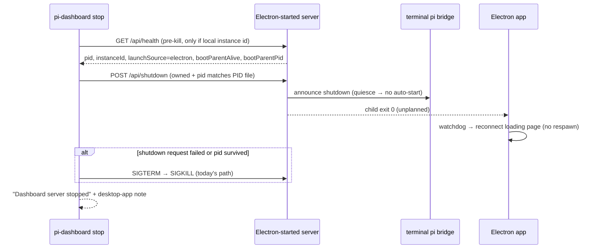

## Context

See proposal.md (Why, planning-time findings). State that shapes the approach:

- **Ownership proof** for `stop`/`status`/`start` is HOME-scoped. It holds when lock metadata (`server.lock.meta.json`) records the pid, or when `/api/health.instanceId` == `instances/<piPort>.id` (`packages/server/src/lifecycle/stop-ownership.ts::isOwnedHealth`, shared by `classify-dashboard-port.ts`). `server.pid` is advisory. An Electron-spawned server runs with the user's HOME and writes all three files (`packages/electron/src/lib/launch-source.ts::spawnFromSource` passes `process.env`). So it is already "owned" by a same-HOME CLI. This was verified live: `pi-dashboard status` → running, exit 0.
- **Health no longer publishes `starter`.** `/api/health` publishes `launchSource` (`electron|standalone|bridge`), `launchSourceEffective`, `bootParentPid`, `bootParentAlive` (`packages/server/src/routes/system-routes.ts:1163`, `:1208`). It has not published `starter` since squash `9d3edad66` (2026-05-26). The removal was deliberate (`openspec/changes/archive/2026-05-26-eliminate-electron-runtime-install/tasks.md:98`, task 3.2: "legacy `starter` + `installable` fields removed"), but `openspec/specs/dashboard-starter-identity/spec.md` was never amended. Four Electron consumers still read `health.starter`:
  - `packages/electron/src/lib/server-lifecycle.ts:580` → `decideShutdownOnQuit`: quit never stops the app's server.
  - `packages/electron/src/lib/update-checker.ts:43`: the strategy is always derived from `null`.
  - `packages/electron/src/lib/doctor.ts:139`: the starter row is always "Unknown (old server?)".
  - `packages/electron/src/lib/launch-source.ts:195`: the attach probe always falls back to `"Standalone"`.
  The Electron Playwright fakes (`tests/e2e-electron/*.electron.spec.ts`) publish both `starter` and `launchSource`, so CI never saw the drift. `/api/doctor`'s own `starter` (`packages/server/src/routes/doctor-routes.ts:188`) is a separate payload and is unaffected.
- **Quit path.** `main.ts::quit` (`packages/electron/src/main.ts:~696`) awaits `stopServerIfNeeded()` and then calls `app.quit()`. But `stopServerIfNeeded` (`server-lifecycle.ts:567-590`) only POSTs `/api/shutdown` (with `localProofHeaders`, body `{userQuit:true}`). It does not wait for the server to exit, although `dashboard-starter-identity` requires "SHALL await server exit". Unreached today because of the `starter` drift; reachable once D6 lands.
- **Stop mechanics.** `cmdStop` (`packages/server/src/cli.ts:592`) SIGTERMs the PID-file pid (`cli.ts:~614`); the owned port-sweep kills follow (`cli.ts:~630-640`). The foreground SIGTERM handler records exit intent `"signal"`, flushes, and exits (`cli.ts:352-361`). It does **not** announce anything to bridges. `POST /api/shutdown` (`networkGuard`, `system-routes.ts:1426`; under `requireLocalProof` a bare loopback request is refused, `packages/server/src/auth/localhost-guard.ts:352-363`, so callers send a local proof the way `cmdRestart` does at `cli.ts:704-708`) records `"shutdown"`, or `"user-quit"` when the body declares `userQuit: true` (`system-routes.ts:1437`). It flushes, and calls `announceRestart("shutdown", SHUTDOWN_QUIESCE_MS)` so connected bridges suppress auto-start, then exits 0. `cmdRestart`'s comment (`cli.ts:658-669`) documents the race a bare kill causes: non-pinned bridges see the WS close and auto-start a replacement. Server-spawned sessions are pinned and never relaunch; sessions started from a user's terminal are not.
- **Electron watchdog.** Electron spawns the CLI in foreground mode (no subcommand, `--port --pi-port`, `DASHBOARD_STARTER=Electron`). Its child-exit watchdog (`server-lifecycle.ts:103`) routes any unplanned exit to the reconnect loading page and respawns only on exit 75 (`/api/restart`). So the app itself never respawns after a CLI stop. A CLI `restart` of an Electron-owned server goes through exit 75, and the app respawns it as its own child (`bootParentAlive` stays true).
- **Foreground failure path.** Foreground mode has no pre-launch classification. `_startCore` starts the pi gateway (`server.ts:~3486`) before the HTTP bind (`listenWithProofFloor`, `server.ts:4451`).
  - In the desktop-app case (same HOME, POSIX), the gateway's unix socket is held, so it falls back to `127.0.0.1:piPort` (`packages/server/src/pi/gateway-listeners.ts:40-67`). That binds, because the desktop server is unix-only by default (`pi/gateway-transport-policy.ts:44-50`). The startup then fails at the HTTP bind with `err.code === "EADDRINUSE"`, and teardown (`server.ts:3339-3360`) releases the transient fallback listener.
  - When the fallback cannot bind either, the error is a wrapper `Error` with `EADDRINUSE` in `cause` (`gateway-listeners.ts:57-73`).
  - The pure-TCP gateway path (`startTcp`, `pi-gateway.ts:1165`; Windows, `PI_GATEWAY_TCP`) has no `error` listener. A held `piPort` there surfaces as an uncaught exception that `installCrashSafetyNet` suppresses, so the foreground keeps running degraded and never fails. Pre-existing; follow-up (task 5.6).
  - The default branch of `main()` (`cli.ts:~1652`) has no try; the module-level `main().catch` prints `Failed to start dashboard:` and exits 1. Exit 1 is classified by spawning parents as a generic `EarlyExitError`. Only the recovery server's exit 2 is a `PortConflictError` (`packages/shared/src/server-launcher.ts:65-80`, `:188-194`). That is a pre-existing gap against `server-launch` "Normal-path port conflict", and this change does not widen it.

## Goals / Non-Goals

**Goals:**
- Root-cause the reported `status` / default-command / "can't stop" failures before any fix lands, and record the evidence here.
- One source of owner facts (health), used by the CLI messages and the Electron consumers.
- A CLI `stop` that sticks: no bridge auto-start replacement.
- Zero added latency on the happy paths: `pi-dashboard` on a free port, `stop`/`status` with no server.

**Non-Goals:**
- No new endpoint. No PID-file format change.
- The app recognising a CLI stop ("stopped from CLI" state). Rejected by the user; the reconnect page is acceptable.
- Zombie adoption UX (#531). This change only removes one way zombies get created: quit not stopping the server.
- Closing the pre-existing `server-launch` normal-path port-conflict gap (exit 1 → `EarlyExitError`). Recorded as a follow-up.
- Supporting a CLI older than `harden-dashboard-start-detection`.

## Decisions

**D1. Root-cause gate first.** Reproduce in an isolated HOME (`HOME=$(mktemp -d)`, non-default `--port/--pi-port`; never touch the live :8000 dashboard). Start a "fake Electron" server with `DASHBOARD_STARTER=Electron PI_DASHBOARD_ELECTRON_INSTANCE=<uuid>` in foreground mode under a parent that stays alive. Then run `status`, `stop`, and bare `pi-dashboard` from the same HOME. Hypotheses:
- H1 (confirmed statically): `health.starter` drift → quit leaves the server orphaned.
- H2: foreground on a held port prints a generic failure. Capture the exact error (gateway vs HTTP, `cause`) and the exit code.
- H3: `status`/`stop` fail only under port/env skew. Electron's `loadMinimalConfig` reads `config.json` only, while the CLI's `buildConfig` honours `PI_DASHBOARD_PORT` / `PI_DASHBOARD_PI_PORT` (`cli.ts:203-206`). A shell export therefore makes the CLI look at another port, or another `instances/<piPort>.id`, and report "not running" or "not owned".
- H4: installed CLI version skew (a global npm install older than the bundle).
- H5 (Windows only, record only): `taskkill` against a Job-Object child that has no console.
- H6: "can't stop" = a non-pinned terminal pi session auto-starts a replacement after the CLI's unannounced SIGTERM. Reproduce with a bridge connected to the harness server.

If a confirmed cause falls outside the specs, stop and amend the specs and tasks before coding. Record the findings in a `## Root-cause log` section appended to this file.

**D2. Owner facts come from `/api/health`, not the PID file.** `launchSource === "electron"` = started by the desktop app. `bootParentAlive` + `bootParentPid` = the app is still open (and its pid). Alternative rejected: an owner field in `server.pid`. The file is advisory and not ownership proof. It would need tolerant reads everywhere and goes stale on respawn. Health is live, already published, and unauthenticated by design. These fields carry no secrets.

**D3. One health fetch, reused.**
- Extend `DashboardStatus` (`packages/shared/src/server-identity.ts:21`) with optional `launchSource`, `bootParentAlive` and `bootParentPid`, parsed from the same response `isDashboardRunning` already reads.
- `classifyDashboardPort` copies them onto the `owned` variant of `PortClassification` (`classify-dashboard-port.ts:35`, `owned` at `:36`).
- For `stop`, widen `probeHealth` (`stop-ownership.ts:50`, which today narrows the body to `{pid, instanceId}`) to return those fields too.
- Add `collectOwnership() → { owned, healthProven: { pid, health } | null }`, keeping `collectOwnedPids` as a wrapper. `StopDeps` gains an optional `collectOwnership` member; by default it wraps an injected `collectOwnedPids` with `healthProven: null`, so existing stop tests stay offline and unchanged. New tests inject `collectOwnership`.
- The probe still runs pre-kill and only when a local instance id exists, so there is no new latency. Under piPort skew (no local id) no health proof exists: no request, no note, SIGTERM path. That is an accepted trade-off.

Alternative rejected: a second probe in `cmdStop`. It adds up to 2 s, and after the kill it cannot answer at all.

**D4. Stop: announced shutdown first, SIGTERM fallback, then the note (user decision A + review findings).** Whenever `cmdStop` is about to terminate the pid in `healthProven`, whether in the PID-file step or the owned sweep, it first POSTs loopback `/api/shutdown` (same host logic as `healthHost`).
- The request carries `localCredentialHeaders("POST", url)`, as `cmdRestart` does (`cli.ts:704-708`). The route is `networkGuard`-guarded, and under `requireLocalProof` the guard refuses a bare loopback caller (`packages/server/src/auth/localhost-guard.ts:352-363`).
- It has **no body**. Never send `userQuit: true`, which would record `"user-quit"`; do not reuse Electron's `userQuitShutdownInit`.
- It then awaits a new `StopDeps.waitForExit(pid, 5000)` seam (liveness poll). On success it prints the same `Dashboard server stopped (pid N)` line `killProcess` prints. On error, refusal or survival it logs the reason and falls back to `killProcess` (SIGTERM→SIGKILL).
- Listeners owned only through lock metadata keep the bare kill, a stated limitation. Everything else (PID-file removal rule, `--force`) is unchanged.
- The server's `exit` handler releases the home lock on `process.exit` (`packages/server/src/lifecycle/home-lock-release.ts:63`). `cmdStop`'s existing rule removes `server.pid` for a dead pid.
- Why: `/api/shutdown` announces a quiesce to bridges, so the stop sticks (H6). It records exit intent `"shutdown"`: sessions keep running, so there is no phantom recovery offer. It also works on Windows, where a console-less child gets no SIGTERM handler.
- An earlier draft rejected this on auth grounds. The credential plumbing already exists (`localCredentialHeaders`). No new endpoint; no auth change.
- A concurrent start racing the stop is out of scope. The spec scenario assumes none.

The desktop-app note prints only when the health-proven pid was actually stopped and its reply had `launchSource: "electron"` and `bootParentAlive: true`. Alternatives rejected by the user: refuse by default with `--force`; an app-side "stopped from CLI" state.

**D5. Foreground classifies only after a failure.** Wrap `await runForeground(config)` in the default branch of `main()` (extracted into a testable function) in a try/catch. On any error, run `classifyDashboardPort` once (failure path only, so the happy path is unaffected).
- If the verdict is `owned`, `starting`, `unowned-dashboard`, `conflict` or `unresponsive`, print `portVerdict(...).lines` plus the desktop-app mention. Otherwise (`free`), print today's generic `Failed to start dashboard:` message.
- Then call `exit(1)` explicitly. This holds in every case, ignoring `verdict.code`: `portVerdict` returns 0 for `owned`, and copying `cmdStart`'s reclassify pattern (`cli.ts:510-513`) verbatim would turn a failed foreground start into success. An explicit exit also stops the attach-mode promotion timer (`home-rendezvous.ts:~174`) from keeping the process alive.
- Not gated on the error shape: the desktop-app case fails at HTTP with `.code === "EADDRINUSE"`, other gateway failures carry it in `cause`.
- Only `config.port` is classified. If the gateway failed while the HTTP port is free, the verdict is `free` and the generic message prints. That is an accepted limitation.
- The recovery-server path (exit 2) is untouched. `runForeground`'s module-not-found branch awaits `startRecoveryServer`, which never returns and exits 2 itself (`cli.ts:271-279`), so the new catch never sees it (`server-startup-recovery` unaffected).

Alternative rejected: pre-classifying like `start`. It adds a probe budget to every Electron and bridge foreground launch on a free port, and it races anyway.

**D6. One starter mapping for Electron; the spec follows the earlier removal (user decision B).** Add `starterFromHealth(body): DashboardStarter | undefined` to `packages/shared/src/dashboard-starter.ts`, next to `parseLaunchSource`.
- It reads only the static `launchSource` (`electron|bridge|standalone` → `Electron|Bridge|Standalone`). It falls back to a legacy `starter` string when `launchSource` is absent, and returns `undefined` for anything else.
- It never reads `launchSourceEffective`. Real bodies carry both fields, so an orphaned bridge server (`launchSource: "bridge"`, `launchSourceEffective: "bridge-orphaned"`) maps to Bridge.
- All four Electron consumers call it. `decideShutdownOnQuit`'s signature is unchanged (it still takes a `starter` string). Call sites typed `string | null` (`update-checker.ts:92`, `:107`; `doctor.ts:119`) normalise with `?? null`.
- The typed `starter` members that other specs name (`electron-doctor-diagnostics` `probeServer().starter`, `electron-launch-source` attach `{ starter }`) keep their names. Only their source changes, so no delta is needed for those specs.
- Behaviour changes that follow: the update checker now returns early for Bridge servers (`update-checker.ts:114`; previously `null` ran the managed check) and routes Standalone to `checkGlobalOutdated` (`:53-66`). The Doctor starter row shows the real starter.
- `dashboard-starter-identity` is amended (MODIFIED delta). The Electron Playwright fakes drop `starter` so CI exercises the real contract.

Alternatives rejected by the user: (A) re-publishing `starter` on health; (C) both.

**D7. Quit awaits the server's exit.** After the `/api/shutdown` POST, `stopServerIfNeeded` polls `/api/health` every 200 ms for up to 5 s until the server stops answering, then returns. Without this, the now-reachable quit path would violate "SHALL await server exit … at most 5 seconds" (amended scenario). Its body stays `{userQuit: true}`, since Electron quit is the documented `"user-quit"` path.

**D8. Message helpers live in `cli.ts`.** `desktopAppNote(health)` (stop) and a running-line suffix (status / foreground / `start` verdict) are small pure functions. They are unit-tested through the existing `StopDeps` / `StatusDeps` / `StartDeps` seams, plus the new `StopDeps` members `collectOwnership`, `shutdownRequest` and `waitForExit`.



## Risks / Trade-offs

- [D6 changes quit behaviour. Since 2026-05-26 quitting the app left its server (and its sessions) running; after the fix, quit stops it, as the spec always said.] → CHANGELOG `Fixed` entry spelling out the behaviour change. Users who want a persistent server run `pi-dashboard start`, whose server the app attaches to and never stops.
- [D4 changes the stop mechanism for owned, health-proven servers: `/api/shutdown` instead of SIGTERM. The exit intent becomes `"shutdown"` instead of `"signal"`, which suppresses the recovery offer on the next boot (`openspec/specs/shutdown-session-recovery/spec.md` exit-intent table; the table itself is unchanged).] → `"shutdown"` is the documented intent for an exit that leaves sessions running (`system-routes.ts:1430` comment). The SIGTERM fallback keeps today's behaviour whenever the request cannot be used. Spec scenarios and tests pin both intents.
- [D6 also changes update-checker behaviour (Bridge → early return, Standalone → npm check).] → Listed in the CHANGELOG `Fixed` entry; this is the behaviour `dashboard-starter-identity` always specified.
- [The note's "app pid" assumes `bootParentPid` is the Electron main process. That holds for `detach: false` spawns (`launch-source.ts:~553`); the devMonorepo path is unverified.] → Task 1.1 checks it; wording only.
- [D1 may surface a `status` cause (H3/H4) that this spec does not cover.] → Hard gate in tasks: amend the specs before implementation; do not silently widen scope.
- [`bootParentAlive` is a heuristic: a pid can be reused.] → Used only for wording, never for a kill decision. The worst case is a misleading note.
- [The foreground failure classification costs one classify budget (≈7 s worst case) on the failure path.] → Failure path only, and it replaces a stack trace with an actionable verdict.
- [Pre-existing: exit 1 from a foreground bind failure is not classified as a port conflict by spawning parents (`server-launch`).] → Out of scope; recorded as a follow-up issue in task 5.6.

## Migration Plan

No data migration. All new fields are additive and optional, and readers tolerate their absence. Deploy order is irrelevant: an old server with the new app falls back to `starter`, and a new server with an old CLI shows today's messages. Rollback = revert the commit. Restarts: server/shared → `/api/restart`; electron → rebuild/repackage the app; CLI → none (jiti).

## Open Questions

None blocking. Windows `taskkill` behaviour (H5) is recorded only; D4's `/api/shutdown` path removes most of the dependency on it.

## Root-cause log

Isolated repro, macOS, 2026-10-19. `HOME=$(mktemp -d)`, `--port 18655 --pi-port 18656`, repo CLI wrapper `packages/server/bin/pi-dashboard.mjs`. The "fake Electron" server ran with `DASHBOARD_STARTER=Electron PI_DASHBOARD_ELECTRON_INSTANCE=<uuid>` under a long-lived node parent. The live :8000 dashboard was never touched.

**1.1 Health shape (confirmed H1 input).** `/api/health` → `launchSource:"electron"`, `launchSourceEffective:"electron"`, `bootParentAlive:true`, `bootParentPid:33794`, `instanceId` = `instances/18656.id`. No `starter` key. `server.pid`, `server.lock.meta.json` (pid 33796, ppid 33794) agree. Finding: `bootParentPid` is the direct parent of the server process, here the `bin/pi-dashboard.mjs` wrapper's pid (the harness parent was the wrapper's parent). In the packaged app it is the Electron main only when Electron spawns the server directly; the D8 note wording stays "started by the desktop app (pid N)" and is never used for a kill decision.

**1.2 Today's code against that server (same HOME).**
- `pi-dashboard status --port 18655 --pi-port 18656` → `Dashboard server is running (pid 33796) on port 18655`, exit 0. No desktop-app mention (that is the gap).
- Bare `pi-dashboard --port 18655 --pi-port 18656` → `[home-lock] rendezvous mode: attach`; gateway socket bind refused (`verdict=live recordedOwnerPid=33796`); `falling back to 127.0.0.1:18656`; then `Failed to start dashboard: Error: listen EADDRINUSE 127.0.0.1:18655` with a stack, `code:'EADDRINUSE'` on the error itself (HTTP bind, not a gateway wrapper `cause`), exit 1, 4.4 s. Confirms H2 and D5's error shape. `server.pid`, lock metadata and `instances/18656.id` byte-identical before and after.
- `pi-dashboard stop --port 18655 --pi-port 18656` → `Dashboard server stopped (pid 33796)`, exit 0; the child exited 0; boot record `exitIntent:"signal"` (no announce, no quiesce). Confirms stop already works through the PID file, and shows the unannounced intent that D4 changes.

**1.3 H3 (env/port skew): reproduced.** Same HOME, no `--port`: `pi-dashboard status` resolves `config.json` port 8000 and reports the foreign live dashboard (`not owned by this HOME`, exit 1). With `PI_DASHBOARD_PORT=18700 PI_DASHBOARD_PI_PORT=18701` it prints `Dashboard server is not running` (exit 1) although an owned server is alive on 18655. With the right env it reports running (exit 0). This is the specified behaviour (`Status subcommand`: resolved port only, "SHALL NOT report a dashboard on a different port") and the likeliest reading of the issue's "status fails" when a shell exports the port variables or Electron runs on a non-default port. Not changed here (resolved-port semantics are a deliberate contract); the FAQ entry in task 5.4 documents it. **H4 (CLI version skew):** not reproduced, needs an older published CLI; the CLI only reads fields that old servers also publish (`pid`, `instanceId`), and new owner fields are optional, so skew degrades to today's messages. **H5 (Windows):** not run; recorded for manual M2.

**1.4 H6 (non-pinned terminal session respawn): not reproduced live.** A real pi session needs a provider. The race is documented at `cli.ts` `cmdRestart` (unannounced SIGTERM closes the bridge WS; non-pinned bridges auto-start). Covered by X8 (real server + fake bridge socket: announce frame precedes close) in place of the live repro.

**1.5 H1 on the real app: not run.** Quitting the user's live packaged app would kill their running dashboard. Static confirmation: `/api/health` has no `starter` (1.1) and `server-lifecycle.ts:580` reads `health.starter`, so `decideShutdownOnQuit` never sees `Electron`. The quit path is exercised by F1 (fake health) and manual M1.

**1.6 Gate: covered.** H1, H2, H3 (existing contract, documented), H6 are all covered by `specs/` and `tasks.md`; no amendment needed.

**4.20 After (fixed tree, same isolated harness).**
```
$ pi-dashboard status --port 18655 --pi-port 18656
Dashboard server is running (pid 34671) on port 18655 (started by the pi-dashboard desktop app)      # exit 0
$ pi-dashboard --port 18655 --pi-port 18656
Dashboard server is already running (pid 34671) (started by the pi-dashboard desktop app)            # exit 1, no stack
$ pi-dashboard stop --port 18655 --pi-port 18656
Dashboard server stopped (pid 34671)
Note: this server was started by the pi-dashboard desktop app (pid 34670). The app stays open and shows its reconnect page: use Start server there to bring the server back, or quit the app.   # exit 0
boot-state exitIntent: "shutdown"      # was "signal" before
```
30 s later `/api/health` on 18655 still refuses (no replacement server). The H6 live bridge was not available (no provider); the announce is covered by X8 (fake bridge receives `server_restarting`/`shutdown`/60000 before the close). `server.lock` / `server.lock.meta.json` persist after any clean exit (pre-existing; the hold `server.lock.lock` and `server.pid` are released), so test-plan X6 asserts those two, not the former.
