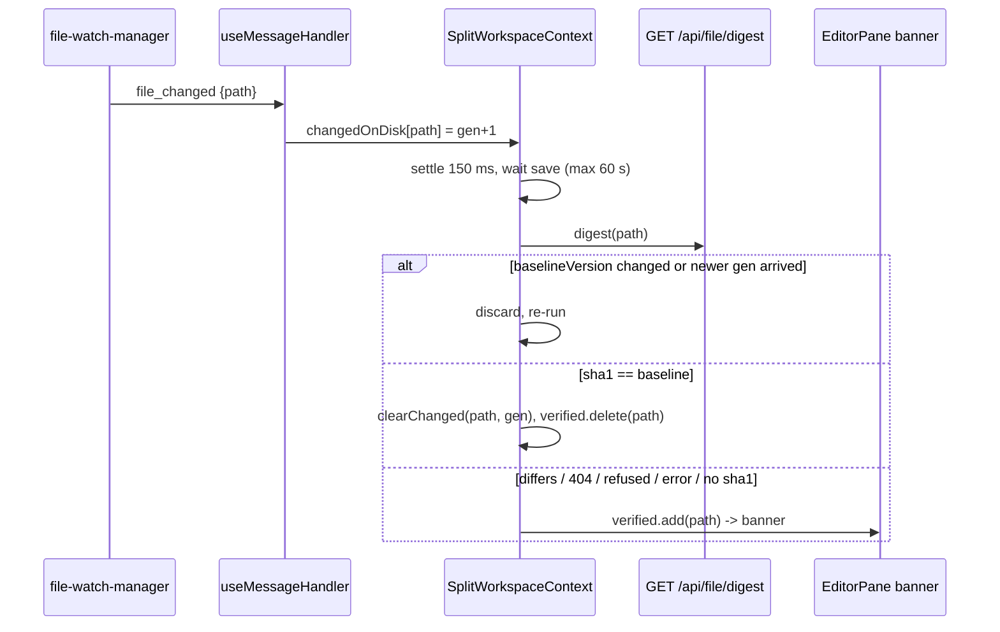

## Context

See proposal.md (Why). Current pipeline, all on the open-files-only path:

- `packages/server/src/file-watch-manager.ts:83-99` — one `fs.watch` per (ws, sessionId, relPath). Any event (the `eventType` is ignored) → 40 ms debounce → `onChange`. It never re-attaches, so a `rename` leaves the watcher on the old inode. The `error` handler closes by key (`:101`).
- `packages/server/src/server.ts:1357-1370` — `watch_files` → `setWatched`; `onChange` → broadcast `{ type: "file_changed", sessionId, path }`.
- `packages/client/src/hooks/useMessageHandler.ts:959-968` — `set.add(path)` into `changedOnDisk: Map<sessionId, Set<path>>` (App state, `App.tsx:723`). A path already in the set is invisible to later events.
- `App.tsx:3107-3127` passes `changedFiles` + `onClearChanged` + `onWatchFiles` to `SplitWorkspaceProvider`. The folder provider passes none (`folder-scoped-editor-pane` spec).
- `SplitWorkspaceContext.tsx:320-338` sends `watch_files` only when `openPathsKey` / `split.mode` changes.
- `EditorPane.tsx:184` `viewerKey = path:refreshNonce:line:autoOpened`; only the **active** tab's viewer is mounted, so a tab switch remounts and re-fetches. `:356-364` renders `ChangedOnDiskBanner` from `changedFiles.has(activePath)`; Refresh = `refreshNonce++` + `clearChanged`; Dismiss = `clearChanged`.
- Viewers fetch independently through `usePreviewFetch` / `fetchWithoutGrantPrompt` (`lib/access-grants/preview-provenance.tsx:36`, `CappedViewer.tsx:48`): `/api/file` (`MonacoBuffer`, `MarkdownViewer`, `EditablePreviewTab`) or `/api/file/raw` (mermaid, pdf, image, office, too-large).
- `GET /api/file` gate (`file-routes.ts:513-570`): `decodeFileUri` → known-session check (403 `unknown session path`) → `evaluateContainment(resolved, [cwd, homePiAnchor()], { hold, disclosure, session, subjectKind: "auto" })` → 403 + `remedy` → `stat` → `openVerifiedRegularFile` only when `viaGrant`. The factored `gateFilePath` (`:300`) is NOT the same gate (no `~/.pi` anchor, no hold, no decode).
- `POST /api/file/write` → `performAtomicMdWrite` (`file-routes.ts:181-215`): stat → mtime check → tmp write → rename → `{ mtime }`. Other in-pane writers: `components/preview/MarkupRepairBanner.tsx:131`, `MermaidApplyFix.tsx:286`.
- Every `/api/*` route needs a `ROUTE_TIERS` row (`shared/src/route-tiers.ts:110-119`) and a manifest or `DENYLIST` binding (`mcp-server-plugin/src/server/tools.denylist.ts`, checked by `server/src/__tests__/mcp-manifest-completeness.test.ts`).
- `openVerifiedRegularFile` (`server/src/access/verified-read.ts:104`) refuses symlinks, which is why `/api/file` uses it only for grant-admitted reads.
- Config: `loadConfig()` (`shared/src/config.ts:2298`) reads disk per call (also the `getConfig` precedent in `server.ts:1325,2418`). PUT handler `system-routes.ts:567-663` broadcasts `config_updated` only for `openspec` / `sessions`; `App.tsx:1275` filters to those two. `components/settings/SettingsPanel.tsx:316` `CONFIG_FIELD_PAGE` maps top-level keys to pages.
- Rich-viewer cap: `MAX_PREVIEW_BYTES` (10 MiB) in `shared/src/file-kind.ts:91`, used by `CappedViewer.tsx:69` and as `TooLargePreview.tsx:30` default `cap`. Office 413 caps: `OFFICE_SIZE_CAPS` (`file-kind.ts:100`).

Measured on macOS / Node 26: `touch`, `chmod`, identical rewrite → `change`; tmp+rename → `rename`, after which later writes are not reported; a sibling write → nothing.

## Goals / Non-Goals

**Goals:**
- Banner only when the bytes differ from the tab's baseline (or the file is gone, unverifiable, or above the digest ceiling).
- A stale view is never silent: races resolve toward a false-positive banner, never a missed one.
- Own Save never shows the banner. Changes after an atomic replace or a quick delete+re-create are still seen.
- A configurable editor large-file limit for the rich-viewer gate.

**Non-Goals:**
- Exact per-viewer baselines (each viewer reporting a hash of what it rendered).
- Auto-reload, 3-way merge, or new dirty-buffer conflict UI (the 409 path is unchanged).
- Banner or digests in the folder-scoped pane.
- Configurable office conversion caps or a configurable digest ceiling.
- Changing `watch_files` / `file_changed` wire shapes.

## Decisions

### D1 — Candidates are events, verified per path with generations

- `changedOnDisk` becomes `Map<sessionId, Map<path, generation>>`. `useMessageHandler` bumps the path's counter on every `file_changed`, so each event is a new candidate. This is client state only; the wire shape is unchanged. `clearChanged(path, gen?)` removes the entry only if its generation is still `gen`.
- `SplitWorkspaceContext` (session scope only; D7) owns `baseline: Map<path, { sha1, size, mtime, version } | null>` (`size`/`mtime` kept for diagnostics only; the decision is `sha1`), `verified: Set<path>`, `savingPaths: Map<path, Promise>`. The banner reads `verified`. All maps belong to the current `(sessionId, cwd)`: a session switch clears them and aborts in-flight digests, so two sessions with the same `relPath` never share a baseline.
- A verification commits its result only if the path's generation and baseline `version` are unchanged since it started. Dismiss deletes `verified[path]` and bumps the generation, so an in-flight verification cannot resurrect a dismissed banner. Refresh does the same and re-captures the baseline (D2).
- One verification per path at a time. A newer generation, or a `baseline.version` bump during flight (D2/D3), discards the result and re-runs. This covers "second change during verify" and "own save during verify".
- An equal digest also removes `verified[path]` (a reverted file clears its banner).
- Failure is never silent: 404, refusal, network error, or a missing `sha1` all mean "banner".
- Mount-time catch-up: 1 s after a newly opened path's baseline, the context runs one verification without a candidate. This closes the gap where a change lands before `watch_files` reaches the server and no `file_changed` is ever sent. The timer is cancelled on tab close, session switch and unmount. It is skipped when the baseline is `null` (refused/failed digest), so a refused path does not banner on every mount; real candidates for it still banner.
- Reconnect: the server drops every watcher on disconnect (`server.ts:1370`). The `watch_files` effect (`SplitWorkspaceContext.tsx:333-338`) gains the WS connection generation as a dependency, so it re-declares the open set on every reconnect, and then runs one catch-up verification for every path with a non-null baseline (changes made while disconnected are detected).
- Residual (accepted): a change that lands after the baseline, is loaded by the viewer, and is reverted to the exact baseline bytes before the 1 s catch-up stays silent. Closing it needs per-viewer byte reporting (non-goal).
- Why not verify on the server: the server cannot know what each client loaded, and dismiss/refresh state lives on the client. Why not per-viewer (exact C): 6+ viewers and two fetch styles, out of scope.

### D2 — Baseline is taken before the viewer mounts (fail-safe ordering)

- On every file-tab mount (`viewerKey` change: open, activation, Refresh), when change detection is enabled (D7), `EditorPane` awaits `captureBaseline(path)` and only then mounts `CappedViewer` (the existing "Loading viewer…" state covers the wait). `captureBaseline` fetches the digest, bumps `version`, stores the result, and clears that path's candidate and `verified` mark (the viewer is about to load fresh bytes).
- Ordering argument: the baseline is read before the content. A change between the two leaves the viewer on the new bytes with the old baseline, so its own `file_changed` banners. That is a false positive, which is safe. A change after the content fetch differs from the baseline and banners correctly. The reverse order (digest after content) could record the new bytes as baseline under an old view, which is silent staleness; this ordering rules it out.
- Cost: one extra round-trip per tab mount. SHA-1 streams at roughly 0.5–1 GB/s, so a 10 MiB file adds ~10–20 ms and a 256 MiB file ~0.3–0.5 s before the viewer mounts. Baseline captures take priority over verifications in the server semaphore (D4), so a tab switch does not queue behind a checkout burst. A failed or refused digest stores `null`, the viewer still mounts, and any candidate banners (today's behavior).
- Dismiss keeps the baseline. A later different change banners again; a revert to the baseline bytes stays silent.
- Pseudo-tab / plugin paths never get a baseline (they are never watched).

### D3 — In-pane writes rebaseline from the write response

- `performAtomicMdWrite` encodes once (`Buffer.from(content, "utf8")`), writes that buffer, and hashes the same buffer. It returns `{ mtime, size, sha1 }` (no `sha1` above the D4 ceiling). A round-trip test pins `write.sha1 == digest.sha1`. If another writer clobbers the file after the rename, the digest differs and the banner is correct.
- One client helper, `trackedFileWrite(path, body)` from the split context (no-op passthrough when change detection is off), wraps every in-pane writer: `MarkdownViewer`, `EditablePreviewTab`, `MarkupRepairBanner`, `MermaidApplyFix`. It calls `beginSave(path)` → POST (aborted after 60 s) → `endSave(path, outcome)`. Out-of-pane writers (e.g. `DirectorySettings/InstructionsPage.tsx:285`) are deliberately not wrapped: their write makes the pane's view stale, so the banner is correct.
- Body limit (pre-existing bug): `POST /api/file/write` inherits Fastify's default 1 MiB `bodyLimit` (`server.ts:1798` sets none; the route sets none), so any markdown save over ~1 MiB fails with 413 today. The route gets `bodyLimit: 600 MiB` (256 MiB content plus JSON escaping headroom), and the handler refuses content whose UTF-8 size exceeds the 256 MiB ceiling with 413.
  - Success with `sha1`: baseline = `{ sha1, size, mtime }`, `version++`.
  - Success without `sha1` (> ceiling) or outcome unknown (network error, no response): baseline = `null`, `version++` (next candidate banners; safe direction).
  - Server refusal (any `4xx`/`5xx` response): baseline unchanged; `savingPaths` cleared.
- A verification for a saving path awaits the save promise (bound 60 s), then runs against the current baseline. The `version` bump discards any verification already in flight.
- Own-save suppression is scoped to content within the ceiling. Since the editor limit max equals the ceiling, only a save that grows a file past 256 MiB is affected.
- No client-side hashing: `crypto.subtle` is unavailable in non-secure LAN contexts.

### D4 — Digest endpoint (fixed 256 MiB ceiling, decoupled from the setting)

- `GET /api/file/digest?cwd&path`. Extract the `/api/file` read gate (`file-routes.ts:518-543`: decode → known-session → `evaluateContainment` with `[cwd, homePiAnchor()]`, `hold`, `disclosure`, `session`, `subjectKind: "auto"` → 403 + remedy) into one helper, `gateReadPath`. Both routes call it (the digest is part of the read site; `file-read-containment` delta), and a parity test pins identical admit/refuse/remedy. Containment runs before any `stat`, so a missing path outside containment gets the containment refusal, not a 404.
- Open rule mirrors `/api/file` (`:567-569`): `openVerifiedRegularFile` when `viaGrant`, otherwise `fs.open(resolved, O_RDONLY | O_NONBLOCK)` (follows an in-cwd symlink exactly like `/api/file`; never blocks on a FIFO). Then `fstat().isFile()` on the handle; a non-regular file returns 404.
- Streams `createHash("sha1")` from the handle. `size > 256 MiB` → `{ size, mtime }` with no hash. `mtime` = raw `stat.mtimeMs`. `Cache-Control: no-store`. No metadata fast path and no digest cache: equal `size`+`mtime` across two different writes (coarse mtime, same-tick bursts) would hide a real change.
- Load bound: hashing runs behind a small server-wide semaphore (`shared/src/semaphore.ts`, 2 concurrent) with two lanes: requests marked `purpose=baseline` are served before queued verifications. The slot is released when the hash finishes or the client aborts (request `close`), so an abandoned digest never holds a slot.
- Route registration: `ROUTE_TIERS` row `GET /api/file/digest` → `observe`, plus a `DENYLIST` entry in `packages/mcp-server-plugin/src/server/tools.denylist.ts` (reason: internal editor-pane verification, no agent use), so `mcp-manifest-completeness.test.ts` stays green.
- Client: the digest uses `fetchWithoutGrantPrompt` (sends `X-Pi-Grant-Channel: ""`, `grant-channel.ts:80-85`; the installed wrapper never overrides a caller-set header, `:105-116`). An opted-out request is never held by `evaluateContainment`, so a background verification never suspends or prompts; a prompt-eligible miss is refused and maps to "banner". `/api/file` behaves identically for an opted-out request, so there is no divergence; tests pin the header through the wrapper and the server's never-held behavior for an opted-out digest. Whether an opted-out miss writes a denial-ledger record is checked in tasks; if it does, the digest suppresses that record (it is background noise, not a user action).
- The 256 MiB ceiling equals the setting's max (D6). It sits below V8's ~512 Mi-char string limit and keeps a worst-case hash bounded. It does not read config, so the digest route has no config dependency.
- SHA-1 is a change detector here, not a security primitive.

### D5 — Watch survives atomic replace and quick re-create

- Per key, keep `{ watcher, retryTimer, debounceTimer }`. The `error` handler and `closeWatcher` act only on the instance the map still holds (fixes `:101` closing a re-attached successor). `closeWatcher`, reconcile-removal and `clearConnection` cancel both timers, so no retry can resurrect a dropped key.
- On `eventType === "rename"`, re-attach **synchronously** (not after the debounce): close the old watcher, `stat` the path, and `watch(abs)` under the same key only if it is a regular file. If it is missing, retry at 100 / 300 / 600 / 1000 ms after the rename, then drop the key. If it is not a regular file (directory, FIFO), drop the key; the candidate then gets a 404 digest and the banner. `onChange` is still emitted through the 40 ms debounce. `change` events never re-attach (no fd churn).
- Tests assert `activeWatchCount() == 0` and no pending timers after `clearConnection` during a retry.
- The Refresh re-send of `watch_files` is an explicit change: the watch effect's deps today are `sessionId, cwd, openPathsKey, split.mode` (`SplitWorkspaceContext.tsx:333-338`), none of which Refresh touches. A `watchNonce` bumped by Refresh (and by reconnect, D1) is added to the deps.
- Client: Refresh re-sends the current `watch_files` set (idempotent server reconcile), so a key dropped after a long delete is restored once the user sees the deleted-file banner and refreshes.

### D6 — `editor.largeFileLimitMb` (render gate only)

- `shared/src/config.ts`: new `editor: { largeFileLimitMb: number }`. The parser clamps integers to `[1, 256]` and defaults non-numeric values to `10`. `MAX_PREVIEW_BYTES` stays as the default.
- Server: `system-routes.ts` PUT accepts `editor`, writes via `saveConfigAndMirror`, sets no restart flag, and broadcasts `config_updated { section: "editor" }`. `GET /api/config` returns the resolved block.
- Parser: a finite number is rounded then clamped; any other value (string, `null`, `NaN`) → `10`.
- Server write path: `restartRequired` stays false for `editor` (asserted in the route test).
- Client: `lib/preview/editor-limits-config.ts` mirrors `mermaid-repair-config.ts` with a `loaded` flag and one `resolveEditorLimitBytes()` reader, the only consumer of `MAX_PREVIEW_BYTES` outside `file-kind.ts`. The App's existing `/api/config` fetch hydrates it, and the `App.tsx:1275` filter is extended to `editor`. `CappedViewer` waits while `!loaded` (falls back to the default on fetch failure or after 3 s), then gates on the limit. `TooLargePreview` default `cap` = the limit. Office 413 call sites keep passing the office cap explicitly (audited in tasks).
- `SettingsPanel`: `computeConfigPartial` (`components/settings/SettingsPanel.tsx:340`) gains the `editor.largeFileLimitMb` diff (an unlisted key is never sent). A bespoke numeric control on the General page (the shared `NumberField` has no bounds), following the spawn-register timeout precedent (`settings-panel` "Settings panel exposes spawn-register timeout", "Bespoke settings controls keep their validation"): inline invalid flag, Save blocked while invalid; `CONFIG_FIELD_PAGE.editor = "general"`. The server clamp is a backstop.

### D7 — Session scope only, explicit flag

`SplitWorkspaceProvider` gains an explicit `changeDetection: boolean` prop (default `false`). Only the App's session provider passes `true`. The folder pane leaves it off: no baselines, no digests, no catch-up, unchanged mount path, and `trackedFileWrite` is a passthrough. A test asserts the folder pane never calls `/api/file/digest`.

## Risks / Trade-offs

- [Extra round-trip before every session-pane tab mount] → digest is small, fast-pathable, and bounded. This is the price of fail-safe ordering (D2); the folder pane is unaffected.
- [False-positive banner when a change lands between baseline and content fetch] → accepted by design; the stale direction is impossible.
- [Files above 256 MiB keep today's always-banner] → explicit spec scenario. Such files are not renderable in rich viewers and rarely open in Monaco.
- [Hash bursts (git checkout touching many open files)] → per-path single-flight, settle delay, generation discard, a 2-wide server semaphore; open tabs only. Without a metadata fast path a `chmod` also hashes; that is accepted for correctness.
- [A high editor limit lets a rich renderer freeze the tab's main thread, delaying that tab's WS handling] → clamp max 256 MiB; settings hint states the trade-off; Monaco is unaffected.
- [`/api/file` JSON-encodes markdown/editable content; at 256 MiB, escaping can approach V8's ~512 Mi-char string limit and the write body can reach ~600 MiB] → accepted by the user during planning (keep 256 MiB). Bounded by the clamp; a read that throws returns the route's existing 500, and the default stays 10 MiB.
- [Delete without re-create beyond 1 s leaves the key dropped] → the deleted-file banner shows; Refresh re-declares the watch.
- [Pre-existing drift: main requirement "Server SHALL extend `/api/file`" still describes the old `cwd + path.sep` gate, and `open-in-editor` "Absolute path containment on file endpoints" predates the `~/.pi` read anchor] → out of scope; the digest inherits the read site's anchors by reference (`file-read-containment` delta) rather than restating them.
- [Own save of content growing past 256 MiB still banners] → explicit spec carve-out; the editor limit cannot exceed the ceiling.

## Migration Plan

Additive. An absent `editor` block resolves to today's 10 MiB. `/api/file/write` gains a field that older clients ignore. `changedOnDisk` shape change is internal to the client bundle. Existing tests that assume the old shapes are updated (tasks). Rollback = revert; older builds ignore a persisted `editor` block.

## Open Questions

- Settle delay (start at 150 ms): tune in the harness smoke if a pi `write` burst double-verifies.
