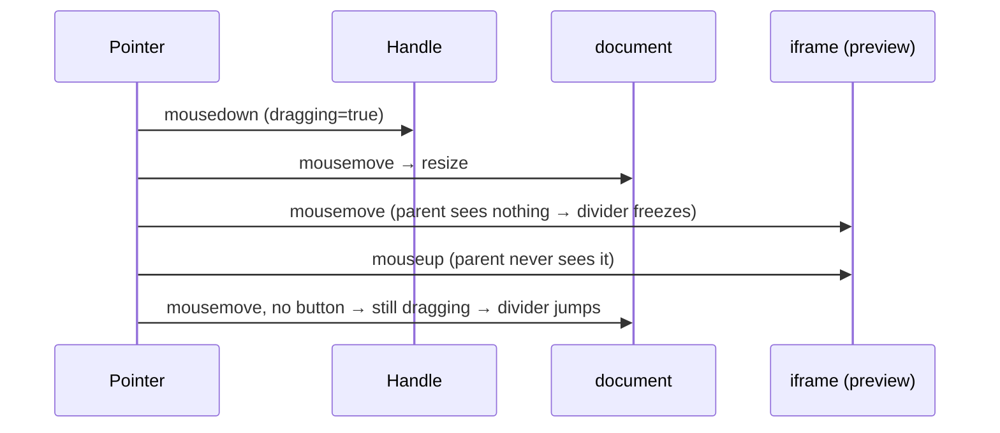

# Design — fix-split-divider-drag

## Context

See proposal.md — Why. Current drag code, per affordance:

| Affordance | File | Tracking | Preview during drag | Commit |
|---|---|---|---|---|
| Split divider (chat│editor) | `components/split/SplitDivider.tsx:55-72` + `SplitWorkspace.tsx:67,117-123` | `document` mousemove/mouseup, always-on effect | `onRatioChange` → `updateSplit` → React + `localStorage` **per event** | n/a (already committed every event) |
| Rail divider (files│preview) | same `SplitDivider` in `editor-pane/EditorPane.tsx:392-400` | same | `setRailWidth` → React + `saveRailWidth` **per event** | n/a |
| Session sidebar seam | `components/shell/ResizableSidebar.tsx:49-70` | `document` mousemove/mouseup | direct `style.width` | `setWidth(e.clientX)` on mouseup |
| Diff tree panel | `components/diff/FileDiffView.tsx:157-210` (`ResizableTreePanel`) | same | direct `style.width` | `setWidth` from mouseup `clientX` |

All four compose `useBodyDragStyle` (spec `drag-body-style`). None handles a
release the document never sees (iframe, outside window, focus loss).



Other constraints found in source:
- Test env: client vitest runs jsdom 25 — no `PointerEvent` constructor, no
  `Element.setPointerCapture`. `requestAnimationFrame` is expected from
  vitest's jsdom environment (visual emulation). Task 1.1 proves both test
  premises (rAF present; React's `onPointerDown` fires for a dispatched
  `MouseEvent("pointerdown")`) before any red test relies on them.
- `SplitWorkspace.tsx:66,107,112` — the chat wrapper already carries
  `chatPaneRef` (feeds `PopoverBoundaryProvider`).
- `lib/layout/rail-width.ts:13` imports `clampWidth` from `useSplitRatio.ts`.
- `SplitDivider.tsx:24` declares `onResizeStart`; no caller passes it today.
- No drag handle sets `touch-action` (`SplitDivider.tsx:84`,
  `ResizableSidebar.tsx:92`); repo convention for pointer-driven surfaces is
  `touchAction: "none"` (`preview/ImagePreview.tsx:90`,
  `preview/DiagramPreview.tsx:137`).
- Stacking order uses the `overlay-layering` token scale (`index.css` `--z-*`;
  `z-lightbox` = topmost); new raw z-index values are ratcheted out.

## Goals / Non-Goals

**Goals:** one drag-lifecycle mechanism for the four affordances; a drag can
never outlive the button press; no React render or storage write per pointer
event on the split/rail dividers.

**Non-Goals:** keyboard resizing / ARIA `separator` values; Escape-to-cancel;
touch-specific UX tuning (handles get `touchAction: "none"` only so a touch drag
is not cancelled by browser panning); multi-pointer concurrent drags (one drag
at a time, D3); containing chat-row reflow during a drag (follow-up only if a
profile after this change still shows jank); `useTreeColumnWidth` migration.

## Decisions

### D1 — Shared hook `useResizeDrag` (in `packages/client/src/hooks/`)

```ts
interface ResizeDragOptions {
  axis: "x" | "y";                          // which client coordinate to report
  cursor: string;                           // body + shield cursor
  onStart?: () => void;
  onPreview: (clientPos: number) => void;   // live preview, ≤ 1 per animation frame
  onEnd: (clientPos: number | null) => void; // last previewed pos; null = no commit
}
function useResizeDrag(o: ResizeDragOptions): {
  onPointerDown: React.PointerEventHandler; // spread onto the handle
  onMouseDown: React.MouseEventHandler;     // preventDefault only (focus kept)
};
```

- Callbacks are read through a latest-ref, so the returned `onPointerDown` is
  stable and inline caller arrows no longer churn listeners.
- Window listeners (`pointermove`, `pointerup`, `pointercancel`) and the
  handle's `lostpointercapture` listener are attached **on drag start and
  removed on drag end** — not an always-on effect.
- Composes `useBodyDragStyle` (unchanged), so the `drag-body-style`
  "single shared mechanism" requirement still holds.
- *Alternative:* patch each of the four components in place. Rejected — four
  copies of a now-nontrivial lifecycle is the duplication `drag-body-style`
  already consolidated once.

### D2 — Drag shield for embedded frames

The shield is created **lazily, on the first held-button move that counts as
moved** (D3), and not on `pointerdown`. A plain click therefore never mounts
it, and the compat `mousedown` that follows `pointerdown` still targets the
handle, so the handle's focus-preserving `onMouseDown` runs (D3).

The shield is one transparent element appended to `document.body`, the same
root `LayerPortal` uses by default (`packages/client-utils/src/LayerPortal.tsx`).
It is non-anchored and never opened from inside a dialog, so the
`overlay-layering` "Dialog layer host" rule does not apply. It carries:
- `fixed inset-0 z-lightbox` (a layer **token**, never a raw z-index; the
  topmost token, chosen because the shield must sit over everything for the
  length of a press);
- inline `touchAction: "none"`, `aria-hidden="true"`, and the drag cursor.

It is removed on end and on unmount. Mounted last in the topmost layer, it
paints over the canvas tray, `FileHandlerLayer`, popovers, dialogs
(`z-dialog`), toasts (`z-toast`) and an already-open `ImageLightbox` (same
layer, earlier mount). Iframes, Monaco, xterm and plugin frames therefore
cannot swallow move/release, even when pointer capture is unavailable or lost.

- *Alternative:* body class + `iframe { pointer-events: none }`. Rejected —
  page CSS cannot reach frames inside shadow-DOM plugin hosts, and it does not
  cover non-iframe surfaces that grab input (canvas, xterm). The shield is one
  element with no CSS coupling.
- *Trade-off:* a dialog or toast that opens mid-drag sits under the shield
  and gets no pointer input until the press ends; keyboard focus still reaches
  it. A `z-lightbox` surface that opens mid-drag mounts after the shield and
  paints above it. The release then goes to that surface, and the drag ends on
  the next `buttons === 0` move (the lost-release path). This is rare, and
  accepted.

### D3 — Start, capture, and end detection (lost release)

- Pointer events replace mouse events for tracking. A drag starts only on a
  primary-button `pointerdown` (`button === 0`), and only when the module-level
  active-drag slot is free. The slot holds an owner token; only the owning
  instance releases it (on its own end or unmount), so one affordance's
  unmount never frees another's drag (`drag-body-style` isolation). The hook
  records `pointerId` and the down coordinate, and ignores events from other
  pointers.
- **Focus preserved.** `pointerdown` does not call `preventDefault`. The hook
  also returns an `onMouseDown` that calls `preventDefault()`, keeping today's
  behaviour where pressing the divider does not steal focus from the composer
  or editor (`SplitDivider.tsx:47`). Body `user-select: none` is applied
  synchronously in `pointerdown`.
- **Capture target = the handle** (`e.currentTarget`), via
  `setPointerCapture(pointerId)` when available (guarded — absent in jsdom).
  With capture held, Chromium/Electron retarget move/up to the handle even
  outside the window. Listeners live on `window`, so they see events whether
  they arrive via capture (bubbling from the handle) or via the shield (capture
  unavailable or lost).
- Handles get inline `style={{ touchAction: "none" }}` (repo convention,
  assertable in jsdom), so a touch drag is not taken over by panning.
- **Moved** means at least one held-button `pointermove` whose coordinate
  differs from the down coordinate. The first such move mounts the shield (D2).
- **End triggers**, first one wins:

  | Trigger | Coordinate used | Commit |
  |---|---|---|
  | `pointerup` | release coordinate if moved; ignored if not moved | moved → cancel pending rAF, `onPreview(release)`, then `onEnd(release)` · not moved → `onEnd(null)` |
  | `pointercancel` | none | cancel any pending frame (the user never saw it), then `onEnd(lastPreviewed)` (`null` if never previewed) |
  | `lostpointercapture` on the handle | none | same as `pointercancel` |
  | `pointermove` with `buttons === 0` | none — the event's coordinate is stale (re-entry point) | same as `pointercancel` |

- No `blur` trigger. A focus move into an iframe would fire `blur` while the
  button is still held. After an OS app switch with the button released, the
  first `buttons === 0` move on return ends the drag anyway (or
  `pointercancel`/`lostpointercapture` already did).
- With capture held, a release outside the window delivers `pointerup` with the
  outside coordinate. The divider then ends at the clamp boundary in that
  direction, which is where the preview already was. That is not a jump.

### D4 — rAF coalescing

Each held-button `pointermove` stores the latest coordinate and schedules at
most one `requestAnimationFrame`. That frame calls `onPreview(latest)`. End
handling follows the D3 table: `pointerup` replaces the pending frame with the
release coordinate, and every other trigger cancels the pending frame. In every case, the committed value equals the
last value passed to `onPreview`, i.e. what the user last saw.

### D5 — Split/rail dividers preview via DOM, commit on end

- `SplitDivider` keeps its presentational role. Its props are internal
  component API, not a spec contract, and every caller is in-repo and updated
  in this change:
  - `onResize(clientPos)` becomes the per-frame preview.
  - `onResizeEnd` changes from `() => void` to
    `(clientPos: number | null) => void` (the commit). Today no caller passes it
    (`SplitDivider.tsx:25`).
  - `onResizeStart` (also unused) is forwarded to the hook's `onStart`.
  - The handle spreads the hook's `onPointerDown`/`onMouseDown` and adds
    `touchAction: "none"`.
- `SplitWorkspace` reuses the existing `chatPaneRef` for the chat wrapper (it
  also feeds `PopoverBoundaryProvider`, so no second ref) and adds one ref on
  the editor wrapper. The preview computes the ratio with the existing
  `ratioFromPointer` / `clampRatio` and writes `style.flexGrow` on both panes.
  The end calls `onRatioChange(ratio)` once, which means one `updateSplit` and
  one `saveSplitState`. React's style prop then reconciles to the value the DOM
  already has.
- `EditorPane` rail: a ref on the rail wrapper. The preview writes
  `style.width = clampRailWidth(clientX - rowLeft)`; the end calls
  `setRailWidth` once.
- `lib/layout/useSplitRatio.ts` stays, because its pure `ratioFromPointer` /
  `clampWidth` are reused (`rail-width.ts:13`,
  `lib/__tests__/useSplitRatio.test.ts:2`). The `useSplitRatio` hook export's
  only importer is `SplitWorkspace.tsx:29,67`, so it becomes an orphan of this
  change and is removed.
- *Alternative:* keep React state but `startTransition`/throttle. Rejected —
  it still re-renders the whole editor pane and writes storage repeatedly.
- `browser-pane-tab` "Divider drag" (≤4 resize requests per 2 s) is unaffected.
  `BrowserPaneTab.tsx` derives requests from a 500 ms-throttled
  `ResizeObserver` on the pane. The pane already resizes every frame today, and
  still does with the DOM preview. The commit render writes the same size the
  DOM already has, so it adds no resize.

### D6 — Sidebar and diff-tree migrate, behaviour kept

`ResizableSidebar` and `ResizableTreePanel` swap their mouse listeners for
`useResizeDrag`, keeping their direct `style.width` preview and
commit-on-release. A normal release still commits the release coordinate (D3
`pointerup` row). The lost-release triggers are new: today those cases never
end the drag at all. Handles add `touchAction: "none"`. The sidebar collapse
knob's `onMouseDown` stopPropagation is joined by an `onPointerDown`
stopPropagation, so a knob press still never starts a drag.

### D7 — Unmount mid-drag

Unmount tears down the listeners, the pending rAF, the shield, the body
overrides and the owned active-drag slot. It does **not** call `onEnd`, so
nothing is committed or written into an unmounting tree. The in-progress size
is dropped, and the spec states this. This matches the existing
`drag-body-style` unmount scenario.

## Risks / Trade-offs

- **Existing unit tests drive handles with `fireEvent.mouse*`.** Some
  assertions encode the superseded contract and are replaced, not ported:
  `SplitWorkspace.test.tsx:83-103` expects `onRatioChange` per move, and
  `ResizableSidebar.test.tsx:96-98` commits on a no-move `mouseup`. The new
  shared helper lives in `packages/client/src/test-support/pointer.ts` and
  dispatches typed `MouseEvent`s:
  - defaults: `bubbles: true`, `cancelable: true`, `button: 0`; `buttons: 1`
    on down/move; `buttons: 0` on up;
  - `pointerId` attached with `Object.defineProperty` (default `1`), because
    jsdom has no `PointerEvent`;
  - premise proven in task 1.1. If vitest's jsdom env lacks
    `requestAnimationFrame`, the helper installs a minimal rAF shim from
    `test-support/`.
- **Shield vs overlay layering.** Handled by the `z-lightbox` token plus
  last-mounted-wins (`overlay-layering` "Layer order is total"). The shield
  exists only during a press.
- **Layout reflow still runs once per frame** (chat text re-wrap, Monaco
  relayout). This is inherent to a live preview and is measured in task 6.2. A
  follow-up change handles it if long sessions still jank.
- **DOM-preview vs React style divergence.** React diffs `style` against its
  previous props, not the DOM. A mid-drag re-render with an unchanged `ratio`
  writes nothing, and `SessionSplitView.tsx:21` re-renders on any
  `SplitWorkspaceContext` change. Divergence happens only if `ratio` itself
  changes mid-drag; React wins that frame and the next preview re-applies.
  Unit case 2.1(d) covers it.
- **Electron/WebKit pointer-capture differences.** The shield and the
  `buttons === 0` check do not depend on the engine; capture is best-effort.
  E2E 5.3 disables capture to exercise the shield path. Safari is checked
  manually in 6.3.
- **Touch `buttons` reporting is unverified per engine.** The Pointer Events
  spec reports `buttons: 1` during contact. If an engine reported `0`, a touch
  drag would end early; manual check 6.3 covers this.

## Migration Plan

Client-only. No persisted-format, protocol or server change. Ship with
`npm run build` + server restart. Rollback = revert the commit; persisted split
ratio / rail width / sidebar width remain compatible both ways.
