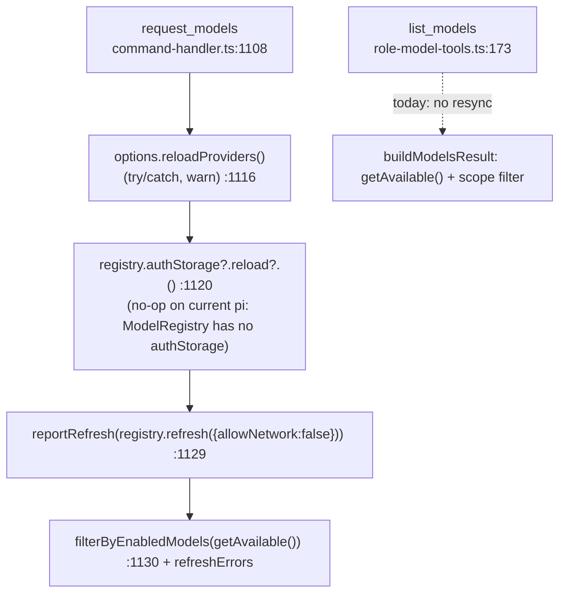

# Design

## Context

See proposal.md (Why). Current paths:

Verified facts:
- `reloadProviders` is serialized via `reloadChain` (`provider-register.ts:937-945`). On an unchanged file it is a no-op diff. For added or changed custom providers it awaits `registerEntry` → `/models` discovery, one provider at a time.
- `loadProviders` (`provider-register.ts:476-497`) returns `{}` for both "file absent" and "parse error". `reloadProvidersNow` then unregisters every `lastRegistered` entry (`:976-985`).
- pi `ModelRuntime.refresh` (`pi-coding-agent/dist/core/model-runtime.js:587`) reloads `models.json`, rebuilds providers and recomputes availability. Availability calls `credentials.list()` (`:191-198`). `AuthStorage.list` → `readLatestData` re-reads `auth.json` when the file revision changed (`auth-storage.js:337-345,414`). So a local refresh already picks up `auth.json` changes, and no separate auth-reload step is needed.
- `refresh` reports `aborted` only when a signal fires (`model-runtime.js:599-626`). A superseded availability pass returns early without updating the snapshot (`:199`).
- `filterByEnabledModels` (`session-sync.ts:52`) is Selector-only. `list_models` applies `ctx.scopedModels` instead (`role-model-tools.ts:150`). Both behaviors are kept.
- `request_models` bypasses the serialized inbound pump (`provider-register.ts:925` comment), so a `list_models` resync waiting on `reloadChain` cannot wedge the pump.

## Goals / Non-Goals

**Goals:**
- `list_models` sees out-of-band global-config changes.
- `list_models` never throws and stays bounded in time.
- An unparseable `providers.json` is never destructive.

**Non-Goals:**
- Refactoring `request_models` code. It is untouched. Its behavior changes only through D5, which is shared and intentional.
- Server-side `registry-singleton.ts` `readProviders` hardening, a follow-up.
- Unifying the `enabledModels` and scope filtering between the Selector and `list_models`.
- Debouncing or caching resyncs.

## Decisions

**D1: A dedicated helper `resyncForListModels(registry, { reloadProviders?, signal? })` in `model-refresh.ts`, not a refactor of `request_models`.**
Steps:
1. Race `reloadProviders?.()` against `PROVIDERS_RESYNC_TIMEOUT_MS` (new, about 5 s) and the signal. Errors are caught and warned. If the bound is hit, discovery continues in the background on `reloadChain`.
2. If the signal has aborted, return `undefined` and skip the refresh.
3. Otherwise run `reportRefresh(registry.refresh?.({ allowNetwork: false }), "list_models refresh")`, which is already bounded by `REFRESH_TIMEOUT_MS`. The signal is deliberately **not** passed into `refresh`. A full refresh bumps `availabilityRefreshSeq` (`model-runtime.js:216`), so aborting it would leave a concurrent `request_models` pass superseded and the snapshot not updated. The caller instead stops waiting by racing the signal outside.

The helper returns `ModelsRefreshResultLike | undefined` and never rejects. Worst case is about 15 s. Also add `toRefreshErrors(result)`, which maps the result to `{provider,message}[]` and returns `[]` when the result is aborted or absent. No `authStorage` step (see Context).
*Alternative:* extract a helper shared with `request_models`. Rejected after review: `request_models` has subtly different throw and catch semantics (an uncaught `authStorage` throw yields `models: []`, a non-optional `refresh`, and the default log label). Making those byte-identical through a shared helper adds coupling for no gain. The overlap is about 5 lines.
*Alternative:* `list_models` dispatches a `request_models` command. Rejected because it couples the tool to the WS pump and to `filterByEnabledModels`.

**D2: Inject `reloadProviders` as an optional dep on `RoleModelToolsDeps`.**
`lifecycle.ts:317` passes `reloadProviders: () => reloadProviders(pi)`. When the dep is absent (tests, older wiring), only the local refresh runs. This keeps the injected-deps pattern and CWD-independence: `reloadProviders` reads the absolute `~/.pi/agent/providers.json`.

**D3: The resync runs in `execute`, not in `buildModelsResult`.**
1. Read `reg = deps.getRegistry()`. If it is falsy, return the existing `registryReady:false` result.
2. Otherwise `await resyncForListModels(reg, {reloadProviders, signal})`.
3. Then `buildModelsResult(deps.getRegistry() ?? reg, …)`: re-read after the await, falling back to the start-of-call instance if it was cleared, so the result stays `registryReady:true`.
4. Attach `refreshErrors` only when non-empty.

`buildModelsResult` stays sync and pure.
If the registry instance was swapped during the await, the new instance came from a fresh `ctx.modelRegistry` capture that pi hydrated itself. We read it without a second resync (accepted, see Risks).

**D4: `refreshErrors` is additive on `ModelsResult`.** It is omitted, never `[]`, on success or abort, mirroring `models_list`.

**D5: `loadProviders` returns a tri-state: `{ kind: "absent" } | { kind: "ok", providers } | { kind: "unreadable", error }`.**
`unreadable` covers IO errors, parse errors, a parsed file whose `providers` key is absent, `null`, or not a plain object, and any entry under `providers` that is not a plain object. The whole file is rejected rather than individual entries skipped. Partial application would itself unregister the skipped provider. Only a fully well-formed `providers` (including `{}`) is `ok`.
On `unreadable`, `reloadProvidersNow` logs a warning and returns an empty diff `{added:[],removed:[],changed:[]}`. It does not touch `lastRegistered` and does not register or unregister anything. Its other caller, `activate`'s initial registration, treats `unreadable` like `absent` (nothing registered yet, so nothing is lost). Callers that consume the diff (`dispatch.ts:121` → `refreshAfterCredentialsReload`) already handle an empty diff with a full local refresh.

## Risks / Trade-offs

- [The resync timeout fires while `reloadProviders` is still discovering, so the call returns early and discovery continues in the background on `reloadChain`] → Accepted. The next call or Selector open sees the result. A later `request_models` waits on the chain, but that path is off the inbound pump.
- [Concurrent `list_models` and `request_models` refreshes: a superseded availability pass resolves without updating the snapshot, so the earlier caller may read a slightly stale `getAvailable()` with no signal] → Accepted. This is the same race the Selector has today, and the next call converges. `aborted` is not a reliable signal here.
- [An editor that saves by deleting and recreating `providers.json`: a resync landing between the delete and the recreate sees `absent` and unregisters everything. The next resync re-registers and re-discovers] → Accepted. Atomic-rename editors are the common case. Any false-absent window is short and self-heals.
- [The server's `registry-singleton.ts` `readProviders` still maps a parse error to `{}`, so during a bad save `/api/models` and the model proxy drop custom models while sessions keep them] → Accepted divergence. It is transient and noted as a follow-up.
- [A changed custom-provider entry is unregistered and then re-registered after discovery (`provider-register.ts:984-1002`). If the agent's active model belongs to that provider, the model is briefly absent during the window its own `list_models` triggered] → Same behavior as Selector open and `credentials_updated`. Only happens on a real config edit. Documented, not mitigated.
- [The first-`session_start` re-enrichment pass (`provider-register.ts:1188-1215`) re-registers from the `activate`-time snapshot, not the current file] → Existing behaviour, untouched. It is a one-shot at first `session_start`, and the next resync diffs against the actual file. Out of scope.
- [The providers re-apply bound fires while discovery is still running, so a just-added or just-edited provider may be missing from this call with no signal] → Accepted. The re-apply is logged, and the next call converges. Not surfaced in `refreshErrors`, which stays pi-refresh-only to mirror `models_list`.
- [Registry swapped mid-resync] → Read the new instance unrefreshed. It was freshly hydrated by pi.
- [Every call now runs a local refresh, a few ms] → `list_models` is an infrequent agent call.
- [`list_models` now has side effects (`pi.registerProvider`/`unregisterProvider`, `models_list`/`providers_list` pushes)] → Spec MODIFIED from "READ-ONLY" to "never writes config files".

## Migration Plan

Extension-only. Run `npm run reload` after landing. Rollback is a revert. No persisted state.
