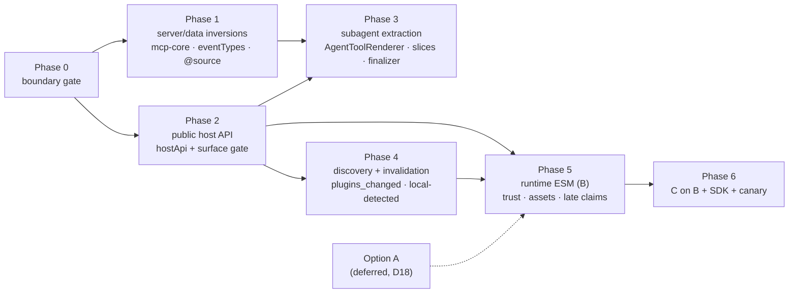

## Context

The plugin boundary leaks in both directions, and external plugins cannot ship UI. Six spikes ([`spikes.md`](./spikes.md); detail on branches `spike/decouple-s{1..6}-*`) turned the reported evidence into verified facts. Doubt cycles 1–3 re-checked every citation below against `develop`; cycle-3 corrections are tagged "cycle 3".

**Core → plugin edges.**
- `packages/client/src/lib/chat/event-reducer.ts:410,412` imports subagent types from `@blackbelt-technology/pi-dashboard-subagents-plugin/client`.
- `packages/client/src/components/tool-renderers/AgentToolRenderer.tsx:26` imports `SubagentDetailView` / `SubagentLiveTail` from the same package. The same file also imports client-utils `Dialog` (`:21`; singleton-bearing: `escape-stack` + `LayerPortal`) and the pure `currentSentence` (`:22`, used `:461`), plus host internals (`:23-44`): `MarkdownContent`, `AgentCardShell`, `ElapsedBadge`, `formatDuration`, i18n `t`, `subagent-inspector-telemetry`, `randomUuid`, `useSubagentResyncCadence`, `countSteps`/`readLiveTail` from `event-reducer.ts`.
- `packages/client/src/lib/package/anthropic-peer.ts:11` imports `PEER_AM_LEGACY` from `flows-anthropic-bridge-plugin/peer-probe`.
- `packages/server/src/server.ts:12-15` and `packages/server/src/auth/radius-mcp.ts:22` import `createMcpClientConfigService` / `createRealConfigIO` / types from `mcp-client-plugin/core`. The Radius MCP service is built from those **factories** lazily per request (`server.ts:3050-3055`). It works today with the mcp-client plugin disabled, because it never touches the plugin's service registry entry.
- Packaging edges:
  - `packages/server/package.json:77` (dep mcp-client-plugin), `:120` (devDep mcp-server-plugin, used only by `host-gate-inject.test.ts` and `mcp-manifest-completeness.test.ts`).
  - `packages/client/package.json:30-57` lists 25 bundled plugins as dependencies, because the generated registry imports them by package name (S1).
- Styling edge: `packages/client/src/index.css:18-46` hand-lists 25 plugin `@source` lines.

**Plugin → plugin edges.**
- `mcp-server-plugin/src/server/index.ts:30` and `legacy-entry-migration.ts:25` import the **factories** `createRealConfigIO` / `createMcpClientConfigService` from `mcp-client-plugin/core` (call site `index.ts:252`).
- `apple-tools/src/{env,install}.ts` and `src/server/index.ts:20` → `mcp-client-plugin/core`. `env.ts` serves a **hostless** installer CLI, which has no plugin registry. The server entry consumes the `mcp-client.config` service through `dependsOn` (`apple-tools/src/server/index.ts:27,65`).
- `chat-gateway/src/server/team/tier.ts:13` → `mcp-server-plugin/manifest` (`GENERATED_TOOLS`). It only uses `name → tier` (`tier.ts:87-89`).

**Hidden coupling around subagents (S2, R9).**
- The reducer `default` branch (`event-reducer.ts:3330-3348`) suppresses every `flow_*` event by hard-coded prefix (`:3339`) and turns any other unhandled event into a `rawEvent` JSON row. With the subagent slice moved out, an absent plugin would spam raw `subagent_*` rows.
- `ToolCallStep.tsx:113` hard-codes `toolName === "Agent"`, and `:122` calls `isAgentResultNotReceived(toolDetails, context.session?.subagents)` (defined `:31`).
- Server-side, `server/src/persistence/memory-event-store.ts` exempts Agent/`subagent_*` payloads from truncation (`:628`, `:1037`, `:1041`, `:1154`, `:1249`, `:1260`). It reads only event shape, works with the plugin disabled, and imports no plugin; it stays in core (inventoried here, no task).
- Agent-row healing has two parts:
  - generic orphan heals: the server synthesizes `tool_execution_end` (with `healedBy`) and `subagent_failed` on session end (`server/src/session/open-tool-calls.ts:1-17,129-151`); the client's neutral settle heal (`event-reducer.ts:804-815`) stops a spinning row with no subagent state;
  - subagent-outcome backfill: `finalizeAgentRowFromSubagent` (`event-reducer.ts:739`, called at `:1935`, `:2713` and `:3248`) reads `SessionState.subagents`;
  - two more core writers of `SessionState.subagents` (R1 cycle 3): the live hydration from the durable `tool_execution_update` `partialResult` channel (`event-reducer.ts:2646-2676`, dual index via `setSubagentState` `:629`, non-regressing; spec `subagent-live-detail-reliability`), and the `tool_execution_end` backfill that re-hydrates the map after `/resume` and page refresh (`:2845-2929`);
  - live-tick reopen: `reopenSessionEndedRow` (`event-reducer.ts:772`) restores a `session_ended`-healed row and, for Agent, its subagent. The guards are normative in `openspec/specs/session-end-orphan-heal/spec.md:138` (running-only, never clobber terminal rows or terminal subagents) and `:162` (live tick reopens).
- Core `packages/client/src/lib/chat/tool-summary.ts` keys collapsed summaries and icons by tool name, including `Agent`, `get_subagent_result` and `steer_subagent` (`:42-44`, `:80-82`). It is data, not an import (R11).
- The resolution order plugin claim → built-in → Generic already exists (`ToolCallStep.tsx:147-160`). That lookup is memoised on `[registry, toolName]` only (`:153-160`) and does not subscribe to the claims version.

**Discovery and registry.**
- `discoverPlugins(repoRoot?)` has one process-global cache that ignores which root it was called with (`loader.ts:53,119-120,220`).
- With an explicit root it scans only `<repo>/packages` (`loader.ts:124-126`). Without one it scans monorepo, `~/.pi/dashboard/plugins` and `resources/plugins` (`loader.ts:128-133`). Earlier dirs win id collisions: workspace > installed > bundled (`loader.ts:202-204`). On an Electron host an older first-party copy under `~/.pi/dashboard/plugins` therefore beats the `resources/plugins` copy the shipped client was built with (npm-global ships no `resources/plugins`, see below).
- `clearDiscoveryCache()` (`loader.ts:225`) has no production caller.
- Package operations complete asynchronously in `packageManagerWrapper.setCompleteListener` (`server.ts:2852-2866`). That listener broadcasts `package_operation_complete` and refreshes recommended/probe caches. The routes return 202 before completion (S4).
- `listPiPackages` (`packages/shared/src/pi-package-resolver.ts:144-162`) resolves `settings.json#packages[]`. It yields **only entries whose install path exists** (`:216`), and memoizes `npm root -g` (~150 ms) process-wide (`:48-57`).
- `selectClientRegistryPlugins` drops plugins outside `bundleRoots` (`client-registry-set.ts:74`). `bundleRootsFor(repoRoot)` (`:86`) is called at `vite-plugin/index.ts:116`, `:635` and `server/src/lib/client-dist.ts:101`.
- **On a host without a monorepo root the server omits `bundleRoots`** (`client-dist.ts:89-97`), so every discovered client plugin is counted in the runtime hash.
  - npm-global has no root and ships no `resources/plugins` (`packages/server/package.json#files` lists no `resources/`; only `bundle-server.mjs:169` and the Electron runtime-overlay stager produce it).
  - Electron **does** resolve a root (R5 cycle 3): the server bundle's `package.json` declares `workspaces` (`packages/electron/scripts/bundle-server.mjs:241`), which `findMonorepoRoot` accepts (`loader.ts:64-82`), and `client-dist.ts:94-96` then passes `bundleRootsFor(root)`. That root's `packages/` holds only `BUNDLED_WORKSPACE_PKGS` copies (`bundle-server.mjs:112-127`, incl. `mcp-client-plugin`, `mcp-server-plugin`); the other first-party plugins sit in `resources/plugins` (`:169`).
  - Either way filesystem roots cannot decide "bundled".
- The server reads that declaration with `readBuildDeclaration` (`client-dist.ts:119`) at startup (`server.ts:2714`); discovery has a single cache that ignores it (`loader.ts:53`).
- The served build already carries a declaration `pi-dashboard-build.json` = `{schemaVersion, pluginRegistryHash, fixturePolicy}` (`dashboard-plugin-runtime/src/server/build-metadata.ts:22,34-38`), validated by `validateBuildDeclaration` (`:66-68`).

**Client registry.**
- `App.tsx:263-272` populates `_pluginRegistry` once from `PLUGIN_REGISTRY`, including i18n catalogs (`:271`). Route descriptors are registered at `:278-280`, and `registerPluginRouteDescriptors` **replaces** the list (`client/src/lib/nav/back-target.ts:96-97`).
- `pluginNames` is built from the build-time array (`App.tsx:3029`).
- The registry is mutable (`slot-registry.ts:129,131` `addClaim` / `removeClaims`).
- `lazyClaim(load, name)` wraps a **component** in `React.lazy` (`lazy-claim.tsx:22-40`). `predicate`, `shouldRender` and `labelComponent` are static functions resolved eagerly from the main client entry (spec `dashboard-plugin-loader` › "Claims MAY name a lazily-loaded component module").
- A claims-version store exists (`slot-claims-invalidation.ts:44,55`). Reader inventory (X10), from `rg -n "useSlotClaimsVersion|getClaims\(" packages/client/src packages/dashboard-plugin-runtime/src` (tests excluded), with each `getClaims` call mapped to its enclosing function: 41 `getClaims` reads; 29 sit in a function that subscribes. These direct registry readers do **not** subscribe (12):
  - in `slot-consumers.tsx`: `ComposerPanelSlot:339`, `AnchoredPopoverSlot:591`, `CommandRouteSlot:610`, `SettingsSectionByPluginSlot:664`, `ToolRendererSlot:697`, `AutomationActionEditorSlot:742`, `useHasAutomationActionEditor:824`, `ShellOverlayRouteSlot:878`, `useShellOverlayRouteMatched:922`, `useShellOverlayRoutePresentation:959`, `useShellOverlayRouteDepth:983`;
  - in the client: `ToolCallStep.tsx:153-160`.

  Already subscribed (verified, no change): the 16 other `slot-consumers.tsx` readers (`useSlotHasClaimsForSession:39` … `ShellHeadlessSlot:806`), `ChatView.tsx:1008`, `CustomEntryRow.tsx:79` (its helper `resolveCustomEntryClaim:50` reads at `:55`), `SessionContentGate.tsx:33`, `use-file-handler-store.ts:29` / `FileHandlerLayer.tsx:201` (readers of `file-handler-claims.ts:33`), `editor-pane-tab.tsx:30`, `SplitWorkspaceContext.tsx:318`.
- The client enable filter hides disabled plugins' claims (`setEnabledSet`), while `getAllPluginsForActivationUi()` still returns their manifest summary (spec `dashboard-plugin-loader` › "Slot registry SHALL filter claims of disabled plugins on the client"). `client/src/hooks/usePluginEnabledSet.ts` computes the default-allow union (`:46-62`, spec "The client-side enable filter SHALL default-allow build-time-known plugin ids"), calls `setEnabledSet` at `:63`, and recomputes only on first mount and `plugin-config-update` (`:91`).

**Host API surface.**
- The runtime root `dashboard-plugin-runtime/src/index.ts` (168 lines) exports 205 names: 53 plugin-used, 66 host-only, 86 unused (S5).
- 25 in-repo plugin test files import host-only names (`createSlotRegistry` in 13 of them, plus providers). invoice-bot deep-imports host *client* files, not runtime names.
- `./context` duplicates 35 hooks (`package.json` exports `:20-22`). It also exports shell names: `useSlotRegistryOrNull` (`plugin-context.tsx:495`), `useSlotRegistry` (`:501`), `applyPluginConfigUpdate` (`:584`), `initPluginConfigs` (`:608`), `PluginContextProvider` (`:614`).
- Plugins import more subpaths than the root. `./context`: 59 files by `rg -l "dashboard-plugin-runtime/context['\"]" packages --glob '!**/node_modules/**' --glob '!electron/resources/**'` (R15): core 14 (`client` 11, `dashboard-plugin-runtime` 1, `team-app` 1, `dashboard-plugin-skill/src/templates/client.tsx.tmpl:13`) and plugins 45. Other subpaths, `rg -l "dashboard-plugin-runtime/<sub>['\"]" packages/` outside runtime/client/server/shared: `./bridge` 9, `./manifest-validator` 5, `./embedded-app` 5, `./test-support` 28. The scaffold reference teaches `./context` (`packages/dashboard-plugin-skill/.pi/skills/dashboard-plugin-scaffold/references/plugin-context-api.md:10`); `plugin-package.json.tmpl` has no `keywords`.
- Plugins call `bumpSlotClaimsVersion` in production code (e.g. `blackhole-plugin/src/client/installed-gate.ts`).
- `PluginManifest` (`shared/src/dashboard-plugin/manifest-types.ts:276`) has no host-version field.
- `validateManifest` (`packages/dashboard-plugin-runtime/src/manifest-validator.ts:550`) returns an explicit allow-list (`:759-776`), so unknown keys are silently stripped.
- `useUiPrimitive` is deprecated for plugins by spec (`openspec/specs/plugin-ui-primitive-registry/spec.md:159-199`), yet 11 plugins call it. `plugin-intent-protocol` (`spec.md:13-42`) forbids plugin client `useUiPrimitive` and points at that exception.
- `UI_PRIMITIVE_KEYS` already has `ui:markdown-content`, `ui:agent-card`, `ui:format-duration` (`shared/src/dashboard-plugin/ui-primitives.ts:33,35,50`) and `ui:dialog` (`:40`). There is no elapsed-badge primitive. `UiConfirmDialogProps` is `{message, confirmLabel?, onConfirm, onCancel}` (`:111-116`); the system-one and team-app copies need `title`, a ReactNode `body`, `cancelLabel`/`destructive`.
- `packages/client/package.json:50` depends on `keycloak-resolver-plugin`, which declares no `client`; no client source imports it (only a comment, `lib/identity/gate.ts:7`, and test ids).

**MCP context partition.** `DENIED_CONTEXT_MEMBERS` (`mcp-server-plugin/src/server/tools.ts:70-91`) lists ctx members never reachable *from an MCP caller*. The plugin itself still calls denied members (`ctx.consume` at `index.ts:70`). The partition test (`assertContextPartitionTotal`, `tools.ts:170-180`) requires every ctx member in exactly one list.

**Delivery constraints.**
- CSP is `script-src 'self' 'unsafe-inline' 'unsafe-eval'` (`server/src/auth/csp.ts:42`). The default mode is `report` (`:57`).
- Device bearer and api-base are added only by `window.fetch` wrappers (`client/src/lib/pairing/device-auth.ts:196-200`, `client/src/lib/api/api-base-fetch.ts:20-30`). `import()` and `<link>` bypass them. When `getApiBase()` is set (remote-server mode) the page stays on the local origin and only `/api/` fetch strings are rewritten (`api-base-fetch.ts:3-12`).
- `/` and `/index.html` are served by `@fastify/static` (prefix `/`, `preCompressed: true`, default index) (`server.ts:3315-3332`) whenever a production build exists, **also in `--dev`**. The SPA deep-link fallback is `reply.sendFile("index.html")` in the not-found handlers (`server.ts:3385,3395`). In `--dev` the not-found handler (`:3347-3389`) proxies to Vite first and falls back to the production `index.html`; so in `--dev` the server cannot know which HTML the browser got.
- Config writes: `PUT /api/config` (`server/src/routes/system-routes.ts:585-588`, `operate` tier) calls `writeConfigPartial` (`server/src/config-api.ts:235`). Its auth merge copies only named keys (`:262-307`), including `capabilityRoutePlugins` (`:304-306`); a naive `trustedPlugins` merge there would let a paired remote `operate` device grant page authority.
- npm writes package files with a normalised mtime (1985-10-26), so `(size, mtimeMs)` cannot detect a same-size package update.
- The docker E2E harness builds from a full workspace (`docker/Dockerfile:146`, `:157` `COPY packages`), so it has a monorepo root and cannot exercise the dist-only (#930) layout; `qa/` VM smoke installs can.
- The network guard covers only `/api/`, `/v1/`, `/editor/` and `/live/` (`localhost-guard.ts:479`). `network-guard-namespace-coverage.test.ts` enforces that every dangerous route lives under one of them.
- Route tiers: `observe < control < operate` (`shared/src/tiers.ts:17`), one route→tier map in `shared/src/route-tiers.ts` (unlisted → `operate`), totality asserted by `server/src/identity/__tests__/http-road-classification.test.ts`. Genuinely-local trust is `isLocallyTrusted` (`server/src/auth/localhost-guard.ts:93`).
- The OAuth auth hook skips app mounts by exact registry match (`auth-plugin.ts:551`). It has **no** `/assets` skip (`auth-plugin.ts:507-583`, R8 cycle 3): whatever lets a paired device load `/assets/*` comes from an earlier branch or does not exist (task 6.9).
- `/api/health` is unauthenticated and tunnel-reachable: the hook skips it (`auth-plugin.ts:534`) and the route (`system-routes.ts:1110`) returns `plugins: …listAll()` (`:1302`). `client-dist.ts` already keeps filesystem paths out of it (R4 cycle 3).
- `POST /api/plugins/:id/toggle` broadcasts only `plugin_config_update`, one per flipped id (`plugin-activation-routes.ts:119-133`, `:205`, `:222`) (X1 cycle 3).
- A loaded server entry runs inside the dashboard server process, next to auth, the vault and `config.json`; it can rewrite `auth.*` itself (R9 cycle 3).
- `serveApp` is shipped:
  - `ServerPluginContext.serveApp` at `server-context.ts:1247`, host binding at `:1539-1541`, wired at `server.ts:4016`.
  - `app-mount.ts`: extension allowlist `:47`, realpath confinement `:130-162`, `.gz` variant `:224-231`, per-app CSP `:236`.
  - Trust: `isServeAppTrusted` (`server/src/auth/serve-app-host.ts:48-53`) = `path.basename(packageDir)` ∈ `piDashboard.bundledPlugins` **OR** id ∈ `auth.capabilityRoutePlugins` (`shared/src/config.ts:208`). The basename check is spoofable once new discovery roots exist: any package whose directory is named `goal-plugin` passes. The trust list is read at plugin activation (`serve-app-host.ts:59,69-72`), i.e. restart-effective. An untrusted call is a log-only no-op (`:73-80`).
- `parseAuthConfig` returns `undefined` unless one of a fixed set of presence predicates holds (`shared/src/config.ts:1723-1732`).
- Electron and npm ship the client as `dist/` only (`packages/electron/scripts/bundle-server.mjs:551-556`; `docs/electron-immutable-bundle.md`). No rebuild is possible on user machines (S4). First-party workspace deps of bundled plugins are copied through `BUNDLED_WORKSPACE_PKGS` (`bundle-server.mjs:112-127`).
- The service worker is repo-root `public/sw.js`, registered at `client/src/main.tsx:241`. It passes `/api/*` through (`sw.js:10-13`) and `respondWith`s everything else.

**Threat model anchor.** `docs/untrusted-plugin-ui-gap.md` already establishes that same-realm React plugin code is no security boundary. Untrusted plugins must use the descriptor protocol. Runtime-loaded client code in this change is therefore *trusted code*, and the job is to make that trust an explicit, locally-granted operator decision.

## Goals / Non-Goals

**Goals**
- Production core packages import no plugin package. Plugin → plugin production imports are gone. A CI gate prevents regressions.
- One versioned public host UI surface that serves both build-time and runtime-loaded plugins.
- An external plugin installed into a stock npm or Electron dashboard renders slot claims and full-page apps with no client rebuild and no toolchain.
- After a package install, a new plugin's server entry loads without a server restart. Its client claims render after the operator trusts it, without a page reload. Update and removal of a loaded plugin are flagged as restart- or reload-required.
- Phases revert in reverse dependency order; irreversible ship points are named.

**Non-Goals**
- Signing, marketplace, sandboxing / isolating plugin JS. The operator trust opt-in is in scope.
- Shipping Option A, or rebuild-on-install.
- *Loading* local-scope (`<cwd>/.pi/settings.json`) plugins. They are detected and reported only (D19).
- Hot removal or upgrade of loaded client or server code.
- Runtime plugin clients while the page targets a remote server (D20).
- Extracting more features into plugins.
- Migrating the external invoice-bot.

## Decisions

### D1 — Boundary gate is a custom script with a ratcheting allowlist
`scripts/check-plugin-boundary.mjs`:
- Runs `ts.preProcessFile` over all packages.
- Adds a regex for `vi|jest.(do)?mock|importActual("lit")`.
- Checks all four package.json dependency fields and CSS `@source`.
- Runs from a vitest wrapper in the existing `scripts` project (`vitest.config.ts:154`) and as `npm run check:plugin-boundary`.

The allowlist `scripts/plugin-boundary-allowlist.json` is keyed `(from, to)`:
- Each row has `kind`, `reason`, `disposition` and `removedBy`.
- A NEW edge or a STALE row fails the run.
- `--write-baseline` re-seeds the file and keeps existing reasons.

The precedent is the AST-walking allowlist test `client/src/lib/__tests__/ui-copy-no-spawn.test.ts`, whose stale entries fail. The spike ran in 0.8 s over 6.2k files.
- *Alternatives:*
  - Biome `noRestrictedImports` misses `vi.mock`, `require`, `import("x").T`, package deps and CSS. It has no stale ratchet, and its plugin list drifts by hand. It stays an optional editor aid generated from manifests.
  - dependency-cruiser adds a dependency, and it reports a silent false green when only TS ≥ 7 resolves. Rejected (S1).

### D2 — Plugin set, scope, manifest-derived exemptions
- A plugin is any package whose `package.json#pi-dashboard-plugin` or `dashboard-plugin.json` exists. "Core" is every other package (including `team-app`, which has no manifest).
- Forbidden edges are core → plugin and plugin → plugin.
- **Manifest-derived exemptions** (not allowlist rows; they follow the manifests automatically):
  - `packages/client/src/generated/plugin-registry.tsx`: its imports are a pure function of the manifests.
  - `packages/client/src/generated/plugin-sources.css` (Phase 1): its `@source` lines are a pure function of the manifests.
  - `packages/client/package.json` `dependencies` on a plugin **iff** that plugin is in the bundle set the vite plugin derives (non-fixture, declares `client`, discovered under `<repo>/packages`). A client dep on any other plugin is reported — today exactly one: `keycloak-resolver-plugin` (`client/package.json:50`, no `client`, unused by client source). Phase 1 drops it (task 2.15) after confirming the npm-global install graph does not need it; the server already lists the plugin in `piDashboard.bundledPlugins` (`server/package.json:47`).
- Fixture plugins (`fixture: true`) are exempt when used from test files and `devDependencies`.
- Consequence: the baseline is **76 rows** (prod 11 / test 34 / pkg 6 / css 25), not 100; 24 of the 25 client pkg edges are exempt from day 0, and the keycloak edge is a row. `extract-git-as-plugin` / `extract-openspec-as-plugin` add a plugin whose client dep and `@source` line are covered by the exemption, so they add no row.
- *Alternative:* a `*-plugin` name suffix. Rejected because it misses `apple-tools`, `cost-estimator` and `demo-plugin`.

### D3 — Contracts in non-plugin packages; core uses libraries, not plugin services
- A contract shared by the host and plugins, or between plugins, lives in a non-plugin package: `packages/shared/src/dashboard-plugin/<name>.ts` for protocol-shaped types, or a core library such as `mcp-core` for a domain library. The provider plugin MAY re-export it.
- Core that needs MCP config behaviour imports the **`mcp-core` library** directly, as it imports the factories today (`server.ts:3050-3055`). Radius MCP keeps working with mcp-client disabled; no new refusal code, no `provider-auth-server` delta.
- Plugins reach another plugin's *running* service only through `consume` with `dependsOn` (apple-tools, unchanged). mcp-server needs only factories (`index.ts:30,252`, `legacy-entry-migration.ts:25`) and imports them from `mcp-core`.
- No new `ServerPluginContext` member. The draft `whenProvided` is dropped: after the library route it has no consumer. `DENIED_CONTEXT_MEMBERS` is therefore untouched. (Verified for the record: the partition governs MCP-caller reachability only, so a denied member stays callable by the plugin itself, `tools.ts:70` vs `index.ts:70`.)
- *Alternative:* look the service up in `pluginServiceRegistry` and answer 503 when absent. Rejected: it regresses Radius MCP when mcp-client is disabled, for no decoupling gain over a library import.

### D4 — `packages/mcp-core` library; verb-tier table as shared data
- Move `mcp-client-plugin/src/core/*` (`service.ts`, `config-io.ts`, `config-writer.ts`, `effective-view.ts`, `layers.ts`, `live-state.ts`, `path-utils.ts`, `pi-rules.ts`, `schema-validation.ts`, `types.ts`) into a new non-plugin package `@blackbelt-technology/pi-dashboard-mcp-core`, including `McpClientConfigService` and `MCP_CLIENT_CONFIG_SERVICE_KEY = "mcp-client.config"`.
- `mcp-client-plugin/core` re-exports it for one minor.
- server, apple-tools (CLI + server entry) and mcp-server import `mcp-core` directly. Each drops its `mcp-client-plugin` dependency (no devDep either).
- `mcp-core` joins the release/publish set and `BUNDLED_WORKSPACE_PKGS` (`bundle-server.mjs:112-127`). The Electron freshness gate derives its watch list from `BUNDLED_WORKSPACE_PKGS` and watches `packages/dist/index.html` (spec `electron-build-pipeline` › "Bundle freshness invalidation"), so `mcp-core` and the rewritten build declaration are covered without a delta (X14, verified).
- The mcp-server codegen (`mcp-server-plugin/codegen/generate-tools.ts` → `src/server/generated/tools.ts`) also emits `packages/shared/src/mcp/verb-tiers.generated.ts` (`{name, tier}[]`; the `shared/src/mcp/` directory is new). chat-gateway reads that file instead of `GENERATED_TOOLS`.
- **Irreversible ship point:** the first npm publish of `mcp-core`. After it, the package stays published (deprecate, never unpublish).
- *Alternatives:*
  - Allowlist the plugin → plugin edges as declared `dependsOn`: it keeps the coupling the gate exists to remove.
  - Put mcp core into `shared`: it carries filesystem and process I/O plus `pi mcp list` runners, which do not belong in the protocol package.
  - mcp-server `provide("mcp-server.tools")`: chat-gateway needs the table statically at module scope (`tier.ts:87`).

### D5 — Subagent inversion and absent-owner UX
Split into a data part (Phase 1, needs no host API) and an extraction part (Phase 3, needs the Phase 2 public API).

**Phase 1 (data):**
1. Types and pure helpers move to `shared/dashboard-plugin/subagent-types.ts`: `readLiveTail`, `countSteps`, `readSubagentDetails`, `setSubagentState`, `applyLiveBlockPiece`.
2. New manifest field `eventTypes?: string[]` (exact names or `prefix_*`) declares the event types a plugin owns. subagents declares `subagent_*`; flows declares `flow_*`, replacing the hard-coded prefix at `event-reducer.ts:3339`.
3. The generated registry carries `{id, displayName, eventTypes}` for **every** bundled plugin. The owner lookup `getEventTypeOwners()` reads this metadata from an unfiltered source, never from `getClaims`, so a disabled plugin's ownership survives `setEnabledSet` (X9).
4. **Ownership is a reducer input; availability is not (R8).** Ownership is static per registry (bundled manifests, plus runtime plugins once registered). Availability (enabled, loaded, not refused) arrives later and changes, so the pure reducer never reads it:
   - default branch, owned type → update **one group row per type per session**, placed at the type's first event, carrying `{ownerId, eventType, count, payloads}`; `count` is updated in place;
   - default branch, unowned type → today's `rawEvent` row.
   - **The group row is a `role: "rawEvent"` message (R2 cycle 3)** with `toolName` = event type and an `ownedGroup: {ownerId, count, payloads}` field. `rawEvent` is already a skip role of the chat-view retry-pill look-ahead and the pending-`interactiveUi` pairing (`collapse-retried-errors.ts:28-33`, `openspec/specs/chat-view/spec.md:61,91`), of `group-tool-calls.ts:27` and of burst transparency (`group-tool-bursts.ts:34-39`), so none of them changes and no `chat-view` delta is needed. A new role would have had to join every one of those sets. Only the `ChatView.tsx` `rawEvent` branch changes: an `ownedGroup` row ignores `showDebugTools` (`:1090-1091`) and renders by availability; a plain `rawEvent` row keeps that gate.
   - Render: a client module store `pluginAvailability` (fed by `/api/health.plugins[]`, `plugins_changed` and the runtime listing; owned by `usePluginEnabledSet`) decides how a group row renders: available owner or no status read yet → nothing; unavailable owner → one collapsed row "N `<type>` events — `<displayName>` plugin unavailable", payloads on expand. A status change re-renders; it never re-reduces. So a replay that runs before `/api/health` answers cannot collapse an enabled plugin permanently.
   - Late owner: when a runtime plugin registers `eventTypes`, the shell applies a pure `regroupOwnedEvents(state, owners)` to every loaded session state, replacing raw rows of those types with one group row at the first row's position.
   - Memory: payloads per group row are capped at the last 50 (oldest dropped, count kept), so `flow_*` traffic, today dropped outright, does not grow state without bound.

**Phase 3 (extraction):**
5. `AgentToolRenderer` moves into subagents-plugin, claimed via `tool-renderer` `{toolName:"Agent"}`. Its host internals are replaced:
   - `MarkdownContent` → `ui:markdown-content`; `AgentCardShell` → `ui:agent-card`; `formatDuration` → `ui:format-duration`; `ElapsedBadge` → new `ui:elapsed-badge` (Phase 2); client-utils `Dialog` → `ui:dialog` (the plugin must not bundle the `escape-stack`/`LayerPortal` singletons, R23); `currentSentence` stays a direct import of the pure `client-utils/minimal-chat` module;
   - i18n `t` → plugin `useT` with its own 7 `agent*` keys;
   - `subagent-inspector-telemetry` and `useSubagentResyncCadence` move into the plugin;
   - `randomUuid` → `crypto.randomUUID()` (available in every supported secure context).
   - `ToolRendererContext` (shared slot-props) gains optional `send`. The built-in registry row is deleted.
6. **Registration is declarative (R9).** The plugin's client entry exports `sessionEventReducer: {eventTypes, reduce}` and `toolRowFinalizers: {toolName, onToolExecution, onSessionEvent}[]`. The vite plugin carries them into the generated registry; the runtime loader reads them from the entry module. The shell registers them through `./host` functions on the plugin's behalf, so there is no import side effect and a test can build the same registry. The public surface gains only the types `SessionEventReducerSlice` and `ToolRowFinalizer` (minor bump). The registry of slices and finalizers is filtered by the same enabled set as claims: a disabled plugin's slice does not run, and its events reach the default branch as owned events. An enable-set change applies to later events; already-reduced state is not replayed.
7. `tool-renderer` claims gain `expandWhileRunning?: boolean` and `resultPending?: string` (name of an exported sync predicate over `ToolContext.session`). These replace `ToolCallStep.tsx:113`'s hard-coded `"Agent"` and the `isAgentResultNotReceived(…, session.subagents)` call (`:31`, `:122`); the subagents plugin exports the predicate.
8. The subagents finalizer takes over **every** core writer of `SessionState.subagents` (R1 cycle 3), with the dual index (`agentId` and `agentSessionId` share one object) and the non-regression rules intact:
   - `onSessionEvent` (`subagent_completed|failed`) writes `completed`/`failed` and performs the row backfill `finalizeAgentRowFromSubagent` does today (`event-reducer.ts:739`; call sites `:1935`, `:2713`, `:3248`);
   - `onToolExecution` on `tool_execution_update` writes `running`: the durable `partialResult` hydration (`:2646-2676`); a terminal subagent is never set back to `running` unless its terminal state came from the `session_ended` heal (spec `subagent-live-detail-reliability`). The Agent late-tick block reading the same state (`:2680-2716`) moves with it; core keeps the row-only `turn_settled` keep;
   - `onToolExecution` on `tool_execution_end` writes `completed`/`failed`: the `/resume` + refresh backfill (`:2845-2929`), merging non-undefined fields so live and replay paths commute; a `healedBy` end never changes a terminal subagent.

   Row finalization: **Contract (X6), from `session-end-orphan-heal`:** finalize only `running` rows; never overwrite a real terminal row; on a synthesized (`healedBy`) event never change a subagent already `completed`/`failed`; record heal provenance on the subagent. On a live `tool_execution_update` core reopens a `session_ended`-healed row (`reopenSessionEndedRow`'s row half, `:772-777`), then calls `onToolExecution`; the plugin reopens the subagent only if its terminal state came from that heal. `session-end-orphan-heal`, `subagents-plugin-state` and `subagent-live-detail-reliability` are modified to name the plugin as the subagent writer.
9. **Generic heals stay in core (R9 cycle 1).** The server keeps `open-tool-calls.ts` unchanged. The client keeps the server-synthesized `tool_execution_end` heal, the row half of the live-tick reopen, and the neutral settle heal (`event-reducer.ts:804-815`, eligible rows `:720`). At the call sites the reducer first asks a registered finalizer; when none is registered, or it declines, the neutral heal runs. With the plugin disabled an orphan Agent row still stops spinning, and synthesized `subagent_failed` events fold into the group row.
10. `SessionState.subagents` stays a core field, written only by plugin slices and finalizers. `useSessionSubagents` keeps its signature.
11. **Tests (R10).** Core replay suites that assert subagent state either move to the plugin or register the plugin's slice through a vitest setup file. The setup-file import is a new core → plugin edge; that PR adds its `integration-keep` allowlist row (Phase 3 is not delete-only).
- *Hidden coupling kept:*
  - `memory-event-store.ts` Agent/`subagent_*` truncation exemptions (Context) stay in core; they shape payload size only and work with the plugin absent.
  - `tool-summary.ts` collapsed summaries and icons for `Agent`, `get_subagent_result`, `steer_subagent` (`:42-44`, `:80-82`) stay in core (R11 cycle 3). They are tool-name data, like the `ctx_*` rows next to them, import nothing, and keep a readable collapsed line when the plugin is absent. `agent-tool-rendering` is modified to say so, and to move auto-expand to the claim field and `AgentCardShell` consumption to `ui:agent-card`.
- *Alternatives:*
  - A core suppression list of known prefixes re-introduces core knowledge of plugins.
  - A tiny core "Agent" card keeps the coupling.
  - Moving the generic heals to the plugin leaves orphan rows spinning when the plugin is disabled.
  - Reading availability inside the reducer makes replay order decide the UI forever (R8).
  - Import-side-effect registration (`registerSessionEventReducer(...)` at module load) is invisible to tests and to tree-shaking (R9).

### D6 — Host API layering
- **Public surface** = `dashboard-plugin-runtime/src/public.ts`, re-exported by the package root. It is the only surface behind the import map and the surface snapshot. It holds S5's v1 list:
  - `useT`, `useLanguage`, the settings kit, `usePlugin*` (explicitly `usePluginConfig`, `usePluginSend`, `usePluginMessage`, `usePluginLogger`, `usePluginRouter`), `useSession*` (explicitly `useSessionState`, `useSessionEvents`, `useSessionSubagents`), `useAllSessions`, `useShellConnectionStatus` (X4: the current spec's Plugin context API `logger` / `pluginRouter` / event stream stay public);
  - folder-menu hooks, `openPluginTabRoute`, `sendPluginAction`, `registerPromptComponent`, `bumpSlotClaimsVersion` (plugins call it in production code);
  - `PLUGIN_HOST_API_VERSION` and `satisfiesHostApi(range)` (R16 cycle 3): through the import map a runtime plugin reads the **host's** version;
  - `SlotPill`, `RoleRef`, `copyText`, `oauthFlowClient`;
  - `useUiPrimitive(OrNull)`, `createUiPrimitiveRegistry`, `registerUiPrimitive`, `UiPrimitiveProvider`, `lazyClaim`;
  - Phase 3 adds the types `SessionEventReducerSlice`, `ToolRowFinalizer` (minor bump); the registration functions are `./host` (D5 item 6).
- **`./host`** (new, not import-mapped, consumed by `packages/client`) takes the 66 shell-only names:
  - every `*Slot` consumer, `createSlotRegistry`, the providers, the `publish*`/`clear*` stores;
  - `setSender`, `intentStore`, `IntentRenderer`, `SlotErrorBoundary`, `use*ClaimsVersion`, `useSlotRegistry`, `useSlotRegistryOrNull`, `PluginContextProvider`, `initPluginConfigs`, `applyPluginConfigUpdate`;
  - graph fns, `claimsToRouteDescriptors`, `EmbeddedAppShellProvider`.

  `__reset*ForTests` move to `./test-support`.
- **Deprecated root re-exports (R21/X6).** The package root keeps re-exporting the 66 `./host` names, marked `@deprecated`, for one package minor release. They are **not** in `public.ts`, so they are not in the import-map shim nor in the `hostApi` surface. This keeps the 25 in-repo plugin test files and any external build-time consumer compiling; Phase 2 migrates in-repo tests to `./host` / `./test-support`, and the release notes announce the removal.
- **Deprecated names cannot leak back (X7).** `@deprecated` alone does not fail CI. Phase 2 extends the boundary gate with a symbol check: an in-repo plugin file importing a `./host` name from the root fails unless an allowlist row with `expires: <runtime minor>` covers it. Rows only shrink; none outlives the deprecation release. `expires` is inclusive: it names the deprecation release itself, so a row is valid while the runtime version ≤ `expires` and fails once the version is greater (spec `plugin-host-api` › "Allowlist `expires` is inclusive").
- **`./context` (R4).** `plugin-context.tsx` mixes plugin hooks with shell names. Only the plugin-facing hooks fold into `public.ts`; `PluginContextProvider`, `useSlotRegistry(OrNull)`, `initPluginConfigs`, `applyPluginConfigUpdate` go to `./host`. `./context` stays one minor as a deprecated alias re-exporting both groups, so the 59 importing files (Context: 14 core incl. the scaffold template, 45 plugin) keep compiling. No second import-map key: runtime plugins import the root.
- **Allowed plugin subpaths (R3).** Root, `./context` (deprecated), `./sdk`, `./server`, `./bridge`, `./embedded-app`, `./manifest-validator` (pure validator, build/test-time), `./vite-plugin`, `./test-support`; plugin tests may also use `./host`. Only the root, React and (Phase 6) `./embedded-app` are import-mapped. Phase 2 migrates in-repo `./context` imports and the scaffold templates to the root; the templates also gain the `pi-dashboard-plugin` keyword and `hostApi`, and keep relying on the generated `@source` file.
- **`./sdk`** (new, side-effect-free, no React context, bundled into each plugin):
  - `encodeFolderPath`, `decodeFolderPath`, `folderRouteHref(cwd, suffix)`;
  - `UI_PRIMITIVE_KEYS` and `UiPrimitiveMap` types, slot-props types;
  - `HOST_FX_CLASSES`;
  - the `HostApiRange` type and the pure `satisfiesHostApiRange(version, range)` only. Not `PLUGIN_HOST_API_VERSION` or `satisfiesHostApi`: `./sdk` is bundled, so its copy would carry the plugin's build-time version and lie about the host (R16 cycle 3).
- **Primitives** stay the channel to host components. They need no import-map entry and are identical for build-time and runtime plugins. Phase 2 adds `ui:elapsed-badge` and `ui:chat-view`.
- `shell-overlay-route` claim props gain a decoded `cwd`. `encodedCwd` is kept for one minor.
- *Alternative:* a new `@…/plugin-host-api` package. Rejected: it renames the surface 11+ plugins already import, for no gain.

### D7 — Versioning: `PLUGIN_HOST_API_VERSION` + manifest `hostApi`
- `packages/shared/src/dashboard-plugin/host-api.ts` exports `PLUGIN_HOST_API_VERSION = "1.0.0"`, the pure `satisfiesHostApiRange(version, range)` and `satisfiesHostApi(range)` (bound to the constant). `public.ts` re-exports the constant and the bound function; `./sdk` re-exports only the pure helper (D6). The range check accepts `^MAJOR.MINOR[.PATCH]` and exact versions only, and is written in-house with no semver dependency.
- `PluginManifest.hostApi?: string` is validated for syntax and kept in the `packages/dashboard-plugin-runtime/src/manifest-validator.ts:759-776` return allow-list.
- **One `hostApi` covers both halves (R17).** The check runs **at discovery** (`loader.ts`) and is recorded in `PluginStatus.hostApi`. It needs the discovery source, so Phase 2 adds the minimal `source` field (`workspace | installed | bundled`, one per existing search dir) on `DiscoveredPlugin` / `PluginStatus`; Phase 4 adds `pi-package`, `local-detected` and shadowing (R11).
  - Plugins from `workspace` / `bundled` sources: a mismatch is a warning only (compiled with the host).
  - Plugins from `installed` / `pi-package` sources: a mismatch refuses **both** the server entry (not loaded, status error `host-api`) and the client (`client.delivery:"refused"`, reason `host-api`).
  - `hostApi` is required for `pi-package`-source plugins and for any `clientBundle` plugin; a missing range there is treated as incompatible. It stays optional for other sources (no regression for today's `~/.pi/dashboard/plugins` installs).
- **Surface gate (R20):** `scripts/host-api-surface.mjs` is a port of S5's `runtime-surface.mjs` (TS checker `getExportsOfModule` + `typeToString`). It records into `packages/dashboard-plugin-runtime/host-api-surface.json`:
  - `public.ts` export names and `./sdk` export names;
  - `UI_PRIMITIVE_KEYS` values plus the printed type of each `UiPrimitiveMap[K]` (props shape);
  - the printed shape of every slot-props interface and claim field type in `shared/src/dashboard-plugin/slot-props.ts` / `manifest-types.ts`;
  - `HOST_FX_CLASSES` values and the **public CSS custom-property subset** (X13). `theme-gallery` owns the palette maps that overwrite the same token names at runtime (`client/src/lib/theme/themes.ts:17` `CSS_VAR_KEYS`); the snapshot does not record values. The decider of which names are public is the plugin-author reference `packages/dashboard-plugin-skill/.pi/skills/dashboard-plugin-scaffold/references/host-design.md`: the snapshot records the token code spans it names, which `host-design-tokens.test.ts` already proves are declared in `index.css`. A pattern span is expanded, never recorded literally: `--accent-<hue>-text` (`host-design.md:60`) becomes the six tokens `--accent-purple-text`, `--accent-blue-text`, `--accent-green-text`, `--accent-orange-text`, `--accent-red-text`, `--accent-yellow-text` (`index.css:148-153`), the ramp `theme-gallery` requires (`openspec/specs/theme-gallery/spec.md:125`) (R14 cycle 3). Other `index.css` properties are internal;
  - the import-map specifiers and the version it was taken at.

  Rules: removing a recorded name, key, class or variable without a major bump fails; adding one or changing any recorded shape string without at least a minor bump fails. (The gate cannot tell widening from narrowing, so a shape change forces a reviewed bump and snapshot refresh.)
- **Irreversible ship point (R26):** the first release that ships `public.ts` + `./sdk` + the `hostApi` field (Phase 2) publishes `hostApi` 1.0.0: build-time plugins published against it already depend on it. Phase 5 adds the runtime linkage (import map) to the same surface. From the Phase 2 release on, the surface only grows within the major.
- **Ordering with Phase 1 (R12).** Phase 1 adds the manifest field `eventTypes`, which is a recorded claim/manifest shape. If Phase 1 lands before Phase 2 freezes the snapshot (task 3.9), the 1.0.0 snapshot includes it. If it lands after, it is a minor bump. Reverting Phase 1 after the snapshot shipped would be a removal (major), so the field stays accepted (Migration Plan ship points).
- *Alternative:* reuse the package release version `0.9.0`. Rejected: that is a release cadence, not an API contract.

### D8 — Primitive registry reversal, `ui:chat-view`, `ui:elapsed-badge`
- Remove two requirements: "consumed by the shell's IntentRenderer, not by plugin code" and "plugin `useUiPrimitive` DEPRECATED". Modify `plugin-intent-protocol` to match (R5/X1): intents remain the path for bridge- or server-originated UI; trusted plugin client code (build-time bundled, or operator-trusted runtime) MAY render React claims and call `useUiPrimitive` / `useUiPrimitiveOrNull`.
- **Coexistence, intentionally (X3).** The current `plugin-intent-protocol` rule "a plugin that emits intents SHALL NOT also register React claims for the same slot" contradicts `dashboard-plugin-loader` "Slot consumers SHALL accept BOTH…" (`openspec/specs/dashboard-plugin-loader/spec.md:859`). The rule is removed on purpose: a plugin MAY do both; `one-active` slots prefer the intent from the same plugin, `many` slots render both. The BOTH requirement is modified to drop its "expected caller moves to IntentRenderer" sentence. Migration: none; no shipped plugin relies on the prohibition.
- New key `chatView: "ui:chat-view"` with contract `ComponentType<{ sessionId: string; readOnly?: boolean; compact?: boolean }>`. It is registered in `client/src/main.tsx` next to the existing registrations (`main.tsx:171`). The registered component mounts the chat providers it needs, nested inside the app's `UiPrimitiveProvider`; `Provider-context distribution` is modified to allow this (T2-2).
- New key `elapsedBadge: "ui:elapsed-badge"` wrapping `ElapsedBadge`.
- **`ConfirmDialog` dedup is deferred (R27).** `ui:confirm-dialog` takes `{message, confirmLabel?, onConfirm, onCancel}` (`ui-primitives.ts:111-116`); the system-one and team-app copies need `title`, a ReactNode body, `cancelLabel`/`destructive`. Widening a frozen contract is its own change; this change does not migrate them.
- chat-embed (`client/package.json:21` `./chat-embed`) gains `createHostPrimitiveRegistry()` and `EmbedProviders`, so team-app and invoice-bot stop copying `main.tsx`. The factory takes no dependencies (R17 cycle 3). Shell-bound wrappers keep their optional-context form outside `<App>`: `ui:model-selector` reads `useModelConfigOptional()` (`client/src/lib/plugins/shell-primitives.tsx:27-41`), and `EmbedProviders` provides no `ModelConfigContext`, so an embed gets no favorites, refresh or provider-settings link while the caller's list still renders. That is the wrapper's documented no-context behaviour, not a new mode.
- *Alternative:* keep the deprecation and push plugins to intents. Rejected: a runtime plugin cannot reach a host component any other way without bundling it (S5).

### D9 — Delivery: Option B (runtime ESM via import map), C as a layer on B
- External and installed plugin clients are prebuilt ESM loaded with `import()`.
- Bare specifiers resolve through a **server-injected** `<script type="importmap">` (D21) to host-built shim entries in `dist/host/*.js`:
  - `react`, `react/jsx-runtime`, `react-dom`, `react-dom/client`;
  - `@blackbelt-technology/dashboard-plugin-runtime` → a shim over `public.ts` only;
  - Phase 6 adds `…/dashboard-plugin-runtime/embedded-app`, `@blackbelt-technology/pi-dashboard-app-kit/react` and `wouter`.
- How the shims are built: `packages/client/vite.config.ts` adds rollup `input` entries with `preserveEntrySignatures: "exports-only"`. Rollup co-chunks them with the existing `react-vendor` manual chunk (`vite.config.ts:94-96`), so ES module singletons give one React instance and shared contexts (S3).
- C is just a B-loaded `shell-overlay-route` claim rendering `<EmbeddedApp>` (S6). `serveApp` stays the standalone/share-link half.
- *Alternatives:*
  - `window.__PI_HOST__` globals: works, but makes artifacts host-specific, forces export enumeration at plugin build, and defeats tree-shaking.
  - A (D18).
  - C alone: no slots or nav, and it needs trust plus a restart.

### D10 — Manifest `clientBundle` / `clientStyles` are separate from `client`
- `client` stays the build-time source entry, so in-repo manifests are unchanged.
- `clientBundle: "./dist/client/index.js"` names a prebuilt ESM **entry module**. It is small and eagerly imported when the plugin is listed; it exports every claim's static functions (`predicate`, `shouldRender`, `resultPending`, `labelComponent`), the components of claims without `module`, optionally `sessionEventReducer` / `toolRowFinalizers` (D5), and, when the manifest declares `i18nCatalog`, the export of that name. `i18nCatalog` is an export name of the client entry, not a file (`dashboard-plugin-runtime/src/vite-plugin/index.ts:434-440`), so the listing carries no i18n URL and the loader reads the catalog from the entry module (R10 cycle 3). Its directory is the served asset root.
- **The asset root is a dedicated client directory (R25).** Discovery refuses the client (`no-bundle`, layout error logged) when the root is the package root or contains the `server` or `bridge` entry; otherwise a plugin shipping `dist/` for both halves would publish its server JS under `/plugin-assets`.
- A claim's `module` (existing lazy-claim field) names a separate chunk inside the asset root; its component stays lazy.
- `clientStyles?: "./dist/client/client.css"` is optional and must sit inside the asset root.
- A plugin may declare both `client` and `clientBundle`. The canary is built-time in-repo and runtime when installed.
- **Authoring path for external projects (R13 cycle 3).** `dashboard-plugin-skill` mode `augment` retrofits projects that live outside the monorepo, so they are always runtime-delivered. It emits `clientBundle` (+ `clientStyles`), `hostApi`, the `pi-dashboard-plugin` keyword and a `build:dashboard` script over the Phase 6 SDK preset, and its next-steps name `pi install` (visible after a dashboard restart; a Packages-tab install is live, D16) plus the local Trust action (task 7.9, spec `dashboard-plugin-skill`). Mode `new` stays build-time (in-repo).
- A runtime-delivered plugin with only a source `client` is listed as `client.delivery:"refused"`, reason `no-bundle`.
- *Alternative:* infer from the file extension of `client`. Rejected as ambiguous: published first-party packages ship TS source with `exports` pointing at `.tsx` (S4).

### D11 — One bundled-vs-runtime rule: the served build's declared ids (R1)
- The vite plugin already selects the bundle set at build time, inside the monorepo. It now also writes the sorted ids of that set into the build declaration: `pi-dashboard-build.json#bundledPluginIds` (additive field, `schemaVersion` unchanged; ids are host-independent so reproducibility holds). `PLUGIN_REGISTRY` embeds exactly the same ids.
- **Rule:** a discovered plugin is *bundled* iff its id ∈ `bundledPluginIds` of the served build. Otherwise its client is *runtime-eligible* (subject to D12). This works on npm-global hosts, where no monorepo root exists (`client-dist.ts:89-97`), and on Electron, where a root resolves to the server bundle but its `packages/` holds only `BUNDLED_WORKSPACE_PKGS` (Context, R5 cycle 3). New helper `isBundledPlugin(id, declaration)` in `client-registry-set.ts` is the single predicate for the server's delivery decision, status and hash.
- When the served build has no usable declaration or no `bundledPluginIds` (older artifact, `metadata-missing`, API-only), runtime delivery is suspended for every plugin (`refusedReason: "build-undeclared"`), and discovery winners plus the staleness hash fall back to today's selection: plain source priority, `bundleRootsFor` where a monorepo root resolves (R19). Installed hosts running an old artifact behave exactly as today.
- **One winner per bundled id, for both halves (R5).** Today the earliest search dir wins (`loader.ts:202-204`), so on an Electron host an older copy under `~/.pi/dashboard/plugins` would load its *server* entry while the shipped client renders the *bundled* claims. New rule, applied by discovery once the server has read the served declaration (D15 orders the read first and keys the cache by it): for an id ∈ `bundledPluginIds`, the winner is the copy the build was made from — the `workspace` copy **if one exists**, else the `bundled` (`resources/plugins`) copy **if one exists**; if neither exists, plain priority. The test is "a copy exists in that root", never "a monorepo root resolves": on Electron a root resolves, yet only the `BUNDLED_WORKSPACE_PKGS` plugins have a `workspace` copy and the rest win from `resources/plugins` (R5 cycle 3). Every other copy (including `installed`) goes to the winner's `shadowed[]` and never loads. The staleness hash is computed over winners. Behaviour change: an operator who dropped a newer first-party copy into `~/.pi/dashboard/plugins` now sees it as shadowed; that setup never worked coherently (mismatched halves). Migration note in the release notes: update first-party plugins by updating the dashboard.
- **npm-global limitation (R7 cycle 3).** npm-global ships no `resources/plugins` (Context), so no build copy exists on disk: a declared id falls back to plain priority, i.e. an `installed` (or `pi-package`, server-trust-gated per D12) copy at whatever version it has, and the two halves can differ, as today. Its status shows that `source`. Closing this needs the server package to ship its plugins and is out of scope.
- **Staleness hash (T1-9).** The server's comparison set becomes: client-contributing plugins whose id ∈ `bundledPluginIds`, plus — only where a monorepo root is resolvable — plugins under `bundleRootsFor(root)` (so a new, not-yet-built workspace plugin still raises the banner). Runtime-eligible plugins are excluded on both sides. **Re-derive only from build copies (R7 cycle 3):** when every declared id has a build copy on disk (`workspace` or `bundled` source) the server hashes those winners; when any declared id lacks one (npm-global), the server does not hash a foreign copy, which could never match, but takes the declaration's own `pluginRegistryHash` for the declared subset, i.e. it compares against the declaration. Staleness on npm-global therefore reports only a served-build change, not halves skew (limitation above). This fixes today's npm-global gap where every discovered client plugin is counted (`client-dist.ts:89-97`). `plugin-manifest-staleness` and `served-client-build-coherence` are modified accordingly.
- *Alternative:* filesystem bundle roots on every host. Rejected: npm-global has no root, and Electron's root covers only `BUNDLED_WORKSPACE_PKGS`.

### D12 — Trust: one operator list, content-hash pin, visible refusal, two freshness semantics
- New config `auth.trustedPlugins?: { id: string; clientSha256?: string; server?: true }[]` in `shared/src/config.ts` next to `capabilityRoutePlugins` (`:208`). `parseAuthConfig`'s presence predicate (`config.ts:1723-1732`) gains `hasTrustedPlugins`, or a config holding only `trustedPlugins` would be dropped.
- **Only the trust endpoints write it (R1).** `writeConfigPartial` (`config-api.ts:235`) does **not** merge `partial.auth.trustedPlugins`; the stored value is kept (it already copies only named auth keys, `:262-307`). The trust endpoints use a dedicated writer that read-modify-writes `auth.trustedPlugins` alone and preserves every other auth key, including `capabilityRoutePlugins` (X8). `PUT /api/config` keeps writing `capabilityRoutePlugins` exactly as today (`:304-306`), not widened; it only gates `serveApp`, which is restart-effective and less privileged than client JS.
- `isServeAppTrusted` (`serve-app-host.ts:48-53`) becomes: bundled ∨ id ∈ `trustedPlugins` ∨ id ∈ legacy `capabilityRoutePlugins`. **Bundled is decided by discovery source plus realpath containment (R16):** `source ∈ {workspace, bundled, installed}` and `realpath(packageDir)` is under `realpath(<repo>/packages)`, `realpath(resources/plugins)` or `realpath(~/.pi/dashboard/plugins)`, and the basename is in `piDashboard.bundledPlugins`. A basename match alone no longer trusts. This lands with or before the 4th discovery source (task 5.1, R12 cycle 3), so no build ever discovers `pi-package` dirs while the basename check is live. **Why `installed` is in (R17):** `~/.pi/dashboard/plugins` is discovered and trusted by basename today; excluding it would refuse first-party apps installed there (e.g. `craft-web-plugin`, the only `serveApp` caller). The spoofable roots are the new ones — `pi-package` (`~/.pi/agent/npm/node_modules`) and `local-detected` — and they never count as bundled. The dashboard never writes `capabilityRoutePlugins` itself; `PUT /api/config` behaviour for it is unchanged.
- **Server entries of `pi-package` plugins are default-deny (R9 cycle 3).** A server entry runs in the dashboard server process next to auth, the vault and `config.json`, and could write `auth.trustedPlugins` itself (Context), so loading it is the root of trust, not a lesser step than client JS. A `pi-package` winner's server entry is not loaded, and its bridge is not auto-registered, unless its `trustedPlugins` entry has `server: true`; status shows `loaded: false`, error `server-untrusted`. This holds for first-party ids too: on npm-global a `pi-package` copy of `goal` has no build copy to lose against (D11) and an id proves nothing. `POST /api/plugins/:id/trust {server: true}` grants it (local-only, like client trust); the follow-up refresh loads the entry when it never loaded in this process; revoke is restart-effective (`restartRequired`). No hash pin: updating the package is itself an operator `pi install`, and a loaded entry's update already needs a restart. `installed` (`~/.pi/dashboard/plugins`), `bundled` and `workspace` sources keep today's loading: the operator places those files by hand, and gating them would break existing installs (residual risk, Risks). Phase 4 lands the deny with no grant path; Phase 5 adds the grant (Migration Plan).
- A runtime client is **admitted** only when all of these hold:
  - the served build declares its bundled ids (D11) and the plugin is not bundled;
  - the plugin is enabled in persisted config (T2-7, D14) and, if it has a server entry, that entry is loaded;
  - every `dependsOn` id is discovered, enabled and loaded (the loader's existing "missing/disabled dep" rule, X1); otherwise `missing-dep`;
  - `hostApi` is compatible;
  - a `trustedPlugins` entry exists with `clientSha256` equal to the current content hash of the `clientBundle` directory: sha256 over the sorted `(relpath, sha256(file))` list of allowlisted, realpath-confined files. An entry without `clientSha256` never admits a client (it only gates `serveApp`) and reports `untrusted`.
- **Hash lifecycle (R15, R2).** The hash is recomputed on every listing and status read, behind a stat cache keyed by `(relpath, size, mtimeMs, ino, ctimeMs)`, so a rebuilt bundle is noticed without a discovery refresh. `mtimeMs` alone is not enough: npm writes normalised mtimes, so a same-size update would keep the old digest; `ino`/`ctimeMs` change on every write or rename and cannot be set by the package. The whole cache is also dropped on every discovery refresh and package-operation completion, so a trust decision after `pi install` always sees a full rehash. No wildcard pin exists. The authoring loop is one click: the Plugins tab shows `pin-mismatch` with **Trust this version** (same endpoint). Requests for a no-longer-current sha answer 404; a module already loaded keeps running, a not-yet-loaded lazy chunk of the old sha fails inside its claim boundary, and the shell shows the reload notice.
- Otherwise `PluginStatus.client = {delivery:"refused", refusedReason}` with `refusedReason ∈ untrusted | pin-mismatch | host-api | no-bundle | build-undeclared | disabled | missing-dep`, rendered in the Plugins tab. **One reason, fixed precedence:** structural, then config, then consent — `build-undeclared` > `no-bundle` > `host-api` > `disabled` > `missing-dep` > `untrusted` > `pin-mismatch`, so the operator fixes what cannot load before being asked to trust it. Admission and trust log lines carry a 12-hex hash prefix, never the full 64. (`dev-mode` is gone: the server cannot know which HTML a `--dev` browser got; the client reports it, D21.) The Trust action shows the source path and full hash.
- **Granting is local-only (R18).** `POST /api/plugins/:id/trust {sha256}` requires an `operate`-tier caller **and** `isLocallyTrusted` (`localhost-guard.ts:93`); a paired remote device cannot grant page authority. `DELETE` (revoke) requires `operate` only. Both get `shared/src/route-tiers.ts` rows (`operate`); `GET /api/plugins/runtime-clients` gets `observe`. Totality and tier enforcement are asserted by `server/src/identity/__tests__/http-road-classification.test.ts` and `packages/server/src/__tests__/route-tier-gate.test.ts` (R22).
- **Freshness per surface (X7):**

  | Surface | Grant | Revoke |
  |---|---|---|
  | Runtime client | Live: next listing admits; open pages pick it up via `plugins_changed`. | Live for new loads: listing omits it and `/plugin-assets` answers 404. Already-loaded modules stay until reload; the reload notice shows. |
  | `serveApp` | Restart-effective (read at activation, `serve-app-host.ts:69-72`); status shows `restartRequired`. | Restart-effective; the mount stays until restart; status shows `restartRequired`. |

- A refused `serveApp` mount sets `PluginStatus.serveApp = "refused"`. Today that refusal is only a log line (`serve-app-host.ts:73-80`).
- *Alternatives:*
  - Reuse `capabilityRoutePlugins: string[]`: it has no place for a pin, and its name misstates the scope.
  - No opt-in: client JS is more privileged than `serveApp`, which already requires opt-in (S3/S6).
  - A `"*"` dev pin: a loopback origin says nothing about who wrote the files on disk. Rejected for the one-click re-trust.

### D13 — Serving: `/plugin-assets/<id>/<sha256>/<file>`, immutable and registry-matched
- A Fastify route outside guard jurisdiction (`localhost-guard.ts:479`) serves only admitted `(id, sha256)` pairs and returns 404 for anything else. **Per request (X5 cycle 3)** it compares the URL `sha256` with the plugin's current content hash, revalidated through the D12 stat cache (a stat per file, a rehash only for changed files), and answers 404 on mismatch. Without that, bytes rewritten after the last listing would be served under the old immutable URL and cached for a year. `network-guard-namespace-coverage.test.ts` gains `/plugin-assets/` and `/host/` as documented public, code-only prefixes (R19).
- It reuses `app-mount.ts`'s realpath confinement, allowlist and `.gz` logic, extracted to `dashboard-plugin-runtime/src/server/confined-static.ts`; `app-mount.ts` imports them with no behaviour change.
- Allowed extensions: `.js`, `.mjs`, `.css`, fonts and images. Not `.map` or `.json`.
- Responses carry `Cache-Control: public, max-age=31536000, immutable` and the host CSP (not a per-app CSP).
- **OAuth handling is conditional (R8 cycle 3).** The OAuth hook has no `/assets` skip (`auth-plugin.ts:507-583`). So `/plugin-assets` gets no skip by default; it gets one only if task 6.9 finds that `/assets` loads on a paired device through a specific exemption, and then exactly that exemption, scoped to admitted asset paths by exact registry match (same pattern as app mounts, `auth-plugin.ts:551`). It is never weaker than `/assets`.
- **Credential rule = `/assets/*` (R24).** The normative target: every client that can load the host's `/assets/*` can load `/plugin-assets/*` under the same rule. That a bearer-only paired device loads `/assets/*` today is inferred (the SPA boots there; `<script>` cannot carry a bearer) but not run (Open Question 3). Task 6.9 verifies it **before** the route (task 6.10) lands. Fallback if `/assets` turns out cookie-gated: `/plugin-assets` copies whatever exemption makes the host bundle load on that device, never a weaker one.
- The listing `GET /api/plugins/runtime-clients` stays under the guard and is fetched through the bearer-carrying `window.fetch`.
- `public/sw.js` `respondWith`s non-`/api/` requests (`sw.js:14`); Phase 5 verifies it forwards `/plugin-assets/*` and `/host/*` unchanged, or adds a pass-through.
- *Alternatives:*
  - `/api/plugins/:id/client.js`: `import()` cannot carry the device bearer, so claims stay blank on paired devices.
  - `blob:` imports: blocked by `script-src` under enforce (S3).
  - Reuse `serveApp`: its sandbox CSP and `/apps` contract are the opposite shape (S6).
  - A cookie-only scheme: paired devices hold bearers, not cookies.

### D14 — Hot add yes; hot remove/upgrade no; claim registration imports the entry
- **Registration (R2).** For each admitted plugin the client loader `import()`s the `clientBundle` entry module, reads the static claim functions from it, then `addClaim`s each claim: component from the entry, or `lazyClaim(() => import(moduleUrl), name)` when the claim names a `module`. It then registers i18n from the entry export named by `i18nCatalog` (D10), merges route descriptors (R12: re-register the union of build-time and runtime descriptors, since `registerPluginRouteDescriptors` replaces the list, `back-target.ts:96-97`), adds the display name to `pluginNames`, and calls `bumpSlotClaimsVersion()`.
- **Late claims (R11).** All 12 non-subscribing readers subscribe to the claims version. The `tool-renderer` lookup in `ToolCallStep` re-runs on a bump; that modifies `dashboard-shell-slots` "one-shot at lookup time" to "one-shot per lookup" (no fall-through after render, re-lookup on bump).
- On `plugins_changed`, the client re-fetches the listing and registers newly admitted plugins the same way, with no reload. **Enabled set (R7).** `usePluginEnabledSet` recomputes today only on mount and `plugin-config-update` (`usePluginEnabledSet.ts:91`). It also recomputes on `plugins_changed` and after each runtime registration, and its default-allow union includes runtime-registered ids (modified spec "The client-side enable filter SHALL default-allow build-time-known plugin ids", X2). Without this a plugin installed after the first `/api/health` read would stay filtered until the next config broadcast.
- A plugin that was removed, refused, or whose hash changed keeps its loaded module until reload. ES modules cannot be unloaded. The shell shows a "Plugin changes need a reload" notice.
- **Toggle (T2-7, X1).** `POST /api/plugins/:id/toggle` keeps its server contract, **including the dependency-graph requirement** (`computeToggleImpact`, 409 on blockers, atomic cascade, `dependents`; `openspec/specs/dashboard-plugin-loader/spec.md:962,986`), which this change does not modify: the server entry set changes only on the next start (`restartRequired: true`). Client-side visibility already follows persisted config live through `setEnabledSet`; runtime admission follows the same persisted value, for the target and every cascaded id. "Deps" in admission means the loader's rule: every `dependsOn` id discovered, enabled and loaded. **The route also broadcasts one `plugins_changed`** after its per-id `plugin_config_update`s, cascades and restore path included (X1 cycle 3): today it emits only `plugin_config_update` (Context), so the Plugins tab, the runtime listing refetch and `pluginAvailability` would otherwise miss a toggle.
- **Re-enable needs a restart (R20).** `refreshPluginDiscovery()` loads server entries of **new ids only**. Re-enabling an already-discovered plugin whose server entry never loaded therefore needs a restart, and its runtime client stays refused until then (its status carries `restartRequired`). Only a fresh install of a new id is hot.
- Server side, `refreshPluginDiscovery()` loads server entries **additively**, for new ids only. A loaded plugin whose package changed or disappeared gets `restartRequired: true`, because its Fastify routes and handlers stay registered until restart.
- *Alternative:* restart-required for every change. Rejected: it fails the "install without restart" goal for the common add case.

### D15 — Discovery: 4th source, `source`, shadowing, keyed cache, server-entry dedupe
- `discoverPlugins()` (no-arg branch) appends `listPiPackages({scope:"user"})` package dirs that carry a manifest. `listPiPackages` yields only existing install paths (`pi-package-resolver.ts:216`), so missing entries are invisible to discovery and are not warned about (R24). `npm root -g` is already memoized (`:48-57`); discovery adds no second cache.
- Priority: workspace > installed (`~/.pi/dashboard/plugins`) > bundled (`resources/plugins`) > pi-package, as today (`loader.ts:202-204`) plus the new lowest source. Exception for ids the served build declares bundled: the build's own copy wins (D11, R5). Discovery takes the declaration's `bundledPluginIds` as input; the Vite build-time call (explicit `repoRoot`) scans only the workspace and is unaffected.
- `source: "workspace" | "installed" | "bundled" | "pi-package" | "local-detected"` goes on `DiscoveredPlugin` and `PluginStatus`.
- **One row per id (X11).** A losing duplicate is recorded on the winner as `shadowed: {source, packageDir}[]` and logged at warn. Shadowed copies are never loaded — so a pi-package copy of a first-party plugin at another version cannot double-load (R17). This replaces the absorbed spec's second `loaded:false` row, which broke the "one entry per plugin" contract. `/api/health.plugins[]` and `GET /api/plugins` change shape only additively; `PluginsSection` renders `shadowed` as a sub-line and does not need a second row.
- **`/api/health` stays path- and hash-free (R4 cycle 3).** It is unauthenticated and tunnel-reachable (Context). Its `plugins[]` gains only `source`, `restartRequired`, `hostApi`, `client.delivery`, `client.refusedReason` and `serveApp`. `client.sha256`, `shadowed` (with `packageDir`) and `local-detected` rows (which name a session cwd's packages) appear only on the guarded `GET /api/plugins` and in `plugins_changed` (authenticated WS). `pluginAvailability` needs only enabled, loaded and the refusal, which health keeps.
- The cache is keyed by the effective root set **and a digest of the served declaration's `bundledPluginIds`** (absent → a fixed "undeclared" key; R6 cycle 3), because the D11 winner rule reads those ids. Today one cache serves both `discoverPlugins(repoRoot)` and `discoverPlugins()` (`loader.ts:53,120`). Each key globs once per process until an explicit refresh clears it.
- **Order.** The server reads the served declaration (`readBuildDeclaration`, `client-dist.ts:119`) and hands its ids to the loader before any server-side discovery call; many `discoverPlugins()` call sites in `server.ts` are lazy closures, so the ids must be set at startup, not passed per call. A declaration change is noticed at server start and on every `refreshPluginDiscovery()`, which re-reads it; a client rebuild with neither keeps the old key until then (the documented client workflow restarts the server). The Vite build-time call (explicit `repoRoot`) passes no declaration.
- Entries that are files (several real `settings.json#packages[]` entries point at `.ts`) or directories without a manifest are skipped silently.
- *Alternative:* `pi-resource-scanner.resolvePackagePath` from server. Rejected: `listPiPackages` is already in `shared` (a runtime dependency) and handles `~/.pi/agent/npm/node_modules`.

### D16 — Invalidation from the completion listener, single-flight
- In `setCompleteListener` (`server.ts:2852`), when `result.success && result.scope !== "local"`, call `refreshPluginDiscovery()`:
  1. re-read the served declaration (D15), `clearDiscoveryCache()` and the content-hash stat cache (D12);
  2. `discoverPlugins()`;
  3. additive `loadServerEntries` (new ids only; `hostApi`-gated per D7; `pi-package` server-trust-gated per D12);
  4. local-scope detection (D19) and probe refresh;
  5. status store update;
  6. one `plugins_changed {plugins: PluginStatus[]}` broadcast per cycle.
- **Local-scope operations (R3 cycle 3).** When `result.success && result.scope === "local"`, the listener reruns only local-scope detection (D19) and broadcasts one `plugins_changed`. A local install into an active session's cwd would otherwise stay invisible until another refresh or a new session cwd. No discovery refresh runs: local plugins are never loaded. The existing requirement-probe refresh (`server.ts:2871-2872`) still runs for every successful operation of either scope.
- Calls are coalesced: a refresh requested while one runs schedules exactly one follow-up. Package operations are already serialized, so ordering is safe.
- A server entry that throws while loading during a refresh is recorded `loaded:false` with its error and broadcast; the refresh continues.
- *Alternative:* hook in `package-routes.ts`. Rejected: the routes return 202 before completion (S4).
- **Terminal `pi install` is restart-visible.** Only installs through the dashboard (Packages tab / `POST /api/packages/install`) reach the completion listener and appear live. A global `pi install` from a terminal appears after the next dashboard restart; README and the skill's next-steps say so. `pi-resources-watcher.ts` is not wired to discovery (no new code, no debounce to tune).

### D17 — CSS contract for runtime bundles
- Runtime plugins ship utilities-only Tailwind v4 CSS: `@import "tailwindcss/theme.css" theme(reference); @import "tailwindcss/utilities.css";`. No preflight, and no `:root` theme redeclare.
- They theme through documented host CSS variables (`index.css` `:root` / `[data-theme]`) and `HOST_FX_CLASSES`, both in the surface snapshot (D7).
- `clientStyles` loads as a `<link>` on the first render of a claim from that plugin, not eagerly.
- The SDK preset owns the CSS template.
- Build-time plugins: `packages/client/src/generated/plugin-sources.css` is emitted by the vite plugin before CSS processing. **It is tracked (R13)**, like `plugin-registry.tsx` (`generated/.gitignore` = `*`, `!.gitignore`, `!plugin-registry.tsx`; add `!plugin-sources.css`). An untracked file would break `@import` on a fresh checkout, in a client test that loads `index.css`, or after a failed vite-plugin run. Churn is avoided by determinism: one line per client-bearing plugin under `<repo>/packages` **regardless of fixture policy** (dev builds include fixtures, production drops them, `vite-plugin/index.ts:692`; listing fixtures only adds utilities), sorted, plus claim `module` dirs. The file changes only when that set changes. `client/src/lib/__tests__/tailwind-source-coverage.test.ts` switches from parsing `index.css` to the manifest-derived set, including claim `module` files outside a plugin's `src/client` dir, and asserts the committed file equals the generated one. `client-build-config` "Tailwind source scan covers all plugin client packages" is modified accordingly (R14).

### D18 — Option A deferred (no tasks)
A cannot reach any shipped distribution, because those are dist-only, immutable and have no toolchain (S4; `docs/electron-immutable-bundle.md`). Its only unique value is HMR on out-of-tree plugin source while authoring. Its costs:
- machine-specific paths in a git-tracked generated file;
- named-import collisions across third-party exports;
- a second delivery semantics for one plugin id;
- a dev watcher for external roots.

The SDK preset's `vite build --watch` plus one-click re-trust and a browser reload covers authoring. The B-independent wins A would have brought are taken in this change anyway: manifest-derived plugin set (D2), generated `@source` (Phase 1), and one bundled rule (D11).
- *Alternative:* an env-gated `PI_DASHBOARD_EXTERNAL_ROOTS=1` dev path (~150 LOC prototype). It can be revived as its own change if authors ask for HMR.

### D19 — Local-scope plugins are detected, never loaded (X2)
Carried over from `external-dashboard-plugins`:
- For each cwd of an active pi session, discovery reads `listPiPackages({scope:"project", cwd})` and keeps the entries that carry a plugin manifest.
- Each such plugin is reported with `source: "local-detected"`, `loaded: false`, `enabled: false`, and the error "Local-scope plugins are not loaded in this release. Install globally with --scope global to enable."
- If the same id already has a row from another source, the local copy goes into that row's `shadowed[]` with `source: "local-detected"` (one row per id, D15).
- Its server entry, bridge, claims and client bundle are never loaded or listed.
- Recomputed on each discovery refresh, when a session registers with a cwd not seen before, and after each successful local-scope package operation (D16, R3 cycle 3); an entry is pruned when no active session has its cwd. Session end reruns detection for that session's cwd; it broadcasts one `plugins_changed` only when the local-detected set changed, and `GET /api/plugins` reflects the result immediately.
- Reported on the guarded `GET /api/plugins` and in `plugins_changed`, never on `/api/health` (D15, R4 cycle 3).

### D20 — Remote-server mode: runtime clients not supported in v1 (R13)
When `getApiBase()` is non-empty, the page is on the local origin and talks to a remote dashboard (`api-base-fetch.ts:3-12`). `import()`, `<link>` and the import map would resolve against the local origin and load the wrong host's code. In v1 the runtime loader does nothing in that mode, and the Plugins tab shows "Runtime plugins are unavailable while connected to a remote server". Build-time plugins are unaffected. apiBase-resolved asset URLs plus a remote import map are Open Question 6.

### D21 — Import-map injection is server-side, bypassing the static handler (R14)
- `@fastify/static` is registered with `index: false`. Explicit `GET /` and `GET /index.html` routes (static routes win over the plugin's `/*` wildcard) and the SPA not-found fallbacks (`server.ts:3385,3395`) all call `sendIndexWithImportMap(reply)`.
- That function reads `index.html` (not its `.gz` sibling) once per mtime, inserts the static import-map tag before the first `<script type="module">`, and keeps `Cache-Control: no-cache, no-store, must-revalidate` (`server.ts:3327-3330`).
- The map is a constant built from the shim file names. No plugin- or request-derived value is interpolated.
- With zero runtime plugins the map is inert.
- **`--dev` (R21/X11).** With a production build present, `@fastify/static` serves `/` even in `--dev` today (`server.ts:3315-3332`), and the not-found handler proxies Vite first (`:3347-3389`). The explicit `GET /` and `/index.html` routes keep that order in `--dev`: proxy to Vite; on failure, `sendIndexWithImportMap`. The server therefore cannot know whether the browser got an import map, so it reports no `dev-mode` reason. The **client** checks for `script[type=importmap]` before loading runtime plugins; without it, it loads none and the Plugins tab shows "Runtime plugins need the production page". Open Question 1 (Vite `transformIndexHtml` parity) stays open.

## Risks / Trade-offs

**Security**
- [Plugin JS runs with full page authority: cookies, the in-memory device bearer, the WS, every session's DOM, and `unsafe-eval`. CSP cannot help, because the code is same-origin by construction.] → Admission requires operator trust plus a hash pin, granted only by a genuinely local operator (D12). The refusal is visible. The untrusted-plugin path stays the descriptor protocol (`docs/untrusted-plugin-ui-gap.md`).
- [Basename-spoofed `serveApp` trust once new discovery roots exist (`serve-app-host.ts:48-53`).] → Source + realpath containment (D12). Lands in Phase 4 as task 5.1, with or before the 4th source (R12 cycle 3).
- [Server entries of `settings.json#packages[]` plugins would auto-load into the dashboard server, which holds auth, the vault and config, after any global install, including one started from a paired remote `operate` device; a loaded entry could even write `auth.trustedPlugins` itself.] → Default-deny: a `pi-package` server entry and its bridge registration need a local `server: true` grant (D12, R9 cycle 3). They are also `hostApi`-gated, lowest priority, and never shadow or double-load a first-party copy (D7, D15). Residual: `installed` copies under `~/.pi/dashboard/plugins` keep loading without a grant, as today; only the local operator writes that directory.
- [`/api/health` is public and tunnel-reachable.] → Its `plugins[]` carries no hash, no path and no local-detected row (D15, R4 cycle 3).
- [The import map is an inline `<script>`, allowed only by `'unsafe-inline'` (`csp.ts:42`).] → The map is a static constant (D21). The `baseline-content-security-policy` delta requires that a future nonce/hash policy stamps the import-map tag.
- [`/plugin-assets/*` is outside the guard.] → It serves only admitted `(id, sha256)` pairs and rechecks the hash per request (X5 cycle 3). Hashes come from a guarded listing. It is code, not data, the same as `/assets`, and gets no OAuth skip unless `/assets` has one (D13, R8 cycle 3).
- [Supply chain: an npm-published `dist/client.js` is unaudited code, and there is no install-time build.] → The hash pin forces re-consent on every bundle change. The Plugins tab shows the source path and hash.
- [Pin computation follows symlinks.] → Hash only realpath-confined allowlisted files. A symlink escaping the dir is skipped, using the same check as `app-mount.ts:162`.

**Performance (S3, Chromium headless, localhost, prod build, 5 runs)**
- Host bundle: `index` 1,972,843 B → 1,840,047 B, plus a new `runtime` chunk of 139,059 B. Net +6.3 kB; `react-vendor` +180 B.
- With zero runtime plugins the cost is one ~759 B listing fetch plus a modulepreload of the runtime chunk (Open Question 4).
- Per runtime plugin: about 7 requests and ~7.3 kB; the entry module is now eager on listing (D14), a few kB. Claim visible at 916–1490 ms versus 1228–1479 ms for a first-party plugin page body. The loader itself took 24 ms.
- Hash recompute on listing is stat-cached (D12); a full rehash happens only when a file changes.
- **Budgets (gated, spec `plugin-runtime-client-loading`):** vs the pre-change build on the docker harness over 5 cold loads, zero runtime plugins add ≤ 10 kB gzip host JS and ≤ 2 requests; one trusted runtime plugin reaches claim-visible p95 ≤ first-party page-body p95 + 300 ms. Server: 10 plugins × 50 files, warm stat cache, 200 requests — `/api/plugins` and the listing p95 ≤ 50 ms, `/plugin-assets` p95 ≤ 10 ms.
- `listPiPackages` runs `npm root -g` once per process (~150 ms, memoized).
- S6 shims (`embedded-app`, `app-kit-react`, `wouter`): 11.1 + 5.5 + 0.35 kB, already in the client and now split out.

**Correctness / compatibility**
- [Export drift breaks a runtime plugin with `SyntaxError: does not provide an export named`.] → Contained per claim by `SlotErrorBoundary` (S3). Prevented by the D7 surface gate plus `hostApi` at discovery.
- [A plugin that bundles its own React crashes on its hooks.] → Contained by the boundary. The SDK preset externalizes React, and the singleton guard fails the plugin build (Phase 6).
- [Late claims miss consumers without a version subscription (S3 race: an empty body at 283 ms).] → All 12 readers subscribe (Phase 5).
- [The Vite dev server (`--dev`) serves its own `index.html`, so the server-injected import map is absent.] → Phase 5 targets production mode. The client detects the missing map, loads no runtime plugin and says so (D21, Open Question 1).
- [Trust granted through the generic config write.] → `PUT /api/config` ignores `auth.trustedPlugins`; only the local-only trust endpoint writes it (D12, R1).
- [A same-size npm update keeps a stale digest.] → Stat key includes `ino`/`ctimeMs`; full rehash on refresh and package completion (D12, R2).
- [The docker harness has a monorepo root (`/app`).] → The #930 dist-only path is verified on a `qa/` VM clean install, using a local packed fixture directory installed as a global-scope path entry (no registry; `npm:` resolution stays covered by `pi-package-resolver` unit tests) (specs `plugin-runtime-client-loading` › "Runtime delivery is verified on a dist-only install", `dashboard-plugin-loader` › "Plugin lifecycle is verified on a dist-only install", R18).
- [Moving 66 names to `./host` breaks build-time consumers.] → Deprecated root re-exports for one package minor (D6); in-repo tests migrated in Phase 2.
- [Moving the subagent slice breaks 38 core reducer tests and 2 server replay suites (S2).] → They move to the plugin, or register the plugin slice through a vitest setup file, in the same PR (Phase 3); a setup-file import adds an `integration-keep` allowlist row in that PR (R10).
- [Old build artifacts lack `bundledPluginIds`.] → Runtime delivery suspended with `build-undeclared`; build-time plugins unaffected (D11).

## Migration Plan



Independence: Phase 0 depends on nothing. Phases 1 and 2 depend only on Phase 0 and are independent of each other, with one ordering constraint (R12): Phase 1's manifest field `eventTypes` should land before Phase 2 freezes the surface snapshot (task 3.9); landing it after costs a minor bump (task 2.8 note). Phase 2 owns the minimal discovery `source` (`workspace|installed|bundled`) that its `hostApi` gate needs, so it does not depend on Phase 4 (R11). Phase 3 needs 1 and 2. Phase 4 needs 2 (`hostApi` gating). Phase 5 needs 2 and 4. Phase 6 needs 5. **Rollback runs in reverse dependency order only**: a phase is revertable only while no later phase that depends on it has shipped (e.g. revert 6 → 5 → 4 before reverting 2).

**Irreversible ship points** (code can be reverted; the published contract cannot be withdrawn, only deprecated):

| Point | Phase | What stays after a code revert |
|---|---|---|
| First npm publish of `@blackbelt-technology/pi-dashboard-mcp-core` | 1 | Package stays published; `mcp-client-plugin/core` keeps re-exporting it. |
| Shared contracts consumed by published plugins (`subagent-types.ts`, `anthropic-peer-names.ts`, `shared/src/mcp/verb-tiers.generated.ts`) and manifest field `eventTypes` | 1 | Exports stay in `shared`; the validator keeps the field. |
| `hostApi` 1.0.0: `public.ts` + `./sdk` surface (the snapshot), manifest field `hostApi`, `PLUGIN_HOST_API_VERSION` (R26) | 2 | Build-time plugins published against the surface depend on it; it only grows within the major; the field stays accepted. |
| First release shipping the import map: runtime linkage of the same surface, `clientBundle`/`clientStyles`, `/plugin-assets` URL scheme, `auth.trustedPlugins` | 5 | Import-map specifiers stay; URL scheme and config key stay recognised. |

| Phase | Compatibility | Rollback (only after later dependents are reverted) |
|---|---|---|
| 0 | No runtime change. CI gains a check. | Revert the script, allowlist and npm script. |
| 1 | Neutral while owners are enabled. Disabled owner: compact event row. Radius MCP unchanged (library). `mcp-client-plugin/core` re-exports `mcp-core` for one minor. | Revert per inversion PR; each revert re-adds its allowlist rows. Published `mcp-core` and shared contracts stay (ship points). |
| 2 | Deprecated root re-exports and `./context` kept one minor. `encodedCwd` kept next to `cwd`. `hostApi` optional for bundled. Primitive and intent spec changes only relax rules. | Revert the `./host` split (import rewrite in `packages/client` and plugin tests). The published `public.ts`/`./sdk` names, the `hostApi` field and the surface snapshot gate stay (ship point). |
| 3 | Neutral while subagents is enabled. Disabled: Generic renderer, generic heals, collapsed group row. Adds `integration-keep` rows for any replay setup file (R10). | Revert the move; the renderer, slice and backfill return to core, the removed allowlist rows return and the setup-file rows go. The public types stay (minor-bumped surface). |
| 4 | `pi-package`/`local-detected` sources, `shadowed`, `restartRequired`, `plugins_changed` are additive. pi-package has the lowest priority; its server entries stay refused (`server-untrusted`) until Phase 5 ships the grant (R9). The realpath fix lands first (task 5.1). `isServeAppTrusted` keeps trusting first-party copies under `~/.pi/dashboard/plugins` (R17). | Revert the listener hook, then the 4th source and local detection. Keep the `isServeAppTrusted` realpath fix (security). |
| 5 | No runtime plugin is admitted without local operator trust. The build-time path is untouched. The import map is inert with zero runtime plugins. A declared build makes the build's own copy win each bundled id (R5); an undeclared build keeps today's selection (R19). | Revert the loader and asset route. Trust entries left in config are inert; legacy `capabilityRoutePlugins` keeps `serveApp` working. Already-published `hostApi`/URL contracts stay recognised (ship point). |
| 6 | New shims are additive import-map keys (minor `hostApi` bump). | Revert shims, preset and canary. Phase-5 plugins without app-kit are unaffected. |

## Runtime load sequence

```mermaid
sequenceDiagram
  participant B as Browser (stock dist)
  participant S as Server
  participant L as Loader/registry (server)
  B->>S: GET / (or deep link)
  S-->>B: index.html via sendIndexWithImportMap (static map → /host/*.js)
  B->>B: App boot, build-time PLUGIN_REGISTRY claims
  alt getApiBase() set (remote server)
    B->>B: skip runtime loader, show "unavailable" notice
  else no importmap in page (Vite-served --dev)
    B->>B: skip runtime loader, show "needs the production page" notice
  else local server
    B->>S: GET /api/plugins/runtime-clients (bearer via fetch wrapper)
    S->>L: admitted = declared ∧ ¬bundled ∧ enabled ∧ deps loaded ∧ hostApi ∧ trusted ∧ pin==sha256
    L-->>S: [{id, displayName, claims, eventTypes, routes, entry + module URLs}]
    S-->>B: listing (refused plugins omitted; reasons in /api/plugins)
    B->>S: import(/plugin-assets/id/sha/client.js) entry module
    S-->>B: immutable JS (registry-matched, realpath-confined)
    B->>S: bare imports → /host/react.js, /host/runtime.js (one React, shared contexts)
    B->>B: addClaim(entry fns + lazyClaim(module)), i18n from entry export, merged routes, bumpSlotClaimsVersion()
    B->>S: first claim render → import(module chunk) + <link client.css>
  end
  Note over S,B: package op completes → refreshPluginDiscovery() → plugins_changed
  S-->>B: plugins_changed {plugins}
  B->>S: re-fetch listing → add new claims (no reload); removed/changed → reload notice
```

## Open Questions

1. **Dev mode parity.** Should `--dev` inject the import map through Vite `transformIndexHtml`, mapping it to `/@id/…` optimized deps? Unverified (S3 did not run it). Until resolved, a page without an import map loads no runtime plugin and the client says so (D21).
2. **Server-entry trust.** Resolved in cycle 3 (R9): yes for `pi-package` sources, default-deny with a local `server: true` grant (D12). `pi install` trusts the package as a pi extension, not as code inside the dashboard server, and the install can be started remotely. Open: whether `installed` sources should follow in a later change.
3. **Paired-device asset admission.** S3 inferred this from code but did not run it on a real paired device. Code reading (cycle 3) shows the OAuth hook has no `/assets` skip (`auth-plugin.ts:507-583`), so what admits `/assets/*` for a bearer-only device, if anything, is an earlier branch. The spec states the target (`/plugin-assets` loads wherever `/assets` loads, same rule); task 6.9 verifies before the route (6.10) lands. `/plugin-assets` gets an OAuth exemption only if `/assets` has one, and then exactly that one (D13, R8).
   - **Verified (Phase 5B, task 6.9, code reading; not run on a real device).** `/assets/*` has NO exemption: it is outside the network guard's jurisdiction (`GUARD_JURISDICTION_PREFIXES`) and, when OAuth is on, passes the OAuth hook only through a session cookie, a genuinely-local/trusted source or a configured bypass. The device-bearer hook sets `isAuthenticated` only from an `Authorization` header (a `<script>`/`import()` cannot send one) or the `pi_dash_device` cookie, which is `Path=/api/` and so never rides `/assets/*`. A bearer-only paired device therefore gets no admission for host `/assets/*` under OAuth, and loads them freely only when OAuth is off. Decision for 6.10: add NO OAuth skip and NO guard jurisdiction for `/plugin-assets/*` (it behaves exactly like `/assets/*`); `/host/*` likewise.
4. **Inline the listing into `index.html`** to remove one serial hop? Performance-only. Decide after Phase 5 measurements.
5. **Folder-scoped external apps** (`sidebar-folder-section` + `useFolderMenuItem` + `projectScope`) were not exercised by S6. The Phase 6 canary covers one.
6. **Remote-server runtime plugins.** apiBase-resolved asset URLs plus an import map fetched from the remote host. Deferred (D20).
7. **Hot-added server entries that register Fastify routes.** `refreshPluginDiscovery()` runs after Fastify is listening, which rejects `fastify.get/post(...)` (`FST_ERR_INSTANCE_ALREADY_LISTENING`). Chosen (Phase 4B): no hot route mount; the refresher records such an entry `loaded:false` with a clear error and `restartRequired:true` (`HOT_ROUTE_RESTART_ERROR`), so the Plugins tab shows the restart hint. Open: a dynamic dispatcher or an encapsulated pre-`ready` registration seam would make route-registering plugins hot-addable; deferred until a first-party plugin needs it.
