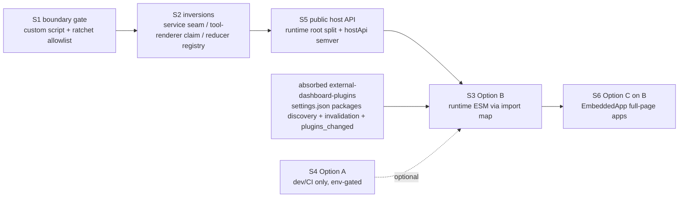

# Spikes — decouple-plugins-from-core (2026-10-20)

Six throwaway spikes, one worktree each (`.worktrees/spike-decouple-<id>`, branch `spike/decouple-<id>`, findings committed, nothing merged).
Full per-spike findings: `SPIKE-FINDINGS.md` on each branch (copies in `/tmp/decouple-spikes/<id>-FINDINGS.md`).

## Decision summary

| Spike | Verdict | Consequence for the change |
|---|---|---|
| S1 boundary lint | ✅ custom `scripts/check-plugin-boundary.mjs` + vitest + ratcheting allowlist (100 rows: prod 11 / test 34 / pkg 30 / css 25). Biome misses `vi.mock`/`require`/pkg deps; dependency-cruiser gives false green under TS7 — rejected. | Phase 0 lands the gate first. Plugin set = manifests (`package.json#pi-dashboard-plugin`), not `*-plugin` suffix. Generated registry + fixture plugins exempt. Plugin→plugin forbidden. |
| S2 inversions | ✅ server mcp-client edge inverted via existing `pluginServiceRegistry` + new `ctx.whenProvided` (absent plugin → 503 degrade); mcp-server→mcp-client removed; `AgentToolRenderer` moved to plugin `tool-renderer` claim; ⚠️ subagent state only partly (new `registerSessionEventReducer`; terminal/heal paths stay in core). | Convention: `shared/dashboard-plugin/<name>-service.ts` contracts. Open decisions: apple-tools CLI dep, raw-event suppression for absent plugin, Agent fallback card. |
| S3 Option B runtime ESM | ✅ prebuilt ESM plugin dropped into `~/.pi/dashboard/plugins/` renders a slot claim in a STOCK prod build; one React via import map → host shim entries; utilities-only Tailwind CSS + shared host CSS vars; CSP passes; `hostApi` fail-closed 409. ⚠️ 10 slot consumers ignore late claims; ⚠️ `import()` bypasses bearer → paired remote devices; ❌ hot add needs restart. | B is the #930 answer. Needs: import map + shims, `useSlotClaimsVersion` in 10 (+4 from S6) consumers, hashed static prefix, operator trust opt-in + hash pin, runtime parity for route descriptors/i18n/display names. |
| S4 Option A build-time | ✅ works in dev + `npm run build`; ❌ impossible in Electron/npm installs (dist-only, no toolchain, ~280 MB). | A = optional env-gated dev path only. Shared `resolveBundleRoots()` for 3 producers; untrack generated registry; generate `@source` lines. |
| S5 host API | ✅ folder encode/decode copied 5×; status visuals, ConfirmDialog mirrored; invoice-bot deep-imports 20 host files (ChatView!). Runtime root exports 205 names, only 53 used by plugins. ⚠️ primitive-registry spec deprecates `useUiPrimitive` though 11 plugins use it — must reverse. | Root = public (import-mapped); move 66 host-only names to `./host`; fold `./context` into root; `./sdk` for bundled pure helpers; new `ui:chat-view` primitive; `PLUGIN_HOST_API_VERSION` + manifest `hostApi`; export-surface snapshot test. |
| S6 Option C app-kit | ❌ alone (no slots, no nav entry, needs trust+restart); ✅ composes on B: B-loaded `shell-overlay-route` claim rendering `<EmbeddedApp>` proven (≈6 plugin LOC, +3 shims ~17 kB). | C = thin layer on B. Don't use `serveApp` for host-document ESM (sandbox contract); reuse only its realpath/allowlist/gz helpers. One unified operator trust list + `PluginStatus` "refused". |

## Corrections to proposal evidence

- `ModelSelector`→roles, runtime→roles, `shared/recommended-extensions`→mcp-client are comments/strings, not imports.
- Real production core→plugin files: `AgentToolRenderer.tsx`, `event-reducer.ts`, `anthropic-peer.ts`, `server.ts`, `radius-mcp.ts`. Plugin→plugin: mcp-server→mcp-client, apple-tools→mcp-client, chat-gateway→mcp-server.
- Third coupling: Tailwind `@source` lines in `client/src/index.css:16-46`.

## Absorbed from external-dashboard-plugins

- 4th discovery source `~/.pi/agent/settings.json#packages[]` — reuse `shared/src/pi-package-resolver.ts:144` `listPiPackages`.
- `source` field on `PluginStatus`; `clearDiscoveryCache()` + `loadServerEntries()` re-run + `plugins_changed` WS broadcast.
- Correction: invalidation hook goes in the package-operation completion listener (`server.ts:~2852` `setCompleteListener`), NOT `package-routes.ts` (routes return 202 before completion).
- npm search keyword `pi-dashboard-plugin`.
- Already shipped there: `PluginsSection` UI (add-plugin-activation-ui).

## Proposed phasing

0. Boundary gate + allowlist (S).
1. Inversions, each PR deletes its allowlist rows (S–M; subagent terminal/heal hook L).
2. Public host API: spec reversal, root/`./host`/`./sdk` split, `hostApi` + snapshot test, `ui:chat-view` (M).
3. Discovery/invalidation/`plugins_changed` (absorbed) (M).
4. Runtime ESM loading B + trust opt-in + consumer fix + auth for `import()` (M–L).
5. C-on-B shims + SDK Vite preset + canary (S–M). Optional: A dev path (S–M).

## Open decisions

- Auth for `import()` of plugin bundles on paired remote devices (cookie vs public hashed prefix).
- Trust model: operator opt-in list (unify with `auth.capabilityRoutePlugins`?) — proposal's non-goal "no trust model" conflicts with S3/S6 security findings.
- Hot add/remove without restart vs restart-required for v1.
- apple-tools hostless CLI: keep declared dep or extract `mcp-core` lib.
- Absent-plugin UX: raw `subagent_*` rows suppression, Agent fallback card.

## Incident

S3 ran `pi-dashboard --help` once with real HOME: the CLI ignores `--help` and boots (~30 s). `~/.pi/agent/settings.json` verified afterwards: no duplicates, no new entries.
