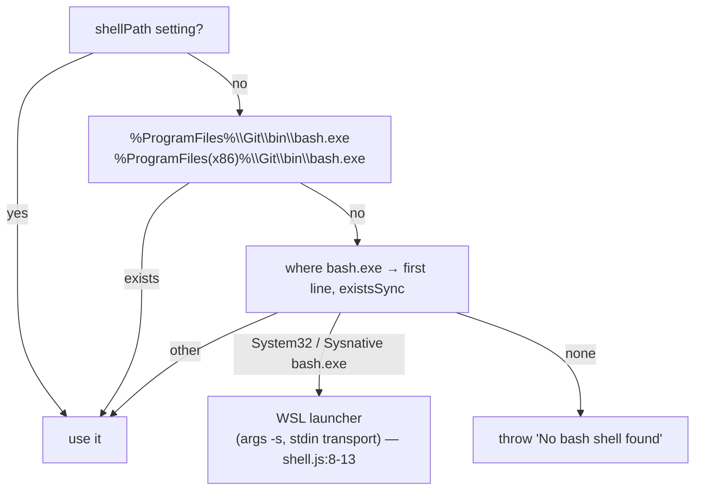

# Design

## Context

See proposal.md — Why (both spike tables).

pi-coding-agent 1.3.0 `getShellConfig(customShellPath)` on win32 (`node_modules/@earendil-works/pi-coding-agent/dist/utils/shell.js:58-91`):

Callers: `bash` tool (`dist/core/tools/bash.js:133`, passes the `shellPath` setting); user `!` commands via `AgentSession.executeBash` (`dist/core/agent-session.js:3129-3137`) → `createLocalBashOperations({ shellPath })` (`tools/bash.js:133`); `!cmd` config values via `getShellConfig()` with **no** argument (`dist/core/resolve-config-value.js:132`) — `shellPath` is ignored there. `getShellConfig` is exported from the package root (`dist/index.js:53`); the package `exports` map has only an `import` condition (`package.json:14-19`), so it must be loaded with `import()`, not `require`.

Dashboard spawn env: `ToolResolver.buildSpawnEnv` normalises the PATH key (`normalizeEnvPathKey`, `packages/shared/src/platform/binary-lookup.ts:280`), injects `extraBinDirs` + `getUserBinDirs()` (`:300-310`), then runs `ensureWindowsSystemPath` and `augmentEnvWithGitSource` (`:316-320`); PTYs call `augmentEnvWithGitSource` directly (`packages/server/src/terminal/terminal-manager.ts:332`). `augmentEnvWithGitSource` → `getActiveGitSource` (module-cached `{source, setting, gitDir}`, `git-source.ts:31-53`) → `ensureBundledGitOnPath`, which skips dirs already present and only prepends (`ensure-bundled-git.ts:138-160`). Setting seeded at startup (`packages/server/src/server.ts:631`) and on config write (`packages/server/src/config-api.ts:484-486`).

Current diagnostics accept `sh.exe` as "bash": `bundledGitBashStrategy` (`tool-registry/strategies.ts:442-456`); `getGitSourceReadout` bundled → `usr/bin/sh.exe` unconditionally, host → `which("bash") ?? which("sh")` (`git-source.ts:124-143`); Doctor bash row `ok` iff `shellPath` (`doctor-core.ts:1620-1625`). Client type + hint: `SettingsPanel.tsx:833-836`, `:2401-2418`; save partial is an explicit per-field diff (`:394-396`), section map `:342`, readout refresh trigger `:1051`.

MSYS2 bash picks POSIX mode from `argv[0]`: `sh` → `posix on`, `bash` → `posix off` (spike 1, same binary).

## Goals / Non-Goals

**Goals:**
- pi resolves the bundled shell, in bash mode, by default — no pi-settings writes.
- Users who want the host shell (WSL with a distro, MSYS2, Cygwin) keep a supported switch.
- Dashboard diagnostics name the shell pi would resolve (with documented residuals).
- A build-time gate fails the Windows leg if pi cannot resolve the bundled bash.

**Non-Goals:**
- Changing `selectGitSource` / which git a user gets. (A "treat the WSL launcher as no host bash" idea was dropped: `whichSync` returns the first `where` hit, `binary-lookup.ts:375-387`, so it would switch Git-for-Windows + WSL users to bundled git, and it cannot change pi's own first-hit pick.)
- Overriding pi's `%ProgramFiles%\Git\bin\bash.exe` precedence. With Git for Windows installed, pi uses it regardless of `windowsBashSource`; diagnostics report that.
- Mirroring a user-set pi `shellPath` or the session cwd in diagnostics (documented residuals, D3).
- Making the tool-registry `bash` entry follow `windowsBashSource`. In `"host"` mode the Tools panel can show bundled bash ✓ while pi runs the host shell — accepted; the Settings hint + Doctor row are the "what pi uses" surfaces.
- Live re-probe of the readout when Git for Windows is installed/removed at runtime (existing process-lifetime cache; refreshed on config write or restart).
- Patching pi-coding-agent; removing `sh.exe`.

## Decisions

### D1 — Ship `usr/bin/bash.exe` as a byte copy of `sh.exe`

`download-git-windows.mjs` copies `usr/bin/sh.exe` → `usr/bin/bash.exe` right after `extract()` (`download-git-windows.mjs:168`), before `writeLicense`; skipped when the tarball already has `bash.exe`; throws when `sh.exe` is missing. Runs only on legs that reach the git-embed block — `bundle-server.mjs` `--source-only` exits earlier (`bundle-server.mjs:353` vs `:476-509`). Arch-agnostic (same copy for `mingw64`/`clangarm64` trees).

Alternatives:
- **Write pi `shellPath`** — rejected: mutates user-global pi config; path breaks on install-dir moves; `shellPath` is code-executing; `sh.exe` runs `posix on`.
- **Bridge extension re-registers `bash` tool** — rejected: replaces a built-in, misses `!` and `!cmd` paths, fragile across pi versions.
- **Hard link / symlink** — rejected: Forge `extraResource` + NSIS/zip don't preserve links reliably; plain copy is what spike 1 validated (~2.5 MB uncompressed).
- **Upstream pi `sh.exe` fallback** — not a dependency; optional follow-up.

### D2 — `windowsBashSource` controls `usr/bin` placement, nothing else

**State plumbing** (mirrors `windowsGitSource`): `git-source.ts` gains module state `bashSetting` with `setWindowsBashSourceSetting(v)` (invalidates `activeCache` + `readoutCache`); `ActiveGitSource` carries `bashSetting`; `augmentEnvWithGitSource` passes it to `ensureBundledGitOnPath`. Call sites `binary-lookup.ts:320` and `terminal-manager.ts:332` stay unchanged and inherit the behaviour. Seeded in `server.ts` next to `:631`; set from `config-api.ts` next to `:484-486`.

**Placement** — `ensureBundledGitOnPath(env, { source, gitDir, bashSource })`:
- `source !== "bundled"` → unchanged.
- First remove every existing PATH entry equal (case-insensitive, trailing `\`/`/` trimmed) to the bundled `cmd`, `usr/bin`, `<libdir>/bin` dirs.
- `"bundled"` (default) → prepend `cmd`, `usr/bin`, `<libdir>/bin` (today's order).
- `"host"` → prepend `cmd`, `<libdir>/bin`; append `usr/bin` last.
- Operates on the already-normalised env (both call sites run `normalizeEnvPathKey` first: `binary-lookup.ts:280`, `terminal-manager.ts:320-332`); no own casing logic. Idempotent per mode; switching mode moves `usr/bin`. `GIT_EXEC_PATH` / `SSL_CERT_FILE` unchanged.
- In both modes `cmd` and `<libdir>/bin` precede System32; `usr/bin` precedes it only in `"bundled"` mode.

Spike 2: bundled git (incl. `#!/bin/sh` hooks) works with `usr/bin` last or absent; pi then resolves the host's first `bash.exe`.

Side effects, documented with the setting:
- `"bundled"` (default): the new `usr/bin/bash.exe` is what **every** child resolves for `bash` by name — pi, a `bash` typed in a dashboard PTY (default shell stays `COMSPEC`, `packages/shared/src/platform/shell.ts:25-26`), `#!/usr/bin/env bash` git hooks. With an explicit `windowsGitSource: "bundled"` and Git for Windows installed, it also shadows Git's `bash.exe` for PATH lookups (pi itself still prefers `%ProgramFiles%\Git\bin\bash.exe`).
- `"host"`: every MSYS tool in `usr/bin` (e.g. `find`, `sort`) is shadowed by same-named `System32` tools for spawned children (today's ordering shadows the other way). With no host `bash.exe` on PATH, `where` still finds the appended bundled `bash.exe` → pi uses bundled bash (graceful fallback; readout + Doctor show it).

**Config / API / UI:** `windowsBashSource` parsed like `windowsGitSource` (`config.ts:2640-2645`; absent/unknown → `"bundled"`; type at `:1318`, default at `:1769`), accepted by `config-api.ts`. Client: add to the config type (`SettingsPanel.tsx:293`), section map (`:342`), save-partial diff (`:394-396`), readout refresh trigger (`:1051`) and readout type (`:833-836`); render a second `SelectField` labelled "Bash for agent commands" (`git.bashSource`) beside the existing one (`:2401-2418`), options `bundled` ("Bundled — shipped bash (default)", `git.bashSourceBundled`) and `host` ("Host — first bash.exe on PATH, e.g. WSL", `git.bashSourceHost`), shown when `gitSourceReadout` is non-null and always enabled; its hint (`git.bashSourceHint`) says PATH order changes only while the git source is bundled, and that `host` also acknowledges a WSL-launcher shell in Doctor. Add the resolved `shellPath` to the "Currently active" hint. Keys in `i18n-en-source.json`, `i18n-hu.ts`, `i18n-zh-CN.ts` (`i18n-orphans.test.ts` gate); Doctor code text for `doctor.bash_is_wsl_launcher` alongside `doctor.no_posix_shell`.

Why always enabled: under host git source with the WSL launcher as pi's shell, Doctor warns (D3); `"host"` is the only way to acknowledge a deliberate WSL setup without changing git provenance.

Alternatives:
- **Fold into `windowsGitSource`** (e.g. `bundled-hostbash`) — rejected: combinatorial values, breaks the tri-state and its tests.
- **Auto-detect a working WSL distro** (`wsl.exe -l -q`) — rejected for now: spawns WSL on cache misses, can hang on broken installs. Possible later `"auto"` value.

### D3 — Diagnostics resolve the shell the way pi does

New pure helper `resolvePiShell({ env, exists })` in `packages/shared/src/platform/`:
1. `ProgramFiles` / `ProgramFiles(x86)` looked up case-insensitively in `env` → `<value>\Git\bin\bash.exe`, first that exists.
2. Else the first dir of the env's PATH (`;`-split, in order) containing an existing `bash.exe` — the same file `where bash.exe` lists first (pi takes that line and `existsSync`s it, `shell.js:19-27`; `where` only lists existing files).
3. Return `{ path, isWslLauncher }` or `null`.

`isWslLauncher` = pi's predicate (`shell.js:8-11`): `^[a-z]:\\windows\\(system32|sysnative)\\bash\.exe$`, case-insensitive, `/`→`\`. Bundled paths are never hardcoded in the helper (lint `no-hardcoded-bundled-git-paths.test.ts`); it only scans PATH.

`getGitSourceReadout(which, { spawnEnv })` runs `resolvePiShell` over a caller-supplied spawn env; `system-routes.ts:1311` passes the env produced by the server's `ToolResolver.buildSpawnEnv(process.env)` (same builder as real spawns — normalised key, `extraBinDirs`, user bin dirs, System32, bundled git; no import cycle since the caller builds it). Adds `bashSetting` and `shellIsWslLauncher` (additive fields). No `which("sh")` fallback. Health payload already `null` on non-Windows (`system-routes.ts:1311`).

Doctor bash row:
- `shellPath === null` → existing `doctor.no_posix_shell` warning.
- WSL launcher and `bashSetting === "host"` → `ok`, detail "WSL launcher — requires an installed WSL distro".
- WSL launcher otherwise → new `doctor.bash_is_wsl_launcher` warning. Remedy branches: bundled source but bundle lacks `bash.exe` → "update/reinstall the dashboard app"; host source → "install Git for Windows, or set `windowsGitSource` to `bundled`".
- else `ok`.

Residuals (documented in the FAQ, accepted):
- `where.exe` searches the process cwd first (session cwd unknown to the readout).
- A user-set pi `shellPath` wins for the `bash` tool and `!` commands — but not for `!cmd` config values, which always use the resolution above.
- `selectGitSource` treats any PATHEXT `bash` hit (e.g. `bash.bat`) as host bash (`binary-lookup.ts:375-410`), so `source: "host"` with no pi-usable `bash.exe` is possible; the readout then shows `shellPath: null` (correct), Doctor warns.

`bundledGitBashStrategy` resolves `usr/bin/bash.exe` and fails when absent (chain continues to `managed` / `where`). The win32 `bash` install hint (`definitions.ts:73-77`) is updated: Electron ships a bundled bash; WSL is reachable via `windowsBashSource: "host"` instead of "must be set as an override".

Literal bundled paths stay in allowlisted files (`no-hardcoded-bundled-git-paths.test.ts:24-33`): `resolvePiShell` only scans PATH; new tests build paths with `path.win32.join` pieces or are added to `ALLOWLIST`.

### D4 — Build-time proof against the shipped pi + shipped env helpers

New `packages/electron/scripts/assert-bundled-bash-resolvable.mjs`; exit 0 on non-win32. On win32:
1. Load `ensureWindowsSystemPath` and `ensureBundledGitOnPath` from `resources/server/node_modules/@blackbelt-technology/pi-dashboard-shared/src/platform/` (the copy the server imports) via the bundle's `resources/server/node_modules/jiti`; load pi via `await import(pathToFileURL(resources/server/node_modules/@earendil-works/pi-coding-agent/dist/index.js))`. Missing file → fail naming the path ("bundle layout changed — update gate").
2. Child env: inherit `process.env` (keeps System32 + `node`), `normalizeEnvPathKey` (same module set), set `ProgramFiles` / `ProgramFiles(x86)` / `ProgramW6432` to an empty temp dir (the OS re-derives a 64-bit child's `ProgramFiles` from `ProgramW6432`; measured on `windows-latest`, overriding `ProgramFiles` alone is ignored), prepend a temp **stub host dir** holding a copy of the bundle's `bash.exe` (deterministic stand-in for a host shell, independent of runner contents), then apply the two helpers in `buildSpawnEnv` order with `{ source: "bundled", gitDir }`. Assert `where.exe` is resolvable.
3. Child Node, `cwd` = the empty temp dir, run twice:
   - `bashSource: "bundled"` → `getShellConfig()` (throw → print message, exit 1) SHALL equal the bundle's `usr\bin\bash.exe`;
   - `bashSource: "host"` → SHALL equal the stub's `bash.exe`.
   In both runs also load `resolvePiShell` from the shipped shared copy and assert it returns the same path as pi (replica tripwire for future pi changes).
   Paths compared normalised, case-insensitive.
4. Exec step only when the target arch equals the runner arch (`GIT_TARGET_ARCH === process.arch`): run `echo "$BASH_VERSION"; set -o` through the returned config and assert in Node a non-empty version and a `posix … off` line. The win32-arm64 leg builds on x64 `windows-latest` (`_electron-build.yml:126-127`; arm64 binaries can't exec there, cf. `:935-945`) → resolution-only, logged as such.
5. Log whether `System32\bash.exe` exists (extra precedence evidence; the stub makes the verdict independent of it).

Precedence is additionally covered at unit level: `ensure-bundled-git.test.ts` asserts entry order for both modes with a stubbed env (System32 + a host dir), so the ordering contract does not depend on any runner. On pi version bumps the gate is the re-verification point (it imports the shipped pi).

Workflow step after "Assert runnable bundle", Node-only `run: node …`, no `shell:` key, `env: GIT_TARGET_ARCH`, same `if:` guard as the runnable-bundle step plus win32. `_electron-build.yml` is not in `no-bash-on-windows.test.ts`'s `WORKFLOW_FILES` (`:44-52`), so the "no `shell: bash`" rule is enforced by a new assertion in `publish-workflow-contract.test.ts` (step exists, `run` starts with `node`, no `shell:` key).

Alternative — re-implement PATH in the gate: rejected (can pass while production differs; #720 `Path` casing).

## Risks / Trade-offs

- [Bundled-source users with a WSL distro switch to bundled bash] → intended; `windowsBashSource: "host"` restores; FAQ entry.
- [`"host"` shadows MSYS tools with System32 tools] → documented on the setting; only affects users who opt in.
- [dugite-native bump renames `sh.exe` / ships `bash.exe`] → copy step first requires `sh.exe` (throws otherwise, even if `bash.exe` exists), then copies only when `bash.exe` is absent; GO/NO-GO requires both; D4 gate fails otherwise.
- [pi changes `getShellConfig` order] → D4 gate runs shipped pi on every Windows build; `resolvePiShell` tests cite `shell.js` lines to re-check on pi bumps.
- [arm64 bash never executed in CI] → arm64 gets resolution-only; spikes were x64. The copy is the same byte operation; full arm64 exec is a manual-QA row.
- [`windows-latest` drops `System32\bash.exe`] → verdict unaffected (stub host dir); absence logged.
- [+~2.5 MB per Windows artifact] → accepted.

## Migration Plan

None. New optional config key with a default; build-artifact addition. Ships with the next Electron release. Rollback = revert; older builds ignore the key on read.
