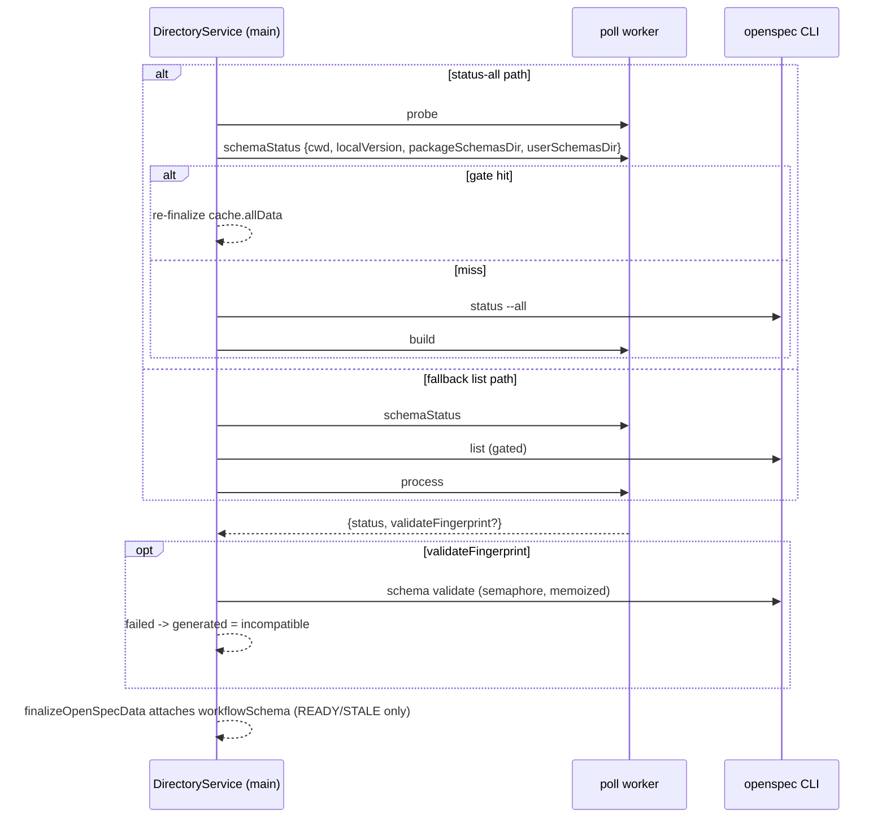

## Context

Code paths below are in the `add-pi-spec-driven-schema` tree (worktree `.worktrees/os-add-pi-spec-driven-schema` until it merges; see proposal "Sequencing").

- **What the first change shipped.** `workflowSchemaStatusFor` builds the status on the main thread with async fs reads (`packages/server/src/directory-service.ts:647`). `pollOne` starts it right after the CLI version resolves, **before** `pollOneStatusAll` issues its probe (`directory-service.ts:1231-1233`), and passes the one promise to all four `finalizeOpenSpecData` success sites (gate hit `:1100`, status-all build `:1171`, fallback list `:1345`, force `:1455`). Finalize attaches the result only when the payload is a success and `hasWorkflowSchemaStatus(readiness)` holds (READY/STALE, `directory-service.ts:625`); a compute error returns `undefined` and the key is left out. Spec and design D5 of `add-pi-spec-driven-schema` say the filesystem part runs in the poll worker.
- **What the caches hold.** `cache.allData` is the **unfinalized** status-all build output (`applyStatusAllBuild`, `directory-service.ts:514`); a gate hit re-finalizes it (`:1100`). `cache.data` is the finalized payload (it carries `workflowSchema`) and is what `reconfigurePolling` and on-demand reads use (`directory-service.ts:2242-2246`).
- **What the gate tracks.** `statusAllGateHit` compares the cwd stamp and per-change mtimes; the cwd stamp is the max effective mtime over the openspec dir, `changes/`, `config.yaml` and the whole `schemas/` tree (`packages/server/src/openspec/openspec-poll-fs-helpers.ts:185-192`), per-change over `.openspec.yaml` and artifacts. So enable/disable/update and a teammate's pull normally miss the gate and rebuild.
- **What the gate does not track but the status depends on.** The resolved CLI version (stamp comparison, `newer`/`conflict` validate memo key), `openspec/config.yml`, the user and package schema directories (`missing`), and the fallback `list` path, whose build never consults the status-all gate. A compute that runs only when the poll rebuilds is stale on a gate hit for these inputs, and needs a second mechanism for the fallback path.
- **The worker pool already has the right shape.** `probe` and `build` are request kinds with a worker body and an in-process async fallback (`packages/server/src/openspec/openspec-poll-worker-pool.ts`: `runAsyncInProcess`, `fallbackSettle`, timeout → terminate → fallback). `PollWorkerKind` is `"derive" | "probe" | "build"`; three dispatch sites branch on it with a silent default — the worker message handler (`probe` / `build` / else `deriveAndSerialize`), `runAsyncInProcess` (`probe` / else `buildFromStatusAll`), and the pool's disposed-path branch in `enqueue` (`derive` / else `runAsyncInProcess`) (`openspec-poll-worker.ts`, `openspec-poll-worker-pool.ts`) — so a new kind must be added to all three explicitly (D2).
- **Cost reality.** The status is a config read + stamp parse + one `readdir` of `changes/` with a `.openspec.yaml` read per change. The first change's `inspectSchema` also hashes every file of `schemas/pi-spec-driven/` (`fingerprintDir`, `packages/server/src/openspec/workflow-schema.ts:324`) on every evaluation, and `computeWorkflowSchemaStatus` fans out one `readChangeSchema` per change with an unbounded `Promise.all` (`workflow-schema.ts`, `pinsP`). Both were tolerable on the main thread only because the cost was small per tick; neither is acceptable per tick in the hot path (D2). Off the main thread the reads cannot add to a main-thread turn, but the worker pool is shared with the poll of every cwd, so the work is kept lean.

## Goals / Non-Goals

**Goals:**
- The filesystem part of `workflowSchema` is computed in the poll worker, fresh on every tick (gate hit included), on one code path for worker and in-process fallback.
- The `newer` / `conflict` validate stays main-thread, semaphore-bound and memoized.
- One spawn semaphore for poll and route.
- The dependency's spec sentence is reconciled, so the archived specs hold one consistent rule.

**Non-Goals:**
- Changing the gate signature, the wire format, or any readiness behaviour (the READY/STALE attach rule stays).
- The two client-side selector limitations (see proposal).

## Decisions

### D1. A dedicated `schemaStatus` request every tick, not a gate-signature fold

- **Chosen:** one request per poll tick, awaited at finalize on every success path. Where it is enqueued:
  - **status-all path (gated and force):** inside `pollOneStatusAll`, synchronously right after the `pool.probe(probeReq)` call is issued and before that call is awaited, so on any pool the probe of the same cwd is ahead of it in the FIFO.
  - **fallback list path** (CLI known not to support `--all`, or the poll that just detected it): there is no probe; the request is enqueued before the gated `list` spawn, so it overlaps the CLI call.
  - **Once per tick.** The request is enqueued at most once per poll tick. On the tick that detects `--all` as unsupported, `pollOneStatusAll` has already enqueued it after the probe; it returns that promise with its `null` result and the fallback list path reuses it instead of enqueueing a second one.
  - `pollOne` no longer creates the promise before the poll path is chosen; the promise flows to the `finalizeOpenSpecData` calls of whichever path finalizes. Paths decided before the enqueue point (disabled, opted out, no `openspec/`) enqueue nothing. A tick that fails after the enqueue (whole-call failure, BROKEN) consumes the promise with a no-op rejection handler and discards it, so no rejection goes unhandled.
  - **Concurrency.** On a pool with more than one slot the status runs concurrently with the probe. It overlaps the `build` only when it outlives the CLI spawn, because `build` is enqueued after the spawn returns. `build` is never gated on the status; only finalize awaits it.
  Gate-hit freshness is then free; no new cache or signature state.
- **Alternative A (compute inside the worker `build`, cache in `allData`).** The original spec's wording, and cheapest per tick: the status rides the rebuild and survives gate hits in the cache. Rejected: it is stale for the untracked inputs above, so each would need its own invalidation (CLI-version key in the cache, `config.yml` and user-dir stamps in the probe, a separate build hook in the fallback path). That is three small mechanisms to avoid one cheap request. If the extra per-tick round trip ever measures as a problem, this is the fallback design.
- **Alternative A2 (extend the gate signature).** Add `config.yml`, the CLI version and the user/package schema dirs to `statusAllGateHit` so they force a rebuild. Rejected: it spawns `openspec status --all` (30 s budget, semaphore) to learn something the CLI's own status does not depend on, and still does not cover the fallback path. (The `config.yml` gap also exists for the CLI's own status; out of scope.)
- **Alternative B (piggyback on `probe`).** Return the status in the probe response. Rejected: only the status-all path probes; the fallback list path would need a second mechanism, which is the two-path problem this change removes.
- **Alternative C (keep main thread, amend the spec).** Considered and declined by the owner of `add-pi-spec-driven-schema`: the worker is where the repo keeps poll fs work, and a 100+-change directory's reads should not compete with the event loop.

**Payload hygiene.** `cache.data` is always set to the finalized payload of the last tick, including a tick whose status omitted the key, so the cached state served on demand tracks the last broadcast. `cache.allData` is unfinalized and never carries `workflowSchema`, so a gate hit cannot resurrect a previous value by itself. As a defensive invariant, `finalizeOpenSpecData` SHALL still drop any `workflowSchema` of the object it is given and set the key only from this tick's request result; a failed or absent result leaves the key out. The one deliberate reuse is the `reconfigurePolling` rebroadcast, which re-derives readiness from the finalized `cache.data` without a tick and keeps its `workflowSchema` when readiness allows (`directory-service.ts:2242-2246`). It stays: the value is at most one tick old and the next tick replaces or removes it. The spec states this exception.

### D2. Worker-safe module, lean per-tick work, validate verdict stays on main

The worker request body must not pull `workflow-schema.ts`' CLI recipes, semaphore or `yaml`-writing paths into the worker module graph through the new code. The filesystem-only pieces (`readConfigFile`, `parseStamp`, `inspectSchema` without the validate callback, `enumerateActiveChanges`, `readChangeSchema`, the resolution checks, `computeWorkflowSchemaStatus`'s assembly) move to `packages/server/src/openspec/workflow-schema-status.ts`; `workflow-schema.ts` imports them back, so the REST path and the poll path share one implementation (no duplicated stamp or enumeration logic).

**Import scope (explicit waiver).** The worker module already imports `@blackbelt-technology/pi-dashboard-shared/openspec-poller.js`, which transitively imports `platform/openspec.js` and `platform/runner.js` (`resolveExecutorArgv`) (`packages/shared/src/openspec-poller.ts:50-51`, `packages/shared/src/platform/openspec.ts:18`). The worker never calls them for the status, but the modules are loaded. This change does not remove that pre-existing edge (follow-up candidate), so the worker-wide form of the invariant ("the worker imports no CLI recipe, semaphore or `resolveExecutorArgv`") is waived for it. What this change guarantees, and tests:
- the transitive import closure of `workflow-schema-status.ts` contains no `platform/openspec.js`, `platform/runner.js`, `semaphore.js`, `openspec-poller.js` or `workflow-schema.ts`;
- the direct imports of `openspec-poll-worker.ts` add no `platform/openspec.js`, `platform/runner.js` or `semaphore.js` edge beyond the grandfathered `openspec-poller.js`.

`workflow-schema-status.ts` has no default `userSchemasDir()` call; `userSchemasDir` is a required input. The `command-executor` rule ("new callers of openspec list/status/archive import `platform/openspec.js`") is unaffected: the new module calls no CLI operation, and the main thread keeps taking `userSchemasDir` / `resolveOpenSpecPackageSchemasDir` from `platform/openspec.js`.

**What moves.** `readConfigFile`, `parseStamp`, `compareStamp`, `CURRENT_PATCH`, `inspectSchema`, `fingerprintDir`, `lstatOrNull`, `schemaDirOf`, `schemasDirOf`, `changesDirOf`, `enumerateActiveChanges`, `readChangeSchema` and the status assembly move to `workflow-schema-status.ts`; `workflow-schema.ts` imports and re-exports what its callers (generation, actions, REST) use, so nothing outside the two modules changes import paths.

**Request inputs.** The main thread passes `{ cwd, localVersion, packageSchemasDir, userSchemasDir }` (resolved on main: `resolveOpenSpecPackageSchemasDir()` and `userSchemasDir()` live in modules the new module must not import, and `resolveExecutorArgv` uses the main-thread registry). `packageSchemasDirFor` memoizes per CLI version including a `null` result (today only a non-null result is memoized, `directory-service.ts:641-646`, so an absent CLI re-walks the filesystem every tick).

**Lean per tick.**
- `inspectSchema` takes a `fingerprint: "full" | "when-needed"` option and classifies **from the stamp first**: no directory → `none`; symlink → `unmanaged`; unreadable or missing stamp → `unmanaged`; else `compareStamp`. With `"when-needed"` the whole-directory fingerprint (`fingerprintDir`) is computed only afterwards and only when the comparison is `newer` or `conflict` (a fingerprint failure there → `unmanaged`, as today, since no validate can be keyed). `current` / `outdated` therefore need no fingerprint, and a fingerprint failure can no longer turn them into `unmanaged`. This is a deliberate behaviour change: the dependency's spec defines `unmanaged` as "a symlink, or no parseable stamp" (`add-pi-spec-driven-schema` `openspec-workflow-schema` spec), and the old fingerprint-failure → `unmanaged` rule for a readable stamp existed only in code (`workflow-schema.ts:324-325`). The status is advisory; writing actions still run `"full"`. The writing-action path (`runWorkflowSchemaAction` → `generateWorkflowSchema`, which compares the fingerprint it was handed with a fresh one before the destructive rename) keeps `"full"`, whose result is unchanged from today, so Update, Adopt and the swap pre-check are unchanged.
- The per-change `.openspec.yaml` reads (`readChangeSchema` fan-out in `computeWorkflowSchemaStatus`) use `mapLimit(…, 16)` (`packages/shared/src/openspec-status-all.ts`, as `probeTrackedPaths`), not one in-flight read per change.
- The fingerprint function is an injectable option of the status computation (default `fingerprintDir`), so tests count its calls without spying on an intra-module call.

**Dispatch.** All three dispatch sites (worker handler, `runAsyncInProcess`, the disposed-path branch of `enqueue`) switch exhaustively over `PollWorkerKind` (`derive` | `probe` | `build` | `schemaStatus`) with a `never` check, and an unknown kind rejects instead of running another request's body.

Because a callback cannot cross the thread boundary, the worker returns `generated` as computed from the stamp comparison alone plus `validateFingerprint` (the whole-directory fingerprint, only when the comparison is `newer` or `conflict`). The main thread runs `makeValidateLocal(cwd, version, { semaphore })` with that fingerprint and rewrites `generated` to `incompatible` on failure; a passing or memoized verdict leaves it. Net behaviour equals the current `validateLocal` callback. The verdict is advisory display state: every writing action re-evaluates the status under its lock with a fresh fingerprint, so a directory edited between the worker's read and the validate can at worst cache a verdict under a stale fingerprint for one tick (the next tick computes a new fingerprint and key).

**Test seams.**
- `PollWorkerPoolOptions` gains `schemaStatusImpl?` (default: the shared computation), used by the in-process path (`runAsyncInProcess` and the disposed branch). The worker thread cannot take a function, so a worker-side failure is produced with the existing `workerUrlOverride` pointing at a fixture worker that rejects `schemaStatus`.
- `DirectoryServiceOptions` gains `pollWorkerPoolFactory?: (opts) => PollWorkerPool` (default `createOpenSpecPollWorkerPool`, used by `ensureWorkerPool`), and `workflowSchema.computeStatus?`, which `DirectoryService` threads into the pool as `schemaStatusImpl`.
- The existing `workflowSchema.deps` seam (`directory-service.ts:438-447`) moves to the main-thread validate step.
- So a test can fail the real worker (fixture), fail the real in-process fallback (`computeStatus`), or record and delay requests (factory).

### D3. Failure handling

- The pool already guarantees the request resolves (worker failure → in-process fallback). An in-process throw yields `undefined` and the `workflowSchema` key is omitted for that tick, exactly as the main-thread implementation behaves on a compute error.
- A failure (not a normal "no schema" result) is logged once per failure run per cwd, with the path taken: the first failing tick logs, further consecutive failures stay silent, and the next successful tick re-arms the log. A payload without `workflowSchema` is therefore diagnosable without per-tick log spam.
- Attachment stays gated on a success finalize and `hasWorkflowSchemaStatus(readiness)` (READY/STALE); this change does not alter that rule.

### D4. One spawn semaphore

`server.ts` currently builds `createSemaphore(loadConfig().openspec.maxConcurrentSpawns)` for the REST route's validate, read from disk once at construction and never resized, separate from `DirectoryService`'s `createSemaphore(cfg.maxConcurrentSpawns)` (`packages/server/src/server.ts:2482`; `packages/server/src/directory-service.ts:841`). `DirectoryService` exposes its `semaphore` and `server.ts` passes that instance, so the poll, the route and every other `openspec` spawn share one cap, including after `reconfigurePolling` resizes it (`semaphore.setMax`, `directory-service.ts:2169`).

### D5. Reconcile the dependency's requirement

`add-pi-spec-driven-schema`'s `openspec-workflow-schema` requirement "Workflow schema status is reported separately from readiness" says every successful-poll payload SHALL carry `workflowSchema`, that it is recomputed "whenever the poll rebuilds data, and whenever the resolved CLI version changes", and names `schema validate` "for `newer`". This change ships a MODIFIED delta of that requirement (full copy): recomputed on every poll tick per `server-openspec-polling`; carried by successful-poll payloads whose readiness is READY or STALE; omitted for that tick on a computation failure; validate for `newer` or `conflict`. `openspec validate --strict` accepts it now; archive applies it after the dependency's ADDED delta (blocked-by order), so the archived specs hold one rule.

**Third writer.** `add-openspec-change-dependencies` also writes full MODIFIED copies of this requirement (adds `undeclaredChanges`) and of the gate requirement (adds `config.yml`, `dependencies.yaml`, main-spec and `archive/` tracking). A full-copy MODIFIED replaces the whole requirement, so the change archived second must rebase onto the first. Order decided: this change archives first; the sibling rebases both copies and adds `undeclaredChanges` to `workflow-schema-status.ts` (note recorded in the sibling's proposal and tasks).

## Risks / Trade-offs

- **One extra worker round trip per tick per cwd, on a pool shared by every cwd.** The pool is one FIFO. With more than one slot the status request runs concurrently with the probe; with `maxConcurrentSpawns = 1` it runs after its own cwd's probe, and other cwds' probes/builds can queue behind it, so a cwd's tick latency grows by the status work of the cwds ahead of it (each lean per D2). On a miss tick the status normally completes during the CLI spawn, before `build` is enqueued, but a slow status (cold 100+-change directory, or a wedged worker burning the pool timeout before terminate → fallback) can delay a later `build`. Accepted: the work is small and off the main thread; measured by the event-loop turn test with two 104-change cwds on a one-slot pool and the enqueue-order test (see tasks). Alternative A is the fallback if it measures as a problem.
- **The worker must load the new module.** The worker entry is resolved by URL (`workerUrlOverride`, `openspec-poll-worker-pool.ts`) and loaded as source; the new module is a sibling source file imported statically by `openspec-poll-worker.ts`, so it resolves through the same loader. The packaged Electron path is unverified; a missing module surfaces as a worker error → in-process fallback (D3), not a lost status. A unit test asserts the new module's import graph (D2 "Import scope").
- **Pre-existing, unchanged.** Finalize re-serializes on the main thread on every success path (`cache.serialized = undefined`), so the serialize-once scenario of "Periodic poll derivation runs off the main event loop" was already not met after `add-openspec-init-affordances`; attaching the status at finalize does not add a serialization. `makeValidateLocal` memoizes `runValidate`'s boolean, so a validate that fails to spawn (timeout) is memoized as `incompatible` until the fingerprint or CLI version changes. Both are out of scope (proposal Non-goals).
- **Stale-by-one-tick window.** The status is read at the start of the tick, the swap rename gap (spec of the first change) can show a transient `none`/`missing`; the forced refresh after every action supersedes it, unchanged.

## Migration Plan

No data migration, no config change. Ships behind no flag; rollback is a revert (behaviour returns to the main-thread compute of the first change).

## Open Questions

_None._
