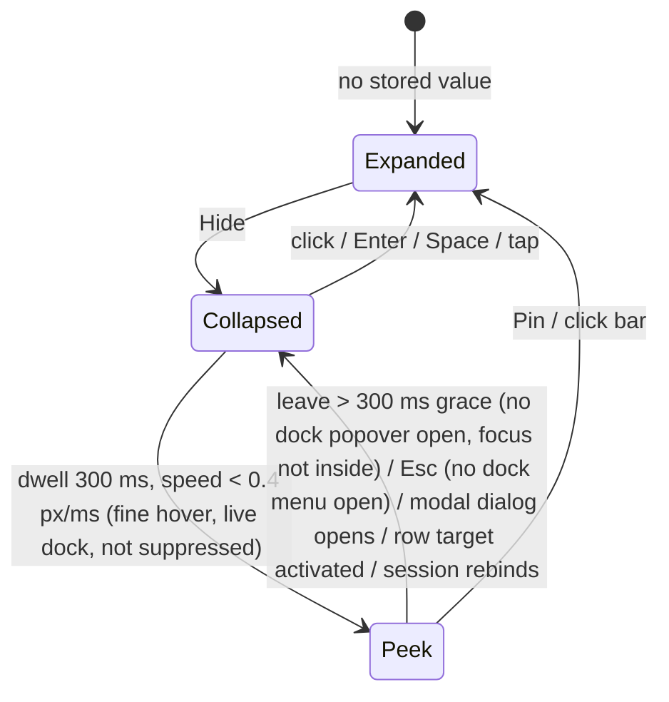

# Design

## Context

- **Dock root.** `packages/client/src/components/chat/ComposerDock.tsx:376-415` renders the root (`data-testid="composer-dock"`, `overflow-hidden rounded-t-xl border … bg-[var(--bg-secondary)] pb-6`, `mx-5 -mb-6`).
  - The root picks its row key (`composer-dock` / `composer-dock:footer-only`, `:367-371`) and sets `flexShrink`, plus `minHeight` only when YOLO is live (`+ DOCK_CHROME_PX` 25, `:72`).
  - Lanes live in `composer-dock-scroll` (`:389`). `YoloDockFooter` is the root's next child (`:412`).
  - `index.css:1277` drops the composer card's top border through the adjacent-sibling rule `[data-testid="composer-dock"]:not([hidden]) + [data-testid="composer-root"]`.
- **Empty lanes.** `hideWhenEmpty` emptiness is a DOM-content probe (child nodes / text, MutationObserver) inside each mounted `LaneRow` / compact sheet (`ComposerDock.tsx:80-135`, `:214`, `:292`). It is not a layout measurement, so a `hidden` ancestor does not change it.
- **Lane model.** `DockLane` (`composer-dock-model.ts:30-32`) has `summary: ReactNode` and `summaryText: string` (no clock text).
  - Changes: `summaryText` = branch + `N files…` + totals (`ChangesLane.tsx:193-212`).
  - Processes: `summaryText` = its counts-only announce string (`ProcessesLane.tsx:98-113`, `:225-226`).
  - Context: `summaryText` is the static `plugin context` (`ContextLane.tsx:51`).
- **Hover constants.** `session/session-hover-intent.ts:25-30` exports `HOVER_DWELL_MS` 300, `HOVER_SPEED_CUTOFF` 0.4, `HOVER_SPEED_WINDOW_MS` 100 and `HOVER_CLOSE_GRACE_MS` 300. `createHoverIntent` is specific to session cards.
- **Changes rows.** `ChangesLane.FileRow` (`:93-130`) renders `ComposerDockRow` (`packages/dashboard-plugin-runtime/src/ComposerDockRow.tsx:72`; title is a plain string span). It has one `Diff` button, gated on `previewable !== false`.
  - App wires `onOpenFile={() => navigate(buildSessionDiffUrl(selectedId))}` (`App.tsx:2696`), which ignores the path.
  - Out-of-cwd rows (`useDockDiff.ts:208-210`) render with no button.
- **Split workspace.** `ComposerDockHost` is rendered by `renderSessionDetail(sessionIdArg, frozen)` (`App.tsx:2437`). That is inside `apiProvider` → `SplitWorkspaceProvider sessionId={selectedId}` (`App.tsx:3160`).
  - `frozen` only reaches the dock as `openLane=null` and `columnEl=null` (`App.tsx:2685-2687`). `ComposerDockHostProps` has no live flag.
  - `openInSplit(relPath)` (`SplitWorkspaceContext.tsx:286-305`) and `openDiffTab(relPath)` (`:378-385`) take cwd-relative paths.
  - `DiffViewer` renders a `diff:` tab from `SessionDiffProvider` (`gitDiff` / change events), not from disk.
- **Viewer metadata.** `CappedViewer` reads file metadata via `fetchWithoutGrantPrompt(/api/file…)` before mounting the viewer, but only when size-gated (`CappedViewer.tsx:52-77`). The editor pane has no dedicated not-found state.

## Goals / Non-Goals

**Goals:**
- Collapse, peek and pin. A peek never reflows the chat, and no state ever moves the bottom-anchored composer card.
- Reuse the session menu's hover constants and its rule that a click converts a hover-open.
- Per-file Open and Diff for in-cwd changed files, landing in the bound session's editor pane.

**Non-Goals:**
- Open for out-of-cwd files. This is deferred to a follow-up change: it needs the `internal-monaco-editor-pane` read and watch rules, the `showOutOfCwdSessionDiffs` gate and a write-path review. The mockup's out-of-cwd Open rows are superseded by this.
- Changing the lane accordion.
- Collapse on the folder home dock (footer only).
- Quota figures in the collapsed bar (no plugin summary contract).
- Generalizing `createHoverIntent`.
- Changing Review's target.
- Cross-tab sync of the collapsed state.

## Decisions

### D1 — Three states, one persisted bit

`Expanded | Collapsed` is persisted per session in a new `lib/util/dock-collapsed.ts`, under the key `pi-dashboard:composer-dock-collapsed:<sessionId>`.
- It is best-effort, like `tree-visible.ts`, but the default is **expanded**.
- The hook initializes lazily from storage keyed by session, so it never shows the previous session's value for a frame.
- An empty `sessionId` never reads or writes.
- `Peek` is transient component state and resets when the bound session id changes.
- Keys accumulate like `tree-visible` keys. This is accepted, with no eviction and no cross-tab sync.

*Alternative:* one global preference. The user rejected it.

### D2 — No wrapper; the root un-clips while collapsed

There is no new wrapper element, so the `composer-dock + composer-root` sibling rule (`index.css:1277`), the row-key ownership and the footer chrome all stay in the root.

- **Expanded.** Exactly today's markup. Clipping for the rounded corners moves from the root to `composer-dock-scroll` (`overflow-hidden` → the scroll region already scrolls), so the root itself does not clip. That lets the Hide handle straddle the root's top edge.
- **Collapsed.** The lane region (`composer-dock-scroll`, with a stable id for `aria-controls`) stays mounted and gets `hidden`. The summary bar renders in the root in its place. The YOLO footer stays where it is.
  - The probes keep working (DOM-content, not layout).
  - The open lane's body stays mounted, so a peek re-shows it without refetching. Opening a different lane during a peek is a normal expand and refetches under the existing rule.
- **Peek.** The lane region loses `hidden` and becomes `position: absolute`, bottom-anchored to the root's top edge.
  - `max-height` is measured from the root top to the chat pane top (`columnEl`), with internal scroll.
  - Stacking: above the transcript and the canvas chip tray, below the composer card and `z-popover`.
  - `composer-stack-anchor` keeps tracking the in-flow root top, so the chip tray does not jump.
- **Compact mode.** The region is the chip row plus sheet. Collapse and peek treat it identically, so a compact peek shows chips plus the open sheet.
- **Bar height.** One constant, `COLLAPSED_BAR_PX = 44`, sets both the bar's `min-h` (44 px at every width, which also meets the phone target) and the row table. Hide and Pin are `min-h-6 min-w-6`, and `min-h-11 min-w-11` below `md`.

*Alternative:* a frame wrapper hosting the overlay as a sibling of the root. Rejected: it breaks the sibling CSS join and splits the footer from the dock chrome.
*Alternative:* unmount lanes while collapsed. Rejected: stale probes, dangling `aria-controls`, and a refetch on every peek.

### D3 — Hover intent: reuse the constants in a small local hook

New `components/chat/useDockHoverIntent.ts`:
- one `document` `pointermove` listener, refs only, no React state per move;
- speed samples over `HOVER_SPEED_WINDOW_MS`, dwell `HOVER_DWELL_MS`, grace `HOVER_CLOSE_GRACE_MS`.

**Arm.** Over the bar element only. Never when the dock is not live, when any pointer button is pressed, when a modal dialog is open (`[role=dialog][aria-modal=true]`), or when a click- or keyboard-opened dock popover is open.

**Why the bar button arms.** This is the user's explicit ask: "a zone when mouse is over auto expand". The strip's button disarm protects unrelated controls under an invisible strip. Here the bar is the only target and a click on it pins. The speed cutoff still filters pass-throughs. The session menu's strip and its spec are unchanged.

**Keep open** while any of these hold:
- the pointer is inside bar ∪ overlay;
- a `[aria-haspopup][aria-expanded="true"]` trigger is inside the overlay (this covers portaled menus; disclosures and compact chips carry no `aria-haspopup`);
- `overlay.contains(document.activeElement)`.

**Close immediately** when a modal dialog opens, or when a row target or Review is activated.

**Escape.** A keydown listener on the root acts only when no dock popover is open (open menus handle Escape first) and `bar`/`overlay` contains `activeElement`. Only then does it call `stopPropagation`.

**Audit.** Task 3.2 checks every dock popover trigger (OpenSpec `⋯`, Attach change, worktree actions) for `aria-haspopup` + `aria-expanded`, and checks that its popover portals (`LayerPortal`, `z-popover`). It fixes any that do not.

**Live docks.** App passes `live={!frozen}` to `ComposerDockHost`. The host computes `live && splitContext?.sessionId === session.id`. A non-live dock renders the stored state read-only: no Hide, no Pin, no hover listener, no storage write, no row targets.

### D4 — Bar content is `summaryText`

The bar renders `summaryText` for each lane not in `emptyLanes`, in `DOCK_LANE_ORDER`, separated by an `aria-hidden` dot glyph. Its accessible name is `"Session context: " + texts.join(", ")`.
- The Processes segment gets a leading `--status-working` dot (`aria-hidden`), gated by `prefers-reduced-motion` and the app-hidden pause.
- No segment carries clock text, so the bar never ticks.
- "The dock has a lane" means at least one lane not in `emptyLanes`. Otherwise there is no Hide and no bar.

### D5 — Row table entries

Add two static entries to `CHAT_PANE_ROW_TABLE` (`lib/layout/chat-pane-row-class.ts`). Both are shrinkable, with floor = bound + 1 (as for `footer-only`):
- `composer-dock:collapsed`: bound = `COLLAPSED_BAR_PX`;
- `composer-dock:collapsed-yolo`: bound = `COLLAPSED_BAR_PX + YOLO_FOOTER_HEIGHT`.

The root picks the key (`ComposerDock.tsx:367`). When collapsed or peeked it always sets `minHeight = bound + DOCK_CHROME_PX`, so the bar is never squeezed. The peek overlay is absolutely positioned, so it is outside the budget.

### D6 — Open and Diff targets

- **Row.** `ComposerDockRow` gains optional `onTitleActivate?: () => void` and `titleLabel?: string`. When set, the title is a truncating button named by `titleLabel`. This is an additive public plugin-runtime API (a MODIFIED delta on `dashboard-shell-slots`); existing callers are unchanged.
- **Lane input.** `ChangesLane` input becomes `onOpenFile(rel)` + `onOpenDiff(rel)`. Both targets exist only for `previewable !== false` rows. Targets are `shrink-0`, the folder text truncates first, and row actions keep the existing phone target size.
- **Host.** `ComposerDockHost` passes `openInSplit` / `openDiffTab` from `useOptionalSplitWorkspace()`, only for a live dock (D3). Activating a target also ends a peek.
- **App.** App drops `onOpenFile`. `onReview` keeps `buildSessionDiffUrl`.

| Entry | Name / Open | Diff |
|---|---|---|
| in-cwd | `openInSplit(rel)` | `openDiffTab(rel)` |
| in-cwd, missing on disk | file-missing message (below) | `openDiffTab(rel)`, rendered from the session diff |
| out-of-cwd | — (deferred) | — |

**File-missing message.** The editor pane renders one state for every viewer kind. When the active file tab's metadata read (`/api/file`, no-prompt) returns 404, the pane renders `File no longer exists: <path>` in place of the viewer. The probe moves from `CappedViewer`'s size gate to an unconditional per-tab metadata check, reusing the same `fetchWithoutGrantPrompt` call. In-cwd reads are never prompt-eligible, so no grant path changes. Plugin file-handler mode tabs (`FileHandlerAnchor`) keep their own behaviour; the message covers the default viewers only.

Post-fold scan, checked and not affected: `chat-selection-preservation` (collapsing is a user click that resizes the viewport, not a transcript-row change), `session-diff-extraction` "Out-of-cwd diff display is opt-in" (out-of-cwd rows are unchanged), and the `editor-pane-file-handler` slot (covered by the sentence above).

## Risks / Trade-offs

- [Accidental peek while moving to the composer input] → the session menu's dwell and speed cutoff. Covered by fake-timer unit tests and an E2E scenario.
- [The overlay hides the last transcript lines during a peek] → accepted. It is transient, and Pin is the escape hatch.
- [Moving root clipping to `composer-dock-scroll` changes the rounded-corner look] → a visual check at the three themes. The scroll region already carries the lane backgrounds.
- [The unconditional metadata probe adds one small request per opened file tab] → it is the same request the size gate makes today for gated kinds, and it runs once per tab mount or Refresh.
- [A long plugin lane `summaryText`] → the bar truncates at the end. Lane order puts Processes and Changes first.
- [The additive `ComposerDockRow` prop] → optional and unit-tested. The `dashboard-shell-slots` delta records it.

## Migration Plan

Client-only, with no stored-data migration. Existing users see the dock expanded. Rollback: revert the commit. Leftover `pi-dashboard:composer-dock-collapsed:*` keys are ignored.
