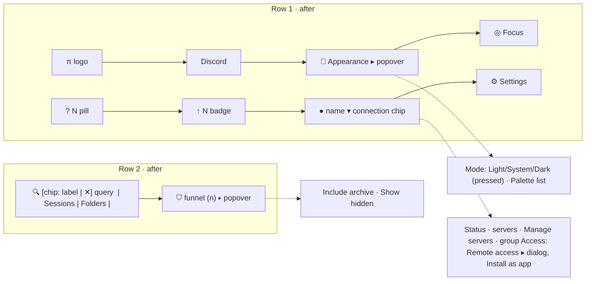

# Design: declutter-sidebar-header

## Context

Row 1 (`data-testid="header-app-bar"`) is built in `packages/client/src/components/session/SessionList.tsx:2831-2870`:

- left group: `PiLogo`, `<ThemePicker />` (`:2839`), `<ThemeToggle />`;
- right group: `<InstallButton>` (`:2843`), `<TunnelButton>` (`:2844`), `<QuestionStack>` (`:2846`), `<FocusToggle />` (`:2847`), `{headerExtra}` (`:2848`), the Discord `<a data-testid="discord-btn">`, the Settings button (`:2866`).

`headerExtra` is composed in `packages/client/src/App.tsx:2253-2271`: `PiUpdateBadge` (non-Electron), or `RuntimeUpdateBadge` (Electron), then the **only** `ServerSelector` instance. `SessionList` receives it as an opaque node.

ServerSelector (`components/connectivity/ServerSelector.tsx`):
- It is an APG menu button. The trigger (`:378-395`) renders `mdiServerNetwork`, a name truncated at 180 px, a status dot, `Connected`/`Offline`, and a chevron. `aria-label` = `connection.selectorLabel` "Server: {server}, {state}".
- The menu (`:397ff`) portals via `LayerPortal`, flips, and is mounted only while open.
- Roving focus queries `[role="menuitemradio"], [role="menuitem"]` (`:303-306`). Items use `tabIndex={-1}`.

`TunnelButton` owns:
- the `/api/tunnel-status` 30 s poll;
- `remoteAccessIndicator(...)`;
- the pending-pairing count;
- `takeFreshRun` resume;
- the lazy `RemoteAccessDialog`;
- live network state from the `reachability_updated` broadcast via `useLiveReachability()` (no polling of the guarded config) and a `resolvedBindHost`-keyed resume effect (`takeFreshRun`, `TunnelButton.tsx:60-95`) that sets `initialRun` and opens the dialog;
- testids `tunnel-btn` (`:110`) and `tunnel-btn-badge` (`:121`);
- an unused `showToast` prop (`:43`).

Install: `useInstallPrompt()` is called twice today: `App.tsx:712` (feeds `InstallBanner`, `:3242`) and `SessionList.tsx:409` (feeds `InstallButton`). `InstallButton` renders `install-btn` only when `canInstall && !isInstalled` (`packages/client/src/components/packages/InstallButton.tsx:13,20`).

`ThemePicker` (`components/settings/ThemePicker.tsx`) is a `mdiPalette` trigger + dropdown positioned by `usePopoverFlip`. It is consumer #3 in `popover-viewport-positioning`'s enumerated table. Testids: `theme-picker`, `theme-picker-trigger`, `theme-picker-dropdown`, `theme-option-<id>`. `ThemeToggle` renders `theme-toggle` (div) with `theme-light|system|dark` buttons and no `aria-pressed` (`ThemeToggle.tsx:13-35`).

Scope: this change covers the desktop header in `SessionList.tsx`. The alternate `SessionSidebar.tsx` header shows only the home button and stays unchanged.

Row 2 (`data-testid="header-filter-bar"`, `SessionList.tsx:2872-2913`):
- `workspaceFilter` (`:499`) and `sessionSearch` (`:500`);
- the include-archive chip (`toggleIncludeArchive` `:546`, `data-testid="search-include-archive"`);
- `Show hidden`, rendered by the file-local `ToggleButton` (`:376`). It has no `aria-pressed` and no testid, and it is the only `<ToggleButton>` call site.

`openQuestionSession` clears both queries and the tag filters (`SessionList.tsx:1546-1558`).

`card-pill-surfaces-no-literals.test.ts:96-128` locates the `theme-system` literal-scan regions by AST **inside `SessionList.tsx`**: `function ToggleButton` and the JSX element whose `data-testid` is `"search-include-archive"`.

Sidebar width is clamped to 180–500 px, default 500 (`hooks/useSidebarState.ts:5-7`).

Floating primitive: `Popover` from `@blackbelt-technology/pi-dashboard-client-utils/Popover`:
- anchors, flips and shifts; dismisses on outside mousedown and Escape (`onDismiss`);
- no max-height clamp, and no focus return;
- already used in `components/openspec/SessionOpenSpecActions.tsx:2`.

## Goals / Non-Goals

**Goals**
- Row 1 never clips: it wraps instead.
  - One line at ≥ 280 px in the common state: connected, no question, no waiting device.
  - One line at ≥ 400 px in every state.
- Every control is reachable in ≤ 2 activations.
- Attention states stay visible on row 1, not colour-only: open questions, update available, offline, remote access internet/partial/failed, devices waiting.
- Session-search semantics stay intact. Existing testids keep their element role mapping.

**Non-Goals**
- Changing what any control does: ThemeProvider, the server-switch transaction, `RemoteAccessDialog` content, PWA install prompt, Focus mode.
- The tag-filter bar, the YOLO tint mechanics, the collapsed-sidebar rail.
- The alternate `SessionSidebar.tsx` header.

## Decisions

### D1 · Appearance = ThemePicker's dropdown with the mode control inside
No new popover component. `ThemePicker` stays the row-1 Appearance trigger (`mdiPalette`, already its icon). Its dropdown renders `<ThemeToggle />` as a "Mode" section above the palette list. `<ThemeToggle />` is no longer mounted on its own in row 1.
- `ThemeToggle` buttons gain `aria-pressed={preference === value}` and keep their titles (Light / System / Dark). This is a non-breaking a11y addition.
- Selecting a mode does not close the dropdown. Selecting a palette keeps today's behaviour.
- The dropdown keeps `usePopoverFlip` (min/max height + internal scroll), so `popover-viewport-positioning` consumer #3 holds unchanged and no new consumer is added.
- Keyboard: opening from the keyboard focuses the pressed mode button. Escape closes and focuses the trigger. Tab walks mode → palette rows. A palette selection closes the dropdown and now also focuses the trigger (today it drops focus, `ThemePicker.tsx:58-63`).
- Horizontal: the trigger moves right (after Discord), and the panel widens to fit the mode control. The dropdown therefore adopts `usePopoverFlip`'s horizontal anchor/clamp (`popover-viewport-positioning`) instead of its fixed `left-0`, and stays inside the viewport at a 180 px sidebar.
- Testids and roles are all unchanged: `theme-picker*`, `theme-toggle` (still a div), `theme-light|system|dark`, `theme-option-<id>`. Only their location moves inside the dropdown.
- *Alternative rejected:* a new `AppearancePopover` on client-utils `Popover`. It has no height clamp, and it would need a new entry in the enumerated positioning contract.

### D2 · ServerSelector trigger becomes the connection chip
The trigger drops `mdiServerNetwork` and the always-on `Connected` word. It renders:
- the status dot;
- `displayLabel` (`min-w-0 truncate max-w-[160px]`), hidden when the header container is narrower than 400 px (`@max-[399.98px]:hidden`; the container is the header element, so the measure excludes the sidebar's 1 px border);
- when disconnected: `Offline` text when the header is ≥ 400 px, or an `mdiCloudOffOutline` glyph below that. Either way the state has a shape, not only a colour;
- remote-access glyph by tone, each a different shape: internet `mdiAccessPointNetwork`, partial `mdiAlertOutline`, failed `mdiAlertCircle`. Tones `local`/`network` show nothing;
- the waiting-device count badge (`data-testid="tunnel-btn-badge"`);
- the chevron.

`aria-label` extends `connection.selectorLabel` with the remote-access state when it is not quiet: "Server: {server}, {state}; remote access {raState}[, N device(s) waiting]".

The sidebar header element gets `@container` (Tailwind v4 `@container` utility) so the `@max-[400px]:` variants apply.

New chip props from App: `remoteAccess?: { tone, label, pending }`.

### D3 · Access group, owned by App.tsx
`App.tsx` owns the only `ServerSelector`, so the wiring lives there.

**`useRemoteAccessIndicator()`** is extracted from `TunnelButton` with its full current behaviour:
- the 30 s `/api/tunnel-status` poll (+ gated detail);
- the `useLiveReachability()` broadcast binding;
- the `pairingApprovalStore` pending count;
- the `resolvedBindHost`-keyed `takeFreshRun` resume effect.

It returns `{ tone, label, pending, resumeRun, dialogOpen, openDialog(trigger), closeDialog }`: a resumed run sets `resumeRun` and opens the dialog, exactly as today. It is called **once**, in `App`, which is always mounted. Exactly one poll and one resume effect exist. `TunnelButton` and `InstallButton` lose their only mounts, so they are **deleted** (orphans of this change). Their unit tests are ported to the hook test and the ServerSelector access-item tests.

**Dialog.** `App` mounts `<RemoteAccessDialog initialRun={resumeRun} onClose={closeDialog}>` while `dialogOpen`, **outside** ServerSelector's conditional menu. It uses client-utils `Dialog`, so it has a focus trap.

**Install.** App reuses its existing `installPrompt` (`App.tsx:712`). `SessionList`'s second `useInstallPrompt()` call (`:409`) is deleted with `InstallButton`'s row-1 mount.

**`ServerSelector` props:**
- `accessItems?: Array<{ id; label; sublabel?; icon; badge?; testId; onSelect; opensDialog?: boolean }>`. Rows render as `role="menuitem" tabIndex={-1}` after "Manage servers…", inside `role="group" aria-labelledby=<label id>`. The label element has no menu role, so roving focus skips it.
- `onSelect(triggerEl: HTMLButtonElement)` receives the trigger of the chip instance whose menu was used. App can mount two chips (desktop sidebar and the `MobileOverlay` copy of `sessionList`, `App.tsx:3288-3296`), so a single shared ref would be ambiguous.

On selection, an `opensDialog` item closes the menu without focusing the trigger. Any other item closes the menu via the existing `closeToTrigger` path, which focuses the trigger.

**Rows:**
- **Remote access** (`testId: "tunnel-btn"`, `data-tone={tone}` kept, `opensDialog: true`): sublabel = state + "N device(s) waiting", `onSelect(el)` = `openDialog(el)`, which refetches `/api/tunnel-status`, clears `resumeRun` and opens the dialog on its landing view (today's `handleClick`, `TunnelButton.tsx:96-100`). A failed status fetch keeps the last known state (today's behaviour). The chip badge shows the raw pending count (today's format). The `Dialog` trap takes focus. `closeDialog` focuses the stored trigger if it is still connected and visible (`isConnected && offsetParent !== null`), else the first visible `[data-testid="connection-chip"]`, else nothing.
- **Install as app** (only `canInstall && !isInstalled`, `testId: "install-btn"`): `onSelect` = `prompt()` after `closeToTrigger`.

The chip trigger gets `data-testid="connection-chip"`. "Manage servers…" navigates to `/settings/remote` and is exempt from focus return.
- *Alternative rejected:* a separate Remote access icon in row 1. It brings back the crowding. The chip glyphs carry the attention states.

### D4 · Row 1 order, Discord placement, wrap rule, question-pill anchor
Left: logo · Discord · `aria-hidden` 1 px divider · Appearance · Focus. Right: QuestionStack pill · update badge · connection chip · Settings.
- The Discord `<a>` keeps markup, `href`, `target`, `rel`, `aria-label` and `discord-btn`. Only its position moves.
- Row 1 becomes `flex-wrap` with `row-gap`. The right group is `ml-auto flex-wrap justify-end`, so a shortfall wraps the right group under the left instead of clipping. The chip is the only `min-w-0` item, so it shrinks first. Estimated widths:
  - budget = `px-3` (24) + left + inter-group gap (8) + right;
  - left: logo 26 + Discord 24 + divider 5 + Appearance 24 + Focus 24 + 4 gaps × 6 = 127;
  - common state (name hidden < 400, connected): update 36 + chip 42 + Settings 24 + 2 gaps × 4 = 110 → 269 px, under the 280 px floor;
  - worst state: questions 38 + update 36 + chip 98 (dot, offline glyph, tone glyph, badge, chevron) + Settings 24 + 3 gaps × 4 = 208 → 367 px, under the 400 px floor.
  - These are estimates. The Playwright fit spec (task 6.2) is the authority, and the floors may only be raised by a spec change.
- The YOLO height-equality rule compares tinted vs untinted at the same width. Wrapping changes both alike, so it still holds. The YOLO link stays the first focusable element.
- The open-questions pill becomes the first control of the right group. TunnelButton, its old anchor, is gone.

### D5 · Scoped search keeps two queries
`SessionList` keeps `workspaceFilter` / `sessionSearch` unchanged (`:499-500`) and adds `searchScope: "sessions" | "folders"` (default `sessions`, not persisted).
- One `<input type="search">` binds to the active scope's value. Its `data-testid` and `aria-label` follow the scope: `session-search-input` with "Search sessions across folders", or `workspace-filter-input` with "Filter folders by path".
- Scope toggle: two `aria-pressed` buttons, `search-scope-sessions` and `search-scope-folders`.
- The inactive non-empty query renders as a chip made of **two sibling buttons**, not nested:
  - a label button (`search-chip-switch`) that switches to that scope;
  - a clear button (`search-chip-clear`, an `mdiClose` `Icon`, never a Unicode ✕, per `mdi-icon-system`; `aria-label` "Clear folder filter" / "Clear session search").
- Focus: activating the scope toggle or the chip's label button moves focus into the input, so the user can type immediately. Clearing via the chip keeps focus in the input.
- `openQuestionSession` additionally resets `searchScope` to `sessions`. Its existing clearing of both queries and the tag filters stays.
- All filtering code stays untouched. AND composition, pinned-only session search, unpinned re-inclusion and auto-expand keep their implementation.
- *Alternative rejected:* one query applied only to the active scope. It loses AND, and makes unpinned-folder session search impossible.

### D6 · Filter funnel, inline in SessionList.tsx
The funnel button (`filter-funnel-btn`, `mdiFilterVariant`) and its `Popover` content are written **inline in `SessionList.tsx`**. This keeps the `search-include-archive` JSX element and `function ToggleButton` where the `theme-system` AST scan looks for them, so the scan and its spec stay valid unchanged.
- Include archive: the existing button, moved into the panel. It keeps `search-include-archive` and `aria-pressed`, and calls `toggleIncludeArchive`.
- Show hidden: `ToggleButton` gains `aria-pressed={active}` and an optional `testId` prop (only one call site) → `show-hidden-toggle`.
- Badge: the count of funnel filters on (0–2), absent at 0. `aria-label` is "Filters, N on". Tag filters are excluded; their bar has its own count.
- Panel: client-utils `Popover`. Two rows, so no height clamp is needed, and it is not a `usePopoverFlip` consumer, so the positioning contract is unaffected. On keyboard open, focus moves to the Include archive toggle. `onDismiss` via Escape focuses the funnel trigger.

### D7 · Test updates
Selector/role changes, all other testids keep element and role:

| testid | before | after |
|---|---|---|
| `connection-chip` | (none) | ServerSelector trigger (new) |
| `tunnel-btn` | button in row 1 | `menuitem` in the connection menu |
| `install-btn` | button in row 1 | `menuitem` in the connection menu |
| `tunnel-btn-badge` | badge on TunnelButton | badge on the connection chip |
| `theme-toggle`, `theme-light\|system\|dark` | row 1 | inside the ThemePicker dropdown (same roles) |
| `workspace-filter-input` / `session-search-input` | always present | present only under their scope |

Helpers added to `tests/e2e/helpers/`: `openConnectionMenu(page)`, `openAppearance(page)`, `setSearch(page, scope, text)`. A vitest helper `setSidebarSearch(scope, text)` lives next to the SessionList tests. The sweep includes `tests/e2e/*.AGENTS.md` rows that name these testids.

Row-1 fit (the 280 / 400 px floors, the 400 px name/offline breakpoint) is verified in Playwright against real layout (jsdom has none). The arithmetic in D4 is an estimate only.

## Risks / Trade-offs

- **Discoverability.** Remote access and Install sit one click deeper. Mitigation: the chip glyphs and badge carry every attention state.
- **Scoped search hides one query.** Mitigation: an always-visible chip, and AND semantics unchanged.
- **Wrapping row 1** at very narrow widths (< 280 px common, < 400 px worst) adds a line. This is preferred over clipping.
- **Container queries.** Supported in every engine the dashboard targets (Electron Chromium, Safari ≥ 16, Firefox ≥ 110). Without support, the name stays visible and the row wraps.
- **Test churn.** About 10 e2e specs plus 6 vitest suites. The helpers keep the diff mechanical.

## Migration Plan

Client-only. No persisted state changes (`searchScope` is not persisted). Rollback = revert the client commit, then `npm run build` + `/api/restart`.

## Open Questions

None. The variant and the filter-row semantics were decided via ask_user during planning. Discord placement (beside the logo) was a follow-up user instruction.
