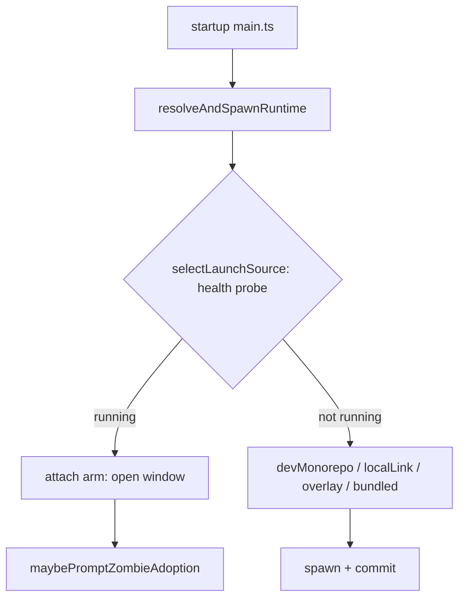

# Design

## Context

See proposal.md — Why. Current attach flow:

- `selectLaunchSource()` (`packages/electron/src/lib/launch-source.ts:347-358`) returns `attach` before looking at any runtime (guarded by `skipAttach`, `:351`), so the attach arm never knows what it *would* have launched. It throws `PinnedSourceUnavailableError` / `BundledServerMissingError` when nothing resolves.
- `planColdLaunch()` (`packages/electron/src/lib/runtime-overlay.ts:79`) is **not** read-only: it calls `consumeExplicitUpdate(dir)` and `markExhaustedPending(...)`, both of which `patchRuntimeState`. `coldLaunchRuntimeInputs()` (`runtime-overlay-main.ts:113-128`) adds a third writer via `onFallThrough`.
- `resolveAndSpawnRuntime()` (`runtime-overlay-main.ts:354`) loops with an `exclude` set: a candidate that fails at **spawn** time falls through to the next source, so the runtime actually started can differ from the first one resolved.
- `requestServerLaunch({ force })` (`packages/electron/src/lib/server-lifecycle.ts:500`) is the spec'd single in-app launch entry point (`electron-shell` "Idempotent server launch routine"): `force` POSTs `/api/shutdown` with local-proof headers, waits ≤5 s for the port to close, then `ensureServer()`. `ensureServer()` (`:375`) returns the existing URL if a server still answers, without spawning.
- `maybePromptZombieAdoption()` (`packages/electron/src/main.ts:258`, fire-and-forget at `:857`) owns the zombie modal; its "Stop now" branch (`:302-350`) uses `stopZombieServer()` (`zombie-adoption-dialog.ts:47`), whose post-SIGKILL path returns `true` without re-checking.
- `wizard-state.ts`: `isFirstRun()` (`:86`) is "settings file absent"; `writeModeFile()` (`:104`) rebuilds the object and keeps only `recentRemotes`.
- `checkAttachedServerVersion()` (`packages/shared/src/doctor-core.ts:672`) compares against the **shell** version and holds the launch-source fix text.
- `/api/health` exposes `version`, `pid`, `launchSourceEffective`, `ppid`, `bootParentPid`, `bootParentAlive`; `launchSourceEffective` exists since ≤0.8.0 (`packages/server/src/lifecycle/launch-source-effective.ts`). Bundle/overlay manifest `version` equals the server package version (`packages/electron/scripts/bundle-server.mjs`).

## Goals / Non-Goals

**Goals:**
- One attach-time decision covering zombie detection and version skew, with one modal at most.
- Restart goes through the existing graceful launch routine; no second stop/spawn routine.
- Expected-version resolution matches cold-launch *resolution* (same chain, same gates) with zero writes.
- The app never reports a version it did not actually start.

**Non-Goals:**
- Retrying failed plugin imports inside a running server (ESM caches the failure; restart is the fix).
- Changing the Doctor row: it stays shell-version based and may disagree with this check while an overlay is active. Its text is reused, not edited.
- Changing `/api/health`, the server, or the client.
- Semver ordering. Any inequality counts as skew; modals name both versions.
- Remote mode and the multi-server windows (`server-windows`). Remote mode never reaches the attach arm (`main.ts:779-795`).
- Changing the zombie "Stop now" flow beyond the liveness-confirmed kill (D4b).

## Decisions

### D1 — Pure `peekColdLaunch()` + manifest read
Add `peekColdLaunch(dir)` in `runtime-overlay.ts`: same derivation as `planColdLaunch()` but reading request/state only. Where `planColdLaunch` would *write* (explicit-update consumption, exhausted-pending → bad), the peek applies the equivalent decision **in memory** so it resolves the same candidate the next cold launch would. `planColdLaunch` is refactored to `peek + persist`, so the two cannot drift.
`resolveExpectedRuntime()` in `runtime-overlay-main.ts` calls `selectLaunchSource({ ...resolver, skipAttach: true, runtime: { ...peek.inputs, gate: gateRuntimeRoot, onFallThrough: noop } })`, then `readRuntimeManifest()` on the resolved root (`overlay` root, or `<resources>/server` for `bundled`). `devMonorepo`/`localLink`/missing manifest/any thrown error → `{ version: null }`.
- *Alternative:* `planColdLaunch` + no-op `onFallThrough` (first draft). Rejected: still writes state through two other paths.
- *Alternative:* compare against `app.getVersion()`, as the Doctor does. Rejected: an activated overlay is legitimately newer than the shell, so every launch would report a false skew.

### D2 — Pure decision helper beside `decideIsZombie`
`decideAttachAction({ health, expectedVersion, isZombie, isPackaged, isDismissed })` in `server-lifecycle.ts` returns `none | zombie | skew-restart | skew-zombie-merged | skew-info`, plus `restartIsDefault` (true only when `bootParentAlive === false`). A server `version` that is empty or the literal `"unknown"` (`system-routes.ts` sends `version ?? "unknown"`) counts as unknown. Unknown or unrecognised `launchSourceEffective` maps to `skew-info` (never a restart); `launchSourceEffective` exists since ≤0.8.0, so every server that can be skewed against ≥0.10.0 carries it. `main.ts` only executes the result.

### D3 — One attach-evaluation entry point
Replace the attach-arm `void maybePromptZombieAdoption()` with `void evaluateAttachedServer()`, implemented in a new `packages/electron/src/lib/attach-evaluation.ts` with injected deps (health fetch, resolver, dialogs, `requestServerLaunch`, clock) so it is unit-testable; `main.ts` only wires it. The flow is: one `/api/health` fetch → `decideIsZombie` → `resolveExpectedRuntime` (try/catch → unknown) → `decideAttachAction` → dialog. It stays fire-and-forget; the window opens first, as today. The existing `zombie` action delegates to the current zombie-modal code unchanged. One session flag (`attachAskedThisSession`) covers all prompts.

### D4 — Restart = identity re-check + `requestServerLaunch({ force: true })`
1. Re-fetch `/api/health`; abort with a notice if `pid`, `bootParentPid` or `launchSourceEffective` changed since the modal was raised. If `version` now equals the expected version, abort with an "already up to date" notice.
2. `requestServerLaunch({ force: true })`. The force branch is tightened for **every** caller, including the tray "Restart server" (MODIFIED "Idempotent server launch routine"):
   - read the running server's PID from `/api/health` first; then graceful `/api/shutdown` (local proof; bridges quiesce; exit intent `shutdown`);
   - poll that PID every 200 ms with `isProcessAlive(pid, { epermAlive: true })` (`ESRCH` = gone; success or `EPERM` = alive) for ≤5 s. An unbroken alive streak proves it is the same process (a PID can only be reused after its process exits), so no health re-validation is needed once the port has closed;
   - PID still alive → `stopZombieServer` (D4b) on that PID; still alive → `failed`, no spawn;
   - a server still answering the port after the PID is gone (foreign server) → `failed`. Today `ensureServer()` (`server-lifecycle.ts:387`) silently returns the old URL as `started`, a latent bug against the existing spec.
3. On `started`: `/api/health.pid` must equal `getStoredSpawnedPid()` and `launchSourceEffective === "electron"`, else recovery page. Then compare the normalised `version` with the promised expected version and show a notice if they differ (spawn-time fallback).
4. On `failed` → `notifyRestartOutcome`, plus `showServerRecovery()` when the old server is already gone; otherwise keep the current page.

### D4b — `stopZombieServer` confirms death
Liveness reuses the shared primitive `isProcessAlive()` (`packages/shared/src/platform/process.ts:89`, per `platform-primitives`), which today treats every throw (including `EPERM`) as dead; it gains an opt-in `{ epermAlive: true }` option, with the default unchanged for existing callers. `stopZombieServer()` (`zombie-adoption-dialog.ts:47`) replaces its port-based `isRunning` dep with that check and returns `false` when the PID outlives SIGKILL + a 2 s poll (200 ms interval). The zombie "Stop now" branch (`main.ts:302`) checks the return value and shows a notice instead of respawning. This is the single kill primitive; no second ladder.

### D5 — Dialogs live in `zombie-adoption-dialog.ts`
Add `promptVersionSkewRestart({ server, expected, restartIsDefault })`, `promptMergedZombieSkew(...)`, `promptVersionSkewInfo(...)`, `notifyRestartOutcome(...)` next to `promptZombieAdoption`. Same `dialog.showMessageBox` shape; "Leave running" is the cancel id everywhere.

### D6 — Fix text reused verbatim from the Doctor
Extract the launch-source → suggestion mapping from `checkAttachedServerVersion()` into an exported `attachedServerVersionSuggestion(launchSource, appVersion)`; the Doctor output stays byte-identical (pinned by `packages/shared/src/__tests__/doctor-core.test.ts`). The info modal passes the static `launchSource` (falling back to the legacy `starter`), as `electron-server-supervision` "Electron health consumers read the published launch source" requires for starter-derived text, and the **shell** version, the same as the Doctor, so the npm pin never names an overlay-only version. When the expected version ≠ the shell version, the modal adds: "This fix installs v<shell> (this app's version). The app currently runs the v<expected> runtime." The info modal is never shown for `electron`, so the Doctor's electron wording ("zombie-adoption prompt") is not surfaced here.

### D2b — Version normalisation
Both sides are trimmed and a leading `v` is stripped before comparison; empty or `unknown` → unknown. The raw and normalised values are both logged.

### D7 — Dismissals in a dedicated file
`~/.pi-dashboard/version-skew-dismissals.json` = `{ pairs: [{ server, expected, launchSource, at }] }`, FIFO-capped at 20 (oldest evicted), deduped, written atomically (tmp + rename). Read via try/catch (missing/corrupt → empty). The key includes the launch source the fix text was chosen from (static `launchSource`, else `starter`, else `"unknown"`), because the advice differs per source. Restart eligibility (D2) is ownership classification and keeps using `launchSourceEffective`. It is not a setting and never touches `dashboard-settings.json`, so `isFirstRun()` and `writeModeFile()` are unaffected. Only the info modal reads/writes it; "OK" is session-only.

### D8 — QA fixtures follow the bundle
`tests/e2e-electron/zombie-adoption.electron.spec.ts:38` hard-codes `version: "0.5.4"`. Fixtures read the packaged app's bundled `runtime-manifest.json` version instead, so zombie-only scenarios stay on the three-button modal and new skew scenarios set a different version on purpose. Skew specs run without `--no-zombie-prompt` (`tests/e2e-electron/electron-lifecycle.ts`).

## Risks / Trade-offs

- [Restart drops live bridge connections and in-flight work] → graceful `/api/shutdown`, the same as tray "Restart server"; bridges reconnect. The modal says so. Unless the boot parent is known dead, the default is Leave running.
- [Restart is still offered when the owner looks alive] → accepted: `bootParentAlive` can be a PID-reuse false positive under Tier 1, and the user explicitly chooses; the default stays safe.
- [Escalated kill records exit intent `signal` and leaves the instance lock to stale-reclaim] → only reached after the graceful path failed; recovery offers after it are acceptable, and `home-lock-single-instance` stale reclaim handles the lock.
- [SIGKILL leaves keepers running] → by design: keepers outlive server restarts and reattach to the new server (`rpc-keeper-sidecar`).
- [Tightened force branch changes tray "Restart server" outcome] → only when a server survives the wait, which today misreports `started`; it now reports `failed` as the existing spec intends.
- [Peek diverges from the persisted plan] → `planColdLaunch = peek + persist`; a parity test runs both on the same fixture and asserts identical inputs.
- [Spawn-time fallback runs a different version than promised] → post-restart verification reports the actual version (D4.3).
- [PID reuse between probe and kill] → re-validate PID + boot parent + launch source immediately before the signal; kill only after graceful failure.
- [Doctor and attach check disagree under an active overlay] → accepted (non-goal); the Doctor is shell-based by spec.
- [`--no-zombie-prompt` also hides skew modals] → intended for QA; the decision is still logged. QA specs that exercise modals run without the switch.

## Migration Plan

Additive. A new optional dismissal file; no settings or schema migration. Rollback = revert; the orphan file is ignored.
