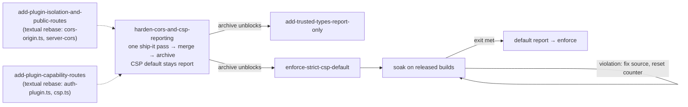

# Design — harden-cors-and-csp-reporting

## Context

See proposal.md (Why / What Changes). Split out of `close-residual-audit-findings`, this change fixes the *how* for four `security-boundary-audit` items: **B19** and **R2** (zrok CORS read path, tunnel-origin normalization), **S3b** (CSP report sink, persisted counter, strict policy; default stays `report`) and **B26r** (advisory triage only). The remaining residual items stay in `close-residual-audit-findings`.

Constraints that shape the approach:

- **No baseline CSP report sink exists.** `buildCsp()` emits no `report-uri`/`report-to` (`auth/csp.ts:46-60`). The only sink is the live-preview one, mounted per preview at `/live/<id>/__pi/csp-report` (`live-server/live-csp.ts:41,72`; `live-csp-report.ts:49`).
- **Trusted Types already shipped.** Archived `harden-client-sinks` (commit `433993088`) added `PI_DASHBOARD_TRUSTED_TYPES` (`auth/csp.ts:22-28,70-73`, resolved at `server.ts:2254-2255`) and the baseline requirements "Independent Trusted Types mode" and "Trusted Types directive emission". Its in-memory client counters live at `/api/csp-violations` (`packages/shared/src/route-tiers.ts:121,316`); this change does not touch them.
- **No server logger.** Fastify runs `logger: false` (`packages/server/src/server.ts:1905-1906`), so `request.log.*` is a no-op. Log lines (the throttled `[csp]` line) use `console.*`, as pairing does (`pairing/pairing.ts:542,581,586,604`).
- **`trustProxy` stays off.** This is deliberate (`auth/auth-plugin.ts:319-324`): `request.ip` is the socket peer, so tunnel traffic appears as `127.0.0.1` (relevant to the sink limiter, D8).
- **Shared spec text.** Requirements this change MODIFIES are also MODIFIED by other active changes. Every MODIFIED block is written on **baseline** text (`openspec/specs/**`); rebase rules are in Sequencing. Spec deltas describe what this change ships (CSP default `report`). Requirement wording lives in `specs/` and is referenced here, not restated.

## Landing



- **One landing.** ship-it runs B19, R2, S3b and B26r in one pass, merges, then archives. No stage gate; the spec deltas match the shipped code.
- **S3b here:** the baseline sink, a persisted counter with a reset action and a `dropped` count, the strict nonce policy as a **second** Report-Only header in `report` mode, `enforce` = strict policy enforced (opt-in, `PI_DASHBOARD_CSP=enforce`), passkey scripts as static assets, the import-map nonce, and the soak instrumentation (D8–D10).
- **Handoff to `enforce-strict-csp-default`** (`blocked_by` this change). It owns the soak gate, the default flip (`resolveCspMode`, `auth/csp.ts:62-65`), its release note, and the MODIFIED "Staged CSP mode resolution" delta. This change leaves that requirement unmodified. Soak exit (recorded there; all must hold):
  - zero `strict` `script-src*` violations on the persisted counter over ≥14 consecutive days;
  - zero `dropped` reports in the same window;
  - the window spans ≥1 release, on released builds;
  - Playwright E2E green against the docker harness with `PI_DASHBOARD_CSP=enforce`.
  - Trusted Types reports (`trusted-types` policy label, D8) never count toward this exit.
- **B26r** ships as documentation: `advisory-triage.md` (this change) plus a committed `pnpm audit --json` snapshot. Runtime bumps are owned by `bump-runtime-security-advisories`.

## Goals / Non-Goals

**Goals**
- Close B19, R2, S3b and B26r with test-backed changes.
- Bound the new attack surface: the unauthenticated CSP report sink (size cap, content type, limiter, deadline).
- Give the CSP change a config rollback (`PI_DASHBOARD_CSP`) and the zrok change a config escape hatch (`cors.allowZrokWildcard`), neither needing a code revert.
- Sequence against overlapping changes so that no MODIFIED requirement gets clobbered.

**Non-Goals**
- Dependency bumps. Fastify GHSA-p68q-wchp-6fh7 and the other runtime bumps move to `bump-runtime-security-advisories`. This change only records triage (D11).
- `style-src 'unsafe-inline'`, which mermaid SVG needs. S3b tightens `script-src` only.
- Trusted Types itself. It already shipped (Context); this change only points its existing header at the sink (label `trusted-types`, D8/D10) and preserves every TT carve-out of the baseline text. `add-trusted-types-report-only` becomes `blocked_by` this change; its premise is partly stale.
- The CSP default flip and its soak gate. Both belong to `enforce-strict-csp-default` (Landing).
- The other residual-audit items (Tier-3, S1r, B1r, B4r, B15r, B16r, R1, R4, R5), which stay in `close-residual-audit-findings`.

## Decisions

### CORS

**D6 · B19 — zrok wildcard off on the read path; real config key as escape hatch.** *(planner default)*
- Today branch 5 runs on the read path because `allowZrokWildcard !== false` (`auth/cors-origin.ts:158`). It becomes `=== true`. Admission already passes `false` (`:261`), unchanged.
- `cors.allowZrokWildcard` becomes a **real config key**: today it exists only as a `CorsOriginOptions` field (`cors-origin.ts:55`) and is never parsed. It is added to the `cors` config type and parser in `packages/shared/src/config.ts` (default block `:1813`, parser `:2674-2675`; boolean `true` only, default `false`) and threaded through `corsOpts()` (`server.ts:2057`).
- The live zrok URL stays allowed through branch 4b (`:147-155`), because `liveTunnelOrigins()` includes the zrok runtime URL (`tunnel/tunnel.ts:486-487`). The "load-bearing" comment (`:47`) is rewritten.
- Consumers: `@fastify/cors` (`server.ts:2224`), the denial observer (`access/cors-denial.ts:23`), the kind test (`__tests__/cors-origin-classification.test.ts:86`).

MODIFIES server-cors "Every live tunnel origin is an allowed CORS origin", "Neutral shell origin trusted by default", "Trusted-network origins allowed for LAN-to-LAN switching"; live-server-preview "CORS SHALL reject the opaque `null` origin" (wording only). cross-site-request-gate already excludes the wildcard.

*Alternatives:* narrow the suffix match to live hostnames (equivalent to 4b); delete with no escape hatch (no config rollback).

**D7 · R2 — one `canonicalOrigin()` helper.**
- Lowercases scheme and host, strips the default port, strips one trailing dot from the hostname, drops the path.
- Applied on both sides of: branch 4 (raw compare today, `cors-origin.ts:142`); branch 4b (`URL.origin`, keeps the dot, `:150,154`); `isSameOriginByHost` (`:216-240`); and the D3 Host match.
- A trailing-dot origin equals its dotless form, matching host admission (`auth/host-admission.ts:44-48`, `packages/shared/src/host-admission.ts:70-92`). zrok URLs are captured case-insensitively (`tunnel-providers/zrok.ts:388-389`).
- Tests cover case, `:443`, path and trailing-dot variants on every branch. ADDS server-cors "Tunnel origins compare in canonical form".

*Alternative:* deny trailing-dot origins. Stricter, but then the CORS gate and host admission disagree.

### CSP (S3b)

**D8 · Baseline report sink + persisted violation counter.** *(user-confirmed)*

*Route:* `POST /__pi/csp-report/:policy`, `:policy ∈ {baseline, strict, trusted-types}`; anything else → 404.
- Mounted at the root, **outside guard jurisdiction** (`/api`, `/v1`, `/editor`, `/live` — trusted-networks "Guard jurisdiction and in-namespace public exceptions", `openspec/specs/trusted-networks/spec.md:338-343`). So no trusted-networks exception delta is needed, and the mutation-origin gate, which covers only `/api/*` and `/auth/logout` (`auth/mutation-origin-gate.ts:31`), does not apply.
- **OAuth gate:** the auth `onRequest` hook (`auth/auth-plugin.ts:507-554`) runs globally and would 401 or redirect a signed-out page. Reports must arrive from signed-out pages (login, passkey), so the sink path joins its public skips (next to `/api/health`, `:534`). oauth-authentication has no enumerated public-path requirement, so this lands as ADDED "CSP report sink is public to the OAuth gate".
- Host admission still applies: the host gate is a global `onRequest` hook (`server.ts:2196`).
- No collision: the live sink is `/live/<id>/__pi/csp-report`; the SPA `setNotFoundHandler` fallbacks (`server.ts:3646-3666`) see only unmatched routes. A test asserts both.
- Each emitted policy carries `report-uri /__pi/csp-report/<policy>` plus `report-to csp-<policy>`, declared in `Reporting-Endpoints`. This includes the TT-only header (D10, emitted only when the TT mode differs from the CSP mode), labelled `trusted-types`.

*Hardening (unauthenticated POST):*
- *Size cap:* the sink reads its own body with a **byte-counting read** and aborts at 8 KiB, chunked bodies included → **413**. The cap is independent of `content-length`, Fastify `bodyLimit` and parser registration order. Context: `registerCspReportParsers` (`live-server/live-csp-report.ts:22-32`) is idempotent and skips a type already registered, so the first registrant fixes the parser limit (the live proxy registers at `live-server-proxy.ts:182`); the baseline sink does not rely on it. The live sink is unchanged. Scenario: chunked oversize body → 413.
- Content-Type `application/csp-report` | `application/reports+json`, else **415**.
- *Limiter:* dedicated, per route, keyed by socket peer, a token bucket of capacity 20 refilled at 1 token/s (= 60/min); every request reaching it consumes one token, a Reporting API batch included. Loopback is **not** exempt: the global `@fastify/rate-limit` allow-lists `127.0.0.1`/`::1` (`server.ts:1962-1967`), which would exempt all tunnel traffic. Excess → **429**.
- Body read deadline 5 s → **408**. Method other than POST → 405 `Allow: POST`; empty/malformed/non-report/content-encoded body → 400, uncounted. Precedence: 404 → 429 → 415 → 413.
- Every report refused by the limiter, the size cap or the read deadline increments a persisted `dropped` counter; the follow-up's exit requires `dropped == 0` in the window.
- Accepted → **204**, empty body. No response reflects input. Raw reports are never logged or stored (`blocked-uri` can carry tokens).

*Counter:*
- Keyed by `policy × effective-directive`; directives from a fixed allow-set, else `other`. Trusted Types violations land in the `require-trusted-types-for` directive bucket (under the emitting header's label, `trusted-types` for a TT-only header) and never count toward the strict `script-src*` measure. A bounded document-path breakdown (path only, no query, top-N with `other`) supports the soak review.
- Stores counts, `dropped`, `firstSeen`/`lastSeen` and a global `since`. No URLs beyond the bounded path, no user data.
- **Persisted** across restarts to `~/.pi/dashboard/csp-reports.json` (0600, debounced).
- *Reset* (sets a new `since`): `POST /api/csp-reports/reset` at tier `operate`, entered in the route→tier map, or deleting the file while the server is stopped (equivalent). Distinct namespace from harden-client-sinks' in-memory client TT counters at `/api/csp-violations` (`route-tiers.ts:121,316`), which are not touched.
- Throttled log line: `[csp] violation policy=strict directive=script-src-elem`.

*Exposure:* an optional `cspReports` block in `GET /api/health` (`routes/system-routes.ts:1134`), present only when `canDiscloseAccessPosture(request)` passes (`auth/localhost-guard.ts:110-115`) — the same predicate as the existing access-posture disclosure (`system-routes.ts:1162`). Otherwise the block is **omitted**; health never refuses. That predicate ignores strict mode: accepted, since the block carries counts only, no user data (Risks).

*Trusted Types:* TT emission already exists and stays independent of the CSP mode (Context). Its reports go to `/__pi/csp-report/trusted-types` when a TT-only header carries it, else to the label of the header it is appended to; either way they land in the `require-trusted-types-for` bucket. `add-trusted-types-report-only` assumes this sink; a task writes its `dependencies.yaml` `blocked_by: harden-cors-and-csp-reporting`.

ADDS baseline-content-security-policy "Baseline CSP violation report sink", "Violation counter is observable and persistent", "Violation counters reset only by explicit operator action", "Violation counters appear in the health report only when disclosure is permitted"; oauth-authentication "CSP report sink is public to the OAuth gate".

**D9 · Strict policy shape.**
- `script-src 'self' 'nonce-<n>'`, with no `'unsafe-inline'` and no `'unsafe-eval'`. All other directives stay as in `auth/csp.ts:46-60`.
- *Nonce:* 16 random bytes per HTML response. `cspNonceFor(reply)` memoizes it; the onSend hook (`csp.ts:88-93`) reads it. Non-HTML responses carry none.
- *Import map* carries the nonce: `injectImportMap` already accepts one (`lib/index-html.ts:22-23`), but `sendIndexWithImportMap` callers pass none (`server.ts:3641,3653,3658,3659`). They now do.
- *Passkey pages* (`auth/passkey/passkey-pages.ts:94,120,154`): the inline scripts move to static same-origin assets (like the existing `/auth/passkey/webauthn.js`, `:93`); per-request data goes into non-executable `<script type="application/json">`. No nonce is needed there.
- *Eval:* no real need. pdf.js probes `new Function` in try/catch; the client sets `isEvalSupported:false` so the probe does not report.
- *Vite dev* (`--dev`): the react-refresh preamble is inline, so the strict policy header is **not emitted at all** in dev (neither report nor enforce); the baseline header keeps the legacy `script-src`. Dev never feeds the strict counter.
- Plugin bundles load via same-origin `import()` (`client/src/lib/plugins/runtime-plugin-loader.ts:138`), covered by `'self'`. `blob:`/`data:` stay forbidden. Electron local pages keep their own meta CSP.

MODIFIES baseline-content-security-policy "Mode-dependent header emission" (preserving every TT carve-out of the baseline: the TT-only header is not the baseline CSP; the Off scenario keeps "AND the Trusted Types mode is `off`"; TT emission stays independent of the CSP mode), "Baseline policy directives", "Runtime plugin loading fits the baseline policy"; ADDS "Strict policy uses a per-response script nonce", "Strict policy is not enforced in Vite dev mode". "Staged CSP mode resolution" is **not** modified (default stays `report`; the follow-up modifies it).

*Alternatives:* hash-based (the import-map JSON varies with the plugin set); `strict-dynamic` (no script-inserted loaders beyond `import()`).

**D10 · Modes.**

| `PI_DASHBOARD_CSP` | Headers |
|---|---|
| `report` (default, unchanged) | `baseline` Report-Only → `/__pi/csp-report/baseline` **and** `strict` Report-Only → `/__pi/csp-report/strict` |
| `enforce` (opt-in here; default in `enforce-strict-csp-default`) | `strict` enforced → `/__pi/csp-report/strict`. The `baseline` policy is **not** emitted as Report-Only. |
| `off` | no baseline or strict CSP header (`csp.ts:8-10`) |
| any, Vite dev (per proxied response) | baseline header only (legacy `script-src`), enforcing in `enforce`; no strict header; no report destination on any header |

- *Trusted Types* follows its own mode in every row (`csp.ts:82-87`): matching modes append the directive (`report`: to the baseline Report-Only header; `enforce`: to the strict enforcing header; it then reports to that header's label), differing modes set the other header kind with the TT directive alone. Topology unchanged; the TT-only header gains `report-uri`/`report-to` → `/__pi/csp-report/trusted-types`. Non-HTML responses carry the strict header without a nonce.
- Route-level per-response policies (`/api/file/raw` sandbox, `ctx.serveApp` mounts) are untouched by mode.
- *Rollback:* `PI_DASHBOARD_CSP=report` or `off`, plus restart. Release notes state that an explicit `enforce` now enforces the strict policy.

*Alternatives:* strict in report mode only (never closes S3b); drop `'unsafe-eval'` only (partial).

### Dependencies

**D11 · B26r — triage only.** *(user-confirmed)*
- `advisory-triage.md` is an implementation-task deliverable. It lists every `pnpm audit` advisory (7 critical / 51 high / 54 moderate / 8 low at planning). Columns: `package@version | advisory | path | class (reachable / build-only / accepted) | reason | owner`; a `reachable` row names an owning change id. A `pnpm audit --json` snapshot is committed beside it and the checker diffs against the snapshot; stale rows warn.
- xlsx: CDN pin `packages/server/package.json:113`; integrity `pnpm-lock.yaml:10147-10148`; `pnpm audit` does not cover URL tarballs. The task re-verifies 0.20.3 online against GHSA-4r6h-8v6p-xvw6 (fixed 0.19.3) and GHSA-5pgg-2g8v-p4x9 (fixed 0.20.2) and records the advisory links.
- Runtime bumps (fastify ≥5.12.5 etc.) belong to `bump-runtime-security-advisories`. A task creates that stub if missing.

## Sequencing

```mermaid
flowchart TD
  subgraph External["Other changes"]
    PIR["add-plugin-isolation-and-public-routes<br/>(server-cors, cors-origin.ts, tier req)"]
    PCR["add-plugin-capability-routes<br/>(localhost-guard, auth-plugin, CSP)"]
    BUMP["bump-runtime-security-advisories<br/>(fastify et al.)"]
  end
  subgraph This["harden-cors-and-csp-reporting"]
    PR["one ship-it pass: B19, R2, S3b, B26r<br/>sink + counter, dual Report-Only"]
    ARC["archive"]
  end
  subgraph After["blocked_by this change"]
    TT["add-trusted-types-report-only<br/>(needs sink; premise partly stale)"]
    FU["enforce-strict-csp-default<br/>(soak gate + default flip)"]
  end
  PR --> ARC
  ARC --> TT
  ARC --> FU
  PIR -. textual rebase: server-cors / cors-origin.ts .- PR
  PCR -. rebase auth-plugin / csp.ts .- PR
  BUMP -. separate, urgent, no dependency .- PR
```

- *Spec rebase rule:* the change that archives second rebases its MODIFIED block on the other's text. Every MODIFIED block here is written on **baseline** text (`openspec/specs/**`).
  - baseline-content-security-policy "Mode-dependent header emission": `add-trusted-types-report-only` archives after us and rebases on our text; `enforce-strict-csp-default` MODIFIES only "Staged CSP mode resolution" (untouched here);
  - server-cors: with `add-plugin-isolation-and-public-routes` (different requirements, textual only).
- *TT premise partly stale:* `add-trusted-types-report-only` assumes no TT directive exists; it already ships (Context). A task writes its `dependencies.yaml` `blocked_by` this change and notes the stale premise there.
- Archive is the last task. Task notes: write TT's `dependencies.yaml` (D8); confirm `enforce-strict-csp-default` exists with `blocked_by` this change.

## Risks / Trade-offs

- **[Risk]** The strict CSP breaks an unseen inline script in production. → the default stays `report`, so this change cannot break pages; dual Report-Only surfaces the script; the follow-up's soak exit needs zero count, zero dropped and green E2E; opt-in `enforce` rolls back with `PI_DASHBOARD_CSP=report`.
- **[Trade-off] Counter inflation fails safe.** Anyone reaching the sink (e.g. `curl` with a forged `document-uri`) can add strict violations. That can only **delay** the follow-up's flip, never hide a real violation. Bounds: Content-Type gate, 8 KiB cap, non-loopback-exempt limiter, fixed key set. The operator inspects the directive / document breakdown before the flip.
- **[Risk]** Tunnel users share one limiter bucket (`127.0.0.1`), so a flood can push real reports into `dropped`. → `dropped` is counted, and `dropped > 0` blocks the follow-up's exit; the sink is a signal, not access control.
- **[Trade-off] Counter disclosure ignores strict mode.** `canDiscloseAccessPosture` does not consult `requireLocalProof`, so a bare-loopback caller sees the `cspReports` block. Accepted: counts only, no user data.
- **[Risk]** zrok may rewrite `Host` to the local target, so a loopback+Host branch never fires. → harmless; a task verifies zrok's Host behaviour.
- **[Trade-off] R2 trailing-dot equality.** `https://x.share.zrok.io.` equals the dotless origin. It widens nothing (same host per DNS and host admission) and keeps CORS and host admission consistent.
- **[Risk]** B19 breaks a stale second zrok frontend, or a probe from zrok A to server B. → server-selector's server-side probe fallback; `cors.allowZrokWildcard: true`.
- **[Trade-off] Scenario-name mismatches.** `openspec validate` matches MODIFIED blocks by requirement name, and some baseline scenario names (e.g. server-cors "Empty trusted networks preserves prior behavior") no longer describe the new behaviour. Names are kept so the validator matches; the scenario bodies carry the new truth.
- **[Risk]** Overlapping changes conflict. → Sequencing and rebase rules above.

## Migration Plan

One landing: every row below ships in one ship-it pass, then the change archives. The CSP default flip is not here (`enforce-strict-csp-default`).

| Item | Data / config migration | Rollback |
|---|---|---|
| B19 | New config key `cors.allowZrokWildcard` (default `false`). | `cors.allowZrokWildcard: true`. |
| R2 | None. | Revert the helper. |
| S3b | New `~/.pi/dashboard/csp-reports.json` (0600). Reset: `POST /api/csp-reports/reset` (operate) or delete the file while the server is stopped; both start a new `since`. Default stays `report`, dual Report-Only; `enforce` = strict, opt-in. | `PI_DASHBOARD_CSP=report` or `off`, plus restart. |
| B26r | None (doc). | n/a |

*Compatibility:* no database; all persistence is JSON with optional fields. Old clients are unaffected: the sink is additive and the default CSP mode is unchanged.

## Open Questions

- Can Vite `html.cspNonce` remove the dev-only `script-src` carve-out (D9)? Dev only; the production policy does not change.
