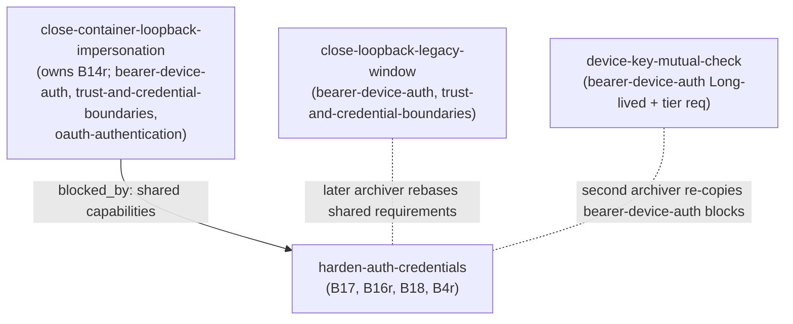

# Design — harden-auth-credentials

## Context

See proposal.md (Why / What Changes). Split out of `close-residual-audit-findings`; this doc fixes the *how* for four auth and credential items: B17, B16r, B18, B4r. B14r (the `requireLocalProof` default) is **not** here: it is owned by `close-container-loopback-impersonation` (D4).

Constraints that shape the approach:

- **No server logger.** Fastify runs `logger: false` (`packages/server/src/server.ts:1905-1906`), so `request.log.*` is a no-op (`routes/provider-auth-routes.ts:306,340`). Audit lines use `console.*`, as pairing does (`pairing/pairing.ts:542,581,586,604`).
- **`trustProxy` stays off.** This is deliberate (`auth/auth-plugin.ts:319-324`): `request.ip` is the socket peer, so tunnel traffic appears as `127.0.0.1`.
- **Shared spec text.** Requirements this change MODIFIES are also MODIFIED by other active changes (Sequencing). Every MODIFIED block is written on **baseline** text (`openspec/specs/**`). Requirement wording lives in `specs/` and is referenced here, not restated.

## Goals / Non-Goals

**Goals**
- Close each finding with a test-backed change.
- Bound the new attack surface: the bearer rotation endpoint.
- Give every default change a rollback that needs no code revert where possible.
- Sequence against overlapping changes so that no MODIFIED requirement gets clobbered.

**Non-Goals**
- Dependency bumps (`bump-runtime-security-advisories`).
- The `requireLocalProof` default (B14r). Owned by `close-container-loopback-impersonation` (D4).
- Navigate-to-origin or same-origin proxying for the cross-origin ServerSelector. The user rejected it for B4r.
- Rotating existing `auth.secret` values (D1).

## Decisions

### Auth

**D1 · B17 — pin HS256, mint 32-byte secrets, keep every existing secret.** *(user-confirmed)*
- `verifyToken` gains `{ algorithms: ["HS256"] }`. Today it calls `jwt.verify` with no options (`auth/auth.ts:181`). `signToken` already signs HS256 (`auth.ts:165-177`), so live tokens keep verifying.
- `ensureAuthSecret` mints `randomBytes(32)`, i.e. 64 hex chars. Today it mints 16 bytes (`auth.ts:142`).
- Any existing non-empty `auth.secret` is kept unchanged: no forced logout. This includes operator-set values (`packages/server/src/config-api.ts:270-273`).
- A secret shorter than 32 characters logs one startup warning recommending rotation, never printing the secret.

*Rationale:* a 128-bit HMAC key is beyond brute force; an auto-minted 32-hex secret cannot be told apart from a hand-set one; rotation would kill every `pi_dash_token` (7 d, `auth.ts:162`) and every in-flight OAuth state.

MODIFIES oauth-authentication "Auth secret management".

*Alternatives:* rotate on upgrade (one-time logout, false positive on hand-set secrets); an opt-in rotate action (deferred, no demand).

**D2 · B18 — pairing-style audit lines with socket IP where a request exists.**
- Format: `[<area>] <verb> k=v…`, the same as the existing `[pairing]` lines.
- New lines add `actor=` (`session:<sub8>` | `device:<id8>` | `local` | `system`) and `ip=<request.ip>`.
- Values are sanitized (other characters → `_`, id prefix taken after sanitizing) to prevent log injection. A refused rotation of a known device logs `[pairing] rotate_refused id= reason= ip=`; unknown-id revoke is not audited; an audit write failure never fails the mutation. Lines never carry a secret, token, hash, key or flow input value.
- The existing pairing decision lines (`pairing.ts:332,423,460,542,581,586,604`) keep their format. They run in the pairing state machine, which has no request, so they gain no IP.

| Event | Site | Line |
|---|---|---|
| device revoke | `DELETE /api/paired-devices/:id` (`routes/pairing-routes.ts:519`) | `[pairing] revoked id= actor= ip=` |
| direct device mint | `POST /api/paired-devices` (`pairing-routes.ts:535`) | `[pairing] minted id= tier= actor= ip=` |
| browser bearer rotate (D5) | new rotate route | `[pairing] rotated id= ip=` |
| provider API key | `PUT /api/provider-auth/api-key` (`provider-auth-routes.ts:282`) | `[provider-auth] key_set provider= actor= ip=` |
| provider remove | `DELETE /api/provider-auth/:provider` (`:318`) | `[provider-auth] removed provider= actor= ip=` |
| provider OAuth start | `POST /api/provider-auth/start` (`:206-240`) | `[provider-auth] oauth_start provider= actor= ip=` |
| OAuth flow input | `POST /api/provider-auth/flow/:flowId/input` (`:255`; answers the flow's pending prompt, value may be an auth code) | `[provider-auth] flow_input flow=<id8> actor= ip=` (value never logged) |
| Radius MCP config | `POST /api/provider-auth/radius/mcp` (`:160`; writes a global MCP server entry via `auth/radius-mcp.ts` `configureRadiusMcp`) | `[provider-auth] radius_mcp written= actor= ip=` |
| system writers | `auth/pi-legacy-credentials.ts:277`, `auth/dashboard-credential-store.ts:237,298` | `… actor=system` |

- Logging happens at the route layer, where the IP is known. The storage layer logs system actors only.
- OAuth completion is async; only `/start` and `/flow/:id/input` have a request.
- Forwarded headers are never logged as the IP. Docs state that tunnel traffic logs as `127.0.0.1`.

*Alternatives:* a JSON audit file (new persistence and rotation, overkill); enabling the Fastify logger (global behaviour change).

**D3 · B16r — `Secure` from a per-request secure-origin predicate; never `trustProxy`.**

`isSecureOrigin(request)` returns true if any of these holds:
- the socket uses TLS;
- the resolved base is https (`resolveRedirectBase`, `auth/auth.ts:380-395`);
- the **socket peer is a loopback address** **and** the request `Host` equals — host **and** port, compared with the R2 `canonicalOrigin` helper (D7) — an **https** entry of `liveTunnelOrigins()` (`tunnel/tunnel.ts:473`). http tunnel origins never qualify.

The branch keys on the socket peer, not on "genuinely local". Header-injecting tunnels (zrok, cloudflared) add forwarding headers yet still arrive from a loopback socket, and "genuinely local" excludes forwarded requests.

Where it is used:
- the OAuth state cookie (`auth-plugin.ts:309-315`) and `pi_dash_token` (`:328-334`). Their setters `issueState` (`:306`) and `setSessionCookie` (`:326`) take only `reply` today; both gain the `request`;
- the device cookie `pi_dash_device`: the global branch of `deviceCookieSecure` (`auth/bearer-auth.ts:54-62`, set at `:124-130`), which already receives the request and passes it on. The direct plain-http LAN carve-out stays, and applies only to a request carrying no forwarding header; with one, the carve-out is skipped and the normal rule decides.
- `pi_dash_local` is unchanged (`routes/local-proof-routes.ts:44-49`). It is a loopback-only bootstrap.

*Rationale:* with no `redirectBaseUrl`, an https tunnel already yields `Secure`. The residual gap is an `http:` override, or a tunnel URL that is not yet known. A forged `Host` can only make the cookie *stricter*.

MODIFIES oauth-authentication "Session cookie `Secure` flag derives from the resolved base" and fixes the stale "(when not localhost)" wording in "JWT session token". MODIFIES bearer-device-auth "Device cookie survives a plain-http LAN exchange" (the requirement that specifies the device cookie's `Secure` rule).

*Alternatives:* `trustProxy` / `X-Forwarded-Proto` (forbidden); global `Secure` (breaks plain-http LAN logins).

**D4 · B14r** is owned by `close-container-loopback-impersonation` (not decided here; D-numbers kept).

**D5 · B4r — short-lived, rotated browser bearer.** *(approach user-confirmed; parameters final)*

Scope: only browsers whose API base is cross-origin, via `LAST_SERVER_KEY` or `VITE_API_URL` (`client/src/App.tsx:503-507`, `lib/api/server-switch.ts:23-34`).
- The client declares `holder:"browser"` at pairing or rotation only when it keeps the bearer in browser storage, i.e. `isSameOriginApi()` is false (`client/src/lib/pairing/device-auth.ts:52-58`).
- Electron (keyring, `docs/electron-server-windows.md:7,67`), the CLI and manual MCP tokens omit it and keep non-expiring rows.
- Same-origin browsers keep the bearer only until the cookie is proven (bearer-device-auth "Browser keeps its bearer until the cookie is proven", baseline :386-393). The keep-failed path (`finishDevicePairing`, `client/src/lib/pairing/device-auth.ts:116`) wrote the legacy global slot (`BEARER_KEY`, `device-auth.ts:30`); it now writes the **per-origin** slot, so the requirement still holds with a changed storage key. It is MODIFIED (storage key only, baseline text); a same-origin browser that proves its cookie never declares a holder.

| Parameter | Value |
|---|---|
| TTL | `expiresAt = issue + 7 d`, matching the session cookie (`auth.ts:162`) |
| Absolute lifetime | 30 d from the original pairing (theft ceiling), then 401 `bearer_expired` → re-pair. A rotation near the ceiling is capped at it. |
| Rotation | `POST /api/paired-devices/rotate`, tier **`observe`**, entered in the route→tier map (`packages/shared/src/route-tiers.ts`). Authenticated **only** by `Authorization: Bearer <browser-held or legacy row bearer>`. Cookie-only, local-proof or no-bearer callers → 401 `bearer_required`. Any device id in the body is ignored: the bearer identifies the row, so a bearer rotates **itself** only. An already-expiring browser row needs no declaration. Returns `{token, expiresAt}` with `Cache-Control: no-store`. Keeps device id, label, tier. 10/min per device (sliding 60 s) → 429 + `Retry-After`; persist failure → 500 `rotation_failed`, no state change. |
| Grace | Previous hash valid for **60 s**, then invalid. Only the immediately previous bearer has a grace, until `min(rotation + 60 s, its own expiresAt)`. Rotate called with a bearer superseded within its grace → 409 `bearer_superseded`, no new bearer; after the grace it is a plain 401 on every route; the client picks up the new token from its slot (`storage` event), so tabs never fork. |
| Client schedule | Rotate on startup and when <25 % of the lifetime (issue→`expiresAt` of the current bearer) remains (≈42 h). |
| Expired | 401 `{code:"bearer_expired"}`, distinct from revoked. The client clears that server's slot and re-pairs. |
| Revoke | Unchanged: deleting the row kills the current and the previous hash. |
| Storage | One slot per server: `pi-dashboard:device-bearer:<apiOrigin>`. |
| Legacy slot | The single global key `pi-dashboard:device-bearer` (`device-auth.ts:30`) is **discarded** on upgrade on **both** paths, cross-origin and same-origin: never exchanged for a cookie, never sent. It may hold another server's bearer (the `VITE_API_URL` early fallback, `device-auth.ts:54-55`, can pick the wrong base). No new write targets it: the same-origin keep-failed path writes the per-origin slot. Cross-origin browser users re-pair once. |
| Legacy rows | A non-expiring row presented to rotate **with** `holder:"browser"` converts to a browser row (only shortens life; 30 d counts from conversion). **Without** the declaration → 409 `holder_declaration_required`, nothing issued; the row stays non-expiring — no contradiction with "non-browser bearers never expire". A 404 from an old server keeps today's behaviour. |

MODIFIES (all on baseline text):
- bearer-device-auth "Long-lived opaque bearer tokens in a revocable registry": the token is returned exactly once **per issuance or rotation**; browser rows expire. "A device bearer's tier gates REST routes and WS-ticket minting": route→tier entry for the rotate route. "Browser keeps its bearer until the cookie is proven": per-origin slot. ADDS "Browser-held device bearers expire and rotate", "Legacy non-expiring rows convert on browser declaration", "Expired bearer is reported distinctly from revoked".
- trust-and-credential-boundaries "Browser device credential is not JS-readable": the baseline scenario "legacy stored bearer migrated" (`openspec/specs/trust-and-credential-boundaries/spec.md:165-167`, exchanged for the cookie) becomes "discarded, never exchanged or sent";
- cross-origin-client "Bearer auth mode independent of origin-bound cookie".

*Overlap:* `device-key-mutual-check` also MODIFIES "Long-lived opaque bearer tokens…" and the tier requirement (Sequencing).

*Alternatives:* navigate-to-origin or document-only (rejected by the user); sessionStorage (poor UX, still XSS-readable); migrating the legacy slot (wrong-server leak).

## Sequencing

- *Spec rebase rule:* the change that archives second rebases its MODIFIED block on the other's text:
  - **every** MODIFIED block here is written on **baseline** text (`openspec/specs/**`), including B4r / B16r / B18 blocks in bearer-device-auth, trust-and-credential-boundaries and oauth-authentication. Whichever of this change / `close-container-loopback-impersonation` / `close-loopback-legacy-window` archives **later** rebases the shared requirements on the earlier archiver's text. By `blocked_by`, this change lands after `close-container-loopback-impersonation`;
  - bearer-device-auth "Long-lived opaque bearer tokens…" and "A device bearer's tier gates REST routes…" — with `device-key-mutual-check`.

## Risks / Trade-offs

- **[Trade-off] 7-day idle re-pair.** A cross-origin browser idle >7 d, or any browser past 30 d from pairing, must re-pair. Accepted as the theft ceiling; Electron and CLI users are unaffected. Cross-origin users also re-pair once at upgrade (legacy slot discarded).
- **[Residual] Same-origin keep-failed browsers.** A same-origin browser whose cookie is not yet proven keeps its bearer in the per-origin slot (D5). It never declares `holder:"browser"`, so that bearer is non-expiring until the cookie is proven. Accepted; revoke still kills it.
- **[Risk]** A thief who exfiltrates a browser bearer keeps rotating it. → rotation splits the token (legit client gets 409/401 within the grace); revoke kills the row; the 30-day absolute lifetime caps the window.
- **[Risk]** zrok may rewrite `Host` to the local target, so the D3 loopback+Host branch never fires. → harmless; the no-override case is covered by `resolveRedirectBase`; a task verifies zrok's Host behaviour.
- **[Trade-off] Scenario-name mismatches.** `openspec validate` matches MODIFIED blocks by requirement name, and some baseline scenario names no longer describe the new behaviour. Names are kept so the validator matches; the scenario bodies carry the new truth.
- **[Risk]** Overlapping changes conflict. → Sequencing and rebase rules above.

## Migration Plan

This change follows `close-container-loopback-impersonation`. B14r is not here (D4).

| Item | Data / config migration | Rollback |
|---|---|---|
| B17 | None. New mints are 64-hex; every existing secret kept (short ones warn). | Revert the alg pin (no data change). |
| B18 | None. | Revert the log lines. |
| B16r | None. | Revert the predicate; cookies re-issue at next login. |
| B4r | Row gains optional `expiresAt` / `pairedAt` / `previousHash` / `previousExpiresAt`. Client discards the legacy global slot on both paths; the same-origin keep-failed path writes the per-origin slot; cross-origin browsers re-pair once. Legacy rows convert only on explicit declaration. | Server revert: old code ignores the new fields, rows become non-expiring. Client revert: re-pair once. |

*Compatibility:*
- Old client, new server: no `holder` declaration → non-expiring rows as today.
- No database. All persistence is JSON with optional fields.

## Open Questions

None.
