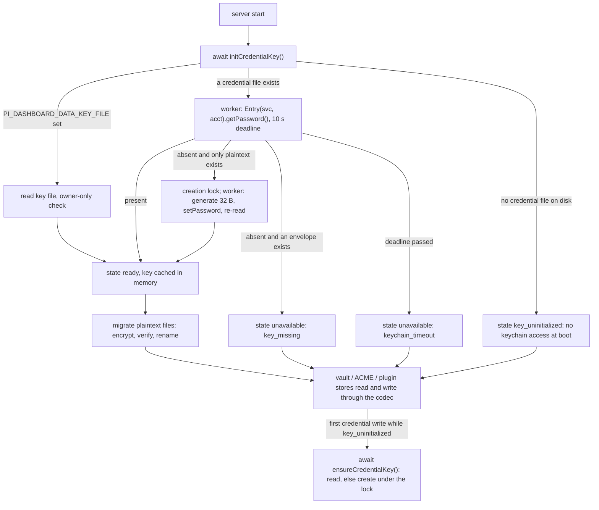
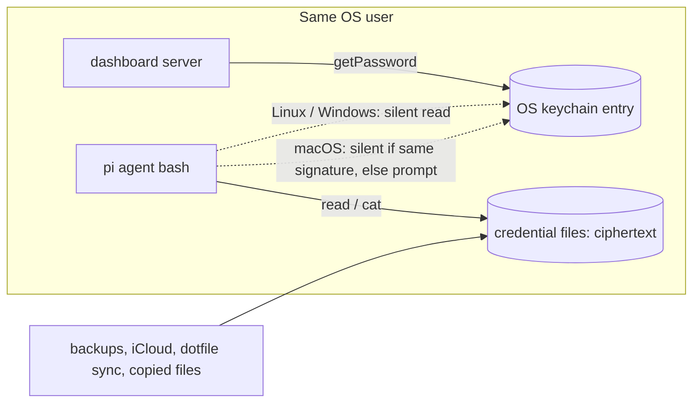

# Design: encrypt-credentials-at-rest

## Context

### Today (verified against code)

- **Plugin credentials.** `createPluginCredentialStore(pluginId, path?)` keeps `{pluginId:{key:record}}` in `~/.pi/agent/plugin-credentials.json` (`defaultPluginCredentialsPath`, `packages/server/src/auth/plugin-credential-store.ts:75`).
  - Reads are unlocked and synchronous: `readNs` → `readJsonChecked` (`:162-165`).
  - Writes go through `mutateNamespace` under `withLockedJsonFile` (`:137-153`). The `update(key, fn)` callback runs **synchronously inside the lock**, typed `NotPromise`.
  - A corrupt file that was backed up is **overwritten** by the next write (`:144`, `:151`).
  - The plugin-facing docstring says "Plaintext at rest, like `auth.json`" (`packages/dashboard-plugin-runtime/src/server/server-context.ts:861`).
  - The host binds the store per plugin at `packages/server/src/server.ts:4529`.
- **Credential vault.** `createVaultStore(path?)` keeps `~/.pi/dashboard/vault.json` (`packages/server/src/vault/vault-store.ts:241`).
  - `readDocument` is synchronous (`:248-254`), and so is `getKeyValue`, the reader used for delivery and plugin reads (`:283`).
  - `update` runs a synchronous `fn` under the lock with `createIfMissing:false` (`:256-271`).
  - A corrupt file is backed up byte-exact by `readJsonChecked`, and every write is refused with `vault_corrupt` (`:173-179`, `:261`).
  - There are two instances: the server's (`server.ts:1862`) and a lazy one in the ACME runtime (`packages/server/src/tls/sources/acme/runtime.ts:40`).
- **Shared JSON primitives.** `locked-json-file.ts` holds them.
  - `parseJsonObject` treats non-object JSON as corrupt (`:223-231`).
  - `readJsonChecked` quarantines unparseable bytes and returns `{corrupt:true}` (`:239-256`).
  - `writeJsonAtomic` writes a temp file and renames it (`:297`).
  - They have 7 other importing modules (non-test), including `auth.json` via `provider-auth-storage.ts`, `vault-projects.ts` and `services/secrets-store.ts`, and `plugin-credential-store` "auth.json behaviour preserved" requires that `auth.json` behaviour does not change.
- **Path gate.** It treats the pi agent directory as a built-in **read-only root** (`packages/extension/src/path-gate/roots.ts:132`). So `read ~/.pi/agent/plugin-credentials.json` is `in-root`: no prompt. The gate covers `read`/`write`/`edit` only (`path-gate/AGENTS.md`). `~/.pi/dashboard/vault.json` is not a root, so `read` prompts.
  - pi's built-in `grep` and `find` tools run `rg`/`fd` including hidden files (behaviour of pi's tool implementation; spike 1.2 re-checks it on the pinned pi version). A recursive grep over `~` or `~/.pi` therefore reads both files, and the path gate does not check it.
  - pi's `grep`/`find`/`ls` default a missing `path` to the session cwd. The path gate does not mirror that: it returns `undefined` (no decision) for a non-string or empty `path` (`packages/extension/src/path-gate/handler.ts:277-278`). The credential guard must not copy that shortcut (D12).
- **path-containment-guard** is a separate opt-in package. Its spec says "The guard SHALL NOT analyse shell command text" (`openspec/specs/path-containment-guard/spec.md:273`).
- **Bridge tool_call chain.** Fan-out admission is wrapped in `safe()` (`packages/extension/src/bridge.ts:1957`). Then the path gate runs, NOT wrapped in `safe()`, and turns its own errors into a block (`:1961-1968`).
- **service-secrets.** The `keychain:` resolver is read-only. It uses `security find-generic-password -s <svc> -a <acct> -w` on darwin, `secret-tool lookup` on linux, and returns `null` on win32 (`packages/server/src/services/secrets-resolver.ts:63-70`). The header explains that writes are avoided because `security add-generic-password -w <value>` puts the value in argv (`:8-9`). The spec example uses the service name `pi-dashboard` (`openspec/specs/service-secrets/spec.md`, scenario "Keychain ref on Linux without a session bus").
- **Electron startup budget.** The launcher waits `healthTimeoutMs: 30_000` for the server's health check (`packages/server/src/cli.ts:605`). A synchronous keychain call that blocks on a macOS prompt or a Secret Service unlock would stall the event loop past that budget (D4).
- **Electron.** Main runs the server as a **detached** child (`packages/electron/src/lib/server-lifecycle.ts:44`, `spawnDetached`), on the bundled Node (`openspec/specs/electron-node-runtime-selection/spec.md:9`). If that Node is missing, it falls back to Electron's own binary with `ELECTRON_RUN_AS_NODE` (`:25`). `safeStorage` is used only in main (`packages/electron/src/lib/server-keyring.ts:6`, `:44`).
- **Pi-session runtime ladder.** Override → the user's Node → managed Node → the dashboard's own runtime. On the Electron arm the last step is the bundled Node (`openspec/specs/managed-node-runtime/spec.md:111-140`).
- **Packaging.** `bundle-server.mjs` asserts that all four node-pty prebuild targets are present (`packages/electron/scripts/bundle-server.mjs:406-420`). node-pty keeps every prebuild in one package; `@napi-rs/keyring` publishes **one optional package per platform** (`npm view @napi-rs/keyring optionalDependencies`, 12 triples, 2.1.2, MIT).
- **Docker.** The image is `node:24-bookworm-slim`, runs as user `pi` and has the volume `/home/pi/.pi` (`docker/Dockerfile:13,214,219`). There is no session D-Bus, so libsecret is unavailable (and Docker's default seccomp blocks the kernel keyring: `PermissionDenied`, CI spike C8). `test-entrypoint.sh` wraps `entrypoint.sh`, and `peer-entrypoint.sh` hands over to `test-entrypoint.sh`, so key handling in `entrypoint.sh` reaches all three.
- **Owner-only check.** `checkOwnerOnly` rejects any POSIX mode with group or other bits (`packages/server/src/vault/vault-permissions.ts:25-35`). A Compose file secret mounted at `/run/secrets/…` is `0444`, so it fails that check (D6).
- **Vault-state consumers.** Every reader of `status.state === "corrupt"` (listed in D3) needs a defined behaviour for `locked`.
- **Reference implementation** (external repo, not in this tree): `/Users/robson/Project/pi-hu-connectors/packages/core/src/secure-store.ts` encrypts **per record** with AES-256-GCM. Its AAD is `<prefix>:<key>`, its key is a lazily loaded async `KeyProvider` cached per plugin, and the keychain service is `pi-hu-connectors`.

### Brief claims checked

| Brief claim | Verdict |
|---|---|
| A `read` of `plugin-credentials.json` is allowed with no prompt | **Confirmed** (`roots.ts:132`). Also: `grep`/`find` are not gated and use `--hidden`. `vault.json` *does* prompt on `read`. |
| Packaged Electron: a read from a different binary triggers an OS prompt | **Unverified and partly refuted.** The macOS keychain ACL is keyed by the code-signing *designated requirement*, not the file path. A user `node` from nodejs.org has the same signer as the bundled one and may be admitted silently. Ladder step 4 runs pi sessions **on the bundled Node itself**. Spike task 1.1 must measure this. |
| "Plugins keep using `ctx.credentials` unchanged" | Shape: confirmed. Semantics: new rejection `store_locked` (D3), and the docstring at `server-context.ts:861` must change. |
| The per-record envelope from `secure-store.ts` fits the host | **Refuted for the host.** Its async `KeyProvider` cannot run inside the synchronous lock callbacks (`plugin-credential-store.ts:137-153`, `vault-store.ts:256-271`), or in the synchronous `getKeyValue` (`:283`). It also leaves keys, binding names and project directories in plaintext. See D1. |
| `safeStorage` is unavailable to the server | **Confirmed.** The server is a separate, detached Node process, not Electron main (`server-lifecycle.ts:44`). |
| Keychain write exception is limited to `service-secrets` | **Extended.** Users already own entries under the service `pi-dashboard` (spec example). The host entry needs a distinct service name, and the `keychain:` resolver must refuse it. Otherwise a service definition could resolve the data key into a container env (D10). |

## Goals / Non-Goals

**Goals:**
- Neither credential file holds plaintext secrets on disk, in a backup or in a sync.
- Plugin and vault APIs are unchanged.
- Fail closed: never silently fall back to plaintext, and never overwrite ciphertext the host cannot read.
- The migration is verifiable and reversible through a local CLI.
- A best-effort agent guard covers the common ways an agent could disclose the files.

**Non-Goals:**
- `auth.json`: pi reads it.
- `services-secrets.json`: absorbed into the vault by `absorb-service-secrets-into-vault`.
- Data-key rotation.
- Moving the key between sources (keychain ↔ key file) other than by decrypting and encrypting again.
- Process isolation or a sandbox: the follow-up is `docs/research/agent-bash-sandboxing.md`.
- Rewriting existing `.corrupt-*` plaintext backups.

## Decisions



### D1: Whole-file envelope behind an opt-in codec in `locked-json-file`

`readJsonChecked` and `writeJsonAtomic` gain an optional `codec` option. Only `plugin-credential-store` and `vault-store` pass the credential codec. The other 7 importing modules, `auth.json`'s among them, keep byte-identical behaviour.

- **The codec is a required argument of the two credential stores, and it fails closed.** `createPluginCredentialStore(pluginId, { codec, path? })` and `createVaultStore({ codec, path? })` cannot be built without one. Production call sites pass `getCredentialCodec(fileId)`: `server.ts:1862`, `server.ts:4529`, the ACME lazy store (`tls/sources/acme/runtime.ts:40`) and the CLI. Tests inject a test codec with a fixed key. While no key has been resolved in the process, the singleton codec classifies an envelope as **locked** `key_uninitialized`. A store used before `initCredentialKey` has run also refuses every write with `key_uninitialized`; after init, a write first runs `ensureCredentialKey()` (D4). The codec never reads or writes plaintext in place of an envelope.

- The codec runs **inside** the existing synchronous read and lock paths, so `update(fn)` and `getKeyValue` stay synchronous. This works because the key is resolved asynchronously **before** a store's read or lock path needs it: at boot when a credential file exists, otherwise by `await ensureCredentialKey()` at the start of each write, before the store lock is taken (D4).
- The JSON document inside is unchanged. In-flight schema changes therefore do not interact with this one: `absorb-service-secrets-into-vault` (service namespace), `add-vault-llm-delivery` and `add-vault-reach-all-projects` (grants), and `add-acme-dns01-certs` (tls namespaces).
- Account ids, plugin keys (often e-mail addresses), binding names and project directories become confidential too.

Alternatives:
- **(a) Per-record envelopes, as in the reference implementation.** Rejected: keys and metadata stay in plaintext, the async provider does not fit the synchronous lock (see the table), and the vault schema would need a per-field rule that every in-flight change would have to follow.
- **(b) A separate encrypted file next to the plaintext one.** Rejected: two sources of truth.

### D2: Envelope format

The file is UTF-8 text with a magic first line, then one JSON line:

```
pi-dashboard-encrypted:v1
{"alg":"A256GCM","kid":"<16 hex>","iv":"<b64 12 B>","tag":"<b64 16 B>","ct":"<b64>"}
```

- `ct` is the AES-256-GCM encryption of the canonical JSON document bytes. A fresh 12-byte random IV is used per write.
- The AAD is `pi-dashboard:v1:<fileId>`, where `fileId` is `plugin-credentials` or `vault`. Swapping one file's ciphertext into the other path fails authentication. The AAD deliberately does not bind the path, so `HOME` moves keep working.
- `kid` is the first 8 bytes of SHA-256(`"pi-dashboard-kid\0"` ‖ key), in hex. It tells `key_mismatch` apart from a damaged ciphertext without revealing the key, which is 256-bit random.
- **Why not a JSON object?** An older dashboard version parses it as corrupt (`parseJsonObject`, `locked-json-file.ts:223`):
  - the old vault refuses every write;
  - the old plugin store keeps a byte-exact `.corrupt-*` backup before writing.

  A JSON-object envelope would instead let an old version add plaintext fields next to the ciphertext (`vault-store.ts` preserves unknown fields), and those fields would later be lost silently.
- **Header tolerance.** The reader strips one leading UTF-8 BOM and accepts `\r\n` line endings and one trailing newline (git autocrlf, editors). The prefix check is case-sensitive: `PI-DASHBOARD-ENCRYPTED:v1` is not an envelope and is `corrupt`. On a `v1` file an `alg` other than `A256GCM`, or any non-empty line after the envelope line, is `envelope_damaged`.
- **The magic prefix decides.** Any file whose first line starts with `pi-dashboard-encrypted:` is an envelope and is **never** classified corrupt, so it is never quarantined or replaced by the corrupt-backup path (`plugin-credential-store.ts:144,151`).
  - Unknown version (for example `pi-dashboard-encrypted:v2`) → locked `unsupported_format`.
  - Known `v1` magic, but the second line is missing, is not JSON, lacks a field, has bad base64 or wrong IV/tag lengths, names another `alg`, or has an extra line → locked `envelope_damaged`.
  - The host never overwrites a file in either state.

### D3: Read classification and fail-closed states

| On-disk bytes | Key state | Result |
|---|---|---|
| absent | any | empty. Unchanged: never created by a read. |
| valid envelope | ready, kid matches, tag OK | document |
| valid envelope | not ready (`keychain_unavailable`, `keychain_timeout`, `key_missing`, `key_file_*`, `key_uninitialized`) | **locked**, reason = key reason |
| valid envelope | ready, kid differs, or tag fails | **locked**, `key_mismatch` |
| first line starts with `pi-dashboard-encrypted:`, unknown version | any | **locked**, `unsupported_format` |
| `v1` magic line, damaged header (D2) | any | **locked**, `envelope_damaged` |
| valid plaintext JSON object | ready | document; encrypted at startup (D6) or by the next write |
| valid plaintext JSON object | not ready | document readable (no regression, it is already plaintext). **Writes refused** with the key reason: plugin store `store_locked`; vault `vault_locked` (409) and status `{state:"ok", writable:false, reason}`, so the page disables write controls and shows the remedy (decision G2). |
| anything else (never a file starting with the magic prefix) | any | **corrupt**: today's behaviour, byte-exact backup |

- **Locked never quarantines and never overwrites.**
  - Plugin store: `get`/`list`/`snapshot` and every write reject with `PluginCredentialError` code `store_locked`, carrying `reason`.
  - Vault: `status()` returns `{state:"locked", reason}`; for a plaintext vault with no key it returns `{state:"ok", writable:false, reason}`. Writes throw `VaultError("vault_locked")` (409 in `vault-routes.ts` `STATUS_FOR`, and next to `vault_corrupt` in `acme-routes.ts:169`). `getKeyValue` returns `undefined`.
- **Every consumer of the vault `corrupt` state** gets this behaviour for `locked`:

  | Consumer | Today on `corrupt` | On `locked` |
  |---|---|---|
  | `tls/sources/acme/credentials.ts:127-133` `vaultState()` | `"unavailable"` (checks `=== "corrupt"`) | `"unavailable"`: the check becomes "corrupt or locked" |
  | `tls/sources/acme/acme-source.ts:249-256` | gate `credential vault unavailable` | same (through `vaultState()`) |
  | `tls/sources/acme/gc.ts:34` | GC skipped | skipped: no TLS namespace is deleted |
  | `tls/sources/acme/config-projection.ts:25` | `configured:false` | same |
  | `vault/vault-store.ts:344` `deleteTlsNamespace`, `:353` `readTlsSecret` | throw `vault_corrupt` | throw `vault_locked` |
  | `vault/vault-routes.ts:274` ungranted bindings | skipped | skipped |
  | `vault/vault-delivery-hub.ts:215` | `vault-unavailable` | `vault-unavailable` |
  | `vault/vault-plugin-read.ts:55` | `undefined` (`!== "ok"`) | `undefined`: already covered, no change |
  | `routes/acme-routes.ts:169` | 409 | 409 |
  | client `lib/vault/vault-api.ts:43` status type | — | gains `"locked"`, `reason` and `writable`; an unknown future reason still renders as locked, never as `ok` |
  | client `VaultSection.tsx:199`, `VaultVariablesTab.tsx:38`, `VaultAccountsPanel.tsx:552`, `VaultImportPanel.tsx:289` | write controls disabled | disabled too (also for `writable:false`); the section names reason and the remedy from the shared table (below) |

- **Plugin-credential consumers.** The store's only `corrupt` handling is internal (`plugin-credential-store.ts:144,151`). Its consumers see `store_locked` as a rejected promise: `packages/gmail-plugin/src/server/accounts.ts`, `packages/gmail-plugin/src/server/index.ts` and `packages/demo-plugin/src/server/index.ts` surface it through their existing store-error paths, which a task checks.
- **Remedy table (decision G3).** `packages/shared/src/credential-encryption.ts` holds a fixed reason→remedy table, used by the vault status, the page and refusal messages. `key_missing` and `key_mismatch` name `pi-dashboard credentials reset --vault` (`--plugin-credentials` for that file). `keychain_unavailable`, `keychain_timeout` and `key_file_*` name `PI_DASHBOARD_DATA_KEY_FILE`. `unsupported_format` says to upgrade the dashboard, `envelope_damaged` to restore the file from a backup or reset it, `key_uninitialized` to restart the server.
- **Corrupt keeps today's behaviour**, with one tightening: plaintext that was valid before is never "repaired" into an encrypted file without the key.

### D4: Data key: one per OS user, resolved lazily off the event loop, cached in memory

- **Keychain entry:** service `pi-dashboard-credential-key`, account `data-key-v1`. The service name is distinct from `pi-dashboard`, which users already use for `keychain:` refs. The value is base64 of 32 random bytes.
- **Process-wide singleton.** `packages/server/src/auth/credential-key.ts` exports `initCredentialKey(opts)`, `ensureCredentialKey()`, `getCredentialKeyState()` and `getCredentialCodec(fileId)`.
  - `server.ts` awaits `initCredentialKey` **before** `createVaultStore()` (`:1862`), the ACME runtime, plugin load and `listen`. With the 10 s keychain deadline, a hung keychain still lets server creation finish with the stores locked (`keychain_timeout`) well inside the launcher's 30 s budget (`cli.ts:605`); the event loop stays free meanwhile (timers fire). `/api/health` is not served during init, because init runs before `listen`.
  - The CLI commands call it too.
  - The ACME lazy store (`runtime.ts:40`) reads the same singleton.
- **Lazy creation.** Boot only **reads**:
  - neither credential file exists → no keychain access at all; the state stays `key_uninitialized`. This keeps the credential-vault rule "No file before the first account" and adds no keychain entry or prompt on a host without credentials.
  - an envelope exists → read the key; absent → `key_missing` (never created).
  - only plaintext exists → read the key; absent → create it (below), then migrate (D7).
  - The first credential write while `key_uninitialized` calls `await ensureCredentialKey()` before taking the store lock: it reads the key, and creates it only if absent and no envelope is on disk.
- **Creation rule.** A key is created only when the source holds none **and** neither credential file holds an envelope, and only for a migration or a credential write. Creation runs under a lock file (`~/.pi/dashboard/credential-key.lock`, same `proper-lockfile` semantics as `LOCK_OPTIONS`). After `setPassword`, the key is read again and the stored value is used. Two servers starting at once (dev and prod) therefore converge on one key.
- **Off the event loop, with a deadline.** `@napi-rs/keyring` calls are synchronous and unbounded: a Secret Service unlock or a macOS prompt blocks the calling thread, and the Electron launcher waits only 30 s for health (`cli.ts:605`). Each keychain job (`getPassword`, or the read→`setPassword`→re-read sequence of creation) runs in a `worker_threads` Worker that loads the binding and posts the result back. **One total deadline of 10 s** (the `keychain:` resolver's timeout) bounds `initCredentialKey` as a whole: the read, the creation-lock wait and the creation share it (decision G1), so startup never exceeds it plus the rest of boot, inside the launcher's 30 s budget. A job started later by the first credential write (`ensureCredentialKey`) gets its own 10 s. On expiry the state becomes `unavailable` with reason `keychain_timeout`, the worker is `unref()`'d and abandoned, and a late answer is ignored. The key crosses only an in-process `postMessage`. The key-file source reads synchronously at init (a local file, no prompt).
- **Self-contained worker entry.** The worker entry is a plain `.mjs` file (`packages/server/src/auth/credential-key-worker.mjs`) that imports only `@napi-rs/keyring`: no TypeScript, no workspace import, so it needs no TS loader. Precedent: the fit worker's `.ts` entry needs a loader injected into `execArgv` and, under a host without one, died on load and fell back to the main thread (`packages/server/src/attachments/fit-worker-pool.ts:56-107`). Here there is **no in-process fallback**: a worker that fails to start, fails to load its entry or the binding, or exits before answering gives `keychain_unavailable`. The Electron bundle assertion (D5) includes the worker file. Spike 1.6 checks that it loads under the packaged bundle, the jiti/tsx dev server and vitest.
- **Malformed stored value.** A keychain value that is not base64 or does not decode to 32 bytes gives `keychain_unavailable`; the entry is never overwritten (decision G4).
- **Failure handling.** A failure, `keychain_timeout` included, is cached for the life of the process: no retry loop, and no repeated macOS prompts. One exception (decision G7): failing to take `credential-key.lock` (a live holder past the 2 s retry budget, or `EACCES`) refuses only that write with `keychain_unavailable` and is **not** cached, so transient contention does not lock the user out until a restart. The lock reuses `LOCK_OPTIONS` (30 s stale). Remedy: fix the source, then restart. The key never leaves the server process. It is not sent to the bridge, plugins, the client, logs or child env.
- **Key never in argv:** the native API takes the secret as a function argument.

### D5: Keychain mechanism (decided: native module)

**Recommended: `@napi-rs/keyring` 2.1.2.** It is MIT, uses N-API (independent of the Node ABI), has a synchronous `Entry(service, account).getPassword()/setPassword()` API, and ships prebuilt packages per platform. The pi-hu-connectors core already uses it. It is a new runtime dependency, and the native code is justified: no Node built-in reaches these OS stores.

Alternatives:
- **(a) OS CLIs through `ToolRegistry`.** `security add-generic-password -w <value>` exposes the secret in argv, as `secrets-resolver.ts:8-9` already notes. An entry created by `/usr/bin/security` lists `security` as a trusted application, so **any** `security find-generic-password` call reads it silently. That ACL is worse than with the native module. Windows has no stock CLI for reading a credential. Rejected.
- **(b) Electron `safeStorage`.** Only Electron main can use it. The server is a detached child that outlives main (`server-lifecycle.ts:44`), and the npm and Docker arms have no Electron at all. Main could pass a key to the server through env, but env is inherited by the server's pi-session children unless every spawn strips it. Rejected.
- **(c) `keytar`.** Archived and not maintained. Rejected.

**Packaging.** Only the host platform's optional package installs (`npm view` above). Delivery spike: `spike/keyring-delivery/FINDINGS.md` (Node 16 to 24 and Electron 44 `ELECTRON_RUN_AS_NODE` all round-trip, main thread and worker; N-API, so no Node-version or ABI regression).
- The Electron bundle step must install the **target** platform's `@napi-rs/keyring-<triple>`. CI legs are native per arch (`_electron-build.yml` matrix; win32-arm64 ships x64 Node from an x64 host), so the host triple is the target triple there. Local cross-builds: only `npm install --os=<os> --cpu=<cpu>` (and `--libc` on Linux) or an npm run under `arch -x86_64` selects the triple; `npm_config_target_arch`, which `bundle-server.mjs` sets for `TARGET_ARCH`, is ignored for optional packages (spike rows 3, 7). One npm run installs one arch only (row 5).
- `bundle-server.mjs` asserts this like node-pty (`:406`), for the triple of `TARGET_ARCH ?? process.arch` (win32-arm64: `win32-x64-msvc`), and also asserts that the keychain worker entry `credential-key-worker.mjs` is in the bundle and that the bundled `@napi-rs/keyring-<triple>/package.json` version equals `@napi-rs/keyring`'s: neither npm nor the generated loader enforces it by default (row 11). `verify-release-deps.mjs` pins the floor.
- The npm-install arm gets the right binding through normal optional-dependency resolution.
- **Linux store pinned to Secret Service.** By default the binding silently falls back to the in-memory kernel keyutils keyring when no Secret Service answers (CI spike C2: the entry lands in the session keyring; the package README: "will not persist across reboots"). A data key there is lost at reboot and locks every credential file `key_missing`. The keychain worker therefore constructs every entry with `{ linux: { store: 'secret-service' } }`; a missing Secret Service is then a fast typed error (C3, ~5 ms) → `keychain_unavailable`. On Linux the item is stored with attributes `service`/`username` (C6); on Windows the target is `data-key-v1.pi-dashboard-credential-key` (C10).
- **Licence.** The Linux binaries statically link `libdbus` (`AFL-2.1 OR GPL-2.0-or-later`, package README). The Electron Linux bundle and the Docker image ship the package's `LICENSE.third-party.md`. `--omit=optional` (or any optional-dep pruning) removes the binding (row 12); no delivery path uses it today.
- A binding on a `noexec` mount fails `dlopen` (`failed to map segment`, row 16). Documented for the npm arm; remedy `PI_DASHBOARD_DATA_KEY_FILE`.

**Load failure.** A missing binding, an unsupported triple or a `dlopen` error gives state `keychain_unavailable`. The host does not fall back to the CLI. Every such failure throws the same misleading top-level text (`Cannot find native binding. npm has a bug …`); the real reason sits in the nested `err.cause` chain (spike rows 6, 10, 12, 16). The worker walks that chain (arrays included) and reports the deepest `dlopen` / `map segment` / `Cannot find module` message, shortened and with no file content, as the log detail of `keychain_unavailable`. No-bus and locked-keyring errors are fast typed errors, not hangs (rows 13, 15). This includes a packaged Electron app whose hardened runtime refuses the `.node` binary: encryption is **not** silently disabled; the keyless rule of D6 applies (writes refused unless `PI_DASHBOARD_DATA_KEY_FILE` is set).

**Signed bundle.** The macOS app is notarized with the hardened runtime. `packages/electron/entitlements.plist` already grants `com.apple.security.cs.disable-library-validation`, so a `.node` signed by another team may load; notarization still needs every bundled `.node` signed. The darwin `.node` is signed by a third-party Developer ID (team `K3VT49H83Y`). The process that loads it is the **bundled Node** (`Resources/node/bin/node`), not the Electron binary. Today that Node keeps its nodejs.org signature, which carries DLV. Re-signed with the hardened runtime **without** DLV, `dlopen` refuses the binding (`mapping process and mapped file (non-platform) have different Team IDs`, spike row 10); with the repo `entitlements.plist` it loads (row 9). So whoever signs the bundle (`macos-notarization`) MUST sign `Resources/node/bin/node` with DLV. The build gate is **static**: `codesign -d --entitlements -` on `Resources/node/bin/node` lists `com.apple.security.cs.disable-library-validation`, plus `codesign --verify` on the `.node`. A load round-trip with the bundled Node runs as a smoke check only: GitHub macOS runners have SIP disabled and load the binding even without DLV (CI spike C14, C15), so a load check there cannot catch the regression. Spike 1.4 checks that the signed, notarized bundle loads the binding and round-trips a key.

### D6: Keychain unavailable (decided: explicit key file, otherwise refuse writes)

- **`PI_DASHBOARD_DATA_KEY_FILE=<abs path>`.** When set, it is the **only** source: the keychain is never consulted, and there is no fallback either way.
  - The file holds base64 of 32 bytes, with at most one trailing newline (`\n` or `\r\n`, decision G4).
  - It must be owner-only, checked with `checkOwnerOnly` (`packages/server/src/vault/vault-permissions.ts:25`).
  - Errors: `key_file_missing`, `key_file_invalid` (directory, unreadable such as `EACCES`, or not 32 bytes of base64), `key_file_insecure`.
  - The dashboard server **never creates** the key file. Docs show `openssl rand -base64 32 > <file>; chmod 600 <file>`.
  - A Compose file secret (`/run/secrets/…`) is mounted `0444` and fails `checkOwnerOnly` (`vault-permissions.ts:25-35`), so it cannot be used directly; copy it into a `0600` file instead.
- **No key source available** (no session bus, a locked keyring, CI; on Linux the store is pinned to Secret Service, so the kernel keyring never counts as a source):
  - state `keychain_unavailable`;
  - existing plaintext files stay readable;
  - every write to either store is refused with the reason and a remedy that names `PI_DASHBOARD_DATA_KEY_FILE`.
- **Docker: a `0600` key file in a dedicated volume.** The documented path is `/home/pi/.pi-key/data-key` on its own volume, separate from `/home/pi/.pi`, so a copy of the state volume carries no key.
  - `docker/Dockerfile` creates `/home/pi/.pi-key` owned by `pi` (mode `0700`) next to the existing `mkdir`/`chown` (`:207`) and adds it to `VOLUME` (`:219`).
  - `docker/entrypoint.sh`, before starting the server: when `PI_DASHBOARD_DATA_KEY_FILE` is unset, it exports `/home/pi/.pi-key/data-key`. If that file is absent **and** neither `~/.pi/agent/plugin-credentials.json` nor `~/.pi/dashboard/vault.json` starts with `pi-dashboard-encrypted:`, it generates 32 random bytes as base64 under `umask 077` (no key in argv). If an envelope exists, it **refuses** to generate, prints the restore remedy, and starts the server anyway, which then reports the files locked with `key_file_missing` (the key-file form of `key_missing`). A fresh key would only turn that into `key_mismatch`.
  - A preset `PI_DASHBOARD_DATA_KEY_FILE` pointing elsewhere is never generated (decision G9): generation happens only at the default path.
  - When `/home/pi/.pi-key` is not a mountpoint, `entrypoint.sh` prints a warning (the `VOLUME` line only creates an anonymous volume, which `docker compose down -v` or a fresh `docker run` loses) and continues.
  - `test-entrypoint.sh` and `peer-entrypoint.sh` reach this through `entrypoint.sh`; they need no own logic, only a check.
  - `compose.yml` mounts a named volume `pi-key` at `/home/pi/.pi-key` next to `pi-state` (`:61`); overlays such as `compose.dev.yml` inherit it. `compose.test.yml` overrides `pi-key` to a tmpfs, as it does `pi-state` (`:224`).
  - `compose.test.peer.yml` defines a second service `pi-dashboard-peer` with its own `peer-state` volume at `/home/pi/.pi` (`:54`, tmpfs at `:66-70`). It gets its own `peer-key` tmpfs volume at `/home/pi/.pi-key`. The overlays `compose.test.acme.yml`, `compose.test.cap.yml` and `compose.test.identity.yml` override the `pi-dashboard` service; each is checked to inherit the `pi-key` mount rather than replace the `volumes` list.
  - Custom Compose files and plain `docker run` MUST mount `/home/pi/.pi-key` as a named volume; `docker/README.md` and the release note say so.
  - The pi sessions run as the same user in the same container, so the key file protects only against copies of the `/home/pi/.pi` volume (backups, sync). The docs say so.
- **Alternative rejected:** `PI_DASHBOARD_CREDENTIALS_PLAINTEXT=1` as an explicit opt-out. It is not silent, but it is an easy footgun. Listed in Q2 for the human gate.

### D7: Migration of existing plaintext (decided: in place, verified, no plaintext copy)

At startup, after the key is ready, each file that classifies as "valid plaintext JSON object" (D3) is migrated under its lock:

1. Parse the plaintext.
2. Encrypt it.
3. Decrypt that ciphertext in memory and deep-compare it with the parsed plaintext. On a mismatch, abort, log, and leave the plaintext.
4. Write it with `writeJsonAtomic` (temp + rename, mode 0600).

- Log `[credential-key] encrypted <basename> (migrated from plaintext)`.
- There is **no plaintext backup**: a lingering copy would keep the exact exposure this change removes. Crash safety comes from the atomic rename. The file is either fully old or fully new.
- Any write after startup also encrypts. This covers a plaintext file that appears later, for example one restored by the user.
- Existing `<file>.corrupt-*` siblings stay byte-exact, as the corrupt-backup requirements demand. `credentials status` lists how many exist, so the user can delete them.

**Rollback.** Run `pi-dashboard credentials decrypt` with the server stopped, then install the older version. The command:

1. **Server check.** Sends `GET /api/health` to the configured port. **Any** HTTP reply, `401` included, means a server is running: refuse, exit non-zero. Only a refused connection (`ECONNREFUSED`) proceeds; any other outcome (timeout, reset) refuses too. It also refuses when the PID file (`~/.pi/dashboard/server.pid`, `readPid` + `isProcessAlive`) or the per-HOME lock metadata names a live server of this HOME, so a second dashboard on another port (dev and prod) cannot re-encrypt the files afterwards (decision G11).
2. **Confirmation.** Needs an interactive confirmation or `--yes`, like `reset`.
3. **Locks.** Takes both store locks, `plugin-credentials.json` first, then `vault.json`, and holds them for the whole run.
4. **All-or-nothing decode.** Decodes every encrypted file in memory first. If any file is locked or damaged, it writes nothing and exits non-zero naming that file and its reason.
5. **Write.** Rewrites each encrypted file as plaintext `0600` with `writeJsonAtomic`. Already-plaintext and absent files are skipped, so a re-run is idempotent.
6. **Report.** Prints one line per file, `<basename>: decrypted|already-plaintext|absent|failed <reason>`, never a value. If a write fails after an earlier one succeeded, the report says which, and the command exits non-zero.

**Downgrade without decrypt:**
- Old vault: sees a corrupt file and refuses writes. The ciphertext is kept.
- Old plugin store: keeps a byte-exact backup, then starts a fresh plaintext file. On re-upgrade the new version migrates the fresh file. The backup is an ordinary `.corrupt-*` sibling; the release note says to run `decrypt` before a downgrade.

### D8: Key loss and recovery

Key loss happens on a keychain reset, a home directory restored on a new machine, or a key file deleted. In each case the files stay **locked** (`key_missing` or `key_mismatch`) and the ciphertext is untouched.

- **Remedy 1:** restore the key (keychain backup or key file).
- **Remedy 2:** `pi-dashboard credentials reset [--vault|--plugin-credentials]`. It is local-only and needs an interactive confirmation or `--yes`. It runs the same server check as `decrypt` (D7 step 1: any HTTP reply, `401` included, refuses; only `ECONNREFUSED` proceeds; a live server of this HOME by PID or lock metadata refuses) and takes the same store locks in the same order (`plugin-credentials.json`, then `vault.json`) while it renames. With no flag it acts on both files. A file that is not locked (it decrypts, is plaintext or is absent) is left untouched and reported as `<basename>: not-locked`, exit 0 for that file (decision G6). It renames the locked file to `<file>.undecryptable-<stamp>` (kept); `<stamp>` is `YYYYMMDDTHHMMSSZ`, with a `-N` suffix on collision. It releases the store locks before any key creation, so the creation lock is never taken while a store lock is held, matching the server's order (D4: `ensureCredentialKey()` runs before the store lock). The user then enters the credentials again: the vault page, or each plugin's settings.
  - **Keychain source:** it creates a new key under the creation lock, unless one is present.
  - **Key-file source:** it never creates a key. When the key file is missing or unusable, it still renames the locked file aside, then prints the remedy `openssl rand -base64 32 > <file>; chmod 600 <file>` and exits non-zero. Writes stay refused with the key-file reason until the file exists.
- A login-keychain item created by the native module is not synchronizable, so it does not follow the user to a new machine. The docs say so.

### D9: Dev arm and tests

- **Dev (`tsx` server on the user's `node`).** The keychain entry is created by that `node`. On macOS, a later `node` with a different code signature prompts once ("Always Allow"). This is documented. `PI_DASHBOARD_DATA_KEY_FILE` works in dev too.
- **Tests never touch a real keychain.**
  - `initCredentialKey({ provider })` accepts an injected `EntryFactory`-style provider, as in the external reference `/Users/robson/Project/pi-hu-connectors/packages/core/src/secure-store.ts` `keychainDataKey(…, {entryFactory})`.
  - `_resetCredentialKeyForTests()` resets the singleton.
  - Store tests inject a test codec with a fixed 32-byte key (the codec is a required store argument, D1).
  - When `VITEST` is set and nothing was injected, the default provider throws `keychain_unavailable` instead of loading the native module.
  - Existing `auth.json` and locked-json-file suites run unchanged, because the codec is opt-in (D1).

### D10: service-secrets keychain exception

The `keychain:` resolver stays read-only. It **refuses** `keychain:pi-dashboard-credential-key/<any>` with `secret-unavailable` before running any tool, so a service definition cannot pull the data key into a container env. The only keychain write is `setPassword` in D4.

### D11: Observability (never the key)

- **One startup line:** `[credential-key] source=<keychain|key-file> state=<ready|deferred|unavailable> reason=<code?> kid=<16hex?> created=<bool>`. `deferred` means no credential file existed, so the keychain was not touched (D4). `created=true` only when this boot created the key for a plaintext migration; a key created later by the first credential write logs its own `[credential-key] created source=keychain kid=<16hex>` line.
- **One line per file migration or lock:** `[credential-key] <basename> state=<encrypted|plaintext|locked|absent> reason=<code?>`.
- `credentials status` (CLI) prints `key=value` lines that mirror these tokens (decision G10): `source=… state=… reason=… kid=…`, one `<basename>: <state> [reason]` line per file, and `corrupt=N undecryptable=N`. It reads the keychain only when a credential file exists. No `--json`.
- The vault page shows `locked` with the reason and remedy, and disables write controls (MODIFIED credential-vault requirement).
- Plugin settings surface `store_locked` through the plugin's own error path. Plugins already handle store errors.
- No HTTP route exposes the key state beyond the existing vault status. No new endpoint.

### D12: Agent credential guard (new capability `credential-file-guard`)

`packages/extension/src/credential-guard.ts` exports `createCredentialGuard({ protectedPaths, keychainService })` → `handler(event)`. `bridge.ts` registers it as a `tool_call` handler **before** the path gate. A call it blocks never shows a gate prompt. It is not wrapped in `safe()`: an internal error blocks the call it was evaluating (fail closed) and logs `[credential-guard] error tool=…`.

- **Protected paths** come from shared constants (`packages/shared/src/credential-encryption.ts`):
  - `<home>/.pi/agent/plugin-credentials.json`;
  - `$PI_CODING_AGENT_DIR/plugin-credentials.json` when that is set (the server always uses `<home>/.pi/agent`, `defaultPluginCredentialsPath`, `plugin-credential-store.ts:75`, but the bridge cannot be sure);
  - `<home>/.pi/dashboard/vault.json`;
  - `$PI_DASHBOARD_DATA_KEY_FILE` when set in the pi process env. Dashboard-spawned sessions inherit the server env; others may not, which is best-effort.

  Each one includes its siblings `<name>.*` (lock, temp, `.corrupt-*`, `.undecryptable-*`).
- **Path tools** (`read`, `edit`, `write`, `ls`, `find`, `grep`):
  - blocked when the resolved target is a protected path;
  - `grep`: also blocked when the target is a directory that **directly contains** a protected file, because rg reads hidden files;
  - a missing or empty `path` on `grep`, `find` or `ls` means the session cwd (`ctx.cwd`), as in pi. The guard resolves it and decides; it does **not** copy the path gate's "non-string path → no decision" shortcut (`path-gate/handler.ts:277-278`);
  - recursive greps from further up (`~`) are a documented residual. After this change the files hold only ciphertext; the key file is the residual that matters;
  - paths use the shared `tool-path-resolve` canonicaliser that the path gate uses (`path-gate/resolve.ts`).
- **Text rules on command-bearing fields.** For **every** tool, built-in, extension or MCP (for example `bash`, `powershell`, `ctx_execute_file`'s `path`, codemode `code`, a `file://` URL to a fetch tool, `grep`'s `glob`, `find`'s `pattern`), the guard scans string values at any depth, but **only** under a field named `command`, `script`, `code`, `args`, `url`, `path`, `file`, `filePath`, `cwd`, `pattern` or `glob` (array elements under such a field included). Other field names are not scanned.
  - **Content fields exempt.** For `write`/`edit`, `content`, `newText`, `oldText` and the `edits[]` text are not scanned; those tools are covered by the path rule. An `edit` of `docs/credential-vault.md` whose `newText` quotes `~/.pi/dashboard/vault.json` is allowed.
  - A scanned string matches only in a **path-like** or command context, never on a bare basename:
    - `path`: contains `.pi/agent/plugin-credentials.json` or `.pi/dashboard/vault.json` (either separator, case-insensitive, sibling suffixes included), or the full path of `$PI_CODING_AGENT_DIR/plugin-credentials.json` or of the configured key file;
    - `keychain`: contains the service name `pi-dashboard-credential-key` **and** a keychain CLI verb in the same string (`find-generic-password`, `delete-generic-password`, `secret-tool`, `Get-StoredCredential`, `CredentialManager`, `cmdkey`);
    - `dump`: matches `security\s+dump-keychain`;
    - `decrypt`: matches `credentials\s+decrypt`.
- **No false positive on a bare name.** `rg plugin-credentials.json docs/`, or a commit message that mentions `plugin-credentials.json`, is not blocked.
- **Block result:** `{ block: true, reason: "credential_guard: <tool> targets dashboard credential storage" }`. Log `[credential-guard] blocked tool=<name> match=<rule-id>`. The command text and file content are never logged.
- **Relation to other guards:**
  - **path gate:** independent. A gate grant, YOLO or the gate's off setting cannot override this guard.
  - **path-containment-guard:** separate capability and package. Its "SHALL NOT analyse shell command text" applies to that guard only and is not modified. This guard runs in every dashboard-bridged session, with no configuration.
- **Bypassable by design** (residuals that stay): relative names from a nearby cwd (`cd ~/.pi/dashboard && cat vault.json`), variable or string indirection (`f=vault; cat ~/.pi/dashboard/$f.json`), encoded strings (base64, hex), a script written to disk and then executed, a keyring library call from a script, and any process outside pi. The docs say "not a sandbox".
- **Always on, no switch.** A switch would be the first thing an injected prompt asks for.

## Threat model



**Protects against:**
- disclosure through `cat`, `read` or `grep` (ciphertext only, plus the guard);
- backups, iCloud or dotfile sync, support bundles, a copied `~/.pi`;
- a stolen disk image without the user's keychain.

**Does NOT protect against** a same-user process that reads the keychain:
- **Linux (libsecret) and Windows (DPAPI):** any same-user process reads it.
- **macOS, npm arm:** silent when the reader is the same `node` binary or has the same signer. CI spike C16: any nodejs.org-signed `node` reads an entry created by another nodejs.org `node` without a prompt; `/usr/bin/security` and differently-signed binaries prompt.
- **macOS, Electron:** depends on the signature (spike 1.1). Silent when the ladder falls back to the bundled Node.

The real fix is agent bash sandboxing (`docs/research/agent-bash-sandboxing.md`), a follow-up change.

## Risks / Trade-offs

- **Decrypt-on-read cost.** Every vault and plugin read decodes the whole envelope. Budget (decision G8): a 2 MiB envelope (the plugin store cap) decodes in under 50 ms at p95.
- **Key loss makes credentials unrecoverable** without the key. Mitigation: fail closed, keep the ciphertext, offer reset and re-entry, and document how to back up the key.
- **Native dependency in the Electron cross-build.** A missing target binding is a hard NO-GO at build time, not at run time.
- **Bundled-Node re-signing without DLV** silently turns every macOS user to `keychain_unavailable` (spike row 10). Mitigation: the static entitlement gate on the bundled Node (D5, task 11.1; a load check on SIP-disabled CI runners cannot catch it); the requirement is stated for `macos-notarization`.
- **Linux keyutils fallback** would create a non-persistent data key on headless hosts. Mitigation: the Secret Service store pin (D5).
- **Silent binding version skew.** A platform package at another version loads without error (spike row 11). Mitigation: version-equality assertion at bundle time (D5).
- **macOS prompt after a `node` upgrade (npm and dev arms).** Mitigation: one-time "Always Allow", documented. The key-file option avoids it.
- **A downgrade without decrypt** strands plugin credentials in a `.corrupt-*` backup. Mitigation: the release note says to run `credentials decrypt` first (D7).
- **Collision on service-secrets "Secret references and resolvers"** with `absorb-service-secrets-into-vault`. Both changes MODIFY that requirement. The delta here is one sentence plus one scenario; whichever change archives second rebases it onto the other's archived text (`dependencies.yaml` `related`, task 13.1). Two notes for absorb, which this change does not edit:
  - absorb's D1 state table has no row for a **locked** vault. It must treat `vault_locked` like `vault_corrupt`: writes refused, `store:` services `secret-unavailable`, migration retried later.
  - absorb leaves plaintext `.migrated`/`.bak` copies of `services-secrets.json`. They are outside this change's two files and stay a known residual, to be addressed in absorb.
- **Guard false positives:** limited to command-bearing and path-like fields (D12). A `bash` command holding a path-like `.pi/agent/plugin-credentials.json` or `.pi/dashboard/vault.json` is blocked even when harmless (for example `git commit -m` quoting the full path). Doc edits through `write`/`edit` content, and non-command fields of other tools, are never scanned. Bare basenames do not match. Acceptable, because the reason names the guard.
- **Guard false negatives from field scoping:** a tool that carries a command or path under a field name outside the D12 list is not text-scanned. Accepted: the guard is bypassable by design and the list covers pi's built-ins and the common MCP shapes.

## Migration Plan

1. Ship the key module and codec. The startup migration is gated behind the readiness checks in D4 and D6.
2. First start: read the key when a credential file exists; create it only to migrate plaintext (D4), migrate the plaintext files (D7), log the states. A host without credential files touches no keychain until the first credential write.
3. Rollback: `pi-dashboard credentials decrypt` with the server stopped, then downgrade.
4. Docker: the entrypoint provides `/home/pi/.pi-key/data-key` on its own volume (D6, Q2). A custom `PI_DASHBOARD_DATA_KEY_FILE` must point at a `0600` file owned by `pi`.

## Decisions (human gate, accepted)

- **Q1 Keychain mechanism:** `@napi-rs/keyring` (D5). OS CLIs rejected (argv leak, weaker ACL).
- **Q2 No keychain (Docker, headless, CI):** explicit `PI_DASHBOARD_DATA_KEY_FILE`, else refuse writes (`keychain_unavailable`). The Docker entrypoint generates `/home/pi/.pi-key/data-key` on a separate volume and refuses to generate while an envelope exists (D6, task 11.2). No plaintext opt-out flag; no Compose-secret copy.
- **Q3 Plaintext backup at migration:** none (verify-before-replace plus the decrypt CLI) (D7).
- **Q4 Guard scope for recursive `grep`:** block only when the target directly contains a protected file (D12).
- **Scenario gaps G1–G11:** G1 one total 10 s deadline for init (D4); G2 plaintext vault without a key: 409 `vault_locked` plus `writable:false` status (D3); G3 remedy table in shared constants (D3); G4 one trailing `\n`/`\r\n` accepted, directory/EACCES `key_file_invalid`, bad keychain value `keychain_unavailable` never overwritten (D4, D6); G5 header tolerance (D2); G6 `reset` not-locked/no-flag/stamp (D8); G7 creation-lock busy not cached (D4); G8 2 MiB decode p95 < 50 ms (Risks); G9 no generation at a custom key path (D6); G10 `credentials status` format (D11); G11 `decrypt`/`reset` also refuse on a live server of this HOME (D7, D8).
