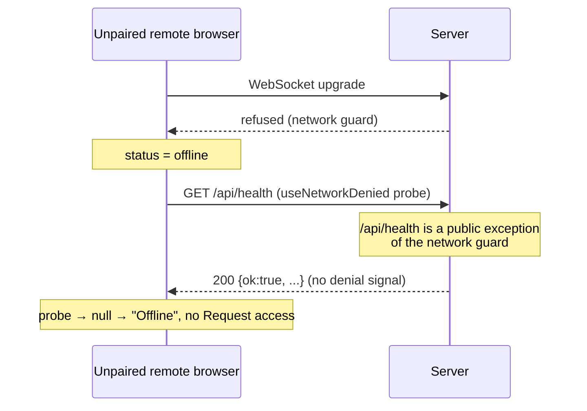

# Surface the caller's network denial on `/api/health`

## Why

Issue [#1082](https://github.com/BlackBeltTechnology/pi-agent-dashboard/issues/1082). In `network.trustMode: "pair"`, a fresh remote browser (no device cookie, no session) sees "Disconnected from <host>. Retrying…" and an **Offline** chip, with no **Request access** action. In a home-screen WebView there is no address bar, so `/pair?request` cannot be reached at all.

Root cause:

- `useNetworkDenied` (`packages/client/src/hooks/useNetworkDenied.ts`) treats only a `403 network_not_allowed`, or a `200` with `localProof: "required"`, as a denial.
- `/api/health` is in `PUBLIC_IN_NAMESPACE_PATHS` (`packages/server/src/auth/localhost-guard.ts`), so the guard never refuses it: the probe always gets `200`.
- The health body reports `localProof` only for a bare-loopback caller; nothing tells a remote caller it is refused.

The "Network not allowed" surface + Request access (`add-lan-knock-pairing`) therefore never renders for a real remote denial, with or without OAuth (with OAuth the sign-in gate masks it). Its E2E (`tests/e2e/trust-mode-pair.spec.ts`) accepts either surface and needs OAuth, so the gap went unseen; the L1 banner test simulated the 403.

## What Changes

- **Server — health carries the caller's own admission verdict.** `/api/health` adds `networkAccess: { error: "network_not_allowed", hint }` iff the REST network pass predicate, evaluated as for a non-observe route, would refuse THIS request and the caller is not the local-proof case (which keeps `localProof: "required"`). `hasNetworkPassCondition` is split into a pure core (`evaluateNetworkPass`, no telemetry) plus the existing telemetry wrapper, so health and both guards share one predicate and health never touches admission counters. Health receives a `readNetworkVerdict` closure built in `server.ts` (no raw local token in the route module); failures omit the field. The `hint` is the generic 403 hint constant. Field absent for every admitted caller.
- **Client — `useNetworkDenied` reads the field.** A `200` whose body carries `networkAccess.error === "network_not_allowed"` is a denial `{ hint }`, same as a 403. Credentials need no change: the installed fetch wrapper already attaches only the probed origin's own bearer. Transport failure stays `null` → offline banner unchanged. The server-selector health check (`server-route-check.ts`) is intentionally unchanged (design D6).
- **Server — session tagging on health by pathname.** `auth-plugin.ts` tags a session cookie on `/api/health` by parsed pathname instead of exact `request.url`, so a query string cannot turn a signed-in caller into a false denial.
- **Tests.** Driven by `test-plan.md`. Server: field present / absent per caller type, OAuth off and on; no telemetry side effects. Client: hook maps the 200 field and sends the bearer. Browser level: harness caveat — `tests/e2e/trust-mode-pair.spec.ts` skips without the OAuth operator credential (`PI_E2E_OAUTH=1`), its seed sets `auth.bypassUrls: ["/"]` (not the #1082 caller class), and `docker/` has no `network.trustMode` boot knob; whether an E2E is added or L1 + manual cover it is decided in `test-plan.md`.
- **Spec record.** `trust-and-credential-boundaries`: the access-posture exception requirement is renamed to "Recorded exceptions to the access-posture disclosure predicate" and records the health verdict as its second exception (its own amendment rule), limited to the caller's own admission outcome.

## Capabilities

### New Capabilities

None.

### Modified Capabilities

- `connection-status-banner`: MODIFIED "Network-not-allowed state distinct from offline" (a `/api/health` 200 carrying `networkAccess` is a denial; probe uses the origin-scoped credentialed fetch) and "Visible disconnection banner" (a known denial replaces the Disconnected banner).
- `trust-and-credential-boundaries`: health reports the caller's own network-denial verdict with no admission side effects; the access-posture exception requirement is renamed and records it as a second exception.

## Impact

- `packages/server/src/auth/localhost-guard.ts` — split pure `evaluateNetworkPass` from the telemetry wrapper; generic 403 body uses the shared constants.
- `packages/server/src/routes/system-routes.ts` — health field; optional dep `readNetworkVerdict` (absent → no field, so the ~18 hand-built test deps are unaffected).
- `packages/server/src/server.ts` — build the verdict closure over `admissionList`, `localToken`, `localTrust`.
- `packages/client/src/hooks/useNetworkDenied.ts` — read the field.
- `packages/server/src/auth/auth-plugin.ts` — pathname compare for health session tagging.
- `packages/shared/src/network-denial-signal.ts` — new dependency-free constants + field type.
- Docs (via DocScribe): `docs/architecture.md`, `docs/faq.md`, `docs/electron-server-windows.md`, `docs/credential-vault.md` — wherever the denial signal is described as 403-only.
- Tests: new server test, `useNetworkDenied.test.ts`, new E2E spec (or extend `trust-mode-pair.spec.ts`).
- No new route, no admission change, no new log/observer side effects (health never calls `sendNetworkDenied`).
- Cost (accepted, bounded deviation from "no new I/O on health"): for unauthenticated non-local callers only, at most one config `statSync` per second (1 s TTL memo); local / token / authenticated callers short-circuit first. Budget in design Risks.

## Non-goals

- Changing who is admitted, or making `/api/health` refuse.
- Evaluating knock eligibility (`knock_not_lan`, `acceptLanRequests`) in the field — the banner already shows Request access unconditionally on a denial and the knock route returns the refusal reason (`add-lan-knock-pairing` D10).
- Recording block events / raising operator grant prompts from health probes.
- A Request access action on the login page when a sign-in method (OAuth or passkeys) is configured (the sign-in gate stays as is; follow-up).
- A pairing-aware state in the server selector's health check (`checkAccess`; follow-up).
- Unifying the WebSocket upgrade predicate (`authorizeWsUpgrade`) with the REST pass predicate.
- Probing in `connecting` to remove the brief Offline flicker (pre-existing).

## Discipline Skills

- `security-hardening` — a public, unauthenticated endpoint gains a caller-specific field; must disclose nothing beyond the 403 body.
- `doubt-driven-review` — confirm the disclosure argument and predicate reuse before implementation.
- `performance-optimization` — `/api/health` is a frequently polled hot path; measure the added verdict cost.
