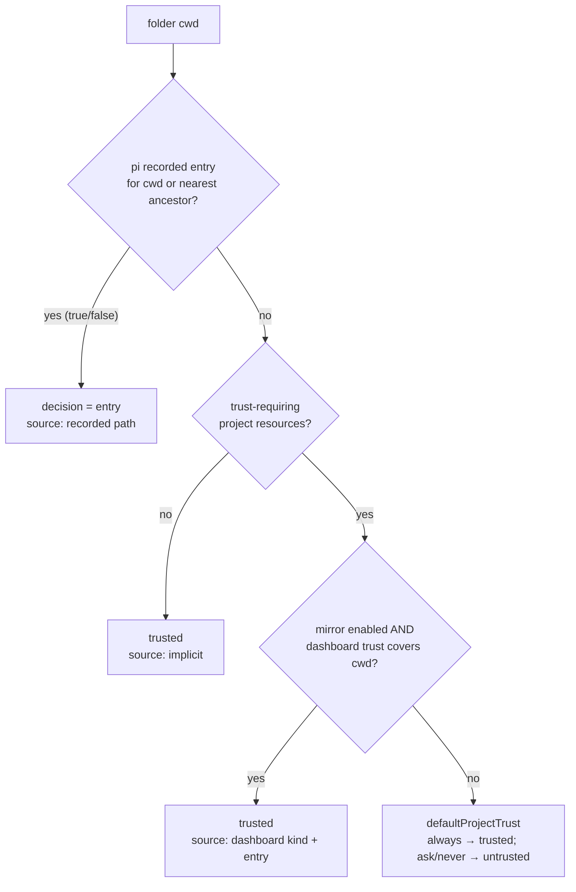

## Context

- Governed pins today (all `1.3.0`):
  - `packages/server/package.json:19-20` (`piCompatibility`) and `:78` (`^1.3.0`);
  - root `package.json:141` (pi-ai devDependency) and `:159-161` (peers);
  - `pnpm-workspace.yaml:63-65` (overrides) and `:122-130` (`minimumReleaseAgeExclude`);
  - `docker/Dockerfile:116`, and `.github/workflows/ci-e2e-browser.yml:504,563` (`npm i -g …@1.3.0`). These are held equal to the Dockerfile pin by `packages/shared/src/__tests__/e2e-browser-workflow-contract.test.ts` (E3);
  - `scripts/verify-release-deps.mjs:93-97` (`minVersion` and its note);
  - peers and devDependencies in the `packages/*/package.json` files: `extension`, `kb-extension`, `mockup-loop`, `deck3d`, `context-budget`, `image-fit-extension`, `video-production`, `video-transcription`, `nano-banana`, `path-containment-guard`, `untrusted-content-guard`.

  The `rg '\b1\.3\.0\b'` sweep is authoritative; the hits `bonjour-service ^1.3.0` (`packages/server/package.json:93`, `packages/shared/package.json:37`) are not pi. Pin-encoding fixtures:
  - `packages/server/src/__tests__/pi-version-skew.test.ts`;
  - `packages/server/src/__tests__/pi-version-update-handling.test.ts:95-127` (X3);
  - `packages/shared/src/__tests__/bundled-node-meets-pi-floor.test.ts:61-63`;
  - `scripts/__tests__/verify-release-deps-pi-coherence.test.mjs`;
  - `tests/e2e/pi-1-3-floor-smoke.spec.ts:18` (`FLOOR`);
  - `qa/tests/01-install.sh:35` (`PI_FLOOR`).
- pi 1.3.0 → 1.5.0 manifest (`npm pack`, recorded in `evidence.md`):
  - siblings move to exact `1.5.0`;
  - pi-ai and pi-agent-core replace `typebox` with `@earendil-works/pi-schema` `1.5.0`;
  - pi-tui adds `marked-cjk-friendly`;
  - pi-coding-agent keeps `typebox` `1.3.27` and moves `minimatch` `10.2.6` → `11.0.3` (the repo's `packages/shared/package.json:38` and `packages/extension/package.json:56` declare `^10.0.0`);
  - exports maps and engines (`>=22.19.0`) are unchanged.
- `PLUGIN_HOST_API_VERSION = "1.3.0"` (`packages/shared/src/dashboard-plugin/host-api.ts`) is the plugin host API version, not a pi pin.
- Trust (the shared decision and its consumers):
  - `decidePiTrust` (`packages/shared/src/pi-trust-mirror.ts:259-276`): implicit (`:260`) → recorded (`:261-263`) → dashboard (`:264-274`) → default (`:275`);
  - host predicate (`packages/server/src/pi/host-project-trust.ts:63-80`): the recorded read is gated on resources (`:68`), and `piDefault` is forced to `"ask"` on the no-resources path (`:75`). The loader reads through pi's `ProjectTrustStore.getEntry` (`:158-166`);
  - toggle gate (`packages/server/src/pi/resource-toggle-trust.ts:120-187`): recorded first for every folder (`:126-139`). It decides "recorded for this folder itself" with `canonical(entry.path) === canonical(cwd)` (`:131`; `canonical` at `:38-44` is `realpathSync(path.resolve(p))`, with no case-folding). pi 1.5 `getEntry` returns the stored key spelling (`trust-manager.js:28-31`); 1.3.0 returned the walked folder. So on Windows an own-folder refusal saved with different casing now reads as inherited, and the prompt lets the user override a refusal that is final.
  - The bridge decides only inside pi's `project_trust` event (`packages/extension/src/bridge-handlers/lifecycle.ts:201`), which pi emits only for folders with trust-requiring resources (`project-trust.js:22-26`). For those folders pi 1.5 applies the extension answer BEFORE the recorded entry (`project-trust.js:25-41`), so the bridge itself withholds its yes when pi has a recorded entry: `piStoreBlocks` (`packages/extension/src/project-trust.ts:152-157`) → `nearestRecordedEntry` (`packages/shared/src/pi-trust-mirror-snapshot.ts:104-112`), which matches `data[k]` exactly for each ancestor key;
  - pi 1.5 matches trust-file keys with `pathsEqual` (`trust-manager.js:22-35`; `utils/paths.js` `getPathComparisonKey`: `win32.resolve` + lower-case on win32, `posix.resolve` elsewhere). The server's loader goes through pi's `ProjectTrustStore.getEntry` (`host-project-trust.ts:158-166` → `trust-manager.js:185` → `findNearestTrustEntry`), so it already matches like pi. The legacy adapter's `recordedEntry` (`host-project-trust.ts:101`) wraps a caller-supplied `recordedDecision` and has no production caller.
  - `ancestorKeys` (`packages/shared/src/pi-trust-mirror.ts:65-73`) walks with the native `path.dirname`, so on macOS/Linux it cannot step from `C:\Work\Repo` to `C:\Work`; stubbing `process.platform` does not make a win32 test work.
  - The remote-trust digest skips the user's own skills with `skills !== userSkills` (`packages/shared/src/pi-trust-resource-digest.ts:215`); pi 1.5 uses `pathsEqual` (`trust-manager.js:167`; 1.3.0 and 1.4.0 used `!==`).
- Tool validation:
  - pi-ai 1.5.0 `dist/utils/validation.js` (pi-schema, `coerce: true`);
  - the repo test still on TypeBox: `packages/extension/src/__tests__/typebox-nullable-array-validation.test.ts`;
  - the ctx error parser: `packages/client/src/components/tool-renderers/parse-ctx-result.ts:86`;
  - the fixture: `parse-ctx-result.fixtures.ts:16`;
  - assertions: `__tests__/parse-ctx-result.test.ts:107` and `__tests__/CtxToolRenderer.test.tsx:213`;
  - the memory-eval classifier: `packages/memory-eval/src/signature.ts:22-25,47`.
- Settings:
  - int defs: `packages/shared/src/pi-settings-schema.ts:76-83` (`intKey`) and `:202-203` (the timeout keys);
  - `checkInt` at `:243-249`;
  - the `compaction.reserveTokens` hint at `:136`;
  - typed validation: `packages/server/src/pi-agent-settings.ts:96-98`;
  - raw checks: `RAW_LEGACY_TYPED` (`:268-279`, timeout keys absent);
  - form: `packages/client/src/components/settings/pi-settings-form.ts:45-72` (`toFormString`, `toForm`, `parseField`) and `PiSettingsRows.tsx:216-231` (number input).
- Shell replica:
  - `packages/shared/src/platform/resolve-pi-shell.ts:6` (header), `:38-42` (`isWslLauncherBash`), `:56-75` (`resolvePiShell`, `existsSync` default at `:57`);
  - callers: `packages/shared/src/platform/git-source.ts:195` and `packages/electron/scripts/assert-bundled-bash-resolvable.mjs:130`;
  - tests: `packages/shared/src/__tests__/resolve-pi-shell.test.ts:59-65`.
- MCP reader:
  - `packages/mcp-core/src/layers.ts:47-61` (`readLayer`; `JSON.parse(raw)` at `:52`);
  - callers: `effective-view.ts:139,168` and `config-writer.ts:221,235,424,503,602,609`;
  - the Radius offer reports the same layer error (`packages/server/src/auth/radius-mcp.ts:108`).

## Goals / Non-Goals

**Goals:**
- the lockstep pin and floor at 1.5.0;
- the dashboard's trust decision equal to pi 1.5's for every folder;
- tests that exercise pi's real validator;
- the typed settings form accepting what pi 1.5 documents;
- the shell replica faithful to 1.5;
- `mcp.json` reads matching pi;
- an honest audit record.

**Non-Goals:**
- a typed `selfUpdateCommand` row;
- deriving `pi-settings-schema.ts` from pi's JSON Schema;
- surfacing `cost.totalFromProvider` or `responseModel`;
- refreshing the `pi 1.1.0` anchors in `packages/mcp-core/src/pi-rules.ts` comments (rules unchanged apart from the no-op `clientRegistration`);
- editing in-flight changes that cite 1.3.0;
- MODIFYING live requirements whose `1.3.0` or older text is a historical anchor (for example `pi-api-feature-detection`'s 1.2.0–1.3.0 audit).

## Decisions

**D1: Floor = pin = 1.5.0 (lockstep).** The fixtures move first. `minimumReleaseAgeExclude` is regenerated from the lockfile, so `@earendil-works/pi-schema@1.5.0` joins and every `@1.3.0` entry moves. The overrides still govern `pi-ai` and `pi-tui` for the dashboard's direct imports and keep one hoisted copy for the `/api/health` probe. The extension `typebox` devDependency stays, but its rationale changes. It no longer mirrors pi's tool-argument validator; it mirrors the TypeBox that pi's extension loader aliases for `import "typebox"` (`loader.js:42-44,81-82`), still `1.3.27`. The `pi-core-version-check` text says so.

**D2: Trust decision order = pi 1.5.** New order, for every consumer of `decidePiTrust`:

- `decidePiTrust`: move the `recordedEntry` branch above the `hasTrustRequiringResources` check.
- `createHostProjectTrustService`: always call `deps.recordedEntry(cwd)`. Keep the fail-closed `try` (`:64,77-79`), because an unreadable store must still produce "untrusted, source unknown". Read `defaultProjectTrust` only when it can decide, which means trust-requiring resources and no recorded entry. This keeps pi 1.5's property that the no-resources path consults neither extensions nor the default.
- The test at `pi-trust-mirror.test.ts:165-167` flips to `{ trusted: false, source: { kind: "recorded", path: "/r" } }`. A new case (no resources, nothing recorded → implicit) keeps the implicit branch covered.
- `resource-toggle-trust.ts` needs no change for the order (see Context); its own-folder check changes (below).
- The bridge's `project_trust` path is unaffected by the order change, because pi never emits the event for a no-resources folder.
- Shared helper `packages/shared/src/pi-path-compare.ts`: `nativePathApi()` returns `path.win32` on win32 and `path.posix` elsewhere, read at call time; `piPathComparisonKey(p, pathApi = nativePathApi())` is `pathApi.resolve(p)`, lower-cased when `pathApi === path.win32`; `piPathsEqual(a, b, pathApi)` compares the two keys. This mirrors pi's `getPathComparisonKey` / `pathsEqual` (`utils/paths.js:31-35,41-43`). The explicit `pathApi` is what makes the win32 branch testable on macOS/Linux (see Context: `ancestorKeys`).
- Bridge key match (every platform): `ancestorKeys(key, pathApi = native)` walks with `pathApi.dirname`; existing callers keep the default. `nearestRecordedEntry(data, cwdKey, pathApi = nativePathApi())` walks `ancestorKeys(cwdKey, pathApi)` and, for each ancestor, returns the first trust-file key (in object order) with a boolean value that `piPathsEqual` matches, as pi's `findTrustFileKeys` / `findNearestTrustEntry` do. A Windows refusal saved as `C:\Work\Repo` is then found for the key `c:\work\repo`, and on posix a key saved as `/r/`, `/a//r` or `/a/./r` is found for `/r` or `/a/r`. Without it the bridge misses the refusal, and its yes overrides pi's. Tests pass `path.win32` explicitly: `({ "C:\\Work": false }, "c:\\work\\repo")`, a case-different drive-letter ancestor, returns `{ path: "C:\\Work", decision: false }`. Posix: `{ "/r/": false }` is found for `/r`, and `/R` does not match `/r`.
- Toggle gate own-folder check: `resolveToggleTrust` (optional trailing `pathApi`, default native) decides "recorded for this folder itself" with `piPathsEqual(canonical(entry.path, pathApi), canonical(cwd, pathApi), pathApi)`; `canonical` resolves with `pathApi.resolve` before `realpathSync` and falls back to the resolved path. Test: `pathApi = path.win32`, `getEntry` mocked to `{ path: "C:\\Work\\Repo", decision: false }`, cwd `c:\work\repo` → `refused`. Without it, a case-different own refusal reads as inherited and prompts, and approving the prompt overrides a refusal pi treats as final for that folder.
- Digest user-skills exclusion: `collectAgentSkills` (`pi-trust-resource-digest.ts:215`) skips the user's own `~/.agents/skills` when `piPathsEqual(skills, userSkills)`, as pi does, instead of `!==`. Server and bridge compute the digest with the same code, so equal trees still produce equal digests. `trustResourceManifest` gains an optional `pathApi` in `opts` (default native), passed to `collectAgentSkills` next to the user-skills path for `join`/`dirname`/`piPathsEqual`, so the drive-letter casing case is tested with `path.win32` on the ubuntu CI (test-plan decision G1).

Security note: the order change only ever turns "trusted (implicit)" into "untrusted (recorded refusal)" or "trusted (recorded)", and the `pathsEqual` changes only add refusals that must be respected: the bridge now finds a case-different or non-normalised refusal, and the toggle gate refuses (instead of prompting) for a Windows own-folder refusal saved with different casing. The digest change only drops the user's own skills directory, which pi does not treat as a project resource, from the hashed set. None of these can widen trust. The effect of the order change is on `host.isProjectTrusted` / `host.projectTrustSource` (`server.ts:1757-1758`) for a folder the user refused in pi that has no trust-requiring resources (for example an `AGENTS.md`-only folder): it now reads untrusted with source `recorded <path>`, as pi does. The MCP project layer never takes this branch, because `.pi/mcp.json` is itself a trust-requiring resource (`trust-manager.js:8-17`). Considered alternative: keep the 1.3 order and document the drift. Rejected, because the host predicate would then report "trusted (implicit)" to plugins for a folder pi treats as refused.

**D3: Validator semantics + test replacement.**
- `typebox-nullable-array-validation.test.ts` is replaced by a test (same directory) that imports `validateToolArguments` from `@earendil-works/pi-ai`. That is the function pi's agent loop uses: pi-ai `dist/index.d.ts:34` re-exports `./utils/validation.ts`. The test feeds it a tool with the `ask_user` optional-array shape and asserts:
  - omitted → accepted;
  - `null` → accepted with `options` dropped;
  - `"a"` → `["a"]`;
  - `["a", 1]` → `["a", "1"]`;
  - `{}` → throws with `Validation failed for tool "ask_user":` and a `- method: missing` line.
- The schema is built with `typebox` `Type`, as `ask-user-tool.ts:13` builds it, so the test also proves pi-schema accepts a TypeBox-built JSON Schema. Its header cites this change and the old one.
- `parse-ctx-result.fixtures.ts` `err_validation` is re-captured in pi-schema wording: `- code: missing`, `- language: expected one of [...]` (evidence.md). The `message` assertions at `parse-ctx-result.test.ts:107`, `CtxToolRenderer.test.tsx:213` and the comment at `:285-286` follow. The parser regex is unchanged.
- `memory-eval` `signature.ts`: verified no-op (the header line is the error line, and `validation failed` matches `GENERIC`). Nothing is added.
- Tool schemas use only JSON-Schema builders, audited with 0 hits for non-JSON builders.

**D4: `"disabled"` timeout literal + form display.**
- `PiSettingDef` gains `disabledLiteral?: true`, set on `httpIdleTimeoutMs` and `websocketConnectTimeoutMs` through `intKey`'s `extra` (default `{ min: 0 }` merged). With the flag, `checkInt` accepts exactly the string `"disabled"`, the canonical spelling the dashboard writes. pi's runtime parser (`parseHttpIdleTimeoutMs`, `http-dispatcher.js:15-29`, identical in 1.3.0 and 1.5.0) is lenient (trimmed, case-insensitive) and has accepted the literal since 1.3.0 or earlier; 1.5.0 only documents it. The error text for those keys becomes `must be a non-negative integer or "disabled"`. No other int key changes.
- In the form, `toForm` maps a stored string on a flagged def that pi parses as disabled (`s.trim().toLowerCase() === "disabled"`) to `"0"`. Any other stored string (e.g. `"soon"`) reaches the `<input type="number">` via `toFormString`, which browsers and jsdom sanitise to an empty value: the row shows an empty input with the Changed marker and no extra text, and no new UI is added (test-plan decision G2); like every unchanged row it stays outside `buildFormPatch`'s diff and does not block saving other rows. Both disable the timeout, and pi treats them identically (`http-dispatcher.js:18-19`). Because the baseline form is built with the same `toForm`, an unchanged row is not in `buildFormPatch`'s diff, and the stored `"disabled"` survives. If the user edits the row, the number they enter is written. This avoids a blank number input whose placeholder suggests pi's default. A number input can't hold text, so the form never writes `"disabled"` itself. The literal arrives through the typed PATCH API or raw mode.
- The raw-mode validator needs no change: `RAW_LEGACY_TYPED` excludes both keys (`pi-agent-settings.ts:268-279`).
- The hint at `pi-settings-schema.ts:136` becomes "Free context tokens below which automatic compaction starts". The `collapseChangelog` hint (`:213`) becomes "Show a condensed changelog after an update; also condenses extension package changelogs". The other 1.5 docs changes keep their hints: `terminal.clearOnShrink` (`:162`; the new `PI_CLEAR_ON_SHRINK` fallback is TUI-only), and `httpIdleTimeoutMs` / `websocketConnectTimeoutMs` (`:202-203`; "0 disables" stays true, and the form writes only numbers).
- `extensionChangelogVersions` (pi-written record, global settings; `settings-schema.js:142`, `settings-manager.js:524-527`) joins `DASHBOARD_MANAGED_KEYS` (`pi-settings-form.ts:171`), the collapsed read-only list on the page (`PiSettingsPage.tsx:801-812`), next to `lastChangelogVersion`.
- `selfUpdateCommand` in the file: Form mode renders only the table rows, so the key gets no row, link or managed-list entry. It is visible and editable only in JSON mode (the raw editor shows the whole file). A typed PATCH naming it fails in `checkLeaf` with `400` `selfUpdateCommand is not a form field; use the JSON editor for this key` (`pi-agent-settings.ts:90,95-97`).

**D5: Shell replica follows pi's `isLegacyWslBashPath` and `shellPathExists` (shipped in 1.4.0, unchanged in 1.5.0).**
- `isWslLauncherBash(p, env = {})`: read `SystemRoot` case-insensitively with the existing `envGet`.
  - If it is set and not drive-absolute (`/^[a-z]:[\\/]/i`), return false.
  - If it is set, compare `path.win32.normalize(p).toLowerCase()` with `path.win32.join(SystemRoot, "System32" | "Sysnative", "bash.exe").toLowerCase()`.
  - Otherwise apply the existing regex.
- `resolvePiShell` passes `opts.env`, because the spawn env is what pi's process sees. The default `exists` becomes an `accessSync(F_OK)` try/catch, like pi's `shellPathExists`. Without it, a Store-alias `bash.exe` on PATH, which pi accepts, would be skipped by the replica.
- The header is updated to 1.5.0.
- The build gate (`assert-bundled-bash-resolvable.mjs:130`) compares only `.path`, so it is unaffected. Resolution order is unchanged.

**D6: `readLayer` strips a leading BOM.**
- `const text = raw.charCodeAt(0) === 0xfeff ? raw.slice(1) : raw;` before `JSON.parse`, mirroring pi's `stripBom`. Only one leading U+FEFF is removed, and the file bytes are not touched on read.
- Writes keep their behaviour: a later write through `config-writer` serializes the parsed object without a BOM, as pi's `editMcpServers` does.
- The `layers.ts` header comment ("parsed with strict `JSON.parse`") gains "after a leading BOM is removed".
- The same one-character strip goes inline into the two plugin registrars that read `mcp.json` directly: `packages/blender/src/mcp-register.ts:75` and `packages/craft-apps/src/mcp-register.ts:82`. Neither imports `mcp-core`, and shared's `stripBom` (`pi-agent-settings-lock.ts:98`) is module-private, so no shared helper. Their write-back serializes without a BOM, as pi's `editMcpServers` does.

**D7: Non-adoptions.**
- `selfUpdateCommand` stays reachable only through the raw JSON editor. Its value is an argv array (`string[]` with `{packageName}`, `{version}` and `{installSpec}` placeholders; `settings-schema.js:187-189`), it is read from agent-directory settings only, and `PI_SELF_UPDATE_COMMAND` takes precedence (`config.js:268-272`). The typed editor has no argv-array control; the precedent `npmCommand`, also a `string[]`, is likewise JSON-only. This is not a security boundary: the typed form already writes `shellPath` and `shellCommandPrefix`, and raw mode writes any key. The dashboard's own pi-core updater does not run `pi update` (`pi-core-updater.ts:4-5`), so a typed row would add little.
- `cost.totalFromProvider` and `responseModel` have no consumer.
- `pi.exec({ maxBuffer })`: the one bridge caller (`command-handler.ts:1578`, `!`/`!!`/slash-exec) keeps pi's default cap. `truncated` / `killed` are not surfaced separately; with D9 an over-cap run already reports pi's nonzero `code`.
- `ctx.ui.custom({ blocked })`: 0 calls.
- `keyText`/`keyHint`: the dashboard renders no pi keybindings.
- `MarkdownTransformContext`: the dashboard doesn't render through pi's markdown transform.
- MCP `clientRegistration: "auto"`: the mirror doesn't validate the field.
- TypeBox re-export removal: 0 affected imports. The guard is the existing practice: extensions import `typebox`.
- OAuth `device_code` `openBrowserOnConfirm` / `copyCodeOnConfirm` (pi-ai `auth/types.d.ts:144-147`; "clients may ignore it"): the dashboard's mirror type (`packages/server/src/auth/pi-oauth-types.ts:53-59`) omits them, and `applyDeviceCode` (`provider-auth-adapter.ts:221-228`) copies only `userCode`, `verificationUri`, `intervalSeconds` and `expiresInSeconds`. The extra optional fields are ignored at runtime and are structurally compatible at compile time.

**D8: `minimatch` `^11.0.3` in lockstep with pi.**
- `packages/shared/src/enabled-models-match.ts` mirrors pi's `resolveModelScope`, which matches with minimatch 11.0.3 (`model-resolver.js:268-269`). The repo pins `^10.0.0` in `packages/shared/package.json:38` and `packages/extension/package.json:56`; both move to `^11.0.3`, so the dashboard's in-scope count and the bridge's `models_list` filter run the same matcher as pi.
- minimatch 11 changes: a `Matcher` replaces the `RegExp`; `makeRe`, the AST and `debug` are removed; an empty-portion rule and multi-`**` fixes; engines `node 18 || 20 || >=22`. The repo uses only `minimatch(target, pattern, { nocase: true })` through a namespace import (`enabled-models-match.ts:12-21`), and 11.0.3 still exports the named `minimatch` (checked on pi's installed copy).
- Parity: the existing `enabledModels` matcher tests (`packages/extension/src/__tests__/filter-enabled-models.test.ts` and the `enabledModels` scope-editor cases in `packages/client/src/components/__tests__/PiSettingsPage.test.tsx`) stay green on 11.

**D9: `!`/slash-exec reads `ExecResult.code` (pre-existing defect).**
- pi's `ExecResult` is `{ stdout, stderr, code, killed, truncated }` in 1.3.0 and 1.5.0 (`dist/core/exec.d.ts:23-31`); there is no `exitCode`.
- `handleBashCommand` sets `exitCode = result.code ?? 0` instead of `result.exitCode ?? 0` (`command-handler.ts:1580`). The `catch` branch keeps `exitCode = 1`. The `bash_output` payload field stays `exitCode`, so server and client are unchanged.
- `pi-env.d.ts:33` types `exec` as `Promise<{ stdout: string; stderr: string; code: number; killed: boolean; truncated: boolean }>`. The `command-handler.test.ts` mocks (`:629,651,674,690,711,728,1065,1353,1439`) move from `exitCode` to `code`.
- Over pi 1.5's output cap, pi terminates the command and returns `truncated: true` with a nonzero `code`; the bridge now forwards that run as failed instead of as a truncated success.
- A run pi kills on `BASH_TIMEOUT` (`killed: true, truncated: false`) forwards pi's `code` verbatim (e.g. `143`, or `0` if pi reports `0`); the bridge derives nothing from `killed` (test-plan decision G6).

## Risks / Trade-offs

- **[A folder previously shown trusted now shows untrusted]** → This is intended, and it equals pi's own behaviour. The MCP page shows the source `recorded <path>`, so the user can see why.
- **[A recorded `true` on an ancestor now decides a resource-less child]** → The outcome is the same (trusted); only the reported source changes from `implicit` to `recorded <ancestor>`. Accepted.
- **[Store unreadable on the no-resources path]** → Before, the store was never read there, so the folder was implicitly trusted. Now the `try` maps the read failure to "untrusted, source unknown" (`host-project-trust.ts:77-79`). pi itself would throw at the same read. Accepted: fail-closed is the existing contract.
- **[`pathsEqual` resolves trust-file keys]** → A hand-edited relative key in `trust.json` resolves against the reading process's cwd, as it does in pi (`utils/paths.js:31-35`). Accepted: the behaviour equals pi's, and pi writes absolute keys.
- **[Validator coercion hides model mistakes]** → `null` and single values are now accepted by pi. Dashboard tools (`ask_user`) already tolerate absent optionals. Nothing in the repo depended on rejection, apart from the replaced test.
- **[Re-captured fixture drifts from pi wording again]** → The fixture text is pi-generated and the parser keys only on the stable prefix. The renderer tests assert one message fragment, which a future pi wording change updates in one place.
- **[`"disabled"` shown as `0`]** → This loses the literal's spelling in the UI, though not in the file unless the row is edited. Accepted: the two values are equivalent to pi.
- **[The floor raise strands users on pi < 1.5.0]** → Handled as in every lockstep bump: the existing red advisory plus the `CHANGELOG.md` note.
- **[Host predicate now takes pi's trust lock for every folder]** → `ProjectTrustStore.getEntry` runs inside `withTrustFileLock` (`trust-manager.js:185`, `:141`), also for reads. `acquireTrustLockSync` (`:112-139`) retries up to 10 times with a synchronous 20 ms busy-wait, so a held lock can block the server event loop for up to about 180 ms per call, and `decide` runs once each for `isProjectTrusted` and `projectTrustSource`. Before, folders without trust-requiring resources skipped the read. Now a lock still held after the retries maps such a folder (previously always "trusted, implicit") to "untrusted, source unknown". Accepted: pi itself takes the same lock at the same read, the lock is held only for pi's short trust writes, and failing closed is the existing contract. Bound (test-plan decision G5): with the lock held, a server-side decision for a no-resources folder returns `{ trusted: false, source: undefined }` within 250 ms; no uncontended latency budget is set. If this shows up in latency, the mitigation is a lockless read with pi's reading rules, like the bridge's `readPiTrustFileLockless`, matched with `pathsEqual`.
- **[minimatch 11 changes a match the dashboard relied on]** → Low: pi already matches with 11.0.3, so a divergence would be the replica drifting from pi, which the bump removes. The existing matcher tests guard the common patterns.
- **[In-flight changes cite 1.3.0]** → They must rebase onto the 1.5.0 floor. Noted in the proposal, not edited here.

## Migration Plan

Land as one commit: fixtures, then pins, `pnpm install`, code, tests and docs. Nothing persisted is migrated: `trust.json`, `settings.json` and `mcp.json` formats are unchanged, and reads are only more lenient (BOM) or more faithful (trust). Rollback: revert the commit and run `pnpm install`. A `settings.json` holding `"disabled"` stays valid for pi after a rollback; only the old typed form would refuse to re-save that row.

## Open Questions

None. The scope (trust alignment adopted, `selfUpdateCommand` JSON-only) follows the plan-proposal brief; the Windows trust-key match, `extensionChangelogVersions` and the minimatch lockstep were added by doubt-review cycle 1; the shared `pathsEqual` helper with its posix, toggle-gate and digest users by cycle 2; the `pi.exec` exit-status fix and the plugin-registrar BOM strips by cycle 3.
