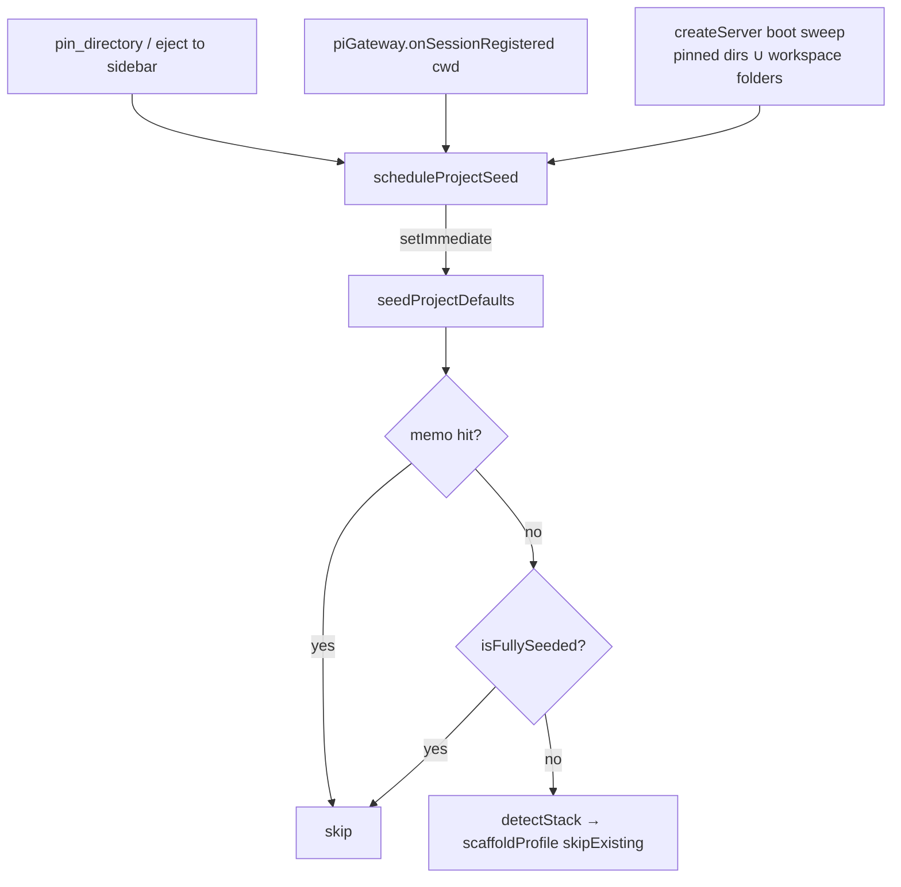

# Design — auto-seed-project-defaults

## Decision 1 — Trigger on registration, never on the probe

The init-status probe (`GET /api/git/worktree/init-status`) is the one code path
that already runs for **every** folder row, which makes it the tempting hook.
Rejected: it is a `GET`, it runs on every render of every row, and a seeding
side-effect there would write to disk as a function of scroll position.

Chosen: the three points where a directory *becomes known*.



The boot sweep exists because the first two only cover folders learned *after*
this change ships; without it, an existing install would never seed the folders
already in its preferences.

## Decision 2 — `setImmediate`, not inline

`resolveConfigRoot` → `checkoutRoots` spawns git **synchronously**. Inline
seeding would put that spawn on the pin handler and on bridge registration, and
the boot sweep would pay it N times in a row before the server listens.
`scheduleProjectSeed` defers each directory onto its own tick; the per-root memo
plus the `isFullySeeded` short-circuit mean steady state costs a handful of
`existsSync` calls and no spawn at all.

## Decision 3 — Gap-fill is a scaffold concern, not a seed concern

`scaffoldProfile` was all-or-nothing: `overwrite: false` throws if **any**
target exists, `overwrite: true` clobbers **all** of them. Neither is usable for
a half-configured project (the common case — an `AGENTS.md` but no
`knowledge_base.json`).

Rejected: re-implementing per-artifact writes inside `project-seed.ts`. That
would duplicate template rendering, JSON validation, and the DOX branch, and
the two copies would drift.

Chosen: a third mode, `skipExisting`, in the scaffold itself. One
`shouldWrite(target)` guard gates every write and records the untouched path in
`ScaffoldResult.skipped`. The interactive skill's behaviour is untouched.

**Sub-decision — the doctrine block.** `seedDoctrine` is an append-only,
marker-gated mutation, so running it on a pre-existing `AGENTS.md` would be
idempotent and arguably desirable. Rejected anyway: "never modifies a file you
wrote" is a much easier guarantee to reason about for an unattended writer, and
the DOX doctrine reaches the project through `.pi/dashboard/knowledge_base.json`
(`doctrine: { inject: "kb", write: true }`) regardless. So the block is appended
only to an `AGENTS.md` this call created.

## Decision 4 — The no-stack hook must be inert, not absent

The `coding` profile's `settings.json.tmpl` always carries a `worktreeInit`
hook. With no stack detected, `{{INIT_GATE}}` / `{{INIT_COMMAND}}` would render
literally and persist a gate of `"{{INIT_GATE}}"` — a hook that `normalizeHook`
accepts (non-empty string) and that bash would fail on confusingly.

Options weighed:

| Option | Verdict |
|---|---|
| Write `{}` instead of the template | Needs a second write path that bypasses the profile; diverges from "scaffold the profile" |
| Leave the placeholders | Persists a nonsense gate — rejected |
| Render an inert hook | Chosen |

`gate: "false"` never exits 0, so `evaluateGate` reports `needsInit: false` and
the command is never reached. The AGENTS.md command placeholders become
`# TODO: …` comments, which is valid inside the template's fenced bash block and
reads as an invitation to fill in.

## Decision 5 — Config root, not the passed directory

Seeding is keyed by `resolveConfigRoot(dir) ?? dir`, matching the checklist's
own resolution:

- git repo / worktree → the main checkout, so seeding a worktree configures the
  repo once rather than once per worktree;
- non-git directory → itself.

The memo is keyed on the same resolved, `path.resolve`'d root, which is what
makes "pin three worktrees of one repo" a single seed.

## Decision 6 — Module-level enable flag

`configureProjectSeed(enabled)` sets a module-level boolean from
`DashboardConfig.autoSeedProjects` at boot. Rejected alternative: threading the
config through `BrowserHandlerContext` (which carries no `DashboardConfig`
today) and through `wireEvents` — that is a far larger diff than this feature
warrants, for a value that is boot-frozen anyway. `resetSeededRoots()` clears
both the memo and the flag as the test seam.

## Decision 7 — `exports` map on the extension package

The server already declares `@blackbelt-technology/pi-dashboard-extension` as a
dependency, but the package had no `exports` and no `main`, so no subpath was
importable. Adding

```json
"exports": {
  "./package.json": "./package.json",
  "./*.js": "./src/*.ts",
  "./*": "./src/*"
}
```

mirrors `pi-dashboard-shared` exactly. `./package.json` is listed explicitly
because `findBundledExtension` in `packages/shared/src/bridge-register.ts`
resolves the package *by its manifest* (`req.resolve(".../package.json")`), and
an `exports` map without that entry would break bundled installs. Every other
consumer of the extension's files (`.pi/skills/`, `agents/`) reaches them by
filesystem path under the resolved package directory, not by specifier, so the
map affects nothing else.
