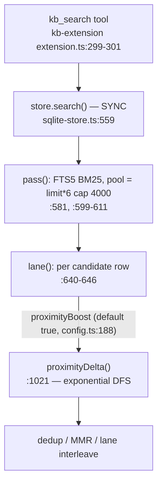
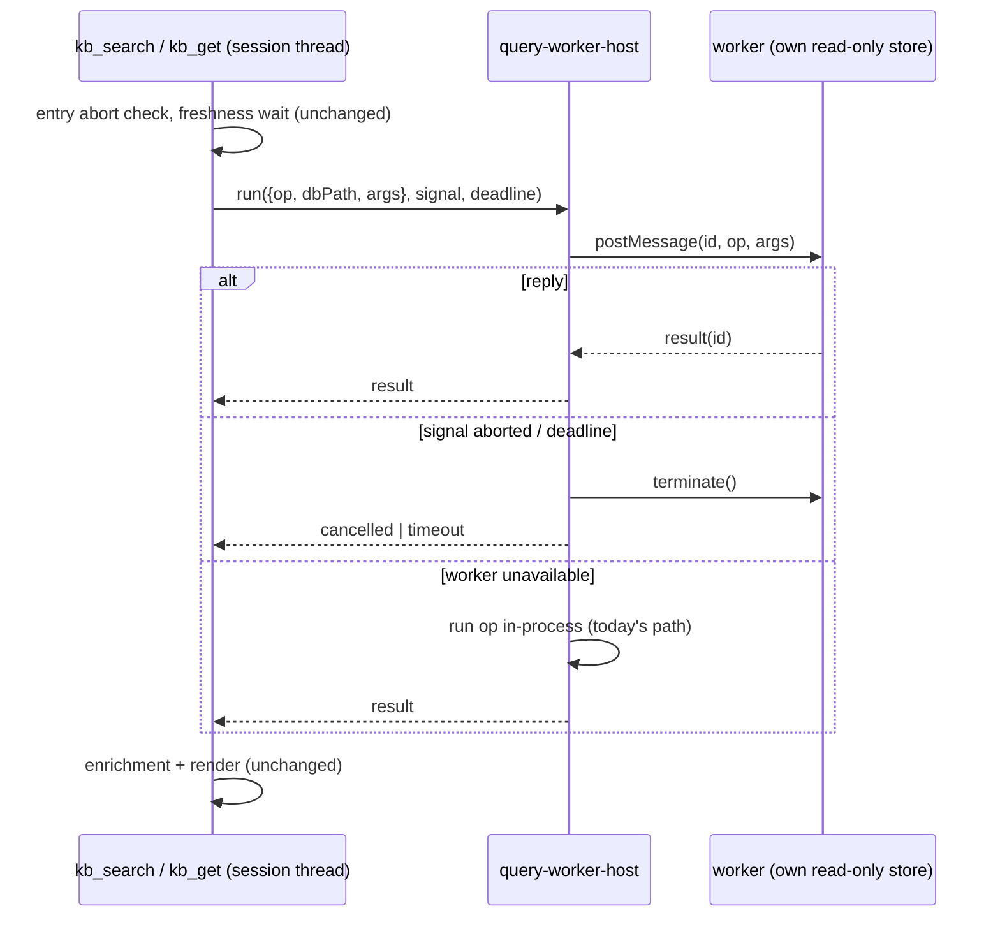

# Design — bound-kb-proximity-search

## Context

`proximityDelta(queryTerms, body)` (`packages/kb/src/sqlite-store.ts:1021`) rewards a hit whose query terms occur in query order close together. It builds `pos[token] → positions` (`:1023-1025`) and searches for the smallest span by recursive `walk(idx, start, span)` (`:1029-1038`): for term `idx` it iterates every position `p ≥ start` and recurses, adding `p − start` to the span. Nothing prunes on `span >= best`; the sole early exit `best === 1` (`:1036`) is unreachable for most chains. Cost is the product of per-term occurrence counts.

Call path:

Because `search()` is synchronous, the `AbortSignal`, the freshness budget (`bound-kb-search-freshness`, archived) and the bridge heartbeat timer all sit behind it on the same thread. #895's fix bounded the stage *before* this call; this stage was never bounded.

The same holds for `kb_get`: `buildFetchRoots(store.listRoots(), …)` + `resolveFetch()` + `renderFetch()` run synchronously (`packages/kb-extension/src/extension.ts:396-397`). Every store lookup it makes filters the FTS5 `chunks` virtual table on unindexed `root`/`path` columns (`packages/kb/src/sqlite-store.ts:799-829`), i.e. a full scan — ~2.2 s cold per scan on a 357 MB consumer index, several scans per call (`packages/kb/src/fetch-resolve.ts:37-57`). The tools' abort checks sit only between stages (`extension.ts:293,304,317` for search; `:389,398` for get), so a signal raised *during* retrieval is observed only after it ends. Field report 2026-11-19: Stop had no effect on a frozen `kb_search`; the process had to be killed.

Call path after this change (docs scope):

### Measured (task 1.1 re-records these on the implementation branch)

Scratch reproduction at HEAD, one macOS host; the DFS copy has a 2e7-call budget so the harness cannot hang. Query terms `alpha…`, each repeated `r` times interleaved in the body.

| terms k | repeats r | DFS | greedy |
|---|---|---|---|
| 5 | 50 | 3.48 M calls, 33 ms | 0.22 ms |
| 6 | 50 | budget exhausted, 192 ms | 0.15 ms |
| 8 | 100 | budget exhausted, 160 ms | 0.20 ms |

Differential: 20 000 random (query, body) pairs, duplicates in the query allowed, DFS vs greedy — 0 mismatches. `rawTokens` on an 827 KB body: 2.7 ms (so tokenising is not the cost; the issue's 10 ms/450 KB estimate is the same order).

**Implementation branch (tasks 1.1 / 8.1, macOS, Node 26.9):**

- DFS baseline (call budget 2e7): k=5×50 3.48 M calls / 47 ms; k=6×50, k=8×100, k=10×100 budget exhausted at 240–270 ms.
- Greedy (`proximity-perf-child.mts`, median of 5): k=10×100 0.24 ms, k=6×50 0.06 ms, k=8×100 0.16 ms; end-to-end `store.search` over the k=10×100 chunk + a 450 KB chunk 19.8 ms, event-loop max delay 0; 600-doc pool 14.3 ms; no budget warn.
- Fixture gate (D4): `run-fixtures.ts` before/after — all 12 variant rows identical in R@10, P@1, P@5, MRR, nDCG@10, distinctSrc, dupShare, singleSrcPage.
- Synthetic #1075 equivalent (6022 chunks; 22 single-chunk ≈400 KB AGENTS.md bodies with the field term frequencies, 7-term query): proximity over ALL chunks 107 ms (< 250 ms default — kept); search median 776 ms boosted vs 596 ms plain (the remainder is FTS5 `snippet()`/BM25 over huge chunks, outside this change); budget guard did not fire.
- `measure-search-latency.ts` (repo fixture index, 212 queries): develop 148 ms median, branch 113–118 ms — no regression.
- Finding (out of scope): FTS5 `snippet()` is quadratic in query-term hits per chunk (1000→4000 interleaved repeats: 0.5 s → 8.2 s). P2 therefore pads the 450 KB chunk with non-query prose (the field shape) instead of making every token a query term.

The issue additionally reports (not re-run here: it needs the reporter's index): real 450 KB chunk ≈3.97e18 combinations, greedy 12.6 ms for that chunk and 208 ms over all 5957 chunks of that index. Treated as indicative; task 8.1 re-measures on a synthetic equivalent.

## Goals

- `proximityDelta` cost is polynomial and small for every input; a 10-term query over a body where every term repeats ≥100× completes in milliseconds.
- Scores and ordering unchanged wherever the DFS ever terminated (ranking-regression gate = identical metrics on the bundled fixtures).
- A structural wall-time bound on the proximity stage so `search()` cannot be frozen by it regardless of future input shapes.
- Stop works: an aborted `kb_search` / `kb_get` returns the cancelled result within ~100 ms of the abort regardless of what the retrieval stage is doing, and the session thread (heartbeat, other tools, UI events) is never blocked by it.
- With the off-thread path available, no call can hang a session: a hard per-call deadline ends retrieval even with no signal (D8). Without it (runtime matrix, D7) the call behaves as today, bounded by D1/D2.

## Non-goals

- Async `store.search()` / cooperative yielding inside ranking (rejected, D6).
- `kb_neighbors` and `scope: "git"` stay in-process (see proposal Non-goals).
- Making `kb_get` lookups fast (indexing `root`/`path`) or purging orphan chunks — separate changes.
- Changing the boost formula, the proximity tokenisation, or `rawTokens`.
- Bounding other per-row body passes (see proposal Non-goals).

## Decisions

### D1 — Exact per-start greedy chain with binary search

For a non-decreasing chain `p0 ≤ p1 ≤ … ≤ pk` the DFS span is `Σ(p_i − p_{i−1}) = p_k − p_0` (`:1035`, first term contributes 0). For a fixed `p0`, picking for each next term the *smallest* admissible position (`lowerBound(list_i, cur)`, `≥` so equal positions — repeated query terms — still count, matching `if (p < start) continue`, `:1034`) minimises `p_k`. Iterate `p0` over `pos[q0]`:

- `if some list missing → 0` (same as `if (!arr) return` leaving `best = Infinity`, `:1032`).
- If a term has no position ≥ `cur`, every later `p0` fails too (`cur` is monotone in `p0`) → stop.
- If `cur − p0 ≥ best`, abandon this `p0`.
- `best === 0` (all terms identical) → stop. The DFS `best === 1` early exit is exact as well (distinct terms need span ≥ 1; identical-only terms reach 0 on the first chain), so dropping it changes nothing.

Cost `O(|pos[q0]| · k · log n)`, with `n` ≤ body tokens. The final mapping `−max(0, 2 − best/20)` (`:1040-1042`) is untouched, so boosts are identical — with one normalisation: for `best ≥ 40` today's expression yields `-0`; the new code returns `+0` (`d === 0 ? 0 : d`) so "no proximity change" is exactly `0` (score arithmetic is unaffected: `x + -0 === x + 0`).

The span search is factored into an internal `minInOrderSpan(queryTerms, body): number` (`Infinity` when a term is missing), exported for tests only, so the differential test compares RAW spans against the oracle — the clamped delta hides divergences at spans ≥ 40, exactly the large-body regime. The differential generator also covers bodies of 64–512 tokens with k = 3–8 (duplicates included).

Alternatives considered:

- *Keep the DFS, add `span >= best` pruning.* Rejected: still exponential in the worst case (interleaved terms never exceed `best` until late); trades a proof for a heuristic.
- *Memoised DP over (term, position).* Correct, `O(n·k)` memory/time, but needs a per-body table and offers no practical gain over the greedy's early exits; more code.
- *Sliding-window (min window over the merged position list).* Right for **unordered** coverage; the spec and current behaviour require **query order** ("close together and in query order", `openspec/specs/kb-fts5-search-store/spec.md` §Proximity boost), so it would silently change semantics.

### D2 — Per-search proximity time budget (decided 2026-11-03 by owner)

`search()` keeps one running total `proximitySpentMs` per call, shared by both lanes. Each `proximityDelta` call is timed with the global `performance.now()` read at call time (before/after; no module-level alias, so tests can spy on it to drive partial expiry deterministically) and its elapsed time added to the total; time spent in dedup, source-dedup, MMR or `coverageRerank` is NOT counted, so the budget measures proximity cost, not wall time of the whole lane. `lane()` checks `proximitySpentMs >= budget` before each row (`:640-646`). Default `PROXIMITY_BUDGET_MS = 250`; overridable through an optional `SearchOpts.proximityBudgetMs` used by tests (not exposed in config), coerced with the existing `num()` helper (`sqlite-store.ts:560-565`: non-finite → default, clamped to `[0, 60000]`). A budget ≤ 0 therefore skips every row deterministically (`0 >= 0`), which is what the E10 test (tasks.md, Test E10) relies on. Rows are already in BM25 order, so the best candidates are boosted first. After expiry the remaining rows are scored Δ = 0 (plain BM25), never dropped. Total proximity cost per call ≤ budget + one row.

On expiry the search emits exactly one `console.warn` line (once per `search()` call, however many rows are skipped; same convention as `config.ts:380` / `trust.ts:69`; there is no injectable kb logger in `sqlite-store.ts`), emitted only when at least one row was actually skipped while proximity was applicable (boost on, ≥2 usable terms; so `proximityBoost:false` or a 1-term query with budget 0 logs nothing), naming the budget and the count of rows scored without proximity out of the rows examined by `lane()` across both lanes, e.g. `[kb] proximity budget 250ms exhausted; 37 of 240 rows scored without proximity`. No label in the tool text and no change to `KbHit[]` / the search return contract.

Why silent-in-output + one log line: degradation only reorders low-ranked rows slightly; D1 makes expiry unreachable on measured inputs (issue #1075: zero chunks need the guard once the greedy runs, 208 ms for all 5957 chunks); a model-facing label would widen the contract across kb, kb-extension and the CLI for a case that should never fire. The log line gives field diagnosability at no contract cost.

Why 250 ms: the issue's all-chunks greedy figure (208 ms for 5957 chunks) is a ceiling no real call reaches (a default page scores ~60 rows); 250 ms is above that ceiling while staying well under the heartbeat period (15 s per the issue) and the freshness budget (1500 ms, `bound-kb-search-freshness`). It is a backstop, not a tuning knob: it does not fire on the fixtures (the identical-metrics gate, D4, proves that) or on this repo's own index (≈10 ms for a full 4000-row pool of a 7-term query, measured by the cross-model review). It CAN fire on a consumer repo whose pool holds ~20+ single-chunk bodies of ~450 KB (12.6 ms each per the issue); then the late rows lose their ≤2-point boost, recorded by the log line — the accepted trade-off below.

`proximityBudgetMs` is a store-internal guard plus test seam, not a ranking option: it is not in `searchOptsFromConfig`, so the CLI/eval and the tool both run the same store default and cannot drift (`openspec/specs/kb-retrieval-eval/spec.md` §"A ranking option cannot drift between CLI and tool" governs options obtained from config; this one has no config surface). If it ever gains one, it MUST go through `searchOptsFromConfig`. task 8.1 confirms or retunes the default after the measurements.

Honest limits: the guard checks between rows, so the bound is "stop starting new proximity computations once the budget is spent" — a single enormous row is not interruptible; D1 makes that row cost O(|q0|·k·log n) over a measured ~µs/KB tokenisation, which is bounded by body size. A degraded call returns a slightly different ordering (late rows lose their ≤2-point boost) and is load-dependent — acceptable for a backstop that the algorithm makes unreachable in practice.

Lane-lead interaction: `mainRows` are scored before `agentsRows`, so on expiry the agents lane degrades first. The lead rule (`laneLeadMargin`, `captureRawBest`, `:630-646`, `:715+`) compares each lane's raw best score including proximity, so an unboosted agents lane (Δ = 0, scores up to 2 worse) can lose a lead it would otherwise have won. Accepted as part of the same backstop degradation (recorded in Risks); not mitigated with a per-lane budget because that would double the worst-case bound for a path that should never fire.

Alternatives considered:

- *Deadline only, keep the DFS.* Rejected: bounds the freeze but returns garbage (unboosted) for exactly the long natural-language queries agents issue; the algorithm fix removes the cost.
- *Call-count budget instead of wall time.* Deterministic and testable, but D1 has no recursion to count and a count does not bound body-size cost. Rejected for the production guard; tests use the injected `proximityBudgetMs` (0 for deterministic expiry).
- *One wall-clock deadline from the first scored row.* Rejected: it would also charge dedup/MMR/`coverageRerank` and the first lane's post-processing to the proximity budget, starving the second lane for reasons unrelated to proximity.
- *Per-lane budgets.* Rejected: doubles the worst-case bound; see lane-lead note above.
- *Visible label / return-contract change.* Rejected by owner (see above).
- *No guard.* Defensible once D1 lands, but violates "treat any synchronous ranking stage as needing a hard bound" (issue §Optional hardening) at ~15 lines of cost.

### D3 — No cap on positions per term, tokens per body, or query terms

Issue floated these. Rejected: with D1 the cost is linear in `k` and log in `n`, tokenising 800 KB costs 2.7 ms, and any cap changes `best` for some chunks, breaking the identical-ranking goal for exactly the large AGENTS.md chunks users care about. Revisit only if task 8.1 shows a residual cost, with data.

### D4 — Ranking-regression gate: identical, not "within tolerance"

D1 is score-preserving by construction, so the gate is exact: run `tsx packages/kb/eval/run-fixtures.ts` before and after and require equal metrics (P@1, P@5, Recall@K, MRR, nDCG, duplicate-slot share) for every variant row. Any difference is a bug in D1, not an acceptable regression (`openspec/specs/kb-retrieval-eval/spec.md` §Fixtures gate ranking changes: a Recall@K drop or duplicate-share rise is a regression — here the bar is stricter). The differential property test (greedy vs reference DFS kept as a test-local oracle with a call budget) is the unit-level counterpart.

### D5 — Pathological-query performance test

A required test builds a body where each of ≥10 query terms repeats ≥100× interleaved and asserts `proximityDelta` (exported for tests, see proposal Impact) and an end-to-end `store.search()` over an indexed chunk of that body each complete in **under 100 ms** (the issue's own threshold; measured greedy is ~0.2 ms, the issue's 450 KB chunk 12.6 ms), and that `proximityBudgetMs: 0` degrades to plain BM25 without throwing. At HEAD the assertion cannot terminate on the main thread, so the timed work runs in a worker thread (or child process) that the test terminates after a hard cap (a few seconds); at HEAD the cap fires and the test fails without hanging the runner. The call-budgeted oracle is used only for the differential test and the baseline measurement (task 1.1), never for the committed timing assertion.

### D6 — Docs retrieval runs in a reused worker thread; abort abandons it

A session-side host, `packages/kb-extension/src/query-worker-host.ts`, owns at most one live `worker_threads` worker per pi process, started lazily on the first docs `kb_search`/`kb_get`. Worker entry files (all under `packages/kb-extension/src/`, already shipped by the package `files` entry `"src/"`): `query-worker.mjs` (plain-JS bootstrap, D7) and `query-worker-entry.ts` (op dispatcher).

Ops (args and results are plain data, structured clone):

- `search` → `store.search(query, opts)` with the exact opts object the tool builds today (`extension.ts:300-302`: `{ limit, docType, ...searchOptsFromConfig(cfg, { overrides: { expandGraph: false, rerank: false } }) }`), computed on the session thread and passed in; returns `KbHit[]`.
- `fetch` → `renderFetch(resolveFetch(store, buildFetchRoots(store.listRoots(), resolvedSources, cwd), arg, section), arg, section, hint)` (`extension.ts:396-397`); returns `{ text, found, suppressedSections, candidates? }`.
- `close` → close the cached connection for one db path (D6 lifecycle).

The session thread keeps everything else: entry checks, freshness wait, cold-start/`building` handling, trust-verdict enrichment (already async + abortable), rendering.

**No database → no worker.** When `getKb()` returns null the tool uses the in-memory empty store exactly as today (`reindex.ts:215-224`, `getKbOrEmpty`); the host is not involved (the op is trivially fast and `:memory:` cannot be shared across threads). Inside the worker, `SqliteFtsStore.openExisting` returning null (db deleted between the session check and the worker open, `sqlite-store.ts:132-141`) yields the same empty result as the empty store, is not a crash, and is not cached.

**Connection.** The worker opens each db with `SqliteFtsStore.openExisting` (`existingOnly`: no mkdir, no WAL re-mode, no DDL, connection-local TEMP vocab view, `sqlite-store.ts:100-102,111-141`). It is a read-write handle used for SELECTs only (a `readOnly` handle cannot recreate the WAL `-shm` sidecar, `:132-137`); it sets `busy_timeout=5000` like every handle. Document frequencies come from the TEMP vocab view instead of the persistent one the session store uses; the parity test (D9) pins that both paths rank identically.

**Abort / deadline semantics — return first, clean up after.** Verified at planning (Node 26.9): `worker.terminate()` stops JS promptly but cannot interrupt a native `sqlite3_step` — a 43 s statement kept running, and `terminate()` resolved only when it ended, while the main thread stayed fully responsive (3851 timer ticks of 10 ms during the wait); `node:sqlite` has no `interrupt()`. Therefore on abort/deadline of the in-flight request the host:

1. resolves that call immediately as cancelled/timed-out (never awaits `terminate()`);
2. detaches the worker (`dying`) and calls `terminate()` fire-and-forget (`.catch(() => {})`); a JS-bound stage (ranking, proximity) stops at once, a native statement runs to completion in that thread and its result is discarded;
3. re-dispatches every *other* queued request, in order, to a freshly spawned worker; their deadlines start at their own dispatch, not at enqueue.

Abort of a request that is only queued removes it from the queue; the worker is untouched.

**Dying cap = 2.** At most two abandoned (`dying`) workers may exist at once. When a new worker is needed and the cap is reached, the request waits (queued, not dispatched) until a dying worker exits; while waiting its abort is honoured, and a cap-blocked request's deadline runs from enqueue (not dispatch), so it returns the timeout line rather than waiting unboundedly. This bounds background CPU, connections and WAL read snapshots when a model re-issues the same expensive call after each Stop. A JS-bound dying worker exits at once, so the cap is reached only by native statements (seconds each on the largest observed index).

**Abort / timeout during start.** An abort while the worker is still loading resolves the call as cancelled immediately and abandons the starting worker as `dying`; an abort is never counted as a start failure. A start-budget expiry abandons the starting worker as `dying`, counts as `start-timeout` (D9), and the waiting requests run in-process; a `ready` arriving from an abandoned worker is ignored.

**Op errors.** The worker try/catches each op and posts `{ kind: "error", id, message }`; the host re-throws it on the session thread as an `Error` with that message — exactly what the in-process path does today when the store throws. Op errors are neither retried nor counted as crashes.

**Lifecycle.** The worker is `unref()`'d (never keeps pi alive), uses `resourceLimits` (`maxOldGenerationSizeMb: 512`, `maxYoungGenerationSizeMb: 64` — following the convention of `packages/dashboard-plugin-runtime/src/server/file-validator-pool.ts:94`, which uses 256/64; 512 because search ranking holds candidate bodies of up to 4000 rows), and is idle-retired by the HOST: after `QUERY_WORKER_IDLE_MS = 60_000` (constant, not configurable) with nothing in flight or queued, the host marks it `dying` first and then calls `terminate()` — the worker never self-exits, so an idle exit can never race a just-posted request or be counted as a crash. `closeKbForCwd` (`packages/kb-extension/src/reindex.ts:419-426`, worktree removal) sends `close { dbPath }` BEFORE `state.kb.delete(cwd)` (the path comes from the cached entry), through a module-level host singleton exported by `query-worker-host.ts`; `close` for an unknown path is a no-op. Rationale: release the worker's handle and file descriptors for a removed worktree (an open handle blocks directory removal on Windows and keeps WAL sidecars alive); it takes effect once an in-flight request on that db ends.

**Worker URL.** `new URL("./query-worker.mjs", import.meta.url)` in `query-worker-host.ts`; pi's jiti preserves `import.meta.url` as the module's file URL (`unverified` until the jiti-load test, task list). A bad URL surfaces as `spawn-failed` → fallback with its warning. `session_shutdown` (`extension.ts:541`) terminates the worker alongside closing cached stores.

**Seams (same as the existing pools, `packages/server/src/session/session-load-worker-pool.ts:102-110`):** `createQueryWorkerHost({ workerUrl?, timeoutMs?, startTimeoutMs?, useWorker? })`; kill switch `KB_QUERY_WORKER=0` → always in-process.

Why reused, not per-call: per-call spawn + module load + `openExisting` costs tens of ms on every kb call. Why one worker, not a pool: kb calls of one session are sequential; parallel tool calls are rare and a serial queue keeps one connection per db.

Alternatives considered:

- *B — Cooperative async (`searchAsync` yielding between rows and checking the signal).* Smaller, no new runtime path. Rejected: cannot interrupt a single SQLite statement (each `kb_get` scan is one ~2 s statement) or one huge row, and every future synchronous stage needs its own yield points. Stop would work "usually"; the field report needs "always".
- *Child process (`kb` CLI).* Same preemption, but process spawn + full module load per call, or a long-lived child with its own IPC; worker threads give structured clone and no PATH/bin resolution. Rejected.
- *Per-call worker.* Simplest lifecycle; rejected on per-call latency.
- *Freshness/indexing pass in the worker.* Out of scope; already cooperative and abortable, and it writes.

### D7 — Loading the TS entry in the worker

pi loads extensions through its own jiti (`@earendil-works/pi-coding-agent/dist/core/extensions/loader.js:24`); a worker starts a fresh module graph without it, and `packages/kb` exports `./src/index.ts` with `.js`-suffixed relative imports (`packages/kb/dist` is gitignored, not an entry). The bootstrap `query-worker.mjs`:

1. installs in-thread hooks with `module.registerHooks` (sync, per-thread — they never affect the session thread). `resolve`: delegate to `nextResolve`; on a not-found error for a relative/`file:` specifier retry `.js`→`.ts`. `load`: for every `.ts` URL (including under `node_modules`, where published kb sources live) read the file, `stripTypeScriptTypes(source, { mode: "strip" })`, and return `{ format: "module", source, shortCircuit: true }` — never `nextLoad` for `.ts`, which throws `ERR_UNSUPPORTED_NODE_MODULES_TYPE_STRIPPING` under `node_modules`. The bootstrap silences exactly two `ExperimentalWarning`s in the worker — `stripTypeScriptTypes` and `node:sqlite` — via a `process.on("warning")`/`emitWarning` filter scoped to those names (worker stderr is piped into the pi TUI); a test asserts a full worker round-trip writes nothing to stderr. Contract and code shape follow `packages/shared/src/platform/native-ts-hooks.mjs` / `native-ts-register.mjs` (`openspec/specs/native-ts-loader/spec.md`); re-implemented minimally because kb-extension does not depend on `pi-dashboard-shared`;
2. dynamically imports `./query-worker-entry.ts` (imports `@blackbelt-technology/pi-dashboard-kb`, zero runtime deps);
3. posts `ready`, or `load-failed` with the reason, once.

The worker is created with `execArgv: []`: pi's own loader flags are not inherited, so hooks never stack; `NODE_OPTIONS` (e.g. `--experimental-sqlite` on old Node) still applies process-wide.

kb and kb-extension sources use erasable syntax only (no `enum`/`namespace`/parameter properties — grep-verified at planning); a test pins this by loading `packages/kb/src/index.ts` through the hooks from a `node_modules`-shaped path.

**Runtime matrix.**

| Host | Off-thread path | Consequence |
|---|---|---|
| Node ≥ 22.19 (kb's engines floor) or ≥ 23.5, with `registerHooks` + `stripTypeScriptTypes` (incl. Node 26, the repo's engine) | available | Stop interrupts retrieval |
| Node 23.0–23.4 (in kb's `>=22.19.0` range, no `registerHooks`) | `load-failed` | in-process fallback |
| pi with embedded modules (`isBunBinary`/`isNodeSeaBinary`/`isBundledNode` → `usesEmbeddedModules`, `loader.js:24`) | not guaranteed (`unverified` under Bun) | in-process fallback |
| `KB_QUERY_WORKER=0` | disabled | in-process |

In every fallback row Stop cannot interrupt a running retrieval (today's behaviour, with D1/D2 removing the reported freeze). The once-per-process warning names the reason (`load-failed: <msg>`, `spawn-failed`, `start-timeout`, `disabled`). Accepted as a non-goal (proposal).

Alternative rejected: the shared loader's tier-2 `module.register` route for Node 23.2–23.4 — that band is end-of-life, the async hooks thread adds a second failure mode, and the fallback is already safe. Alternative rejected: `jiti` resolved via the `@earendil-works/pi-coding-agent` peer — more moving parts, a transpile cache, and the same embedded-module uncertainty.

### D8 — Hard per-call deadline (off-thread only)

Each dispatched worker request has a deadline from `KB_QUERY_TIMEOUT_MS`, parsed by a new `resolveQueryTimeoutMs` modelled on `resolveFreshnessBudgetMs` (`reindex.ts:77-82`): trim; must match `^\d+$` else default 60 000; then clamp to `[1000, 600000]`. Expiry handles the request exactly like an abort (D6: return first, terminate fire-and-forget, re-dispatch others). The tool returns one line `kb: query timed out after <n>s — index may be oversized; try a narrower query` with `details.timedOut = true`; for `kb_search` `format: "json"` the line is followed by `[]` as the final line (same convention as `cancelledResult`, `extension.ts:96`). Never a throw. One `console.warn` per expiry naming tool, op and db path. 60 s: far above any healthy call (fixtures: ms; consumer `kb_get` worst ~10 s cold), far below "session looks dead".

The deadline does NOT apply to the in-process fallback (it cannot preempt the session thread); the spec states the guarantee only for the off-thread path.

### D9 — Fallback, crash handling, parity

- **Unavailable.** `load-failed` (deterministic: missing API, unresolvable module, non-erasable syntax) and the kill switch disable the worker for the process at once (pattern of `session-load-worker-pool.ts:109`). `spawn-failed` and `start-timeout` (no `ready` within 10 s — possibly transient: cold load under CPU pressure or AV scanning) allow one more start attempt after a 30 s cooldown (calls in the cooldown run in-process); a second such failure disables. Disabled → every op runs in-process with the same function and args; warn once per process naming the reason.
- **Crash after `ready`** (`error`, non-zero `exit`, or `resourceLimits` OOM while serving a request): retry that request once in a freshly spawned worker; the crashed worker's other queued requests are re-dispatched to that fresh worker in order (not failed). If the retry also crashes, return one line `kb: retrieval failed (query worker crashed)` (`details.failed = true`; for json, `[]` final line) — never an in-process retry, which could re-freeze the session on the very input that crashed the worker. Three crashes in one process set `workersDisabled` (→ in-process fallback, warned once). Accepted trade-off: after three crashes the off-thread path is evidently broken on this host; later (different) requests then run in-process like on any fallback host and could, in principle, hit the same crash-inducing input on the session thread. The alternative — refusing all docs retrieval for the rest of the process — is worse for a kb that is otherwise healthy.
- A `dying` worker's exit (D6 step 2) is expected and never counts as a crash.
- **Parity:** both paths call the same exported functions with structured-cloned inputs; the only open-path difference is the vocab view (persistent vs connection-local TEMP). A parity test runs every op on one fixture index through the worker and in-process (session-style `new SqliteFtsStore(db).init()` handle) and asserts identical hits/text.

## Risks

- *Off-thread path unavailable* on some hosts (runtime matrix, D7) → in-process fallback; Stop does not interrupt retrieval there. Visible through the once-per-process warning.
- *Abandoned native statement keeps running* in a dying worker after Stop (D6). Costs CPU for the rest of that statement (seconds on the largest observed index) but never blocks the session; its connection closes when the thread exits.
- *Stale reads:* the worker sees committed data only — identical to today (the tools never read an in-flight pass's uncommitted writes).
- *Memory:* one extra connection + page cache per db while the worker lives; bounded by idle exit (60 s), `resourceLimits`, and `close` on worktree removal.

- *Algorithm slip:* mitigated by the differential test including duplicate query terms and equal positions (the case the issue's equivalence run could have missed; re-covered here).
- *Time-dependent ranking when the guard fires:* nondeterministic under load, and the agents lane degrades first, which can flip a `laneLeadMargin` lead decision (D2). Trade-off accepted by owner 2026-11-03: only reachable on inputs the algorithm already makes cheap; the guard exists for unknown unknowns; the single log line makes it observable.
- *Duplicate query terms:* `tokenize()` does not dedupe query terms, so `foo foo` gets span 0 (max boost) for any body containing `foo`. This is existing behaviour, preserved bit-for-bit by D1 and not endorsed by the change; fixing it is a separate scoring change.
- *Export surface:* `proximityDelta` becomes an exported symbol of `sqlite-store.ts` for tests; not re-exported from the package index.
- *Dist drift:* `packages/kb/dist` must be rebuilt (gitignored, never committed) and the regenerated `engine-fingerprint.json` committed, or CI's dist-fresh check fails.
- *Other sync stages remain unbounded in theory* (`mmr` is O(limit·pool) Jaccard; opt-in `coverageRerank`). Out of scope; noted so the fix is not read as "search can never block".

## Migration / Rollback

Migration: none (no schema, config, or output change). Rollback: revert the commit; the freeze returns. Interim mitigation unchanged: `ranking.proximityBoost: false` in `.pi/dashboard/knowledge_base.json`.
