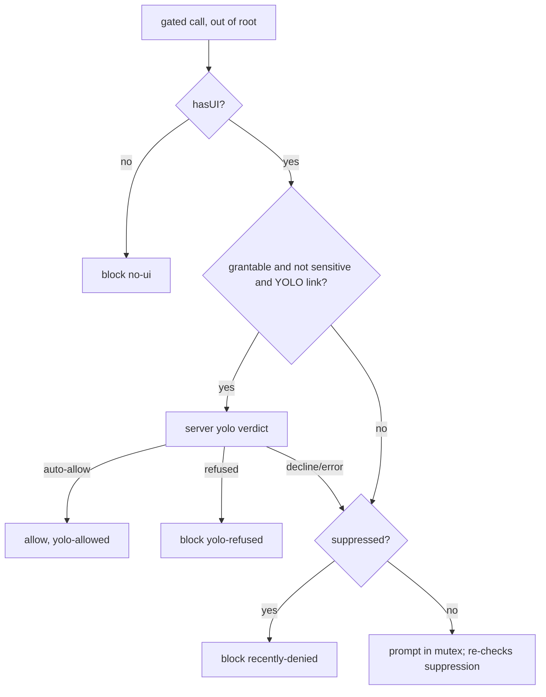

## Context

Three independent fixes, one theme (a guard missing on a sibling road). Only #1115 and the
#1103 escalation involve a design choice; #1104 is "reuse `admitRouteCwdParam`".

## D1 — #1104: reuse the REST admission, do not fork it (decided)

`plugin_action` `create`/`run` call `admitRouteCwdParam(p.cwd, { required: scope !== "global" for
create, false for run, knownCwds, admitOptions })` exactly as the WS `stop` branch already does
(`index.ts:194-208`), `release()` in `finally`. `create` loses the `process.cwd()` fallback
(`index.ts:224`) for folder scope, matching REST `cwd_required`; global scope keeps `os.homedir()`.
The **raw** `p.cwd` is passed to admission (not the handler's string-filtered `cwd`), so a non-string
value is refused as `invalid_cwd` for `create` and `run` alike. `run` without a cwd keeps its current
behaviour (REST `/run` spec: "unchanged"; `runNowViaEngine` still defaults to `process.cwd()`), so only a
*supplied* cwd is newly gated. The existing inline `knownCwds`/`admitOptions` pair (`index.ts:153-154`,
`:201-203`) is hoisted into one local `admit(raw, required)` closure used by stop/create/run; the
`mountAutomationRoutes` call keeps its hook shape. The WS branches are kept (Non-goals): they are the
WS ingress for any operate-capable client.

## D2 — #1115: order of YOLO vs recent-denial (owner-confirmed: `/tmp/issue-batch/decisions-final.md`)

Options (evidence in `/tmp/issue-batch/harden-path-and-process-guards-DECISIONS.md`; the confirmation is recorded in `/tmp/issue-batch/decisions-final.md`):

| | Option | Effect |
|---|---|---|
| A | Keep as is (close issue, document) | Spec-conformant; user waits 120 s |
| **B (chosen)** | Ask YOLO verdict before the suppression check for grantable, non-sensitive paths | timeout → overridable; an explicit Deny the server remembered → still `yolo-refused` |
| C | YOLO activation clears bridge suppression | Overrides explicit Deny too; needs new server→bridge message |

Why B: the server already encodes "operator said no" durably (Deny → remembered refusal →
`refused`), so the ordering change releases the cases where no refusal is remembered: a timeout
(nobody said no) and the unremembered Denies below. The
in-mutex re-check inside `ask()` (`handler.ts:122`) stays, so non-YOLO sessions are unchanged.
Residuals (an operator "no" that leaves no remembered refusal is overridable by a live YOLO session;
documented in the MODIFIED "An operator Deny at the gate is remembered durably"):
- the Deny report is fire-and-forget (`handler.ts:211-217`); a report lost before the next call, or
  not persisted (`agent-yolo.ts` "refusal NOT persisted"), lets the next call auto-allow. Same-host WS
  ordering makes the loss a narrow race; a persist failure is rare;
- a declined or dismissed always-allow *confirmation*, and an unknown answer, are never reported
  (`handler.ts:228-232`); declining the confirmation is "choosing to allow" in the main spec, so
  auto-allow on retry is accepted;
- a Deny while the bridge is disconnected is never remembered (the server never saw the prompt). A
  retry made while the YOLO link is still down (not connected / `path-yolo` not announced / not
  same-host) is not asked, so the suppression still blocks (unchanged); once the link is back and
  YOLO is live, a grantable non-sensitive retry MAY auto-allow, like any unremembered Deny.
- cost: a suppressed retry by a YOLO-supported session now does one server round-trip (up to
  `YOLO_ASK_TIMEOUT_MS` = 1500 ms if the server is silent, `yolo-link.ts:18`) where it returned
  immediately; the ask is already skipped when the link is down (`yoloSupported()`).
Behavioural note for the issue reporter: after an explicit **Deny** that the server remembered the retry is still refused
(now with the clearer `yolo-refused … clear it in Settings ▸ Access`), per shipped spec.

## D3 — #1103: forward + escalate (decided)

Forward-only (issue's option C) would turn a leaked orphan into a live `exec` + wedged child still
heartbeating its lease, because `BridgeManager.terminate` sends one SIGTERM and forgets
(`bridge.ts:175`). So `exec` owns the ladder: SIGTERM/INT/HUP forwarded → 5 s grace
(`deps.killGraceMs`, test seam) → SIGKILL to the child → release lease → exit. A repeated signal does **not** escalate: a terminal
Ctrl-C/hangup is delivered by the tty to the whole foreground group, and `bin/pi-dashboard.mjs`
(the wrapper that fronts the CLI; `PI_DASHBOARD_BIN=*.mjs` selects it) also re-forwards every
SIGTERM/SIGINT/SIGHUP (`:208-216`), so `exec` routinely sees the same signal twice back-to-back and
"second signal ⇒ SIGKILL" would defeat the grace on a single Ctrl-C. Repeats are forwarded as received
(harmless) and never shorten the grace. Handlers stay installed (a latch makes them no-ops once the
child has exited) until the lease-release call resolves, then are removed — removing them earlier would
re-open the default disposition and a SIGTERM during the release HTTP call would kill `exec` before the
release, leaking the lease to its TTL. Exit status: the child's own (existing mapping `signal → 128+n`); no synthetic code.
`stdio:"inherit"` is kept so stdin EOF still reaches the child. Only the direct child is signalled;
reparented descendants of a child that exits are not reaped, and process-group spawn stays out of scope
(Non-goals). On Windows `child.kill(sig)` force-terminates, so the grace is best-effort there.
