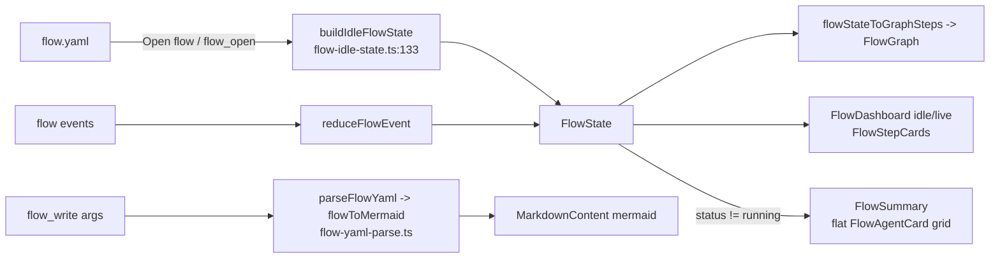

# Design

## Context

Motivation: see proposal.md - Why. The current render paths:



- `FlowDashboard` returns `<FlowSummary>` as soon as the flow is not running (`packages/flows-plugin/src/client/FlowDashboard.tsx:272-284`). It drops `session` on the way. The return sits before the mobile "tap to expand" early return (`FlowDashboard.tsx:299-315`).
- `FlowSummary` renders the same `FlowGraph` (`FlowSummary.tsx:139`, `:228`). Its cards are a flat `FlowAgentCard` grid (`FlowSummary.tsx:163-176`), not `FlowStepCards` (`FlowDashboard.tsx:461`). Everything under the graph sits in a `48vh` scroll box (`data-testid="flow-summary-scrollbox"`).
- Selection is implemented twice, with different rules. `FlowDashboard` uses `useSelectionReset` (reset on flow change or a vanished step, `FlowDashboard.tsx:41-55`), `useOnEnterIdle`, and reduced-motion scroll. `FlowSummary` resets on every `flowState.agents` change (`FlowSummary.tsx:78-80`).
- The slot claim already computes a `summary` header variant (`FlowDashboard.tsx:864`) and passes summary header actions through `headerActions`.
- The body renders `displayState`, which a manual tab click can point at another flow (`FlowDashboard.tsx:197-203`).
- `FlowWriteToolRenderer` builds Mermaid from `toolInput.content` (`FlowWriteToolRenderer.tsx:53-58`). Only it and its test use `parseFlowYaml` / `flowToMermaid`.
- `buildIdleFlowState(content, { name, source })` turns flow YAML into a `FlowState` by replaying a fake `flow_started` through the real reducer (`flow-idle-state.ts:133-150`). Its `branchesOf` stringifies branch values (`flow-idle-state.ts:43-49`), so object-form branches `{ to, ... }` become `"[object Object]"`. The deleted parser handled that form (`flow-yaml-parse.ts:63-73`).
- `FlowGraph` reads an app-global error-route toggle (`FlowGraph.tsx:429`, `FLOW_SHOW_ERROR_ROUTES_KEY`, default off).
- `buildIdleFlowState` returns `{ kind: "ready", flowState } | { kind: "error", message }`. It mirrors the pi-flows parser strictly: top-level `name` + `description`, per-kind required fields, and it throws on unknown types (`flow-idle-state.ts:84-126`). The deleted parser needed only `steps[].id` and defaulted `type` to `agent` (`flow-yaml-parse.ts:47-58`). Existing card fixtures have no `description` (`src/__tests__/authoring-renderers.test.tsx:33-41`).
- `FlowSummary` collapse unmounts the body (`FlowSummary.tsx:135`). `FlowDashboard` collapse is CSS-only (`FlowDashboard.tsx:376`). The slot claim keys `FlowDashboard` on `shown.flowName` only (`FlowDashboard.tsx:869`). `usePersistedToggle` re-syncs a changed key in an effect, one render late (`flow-collapse-storage.ts:62`). Tests and e2e assert the summary body is absent when collapsed.

## Goals / Non-Goals

**Goals:**
- One panel component and one card renderer for idle, running and completed flows.
- One YAML→graph pipeline for the flow panel and the `flow_write` card.
- A parity test that fails on any future divergence.

**Non-Goals:**
- No change to `FlowGraph` layout, the edge derivation (`flow-edges.ts`), `FlowStepCards`, or `FlowAgentCard` internals.
- No server, bridge, persistence or event-protocol change.
- No "Open in flow panel" action on the `flow_write` card (follow-up).
- No change to `flow_agents` cards or `FlowYamlPreview`.

## Decisions

### D1. Completed flow = `FlowDashboard` in summary mode

Delete the `isComplete` early return. `FlowDashboard` keeps one tree and switches on a derived `mode: "idle" | "live" | "summary"`. `summary` is when not idle and `flowState.status !== "running"`.

**Shown state.** Introduce `shownState = mode === "summary" ? flowState : displayState` and route every reader through it. That covers: `withNodeFiles`/`agents`, `stepStateCounts`, `useSelectionReset`, the scroll effect, `flowStateToGraphSteps` (panel + dialog), `FlowStepCards state=`, the flow-YAML button, the dialog title and `FlowQuestionsSection flowId`. A manually selected tab therefore cannot leak into the completed panel.

| Region | idle | live | summary |
|---|---|---|---|
| Header status | π / not started | spinner / n of m steps | today's `FlowSummary` header: status icon + "<name> complete/failed/aborted" + steps · duration · files |
| Collapse chevron | left of name | left of name | left of name, testid `flow-summary-panel-toggle`, `aria-expanded` |
| AUTO toggle | yes (not view-only) | yes | no |
| Abort | no | yes | no |
| `headerActions` (Run again / Open flow / Edit) | yes | yes | yes, before Dismiss, visible while collapsed |
| Dismiss | no (idle Close) | no | yes |
| FlowTabBar, breadcrumb | per current rules | yes | no |
| FlowQuestionsSection | pending only | yes | pending only, above the collapsible body |
| FlowGraph + YAML button + expand dialog | yes | yes | yes |
| Agent cards section (`FlowStepCards`) | yes | yes | yes, inside the scroll box |
| Summaries list + Next: /step | no | no | yes, inside the scroll box |
| Collapsed body | CSS collapse | CSS collapse | unmounted (`!collapsed &&`), as today |
| Mobile | collapsed bar until tapped | collapsed bar until tapped | full panel (no bar), as today |
| `data-testid` / `data-flow-mode` | `flow-dashboard` / `idle` | `flow-dashboard` / `live` | `flow-dashboard` / `summary` |
| Whole-panel collapse key | `dashboard` | `dashboard` | `summary` (unchanged) |

- **Remount on completion.** The slot claim keys `FlowDashboard` on `` `${flowName}:${mode === "summary" ? "summary" : "active"}` ``. Entering or leaving summary mode remounts the panel, exactly as today's component swap did: the collapse state is read from the right key on first render (no flash), and selection and the graph dialog reset. idle→live stays one instance, as `attach-flow-before-run` requires. Collapse kind is `mode === "summary" ? "summary" : "dashboard"`. Open flow… and `flow_open` expand the `dashboard` key, which is the key the following idle panel reads.
- **Scroll box.** In summary mode, the Agent cards section, the Summaries list and the Next suggestion sit in the existing `48vh` scroll box, with its testid kept. A finished panel holds more content than a live one, and today's "fits the viewport" guarantee stays.
- **Testids.** The summary testids are kept on the equivalent elements: `flow-summary-panel-toggle`, `flow-summary-scrollbox`, `flow-summary-toggle`, `flow-summaries`. The root now also carries `data-testid="flow-dashboard"` in summary mode, so e2e assertions that expect `flow-dashboard` to be absent while a summary shows must be inverted. E2E containers that use the `flow-summary-scrollbox` parent as the card pane must be re-pointed at the cards-section container.
- **Cards.** The `cards` section key is shared across modes, so a section the user opened while running stays open after completion.
- **Questions.** In summary mode `FlowQuestionsSection` renders with `pendingOnly` above the collapsible body, so a question still pending at completion stays visible and answerable even when the panel is collapsed. Answered questions are not listed, as before.

*Alternative:* keep `FlowSummary` and swap its card grid for `FlowStepCards`. Rejected. It fixes today's symptom but leaves two shells to drift again.

### D2. No new selection hook: the summary copy is deleted

After D1 only `FlowDashboard` holds selection, through its existing `useSelectionReset` / `useOnEnterIdle` / scroll effects, now fed `shownState`. The `FlowSummary` copy, with its reset-on-every-agent-change rule, is deleted rather than merged. The `flow-summary-view` selection requirement is modified to match.

*Alternative:* extract a shared hook. Rejected, because it would have one caller.

### D3. `FlowSummary.tsx` becomes the summary-sections module

It newly exports `statusConfig` (the MDI status map named in `mdi-icon-system`; the map does not move), `FlowSummaryRow`, and a new `FlowSummarySections` component (Summaries list + Next suggestion). `FlowSummary` and `FlowSummaryClaim` are deleted. `FlowSummaryClaim` is not registered in `package.json`, and its only caller is `flow-dashboard-header-actions.test.tsx`, which moves to `FlowDashboardClaim`. `index.tsx` drops both exports.

### D4. `flow_write` card uses the not-started pipeline (lenient) + `FlowGraph`

`buildIdleFlowState` gains an option, `{ lenient: true }`, used only by the card:

- skip the top-level `name` / `description` / `max_concurrent` / `inputs` checks;
- skip the per-kind required-field and integer checks, but keep the per-kind field subset (which fields each kind carries), so YAML the panel accepts yields the same steps;
- treat a missing or unknown `type` as `agent`. This matches `flow-graph-edges` "Unknown step type joins the DAG segment". Such a step uses the agent arm, so `blockedBy` is kept and `branches` are dropped;
- skip step entries that are not objects or lack a string `id`;
- return `kind: "error"` when no valid step remains (including `steps: []`) or the YAML is not a mapping with a `steps` array.

The default (strict) behaviour, used by Open flow and `flow_open`, is unchanged.

```
r = buildIdleFlowState(content, { name: result.command ?? result.name ?? "flow", source: result.path }, { lenient: true })
written && r.kind === "ready" --> <FlowGraph fit steps={flowStateToGraphSteps(r.flowState)} onExpand=Dialog/>
                       counts from r.flowState.dagSteps (one per step): total = length;
                       agents = agent | agent-decision; code = code | code-decision  (same mapping as the deleted parser)
r.kind === "error" --> no graph, no counts (success state, command, diagnostics, View flow YAML still shown)
```

- The memo is keyed on `content`. The `MarkdownContent` primitive import goes.
- **Error-route toggle.** The card graph reads the same persisted error-route toggle as every `FlowGraph`. Toggling it in one graph updates that graph at once; other mounted graphs pick it up on remount, as panels do today (`flow-graph-edges` "Error-route layer hidden by default and its visibility persists").

*Alternative:* keep the Mermaid output but generate it from `FlowState`. Rejected, because a second renderer stays.

### D5. Object-form branches in the not-started pipeline

`branchesOf` in `flow-idle-state.ts` maps `{ to: string, ... }` values with a non-empty `to` to that target, mirroring `flow-yaml-parse.ts:63-73`. It skips anything else, including arrays and an empty `to`. `means` / `for_each` metadata is dropped; the graph does not show it today either. This fixes the Open flow panel too.

- The live reducer path is not changed (non-goal). Whether pi-flows emits object-form branches on `flow:flow-started` is unverified; pi-flows source is not in this repo.
- The hard-coded `blockedBy: []` for `fork` / `agent-decision` mirrors the pi-flows parser and stays.

### D6. Render-parity test

One L1 test with a fixture YAML: an agent DAG segment, a separator `code` step followed by another step, a decision with string-form branches, an `on_error` route, and a fan-out step. It sets `FLOW_SHOW_ERROR_ROUTES_KEY` and the `cards` collapse key explicitly. Surfaces:

- (a) idle: `buildIdleFlowState`
- (b) running: (a)'s `flow_started` plus agent, fan-out item and decision events
- (c) completed: (b) plus `flow_complete`
- (d) the `FlowWriteToolRenderer` card

Assertions:
- Node ids and edge `from→to` pairs are equal across (a)-(d). Statuses are excluded.
- The edge set contains at least one `implicit` edge and one `on_error` route edge.
- `FlowStepCards` structure (group cards, item counts, decision chips) is equal for (b) vs (c).
- A separate case asserts an object-form branch draws its edge on (a) and (d).

Idle has no runtime groups or routes, so idle card parity is not asserted.

## Risks / Trade-offs

- [Finished cards are now collapsed by default unless the user opened them during the run] → A node click opens the section, the header pills summarise state, and the Summaries list stays visible as the primary finished-run content.
- [The lenient card parse can draw a graph for YAML the Open flow panel rejects] → This is intended: the card shows what was written, and parity is asserted only for YAML the panel accepts.
- [The `flow_write` card mounts a full `FlowGraph` per card in long transcripts] → It has no session hooks (no catalog or event reduction), only `buildIdleFlowState` memoized on `content`. Not measured. Comparable to the Mermaid render it replaces.
- [The card's edge set changes for users who relied on the snapshot showing every route] → The error-route toggle is visible on the card graph.
- [Other specs still use the name `FlowSummary` (`flows-plugin` purpose, `mdi-icon-system`, `flow-panel-collapse-persistence`)] → The module and the summary collapse survive under that name, so the statements stay true. A wording sweep can follow at archive.
- [`on_complete` claim rests on a spec statement, not on pi-flows source in this repo] → The derivation still accepts it. No surface supplies it, before or after this change, except the removed snapshot.
