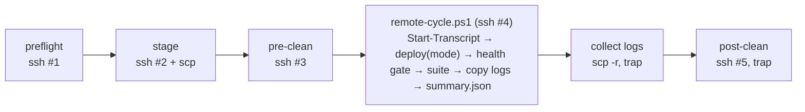

## Context

`qa/` drives ephemeral Packer VMs through `qa/scripts/run-test.sh`: clone → wait SSH → scp `qa/tests/` → `run-all.ps1` → destroy. Bare-metal or long-lived Windows hosts have no automation, and the local VMware Windows image is vTPM-locked. Windows ships three surfaces:
- `PI-Dashboard-win32-<arch>.zip`
- per-user NSIS `PI-Dashboard-Setup-<v>-<arch>.exe` (restored by `restore-windows-nsis-installer`; portable.exe dropped)
- npm-global `@blackbelt-technology/pi-agent-dashboard`

`restore-windows-nsis-installer` left `make test-windows-remote-nsis SETUP=…` as a placeholder for this harness, plus the NSIS launch validation it could not run on a hosted runner (task 10.7).

State left over between runs makes "regression or stale state?" the main manual-QA failure mode. The original version of this design guessed that state footprint and the process model. Both were measured on 2026-10-25. F13–F17 come from a second, repo-level pass:

### Spike results (2026-10-25) — premises re-verified on real Windows

No LAN Windows box was available (local VMware VM is vTPM-locked), so the runner was both orchestrator and target. Each `windows-latest` (Server 2025, Windows PowerShell 5.1.26100) run started stock `sshd`. The runner then drove itself over `ssh runneradmin@localhost`, using the real **v0.10.0** release ZIP, Setup.exe and npm package. Runs: `40184762256` (round 1) and `40186714826` (round 2). The probes, the workflow and a validated clean script are kept in `spike/`. `spike/remote-clean.draft.ps1` = starting point for `remote-clean.ps1`.

| # | Finding | Evidence | Consequence for this change |
|---|---|---|---|
| F1 | **portable.exe no longer ships.** Windows = `PI-Dashboard-win32-<arch>.zip` + `PI-Dashboard-Setup-<v>-<arch>.exe` (per-user NSIS). | v0.10.0 release assets; archived `restore-windows-nsis-installer` + `fix-windows-portable-exe` | Modes become `zip \| nsis \| npm`. Drop every portable/SFX/`%TEMP%` extract item. Wire the existing placeholder `test-windows-remote-nsis SETUP=` target (it already points here). |
| F2 | **Wrong npm name.** `@blackbelt-technology/pi-dashboard` → npm 404. Real name `@blackbelt-technology/pi-agent-dashboard`. | `npm view`, S7/R8 | Fix the proposal + `qa/tests/01-install.ps1`, which installs the 404 name today. |
| F3 | **Wrong exe/state names.** Exe = `pi-dashboard.exe` (forge `executableName`), nested `PI-Dashboard-win32-x64\`. userData = `%APPDATA%\pi-dashboard`. No `pi-agent-dashboard` AppData dirs exist. Live state = `~/.pi/dashboard/` (`server.log`, `server.pid`); `~/.pi-dashboard/` = legacy managed dir. | snapshot diffs R4/R7/R8 | Rewrite the D4 path list from the measured footprint (below). |
| F4 | **Measured footprint.** ZIP/WMI: `%APPDATA%\pi-dashboard`, `~\.pi`, `%TEMP%\pi-dashboard-electron.log`, ports 8000+9999. NSIS adds: `%LOCALAPPDATA%\Programs\PI Dashboard`, `%LOCALAPPDATA%\@blackbelt-technologypi-dashboard-electron-updater`, Start-Menu + **Desktop** `PI Dashboard.lnk`, HKCU Uninstall `{guid}` + `HKCU\Software\{guid}`, `HKCU\Software\BlackBelt Technology`. npm adds: global package under `npm root -g`. | R4/R7/R8 diffs; R9 final diff | The clean script must also uninstall NSIS (`QuietUninstallString` → `/S`) and `npm rm -g`. After that pass, the updater cache, `HKCU\Software\BlackBelt Technology` and `%TEMP%\qa-prefix-*` / `~nsu*.tmp` still survived → added to the draft (not yet re-run). |
| F5 | **SSH session = session 0, in a Job Object with `KILL_ON_JOB_CLOSE`** (breakaway allowed). Anything started with `Start-Process`, `cmd start` or `pi-dashboard start` **dies when the ssh call returns**. A process created by WMI `Win32_Process.Create` survives. | S4 (`aliveAfterClose` 0/0/**1**), R8 (`inSession` health ✗ → `wmi` health ✓) | The proposal's design (deploy in one ssh call, tests in the next) silently kills the server between them. Either run deploy+test in **one** ssh session, or launch long-lived processes through WMI. |
| F6 | **Electron works headless in session 0.** WMI-launched `pi-dashboard.exe` served `/api/health` in 10 s (`launchSource=electron`, v0.10.0). NSIS launch over ssh also booted the server. | S6c, R4, S8/R7 `server.log` | The "GUI needs an interactive session" non-goal is unnecessary for server-level smoke. Scheduled-task `/IT` launch was not proven (`USERDOMAIN\USERNAME` → "No mapping between account names and SIDs"); it is not needed. |
| F7 | **`localhost` costs ~2 s in PS 5.1** (IPv6 `::1` first, server binds `127.0.0.1` only). `Invoke-WebRequest localhost -TimeoutSec 2` **always** times out; `127.0.0.1` answers in 0.04 s. | R4 probe (session 0 and 2 alike) | `windows-nsis-launch.ps1` false-FAILs with a healthy server (R7). `02`/`03`/`04`/`05`/`16`/`22` probe `localhost` with 2–3 s timeouts → flaky to always-fail. Probes must use `127.0.0.1`. |
| F8 | **5 of 27 `qa/tests/*.ps1` do not parse in Windows PowerShell 5.1** (UTF-8 without BOM + `—`/`✓` → cp1252 smart quotes): `02`, `07`, `16`, `28`, `35`. With a BOM: 0 failures. 15 files are at risk. | R2 parse sweep; S6/S7 runtime ParserError | Precondition for any remote run. Fix: add a BOM (or ASCII-only) plus a lint/vitest guard. |
| F9 | **Execution policy.** A Windows 10/11 client defaults to `Restricted` → `ssh host script.ps1` and any inline `npm`/`pi-dashboard` (they resolve to the `.ps1` shims) fail with `PSSecurityException`. | S2 restricted.*, S7 | Every remote step = `powershell -NoProfile -ExecutionPolicy Bypass -File <script>`. Never run inline commands. |
| F10 | **Exit codes.** Stock `cmd` DefaultShell relays `-File` exit codes exactly (7→7). With the D2 `DefaultShell=powershell.exe` tweak, the same call returns **1**, unless the command ends in `; exit $LASTEXITCODE`. | S2/R1 matrix | Drop the D2 registry tweak: the stock shell is simpler and correct. A preflight probe should assert rc=7. |
| F11 | **Transport works out of the box.** Win32-OpenSSH 9.5p2 ships **preinstalled (stopped)** on Server 2025. An admin user is refused with only a per-user `authorized_keys`; it needs `C:\ProgramData\ssh\administrators_authorized_keys` (ACL Administrators+SYSTEM). scp works with the default SFTP mode, legacy `-O`, `C:/`, `/C:/`, backslash and space paths. `scp -r` into an **existing** dir nests (`tests\tests`). | S1, S3 | Doc claim 5.3 confirmed. The driver must delete the remote dest dir before `scp -r`. |
| F12 | **The reused suite is not harness-ready.** Over ssh (BOM-fixed, 01 patched): 3 pass / 12 fail / 1 precondition-skip, 23 min. `02` → `Start-Process pi-dashboard` hits the `.ps1` shim ("not a valid Win32 application"). `03`/`04`/`05`/`10`/`22`/`32`/`38` assume a server already running and die. `07` asserts a removed `resources\offline-packages\manifest.json`. `12` prints SKIP but exits 0 (silent pass). PS 5.1 `Expand-Archive` of the 388 MB ZIP ≈ 12 min. | R6, R9 | "Reuse verbatim, no test changes" is not viable. Either scope test repairs in, or verify the harness against its own contract (rc relay, logs, clean) and track suite repair separately. |
| F13 | **Repo's own Packer image sets `DefaultShell=powershell.exe`** (`qa/packer/scripts/provision-windows.ps1:65`). Under F10, a preflight demanding rc 7 from the plain form would reject every repo-built VM. | repo read (2nd pass) | Preflight auto-detects the invocation form (D2). Both stock and Packer hosts work. |
| F14 | **`/api/health` has no `starter` field** (`dashboard-starter-identity`: "Legacy starter field is absent"; spike: `starter=null`). `07` still asserts `starter=='Electron'`. | spec + S6c/R4 | The harness gates on `launchSource`. The `07` fix goes to `repair-windows-qa-suite`. |
| F15 | **Electron stdout logs one-time `…/auth/local-proof?code=<secret>` URLs** (seen in the `pi-dash-electron-out.log` tail; they reached this spike's public Actions logs — one-time codes on destroyed runners, so no residual risk). | spike log grep | Collected logs are redacted (D6). The README warns that logs may still hold sensitive paths. |
| F16 | **scp'd files carry no Mark-of-the-Web**, so SmartScreen/attachment checks never fire. Download-time breakage (the failure mode that killed portable.exe) goes unseen. | Windows MOTW semantics; spike used scp only | Opt-in `--motw` (D7). The gap is documented. |
| F17 | **CI already runs some of the edited scripts under pwsh 7**: `windows-nsis-*` in `_electron-build.yml:983-986`; `28-gateway-windows.ps1` in `ci-gateway-platform.yml` (path-filtered, so this change triggers it). A BOM and `127.0.0.1` are neutral for pwsh 7. | repo read | "No CI changes" stays true for workflow files, but CI behaviour is touched. Verify both workflows green (task 6.10). |

Stakeholders: release engineer cutting Windows builds; maintainers verifying Windows issue reports on a known-clean host; the follow-up `repair-windows-qa-suite` change and a future self-hosted-runner change, which reuse these primitives.

## Goals / Non-Goals

**Goals:**
- One command on a Mac/Linux orchestrator runs clean → deploy → verify → collect → clean against a real Windows host for `zip`, `nsis` or `npm`.
- The verdict is truthful: an exit code relayed from the target, logs always collected, and no state left behind (`remote-clean.ps1` exits 3 if any residue is left).
- Idempotent: an aborted run never blocks the next one.
- Every Windows QA script the harness runs loads under stock Windows PowerShell 5.1.

**Non-Goals:**
- Making `run-all.ps1` green. Its semantic rot (F12) goes to `repair-windows-qa-suite`. `--smoke-only` gives a meaningful verdict in the meantime.
- Interactive-desktop GUI tests. F6 shows server-level smoke works in session 0. Scheduled-task `/IT` launch stays unproven and unneeded.
- WinRM; several hosts in parallel; macOS/Linux remote hosts; CI integration; signing or AV automation.
- Auto-configuring the target (sshd, keys, policy). This is a one-time operator step, documented in the README.

## Decisions

### D1. Transport: stock OpenSSH, any `DefaultShell`, script files only
SSH and scp only, public-key auth, with options `-o BatchMode=yes -o StrictHostKeyChecking=accept-new -o UserKnownHostsFile=qa/remote/.known_hosts` (gitignored). **The harness never edits `DefaultShell`, and it works with either value.** F10 shows that `DefaultShell=powershell.exe` changes `-File` exit codes to 1 unless the command ends in `; exit $LASTEXITCODE`. F13 shows the repo's own Packer image sets that value. Preflight detects which form relays (D2). Every remote step is `powershell -NoProfile -ExecutionPolicy Bypass -File <script> <args>` because a client SKU defaults to `Restricted` (F9). There are no inline commands at all; even staging runs through a script (D3).
*Alternatives:* WinRM — needs a cert or TrustedHosts and `pwsh` on the orchestrator; it adds surface for no gain. Requiring stock `cmd` — would reject the repo's own Packer VMs (F13). Always appending the suffix — under `cmd` it becomes stray script args.

### D2. Preflight picks the invocation form before any state change
1. The driver scp's `remote-preflight.ps1` into the remote user's **home** directory (the SFTP start dir; it always exists).
2. It runs the plain form `powershell -NoProfile -ExecutionPolicy Bypass -File remote-preflight.ps1`, which exits **7** on purpose:
   - rc 7 → the plain form is used for the rest of the run;
   - rc 1 → the driver retries with `…; exit $LASTEXITCODE` appended. If that returns 7, the suffixed form is used for the rest of the run;
   - anything else → abort, printing both codes and naming `DefaultShell`.
3. One helper `remote_ps <script> <args>` in `run.sh` applies the chosen form everywhere.

The script also prints the PS version, session id, `Get-ExecutionPolicy -List`, free space on `C:` (≥ 3 GB required) and `node --version` (npm mode). The driver checks the config first and makes no ssh/scp call while the config is invalid. Config is parsed with `node -e` (the repo already needs Node), not `jq` (absent on stock macOS). `run.sh` targets bash 3.2 (stock macOS `/bin/bash`): no associative arrays, no `mapfile`, no `${var,,}`.

### D3. Staging layout and upload
Remote root is `C:\pi-dashboard-qa\` with `harness\`, `tests\`, `art\` and `logs\` beneath it. `C:\Temp` does not exist by default on clients; creating a folder under `C:\` is allowed for Authenticated Users. `remote-preflight.ps1 -Stage` (no config-derived args) recreates the four subdirs **before** any `scp -r`. It also takes the run lock `C:\pi-dashboard-qa\.lock`, holding `{orchestratorHost, utc}`. It refuses when the lock is younger than 2 h, and replaces a stale lock with a warning. The driver's trap deletes the lock after post-clean. F11 shows that `scp -r` into an existing dir nests (`tests\tests`). Upload: `qa/remote/*.ps1` → `harness\`, `qa/tests/` → `tests\`, artifact → `art\<basename>`. The artifact basename must match `^[A-Za-z0-9._-]+$`.

### D4. Single-session cycle — `remote-cycle.ps1`
F5: sshd sessions run in a Job Object with `KILL_ON_JOB_CLOSE`. Anything started with `Start-Process` dies when the ssh call returns. **Deploy, health gate, suite and log capture therefore run in one ssh call:**



| Mode | Deploy | Health gate (127.0.0.1, ≤180 s) | Suite (unless `--smoke-only`) |
|---|---|---|---|
| `zip` | `Add-Type -AssemblyName System.IO.Compression.FileSystem` (required in PS 5.1) → `[IO.Compression.ZipFile]::ExtractToDirectory` → `C:\pi-dashboard-qa\app\`; also stage the zip at `C:\qa-artifacts\PI-Dashboard-win32-x64.zip` (the `07` contract); `Start-Process` the discovered `pi-dashboard.exe` | `launchSource=electron` | `tests\run-all.ps1` |
| `nsis` | — (the suite installs) | done by `windows-nsis-launch.ps1` | `windows-nsis-install.ps1 -Setup` → `-no-permachine` → `-branding -Setup` → `-launch` → `-uninstall` (the order in the Makefile comment) |
| `npm` | `npm i -g @blackbelt-technology/pi-agent-dashboard@<pin>`; `pi-dashboard start` | `launchSource=standalone`, `version` = pin when the pin is semver | `tests\run-all.ps1` with `QA_NPM_SPEC` = the same spec |

The deployed app is stopped after the gate and before the suite, because the suite owns server lifecycles. Exit codes: `0` pass, `20` deploy failed, `21` health gate timeout, `22` bad args, otherwise the suite's rc. WMI `Win32_Process.Create` (which survives session close, F5) is used **only** for the operator debug path `run.sh --start-only`, which leaves a server running. Never in the verdict path.
*Alternative rejected:* separate ssh calls per phase with WMI breakaway for every launch. More moving parts, and lifecycle bugs show up as false greens or false reds.

### D5. Cleanup from the measured footprint — `remote-clean.ps1`
Order:
1. `pi-dashboard stop`, if on PATH.
2. Kill `pi-dashboard`, `electron`, `node`.
3. Kill any owner of ports 8000/8112/9999.
4. NSIS: for each HKCU Uninstall entry with `DisplayName='PI Dashboard'`, run the parsed `QuietUninstallString` exe with `/S` and poll until the entry is gone (≤90 s). Then drop the key if it is orphaned.
5. `npm rm -g @blackbelt-technology/pi-agent-dashboard` when it is present under `npm root -g`.
6. Delete paths (3 retries each):
   - `~\.pi`, `~\.pi-dashboard`
   - `%APPDATA%\pi-dashboard`
   - `%LOCALAPPDATA%\Programs\PI Dashboard`
   - `%LOCALAPPDATA%\@blackbelt-technologypi-dashboard-electron-updater`
   - Start-Menu and Desktop `PI Dashboard.lnk`
   - `HKCU:\Software\BlackBelt Technology`
   - `%TEMP%\{pi-dash*,qa-prefix-*,~nsu*}`
   - `C:\qa-artifacts`, `C:\PI-Dashboard-test`
   - `C:\pi-dashboard-qa\app`
7. Verify paths, ports, processes and the uninstall entry. Exit 3 with a residue list, otherwise exit 0.

`remote-clean.ps1` **never** deletes `C:\pi-dashboard-qa\logs` (the driver owns that). F4 + `spike/remote-clean.draft.ps1` are the baseline. Three back-to-back runs on a clean host gave rc 0. The items added after the R9 final diff must be re-validated (task 6.x).

### D6. Logs + verdict round-trip
`remote-cycle.ps1` writes into `logs\`:
- a `Start-Transcript` transcript;
- per-test stdout;
- copies of `~\.pi\dashboard\server.log`, `%TEMP%\pi-dashboard-electron.log` and `%TEMP%\pi-dash-electron-*.log`;
- `summary.json` = `{mode, artifact, version, launchSource, healthSec, suiteRc, exitCode, startedAt, finishedAt}`.

Before writing the log copies, `remote-cycle.ps1` redacts `local-proof?code=<…>` and `[?&](code|token|ticket)=<…>` values to `<redacted>` (F15). The driver's `trap … EXIT` scp's `logs\` to `qa/remote/logs/<host>-<UTC ISO8601>/`, prints that path, then runs post-clean.

Exit policy:
- a failed cycle keeps the cycle's rc;
- a passing cycle whose post-clean exits 3 → driver exit **3** ("leaky");
- an unreachable host in the trap → keep the cycle rc and warn.

### D7. Config and CLI
`qa/remote/config.json` (gitignored; `config.example.json` is committed):

```json
{ "host": "win-qa.lan", "user": "qa", "sshKey": "~/.ssh/qa_win_ed25519", "sshPort": 22,
  "mode": "zip", "artifactPath": "packages/electron/out/make/zip/x64/PI-Dashboard-win32-x64.zip",
  "npmVersion": "0.10.0" }
```

- `host`, `user`, `sshKey` and `mode` are required.
- `artifactPath` is required for `zip`/`nsis` and must exist locally.
- `npmVersion` defaults to `latest`. It must match `^(latest|next|[0-9]+\.[0-9]+\.[0-9]+([-.][0-9A-Za-z.]+)?)$`, because it reaches a remote command line.

CLI flags override the config: `--mode`, `--artifact`, `--npm-version`, `--smoke-only`, `--clean-only`, `--start-only`, `--motw`.

`--motw` (F16): after upload, `remote-cycle.ps1 -Motw` writes a `Zone.Identifier` stream (`[ZoneTransfer]` / `ZoneId=3`) on `art\<artifact>`. This reproduces browser-download conditions for SmartScreen and attachment checks. It is off by default because an unsigned artifact may then block on a SmartScreen prompt that a headless session can't answer. The result is recorded as `summary.json.motw`.

### D8. Makefile surface
- `test-windows-remote-zip [ZIP=…]`
- `test-windows-remote-nsis SETUP=…` — replaces the placeholder body; keeps the `SETUP` guard and usage text.
- `test-windows-remote-npm [NPM_VERSION=…]`
- `clean-windows-remote`

Each target `exec`s `remote/run.sh`, so the driver's exit code becomes make's. No `test-windows-remote-portable` (archived `fix-windows-portable-exe` task 4.7).

### D9. PS 5.1 load-compatibility of the scripts the harness runs
- Every `qa/tests/*.ps1` and `qa/remote/*.ps1` file is saved UTF-8 **with BOM**. F8: 5 files fail to parse as shipped; with a BOM, none fail.
- PowerShell web-cmdlet request URIs use `127.0.0.1`, not `localhost`. F7: ~2 s IPv6 penalty per request in PS 5.1. `Origin` header values are untouched.
- `01-install.ps1` installs `$env:QA_NPM_SPEC`, which defaults to `@blackbelt-technology/pi-agent-dashboard` (F2).

The guard test `packages/shared/src/__tests__/qa-windows-ps1-compat.test.ts` pins these invariants. It runs on POSIX CI and needs no Windows.

## Risks / Trade-offs

- **Destructive clean on a mis-targeted host.** It deletes `~\.pi` and kills `node.exe`. → QA-dedicated host only (README, bold). The driver prints `user@host` and the mode before pre-clean. `--clean-only` is explicit. No wildcard deletes outside the named `%TEMP%` prefixes.
- **Command injection via config.** → All interpolated values are allowlisted or regex-checked (D3, D7). Paths are fixed constants on the remote side.
- **TOFU host key.** → `accept-new` with a repo-local `known_hosts`. A changed key fails hard, and the README covers resetting it.
- **Suite red until `repair-windows-qa-suite` lands.** → `--smoke-only` gives a per-artifact verdict now. Harness self-verification (tasks §6) asserts relay/logs/clean behaviour, not suite green.
- **ZIP extraction time** (PS 5.1 `Expand-Archive` ≈ 12 min, F12). → The harness deploy uses `ZipFile.ExtractToDirectory`. Its speed is unmeasured (task 6.x). `07` keeps its own `Expand-Archive` until the follow-up change.
- **Footprint drift** when a future release writes new state. → `remote-clean.ps1` exits 3 on known residue only. Task 6.x adds an operator-run snapshot-diff mode (`spike/probes/remote/snapshot.ps1`) to rediscover the footprint per release.
- **Defender real-time scanning on real clients** (the runner's protection state was not captured) slows ZIP extraction and the first Electron start. The 180 s health gate may be tight → it is configurable through `healthTimeoutSec` in the config (default 180), and `summary.json.healthSec` gives the measurement.
- **Log secrets** (F15). → Redaction in D6. Logs stay gitignored, and the README says never to attach raw logs to public issues.
- **No MOTW by default** (F16). → Documented gap; `--motw` is opt-in.
- **CI touched indirectly** (F17). → Task 6.10 verifies `_electron-build.yml` (Windows NSIS smoke) and `ci-gateway-platform.yml` stay green.
- **BOM churn** in 27 files. → One mechanical commit. Behaviour-neutral for PS 5.1/7 and `pwsh` on POSIX.

## Migration Plan

- Purely additive test infrastructure. No version bump and no release coordination.
- Adoption is a one-time target setup (README): enable sshd, install the key into `administrators_authorized_keys` (admin) or the per-user `authorized_keys` (standard user), open the firewall rule. Then copy `config.example.json` → `config.json` and run `make -C qa test-windows-remote-zip ZIP=…`.
- Rollback: `git rm -r qa/remote/`, plus reverting the Makefile/README/AGENTS/.gitignore edits and the guard test. The `qa/tests` BOM, `127.0.0.1` and package-name edits are safe to keep.

## Open Questions

- **Q1 (resolved):** Node version on the target. npm mode trusts PATH. Preflight logs `node --version`, and `npm i -g` fails loudly below the `engines` floor (`>=22.19.0`).
- **Q2 (resolved):** a `--keep-state` flag is not added. `--start-only` covers "leave something running to poke at".
- **Q3:** Standard (non-admin) user path. The spike proved only the admin key path (`administrators_authorized_keys`). A per-user key is expected to work for non-admins but is unverified (task 6.x).
