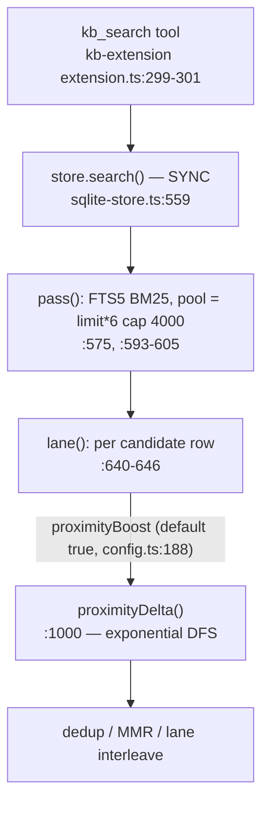

# Design — bound-kb-proximity-search

## Context

`proximityDelta(queryTerms, body)` (`packages/kb/src/sqlite-store.ts:1000`) rewards a hit whose query terms occur in query order close together. It builds `pos[token] → positions` (`:1002-1006`) and searches for the smallest span by recursive `walk(idx, start, span)` (`:1008-1017`): for term `idx` it iterates every position `p ≥ start` and recurses, adding `p − start` to the span. Nothing prunes on `span >= best`; the sole early exit `best === 1` (`:1015`) is unreachable for most chains. Cost is the product of per-term occurrence counts.

Call path:

Because `search()` is synchronous, the `AbortSignal`, the freshness budget (`bound-kb-search-freshness`, archived) and the bridge heartbeat timer all sit behind it on the same thread. #895's fix bounded the stage *before* this call; this stage was never bounded.

### Measured (task 1.1 re-records these on the implementation branch)

Scratch reproduction at HEAD, one macOS host; the DFS copy has a 2e7-call budget so the harness cannot hang. Query terms `alpha…`, each repeated `r` times interleaved in the body.

| terms k | repeats r | DFS | greedy |
|---|---|---|---|
| 5 | 50 | 3.48 M calls, 33 ms | 0.22 ms |
| 6 | 50 | budget exhausted, 192 ms | 0.15 ms |
| 8 | 100 | budget exhausted, 160 ms | 0.20 ms |

Differential: 20 000 random (query, body) pairs, duplicates in the query allowed, DFS vs greedy — 0 mismatches. `rawTokens` on an 827 KB body: 2.7 ms (so tokenising is not the cost; the issue's 10 ms/450 KB estimate is the same order).

The issue additionally reports (not re-run here: it needs the reporter's index): real 450 KB chunk ≈3.97e18 combinations, greedy 12.6 ms for that chunk and 208 ms over all 5957 chunks of that index. Treated as indicative; task 5.1 re-measures on a synthetic equivalent.

## Goals

- `proximityDelta` cost is polynomial and small for every input; a 10-term query over a body where every term repeats ≥100× completes in milliseconds.
- Scores and ordering unchanged wherever the DFS ever terminated (ranking-regression gate = identical metrics on the bundled fixtures).
- A structural wall-time bound on the proximity stage so `search()` cannot be frozen by it regardless of future input shapes.

## Non-goals

- Async/cancellable `store.search()`, worker-thread ranking.
- Changing the boost formula, the proximity tokenisation, or `rawTokens`.
- Bounding other per-row body passes (see proposal Non-goals).

## Decisions

### D1 — Exact per-start greedy chain with binary search

For a non-decreasing chain `p0 ≤ p1 ≤ … ≤ pk` the DFS span is `Σ(p_i − p_{i−1}) = p_k − p_0` (`:1011`, first term contributes 0). For a fixed `p0`, picking for each next term the *smallest* admissible position (`lowerBound(list_i, cur)`, `≥` so equal positions — repeated query terms — still count, matching `if (p < start) continue`, `:1010`) minimises `p_k`. Iterate `p0` over `pos[q0]`:

- `if some list missing → 0` (same as `if (!arr) return` leaving `best = Infinity`, `:1009`).
- If a term has no position ≥ `cur`, every later `p0` fails too (`cur` is monotone in `p0`) → stop.
- If `cur − p0 ≥ best`, abandon this `p0`.
- `best === 0` (all terms identical) → stop. The DFS `best === 1` early exit is exact as well (distinct terms need span ≥ 1; identical-only terms reach 0 on the first chain), so dropping it changes nothing.

Cost `O(|pos[q0]| · k · log n)`, with `n` ≤ body tokens. The final mapping `−max(0, 2 − best/20)` (`:1021-1022`) is untouched, so boosts are bit-identical.

Alternatives considered:

- *Keep the DFS, add `span >= best` pruning.* Rejected: still exponential in the worst case (interleaved terms never exceed `best` until late); trades a proof for a heuristic.
- *Memoised DP over (term, position).* Correct, `O(n·k)` memory/time, but needs a per-body table and offers no practical gain over the greedy's early exits; more code.
- *Sliding-window (min window over the merged position list).* Right for **unordered** coverage; the spec and current behaviour require **query order** ("close together and in query order", `openspec/specs/kb-fts5-search-store/spec.md` §Proximity boost), so it would silently change semantics.

### D2 — Per-search proximity time budget (decided 2026-11-03 by owner)

`search()` keeps one running total `proximitySpentMs` per call, shared by both lanes. Each `proximityDelta` call is timed with the global `performance.now()` read at call time (before/after; no module-level alias, so tests can spy on it to drive partial expiry deterministically) and its elapsed time added to the total; time spent in dedup, source-dedup, MMR or `coverageRerank` is NOT counted, so the budget measures proximity cost, not wall time of the whole lane. `lane()` checks `proximitySpentMs >= budget` before each row (`:640-646`). Default `PROXIMITY_BUDGET_MS = 250`; overridable through an optional `SearchOpts.proximityBudgetMs` used by tests (not exposed in config), coerced with the existing `num()` helper (`sqlite-store.ts:560-565`: non-finite → default, clamped to `[0, 60000]`). A budget ≤ 0 therefore skips every row deterministically (`0 >= 0`), which is what the E10 test (tasks.md, Test E10) relies on. Rows are already in BM25 order, so the best candidates are boosted first. After expiry the remaining rows are scored Δ = 0 (plain BM25), never dropped. Total proximity cost per call ≤ budget + one row.

On expiry the search emits exactly one `console.warn` line (once per `search()` call, however many rows are skipped; same convention as `config.ts:380` / `trust.ts:69`; there is no injectable kb logger in `sqlite-store.ts`), emitted only when at least one row was actually skipped while proximity was applicable (boost on, ≥2 usable terms; so `proximityBoost:false` or a 1-term query with budget 0 logs nothing), naming the budget and the count of rows scored without proximity out of the rows examined by `lane()` across both lanes, e.g. `[kb] proximity budget 250ms exhausted; 37 of 240 rows scored without proximity`. No label in the tool text and no change to `KbHit[]` / the search return contract.

Why silent-in-output + one log line: degradation only reorders low-ranked rows slightly; D1 makes expiry unreachable on measured inputs (issue #1075: zero chunks need the guard once the greedy runs, 208 ms for all 5957 chunks); a model-facing label would widen the contract across kb, kb-extension and the CLI for a case that should never fire. The log line gives field diagnosability at no contract cost.

Why 250 ms: the issue's all-chunks greedy figure (208 ms for 5957 chunks) is a ceiling no real call reaches (a default page scores ~60 rows); 250 ms is above that ceiling while staying well under the heartbeat period (15 s per the issue) and the freshness budget (1500 ms, `bound-kb-search-freshness`). It is a backstop, not a tuning knob: on every measured input it does not fire, and the identical-metrics gate (D4) proves that on the fixtures. Task 5.1 confirms or retunes the default after the measurements.

Honest limits: the guard checks between rows, so the bound is "stop starting new proximity computations once the budget is spent" — a single enormous row is not interruptible; D1 makes that row cost O(|q0|·k·log n) over a measured ~µs/KB tokenisation, which is bounded by body size. A degraded call returns a slightly different ordering (late rows lose their ≤2-point boost) and is load-dependent — acceptable for a backstop that the algorithm makes unreachable in practice.

Lane-lead interaction: `mainRows` are scored before `agentsRows`, so on expiry the agents lane degrades first. The lead rule (`laneLeadMargin`, `captureRawBest`, `:630-646`, `:715+`) compares each lane's raw best score including proximity, so an unboosted agents lane (Δ = 0, scores up to 2 worse) can lose a lead it would otherwise have won. Accepted as part of the same backstop degradation (recorded in Risks); not mitigated with a per-lane budget because that would double the worst-case bound for a path that should never fire.

Alternatives considered:

- *Deadline only, keep the DFS.* Rejected: bounds the freeze but returns garbage (unboosted) for exactly the long natural-language queries agents issue; the algorithm fix removes the cost.
- *Call-count budget instead of wall time.* Deterministic and testable, but D1 has no recursion to count and a count does not bound body-size cost. Rejected for the production guard; tests use the injected `proximityBudgetMs` (0 for deterministic expiry).
- *One wall-clock deadline from the first scored row.* Rejected: it would also charge dedup/MMR/`coverageRerank` and the first lane's post-processing to the proximity budget, starving the second lane for reasons unrelated to proximity.
- *Per-lane budgets.* Rejected: doubles the worst-case bound; see lane-lead note above.
- *Visible label / return-contract change.* Rejected by owner (see above).
- *No guard.* Defensible once D1 lands, but violates "treat any synchronous ranking stage as needing a hard bound" (issue §Optional hardening) at ~15 lines of cost.

### D3 — No cap on positions per term, tokens per body, or query terms

Issue floated these. Rejected: with D1 the cost is linear in `k` and log in `n`, tokenising 800 KB costs 2.7 ms, and any cap changes `best` for some chunks, breaking the identical-ranking goal for exactly the large AGENTS.md chunks users care about. Revisit only if task 5.1 shows a residual cost, with data.

### D4 — Ranking-regression gate: identical, not "within tolerance"

D1 is score-preserving by construction, so the gate is exact: run `tsx packages/kb/eval/run-fixtures.ts` before and after and require equal metrics (P@1, P@5, Recall@K, MRR, nDCG, duplicate-slot share) for every variant row. Any difference is a bug in D1, not an acceptable regression (`openspec/specs/kb-retrieval-eval/spec.md` §Fixtures gate ranking changes: a Recall@K drop or duplicate-share rise is a regression — here the bar is stricter). The differential property test (greedy vs reference DFS kept as a test-local oracle with a call budget) is the unit-level counterpart.

### D5 — Pathological-query performance test

A required test builds a body where each of ≥10 query terms repeats ≥100× interleaved and asserts `proximityDelta` (exported for tests, see proposal Impact) and an end-to-end `store.search()` over an indexed chunk of that body each complete in **under 100 ms** (the issue's own threshold; measured greedy is ~0.2 ms, the issue's 450 KB chunk 12.6 ms), and that `proximityBudgetMs: 0` degrades to plain BM25 without throwing. At HEAD the assertion cannot terminate on the main thread, so the timed work runs in a worker thread (or child process) that the test terminates after a hard cap (a few seconds); at HEAD the cap fires and the test fails without hanging the runner. The call-budgeted oracle is used only for the differential test and the baseline measurement (task 1.1), never for the committed timing assertion.

## Risks

- *Algorithm slip:* mitigated by the differential test including duplicate query terms and equal positions (the case the issue's equivalence run could have missed; re-covered here).
- *Time-dependent ranking when the guard fires:* nondeterministic under load, and the agents lane degrades first, which can flip a `laneLeadMargin` lead decision (D2). Trade-off accepted by owner 2026-11-03: only reachable on inputs the algorithm already makes cheap; the guard exists for unknown unknowns; the single log line makes it observable.
- *Duplicate query terms:* `tokenize()` does not dedupe query terms, so `foo foo` gets span 0 (max boost) for any body containing `foo`. This is existing behaviour, preserved bit-for-bit by D1 and not endorsed by the change; fixing it is a separate scoring change.
- *Export surface:* `proximityDelta` becomes an exported symbol of `sqlite-store.ts` for tests; not re-exported from the package index.
- *Dist drift:* `packages/kb/dist` + `engine-fingerprint.json` must be rebuilt/committed or CI fails.
- *Other sync stages remain unbounded in theory* (`mmr` is O(limit·pool) Jaccard; opt-in `coverageRerank`). Out of scope; noted so the fix is not read as "search can never block".

## Migration / Rollback

Migration: none (no schema, config, or output change). Rollback: revert the commit; the freeze returns. Interim mitigation unchanged: `ranking.proximityBoost: false` in `.pi/dashboard/knowledge_base.json`.
