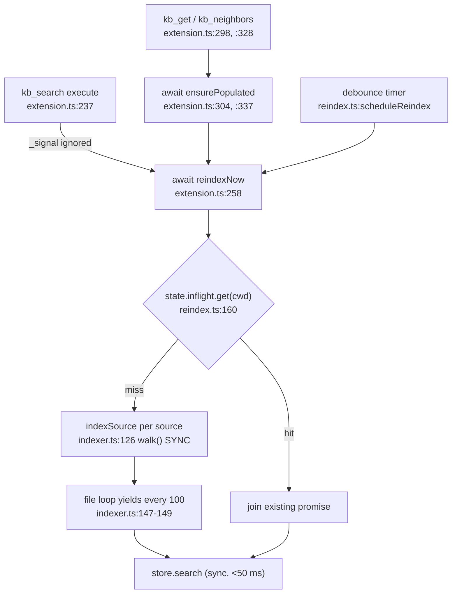

# Design — bound-kb-search-freshness

## Context

`kb_search` runs a freshness reindex before every query. Today that wait is unbounded, uncancellable, and — because the directory walk is synchronous — it blocks the whole Node thread, not just the tool.

Current call path on `develop`:

Issue #895 blamed four things. Two are already fixed by `fix-kb-gitignore-excluded-parent` (#899): `walk()` now prunes an ignored directory unconditionally (`packages/kb/src/indexer.ts:89-91`) and the matcher's descend phase skips an ignored child before parsing its `.gitignore` (`packages/kb/src/gitignore.ts:194`). What remains is that nothing bounds, cancels, or de-blocks the wait.

Provisional baseline, one warm macOS run while drafting (this repo, 4 sources, 2,885 selected files, 37,964 chunks, warm index, no changed files):

| Run | Warm reindex |
|---|---|
| 1 | 486 ms |
| 2 | 439 ms |

Caveats, stated because the budget default leans on this number: one host, one tree shape, warm only, no cold or deep-tree point, nothing from the Docker image or the Windows QA VM. It is an order-of-magnitude indication that the pre-search freshness pass costs hundreds of milliseconds on a repo with no pathology at all — not a calibration, and deliberately not compared against the 50 ms `store.search` median (`openspec/specs/kb-fts5-search-store/spec.md:315-319`), which measures a different stage on a different corpus size. Task 1.1 replaces it with warm + cold + deep-tree numbers before the default is frozen; the default stays overridable either way.

### Measured baseline and after (tasks 1.1, 5.1, 6.62 — recorded once, K3)

One macOS arm64 host, this repo (4 sources, 3,073 selected files). "Before" = `HEAD` indexer sources, "after" = this change, same script, same host, same session. Wall ms / max event-loop delay ms (`monitorEventLoopDelay`, 10 ms resolution).

| Case | Before | After |
|---|---|---|
| This repo, warm, median of 5 (K2) | 765 ms (host noisy; drafting runs were 439–486) | **447 ms** (≤ baseline + 10 %) |
| This repo, warm, max lag | 599 ms | 31 ms |
| This repo, cold (empty index) | 116.6 s, lag 16.6 s | 97.0 s, lag 11.6 s |
| Deep tree, 50,500 dirs (10,100 gitignored), cold | 2.57 s | 1.58 s, lag 20 ms |
| Deep tree, warm | 2.39 s | 1.58 s, lag 21 ms |
| Wide dir, 100,000 direct entries | 301 ms | 182 ms, lag 10 ms (R10 residual: one listing is not a problem at this size on this host) |
| Rename scan `git diff HEAD -M -z`, this repo | 184 ms | 92 ms (async, 2000 ms timeout) |

Findings: (1) the 1500 ms default is kept — warm pass 447 ms is ~3.4× headroom, deep tree pass is 1.6 s total (so a deep cold walk abandons the wait at the budget, background continues). (2) The cold full-repo pass spends its lag in the per-batch upsert (100 files per batch, FTS5 deletes/inserts), not in the walk; that is pre-existing, outside this change, and is why a cold first call returns the index-being-built line rather than waiting. (3) Slow-filesystem case (per-directory latency, test-plan X10) is not bounded by entry-count yields alone: a long run of cheap directories with slow `readdirSync` yields only every `WALK_YIELD_EVERY` entries. Not automated; candidate follow-up is a time-based supplementary yield.

## Goals

- A `kb_search` / `kb_get` / `kb_neighbors` call has a bounded worst case regardless of tree shape.
- Esc ends the call.
- A long walk over a deep or broad tree never freezes the session (other tools, UI, WS traffic keep running); one huge single-directory listing is the accepted residual (R10).
- Forward progress: a repo whose walk always exceeds the budget still converges to a fresh index (D2 states the honest limits of that claim).

## Non-goals

- Reducing the warm reindex cost itself (fs-watch invalidation, cached file list, worker thread).
- Cancelling an in-flight reindex.
- Any gitignore semantics change (#899 owns that).
- Converting `dox.ts`'s three `loadGitignoreMatcher` call sites (`dox.ts:338`, `:394`, `:553`) to the yielding variant — CLI/lint paths, not session-blocking tool calls.
- Reconciling the remainder of the two exclusion sets (only `.worktrees` is aligned here).
- Bounding or cancelling the `scope: "git"` stages (own forge budget, `openspec/specs/kb-git-forge-scope/spec.md:148`).

## Decisions

### D1 — Budget value 1500 ms, env-overridable, not a config key

Default `KB_FRESHNESS_BUDGET_MS = 1500`. One parse rule, one outcome per input class:

| Raw value (trimmed) | Effective budget |
|---|---|
| absent or empty | 1500 (default) |
| matches `/^\d+$/` and ≤ 60000 | that value (`0` = never wait) |
| matches `/^\d+$/` and > 60000 | 60000 (clamped down to the ceiling) |
| anything else — `-1`, `1500.5`, `1e3`, `1500ms`, `abc` | 1500 (default) |

Only a strict non-negative decimal integer is honoured. A negative value is malformed, not a synonym for "never wait" — `0` must be written as `0`. Above the ceiling clamps; it never falls back to the default. This is deliberately a single rule so each scenario has exactly one expected outcome.

Rationale for the value: the provisional baseline is 439–486 ms warm (see Context, with its caveats), so 1500 ms is roughly 3× headroom over the only data point in hand — a healthy repo should not reach the fallback and behaviour is unchanged. The degenerate case in #895 (160 s walk) is cut to 1.5 s. Upper bound sanity: 1.5 s budget + the FTS query keeps a `kb_search` well under ~1.6 s, which is tolerable inside an agent turn. The number is provisional until task 1.1; because it is overridable and spec'd as a default, re-calibrating it is a one-constant change, not a contract change.

Alternatives considered:
- **A kb config key (`freshnessBudgetMs`)** — deferred, not refused. The earlier justification ("the budget must be known before the store is opened") does not hold: `loadConfig(cwd)` is directly callable and merely *reached* through `getKb` today (`reindex.ts:131-143`). The honest reason is knob ownership: this is an operator escape hatch for a pathological host, not a per-project tuning dial, and a config key costs schema + validation + settings UI in `kb-config-and-init` for a value most repos never touch. The repo already runs both shapes — `KB_DOX_ENFORCEMENT` is env-only (`extension.ts:110`), `readDiscipline.guard.mode` is a config key with a `KB_GUARD_MODE` env override (`extension.ts:107`). If per-project values are ever needed, promotion follows the `KB_GUARD_MODE` pattern (config key, env wins) without changing the env name. Tracked in R4.
- **Adaptive budget (e.g. 3× the last observed reindex)** — rejected: needs persisted state and makes the contract unspecifiable ("how long can this take?" has no answer).
- **Drop the pre-search reindex entirely, rely on the debounce hook** — rejected: edits made outside pi's write/edit tools (git checkout, another agent, external editor) would never be picked up; the freshness pass is the only correctness guarantee `kb_search` offers.

### D2 — Budget expiry abandons the wait, never the work

The budget is a race between the shared in-flight promise and an unref'd timer. On expiry, the tool proceeds; the reindex promise keeps running, stays in `state.inflight` (`reindex.ts:160-172`) and settles normally — the caller just stops awaiting it.

Timer and rejection hygiene (spec'd, not left to the implementer):
- The timer is cleared as soon as the race settles, **including the fast path** where indexing wins. A completed call leaves no pending wakeup behind.
- The `.catch` is attached to the shared promise **at creation time**, not when a caller abandons it. Attaching only on abandon leaves a window with zero handlers attached, and if every waiter abandons there is nobody left to attach one — either way a rejected walk becomes an unhandled rejection. Each waiter's own `await` still observes the rejection and degrades to the existing-index fallback.

**A mid-walk partial index must be labelled too.** `ensurePopulated` only reindexes when `chunks === 0` (`reindex.ts:185-191`), while `indexSource` commits every 100 files (`indexer.ts:147-148`) — so during a first cold walk the chunk count is already non-zero and a `kb_get`/`kb_neighbors` arriving mid-walk would skip the guard entirely and serve a partial index with no label. Fix: the budgeted wait helper consults `state.inflight.get(cwd)` **before** the chunk-count test. If a pass is in flight the caller joins it under the budget regardless of chunk count, and labels the answer when the budget expires. `chunks === 0` remains the trigger for *starting* a pass, not the gate for *waiting* on one.

**Pass-state mechanism (what the label is computed from).** Today `reindexNow` returns a bare promise and `ensurePopulated` returns `void` (`reindex.ts:146-172`, `:185-191`), so nothing after the race can tell "finished" from "gave up". The budgeted wait helper therefore returns an outcome, and `ReindexState` gains one per-cwd fact:

- `awaitFreshness(state, cwd, { start: "always" | "if-empty", budgetMs, signal }): Promise<"done" | "timeout" | "failed" | "aborted">`. `"always"` = `kb_search` (start or join a pass); `"if-empty"` = `kb_get`/`kb_neighbors` (join an in-flight pass, else start one only when `chunks === 0`, else return `"done"` immediately with no walk).
- `state.completed: Set<string>` — a cwd is added only when a **real** pass for it finishes successfully: inside the `reindexNow` worker after every source's `indexSource` has resolved (`reindex.ts:164-170`), whatever the trigger (debounce, freshness or populate). It is **not** added by the removed-cwd no-op resolve (`reindex.ts:155-158`, which walks nothing), by `ensurePopulated`'s warm no-op, or by a rejected pass. `closeKbForCwd` (`reindex.ts:215-221`) deletes the cwd from it, and `closeKb` clears it, so a re-created worktree at the same path starts as never-completed. Process-local, like `state.inflight`.

Outcome → model-facing status (one rule, used by all three tools):

| Outcome | Extra condition | Status line |
|---|---|---|
| `done` | — | none (a completed-but-empty pass is a normal empty result) |
| `done` without waiting (warm, no pass in flight, `if-empty`) | — | none |
| `timeout` | `chunks === 0` **and** `!state.completed.has(cwd)` | index-being-built (D5) |
| `timeout` | otherwise | staleness (D5) |
| `failed` | — | staleness, then the existing-index answer (never "being built": a deterministic failure would otherwise say "retry shortly" forever) |
| `aborted` | — | cancellation (D3) |

Keying "being built" on pass state rather than chunk count alone means a source that legitimately yields zero chunks (missing dir — `indexer.ts:114` returns `missing: true` — or no indexable files) reports "being built" at most until its first pass completes, then returns a normal empty result. Budget `0` is simply `timeout` whenever a pass is in flight at answer time; for `kb_get`/`kb_neighbors` on a warm index with nothing in flight it is `done` with no walk and no label, which keeps the "warm index is not re-walked" contract.

Rationale:
1. The promise is shared with the debounce path and with every concurrent pull-tool call; one caller's timeout must not starve the others.
2. `indexSource` commits in batches of 100 files (`indexer.ts:147-151`), so abandoned work is already persisted and queryable.
3. Cancelling instead would restart the walk from scratch on the next call: a repo whose walk always exceeds the budget would never finish indexing. Letting it run is what makes progress possible at all.

**How strong the convergence claim actually is.** Weaker than the earlier "the second call joins an almost-finished walk", which assumed the inter-call gap exceeds the remaining walk time — false in exactly the repos this change targets. What holds:
- A started pass runs to completion unless the process exits, and its batched commits persist (`indexer.ts:147-151`). It finishes in bounded wall-clock time with no caller waiting.
- Until it finishes, chunks for files it has not yet visited keep serving their previous (stale) content. That is precisely why D5 labels the answer instead of claiming freshness.
- A caller arriving mid-pass joins it (see above) and is labelled again if the budget expires again. The worst case is "labelled stale for the duration of one walk", not "never fresh".

What does **not** hold: any promise that a particular call sees a fresh index. On a repo whose walk always exceeds the budget, successive calls may all be labelled stale while the background pass cycles. Honest framing: the *index* converges; an individual *call* does not promise freshness, it promises an accurate label.

Considered and deferred: coalescing the debounce path into one long-lived background walk. Today a debounce-triggered reindex landing during an abandoned-but-still-running pass joins it (`reindex.ts:160-163`) and therefore returns when *that* pass ends, not when a pass covering the just-edited file ends. Pre-existing behaviour, made more visible by longer-lived passes; the join is idempotent and the next debounce picks the file up. Recorded as R6 rather than fixed here.

Trade-off: a pathological walk now runs in background while the agent works. Bounded by coalescing (at most one walk per cwd *per process* — see R2) and by the cooperative yielding of D4.

### D3 — `AbortSignal` ends the caller, not the shared work

Each of the three tools checks the signal at stage boundaries: before awaiting the reindex, after the wait, before the post-search verdict enrichment (`enrichHits`), and after it. On an aborted signal the tool returns promptly rather than throwing, matching the module's existing never-break-retrieval posture (`extension.ts:259-261`, `:305-307`).

**Enrichment has two cost components, only one of them hit-bounded.** (a) The per-hit loop (`packages/kb/src/verdict.ts:387`, per-hit `readFileSync` at `:150`, `stat` at `:358-363`) is bounded by the result `limit` (default 10, max 100 — `extension.ts:245`); it stays synchronous and has no internal cancellation point. (b) On the first hit with an absent subject, `getRenames()` (`verdict.ts:365`, `:385`) calls `renameBatch()` (`verdict.ts:224-237`), which runs a **repo-wide** `git diff HEAD --name-status -M -z` through `execFileSync` with a 64 MB buffer (`verdict.ts:219-221`). That cost scales with the working-tree diff and rename detection, not with the hit cap, and it pins the event loop exactly like the walk. In scope here, same file, small:

- `renameBatch` becomes async: the default runner uses promisified `execFile` with `timeout: RENAME_SCAN_TIMEOUT_MS` (2000 — accepted as the default, decision K6) and the caller's `signal`. `getRenames` memoizes the **promise** (still one scan per enrichment). The injectable `EnrichCtx.git` may return `string | Promise<string>` so existing sync test runners keep working.
- `EnrichCtx` gains optional `signal?: AbortSignal`; `kb_search` passes its own. `cli.ts:303` and `eval/measure-search-latency.ts` pass none and behave as today except for the timeout.
- Timeout, abort and spawn failure all take the existing `catch` (`verdict.ts:228-230`): empty rename map → absent subjects degrade to `GONE`, the documented non-git degrade (`verdict.ts:15`, `:193`). An abort additionally makes the tool return the cancellation result (post-enrichment signal check), so no degraded verdict is shown to the model on cancel. Trade-off recorded as R9.

Cancelled-result shape (identical across the three tools, so a test can assert it):
- `condensed` text / `kb_get` / `kb_neighbors` text: the single line `(cancelled — no results retrieved)`, and nothing else. No hits, no JSON node list, no `(not found)`.
- `kb_search` with `format: "json"`: the same line, then the bare array `[]` on the final line (D5's json rule). `kb_get` and `kb_neighbors` have no `format` parameter, so the json clause does not apply to them.
- Precedence: the entry check runs before the empty-query check, so an empty query with an already-aborted signal returns the cancellation result, not the empty marker.
- `details.aborted: true` additionally, for rendering only — `details` is not model-facing (see D5).
- The tool does **not** throw: an `AbortError` propagating out of a tool ends the call in an error state, which is exactly the "never break retrieval" posture this module already takes for indexing failures.

Interaction with the read-discipline guard: unchanged. The guard resets the chain on the tool **name** at `tool_call` time, before `execute` runs, and never sees the result (`packages/kb-extension/src/guard.ts:88-95`, `:138`; hook at `extension.ts:382-383`). That matches the existing `kb-read-discipline` rule that an attempt to consult is a consult, so a cancelled, stale or index-being-built call still resets the chain. No guard change, no spec change to `kb-read-discipline`.

The FTS query itself is synchronous and inside the 50 ms median budget, so there is no mid-query cancellation point — and none is needed.

`scope: "git"` calls are **out of scope** for this requirement: they return before any docs stage (`extension.ts:246-252`, `:330-334`) and the forge path has its own request budget and "sync in progress" notice (`openspec/specs/kb-git-forge-scope/spec.md:148`, `:243`). The only part that applies to them is the already-aborted pre-check at tool entry, which is cheap and uniform.

Alternative considered: thread the signal into `indexSource` and abort the walk. Rejected for the same reason as D2 (shared promise, lost progress).

### D4 — The walk and the gitignore pre-scan yield to the event loop

`walk()` becomes `async`, awaiting a `setImmediate` every `WALK_YIELD_EVERY = 500` directory entries processed (same spirit as the existing `YIELD_EVERY = 100` file batch; higher because a `readdirSync` entry is far cheaper than a read + hash + chunk). A named constant, so the spec scenarios ("more entries than the walk yield threshold") are testable against one number.

The gitignore pre-scan is brought **into** scope here, because leaving it out would leave the "never freezes the session" goal false: `loadGitignoreMatcher`'s descend phase (`gitignore.ts:176-198`) is a second synchronous recursive `readdirSync` over the same pruned tree, run at `indexer.ts:125` before the walk even starts. The cheap shape: add an async sibling loader that yields on the same threshold and `await` it from `indexSource`; the existing synchronous export stays for `dox.ts`'s three CLI/lint call sites (`dox.ts:338`, `:394`, `:553`), which are not inside a session-blocking tool call. Pattern collection order (shallow before deep) is unchanged, so matcher verdicts are identical.

**One descend rule, two drivers.** To keep the sync and async loaders from drifting, the per-directory decision is extracted once into a pure helper in `gitignore.ts` — given a directory, it applies the `prune` check, parses that directory's `.gitignore`, lists and sorts its entries, and returns the child directories to descend (skipping `.git` and `dirIgnored` children, `gitignore.ts:179-197`). The sync loader recurses over it; the async loader iterates over it with an explicit pre-order stack and yields every `WALK_YIELD_EVERY` directories. Only the driver differs. A parity test runs both loaders over several fixture trees (flat, nested `.gitignore` with negation, ignored parent with its own `.gitignore`, pruned dir) and asserts identical pattern lists in identical order. `walk()` needs no such split: it has a single (async) implementation after this change.

**What the yields bound.** Yields happen every `WALK_YIELD_EVERY` entries *processed*; they bound deep and broad trees, not one huge directory, whose `readdirSync` is a single blocking call (R10).

Alternatives considered:
- **Worker thread for indexing** — rejected: a store handle cannot cross threads; it would need an IPC protocol and a second SQLite connection, for a case the yield fixes in a few lines.
- **Fold the gitignore scan into the walk** (one traversal instead of two) — rejected here as a larger refactor of #899's semantics; the async sibling gets the liveness win without touching verdict logic.
- **Yield only when a depth/entry threshold is crossed** — rejected: extra state for no measurable gain; a `setImmediate` per N entries is already negligible against `readdirSync` + `statSync`.

### D5 — Staleness is reported in the model-facing channel

pi documents a tool result's `content` as model-facing and `details` as "for rendering or state reconstruction" (`@earendil-works/pi-coding-agent/docs/extensions.md:136`, the pi package docs, not this repo's `docs/`). A staleness flag that lives only in `details` is therefore invisible to the agent — the exact failure this decision exists to prevent. So every marker goes in the **text**, on all three tools; `details.stale: true` is additive, for the UI only.

| Tool / format | Text when the pass did not complete |
|---|---|
| `kb_search` condensed | leading line `(index refresh still running — results may be stale)`, then the entries unchanged |
| `kb_search` json | the same leading line, then the bare hits array **on the final line** |
| `kb_get` | the same leading line, then the body (or `(not found: <path>)`) |
| `kb_neighbors` | the same leading line, then the pretty-printed node JSON block unchanged |

Which line (if any) appears is decided by the outcome table in D2. `kb_get`/`kb_neighbors` have no `format` parameter; the status line always sits on its own line **before** the body / JSON block.

The json rule stays inside the existing contract that tool output "SHALL NOT be auto-parsed by any consumer" (`openspec/specs/markdown-knowledge-base/spec.md:725`, retained verbatim): the hits array is emitted **byte-identically** to today (compact, unwrapped, no `{stale, hits}` object) as the final line, and a status line, when present, is a single line before it. No parseability promise is added; `store.search()` stays the structured interface. Alternative considered: a wrapper object when stale — rejected, it makes the shape conditional. `details` still carries the flag for the dashboard renderer.

**Cold (zero-chunk) index.** The base requirement is "never returns a false-empty result" (`openspec/specs/markdown-knowledge-base/spec.md:284-287`), which a plain empty answer with a leading notice would still violate in spirit: `[]` plus a notice is indistinguishable in shape from a real empty result set. So when the outcome is `timeout`, the index holds zero chunks and no pass has ever completed for this cwd (D2 table), the tools return an **explicit index-building result, not a hit list**: text `(index is still being built — no results available yet; retry shortly)` and, for json, that line followed by `[]`. `kb_get`/`kb_neighbors` emit the same line in place of `(not found)` / an empty node list. The distinction is: never-completed and empty → "not indexed yet" result; otherwise incomplete pass → normal results with the staleness line; completed (even if empty) → normal result, no line. Population continues either way, so a later call is served from the completed index. This keeps "never false-empty" true without needing a second, longer cold budget.

Alternative considered: a separate, much longer (or unbounded) cold-start budget. Rejected — it reintroduces the unbounded first call that #895 is about, for a case the explicit marker already handles; the cold path keeps the same budget and the same abortability.

Alternative considered: silent degradation. Rejected — the agent cannot otherwise tell "no hits" from "not indexed yet", which is exactly the failure mode `fix-kb-neighbors-get-cold-start` was raised for.

### D6 — `.worktrees` joins the indexer's built-in exclusion set

`packages/kb/src/indexer.ts:43` gains `.worktrees`, the one entry it is missing relative to `packages/kb/src/dox.ts:28`. This aligns that single directory, **not** the two exclusion sets as a whole — `dox.ts`'s set keeps roughly twenty further DOX-specific entries (`out`, `openspec`, `site`, `.github`, …) which are deliberately not indexer policy. Since #899 a gitignored `.worktrees/` is already pruned, so this covers the remaining case: a `.worktrees/` that is **not** gitignored (pi creates worktrees there and a repo need not ignore the directory). It also short-circuits the matcher's own descent, which is driven by the same regex via the `prune` callback (`indexer.ts:125`). The eval harness already hard-excludes `**/.worktrees/**` (`packages/kb/eval/run-fixtures.ts:90`), so fixture scores are unaffected.

No opt-out is provided, exactly as for `node_modules`/`dist`/`coverage`: `DEFAULT_EXCLUDE` is pruned before include globs and before gitignore verdicts are consulted, so neither an `include` glob nor a `!`-negation can re-admit a path under it. That matches git's own excluded-parent semantics (a negation cannot re-include under an excluded directory) and is policy, not a gitignore-semantics change — #899's rules are untouched. A repo that intentionally keeps notes under `.worktrees/` must move them or configure that path as an explicit source; the migration note in `proposal.md` records this.

Alternative considered: leave it to gitignore. Rejected — the two walks diverging is itself the bug reported in #895 §Suggested fixes 1, and a known-huge, never-interesting directory should not depend on repo hygiene.

### D7 — Verification thresholds (decisions K1–K4)

The goals above ("never freezes", "warm path unchanged", "bounded") get one number each, so the test plan has a pass bar:

| Id | Concern | Pass bar |
|---|---|---|
| K1 | Event-loop responsiveness during the walk and the gitignore pre-scan | max event-loop delay ≤ **250 ms** (measured with `perf_hooks.monitorEventLoopDelay`), on trees whose single-directory listings are not the R10 residual |
| K2 | Warm-reindex regression | **median of 5 runs ≤ task-1.1 baseline + 10 %** |
| K3 | Deep tree, wide directory, rename-scan cost | automated as **scaled-down L1 timed tests** (≈5k directories; wide dir scaled to match; fixture git repo for renames) asserting K1 and the budget; the full-scale run (≥50k dirs / ≥100k entries / this repo's rename scan) is **recorded once in this design** by tasks 1.1 and 5.1, not run in CI |
| K4 | Settle exactly at the budget | timer-vs-settle ordering at `t == budget` is nondeterministic and is **not** asserted; fake-timer tests pin **1499 ms → done** and **1501 ms → timeout** |

K5 (cold start → explicit index-being-built result, no second budget) is D5; K6 (2000 ms rename-scan timeout) is D3.

## Risks / Trade-offs

- **R1 — A stale answer is now possible.** Mitigated by D5's model-facing label and by D2's bounded-convergence argument. Note the honest limit: on a repo whose walk always exceeds the budget, consecutive calls can all be labelled stale. Risk accepted; the alternative is the 8-minute freeze.
- **R2 — Background work during a turn, and more than one walker.** Coalescing covers only the extension's `state.inflight`. The kb plugin runs its own `indexSource` through a separate job registry with its own inflight map (`packages/kb-plugin/src/server/job-registry.ts:38`, `packages/kb-plugin/src/server/kb-routes.ts:232`), so a dashboard-triggered index job and an extension freshness pass can walk the same cwd concurrently — pre-existing (both already write through batched transactions on separate store handles), but longer-lived abandoned passes widen the overlap window. Not fixed here: a cross-process lock is its own change. Worst case is duplicated work and slower turns, not corruption.
- **R3 — Residual synchronous cost outside the yielding scan.** D4 makes the indexing path's gitignore pre-scan yield, but the synchronous `loadGitignoreMatcher` export remains for `dox.ts`'s CLI/lint call sites, which can still pin the thread when invoked. Accepted: those run outside a session tool call. #895 measured 4.4 s for the scan pre-#899; with unconditional pruning plus D6 its descent is the same pruned tree as the walk.
- **R4 — Env-only knob is undiscoverable.** Documented in `docs/`; promotion to a config key follows the `readDiscipline.guard.mode` + `KB_GUARD_MODE` precedent if a per-project need appears (D1 alternatives).
- **R5 — `walk()` becoming async touches the indexer hot path** used by CLI indexing and the plugin's index jobs as well as the extension. It is internal and already awaited through `indexSource`, so the blast radius is one `await` (plus one for the async matcher loader).
- **R6 — A debounce reindex can be absorbed by a long background pass.** A debounce firing while an abandoned pass is running joins that pass (`reindex.ts:160-163`) and so completes on its schedule, not on one covering the just-edited file. Pre-existing coalescing behaviour; more visible now. Mitigated by idempotency (the next debounce or the next freshness pass picks the file up) and by the staleness label in the meantime.
- **R8 — A cancelled or index-being-built call still resets the read-discipline chain** (D3). It delivered no evidence, but the guard decides at `tool_call` time by name. Accepted: consistent with `kb-read-discipline`'s "an attempt to consult is a consult"; changing it would need result-time guard logic and a spec change in that capability.
- **R9 — Enrichment is only partly interruptible.** The per-hit loop stays synchronous; a cancel raised inside it is observed after it returns (bounded by the 100-hit cap). The repo-wide rename scan becomes async with a 2000 ms timeout and the caller's signal (D3); on a repo whose `git diff -M` exceeds the timeout, absent subjects report `GONE` instead of `MOVED` — the same degrade a non-git cwd already gets. Accepted: a wrong-but-labelled verdict on a pathological repo beats a frozen session. Timeout constant is a one-line change if QA hosts need more.
- **R10 — A single very wide directory is one blocking call.** D4's yields bound deep or many-directory trees, not one wide directory: `readdirSync` returns a whole directory in one call, and the scan sorts that listing synchronously (`gitignore.ts:186-190`). A directory with hundreds of thousands of direct entries still blocks for that one listing. Accepted, with task 1.1 measuring a wide-directory case; streaming via `fs.promises.opendir` is the follow-up if the measurement says otherwise (not trivial for the scan, whose sorted pre-order is part of its pattern-order contract).
- **R7 — No opt-out for a non-gitignored `.worktrees/`.** Content kept there intentionally leaves the index via orphan removal on the next walk (D6, and the proposal's migration note). Accepted: it matches how every other `DEFAULT_EXCLUDE` entry behaves.

## Open Questions

- Is 1500 ms right for the slowest supported host (Docker image on a spinning disk, Windows VM in `qa/`)? The current number comes from one warm macOS run; task 1.1 adds cold and deep-tree points (full scale, recorded here per K3). A QA-host data point is tracked as a manual post-merge check (test-plan M1), not a blocker.

Resolved:
- ~~Should a cold (zero-chunk) index get a second, longer budget?~~ **No (K5).** The explicit "index is still being built" result of D5 stands; one budget, one abort story.
