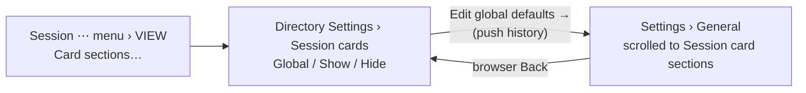

# Design: card-sections-global-pointer

Accepted mock (user-approved 2026-11-23, `decision.json` status `accepted`): `mockups/2026-11-23-card-sections-global-pointer/mock.tsx`, with three frames:
1. Folder page: ring 1 is the scope strip and link; ring 2 is the `Global (…)` label.
2. VIEW group: one item.
3. Click-through: folder → global block. Browser Back returns to the folder page.

## Decisions

### D1 — Pointer lives in the existing summary strip
The strip already explains the relationship ("N override(s)… follows global defaults")
and holds `Reset to global`. Putting `Edit global defaults →` beside it keeps both
scope actions in one place (Gestalt proximity), and it adds no new banner.
- The strip copy gains "the" ("follows the global defaults") as in the mock. This is
  an English-only fallback edit to `cardSections.overrideCount`; the hu/zh-CN strings
  have no article and stay as they are.
- `data-testid="card-sections-open-global"`.
- State: always enabled. It is navigation, not a write, so unlike `Reset to global` it
  ignores `canWrite` and the override count.
- Layout: the strip becomes `flex-wrap`. At narrow widths the two buttons wrap below the
  text as a pair, `Edit global defaults →` first, and the text never truncates.

### D2 — `Global (…)` replaces `Default (…)`
The inherit option names where the value comes from. This is recognition over recall
(Nielsen #6), and the wording matches `Reset to global` (consistency, Nielsen #4).
- Both `Global (Show)` and `Global (Hide)` are kept.
- i18n keys. English lives as inline fallbacks; hu and zh-CN live in `lib/i18n/i18n-hu.ts`
  and `lib/i18n/i18n-zh-CN.ts`.
  - New: `cardSections.globalShow`, `cardSections.globalHide`, `cardSections.editGlobalDefaults`.
  - Changed English fallback: `cardSections.overrideCount`, `cardSections.noOverrides`
    ("the global defaults").
  - Removed: `cardSections.defaultShow` and `cardSections.defaultHide`. Their only users
    are `CardSectionsPage.tsx:60-61` plus the hu/zh-CN entries.
  - Also removed: the `sessionMenu.cardDefaults` fallback. It has no locale entries.
- The option's `data-testid` suffix stays `-inherit`. Its value semantics are unchanged.
- Trade-off (accepted): the shown value is `resolveCardSectionVisible` minus this row's
  override (`CardSectionsPage.tsx:44-62`, `packages/shared/src/card-sections.ts:252-265`),
  so it can reflect a Focus-profile value or a legacy parent's folder override, not
  only the global value. `Default (…)` had the same imprecision. The page already
  shows `FocusNotice` while Focus is active. The value semantics stay unchanged.

### D3 — Single VIEW entry (Hick's law)
- Remove the `card-defaults` item and the `openCardDefaults` action from
  `SessionMenuActions` and from `SessionCard`.
- `Card sections…` already resolves the group folder, including worktrees.
- Global access is one extra click from there, and it's labelled.

### D4 — URL-addressable Settings scroll target
`SettingsPanel` scrolls to `pendingScrollTargetRef` only for in-panel rail navigation
(`SettingsPanel.tsx:1184-1199`). The `settings-panel` spec
(`openspec/specs/settings-panel/spec.md:1599-1626`) forbids route-encoding that
helper's target. This change MODIFIES that requirement to add an external-only one-shot
parameter, and the internal helper stays route-free:
- Form: query `?scroll=<data-testid>`, canonical `/settings/<page>?scroll=…` only. No
  hash form: `splitLocation` drops hashes (`overlay-background.ts:41-48`).
  - The panel's alias, invalid-page and legacy `?tab=` rewrites
    (`SettingsPanel.tsx:871-885`) rebuild the URL without the search, so `scroll` is
    dropped on those paths. That is accepted and documented: callers use the canonical
    form.
- Untrusted input: the value comes from the URL.
  - Accept only `^[a-z0-9-]{1,64}$`; anything else is removed without querying.
  - Look the element up with
    `document.querySelector(\`[data-testid="${CSS.escape(v)}"]\`)` inside `try`/`catch`,
    so a hostile value can never throw out of the effect into the panel's error boundary.
- Offset: reuse the in-panel target's behaviour (`pi-runtime-section`,
  `scrollIntoView({block:"start"})`). Add a `scroll-mt-*` only if isolated verification
  shows the block obscured.
- Timing: the panel renders a loading screen until `/api/config` resolves
  (`SettingsPanel.tsx:1291`), and Settings cold-mounts on a cross-surface move. The
  consumer must therefore run after `loading` is false and the page has rendered, not
  on the first `activeTab` commit. Its effect depends on `[loading, activeTab, scroll]`.
- Consumption: read the param with wouter's reactive `useSearch()`, not
  `window.location.search` (which is not reactive), and guard with a consumed-ref.
  Then `scrollIntoView` the element if present, and
  `navigate("/settings/<page>", { replace: true })` whether or not it was found.
  This stays idempotent under StrictMode double effects: the ref blocks a second scroll,
  and once the replace lands the param is gone.
- Alternative considered: the existing `#hash` anchors (`AccessSection.tsx:108` →
  `/settings/security#network-access`). Rejected because native anchor scroll fires
  before the async-loaded panel renders the block, `splitLocation` drops the hash, and
  the user specified `?scroll=card-sections-settings`.
- Cold mount only: the link lives outside Settings, so Settings mounts fresh with no
  draft state, and the unsaved-changes guard has nothing to protect.
- Target: `card-sections-settings`, the existing root testid of `CardSectionsSection`
  (`CardSectionsSection.tsx:33`).
- Navigation uses a normal `navigate()` push, not `replace`, so browser Back returns to
  the folder page. Overlay routing (`lib/nav/overlay-background.ts`) treats the
  Directory Settings → Settings move as a cross-surface move. Verify that Back restores
  the folder page and not the underlying session.

## Risks

- **Overlay background stacking.** `overlaySurfaceId` gives Directory Settings
  (`folder:<cwd>:settings`) and Settings (`settings`) different surfaces, so
  `recordLauncher` records the folder page as Settings' launcher
  (`lib/nav/overlay-background.ts:116-153`). Back should therefore return to the
  folder page. The follow-up `replace` that strips `?scroll=` must not lose that
  launcher record. Mitigation: a Playwright test on browser Back, and a check of the
  in-panel back arrow (`onBack`).
- **Translations.** hu/zh-CN strings for `Global (…)` and `Edit global defaults` need
  review by the owners of those locales.
