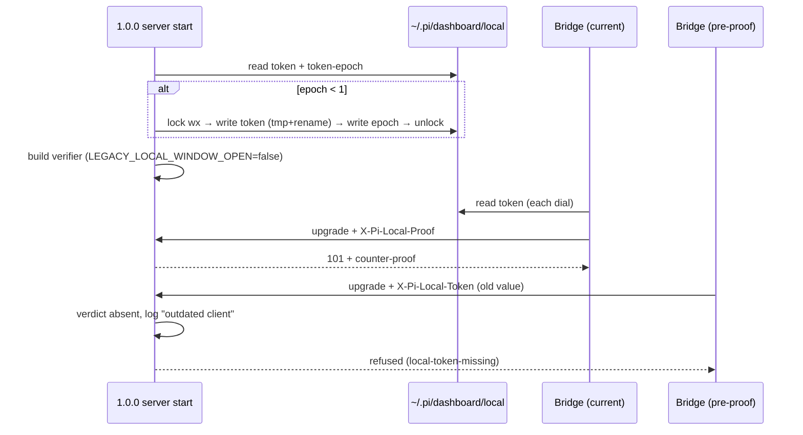

## Context

See proposal.md (Why). Predecessor: archived `2026-10-11-loopback-credential-proof`, D9.

Current state (verified in source):

- `server.ts:623` — `createLocalCredentialVerifier({ token: localToken, acceptLegacyToken: true })`.
  `local-credential.ts` `stamp()`: no `X-Pi-Local-Proof` → `verifyLocalToken` on the raw header → `legacy` verdict + rate-limited deprecation log.
- `server.ts:1133` — `bridgeAuth.requireTicketOnLoopback: false`. `bridge-upgrade-auth.ts` admits a loopback upgrade on `legacy`, then on the grace, before refusing (`local-token-missing` / `local-proof-invalid`). `pi-gateway.ts:1097` already forces `true` when `requireLocalCredential` (POSIX fallback listener).
- `auth/local-token.ts` `ensureLocalToken()` — mint-if-absent, otherwise reuse forever. Called once in `createServer` (`server.ts:617`), **before** `start()` establishes the home rendezvous (`server.ts:~3066`). Attach mode lets several instances share one HOME, and so one token file.
- Token consumers re-read the file on every use: bridge `local-token-header.ts` (on each dial), Electron `local-proof-bootstrap.ts` (on each request), CLI (on each invocation). `local-proof.ts` derives `k_local` from the token, so a rotation invalidates every `pi_dash_local` cookie.
- No shipped client sends the raw header. The only references to `X-Pi-Local-Token` are server-side.
- Package version is `0.9.0`. This change ships in the 1.0.0 release.

## Goals / Non-Goals

**Goals:**
- One switch closes both the raw-header acceptance and the tokenless loopback grace.
- Rotate the token exactly once on the first 1.0.0 start, before anything verifies or derives from it.
- Give the operator an actionable log line when a pre-1.0.0 client shows up.

**Non-Goals:**
- Deleting the `acceptLegacyToken` / `requireTicketOnLoopback` module options and the `legacy` verdict kind. They stay as test seams, and removing them is a separate dead-code cleanup.
- A user-facing `token rotate` CLI command.
- Remote (non-loopback) bridge auth. It never had the grace and is unchanged.
- `cross-site-request-gate` wording that mentions the grace's precedence. It stays true (vacuously) and is left alone.

## Decisions

### D1 — One exported constant replaces both literals

`local-credential.ts` exports `LEGACY_LOCAL_WINDOW_OPEN = false`. `server.ts` wires
`acceptLegacyToken: LEGACY_LOCAL_WINDOW_OPEN` and
`requireTicketOnLoopback: !LEGACY_LOCAL_WINDOW_OPEN`.
- Why: the old spec promised "a single server switch". Two hand-flipped literals can drift apart. A named constant is also something a test can assert against the production wiring.
- Alternative considered: flip the two literals in place. Smaller diff, but nothing ties them together and no test sees them.
- Alternative considered: delete the options. Rejected for now, because ~10 test files use the options as seams (see Non-Goals).

### D2 — A raw header is ignored, never compared

With the window closed, `stamp()` does not call `verifyLocalToken` at all. A
request carrying only `X-Pi-Local-Token` gets the `absent` verdict. If the
header is non-empty, the verifier emits a rate-limited line (same `limited()`
helper and 60 s / per-caller-kind budget as today):
`[local-credential] outdated client sent retired X-Pi-Local-Token (<kind>); update/reload it — send X-Pi-Local-Proof`.
- Why no comparison: if the comparison ran, a log line or any behaviour that depended on its result would reveal whether a harvested value is still current. Skipping it leaves no oracle and no timing side channel.
- Why `absent` rather than a new `retired` verdict: every downstream exemption site, refusal cause and response body stays byte-identical to the no-credential case, which is what the spec requires. The log line is the only difference.

### D3 — One-shot rotation keyed by an epoch file

`local-token.ts` gains `REQUIRED_TOKEN_EPOCH = 1` and a sibling file
`~/.pi/dashboard/local/token-epoch` (integer, `0600`). `ensureLocalToken`:
1. No token → mint, write the token, write the epoch.
2. Token present and epoch ≥ required → reuse (unchanged behaviour).
3. Token present and epoch missing/lower → rotate:
   a. mint a new secret;
   b. write `token.tmp-<pid>` (`0600`), `fsync`, `rename` over `token` (atomic; a reader never sees an empty or partial file);
   c. write the epoch file the same way, **after** the token.

A crash between b and c rotates once more on the next start, which is harmless.
- Alternative considered: rotate on every start. Rejected: it contradicts the reuse requirement, and every restart would log every browser out of strict-mode local proof.
- Alternative considered: rotate in the installer or postinstall. Rejected: npm, Electron and docker are separate channels. Server start is the one choke point all of them pass through.
- Alternative considered: derive the epoch from the package version. Rejected: it couples rotation to every version bump. An explicit integer is bumped only when rotation is actually wanted.

### D4 — Rotation is serialised across instances on one HOME

`ensureLocalToken` runs before the home rendezvous, and attach-mode instances
share the token file. The rotate path (case 3 only) therefore runs under an
exclusive lock: `fs.openSync("token.rotate.lock", "wx")`.
- The winner re-checks the epoch under the lock, rotates, and unlinks the lock.
- The loser polls briefly (≤ 2 s, 50 ms steps) for the epoch to reach the required value, then reads the token.
- A lock older than 10 s is treated as stale (crashed winner) and removed.

Cases 1 and 2 take no lock, so steady-state start cost is unchanged.
- Alternative considered: reuse the home-rendezvous lock. Rejected: it is acquired later, in `start()`, and moving `ensureLocalToken` after it would reorder all the credential wiring in `createServer`.

### D5 — Effect on live state

- Rotation happens at process start, before the verifier, `localTrust` and the
  pairing guards are built. No in-process stale copy of the token can exist.
- Current-version bridges, CLI and Electron re-read the file, so they follow the rotation on their next dial or request.
- `pi_dash_local` cookies die with the old key. Electron re-bootstraps on every
  window load (`loadWithLocalProof`). A plain browser under `requireLocalProof`
  re-runs `pi-dashboard open`.
- A **still-running older instance** on the same HOME keeps the old token in
  memory, so current clients' proofs fail against it. The migration plan says to
  stop all instances first.

## Risks / Trade-offs

- [Old bridges in long-running pi sessions are cut off] → BREAKING note in the
  CHANGELOG; the refusal log names the caller kind and says to reload. `npm run reload` fixes it.
- [Older instance still running on the same HOME] → its in-memory token is now
  stale and current clients are refused there. Mitigation: migration step
  "stop every dashboard instance before starting 1.0.0", and say so in the CHANGELOG.
- [Rollback to 0.9.x re-opens the window] → while rolled back, legacy clients
  send the raw (rotated) token again, and the epoch file stops a later re-upgrade
  from rotating a second time. Mitigation: the rollback note says to delete
  `local/token-epoch` before re-upgrading.
- [Stale rotation lock] → handled by the 10 s staleness rule. The worst case is one extra rotation.
- [Windows rename-over-existing] → `fs.renameSync` replaces atomically on NTFS
  when the target is not held open, and no reader holds the token open.
  The rotation test runs on the Windows CI leg.

## Migration Plan

1. Release as 1.0.0 (BREAKING). CHANGELOG: update CLI and Electron, stop every dashboard instance, start 1.0.0, then `npm run reload` all pi sessions.
2. On first start the token rotates, and `token-epoch` = 1 is written.
3. Rollback: install 0.9.x. It reads the rotated token fine and ignores `token-epoch`. Delete `~/.pi/dashboard/local/token-epoch` before upgrading again so the token rotates a second time.
