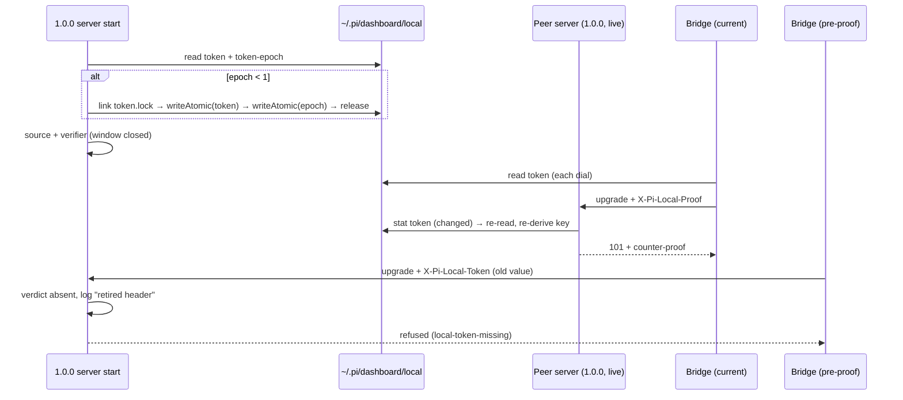

## Context

See proposal.md (Why). Predecessor: archived `2026-10-11-loopback-credential-proof`, D9.

Current state (verified in source):

- `packages/server/src/server.ts:623` — `createLocalCredentialVerifier({ token: localToken, acceptLegacyToken: true })`.
  `auth/local-credential.ts:218` `stamp()`: no `X-Pi-Local-Proof` → `verifyLocalToken` on the raw header → `legacy` verdict + `limited()` (`:136`) deprecation log.
- `server.ts:1133` — `bridgeAuth.requireTicketOnLoopback: false`. `pi/bridge-upgrade-auth.ts:156-175` admits a loopback upgrade on `legacy`, then on the grace, before refusing (`local-token-missing` / `local-proof-invalid`). `pi/pi-gateway.ts:1097` already forces `true` when `requireLocalCredential` (POSIX fallback listener).
- `auth/local-token.ts:39` `ensureLocalToken()` — mint-if-absent (plain `writeFileSync`), otherwise reuse forever. Two callers:
  - `server.ts:617`, in `createServer`, **before** `start()` establishes the home rendezvous (`server.ts:3066`);
  - `cli.ts:883` `safeEnsureLocalToken()`, used by `open`, `login --local` and `token create` (`cli.ts:680,755,802,847`).
- Attach mode (`lifecycle/home-rendezvous.ts`) lets several instances share one HOME, and so one token file. Each server derives its keys once at startup (`auth/local-credential.ts:131`, `auth/local-proof.ts:33`).
- Token readers re-read the file on every use: bridge `extension/src/local-token-header.ts:47` (on each dial), Electron `electron/src/lib/local-proof-bootstrap.ts:22` (on each request), and the CLI (on each invocation). `auth/local-proof.ts:10` derives `k_local` from the token, so a rotation invalidates every `pi_dash_local` cookie.
- Senders of the raw header: no product code. Test harnesses do send it: `tests/e2e/helpers/bridge-credential.ts:67`, `tests/e2e/team/team-harness.ts:165`, `tests/e2e/identity-matrix/{security,multi-user,browser-login}.spec.ts`, `tests/e2e/remote-transcript-read.spec.ts:228`. In addition, `server/src/test-support/local-credential-stamp.ts` stamps the `legacy` verdict for 4 unit-test files.
- Package version is `0.9.0`. This change ships in the 1.0.0 release.

## Goals / Non-Goals

**Goals:**
- One switch closes both the raw-header acceptance and the tokenless loopback grace.
- Rotate the token once, at the first 1.0.0 server start, before anything verifies or derives from it, without stranding live servers on the same HOME.
- Give the operator an actionable log line when a pre-1.0.0 client shows up.

**Non-Goals:**
- Deleting the `acceptLegacyToken` / `requireTicketOnLoopback` module options and the `legacy` verdict kind. They stay as module seams, and removing them is a separate dead-code cleanup.
- A user-facing `token rotate` CLI command.
- Remote (non-loopback) bridge auth. It never had the grace and is unchanged.
- Detecting a rollback-and-re-upgrade automatically (see Risks).

## Decisions

### D1 — One exported constant replaces both literals

`auth/local-credential.ts` exports `LEGACY_LOCAL_WINDOW_OPEN = false`. `server.ts` wires
`acceptLegacyToken: LEGACY_LOCAL_WINDOW_OPEN` and
`requireTicketOnLoopback: !LEGACY_LOCAL_WINDOW_OPEN`.
- Why: two hand-flipped literals can drift apart, and one name documents the window.
- The production wiring is checked by behaviour (task 2.3, a real server refusing a tokenless or raw-token loopback upgrade), not by asserting the constant's value.
- Alternative considered: flip the two literals in place. Equivalent at runtime, but loses the single named switch.
- Alternative considered: delete the options. Deferred (see Non-Goals).

### D2 — A raw header is ignored, never compared

With the window closed, `stamp()` does not call `verifyLocalToken`. A request
with no `X-Pi-Local-Proof` header gets the `absent` verdict. If, in addition,
the first value of `X-Pi-Local-Token` is non-empty after trimming, the verifier
emits a line through the existing `limited()` helper (60 s per caller kind, with
the suppressed count):
`[local-credential] retired X-Pi-Local-Token presented by a <kind> caller (outdated client, or a probe); update/reload clients to send X-Pi-Local-Proof`.
A request that carries a proof is judged on the proof alone and logs nothing
about the raw header.
- Why no comparison: if the comparison ran, a log line or any behaviour that depended on its result would reveal whether a guessed or harvested value is current. Skipping it leaves no oracle and no timing side channel. Because of that, the line cannot tell an outdated client from a squatter's probe, and its wording says so.
- Why `absent` rather than a new verdict: every exemption site, refusal cause and response body stays byte-identical to the no-credential case.

### D3 — One-shot rotation keyed by an epoch file

`auth/local-token.ts` gains `REQUIRED_TOKEN_EPOCH = 1`, a sibling file
`~/.pi/dashboard/local/token-epoch` (a decimal integer, `0600`), and an options
argument that keeps the positional signature:
`ensureLocalToken(dir?, { allowRotate = false } = {})`. The default is `false`,
so every existing caller (CLI; tests at `genuine-local.test.ts:63`,
`bridge-local-token-upgrade.test.ts:44`, `home-lock.test.ts:664`) keeps today's
mint-if-absent behaviour. Only `server.ts` passes `allowRotate: true`, and it
always does (no peer detection — D5 makes rotation safe under live peers).

Epoch parse: trim, then it must match `^\d{1,9}$`; anything else counts as missing.

1. No token, or an empty one → mint, then write the token, then write the epoch (under the lock, D4).
2. Token present and epoch ≥ required → reuse. No lock and no write; unchanged behaviour.
3. Token present and epoch missing, unparseable or lower:
   - `allowRotate: true` → rotate under the lock (D4): mint, write the token, then write the epoch.
   - `allowRotate: false` → return the current token unchanged.

Writes go through `writeAtomic(path, data)`, used for both the token and the epoch:
- write `<name>.tmp-<pid>-<rand>` with `0600`, `fsync` it, then `rename` over the target;
- on Windows, retry the rename on `EPERM`/`EBUSY`/`EACCES` up to 20 × 50 ms (a reader's brief `readFileSync` can block replace);
- `fsync` the directory afterwards (best-effort; no-op on Windows);
- on any failure, unlink the tmp file and throw.

Leftover `token.tmp-*` / `token-epoch.tmp-*` files (only those exact prefixes)
are unlinked on the next locked write. The token is written before the epoch. A
crash between the two renames causes one more rotation on the next start. Live
servers follow it (D5); browsers are logged out of local proof once more. That
cost is accepted.

Alternatives considered:
- Rotate on every start. Rejected: it contradicts the reuse requirement and logs browsers out on every restart.
- Rotate in the installer. Rejected: npm, Electron and docker are separate channels, while server start is common to all of them.
- Derive the epoch from the package version. Rejected: it would couple rotation to every version bump.

### D4 — Every token write is serialised by a link-claimed lock

Cases 1 and 3 run under `local/token.lock`. The lock is never vacated by rename,
so a fresh lock can never be overwritten:
- **Claim:** write `token.lock.<nonce>` (`0600`, content `{pid, at}`), then `fs.linkSync(that, "token.lock")`. `link` fails with `EEXIST` if a lock exists; this is the single linearization point. Then unlink the private file.
- **Hold:** re-read token and epoch under the lock (another process may have just finished), and act only if still needed.
- **Release:** unlink `token.lock` only if its content still names the holder's own `{pid, at}`.
- **Stale:** a lock is stale when its `pid` is not alive (`process.kill(pid, 0)` → `ESRCH`) or its `at` is older than 30 s (covers PID reuse). A waiter breaks a stale lock as follows:
  1. read its content C;
  2. `link("token.lock", "token.lock.breaking.<C.pid>.<C.at>")`; `EEXIST` means another waiter is already breaking that same lock, so back off;
  3. re-read `token.lock` and unlink it only if the content is still C;
  4. unlink the breaking marker;
  5. retry the claim.

  A fresh lock has different content, so it is never removed.
- **Wait:** the server path is async (`ensureLocalTokenAsync`, `setTimeout` 50 ms; `createServer` is already `async`). The sync variant, used only for the CLI's mint-if-absent, waits with `Atomics.wait`. After 35 s (> the 30 s stale age, so a dead holder is always broken first), both throw `LocalTokenLockTimeoutError`. Server start fails loudly. `cli.ts` `safeEnsureLocalToken` re-throws this error instead of mapping it to `null`, so the CLI fails with a named message rather than a later bare 401.

Case 2 takes no lock, so steady-state start cost is unchanged.

### D5 — Every server follows the token file

Only two places hold the token's value in memory:
- the local-credential verifier key (`auth/local-credential.ts:131` `deriveKey(opts.token)`, and `:207` counter-proof);
- the local-proof cookie key (`auth/local-proof.ts:33` `proofKey`).

Every other site (`auth-plugin.ts`, `localhost-guard.ts`, `pairing-routes.ts`,
`user-routes.ts`) tests only that a token exists and reads the stamped verdict.

A new `createLocalTokenSource(dir)` in `auth/local-token.ts` returns
`{ current(): string, generation(): number }`:
- each `current()` does one `fs.statSync` and compares `(mtimeMs, size, ino)` with the cached values;
- when they changed, it re-reads the file, trims it, and if it is non-empty, swaps in the new value and bumps `generation`;
- an empty, unreadable or missing file keeps the last good value (logged once), so a crash mid-write or a transient read error never blanks the key.

Consumers:
- `createLocalCredentialVerifier` accepts `token: string | LocalTokenSource` and re-derives `key` when `generation` changes, before verifying a proof and before computing a counter-proof.
- `LocalTrustContext.proofKey` becomes a getter with the same re-derive.
- `server.ts` builds one source and passes it to both. The `localToken` string handed to the presence-only sites stays as is.

With this in place, rotation is safe under any live peer: attach-mode,
lock-disabled, or an older-version peer that runs this code. Each peer
re-derives on its next verify. Rotation therefore always runs on the first
1.0.0 start, and no peer detection is needed.

- Cost: one `stat` per local-credential verify (per request carrying a proof or cookie, and per bridge upgrade). Requests with no local credential are unaffected.
- Peer that cannot follow: a still-running **0.9.x** instance on the same HOME has no source and keeps the old key, so its current-version clients are refused there. This is covered by the "stop every instance before upgrading" CHANGELOG step; once that peer restarts on 1.0.0 it follows.
- Alternative considered: detect live peers and defer rotation. Rejected after three doubt cycles: attach-mode peers are invisible to the home lock, probe states are ambiguous, and a missed peer is locked out permanently.
- Alternative considered: `fs.watch`. Rejected: unreliable across platforms and filesystems. A stat on the verify path is deterministic.

### D6 — Effect on live state

- Rotation runs at process start, before the source, verifier, `localTrust` and the pairing guards are built. Peers follow via D5.
- Current-version bridges, CLI and Electron re-read the file on each dial or request. A bridge that read the old token just before the rename is refused `bad-mac` once, and its reconnect loop re-reads the file.
- `pi_dash_local` cookies die with the old key, on every server sharing the HOME. Electron re-bootstraps only on window load (`loadWithLocalProof`, `electron/src/main.ts:339,530`), so an Electron window left open across the upgrade needs a reload. A plain browser under `requireLocalProof` re-runs `pi-dashboard open`. Both are stated in the CHANGELOG.

### D7 — E2E operator calls move inside the container

`tests/e2e/helpers/bridge-credential.ts` `operatorHeaders()` sends the raw token
from the HOST through a published port. The server sees the docker-bridge
address, so a proof minted on the host can never bind. After retirement, the
operator-guarded e2e calls (`/api/pair/approve`, `POST /api/paired-devices`)
run INSIDE the container via `docker exec` with a small Node script. The script
mints a proof with `shared/local-credential-proof.ts` and dials the server's
loopback literal. It returns only the JSON result to the host.
- Why: it keeps the real operator credential path (proof over loopback) without adding a test backdoor.
- Alternative considered: a test-only auth bypass env. Rejected as a backdoor.
- Alternative considered: logging in with a cookie. Rejected: the harness runs auth-off.

### D8 — The retained seams fail closed

The module options stay (Non-Goals), but their defaults flip so an omitted flag
can never re-open the window:
- `bridge-upgrade-auth.ts:167`: the grace applies only when `requireTicketOnLoopback === false` (today it applies whenever the option is `!== true`, including when it is omitted);
- the `legacy` verdict admits only when a new `allowLegacyVerdict: true` input is passed;
- `createLocalCredentialVerifier`'s `acceptLegacyToken` becomes optional, defaulting to `false`.

Test files that exercise the legacy path pass the flags explicitly (inventory, task 3.0).

## Risks / Trade-offs

- [Old bridges in long-running pi sessions are cut off] → BREAKING entry in the CHANGELOG; the refusal log says to reload; `npm run reload` fixes it.
- [A still-running 0.9.x peer on the same HOME] → it cannot follow the rotation, so its current clients are refused. CHANGELOG: stop every instance before upgrading.
- [Rollback to 0.9.x re-opens the window and suppresses the re-upgrade rotation] → 0.9.x writes nothing a 1.0.0 server could detect, so no automatic fix exists. Mitigation: the rollback note says to delete `local/token-epoch` before re-upgrading. Accepted.
- [Probe noise in the retired-header log] → rate-limited per caller kind; wording admits both causes (D2). Accepted.
- [stat per verify] → microseconds, and only on credentialed requests. Accepted.
- [Startup blocked by a hung lock holder] → bounded at 35 s, then a named error. A dead or reused-PID holder is broken at 30 s.
- [Windows replace blocked by a concurrent reader] → bounded rename retry (D3); exercised on the Windows QA leg (`qa/tests/28-gateway-windows.ps1`, already on `windows-latest` via `ci-gateway-platform.yml`).

## Migration Plan

1. Release as 1.0.0 (BREAKING). CHANGELOG: update the CLI and Electron app; stop every dashboard instance; start 1.0.0; `npm run reload` all pi sessions.
2. First 1.0.0 start: the token rotates and `token-epoch` = 1 is written. Other 1.0.0 servers on the HOME follow on their next verify.
3. Rollback: install 0.9.x. It reads the rotated token and ignores `token-epoch`. Delete `~/.pi/dashboard/local/token-epoch` before upgrading again.
