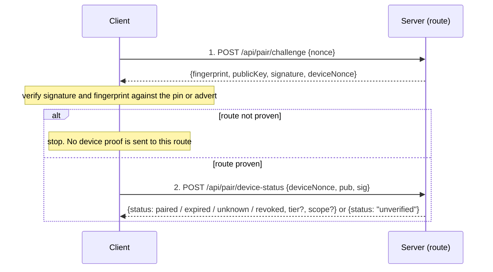

# Design

## Context

See `proposal.md` for motivation. `group-servers-by-identity`, `harden-auth-credentials` and `harden-peer-address-identity` are archived and their requirements are in `openspec/specs/`; this change builds on that text. Starting point, verified in source:

- `POST /api/pair/challenge {nonce}` is public and returns `{fingerprint, publicKey, signature, v}`; nonce must be an 8..512 char string (`packages/server/src/routes/pairing-routes.ts:333-355`). It has **no rate limit** today; only knock has a limiter (created at `pairing-routes.ts:324`, `packages/server/src/pairing/knock-admission.ts`, whose source map is capped by `DEFAULT_MAX_SOURCES = 1024` at line 36).
- The public pairing routes are an explicit prefix list, `PUBLIC_PAIRING_PREFIXES` (`pairing-routes.ts:72-79`), skipped by the auth hook (`packages/server/src/auth/auth-plugin.ts:548`). They are still listed in `route-tiers.ts` (`POST /api/pair/challenge` at `packages/shared/src/route-tiers.ts:394`, tier `operate`). The auth hook skips them, but the bearer branch does not: `registerBearerAuth` decorates any request that carries a valid bearer or device cookie with `authVia = "device"` and the row's tier (`packages/server/src/auth/bearer-auth.ts:97-136`), and the tier gate then applies to it (`packages/server/src/auth/route-tier-gate.ts:71-92,104-140`, installed at `packages/server/src/server.ts:2593`). So today an `observe` or `control` device that reaches a non-loopback, non-trusted-network server gets `403 insufficient_scope` on `/api/pair/challenge` whenever its cookie or bearer rides along, which a same-origin browser tab always does.
- Server identity is an Ed25519 key; fingerprint = `sha256:` + base64url of the SPKI DER hash; helpers sign/verify base64url signatures (`packages/server/src/auth/identity.ts`).
- Paired devices are an array of rows in `~/.pi/dashboard/paired-devices.json`, `0600`: `{id,label,tokenHash,createdAt,lastSeen,source,tier}` plus, since `harden-auth-credentials`, the optional `expiresAt`, `pairedAt`, `previousHash` and `previousExpiresAt` of a browser-held bearer (`packages/server/src/pairing/paired-devices.ts:40-70`). The loader spreads `...d`, so unknown fields survive a rewrite (`paired-devices.ts:139-144`). `revoke(id)` filters the row out; its only caller is the `DELETE /api/paired-devices/:id` route (`paired-devices.ts:355-363`, `pairing-routes.ts:617-632`), which writes the audit line `[pairing] revoked id=<8> actor=<…> ip=<…>` from `packages/server/src/auth/audit-log.ts` (`auditLine`, `auditPrefix`, `auditRequestFields`) and writes none for an unknown id. `list()` is also used as "does this device still exist" by live-preview capability checks (`packages/server/src/server.ts:2343`).
- A bearer authenticates REST through `registry.verifyDetailed(token)`, which judges the current hash against `min(expiresAt, pairedAt + 30 days)` (`now >= limit` is expired, an unparseable field fails closed) and the previous hash against `previousExpiresAt` (`paired-devices.ts:237-267`). An expired bearer in an `Authorization` header is refused with `401 bearer_expired` before any network trust (`bearer-auth.ts:89-94,120`); a cookie-carried expired bearer falls through unauthenticated. The same token value is the httpOnly device cookie, so revoking invalidates both (`bearer-auth.ts:97-136`, exchange handler `bearer-auth.ts:146-160`). Rotation mutates the same row in place: new `tokenHash`, `previousHash = old hash`, `previousExpiresAt = min(now + 60 s, old expiry)`, same id (`paired-devices.ts:314-352`). A browser on the dashboard's own origin keeps no bearer in storage: it exchanges it once for the httpOnly cookie and keeps a non-secret paired marker; only a browser whose API base is another origin keeps the bearer in a per-origin `localStorage` slot, rotates it, and on `401 bearer_expired` clears the slot and goes to the pairing landing (`packages/client/src/lib/pairing/device-auth.ts:14-31,40-42,414`).
- Knock creates a pending device (`PairingManager.knock`, `pairing.ts:420`); QR uses `redeem` (`pairing.ts:446`); operator approval runs `approve` (`pairing.ts:566-622`), which calls `registry.add(label, "pairing", tier, holder)` (`pairing.ts:606`); the device then polls once for the bearer (`pairing.ts:636`). Requester names are normalised by `normalizeRequesterName` (control/format characters stripped, byte-capped; `pairing.ts:152-167`).
- WebSocket tickets carry a `deviceId` only for `bridge` scope; browser-scope tickets carry the principal, not the device (`packages/server/src/server.ts:3460-3507`, `packages/server/src/auth/ws-ticket.ts` `mint`). Cookie sessions already have a revoke-close code `WS_CLOSE_SESSION_REVOKED = 4401` (`packages/server/src/pairing/ws-tier-gate.ts:34`).
- Tier gate: every `/api/*` route needs an entry in `packages/shared/src/route-tiers.ts`; an unlisted route requires `operate`. The pairing routes are listed (lines 187-190, 392-402) and revoke is `DELETE /api/paired-devices/:id` (line 80).
- Cross-origin POSTs to `/api/*` are refused by the mutation-origin gate unless the `Origin` is trusted (loopback, live tunnel, zrok wildcard, `https://pi-dashboard.dev`, configured, trusted network) (`packages/server/src/auth/mutation-origin-gate.ts:44-54`, `packages/server/src/auth/cors-origin.ts:160` `classifyCorsOrigin`). `/api/pair/challenge` has no exemption (`packages/server/src/__tests__/api-origin-gate.test.ts:144-152`).
- The browser request landing is built to run on plain-http LAN origins and "never touches `crypto.subtle`" (`packages/client/src/components/connectivity/PairRequestLanding.tsx:8-12`). Ed25519 WebCrypto exists only in secure contexts. The client's own challenge helper makes a 32-byte base64url nonce (`packages/client/src/lib/pairing/pair-protocol.ts:143`).
- Electron keyring: entries keyed by fingerprint, bearer encrypted with `safeStorage`, in memory only when encryption is unavailable (`packages/electron/src/lib/server-keyring.ts:1-26`). Loading rebuilds each entry field by field, so a field this build does not know is dropped on the next save (`server-keyring.ts:249-262`); a host entry must pass `isHostRef` (`server-keyring.ts:146`). Mobile/neutral shell keyring: IndexedDB `put`/`getAll` of the whole entry object, `{id,label,urls,pinnedPubkey,pinnedFingerprint,bearerToken}`, no field filtering (`packages/shell/src/lib/keyring.ts:12-21,70-82`).
- Electron address binding (`harden-peer-address-identity`): for an `http` host the main process resolves a name to at most 8 address literals, proves each separately, and uses the literal that proved the pin for the bearer exchange, the loaded origin and both re-verification paths; an `https` host keeps its name (`openspec/specs/electron-server-windows/spec.md`, "Proof and use are bound to the same address").

## Goals / Non-Goals

**Goals:**
- A client that holds a device key can ask a *proven* server whether it is paired, expired, unpaired or revoked, without the answer being replayable.
- Revoke is reversible for 90 days without weakening revocation: a revoked device is refused everywhere immediately.
- No new way to obtain a credential. The device key and the companion key only answer a status question.

**Non-Goals:**
- Using the device key to authenticate requests (later).
- A configurable retention period, or revoke reasons.
- Solving plain-http browser origins with a software Ed25519 library.

## Decisions

### D1. Wire format: a two-step check, so a device proof only goes to a proven route

**Step 1** is the existing identity challenge, unchanged except for one more reply field: `deviceNonce`, 32 random bytes, base64url (43 chars). The server keeps it in a bounded in-memory store: single-use, 60 s TTL, at most 10 000 entries with the oldest evicted first. It carries no secret and is harmless if leaked: it only has meaning combined with a signature by a private key.

**Step 2** runs only after the client verified step 1 against the pin or the advertised fingerprint, so a signed proof is never handed to an impostor route. The body is `{deviceNonce, pub, sig}`; `sig` is Ed25519 over the UTF-8 text `pi-devcheck/v2`, the server fingerprint and `deviceNonce` joined by line feeds. There is no client timestamp: the server consumes the nonce on first presentation (valid or not), so the same proof cannot be accepted twice, and the server's own freshness (60 s) replaces clock comparison. The reply is `{status: paired | expired | unknown | revoked, tier?, scope?}`; `tier` and `scope: "full"` come only with a full key that is `paired`, a paired companion answers `scope: "status-only"` with no tier, and `expired` and `revoked` carry neither. The server computes `expired` with the same judgement that refuses a bearer with `401 bearer_expired` (a device row whose current bearer is past `min(expiresAt, pairedAt + 30 days)`, or whose expiry fields do not parse, and whose previous bearer is not inside its grace window; a row with no `expiresAt` never expires), by calling the per-row judgement `currentVerdict` that `verifyDetailed` already uses (`paired-devices.ts:237-267`) plus the previous-bearer grace test, rather than copying the expiry arithmetic, so the two cannot drift; `revoked` is decided first, so it wins over `expired`. An invalid signature, a malformed field, an unknown, expired or consumed nonce, or a rate-limited peer all give exactly `{status: "unverified"}` at HTTP 200, so the answer never reveals whether a key exists. The route is public (added to `PUBLIC_PAIRING_PREFIXES`, listed in `route-tiers.ts` like the challenge) and does not widen CORS: it is a cross-origin POST like the challenge, so the mutation-origin gate treats it the same.

**Field rules (untrusted input).** `pub` is exactly the 32-byte raw Ed25519 public key in unpadded base64url (43 chars), not SPKI: WebCrypto `exportKey("raw")` and Node's JWK export both give it directly, a fixed 12-byte prefix turns it into SPKI for Node's verifier, and the length check is trivial. `sig` is 64 bytes (86 chars); `deviceNonce` is exactly 43 chars; every field is a string checked for charset and length before any decoding. Anything else is treated as an invalid proof. The fingerprint and the version prefix are inside the signed text, so a signature for one server or one purpose (`pi-devcheck/v2`, `pi-devbind/v1`, `pi-companion/v1`) never verifies as another. All signed fields have fixed charsets (fingerprint, base64url) except the companion origin, which is validated before use (D5), so a line feed can't shift field boundaries.

**Where the proof goes (`harden-peer-address-identity`).** The proof, the key bind and a knock carrying a key go only to the address whose challenge proved the pin in the same selection. For an `http` route the client resolves, that means the address literal that proved the pin, not the host name and not a sibling literal (`electron-server-windows` "Proof and use are bound to the same address"; Electron does this today for the bearer exchange and the loaded origin). For `https` the proven host name is used, as before. A browser tab or the shell cannot choose an address literal, so for them the route is the URL whose challenge they just verified; the stated Electron guarantee is not claimed for them.

**Short key id.** `dk:` + the first 12 base64url characters of SHA-256 over the raw public key; shown in the approval dialog, in Settings and in logs, labelled "short id".

*Alternatives:* one call with an optional `device` object on the challenge (rejected: signs a client-chosen nonce and a timestamp, so a captured proof replays inside the window and the proof goes to a route not yet proven); a client timestamp (rejected: clock skew and replay, the server-issued nonce is stricter); length-prefixed binary framing (rejected: harder to build identically in WebCrypto, Node and the shell for no gain given fixed charsets).

### D2. The reply discloses only what the caller can prove; status is advisory

Because the caller must sign with the key it asks about, the answer discloses only the status of its own key. The reply is advisory: over plain http an on-path relay can forward the whole exchange to the genuine server and learn paired or unknown, and can also fake an answer to the client. That is the accepted threat model for http (same note as the knock client, `packages/shared/src/pairing-knock-client.ts:18-19`). What keeps a forged answer harmless: no client discards a credential or key because of a device-status answer (D9), so the worst case is a wrong label until the next check. No tier is returned for a companion (status-only).

**Rate limit (new; there is none today).** Device-status requests are limited to 60 per minute per peer address (the socket peer, as `knockPeerInput` does at `pairing-routes.ts:425`), a sliding window in which invalid attempts count too. The limiter map is bounded (1024 peers, oldest evicted, the same bound as the knock limiter). Over the limit the answer is `{status: "unverified"}`; step 1 is never limited by this, so identity checks (and route probing by `group-servers-by-identity`) never fail because of the key check. The nonce store has its own bound (D1). Behind a tunnel or proxy every client shares one peer address, so a flooder there can make every device show "Status unknown" until the window passes; likewise a flood of challenges can evict unused nonces and make a legitimate step 2 answer `unverified`, and the client simply retries. Both are accepted and documented; neither affects identity or credentials.

*Alternative:* HTTP 429 on excess (rejected: the reply must be indistinguishable from an invalid proof).

### D3. Key lifecycle: created when pairing starts, bound at approval or with the credential

A client creates a key for fingerprint `F` only when the user starts pairing (Request access, Pair with code, Pair again). Listing creates nothing, so a client with no key sends no proof and the row falls to "Not paired" (Electron/mobile know their own keyring) or "Status unknown" (a browser can't know another origin's state). There is one exception: an already-paired device with a working credential and no key creates and binds one (below).

**At pairing.** The client runs the step 1 challenge immediately before the request (re-running it at "Send request" or "Redeem" if the earlier one is older than 30 s, because the nonce lives 60 s), verifies it, and puts `deviceKey: {deviceNonce, pub, sig}` into the knock or redeem body, `sig` over `pi-devbind/v1`, the fingerprint and `deviceNonce`. The server verifies and consumes the nonce on arrival and holds the key on the `PendingDevice`; `approve` passes it to `registry.add`, so a denied, expired or locked-out request leaves nothing behind (`pairing.ts:132-145,566-622`). The brief also wanted the `pendingId` in the signed text; that id is only created by the knock response, so it cannot be known when the key is signed. The single-use server nonce already prevents replay of the bind proof, so the `pendingId` is not part of it. An invalid key, or one already held by any active or revoked row (as primary or companion), is silently dropped and the pairing continues, so pairing never gets harder than today. Pending and approved responses are unchanged.

**Electron keeps the key out of the keyring until approval.** The main process generates the key in memory when the user chooses "Send request" (or redeems a code) and writes it to the keyring only when the request is approved; reject, expiry, "Stop waiting" and a crash discard it. The browser keeps its non-extractable key in IndexedDB under a pending marker for the live request (so reloading the landing resumes the wait) and deletes it on `rejected` or expiry.

**Binding for a device paired before this change, or whose key was lost.** `POST /api/pair/device-key {deviceNonce, pub, sig}` with `sig` over `pi-devbind/v1`, fingerprint and a server `deviceNonce` from a challenge the client just verified. It must be authenticated by the device's own credential (`authVia === "device"`, `principalDeviceId`, set at `bearer-auth.ts:128,132`): the credential proves the device, the signature proves possession of the key, the nonce prevents replay. When to run it: a client binds once when it holds a credential and no key and its environment can hold one (a secure-context browser tab on the credential's own origin, the Electron main process, the mobile shell). It retries on its next app start after a failure and never runs from a plain-http browser origin; those devices stay "Paired · key pending" and that is documented. One primary key per row; a call with a new key replaces the old one, always credential-authenticated, never anonymous. `409` if the key is held by another row (active or revoked, primary or companion). Route tier is `observe`, so every paired device can bind; the route is added to `route-tiers.ts`, otherwise it would default to `operate`. The brief says "with bearer"; browsers hold the cookie (the same token value) on their own origin and keep the bearer in a per-origin `localStorage` slot only for a cross-origin API base (`device-auth.ts:14-31`), so "its own device credential" covers both.

**Uniqueness.** A public key may appear once across all primary and companion keys of active and revoked rows. The check runs at approve and at bind. A duplicate at approval means the pairing proceeds without that key; a duplicate at bind is `409`.

**Key rotation on re-pairing.** "Pair again" after `revoked` or `expired` always creates a new key. A knock with the old key would be dropped by the uniqueness rule anyway (the old record still holds it), and a new key keeps the old revoked row consistent if the operator undoes the revoke.

**Bearer rotation keeps the key.** `harden-auth-credentials` rotation changes `tokenHash`, `previousHash`, `previousExpiresAt` and `expiresAt` on the same row and keeps its id (`paired-devices.ts:314-352`); keys and companions are separate fields of that row, so they are untouched and nothing is re-registered. A test asserts it, because a future rotation that rebuilt the row would silently drop the key.

*Alternatives:* bind the key only after approval through a separate call (rejected: needs a credential the device doesn't have until it polls, and loses the operator's view of the key in the dialog); server-generated keys (rejected: private key would transit the network).

### D4. Plain-http browser origins get no device key

`crypto.subtle` Ed25519 needs a secure context. The knock landing is designed for plain-http LAN origins and must not break there (`PairRequestLanding.tsx:8-12`, `lan-knock-pairing` spec). So the landing feature-detects, and without support it knocks with no key. Consequences: a browser paired over `http://192.168.x.x` has no device key; if it has a credential its row reads "Paired · key pending" and never resolves unless the user opens the dashboard on a secure origin that holds the credential. We accept this: the status question is mostly asked from a *list* (Electron, mobile, a secure-origin browser tab). We do not add a software Ed25519 library: it needs a dependency and keeps an extractable private key in page storage, undoing the non-extractable property that motivated browser keys.

This is a divergence from the brief's single-sentence "feature-detect → status unknown", expanded to the pairing side: the key is also absent on the pairing page.

### D5. Companion key

A browser tab at dashboard A holds (per origin A, per server B's fingerprint) a key for B. When the user chooses "Request access…" on a B row that holds a pinned or advertised fingerprint, in a browser that supports Ed25519 WebCrypto (D11: without either, no companion and the plain `/pair?request` link), A creates that key if needed and opens `B/pair?request#companion=<pub>.<ts>.<sig>&from=<origin of A, percent-encoded>` in a new tab without an opener. Two corrections to the brief: the fragment also carries `ts` (the server needs it to check freshness) and `from` (the origin cannot be read from the new tab, because there is no opener and the signed text needs it). `sig` signs `pi-companion/v1`, `fp(B)`, `origin(A)` and `ts` joined by line feeds. Only a `#companion=` fragment keeps request mode: a `/pair` landing with any other fragment is a QR payload and runs the QR flow. B's landing reads the fragment, strips it with `history.replaceState`, and forwards `{pub, ts, sig, origin}` as `companion` in the knock body (fragments never reach a server).

**Bounds (untrusted input).** The fragment is at most 512 characters; the companion value has exactly three dot-separated parts of the key, timestamp and signature lengths above; `ts` is an integer within ±300 s of the server clock. `origin` must parse as `http(s)://host[:port]` with no path, userinfo, query or fragment, at most 255 bytes; it is signed as sent, stored and rendered as plain text after the control/format-character stripping that knock names get (`normalizeRequesterName`, `pairing.ts:152-167`). A device row holds at most 4 companions. Anything over a limit or invalid is ignored: the knock is still admitted without the companion.

**Why timestamp and not a server nonce here.** The companion is created by dashboard A before the knock, and A is a different origin that cannot get a nonce from B without B's cross-origin POST being admitted, which is not guaranteed (D8 notes the mutation-origin gate). So the companion signature stays time-bound (±300 s). The accepted risk: someone who captures the fragment (an extension, a shared screen) could replay it inside the window in a knock of their own; that knock still needs the operator's approval, the operator must also tick the unticked box, and the stored key is status-only, so the replay gains the replayer nothing except the ability to ask whether the genuine device is paired. The origin is part of the signed text, so it can't be swapped after the fact, but it is only the requester's claim (a phishing page can sign for itself). The dialog therefore labels it as claimed, shows it only when present, and leaves the checkbox unticked.

Stored companions: `{pub, origin, createdAt}` on the device row; in the check they answer `scope: "status-only"` with no tier, and are accepted nowhere else: `verify()` only knows bearer hashes, `device-session` and `ws-ticket` read the bearer/cookie, so a companion cannot authenticate by construction. A test asserts this rather than relying on omission. The check from A to B is a cross-origin POST, so it only works where B's mutation-origin and CORS rules already admit A (loopback, zrok wildcard, `pi-dashboard.dev`, configured, trusted-network). Elsewhere the row is "Status unknown"; this change does not widen those rules (non-goal: cross-origin browser knock).

*Alternative:* postMessage / `window.opener` handoff (rejected in the explore: needs an opener relationship, which the phishing analysis removes).

### D6. Revoke is a state, stored apart from the active registry

Revoke moves the whole row (hash, tier, source, label, keys, companions, and the expiry and rotation fields `expiresAt`, `pairedAt`, `previousHash`, `previousExpiresAt`) plus `revokedAt` and `revokedBy` into `~/.pi/dashboard/revoked-devices.json` (`0600`, same `json-store` writer), then removes it from `paired-devices.json`. Order: write revoked first, then active; if the process dies between, the loader finds the id in both files and treats the revoked record as the truth. Restore does it in reverse (active first, then remove the revoked record); a crash between leaves the id in both, so revoked wins and the operator simply restores again. Undo restores the id, bearer hash, tier, label, source, keys, companions and the expiry and rotation fields exactly as held; `lastSeen` and audit counters then continue from their current values rather than being rewound.

**Expiry and grace while held (`harden-auth-credentials`).** The held record keeps the current hash and, when a rotation grace window existed, the previous hash with its original `previousExpiresAt`. Revoke removes the row, and with it every bearer: the current one, a previous one still in grace, and the cookie, which is the same token (`bearer-auth.ts:97-136`); the main rule "Revoking a device SHALL invalidate every bearer of that device, including one in a rotation grace window" already requires this and the hold satisfies it by construction, because `verify()` scans active rows only. Undo restores `expiresAt`, `pairedAt` and `previousExpiresAt` unchanged: it never extends the 7-day expiry or the 30-day absolute lifetime, and the grace window does not restart (the previous bearer is valid again only if its original `previousExpiresAt` is still in the future, which after a typical Undo it is not). The server clock keeps running while the record is held, so a browser device revoked for longer than its remaining expiry comes back active but `expired` (its bearer answers `401 bearer_expired`, its key answers `expired`), and the operator can revoke it again or leave it. Because retention is 90 days and a browser bearer lives 7, this is the common case for a browser device, which is why the row state "Access expired" exists. Purge removes the revoked record at 90 days (`REVOKED_RETENTION_MS`, a constant, checked at start and on each revoked-list read or check) or by "Delete now".

Why a second file rather than a `revokedAt` field in the same rows: the active loader and `verify()` in older builds ignore unknown fields, so a `revokedAt` row would verify and re-admit a revoked device after a rollback. With a separate file an older build never sees revoked rows: rollback silently degrades to the old "revoke = delete" semantics, which is safe. The cost is only losing Undo while on the old build, and a one-time two-file consistency rule.

**Unreadable revoked file.** Because the active row is already gone at revoke time, losing the revoked file cannot re-admit a device. On a revoked file that fails to parse the server sets it aside (`revoked-devices.corrupt-<time>.json`), logs an error, starts with an empty revoked list, and `GET /api/paired-devices/revoked` returns a `warning` that Settings shows as "Revoked-device list unreadable — revoked devices may be purged early". The one residual window is a crash between the two revoke writes combined with a corrupt revoked file, which could leave an active row that should have been revoked; it needs two independent failures and is accepted.

`verify()` keeps scanning active rows only, so every existing consumer (`bearer-auth`, device-session exchange, ws-ticket, bridge mint, live-preview `list()` check, `operate-required-remedy`'s "revoked bearer counts as no credential") needs no change. The check's `lookupKey(pub)` consults active rows (full + companions) first, then revoked rows.

`revokedBy` is a short string derived from the operator credential (`session` subject when present, else `local`) and is display-only.

**Audit.** Revoke already writes `[pairing] revoked id=<8> actor=<…> ip=<…>` from the route through `auditLine` (`pairing-routes.ts:617-632`, `auth/audit-log.ts`), and writes nothing for an unknown id (`trust-and-credential-boundaries`, "Audit values are sanitized and refusals are audited"). Restore and delete-now write `restored` and `deleted` lines in the same shape from their routes, after a successful change only (a `404` or `409` writes none); purge has no request, so `[pairing] purged id=<8>` carries no `actor` or `ip`. The shared emitter sanitises every value to `[\w.:-]`, which keeps the `dk:` key id readable, and callers pass prefixes only, never a hash or token. The enumerated list in `trust-and-credential-boundaries` "Auth-relevant mutations leave an audit line" is a minimum, so adding restore, delete-now and purge to it by the `bearer-device-auth` requirement here contradicts nothing and needs no MODIFIED copy of it. The revoked list, restore and delete-now are operator-only. Restore of an id that is not in the revoked store is `404`; of an id that is currently active, `409`; delete-now likewise.

*Alternatives:* flag on the row (rejected: rollback hazard above); soft-delete with a tombstone (rejected: loses restore of the hash and tier, the point of Undo).

### D7. Closing live sockets of a revoked device

Browser-scope tickets will carry `deviceId` (from `principalDeviceId`) as bridge tickets already do (`server.ts:3494`; the browser-scope mint is `server.ts:3506`), and the browser gateway tags the socket with it at upgrade. The registry exposes `onRevoked(listener)`; the browser gateway and the pi gateway (which already maps upgrades to device ids, `packages/server/src/pi/pi-gateway.ts:244,484,1170`) subscribe and close matching sockets with the existing revoked code 4401 and reason `device revoked`. REST and new tickets are refused by `verify()` immediately; the socket close covers connections already open. Live preview capabilities already re-check `list()` per request and therefore die with the row leaving the active list.

### D8. Routes and guards

| Route | Guard | Tier entry |
|---|---|---|
| `POST /api/pair/challenge` (reply gains `deviceNonce`) | public, as today | `observe` (was `operate`, see below) |
| `POST /api/pair/device-status` | public (`PUBLIC_PAIRING_PREFIXES`), per-peer limit | `observe` |
| `POST /api/pair/request`, `/redeem` (bodies gain `deviceKey`, `companion`) | as today | as today |
| `POST /api/pair/approve-pending` (new `allowCompanion`) | approval guard | as today |
| `POST /api/pair/device-key` | `networkGuard` + `authVia === "device"` + body proof | `observe` |
| `DELETE /api/paired-devices/:id` (now = revoke) | `operatorGuard` | unchanged |
| `GET /api/paired-devices/revoked` | `operatorGuard` | `operate` |
| `POST /api/paired-devices/:id/restore` | `operatorGuard` | `operate` |
| `DELETE /api/paired-devices/revoked/:id` (delete now) | `operatorGuard` | `operate` |
| `DELETE /api/paired-devices/:id/companions/:companionId` | `operatorGuard` | `operate` |

**Tier of the three device-check routes.** The check is made by paired devices about themselves, so the tier gate must not refuse a device of any tier. With the pre-change entry (`operate`) an `observe` or `control` device with a credential attached would be refused on the challenge and the status check (and on the binding, were it left to the default), while an anonymous caller is served: the lower the tier, the less it could learn about its own pairing. All three are therefore listed at `observe`, and a MODIFIED delta of `bearer-device-auth`'s tier requirement states it with a scenario. The route stays public for anonymous callers, and the entry changes nothing for them (the gate only looks at `authVia === "device"` or `"session"`). *Alternative:* exempt the public pairing prefixes from the tier gate by a predicate (rejected: wider, because it would also exempt `redeem`, `request` and `poll`, whose tier this change has no reason to touch, and the gate's route→tier map is meant to stay the single exact lookup). `/api/pair/request`, `/redeem` and `/poll` keep `operate`: a device that already holds a credential does not call them for the device check.

`/api/pair/device-status` must not be a prefix of any credentialed route (`/api/pair/device-key` does not start with it, because the auth hook matches by `startsWith`, `auth-plugin.ts:548`). `GET /api/paired-devices` keeps its `networkGuard`/`operate` tier and now lists active devices with `keyId` and `companions[]` (origin + id, no keys). The revoked list is operator-only because it names devices that no longer have access; a device bearer gets `401`.

### D9. Client state derivation and what is never discarded

A small pure function maps `(credential held?, key held?, reply)` to the seven row states (Paired · tier, Paired · status only, Access removed, Access expired, Not paired, Paired · key pending, Status unknown); the grouped row from `group-servers-by-identity` renders them and chooses the primary action. The proof is a second request made only after step 1 proved the route and only when the client holds a key (a client with no key makes exactly the challenge call the grouped row already makes). On Electron the main process signs and returns only the status to the renderer. Tier names in the UI are the existing `TIER_OPTIONS` labels (Observe, Control, Operate; `PairedDevicesSection.tsx:46-50`, `TIER_OPTIONS`) for the real tiers `observe | control | operate`; the mockup's "Operator" and "Viewer" are illustrative and map to Operate and Observe.

**Discard rule.** A client never discards its credential or key because of a device-status answer, including `unknown` and `expired`. It discards only when the credential itself is refused at a proven route (`401`, or a refused device-cookie exchange). `revoked` shows "Access removed" and keeps the credential and key, so an Undo needs no re-pairing. `expired` shows "Access expired" with "Pair again" and also changes nothing by itself; the dead bearer goes when it is next refused.

**Expired devices (`harden-auth-credentials`).** A `401 bearer_expired` at a proven route is a credential refusal like any other, so discarding is allowed and is what the browser slot code already does (`device-auth.ts:414`); the change is that the per-fingerprint device key is discarded together with the bearer. Decision: the key is dropped, not kept for re-pair. An expired device's key is still held by its old record (the server keeps expired rows), so submitting it again would be ignored by the uniqueness rule and the new pairing would be keyless; "Pair again" therefore always creates a new key, and a key kept after the bearer is gone has no use and only invites the same `expired` answer. The old record stays in the operator's list until it is revoked; that is `harden-auth-credentials` behaviour this change does not alter. The state is reached only for a client that still holds the credential or is a companion holder: after the refusal and discard the client reads Not paired (a client that knows its own credentials) and offers the row's pair action. In Electron the same conclusion is drawn when a refused exchange meets an `expired` answer (below). `unknown` for a client that holds a credential means: verify the credential with the next authenticated call; refused → discard and show Not paired; accepted → show "Paired · key pending" and bind a key again (the server lost or never had the key). "Keep the local credential until 90 days pass" from the brief is therefore implemented as "keep it while the server answers `revoked`": the server's purge ends the 90 days, after which the credential is refused and discarded on first use, so the device needs no clock of its own.

**What counts as a refused credential (Electron).** The main process classifies the device-cookie exchange in one place: `200` ok; `401`, or `403` with `error: "network_not_allowed"` refused; anything else transport (`packages/electron/src/lib/server-windows.ts:72-83`, called at `server-windows.ts:376-391`). Both refusal codes are the normal answer for a dead credential, not a network problem: the exchange handler answers `401` only when the presented bearer does not verify (`packages/server/src/auth/bearer-auth.ts:146-150`), an expired bearer is refused earlier with `401 bearer_expired` by the bearer hook (`bearer-auth.ts:120`), and a bearer that does not verify leaves the request unauthenticated, so an off-host request is refused by the network guard with `403 network_not_allowed` before the handler runs (`bearer-auth.ts:108-136` marks a request authenticated only on a verified token; `hasNetworkPassCondition` in `packages/server/src/auth/localhost-guard.ts:432-466` admits only authenticated requests, at line 458; the 403 body is built at `localhost-guard.ts:408-414`). A valid credential is therefore never answered `403 network_not_allowed` by the network guard of the genuine server. This is why "never discard on `403 network_not_allowed`" would be wrong: a revoked-and-purged or no-key legacy entry would keep a dead credential forever. What the check adds is the one contradictory case: the exchange is refused yet the proven server answers `paired` for this device's key (stale bearer, a wrong route that shares the fingerprint, a proxy). That case keeps the bearer and key and loads nothing: `403 network_not_allowed` shows a display-only "network not allowed" state (the wording of the existing selector state, `openspec/specs/server-selector/spec.md` "Network not allowed"), and `401` fails the open as "could not confirm, nothing changed" (the existing failed-exchange path, `server-windows.ts:476-478`). Neither is stored in the keyring: the stored "needs pairing" mark also drops the bearer (`packages/electron/src/lib/server-keyring.ts:370-377`, `markNeedsPairing`), and an entry carrying it goes straight to pairing on the next open (`server-windows.ts:431`), so it must not be used for an undecided case. The same "could not confirm" path now covers an inconclusive check (`unverified` or no answer). When the refused exchange meets an `expired` answer the conclusion is the same as for `unknown`: the credential can never work again (neither an Undo nor a re-check revives an expired bearer), so the entry is marked "needs pairing" with the reason shown as "Access expired", and the bearer, key and cookie are discarded; the open-time message is where "Access expired" is shown in Electron, because the stored keyring state afterwards is the existing "Needs pairing". A bearer expiry shows up as `401 bearer_expired` on the exchange, which `classifyExchange` already counts as refused.

When the proof, bind or knock goes out, it goes only to the address that proved the pin in that selection (for an `http` host the proven literal; D1 "Where the proof goes"): the check after a refused exchange re-uses the literal `pickHost` just proved rather than resolving the name again. The existing text of `electron-server-windows` said "needs pairing without discarding" for that case, which the keyring cannot express; the delta corrects it. (`server-keyring.ts:236-247` is bearer decryption, not the exchange; the exchange logic is the code above.)

**Keyless entries (paired before device keys).** Without a key the device check cannot disambiguate, and to such a device a dead credential and a refused network both arrive as `403 network_not_allowed`. So a keyless entry discards only on `401`; on `403 network_not_allowed` it keeps the bearer, shows "network not allowed" and offers "Pair again" as a user choice (cycle-3 review). A dead keyless credential therefore lingers until the user re-pairs or forgets the server — accepted over silently losing a working credential when the user is merely on a refused network.

*Alternative:* a device-side 90-day timer (rejected: needs a revoke timestamp the server doesn't otherwise disclose, and drifts from the server's real purge).

### D10. Logging

Key events use the same audit emitter as revoke (`auth/audit-log.ts`, shape `[pairing] <verb> id=<8> key=<dk:…> [actor=… ip=…]`, values sanitised), one line per state transition, never per answer: `key_bound`, `key_replaced`, `key_ignored` (at approval), `companion_allowed`, `companion_removed`, and the first `revoked` answer for a key id after a different answer, `revoked_answer` (at most one per key id per 10 minutes), plus one line per peer when the proof limit trips. Revoke, restore, delete-now and purge are audited as in D6 and are not repeated. `expired` answers are never logged per answer. Lines name the device id prefix and the short key id only; never a full public key, a signature, a nonce, a bearer or a cookie.

### D11. Browser pairing link and the state labels (edits to text now in main)

`group-servers-by-identity` (A) is archived and its text is in `openspec/specs/`. Two of its requirements contradict this change: a browser's "Request access…" opens exactly `http://<host>:<port>/pair?request`, and any other origin reads "Unknown in this tab" (`openspec/specs/server-identity-routes/spec.md`, "Pair action on a server with no credential on this device" and "Paired state shown in the server list"); the `server-selector` and `known-servers` scenarios repeat the exact URL (`openspec/specs/server-selector/spec.md` scenario "Browser pair action navigates to the peer", `openspec/specs/known-servers/spec.md` scenarios "Request access opens the peer's request landing" and "Request access brackets IPv6 hosts"). D5 changes the first, and D9 the second. This change therefore carries whole-block MODIFIED copies of four requirements, each copied from the current main block with every scenario kept (a MODIFIED block that drops a scenario fails archive; the first version of this change did, after A's text moved):

| Capability | Requirement (header unchanged) | Edit here |
|---|---|---|
| `server-identity-routes` | Pair action on a server with no credential on this device | companion fragment allowed only for an entry holding a fingerprint and a browser with Ed25519; the host:port round-trip check applies to the part before the fragment; the request line never carries it; new scenarios for the fragment and for its absence. Main's sentences on pair-with-code (entry needs a fingerprint, no pair action without one, the https-origin validation of a payload) and its scenarios "Entry without a fingerprint offers no code" and "Browser refuses a payload with no valid https origin" are kept as they are |
| `server-identity-routes` | Paired state shown in the server list | one label set: "This dashboard" and "Needs pairing" kept, the rest are the seven states of D9; "Unknown in this tab" becomes "Status unknown" (same meaning, one wording); a browser tab never reads "Not paired" for another origin; companion holder reads "Paired · status only" |
| `server-selector` | Server selector in dashboard header | scenario "Browser pair action navigates to the peer" allows the fragment |
| `known-servers` | Network discovery is a source of the Servers section | requirement text and two scenarios allow the fragment after the fixed URL |

The other MODIFIED blocks (`bearer-device-auth` x2, `server-identity-keypair`, `lan-knock-pairing` x2, `qr-device-pairing`, `electron-server-windows` x3, `device-keyring-client`, `neutral-shell-device-keyring`) were compared word by word with the current main blocks; they differ only by the edits this change makes. Two of them, `bearer-device-auth` "Long-lived opaque bearer tokens in a revocable registry" and "A device bearer's tier gates REST routes and WS-ticket minting", had to be re-copied after `harden-auth-credentials` and the `requireLocalProof` default change (rotation, browser-holder expiry, the "Observe bearer may rotate itself" and "Rotation never touches another device" scenarios, and the `requireLocalProof` paragraph).

The companion rule has one extra condition the brief did not state: the companion is signed over fp(B) (D5), so A can only create it for an entry that holds a pinned or advertised fingerprint; with none, no fragment is added and the browser pairs exactly as the main text states (the TOFU comparison is not offered to browsers, that rule stays). A browser without Ed25519 support likewise adds no fragment, because the landing on B would have nothing valid to forward.

*Main requirements this change does not modify.* "Expired bearer is reported distinctly from revoked" (`bearer-device-auth`) says an expired browser bearer is `401 bearer_expired`, an unknown or revoked one plain `401`, and revoke invalidates every bearer including a grace one. The hold is consistent with all three: a held bearer is not in the active registry, so it is plainly unauthorized; a restored but expired bearer is `bearer_expired`; the grace bearer leaves with the row. "Proof and use are bound to the same address" (`electron-server-windows`) already says what D1 relies on and is cited, not changed. "Every route is proven by the identity challenge" (`server-identity-routes`) bounds a list check by 2 seconds per request and at most 6 checks at once; the device-status request is one more bounded request inside the same check slot, so the bound holds and is not restated.

## Risks / Trade-offs

- **Rollback loses Undo, not revocation** → separate revoked file (D6); documented in Migration Plan.
- **Two-file write isn't atomic** → write order plus "both ⇒ revoked wins" at load; test with an injected crash between writes.
- **Rollback and the `deviceKey` field** → an older Electron build rebuilds entries field by field (`server-keyring.ts:249-262`) and so drops `deviceKey` on its next save; the bearer and hosts are untouched. After re-upgrading, the entry has a credential and no key: "Paired · key pending", then it binds again. No credential loss. The shell keyring stores whole objects (`keyring.ts:70-82`) and old code ignores the field. Server rows keep unknown fields (`...d`).
- **Plain-http browsers have no key** → documented (D4); they keep today's behaviour and the "key pending" state.
- **Key reuse across revoke/undo ambiguity** → keys are unique across active+revoked rows, primary and companion; pairing again rotates.
- **Companion replay inside 300 s** → accepted (D5): needs operator approval, opt-in tick, and the key is status-only.
- **Companion phishing** → status-only scope, opt-in unticked, origin labelled as claimed, never valid for any credential route.
- **Check flooding** → per-peer limit and bounded stores (D2); worst case "Status unknown" for peers sharing an address, never an identity failure.
- **Key-check oracle for enumeration** → needs the private key; the reply for other keys is identical to "no device".
- **Revoked list growth** → bounded by 90-day purge; each row is small.
- **Overlap with `harden-auth-credentials` audit lines** (archived; it added the revoke audit line, `pairing-routes.ts:617-632`) → restore, delete-now and purge reuse that shape (D6), so there is one format and nothing to merge. `close-residual-audit-findings` is now only an umbrella without spec deltas.
- **Expired browser devices come back expired from an Undo** → by design (D6): Undo never extends a bearer. A browser device revoked for more than its remaining 7 days reads "Access expired" after Undo; the operator can leave it, and the device pairs again.
- **Expired rows stay in the registry** → `harden-auth-credentials` keeps them; "Pair again" makes a new row, so an operator may see the old expired row beside it until it is revoked. Accepted; cleaning up expired rows is not this change.
- **Same requirement as other active changes** → `add-plugin-isolation-and-public-routes` carries a MODIFIED copy of "A device bearer's tier gates REST routes and WS-ticket minting" and `close-loopback-legacy-window` a copy of "Long-lived opaque bearer tokens in a revocable registry", both written against older bases (the first lacks the legacy-mode-only trusted-network rule and the rotation route entry, the second lacks the browser-holder expiry and rotation text now in `openspec/specs/bearer-device-auth/spec.md`). This change copies the current main-spec blocks. Whichever archives second overwrites the other's additions, so the second one to archive must re-copy the block to merge both (the public-namespace paragraph there, the three `observe` routes and the held revoke here; the local-proof wording there).

## Migration Plan

1. Ship the server first: new optional fields, the `deviceNonce` reply field and `revoked-devices.json` (which also holds each record's expiry and rotation fields) are created lazily; the active file format is unchanged for rows without keys.
2. Clients ship next; step 2 happens only when a client holds a key and the challenge reply carries `deviceNonce`, so an older server shows "Status unknown" and nothing breaks.
3. Existing paired devices bind keys on their next authenticated call where their environment can hold one (`Paired · key pending` until then).
4. Existing revoked-by-delete history does not exist, so there is nothing to backfill.
Rollback: restore the previous server build. Active rows keep working (extra fields preserved or ignored); `revoked-devices.json` is ignored, so revoked devices stay refused; operators lose Undo/Revoked list until redeploy. Delete the file only if the pre-change behaviour (revoke = gone for good) is wanted. Client rollback: old clients never make step 2; Electron loses the stored device key (see Risks) and re-binds after re-upgrade.

## Open Questions

None blocking. Resolved during test-plan review:

- Client timeout: 2 s for the identity challenge and 2 s for device-status, each; on timeout abort, "Status unknown", discard nothing, re-run on next list open.
- `unknown` with a held credential reads "Status unknown" until the verifying call returns.
- `POST /api/pair/device-key`: bad signature, malformed field or replayed/expired nonce → `400` (`401` anonymous, `409` held key).
- Retention: purge at age of 90 days or more; "N days" rounds up; under 24 h reads "1 day".
- Expired browser devices (final decision): the check answers `expired` (reply set `paired | expired | unknown | revoked`, plus `unverified` for a failed proof); `revoked` wins over `expired`; the row reads "Access expired" with "Pair again"; a `401 bearer_expired` at a proven route discards the credential and, with it, the device key; Undo never extends expiry and a device that expired while held returns `expired`; revoke invalidates a grace-window bearer and the held record keeps both hashes.
- Revoke of an unknown or already-revoked id → `404`; a wrong-shape revoked store is quarantined like an unparseable one.
- Companion signature is verified over the origin exactly as sent; stripping applies to storage and display only.
- Delete now is confirmed in a dialog naming the device; Undo on `404`/`409` shows an inline "No longer available" and refreshes.
- A browser pair link whose companion fragment would exceed 512 characters omits the companion.

Deferred: an operator label for `revokedBy` when several operators exist (session subject now); a "Check your clock" hint is no longer relevant because the main check has no timestamp (the companion's ±300 s window just makes a skewed companion read "Status unknown").
