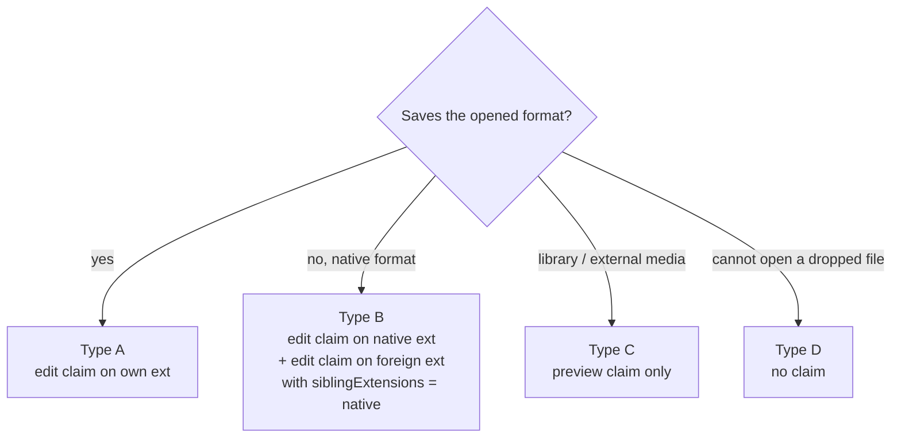

## Context

`craft-web-plugin` embeds an ArtCraft web build in a sandboxed opaque-origin iframe. Shipped in `edit-office-in-pane-with-craft-web` (WordCraft only) and extended by `track-latest-craft-web-version`. Core seams already exist:
- the `editor-pane-file-handler` slot;
- `POST /api/file/write-binary` with registered validators;
- `ctx.serveApp` with `crossOriginFrame`.

The registry is `packages/craft-apps/src/registry.ts`. Builds are provisioned by `provisionWeb` with a `postInstall` hook.

Code facts this change builds on:
- **Registry `webVersion`.** Only WordCraft has one: `packages/craft-apps/src/registry.ts:199`.
- **App tables.** Server `CRAFT_WEB_APPS` (`packages/craft-web-plugin/src/server/apps.ts:19`) and client `CRAFT_WEB_APPS` / `CLAIMED_WEB_APP_IDS` (`packages/craft-web-plugin/src/client/craft-apps-table.ts:20,27`) are hand-kept tables.
- **Post-install.** Requires exactly one inline script containing `TrunkApplicationStarted`, else it throws: `packages/craft-web-plugin/src/server/post-install.ts:53`.
- **Shim title parsing.** `TITLE_RE` is at `packages/craft-web-plugin/src/shim/craft-shim.js:43`. The suffix strip accepts only `-`/`–` before `…Craft`: `craft-shim.js:69`. `SHIM_VERSION = 1`: `craft-shim.js:26`.
- **Frame flags.** `sandbox="allow-scripts"` and `allow="clipboard-write"` are hard-coded at `packages/craft-web-plugin/src/client/CraftFrame.tsx:118-119`.
- **CSP.** `buildCsp`: `packages/craft-web-plugin/src/server/csp.ts:39`.
- **Core copy.** It always uses `<stem>.<copySuffix>.<ext>` with the tab's extension: `copy()` at `packages/server/src/routes/file-write-binary-routes.ts:189`, called at `:454`, up to `MAX_COPY_ATTEMPTS = 99` (`:99`). The claim type has `copySuffix` only (`packages/shared/src/dashboard-plugin/manifest-types.ts:80`, `packages/shared/src/dashboard-plugin/file-handler.ts:51`).
- **Manifest validation.** It whitelists claim keys and silently drops unknown ones: `packages/dashboard-plugin-runtime/src/manifest-validator.ts:170`.
- **Validators.** One module is registered per claim (`claimId` = app id): `packages/craft-web-plugin/src/server/index.ts:39`, module `VALIDATOR_MODULE` (`:23`, OOXML only). The registry accepts only the plugin's own edit claims: `packages/dashboard-plugin-runtime/src/server/file-validator-registry.ts`.
- **Build marker.** `MARKER_RE` is `/<!-- craft-shim:(\d+) -->/`: `packages/craft-web-plugin/src/server/post-install.ts:28`.
- **SVG preview.** The built-in preview renders SVG through ``, so scripts never run: `packages/client/src/components/preview/ImagePreview.tsx:28`.

### Spike (2026-10-19/20)

The harness lives in `/tmp/craftweb-spike/`; the procedure is the project skill `spike-craft-web-app-in-sandbox`. Setup:
- real `createPostInstall`, or a harness variant for non-Trunk loaders;
- the production CSP from `buildCsp`;
- `sandbox="allow-scripts"`;
- a stub host speaking the shim protocol;
- headless Chromium with `?webgl`.

A WordCraft control run reproduced the shipped result.

| App (web ver) | Loader | Opens on drop | Ctrl+S produced | Title signal | Type |
|---|---|---|---|---|---|
| WordCraft 0.8.0 | Trunk | `.docx` | `.docx` in place | `name • - WordCraft` | A (shipped) |
| GridCraft 0.8.0 | Trunk | `.xlsx` | `.xlsx` in place, edit present | `name — Edited`; stays after picker save | A |
| PdfCraft 0.9.0 | Trunk | `.pdf` | `.pdf` in place | none | A |
| CADCraft 0.8.0 | Trunk | `.dxf` (R12) | `.dxf` (R2000), new entity present, download-link path | none | A |
| DesignCraft 0.9.0 | Trunk | `.designcraft` (zip: `document.json`, `assets/`) | same name, assets embedded | none | A |
| SoundCraft 0.8.0 | Trunk + 2nd inline script | `.scraftz` (zip: `.scraft` + `Audio Files/`); `.wav` is imported into the demo session | `<session name>.scraftz` | none | A (session-name save) |
| PhotoCraft 0.10.0 | Trunk | `.jpg` | `.psd` | `name — PhotoCraft` (em dash) | B |
| VectorCraft 0.13.1 | Trunk | `.svg` | in-app Save As defaulting to `.vectorcraft` | `name — VectorCraft` | B |
| DeckCraft 0.8.0 / 0.7.0 | Trunk | 0.8.0 **panics on start** (unsandboxed too, `std::process::id`); 0.7.0 opens `.pptx` | `.deckcraft` (zip) | none (in-app `— Edited`) | B (pin 0.7.0) |
| LightCraft 0.9.1 | custom, `start(font)` | `.jpg` imported into the demo library | nothing (non-destructive) | `LightCraft` | C |
| FilmCraft 0.9.0 | custom, `filmcraftLoad.readyMs`; 2nd inline script | media imported into the demo project | `<project>.fcproj`, media by VFS path `/files/x` | none | C |
| EffectCraft 0.11.1 | custom, `effectcraftLoad.readyMs`; service worker; module workers | media imported into the demo project | `<project>.ecproj` (JSON), media by path `/x` | `EffectCraft - name *` | C |
| FigCraft 0.7.0 | Trunk | ignores the dropped `.svg` | not reached | none | D |

Save capture: WordCraft, GridCraft, PhotoCraft and VectorCraft go through the stubbed `showSaveFilePicker`. CADCraft, SoundCraft, DesignCraft, PdfCraft and DeckCraft go through the shipped download-link interception. SoundCraft, CADCraft, PdfCraft, DesignCraft, DeckCraft and FilmCraft emit no viewport title at all; SoundCraft's session name appears only in its save name.

Environment findings:
- Reading `navigator.serviceWorker` **throws** in an opaque-origin sandbox. EffectCraft's loader skips it under `?nosw`.
- `new Worker(httpUrl)` from origin `null` fails (same-origin rule, not CSP). A blob bootstrap that `import`s the mount URL starts.
- OPFS and IndexedDB are refused, as designed; apps log and continue.
- Favicons hit `img-src` (harmless reports).

## Goals / Non-Goals

**Goals:**
- One adapter layer that every app plugs into declaratively.
- Wave 1–3 claims, each extension gated by its own verification.
- **No widening of frame permissions.** Sandbox flags, `allow`, CSP and the save path stay as shipped; the worker trampoline is the only new frame-side mechanism.
- Native-format sibling saves through core, never-overwrite.
- WordCraft behaviour unchanged apart from one re-prepare.

**Non-Goals:**
- FilmCraft/EffectCraft editing (Wave 4 = spike + follow-up change).
- FigCraft.
- Automating app export dialogs. Same-extension saves the app produces itself (e.g. VectorCraft exporting `.svg`) are ordinary own saves, and overwrite in place as usual.
- Persistent app storage.
- Granting extra frame permissions (e.g. `autoplay`). A first click inside the frame resumes audio, through SoundCraft's own resume script.

## Decisions

### D1 — App types decide claim shape



Claim ids are no longer always the app id. Each claim maps to one app, and status, prepare, config (`apps.<appId>`), mount (`/apps/craft-<appId>/`) and settings stay keyed by **app id**. The invariant comment in `server/apps.ts:1-4` changes accordingly. Existing ids keep their meaning: `wordcraft` → `.docx`(+); `deckcraft` → `.pptx` (as in `client/craft-apps-table.ts`).

| App | Claim id | Extensions | Mode | `siblingExtensions` | Wave |
|---|---|---|---|---|---|
| WordCraft | `wordcraft` | `.docx` (+ `.odt` `.rtf`, gated) | edit | — | shipped / 1 |
| GridCraft | `gridcraft` | `.xlsx` | edit | — | 1 |
| PdfCraft | `pdfcraft` | `.pdf` | edit | — | 1 |
| CADCraft | `cadcraft` | `.dxf` (+ `.dwg`, gated) | edit | — | 1 |
| DesignCraft | `designcraft` | `.designcraft` | edit | — | 1 |
| SoundCraft | `soundcraft` | `.scraftz` | edit | — | 1 |
| PhotoCraft | `photocraft` | `.psd` | edit | — | 2 |
| PhotoCraft | `photocraft-raster` | `.png .jpg .jpeg .webp .tif .tiff` (each gated) | edit | `.psd` | 2 |
| VectorCraft | `vectorcraft` | `.svg` | edit | `.vectorcraft` (after task 3.1) | 2 |
| DeckCraft | `deckcraft` | `.pptx` | edit | `.deckcraft` | 2 |
| DeckCraft | `deckcraft-native` | `.deckcraft` | edit | — | 2 |
| LightCraft | `lightcraft` | RAW set (gated by task 4.1) | preview | — | 3 |

"Gated" means the extension enters the manifest only after its open+save e2e row passes. The spec states the gate and lists only candidate extensions.

Rejected alternatives:
- **Preview-only for foreign formats.** It loses the most common real use (edit a `.png`).
- **Overwriting foreign files with the native bytes.** That corrupts them; the validator would reject it anyway.

### D2 — Adapter profile, single source of truth

`packages/craft-web-plugin/src/shared/app-profiles.ts` (pure data + types) is consumed by:
- `server/apps.ts` (claim table, validators, post-install);
- `client/craft-apps-table.ts`;
- the post-install profile emitter.

The drift test (`__tests__/manifest.test.ts`) checks profiles ↔ manifest claims ↔ registry `webVersion` ↔ validator coverage.

```ts
interface CraftAppProfile {
  appId: CraftAppId;
  ready: { kind: "trunk" } | { kind: "load-ready-ms"; global: string } | { kind: "after-start-call"; call: string };
  title?: { pattern: string; dirtyMarker?: string }; // regex source; capture 1 = document name. Absent = app signals no title.
  openedFallbackMs?: number;          // required iff title is absent; 1000..15000 (drift test enforces)
  cleanOnAckedSave: boolean;          // true when the app does not clear its own edited indication (GridCraft, no-title apps); WordCraft false
  saveName: "stem" | "inner-title";   // inner-title = app names saves after a document title (SoundCraft session)
  frameParams?: string[];             // URL query flags only, e.g. ["nosw"]; never permissions
  workerTrampoline?: boolean;
  latestChannel: boolean;             // false = channel fixed to the verified version (DeckCraft)
  minShimVersion: number;             // oldest shim whose prepared build still loads (WordCraft 1; new apps = current)
  approxDownloadBytes: number;        // shown before the first prepare (existing behaviour)
  claims: { id: string; extensions: string[]; mode: "edit" | "preview"; siblingExtensions?: string[]; maxBytes: number }[];
}
```

A profile row is required for a claim. The drift test fails when one exists without the other. It also checks `copySuffix` = `appId` for edit claims, `maxBytes` ≤ `HANDLER_MAX_BYTES`, the fidelity notice ≤ 300 chars and `keepAlive` bounds. The drift test lives at `packages/craft-web-plugin/src/__tests__/manifest.test.ts`.

Title patterns are anchored (`^…$`). Capture 1 is the document name; the dirty marker is stripped before comparing it with the delivered file's name or stem. A v1-shim build (no profile script) behaves exactly as today: `opened` without `confirmed` counts as confirmed, and the missing profile line is not "drift".

Initial per-app values (from the spike; the e2e row confirms each). `latest` is **no** for every new app until its e2e also runs against the latest build (D8):

| App | ready | title | fallback ms | cleanOnAckedSave | saveName | frameParams | trampoline | latest | minShim |
|---|---|---|---|---|---|---|---|---|---|
| WordCraft | trunk | `^(.*?)(?: •)? [-–—] WordCraft$`, marker `•` | — | false | stem | — | no | yes | 1 |
| GridCraft | trunk | `^(.*?)(?: — Edited)?$`, marker `— Edited` | — | true | stem | — | no | no | 2 |
| PdfCraft | trunk | — | 3000 | true | stem | — | no | no | 2 |
| CADCraft | trunk | — | 3000 | true | stem | — | no | no | 2 |
| DesignCraft | trunk | — | 3000 | true | stem | — | no | no | 2 |
| SoundCraft | trunk | — | 4000 | true | inner-title | — | no | no | 2 |
| PhotoCraft | trunk | `^(.*) [-–—] PhotoCraft$` | — | true | stem | — | no | no | 2 |
| VectorCraft | trunk | `^(.*) [-–—] VectorCraft$` | — | true | stem | — | no | no | 2 |
| DeckCraft | trunk | — | 3000 | true | stem | — | no | **no** | 2 |
| LightCraft | after-start-call `start(font)` | — (static `LightCraft` title is not a document title) | 5000 | n/a (preview) | stem | per task 4.1 (`nosw` if it registers a service worker) | yes | no | 2 |

### D3 — Post-install externalizes every executable inline script

- **Executable** inline scripts are externalized, keeping kind and order. Executable means no `type`, `text/javascript` or `module`; each becomes `inline-<n>-<hash>.js`.
- Data blocks (`application/json`, `text/template`, …) are left in place. They never execute, and CSP does not apply to them.
- An inline `importmap` fails preparation, since CSP would block it and no observed build uses one.
- Inline event-handler attributes and `javascript:` URLs stay unsupported. CSP blocks them at runtime, as it does today, and the per-app e2e row catches an app that relies on them.
- Then the ready hook is injected:
  - `trunk`: unchanged;
  - `load-ready-ms`: dispatch `TrunkApplicationStarted` right after `window.<global>.readyMs = …`;
  - `after-start-call`: right after the matched call statement.
- The injection point must match **exactly once**, otherwise post-install fails (`extract-failed`) and `current` stays unchanged. Loader drift becomes a prepare failure, not a silent hang.
- `craft-profile-<hash>.js` (`window.__CRAFT_PROFILE__ = {...}`) is written and loaded before the shim. When `workerTrampoline` is set, `craft-worker-<hash>.js` loads first.
- The marker stays `<!-- craft-shim:<v> -->` (old `MARKER_RE`, `post-install.ts:28`, still parses it), plus a second line `<!-- craft-profile:<hash> -->`. A different profile hash means the profile changed → `shim-outdated`. Preparation always builds a fresh tree from the verified zip and never patches an installed one. A downgraded plugin therefore sees `shimVersion 2 ≠ 1` → `shim-outdated` → one re-prepare, which needs the network. Offline, the app stays unavailable until then; this is accepted for a code downgrade.

### D4 — Opened and dirty without app titles

- **Opened.**
  - Profiles with `title`: the title must name the delivered document (current rule; the regex accepts `-`, `–`, `—`). No title within the bound → "could not open" (unchanged for WordCraft).
  - Profiles without `title`: `opened` is posted `openedFallbackMs` after the synthetic drop. Conditions: the canvas still exists, no start error was recorded, the frame did not reload. `opened.title` = file name; the message carries `confirmed:false`.
- **Start error.** Before opened, the shim watches window `error` / `unhandledrejection` (`WebAssembly.RuntimeError`, `unreachable`) and `console.error` lines containing `panicked at`. A match → `start-failed` (host: "could not start" + Retry, no resend).
- **Unconfirmed open check.** An app without a title signal is unconfirmed on *every* open: the property belongs to the profile, not to one open. Its claim's `firstOverwriteNotice` therefore starts with the check, "<App> does not report which file it opened. Check that it shows this file before overwriting.", followed by the fidelity sentence. Core shows that notice once per instance before the first overwrite (Overwrite / Save as copy / Cancel), so the user answers one question, not two. This stops an app's default document from silently replacing the file, which validators cannot detect. The drift test requires the check sentence in the notice of every profile without `title`. The `confirmed` flag on `opened` only feeds telemetry. Decided in the UX review (`mockups/` C3); it replaces a plugin dialog that came before core's notice.
- **Dirty.**
  - Fallback-opened instances post `dirty:false` at open: an unmodified, just-opened document counts as saved until input. The spec states this explicitly. Without it these instances would stay `unknown`, which is never evictable and always prompts.
  - **Preview claims:** the host ignores `dirty` messages, calls `setDirty(false)` once opened, and offers no save target.
  - Input tracking as today.
  - With `cleanOnAckedSave`, `save-result ok:true` for an own-file overwrite with no trusted input since the save request sets clean.
  - Precedence: after that, a title dirty marker raises dirty only on a title **change**; a persisting `— Edited` does not.
  - Copy and sibling saves keep dirty.
  - WordCraft (`cleanOnAckedSave:false`) keeps today's title-driven rule.

Accepted cost: unconfirmed opens rely on the user check above plus format validators. An app version whose drop handling regressed is caught by its pinned-version e2e row, but not for `latest` builds (D8). Telemetry counts `title` vs `fallback` opens per app.

### D5 — Worker trampoline

`window.Worker` is wrapped. An `http(s)` URL is resolved against the document and replaced by a `blob:` bootstrap whose body is `import ${JSON.stringify(abs)};` (module) or `importScripts(${JSON.stringify(abs)});` (classic). `blob:`/`data:` URLs pass through.

CSP3 gives a worker created from a local-scheme (`blob:`) URL a copy of its creator's policy. `script-src` therefore restricts the import to the mount base, and `connect-src` is unchanged. This is browser-asserted, not code-asserted, so the ADDED scenario "Worker script outside the build refused" verifies it in e2e. No new origin, credential or storage reach.

`SharedWorker` is not wrapped (no app uses it). Service workers stay unavailable: apps that would register one get `nosw` via `frameParams`.

Spike: EffectCraft starts with the trampoline, but its frame workers still fail and it renders on the page thread. LightCraft is measured in task 4.1.

### D6 — Native-format sibling save (core)

- **Claim field:** `siblingExtensions?: string[]`. Edit claims only. Same per-extension rules as `extensions`, disjoint from it.
- **Wire:** `POST /api/file/write-binary?mode=copy&siblingExt=<.ext>&…` (no `expectSha1`). `<.ext> ∈ claim.siblingExtensions`.
  - Target: the first free `<stem>.<ext>`, then `<stem>-<n>.<ext>` (n ≤ `MAX_COPY_ATTEMPTS`), via `wx`.
  - Same authz, lock, size and validator rules; the validator receives `<.ext>`.
  - `mode=overwrite` with `siblingExt` → 400.
- **Client:** save routing classifies by file type first: a declared sibling type → route `sibling`, whatever name the app chose; the tab's type with a different name → the existing Save As question; another type → device download. Save routing gains route `sibling`. Dialog: "<App> saves as <ext>":
  - **Create and open** (primary, offered only when the app's native claim is available: claimed, enabled, verified): creates the sibling and opens it in a new tab in that claim, so further edits happen in place on the native file;
  - **Create**;
  - **Download instead**;
  - **Cancel**.

  The foreign tab stays dirty.
- The dialog names the target file (`photo.psd`, not the name typed inside the app). Sibling saves use the claim's size limit.
- **Repeated sibling saves** from the same foreign tab create `-2`, `-3`, … After 99, core answers 409 and the plugin explains "too many copies". This is accepted because "Create and open" moves iterative work to the native file.
- **Rollback / old core.** An older runtime drops unknown claim keys silently (`manifest-validator.ts:170`). `siblingExtensions` then disappears, the client treats native saves as "other type" and routes them to device download. This degrades safely, so core can be reverted independently of claims. The client learns `siblingExtensions` from the server-generated plugin registry, so an older server never yields a client that sends `siblingExt`.

The rejected alternative was device download only. The user loses the edit's natural home, and type B apps then feel broken.

### D7 — Validators per format

One dispatcher module (`src/server/validators/index.mjs`, worker-safe) is registered **per claim**. `validate(bytes, ext)` routes on `ext` and rejects an unknown `ext`. Claim membership of `ext` is enforced by core before the validator runs (`file-write-binary-routes.ts`), because the module receives only bytes and extension. The existing OOXML check moves under it unchanged. All checks are reject-only and bounded. Text scans read at most the first 1 MiB plus the last 4 KiB, except SVG, which is scanned in full (the claim caps SVG at 16 MiB); and zip checks read the central directory only. No entity-expanding parser is used, and `.odt` parses no XML part.

| Ext | Check |
|---|---|
| `.docx .xlsx .pptx` | existing OOXML |
| `.odt` | zip; first member `mimetype` = `application/vnd.oasis.opendocument.text` (stored); `content.xml` present |
| `.rtf` | `{\rtf1` at offset 0 |
| `.pdf` | `%PDF-1.x` header in first 1 KiB, `%%EOF` in last 2 KiB |
| `.dxf` | ASCII: group-code pairs `0/SECTION` … `0/EOF`; binary: `AutoCAD Binary DXF\r\n\x1a\0` sentinel |
| `.dwg` | `AC10xx` version string at offset 0, xx in R13–R2018 |
| `.designcraft` | zip directory (≤ 10 000 entries); `mimetype` member = `application/vnd.designcraft+zip`; `document.json` present |
| `.scraftz` | zip directory; exactly one top-level `*.scraft`; `Audio Files/` optional |
| `.deckcraft` | zip directory; `mimetype` member = `application/vnd.storyteller.deckcraft+zip`; `presentation.json` present (0.7.0 sample) |
| `.psd` | `8BPS` + version 1 or 2 |
| `.png` / `.jpg .jpeg` / `.webp` / `.tif .tiff` | that extension's own signature (PNG bytes fail a `.jpg` write) |
| `.svg` | bounded tokenizer: skip XML declaration, comments, PIs and whitespace; reject `<!DOCTYPE`/`<!ENTITY`; the first element's local name is `svg`; element names compare by local name (prefix-insensitive); attribute values are checked after decoding numeric and named character references. Reject:
  - any `script`, `foreignObject`, `iframe`, `embed`, `object` or `handler` element;
  - any `on*` attribute;
  - SMIL `set`/`animate*` whose `attributeName` is `on*`, `href` or `xlink:href`;
  - `javascript:`, `vbscript:` or `data:text/html` (after whitespace/control-char stripping) in any URL-bearing attribute. Reason: `/api/file/raw` serves `.svg` inline (`packages/server/src/routes/file-routes.ts:1196-1201`) under a report-only default dashboard CSP (`packages/server/src/auth/csp.ts:6-10`), so a script-bearing SVG written by a frame must not reach disk. Defence in depth for the pre-existing inline-SVG raw route is a follow-up change (task 6.3). |
| `.vectorcraft` | (task 3.1) VectorCraft 0.13.1 saves JSON `{"format": "vectorcraft", "version": 4, "generator": …, "document": {…}}`: the leading `format` member and a `version` within the first 4 KiB, text ending in `}`. No JSON is parsed. |

Validators are format sanity checks; only the SVG row also acts as a script filter. Polyglots that pass are accepted (trade-off). Saved files re-enter previews as untrusted, e.g. SVG via ``.

### D8 — Versions

- Registry `webVersion` is set per shipped app.
- DeckCraft: `webVersion: "0.7.0"`. Status ignores a stored `version: "latest"` for any `latestChannel:false` app. Settings shows the fixed version as read-only text ("Verified 0.7.0") with the reason as a hint, and no selector (D11). Reasons: DeckCraft "newer web builds fail to start"; others "newer releases are used once they are verified with this dashboard".
- WordCraft keeps both channels (shipped by `track-latest-craft-web-version`, which accepted that latest builds are not shim-verified).
- **Every new app starts with `latestChannel: false`.** Status prepares the verified version and settings shows the channel fixed, so no claim runs on an unverified build. An app's latest channel is enabled in a later change, once a scheduled e2e run covers its latest build.
- DeckCraft additionally documents why (the 0.8.0 start panic). An e2e negative row prepares 0.8.0 via `DECKCRAFT_WEB_VERSION=0.8.0` and asserts "could not start".
- **Shim compatibility.** A prepared build whose shim is ≥ the app's `minShimVersion` but older than current stays `ok`, and settings offers "Update" (the existing update action). Below `minShimVersion` → `shim-outdated` (must prepare). WordCraft has `minShimVersion: 1`, so the change never makes an installed WordCraft build unusable, offline included.

### D9 — One parametrized e2e

`tests/e2e/craft-web-editor.spec.ts` becomes table-driven over the profile list. The rows are F1 (open), F2 (save in place or sibling), F3 (dirty round-trip), F5 (CSP) and F9 (WebGPU/`?webgl`). Fixtures:
- small committed samples per format under `docker/fixtures/sample-git/craft/`;
- app-generated ones for `.designcraft`, `.scraftz` and `.deckcraft`, produced once by the app and committed.

### D10 — Session-named saves (SoundCraft)

With `saveName: "inner-title"`, the first save of the tab's file type in an instance always asks the existing Save As question (copy / overwrite / cancel), even when the suggested stem equals the tab's stem. The answer is remembered for later saves in that instance **with the same suggested name**. A different suggested name asks again. A remembered "copy" creates a new `-n` copy per save, as the WordCraft copy target does today. This keeps the baseline "different name asks first" guarantee without asking on every save.

### D11 — UX surfaces (`mockups/`)

Board `mockups/index.html`, plan `mockups/ui-plan.md`, approved 2026-10-20. Every state uses shipped recipes and theme tokens; computed contrast passes in base dark, base light and Nord dark at 375 and 1280 px.

- **Binary notice names the mode (A4, core `BinaryWarn`).** When enabled claims match the file, the built-in "binary file" notice adds one button per matching mode, with the switcher's label and the switcher's action. Files with no built-in viewer (`.psd .designcraft .scraftz .dng .dwg`) otherwise reach a dead end.
- **Toolbar states where saves go (B2/B3).**
  - Edit claim with `siblingExtensions`: an info chip "Save (Ctrl+S) creates <stem><sibling>"; the save-target label reads "Exports to <ext>", because an in-app export to the tab's type is still an own save.
  - Preview claim: a chip "View only. Exports download to this device", and no save target (D4).
- **Unconfirmed open (C3):** one core question, see D4.
- **Sibling dialog copy (D1–D3).**
  - Title "<App> saves as <ext>", then one line saying why and that the tab's file stays unchanged; file names on the create buttons.
  - "Create and open" is hidden, not disabled, when the native claim is unavailable.
  - The 409 message names the way out ("Open <stem><ext> in <App> to keep editing it in place") and offers Download instead.
- **Session-named Save As (E2).** For `saveName: "inner-title"` profiles, the existing question adds "<App> names saves after the session inside the file, not after <file>."
- **Settings (G2).**
  - App groups appear under three headings by app type: "Edit files in place", "Save in their own format, next to the file", "View only".
  - Each group header lists the app's extensions.
  - A fixed channel is a read-only fact "Verified <v>" with its reason as a hint, never a disabled selector (a control that can never be enabled is noise).
  - The download size moves onto the Download button.
- **Contrast fix.** The selected save-target button uses `--text-primary` on `--accent-soft`. The shipped `--accent-text` pairing measures 4.49:1 in dark and Nord, below WCAG AA 4.5:1.

New strings go into `messages.ts` EN plus zh-CN/hu (`__tests__/i18n.test.ts` parity).

## Risks / Trade-offs

- **Upstream drift** in loaders, titles and save paths → pinned versions + per-app e2e + exactly-once injection (D3).
- **Unconfirmed opens** (D4) → the check sentence in the first-overwrite notice + validators + telemetry.
- **Worker trampoline breaks an app** that derives URLs from `self.location` inside the worker (relative to `blob:`) → per-profile flag, off by default; enabled only where the e2e passes.
- **Page-thread rendering** (EffectCraft/LightCraft frame workers fail) → acceptable for preview; measured in Wave 3.
- **Bigger trusted-bundle surface** (13 vs 1) → the same sandbox/CSP; per-app enable switch; `defaultEnabled:false` unchanged.
- **Core contract change** (`siblingExtensions`) → additive; an old runtime drops it (D6).
- **Validator polyglots** → accepted (D7).
- **Sibling accumulation** → bounded by 99, mitigated by "Create and open" (D6).

## Migration Plan

1. Ship the D2–D5 generic layer with WordCraft only. An installed WordCraft build keeps loading (`minShimVersion: 1`), and re-preparing is offered as an update. Behaviour is unchanged (`cleanOnAckedSave:false`; the title regex now also accepts `—`, which no WordCraft title contains). The WordCraft e2e must stay green with both a v1-shim and a v2-shim build.
2. Wave 1 claims, per extension as its e2e row goes green.
3. Core D6 + Wave 2.
4. Wave 3.
5. Wave 4 spike → follow-up change or a recorded no-go.

Rollback: per app/extension, drop the claim and profile entry; core D6 can be reverted independently (D6 rollback).

## Open Questions

- What is the `.vectorcraft` container format? It determines the D7 row and whether VectorCraft gets its sibling extension (task 3.1).
- Does PdfCraft's in-place save keep incremental-update structure (signatures)? If not, its fidelity notice must say so (task 2.5).
- Does LightCraft open a dropped RAW as a library item that can be shown alone, or always inside its demo library? This decides whether Wave 3 is worth shipping (task 4.1).
- `.dwg`, `.odt`, `.rtf` and each raster extension are in scope (decided 2026-10-20), each gated by its e2e/fixture spike: does the web build open the file on drop and save the same extension in place (or the declared sibling)? A failure drops that extension from its claim, recorded here; it does not block the rest of its wave.

## Implementation findings (ship-it, 2026-10-20)

Fixture spikes (task 2.3, 2.5) ran in `/tmp/craftweb-spike/apps2` with the real post-install v2, shim v2 and the production CSP:

- **`.dwg` (CADCraft 0.8.0): dropped.** The web build refuses DWG ("DWG files can't be opened in the web build yet; save as DXF"). The opened fallback then reported its default `Drawing1`; the save was suggested as `Drawing1.dxf` and routed to device download (other type), so nothing was overwritten. This is the D4 accepted cost; the claim lists `.dxf` only.
- **`.odt` / `.rtf` (WordCraft 0.8.0): dropped** (decided 2026-10-20). Both open on drop, but Ctrl+S always writes `letter.docx`, so the in-place gate fails. Follow-up candidate: a type B claim (`.odt .rtf` with `.docx` as sibling). Their validators stay in the dispatcher (reject-only, unused).
- **PdfCraft 0.9.0 saves incrementally:** an added comment was appended as an incremental update; the original bytes stayed a byte-for-byte prefix of the saved file. A save without edits writes the original bytes. The fidelity note says so.
- **GridCraft 0.8.0:** title `budget.xlsx — Edited` persists after a picker save; the acknowledged own save clears dirty (`cleanOnAckedSave`). A workbook without `xl/styles.xml` shows a blocking "no styles part" dialog, so the committed fixture carries one.
- **CADCraft `.dxf`, DesignCraft, SoundCraft:** opened via the fallback (`confirmed:false`), dirty after input, clean after the acknowledged own save; DesignCraft keeps `assets/`; CADCraft writes DXF R2000 with the drawn circle.
- **SoundCraft opened from a file saves under the file's name** (`mix.scraftz`, inner session renamed), not the session name. `saveName: "inner-title"` is kept as specified (decided 2026-10-20): the extra first question stays a safe default for demo-session saves.

Wave 2 spikes (tasks 3.1, 3.7–3.9):

- **`.vectorcraft` is JSON** (`application/json`), bounded check above. Ctrl+S in VectorCraft opens its own Save As dialog (name `shapes.vectorcraft`, format VectorCraft); OK posts the save. Choosing SVG in that dialog's format list was not exercised: a same-extension save would route as an ordinary own save (overwrite path) if VectorCraft offers it.
- **PhotoCraft 0.10.0** opens `.psd .png .jpg .jpeg .webp .tif .tiff` on drop and always saves `<stem>.psd` (`8BPS` v1); a `.psd` reopens and saves in place. Every raster extension passed its gate.
- **DeckCraft 0.7.0** opens `.pptx` and `.deckcraft` (fallback, no title) and saves `talk.deckcraft` (`mimetype` + `presentation.json`).
- **Create and open** needs the host to open a file in a mode: `FileHandlerProps.openFile?(path, claimId?)` (additive, optional; an older runtime simply hides "Create and open").

Wave 3 RAW spike (task 4.1) — **go**:

- LightCraft 0.9.1 with `after-start-call start(font)` + `workerTrampoline` prepares and starts under the production CSP. A dropped CC0 DNG (Sigma fp, `raw.pixls.us`, 2.1 MB) opens selected in the develop view (histogram, EXIF, Light panel); the demo library stays visible in the filmstrip around it.
- Opened via the fallback (`confirmed:false`) about 10 s after the host's `open` (3 s drop fallback + decode + 5 s `openedFallbackMs`), inside the 15 s open budget but close to it. A Samsung `.dng` from the same site was a JPEG in disguise (`FFD8`); only real TIFF-based DNGs are used.
- Rendering stays interactive in headless Chromium with SwiftShader; no page-thread stall was measured beyond the decode. The `lightcraft_zh_hans.otf` font is absent from the release, so one `ERR_FAILED` resource error is logged (the app falls back as designed).
- Every claimed RAW extension passed its open gate with a raw.pixls.us sample (CR2 PowerShot S2 IS, CR3 EOS R6 Mark III, NEF D2H, ARW DSLR-A330, RAF FinePix S5000, ORF C5050Z, RW2 DC-GH5S): each shows the photo in the develop view. For the ARW and RAF samples LightCraft shows its own "Preview only" note (it views the embedded JPEG of an unsupported camera variant); that is still a view, so the extensions stay.
