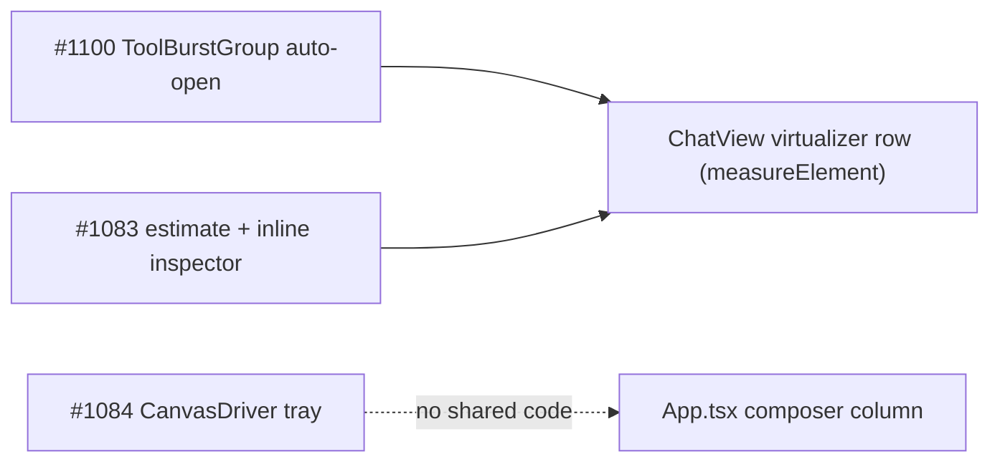

## Context

Three unrelated surfaces, one change. Each section below is self-contained; they share only the virtualized transcript (`ChatView`) as a host.

Issue text is evidence, not fact. Verification status per claim:

| Claim | Status |
|---|---|
| #1100 desktop auto-open of a running burst | **Verified** `ToolBurstGroup.tsx:189` |
| #1100 "flash = virtualizer remeasure of a big height change" | **Plausible, not provable from source** — the burst is one absolute `measureElement` row (`ChatView.tsx:2219-2236`); a ~47-row mount/unmount changes its height by ~1 kpx twice per tool. Task 1.1 reproduces first |
| #1083 inline inspector is a fixed `h-[60vh]` | **Verified** `MinimalChatView.tsx:422` (header comment `:10` still says `max-h`) |
| #1083 only the subagent inline mode uses it | **Verified**: `mode="inline"` has one call site, `AgentToolRenderer.tsx:434`; flows/popout use `h-full` in a dialog |
| #1083 web-search estimate "clamped to 240 px" | **Partly wrong**: the *reserve* clamps at 240, the *estimate* is `160 + 240 = 400` (`chat-virtual-rows.ts:85-91,121-128`; pinned by `chat-virtual-rows.test.ts:90-96`). **But** a claimed `web-search-results` row is a *transparent* item and is normally absorbed into the adjacent tool burst (`group-tool-bursts.ts:84,138-148`; `web-search-entry-rendering` spec "claimed row is absorbed into a tool burst"), so the burst constant, not the `custom` arm, drives its estimate. A claimed row stays a standalone `custom` row only when no tool run is adjacent (rare). D4 therefore changes the burst estimate only |
| #1083 burst uses a flat 220 px | **Verified** `chat-virtual-rows.ts:115` — a collapsed burst header is ~30 px |
| #1083 hidden `search` group may leave an estimated slot | **Verified (minor)**: `CustomEntryRow` returns `null` for a hidden group (`CustomEntryRow.tsx:86`) but the row is still in `displayRows`, so it reserves the estimate until measured to 0. Out of scope (the common absorbed case lives inside a burst; filtering such rows out of `displayRows` is a separate change) |
| #1083 collapse-after-expand shrinks via ResizeObserver | **Unverified** — covered by a regression test (task 3.5), not assumed |
| #1084 tray horizontal anchor is the viewport | **Verified** `CanvasDriver.tsx:178-183` (`right: 1rem`, `maxWidth: calc(100vw - 2rem)`); vertical anchor is the stack's top edge (`:60-62`) |
| #1084 transcript reserves no room | **Verified** by design: spec "taking no space in the page layout" (`auto-canvas` spec:265-267) |
| #1084 dock edges differ from tray edge | **Verified**: dock is inset `mx-5` (`ComposerDock.tsx:518`); tray is `right:1rem` of the viewport |

## Goals / Non-Goals

**Goals**
- #1100: starting a tool in a large collapsed burst never mounts the whole burst.
- #1083: inline inspector and collapsed burst rows leave no blank space; no new bounce while streaming.
- #1084: the chip never overlaps the editor pane, scrollbar, transcript or dock, on desktop or mobile; the newest message stays fully readable above it.

**Non-Goals**
- Changing virtualization, scroll-lock or bottom-pin semantics (except the single check in D6).
- Removing live visibility of running tools (header + stop control stay).
- Redesigning chip visuals; changing canvas auto-open, mobile gate or tap behaviour.
- Windowing the burst body (rejected, D1).

## #1100 — running burst auto-open

### D1 — bound auto-open by burst size  *(Decided 2026-11-03 by owner: option C, cap 8)*

`autoOpen` gains a size gate: `!prefs.toolGroupDefaultCollapsed && !isMobile && isRunning && visibleMembers.length <= RUNNING_AUTO_OPEN_MAX_MEMBERS` (constant, `8`, file-local, chosen at apply against the measured row height). Above the cap the group behaves as if `toolGroupDefaultCollapsed` were on: collapsed, live header, shimmer, shared stop control; a manual toggle still wins (`override ?? autoOpen`).

Why this works: the cost in #1100 is the *unbounded* mount of historical rows into one virtual row. The cap bounds the height step at ~cap rows in both directions. Small bursts keep the existing live-body behaviour that the `chat-view` spec requires.

Alternatives considered:
- **A — never auto-expand an established burst.** Matches the issue's first suggestion but contradicts the spec's "live tool stays visible" for the common 1-3 member burst; also changes behaviour for no gain on small bursts.
- **B — window the running body** (running row + last 3 done rows + a "N earlier" row). Keeps the live tool visible at any size; new UI and tests, new i18n string; larger surface than the bug. Revisit if users miss the live body on large bursts.
- **C (chosen) — size cap.** ~3 lines; no new UI.
- **D — stabilise the virtualizer** (hold the row's old size until the new one is measured). Treats the symptom for every future height jump but touches the scroll machine the specs freeze (`chat-scroll-lock`); rejected for this fix.

The trade-off: above the cap the live tool's output is behind one click. The cap *bounds* the flap, it does not remove it: a burst of ≤ 8 members still collapses on tool end and re-expands on the next tool start (mounting ≤ 8 rows each time), and a burst that crosses 8 members while running collapses mid-run. A collapsed running burst also hides the absorbed live reasoning/narration (`ThinkingBlock turnActive={isRunning}`), not only tool output. Accepted by the owner; the manual-toggle override stays. Visibility counts include the running member (`visibleMembers` includes it), so 7 done + 1 running = 8 expands, 8 done + 1 running = 9 collapses. The header already shows the live command and Stop (`fix-chat-burst-tool-stop`, archived; header stop works collapsed — verified by its "Collapsed running burst shows Stop" scenario).

Relation to archived `2026-09-28-fix-chat-burst-tool-stop`: it made the burst header the stop surface *because* a running burst can be collapsed (pref on or mobile). This change adds one more automatic-collapse condition; it relies on that header control and changes no stop logic.

### D2 — spec edits

Two chat-view requirements state `expanded = override ?? isRunning` / "SHALL render in the EXPANDED state". Both get the size bound (MODIFIED deltas) so the spec matches the code.

## #1083 — blank space

### D3 — inline inspector sizes to content  *(Decided 2026-11-03 by owner: option A)*

`containerClasses` for `inline`: `flex flex-col max-h-[60vh] overflow-hidden` (was `h-[60vh]`). The body keeps `flex-1 min-h-0 overflow-y-auto`, so it still scrolls at the cap. `popout` is unchanged.

The fixed height came from `fix-flows-plugin-polish` ("doesn't bounce as content streams in"). The archived `stream-subagent-reasoning-and-stable-card` has since fixed the actual bounce source (the collapsed card's activity row vanishing) and clamps the live tail with `max-h-36` / `growing` (`MinimalChatView.tsx:266-268`). With content-sizing, growth is monotone per entry (like main-chat rows), not a bounce.

Alternatives: **B** `max-h-[60vh]` + `min-h` only while the producer is live (keeps a stable box while running; still some blank at low content); **C** pin the live tail to the bottom of a fixed box (blank sits above). Both keep a tall box; neither meets "no large gap below short content". A is chosen; B is the fallback if the streaming check (task 2.3) shows growth jitter. Existing test `MinimalChatView.test.tsx:99-104` asserts the old classes and is rewritten. The main spec `shared-timeline-view` ("Three modes adjust layout") also states the inline cap (and wrongly on the body); a MODIFIED delta reconciles it so both specs agree the *root* carries the cap.

### D4 — burst estimate matches collapsed height  *(technical, not product)*

`estimateVirtualRowSize` burst arm: `220` → a collapsed-header constant (~32 px, measured at apply, task 3.1). A burst renders collapsed unless it is running-and-small (D1) or manually opened; one constant for every burst row (owner-confirmed; the function has no running/open input and signature is unchanged); running bursts are at the tail and measured on mount, so the estimate only governs first paint of historical, collapsed bursts. The function stays a pure O(1) DOM-free function; its signature does not change and `ChatView` needs no change.

Scope cut (simplification): an earlier draft also added `opts.claimedCustom` to lower standalone claimed `custom` rows to a ~40 px collapsed-card estimate. Claimed custom rows are transparent and are normally absorbed into a burst (see the verification table), so that path is nearly dead and the plumbing (new option, per-row flag in `ChatView`, extra spec scenarios) is dropped. Task 3.1 confirms in the harness which row kind carries the blank space; only if a standalone claimed `custom` row is shown to carry it does a follow-up reopen this.

Alternatives: query the DOM for real heights (forbidden by the spec: O(1), no DOM); lower the global custom base (hurts unclaimed cards, reintroduces the first-paint drift that `render-inline-reasoning-and-custom-entries` fixed); keep estimates and rely on remeasure (leaves the reported spacer over-reserve while scrolling).

Risk: under-estimating enlarges the above-viewport scroll correction when a burst turns out taller. Mitigation: only the collapsed-by-default burst is lowered, so the estimate is close to truth; the scroll-to-top convergence test (`fix-chat-scroll-to-top-estimate-drift`) is re-run.

## #1084 — canvas chip tray

### Why this is not a code regression of `2026-10-12-fix-canvas-chip-tray-overlay`

That change shipped as designed (sentinel at `App.tsx:2718`, tray at `CanvasDriver.tsx:178`). The reported placement is what its design specified:
- Its D1 anchored `right: 1rem; max-width: calc(100vw - 2rem)` to the **viewport** and rejected a chat-column slot as "needs new slot plumbing" (archived design D1).
- Its spec says the tray takes "no space in the page layout", so the transcript can never reserve room — the mobile overlap is intrinsic.
- Its context/D3 list never considered the split **editor pane** to the right of the chat (only the tablet/mobile markdown-preview replacement), so a viewport-right tray lands inside the editor.
- It anchored above "the composer stack's top edge". Ten days later `2026-10-22-add-composer-dock` put a card with `mx-5` insets and a peek overlay there, so the tray now hangs in the seam between the transcript and an inset dock — which is the "stray floating element" in the issue.

So: a design gap plus a later layout change, not a revert or code bug. The issue itself notes "the current wording produces this overlap by design".

### D5 — chip slot in the composer column  *(Decided 2026-11-03 by owner: option S)*

The zero-height sentinel (`App.tsx:2718`, testid `composer-stack-anchor`) becomes a content-height **slot**: `
`, still placed directly above `ComposerDockHost`. The sentinel's `aria-hidden` is **dropped**: the slot now holds interactive chips (links/buttons), which must stay in the accessibility tree. `CanvasDriver` portals the chips into it with `createPortal(tray, anchor)`. `CanvasDriver` stays mounted where it is (its effects need `SplitWorkspaceProvider`).

Consequences:
- Horizontally the slot is the chat column minus the dock's `mx-5` insets, so the tray is in the chat column, never over the editor pane or the scrollbar, and its right edge matches the dock. When the dock is hidden (`hidden={allEmpty}`) the composer card (`composer-root`, `p-3`, `CommandInput.tsx:951-960`) is inset 12 px, the slot 20 px: the tray sits 8 px inside the card's edges, never outside. Accepted; the spec says "within the composer's horizontal extent".
- The tray wrapper (rendered only while a chip exists, so the empty slot stays 0 px) carries a bottom gap `pb-3 max-md:pb-6`: the dock's Hide handle is `absolute top-0 -translate-y-1/2` (`ComposerDock.tsx:529`, 24 px → 12 px protrusion; 44 px on mobile → 22 px) and would otherwise overlap a full-width chip. This replaces the deleted `TRAY_GAP_PX`.
- Vertically the slot is a flex row: the transcript (the shrinkable row) gives up the chip's height, so the chip never covers a message; on mobile the newest message ends above the chip.
- Long labels truncate (the existing `min-w-0 max-w-full truncate` chain from archived D2c is kept), so the chip cannot exceed the dock width.
- No overlay: no `z-overlay`, no pointer-events juggling, no `visualViewport` maths, no ResizeObserver/MutationObserver. `useAnchorBottom` and its listeners are deleted. The soft keyboard needs no special case: the slot sits above the composer, which the layout already keeps above the keyboard.
- The slot remains a `fixed` row in `CHAT_PANE_ROW_TABLE` (content height; "no content → 0 px").
- Short panes (soft keyboard open, ~320 px visual viewport): two stacked chips (mobile file chip `min-h-[44px]` + server chip) take ~100 px from a non-shrinking fixed row; the transcript bound is 16 px (`CHAT_TRANSCRIPT_BOUND`). Accepted for now (chips are transient; the composer stays usable). Owner-confirmed normative (spec scenario "Composer stays fully visible on a short pane with two chips"): `composer-root` box ⊆ `split-chat-pane` box at 375×320 with both chips; the transcript may shrink to its 16 px bound. Task 4.25 asserts it. If it fails, follow-up: hide the server chip while the keyboard is up.
- Long server URLs: `CanvasServerChip`'s address span (`:port` + declared path, `shrink-0` today, `CanvasServerChip.tsx:55`) is not truncatable and a long path (`canvas-declare.ts` keeps `pathname+search+hash`) would overflow the dock. The address span becomes `min-w-0 truncate` like the label, so label and address shrink together inside the chip's `max-w-full`.
- Fallback unchanged: when there is no live composer (`anchor` null: read-only, frozen underlay, ended session) the tray keeps the `LayerPortal` fixed bottom-right safe-area overlay. The frozen underlay never provides the slot (existing `!frozen && !readOnly` guard).
- Chat pane hidden (full-editor mode): `SplitWorkspace` keeps the chat pane mounted but `display:none` in `full` mode (`split/SplitWorkspace.tsx:133-143`), so `anchor` stays non-null while the slot is invisible; a portaled chip would be unreachable. `CanvasDriver` therefore uses the slot only when `anchor != null && split.mode !== "full"` (`useSplitWorkspace().split.mode`, already in scope via `SplitWorkspaceProvider`) and otherwise renders the fixed fallback overlay. Switching back to split/closed moves the tray into the slot again. (Tablet `replaceChat` unmounts the chat pane, so `anchor` becomes null and the fallback applies already.)

Behaviour change to the spec: the old "a chip appearing SHALL NOT change the position or size of any other element" becomes "SHALL NOT move the header, toolbar, dock or composer; the transcript's viewport height MAY shrink by the chip's height". #681's actual complaint (the header and toolbar pushed down by an in-flow block *above the toolbar*) stays fixed: the slot is inside the chat pane, below the transcript.

Alternatives:
- **F — keep the float; clamp to the column and reserve scroller padding.** Measure `anchor.parentElement`'s rect for `right`/`maxWidth`, publish the tray height (CSS var on the column) and pad the scroller. Keeps "no layout shift" literally, but keeps all the observers and adds cross-component plumbing (portaled tray → ChatView padding); `scrollHeight` changes on chip appear anyway, so it shifts the transcript just the same.
- **G — compact icon pill on mobile only.** Does not fix desktop; the pill still covers the newest message.
- **H — hide the server chip when the editor already shows its target.** Optional polish; does not fix the transcript/scrollbar/dock overlaps. Out of scope.

### D6 — bottom re-pin when the scroller shrinks

A transcript pinned to the bottom must stay pinned when the slot appears and shrinks the scroller. `ChatView` re-pins from the virtualizer `onChange` only when `scrollHeight` changed (`grew`, `ChatView.tsx:1524-1534`) and has no `ResizeObserver` on the scroller. A chip appearing shrinks `clientHeight` only; `scrollTop` and `scrollHeight` are unchanged, so `grew` is false. The re-pin is therefore **expected to be needed**, not a contingency: add one `ResizeObserver` on the scroll container that calls the existing `pinBottom` while `stickToBottomRef` is true and no selection/splice guard is active (follow mode only; reuses the scroll machine, no new scroll semantics). Owner-confirmed: when the user is NOT pinned (scrolled up), the observer must not re-pin and `scrollTop` stays unchanged ±1 px when a chip appears/disappears (spec scenario "Chip appearing does not yank a scrolled-up transcript"). Task 4.14 writes the failing Playwright assertion first (chip appears while pinned → last row bottom ≤ scroller bottom), then task 4.15 adds the observer and re-runs the `chat-scroll-lock` suites.

## Risks / Trade-offs

- [#1100: above the cap, the live body is one click away] → header shows the live command + Stop; the cap is a single constant.
- [#1100: the cap bounds the flap, not removes it (≤ 8-member bursts still collapse/re-expand; a burst crossing 8 collapses mid-run; live absorbed reasoning hidden above the cap)] → accepted by owner (D1); manual toggle remains.
- [#1083b: lower burst estimate raises scroll correction on a mis-estimated burst] → only the collapsed-by-default burst lowered; convergence test re-run.
- [#1083b: standalone claimed custom rows keep the `160 + ≤240` estimate] → rare (they are normally absorbed into a burst); revisit only if task 3.1 shows otherwise.
- [#1083a: a short inspector grows as entries stream in] → growth within `60vh`, same as a main-chat row; B is the fallback.
- [#1084: transcript shrinks by ~44 px when a chip appears] → accepted, bottom stays pinned via the D6 ResizeObserver; no chrome moves.
- [#1084: short pane + two chips (~100 px)] → accepted, composer visibility asserted at 375×320 (task 4.25); follow-up hides the server chip while the keyboard is up.
- [#1084: no-dock state is 8 px inset vs the card] → accepted (D5).
- [#1084: full-editor mode hides the chat pane, so the slot is invisible] → `CanvasDriver` falls back to the fixed overlay while `split.mode === "full"` (D5); the chip stays reachable.
- [#1084: dock peek overlay (`bottom-full z-popover`, `ComposerDock.tsx:495`) paints over the slot while peeking] → transient, popover layer is above by design.
- [The e2e `canvas-chip-tray-overlay.spec.ts` floating-overlay probes] → rewritten explicitly (task 4.12); header/toolbar/composer-root still asserted unchanged.

## Migration / Rollback

None. Client-only; no persisted state. `npm run build` + `/api/restart`. Rollback: revert the commit(s); each of the three fixes is independently revertable.
