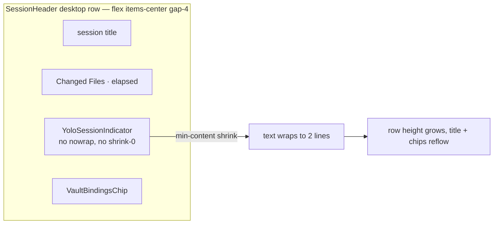

# Design — fix-yolo-indicator-overflow

## Context

Two peer indicators announce an active YOLO session
(`packages/client/src/components/access-grant/YoloIndicators.tsx:1-18`):

| Component | Mount | Host container |
|---|---|---|
| `YoloPill` | sidebar app bar, after `TunnelButton` (mount `SessionList.tsx:2774`) | `packages/client/src/components/session/SessionList.tsx:2770` — `flex gap-1 items-center` right group inside `header-app-bar` (`SessionList.tsx:2762`) |
| `YoloSessionIndicator` (desktop) | after `FooterSegmentSlot` (mount `SessionHeader.tsx:492`) | `packages/client/src/components/session/SessionHeader.tsx:427` — `flex items-center gap-4 text-sm` |
| `YoloSessionIndicator` (mobile) | below the chip row (mount `SessionHeader.tsx:322`) | `SessionHeader.tsx:311` — `flex flex-col text-sm` (indicator carries `self-start`) |

Both anchors are `inline-flex items-center` with no `whitespace-nowrap`, no
`flex-shrink-0` and no max-width (`YoloIndicators.tsx:92` pill,
`YoloIndicators.tsx:114` session indicator). In a non-wrapping flex row a flex
item's automatic minimum size lets it shrink to its `min-content` width, so the
text wraps *inside* the anchor and the anchor grows vertically — which is the
reported header growth, not a true horizontal overflow.

The copy is the amplifier: the unscoped session string is a full sentence
(`YoloIndicators.tsx:117-123`), and the pill's unscoped label is
`YOLO everywhere {time}` (`YoloIndicators.tsx:96-98`).

Verified against `develop`: nothing in `git log` for `YoloIndicators.tsx` after
`e23e53368` (`yolo-covers-agent-path-gate`) touches layout, so no part of the
issue is already fixed.

Two additional facts found while verifying:

- `YoloSessionIndicator` has `role="status"` (`YoloIndicators.tsx:111`) and the
  component re-renders every second (`useNow`,
  `packages/client/src/lib/time/use-now.ts:8-17`). A `status` live region
  re-announces its changed content, so screen readers currently hear the whole
  coverage sentence once per second.
- `YoloSessionIndicator` sets neither `title` nor `aria-label`; its only
  description is its visible text. `YoloPill` already sets both to the long
  sentence (`YoloIndicators.tsx:90-91`).

Existing spec constraint to respect:
`openspec/specs/access-grant-yolo/spec.md:554-555` — "Indicator copy SHALL
describe what YOLO actually covers". Shortening the visible string without
amending that sentence would violate the spec, hence the MODIFIED delta.

## Goals

- Neither indicator wraps (height == one line box) or extends past its host
  row, at 375 / 768 / 1500 px (viewport height ≥ 600 px) in `en` and `hu`,
  scoped or unscoped. Horizontal host rows (sidebar row 1, desktop header row)
  keep their no-YOLO height; the stacked mobile header grows by exactly the
  indicator's one-line height (D7). Sibling placement is not promised (D2).
  `zh-CN` gets the same CSS contract but is not in the verified set: its
  rendered labels are checked to be no wider than `hu`'s (D9).
- The coverage explanation stays reachable without navigation by pointer hover
  and by assistive technology; for touch and sighted keyboard-only operators it
  is one tap / Enter away, on the Access page (D1).
- Remaining time stays legible even when the label has to degrade.
- Keep theme tokens (`--severity-warning-*`) and the scoped/unscoped visual
  distinction.

## Non-goals

- A reusable hover/focus tooltip primitive. The repo's only floating-panel
  primitive is `ui:popover` (`packages/client-utils/src/Popover.tsx`), which is
  click-anchored and states "NOT a tooltip" (`Popover.tsx:11`).
- The Access settings page indicator, YOLO semantics, scope matching, expiry.
- Landing the `ui-state-capture` overflow probe — it lives in the unmerged
  `fix-slot-pill-legend-and-stale-overflow` change
  (`openspec/changes/fix-slot-pill-legend-and-stale-overflow/specs/ui-state-capture/spec.md`)
  and is absent from `openspec/specs/ui-state-capture/spec.md:38-42`.

## Decisions

### D1 — Compact visible copy; full sentence in `title` + `aria-describedby`

The visible label becomes a short form (shield + `YOLO everywhere` / `YOLO` +
the remaining time). The coverage sentence is a **static** string — no
`{remaining}` interpolation — chosen from four keys:

| Key | Scope | Expiry |
|---|---|---|
| `yolo.coverage` | scoped | expiring |
| `yolo.coverageUnscoped` | unscoped | expiring |
| `yolo.coverageForever` | scoped | env, never expires |
| `yolo.coverageUnscopedForever` | unscoped | env, never expires |

The `*Forever` variants embed the existing "until the server stops" wording of
`yolo.untilServerStops` (`YoloIndicators.tsx:51-56`) as literal text, so the env
case is described without ticking. The countdown is not needed in the sentence:
it is already in the visible time slot and therefore in the accessible name (D4).

**Both indicators, one rule.** `YoloPill` today puts a `{remaining}`-interpolated
sentence in both `title` and `aria-label` (`YoloIndicators.tsx:74-91`), so its
accessible name churns every tick. It adopts the same rule as the session
indicator: `aria-label` removed (name = visible compact label + time), `title`
and a sibling `sr-only` description carry the same static `yolo.coverage*`
sentence. The `{remaining}`-interpolating `yolo.pillTitle` /
`yolo.pillTitleUnscoped` keys are deleted from `en` (inline), `hu` and `zh-CN`
(`i18n-hu.ts:1777-1778`, `i18n-zh-CN.ts:1276-1277`); `npm run i18n:parity`
checks gaps only (`scripts/i18n-parity.mjs`), so a symmetric removal is safe.
Existing pill assertions on `title` (`YoloIndicators.test.tsx:89` "until the
server stops", `:150` /agent/) stay satisfied by the coverage sentences.
**Confirmed (decision Y3):** the shared `yolo.coverage*` keys replace the pill
keys outright; `yolo.pillTitle` / `yolo.pillTitleUnscoped` are deleted, not
kept as aliases, and no source file references them afterwards.

Per indicator, the one static string is carried twice, identically:

- `title` on the anchor — the pointer-hover path;
- a visually hidden `` referenced by
  `aria-describedby={descId}` on the anchor — the assistive-technology path.

**Node placement and id.** The `sr-only` span is a **sibling** of the anchor
(rendered next to it inside a fragment), never a child: a child's text would be
folded into the link's accessible name by name-from-content, duplicating the
sentence into the name and into `textContent`. `descId` comes from React
`useId()`, called at the top of `YoloSessionIndicator` **before** the
`if (!session …) return null` early return (`YoloIndicators.tsx:105`) so hook
order is stable; it is unique per mounted instance (desktop and mobile headers
can both exist in a test tree). `sr-only` is `position: absolute`, so the
sibling takes no flex slot and adds no `gap` footprint to the host row. The repo
already uses both `sr-only` spans
(`packages/client/src/components/connectivity/KnownServersSection.tsx:207`)
and `aria-describedby` wiring
(`packages/client/src/components/settings/PushNotificationsSection.tsx:145`),
so this introduces no new mechanism.

**What this honestly does and does not give the keyboard.** A native `title` is
not rendered by browsers on keyboard focus, and the repo has no focus-visible
tooltip primitive — `ui:popover` (`packages/client-utils/src/Popover.tsx:11`) is
explicitly click-anchored and documents itself as "NOT a tooltip". So:

| Path | Coverage sentence reaches the operator via |
|---|---|
| pointer hover | `title` |
| keyboard + assistive technology | `aria-describedby` description, read on focus |
| touch (tap navigates; no hover) | one tap on the link → Access page |
| sighted keyboard, no assistive technology | Enter on the link → Access page, which names the planes, the agent path gate and the folder coverage (`packages/client/src/components/access-grant/YoloAccessCard.tsx:95-107`) |

The spec delta is written to that table: it requires the description to be
obtainable *without navigating away* only for pointer hover and assistive
technology (via the accessible description, for both indicators), and names the Access page, one tap / Enter away, as the touch and
sighted-keyboard path. It does **not** claim a
visible on-focus tooltip, which this change cannot deliver. This resolves Open
Question 1: `title` + accessible description is the accepted floor for this repo;
a focus-visible tooltip primitive is a separate change.

*Alternatives rejected.* (a) Keep the sentence and truncate it with CSS ellipsis
— at header widths the visible remnant would be `YOLO everywhere: agent + das…`
and the remaining time, the one operational datum, would be the first thing cut.
(b) Hide the indicator below a breakpoint — the spec forbids relying on the
sidebar alone (`access-grant-yolo/spec.md:557-559`) and "unmissable" is the
requirement's whole point. (c) Build a focus-visible popover tooltip — new
primitive, new focus-management surface, disproportionate to a wrap fix.

### D2 — Marker and time are `flex-shrink-0`; only the label may ellipse

Internal structure: icon (`shrink-0`) + label span (`truncate min-w-0`) + time
span (`shrink-0 whitespace-nowrap tabular-nums`).

The anchor itself gets `whitespace-nowrap overflow-hidden` **plus `min-w-0`**
**plus a concrete bounded width**:

| Placement | Anchor width classes |
|---|---|
| sidebar pill (`YoloPill`) | `min-w-0 max-w-[12rem]` |
| session header, desktop row (`SessionHeader.tsx:427`) | `min-w-0 max-w-[22rem]` |
| session header, mobile column (`SessionHeader.tsx:311`, `self-start`) | additionally `max-w-full`: in a `flex-col` an item with `self-start` sizes to `max-content`, so without `max-w-full` a `nowrap` anchor would overflow the column horizontally instead of ellipsing |

`min-w-0` is load-bearing, not decoration: without it a flex item's automatic
minimum size equals its full `nowrap` text width, so the anchor refuses to
shrink and the row overflows rather than the label ellipsing. This is the same degradation contract the
mobile attached-proposal chip already uses — truncate the name, keep the
affordance (`SessionHeader.tsx:284`, spec
`openspec/specs/openspec-attach-combo/spec.md:105-108`).

*Alternative rejected:* `whitespace-nowrap` + `flex-shrink-0` on the anchor
alone. That converts vertical growth into horizontal overflow of the header row
— trading a visible bug for a clipped one.

**Sibling shrink policy is out of scope, and the claim is scoped to match.**
Only `YoloIndicators.tsx` is edited. The desktop header row shares its line with
`FooterSegmentSlot` extension decorators (`SessionHeader.tsx:490`) and the
sidebar right group holds `InstallButton` / `TunnelButton` / `FocusToggle` /
`headerExtra` (`SessionList.tsx:2770-2776`); none of those gain a shrink or
`min-w-0` policy here. What this change guarantees is that **the indicator**
never wraps and never grows its host row, and that when the indicator is
squeezed its label degrades before its marker or its time. It does not
guarantee that siblings never truncate: an extension footer segment that itself
refuses to shrink stays its own problem, out of scope for a wrap fix.

### D2b: non-expiring (env-activated) sessions show the infinity glyph

`remainingMs` returns `null` for env-activated sessions that never expire, and
`yoloRemainingLabel` turns that into the sentence "until the server stops"
(`YoloIndicators.tsx:51-56`), while `YoloPill` already renders `\u221e` in the
time slot for the same case (`YoloIndicators.tsx:72`).

Decision: the session indicator adopts the pill's rule. In **both** placements
the time slot renders `formatRemaining(ms)` when `ms !== null` and `\u221e`
otherwise, so the "the time stays legible" contract has a defined value in every
state. The word form stays in the `title` and in the `aria-describedby`
description, where a sentence fits, via the static `yolo.coverage*Forever`
keys (D1) rather than by interpolating `yolo.untilServerStops`. D3 still holds: `\u221e`
continues to mean exactly one thing, the remaining time.

### D3 — No `∞` glyph for "everywhere"

The issue suggests `YOLO∞`. `∞` is already taken: the pill renders `\u221e` as
the *remaining time* for env-activated sessions that never expire
(`YoloIndicators.tsx:72`). Reusing it for scope would make `YOLO∞ ∞` and
conflate two different meanings. Unscoped stays distinguished the way the spec
and `ui-plan S6` already prescribe — heavier border + bold weight, warning tone,
and the word "everywhere" (`YoloIndicators.tsx:36-41`).

### D4 — Drop `role="status"`, keep the link

`role="status"` on the anchor both suppresses link semantics for assistive tech
and turns the 1 s tick into a per-second announcement. The element becomes a
plain link, reachable by Tab and silent between ticks because it is no longer a
live region.

**Where the time lives, stated once so D4 and task 2.3 agree.** No `aria-label`
is set. The accessible **name** is computed from the anchor's own visible
content: the compact label plus the time slot (`YOLO everywhere 35:23`). The
accessible **description** is the static coverage sentence behind
`aria-describedby` (D1), one of the four static `yolo.coverage*` keys with
**no** `{remaining}` interpolation, so its text is identical across ticks
(it can change only if the session itself changes scope/expiry kind). The
description node is a sibling, so it is excluded from the name. The time is therefore still announced (operators need it), and
only the name, not the description, moves with the clock.

*Alternatives rejected.* (a) Keep `role="status"` and add `aria-live="off"` —
contradictory authoring, and still no link semantics. (b) Keep the live region
and move the time into an `aria-hidden` span — any content change in a live
region re-announces, and the remaining time is exactly what an operator needs.
(c) Put the full sentence in `aria-label` with `{remaining}` interpolated, as
`YoloPill` does today (`YoloIndicators.tsx:74-91`): that makes a long accessible
name churn every second; the static description in D1 is the same information
without the churn. For the same reason the pill's `aria-label` is removed (D1).

**Appearance announcement: explicitly dropped, not overlooked.** Removing
`role="status"` means assistive technology is no longer told when the indicator
*appears*. Accepted, because the appearance is not silent in the operator-driven
path: activating YOLO already surfaces a message
(`packages/client/src/components/access-grant/YoloActivation.tsx:97`,
`yolo.activated`) plus the in-dialog confirmation (`YoloActivation.tsx:376`,
`yolo.dialogActivated`). The uncovered case is an **env-activated** session,
where no operator action precedes the indicator; a screen-reader user there
learns of it on first reaching the indicator or the Access page. Adding a
one-shot live-region announcement for that case is rejected as scope creep on a
wrap fix, and is recorded under Risks.

### D5: English defaults live inline; only `hu`/`zh-CN` are catalogue edits

There is **no English catalogue file**. `i18n.tsx:38` declares
`const en: Record<string, string> = {}` and `loadCatalog` short-circuits for
`en` (`i18n.tsx:67`); every English string is the third argument of the
`i18nT(key, vars, fallback)` call site. For these indicators the call sites are
`YoloIndicators.tsx:96-97` (pill) and `YoloIndicators.tsx:119-123` (session
indicator).

So the work splits by locale:

| Locale | Edited in |
|---|---|
| `en` | the inline fallback arguments in `YoloIndicators.tsx` (no catalogue) |
| `hu` | `packages/client/src/lib/i18n/i18n-hu.ts:1776-1789` |
| `zh-CN` | `packages/client/src/lib/i18n/i18n-zh-CN.ts:1275-1288` |

The short forms keep the existing keys (`yolo.sessionUnscoped`,
`yolo.sessionScoped`, `yolo.pillUnscoped`, `yolo.pill`); four new static keys
`yolo.coverage`, `yolo.coverageUnscoped`, `yolo.coverageForever`,
`yolo.coverageUnscopedForever` (D1) carry the long sentences — English as
the inline fallback, plus `hu` / `zh-CN` catalogue entries — shared by both
indicators; `yolo.pillTitle` / `yolo.pillTitleUnscoped` are removed (D1).
Translated strings are
longer than English (`hu` unscoped pill is `YOLO mindenhol {time}`), so the
layout contract in D2 — not the string length — is what guarantees no wrap.
`openspec/specs/ui-i18n-coverage/spec.md:72` already requires all three
catalogues to be complete, so no delta is needed there, only the work.

### D6: one compact label, both placements; mobile is a width constraint, not a variant

Resolves Open Question 2. The mobile session header is a `flex flex-col`
container (`SessionHeader.tsx:311`) and the indicator carries `self-start`
(`YoloIndicators.tsx:114`), so it is NOT a horizontal control row. Rather than
ship a third string set for mobile ("icon + time only"), mobile keeps the same
compact label and relies on D2's width contract: `max-w-full` caps the
`self-start` item at the column width and `truncate` ellipses the label. One
copy set, one degradation rule, two placements.

Consequence for the spec delta: the permission to abbreviate must NOT be worded
as "an indicator placed in a horizontal control row", because that excludes the
mobile placement where the abbreviation matters most. It is worded by indicator
("the sidebar indicator and a session-surface indicator") instead.

### D7: the layout invariant is verified in a real browser, at named widths

Class-name assertions in jsdom cannot prove "does not wrap": jsdom performs no
layout, so `truncate` / `min-w-0` / `max-w-*` assertions only prove the classes
are present. They stay as cheap regression pins on the component contract, but
the invariant itself is verified by a Playwright spec against the docker
harness, `tests/e2e/yolo-indicator-layout.spec.ts`, alongside the existing
access-grant e2e specs (`tests/e2e/access-grant-dialog.spec.ts`).

Which header exists depends on `useMobile` (width < 768 px **or** height
< 600 px, `packages/client-utils/src/useMobile.ts:24`): when true,
`SessionHeader` renders `MobileHeader` (`SessionHeader.tsx:392-397`), the
`flex flex-col` placement; the desktop row (`SessionHeader.tsx:427`) does not
exist. Below 768 px the sidebar is hidden behind a hamburger and opens as a
fixed overlay (`openspec/specs/resizable-sidebar/spec.md:86`), so the pill is
only measurable after opening that drawer. Viewport height is fixed at
≥ 600 px so width alone selects the layout.

| Width | Session-indicator placement measured | Pill measured |
|---|---|---|
| 375 px | mobile column (`MobileHeader`, `SessionHeader.tsx:311`) | after opening the hamburger drawer |
| 768 px | desktop row (`SessionHeader.tsx:427`) | inline sidebar |
| 1500 px | desktop row | inline sidebar |

Assertions target **the indicator element only**, so they cannot fail for
sibling reasons (sibling shrink is out of scope, D2):

| Vehicle | Proves |
|---|---|
| jsdom (`YoloIndicators.test.tsx`) | structure: marker / label / time nodes, classes, `title`, sibling `aria-describedby` target with static text, no `role="status"` / `aria-live` |
| Playwright, every width above, `en` | indicator height == one line box (computed `line-height` + vertical padding + border); indicator's right edge ≤ host row's right edge |
| Playwright, horizontal rows (sidebar row 1 at all three widths; desktop header row at 768 / 1500 px) | host row height ≤ its height with no YOLO session and the same siblings |
| Playwright, mobile column at 375 px | header height ≤ no-YOLO header height + indicator's measured height. The mobile header is `flex flex-col` (`SessionHeader.tsx:311`) and the indicator is a new child (`SessionHeader.tsx:322`), so it always adds a stacked row; no-growth is impossible there by construction, and the claim is exactly "one indicator line, no more" |
| Playwright, all of the above with `hu` | same, with the longest shipped translation (`YOLO mindenhol {time}`) |

Host-row `scrollWidth` is deliberately **not** asserted: a sibling that refuses
to shrink could make it fail without the indicator being at fault.

Both spec deltas name this set literally in their requirement text — 375 /
768 / 1500 px, viewport height ≥ 600 px, `en` and `hu` — and their scenarios
assert only on the indicator plus host-row height (horizontal rows) or header
growth ≤ one indicator line (mobile column). No scenario promises that siblings
stay on their no-YOLO lines (D2).

### D8: below the marker + time floor, no-overflow wins (decision Y1)

The label-degradation clause has a floor: the width of marker + time slot +
the anchor's horizontal padding and border. At or above that floor the label
ellipses and marker + time stay legible. Below it the bounds clause wins: the
anchor (`overflow-hidden`, `min-w-0`) stays single-line and inside its host,
and marker/time MAY be clipped. That band is **out of the verified set**: tests
force widths at preferred − 1 px and at exactly the floor, never below. Both
spec deltas state the floor and the precedence.

### D9: `hu` ≥ `zh-CN` is checked, not assumed (decision Y2)

The verified set names `hu` as the longest shipped locale. CJK glyphs are ~1em
each, so that premise is measured: the layout spec renders each indicator with
language `hu` and `zh-CN` in an unconstrained host and asserts the `hu` label's
`scrollWidth` ≥ the `zh-CN` label's, for the pill and the session indicator.
`zh-CN` is not added to the full width matrix.

## Risks / Trade-offs

- **Information loss at a glance.** The header no longer states the coverage
  inline. Mitigated by the `title` tooltip plus the accessible description (D1),
  and by the Access page, which names the planes, the agent path gate and the
  folder coverage (`openspec/specs/access-grant-yolo/spec.md:548-550` for the
  requirement, `packages/client/src/components/access-grant/YoloAccessCard.tsx:95-107`
  for the implementation).
- **Touch users and sighted keyboard-only users (no assistive technology) get
  no in-place description.** On touch a tap navigates and there is no hover.
  For the keyboard, a native `title` is not rendered on focus, and the repo's only
  floating primitive is click-anchored and documents itself as "NOT a tooltip"
  (`packages/client-utils/src/Popover.tsx:11`). Accepted; their path is
  one tap / Enter on the link to the Access page. The spec delta is worded to that
  reality rather than promising on-focus visibility. Resolves Open Question 1.
- **The accessible NAME still ticks** (D4): it is derived from visible content,
  which includes the countdown. While the link holds focus, some screen reader /
  browser combinations may re-read a changed accessible name. Not reproduced
  here, and not something this change can verify in CI. Mitigations: the name is
  short (compact label + time), and the long sentence sits in the static
  description, which never changes. The spec clause is therefore narrowed to
  forbid the live region and the unsolicited per-tick announcement, not to
  promise universal screen-reader silence.
- **Bounded `max-w`** (`12rem` pill, `22rem` session) could ellipse the label on
  wide screens if a translation is long; the time stays visible, so the
  degradation is graceful.
- **Removing `role="status"`** loses the appearance announcement for assistive
  technology. Covered for the operator-activated path by the existing activation
  messages (D4); uncovered for env-activated sessions, where a screen-reader
  user learns of YOLO on first reaching the indicator or the Access page.
  Accepted and recorded rather than fixed here; a one-shot announcement on
  appearance is a reasonable follow-up.
- **Sibling overflow is not addressed** (D2): the indicator is made
  shrink-correct, but `FooterSegmentSlot` extension content and the sidebar's
  other row-1 controls keep whatever shrink behaviour they have today.
  Scenarios assert on the indicator and host-row height only; whether a
  sibling truncates or moves is not asserted.
- **Mobile header still grows by one line.** The mobile session header is a
  vertical stack (`SessionHeader.tsx:311-323`); the indicator is its own row
  there, as today. This change bounds that growth to one indicator line (the
  reported bug was the 2-line wrap), it does not remove it. Moving the
  indicator into the mobile chip row would be a layout redesign, out of scope.

## Open Questions

1. ~~Visible tooltip on keyboard focus?~~ **Resolved (D1):** `title` plus an
   `aria-describedby` description is the accepted floor; a focus-visible tooltip
   primitive is a separate change. The spec delta claims only what that
   delivers.
2. ~~Drop "everywhere" on mobile?~~ **Resolved (D6):** no mobile-only copy. One
   compact label everywhere; mobile is handled by `max-w-full` + `truncate`.
3. If `fix-slot-pill-legend-and-stale-overflow` lands first, should this change
   add `header-app-bar` and the session header as captured states with
   `overflowRoot`, or leave that to a follow-up? (Still open; it is additive and
   does not block this change.)
