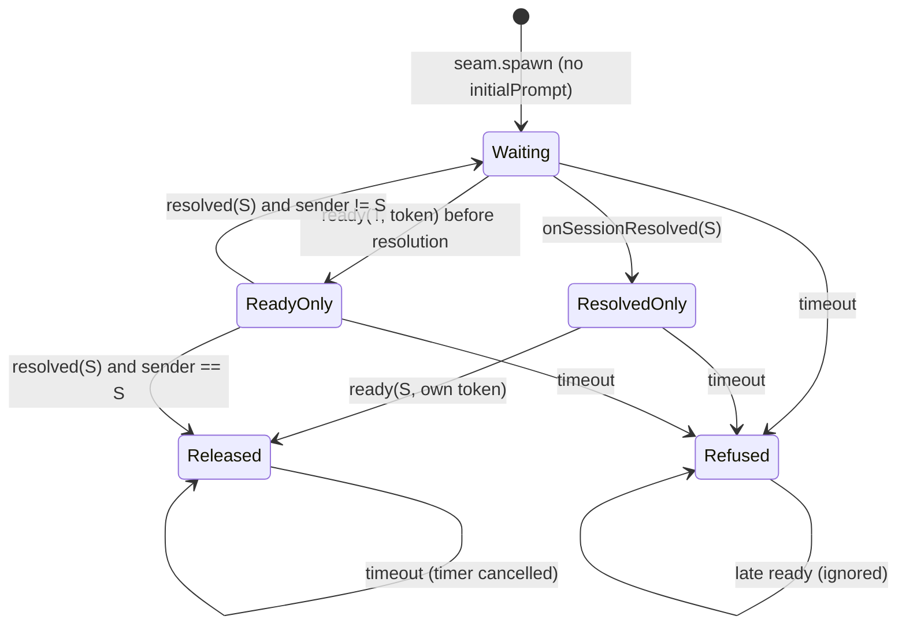

# Test Plan — harden-agent-tool-guards

Stage: design   Generated: 2026-10-26   Hard gate satisfied 2026-10-26 (all 16 gaps answered; see below).

Paths: L1 = `packages/*/src/**/__tests__/*.test.ts` (vitest) · L2 = `qa/tests/*.sh|*.ps1` (process, no rendered-UI asserts) · L3 = `tests/e2e/*.spec.ts` (Playwright against the docker harness; port is read from `.pi-test-harness.json` `dashboardPort`, never hard-coded). The `exemplar` column names the nearest existing test of that category (all verified to exist).

Requirement refs (19 ADDED/MODIFIED): R1 `access-grant-yolo`/YOLO never auto-allows · R2 `agent-path-confinement`/Session roots · R3 …/Always allow second step · R4 …/Some agent-directory paths asked · R5 `bridge-extension`/auto-decides project_trust · R6 `chat-gateway`/Hard in-session tool policy · R7 …/Triggering message · R8 `credential-file-guard`/Protected paths · R9 …/Tool input naming files · R10 `path-anchor-grants`/A grant names the subject · R11 …/Credential + browser dirs sensitive · R12 …/Store write never discards · R13 `pi-trust-mirror`/One decision order · R14 `server-capability-bounds`/Shared-root set · R15 `dashboard-mcp-server`/spawn_session no auto-trust · R16 `untrusted-content-guard`/project can only tighten · R17 `pi-trust-mirror`/The bridge decides at project_trust (`not-covered`) · R18 `pi-trust-mirror`/Access page discloses pi trust (`not-covered` label) · R19 `mcp-client-folder-section`/Folder MCP page follows pi's project rules (no per-run exception). Non-requirement design items: D5 posture (E87), D8 TOOL-03 record (E88, E89, M1, M2).

## Hard gate satisfied

Operator accepted the Recommended answer of every gap on 2026-10-26 (`/tmp/secmap/batch2/gaps-harden-agent-tool-guards.md`); spec/design/tasks amended to match.

- **DG1** readiness timeout is a fixed 30 000 ms constant, injectable in tests only, no config key; a ready at exactly T loses (timer fires first).
- **DG2** a second message while the spawn awaits readiness gets the existing reply "A session is already starting for this channel — one moment."; never queued or delivered; binding persisted only on release.
- **DG3** resume: readiness counts only from the sessionId `onSessionResolved` delivers for the resume spawn, not the ended session's id.
- **DG4** the design D7 browser table is normative, one row per browser × platform (Brave = vendor root); snap/flatpak is residual.
- **DG5** a grant, YOLO root or persisted grant for a directory containing a credential dir (`~/.config`) is refused / not admitted, and preserved in the file.
- **DG6** project fields log only when they would have lowered or relaxed the effective settings, once per `loadSettings` call; no-ops and invalid values are silent.
- **DG7** an uncovered activation cwd logs the new reason `not-covered` (added to `MirrorWithheldReason`, via `withheld`); a live-query miss keeps `live-not-covered`.
- **DG8** `<agentDir>/sessions` itself asks (own session dir exempt).
- **DG9** only the exact `~/.netrc` is sensitive; `~/.netrc.*` and Windows `_netrc` are residual (rows E36, E37 pin the current outcome).
- **DG10** an invalid-JSON or `version !== 1` store is moved aside to `<file>.corrupt-<UTC ts>` by a record; a revoke writes nothing.
- **DG11** the MCP `spawn_session` result text and tool description stay byte-identical (snapshot); no text change.
- **DG12** verified from code: ACP starts no pi process or bridge (`acp-spawn.ts`, `acp-bridge/local-host.ts`, `child-env.ts`), so the rule does not apply; ACP removed from the spec list, row E68 dropped, residual recorded in proposal and design Risks.
- **DG13** preserved rows are bounded by a 1 MiB store-file ceiling (`GRANT_STORE_MAX_BYTES`); a larger file is neither loaded nor rewritten, the write fails.
- **DG14** a `send_prompt` failure after readiness replies "message not delivered" and keeps the binding; the user's next message retries.
- **DG15** a restart while awaiting readiness leaves an idle, unbound, undelivered session; documented residual, no cleanup.
- **DG16** p95 < 1 ms per call for the credential-guard canonicalisation (P4); p95 < 5 ms per request for the browse-root recompute (P5).

---

## Chat readiness state machine (R6, R7)

Legal edges: E44 rows a–c, X20. Illegal edges: E44 d–g, E45, E46, X15.

---

## Scenarios

### Edge-case

| id | requirement | technique | level | disposition | input | trigger | expected observable | exemplar |
|----|-------------|-----------|-------|-------------|-------|---------|---------------------|----------|
| E1 | R8, R9 | decision-table | L1 | automated | tool ∈ {read, edit, write, ls, find, grep} × file ∈ {`auth.json`, `mcp-auth.json`, `providers.json`, `system-one/auth.json`} × dir ∈ {`~/.pi/agent`, `PI_CODING_AGENT_DIR=/srv/pi-agent`} (48 combinations) | guard `tool_call` handler | every combination returns `{block:true}` with reason prefix `credential_guard`; log line carries tool + rule id only (no path) | `packages/extension/src/__tests__/credential-guard.test.ts` |
| E2 | R8 | BVA (sibling rule `<name>.*`) | L1 | automated | `~/.pi/agent/auth.json.bak`, `providers.json.corrupt-20260101T000000Z`, `system-one/auth.json.lock`, `mcp-auth.json.` (trailing dot); controls `~/.pi/agent/xauth.json`, `~/.pi/agent/system-one/author.json`, `~/.pi/agent/auth.json/../settings.json` | `read` | suffix `.`-names blocked (rule `path`); `xauth.json`, `author.json` and the `..` path to `settings.json` NOT blocked | `packages/extension/src/__tests__/credential-guard.test.ts` |
| E3 | R8, R9 | EP (path forms) | L1 | automated | `read auth.json` with cwd=`~/.pi/agent`; `read ./system-one/auth.json` with cwd=`~/.pi/agent`; symlink `/w/repo/l` → `~/.pi/agent/auth.json`; `~/.pi/agent/x/../auth.json`; override dir with trailing `/` | `read` / `edit` | all blocked by the path rule (symlink canonicalised) | `packages/extension/src/__tests__/credential-guard.test.ts` |
| E4 | R9 | EP + BVA (text rule) | L1 | automated | `bash` with `cat ~/.pi/agent/auth.json \| head`; `CAT ~/.PI/AGENT/AUTH.JSON`; `type %USERPROFILE%\.pi\agent\providers.json`; `cat ~/.pi/agent/system-one/auth.json.bak`; controls `rg auth.json packages/`, `rg providers.json docs/`, `ls ~/.pi/agent`, `cat auth.json` | handler | the four references blocked (case-insensitive, either separator, sibling suffix); the four controls NOT blocked (bare name never matches) | `packages/extension/src/__tests__/credential-guard.test.ts` |
| E5 | R9 | decision-table | L1 | automated | `PI_CODING_AGENT_DIR` ∈ {unset, `/srv/pi-agent`, `/srv/pi-agent/`}; command `cat /srv/pi-agent/auth.json`, `cat /srv/pi-agent/system-one/auth.json`, `cat /srv/pi-agent/settings.json` | `bash` | first two blocked when the env is set (full-path needle); `settings.json` and the unset case NOT blocked | `packages/extension/src/__tests__/credential-guard.test.ts` |
| E6 | R8, R9 | decision-table (task 1.3 index coupling) | L1 | automated | env states {no override, override, `PI_DASHBOARD_DATA_KEY_FILE` set, both}; commands naming `.pi/agent/plugin-credentials.json`, `.pi/dashboard/vault.json`, and `ls /tmp` | `bash` | plugin-credentials and vault references stay blocked in every state; `ls /tmp` is NOT blocked (no empty or shifted needle can match every string); needle list has no `""` entry | `packages/extension/src/__tests__/credential-guard.test.ts` |
| E7 | R9 | EP (content exempt) | L1 | automated | `write` to `/w/notes.md` with content "see ~/.pi/agent/auth.json"; `edit` newText naming `.pi/agent/providers.json`; `write` whose `path` is `~/.pi/agent/auth.json` | handler | the first two NOT blocked (content exempt); the third blocked | `packages/extension/src/__tests__/credential-guard.test.ts` |
| E8 | R9 | EP (extension tools) | L1 | automated | MCP tool `ctx_execute_file` with `path` `/home/u/.pi/agent/system-one/auth.json`; `grep` with `glob` `/home/u/.pi/agent/mcp-auth.json` | handler | both blocked (`text-path`) | `packages/extension/src/__tests__/credential-guard.test.ts` |
| E9 | R8 | decision-table (grep directory rule) | L1 | automated | `grep path=~/.pi/agent/system-one`; `grep path=~/.pi/agent`; `grep path=~/.pi/agent/skills`; `ls ~/.pi/agent/system-one`; `find ~/.pi/agent/system-one` | handler | first two blocked (`grep-dir`); the last three NOT blocked (directory protection is `grep`-only, as for `plugin-credentials.json`) | `packages/extension/src/__tests__/credential-guard.test.ts` |
| E10 | R8 | EP (invalid class: non-secret files) | L1 | automated | `read ~/.pi/agent/settings.json`, `trust.json`, `models.json`, `mcp.json` | credential guard, then path gate | credential guard returns `undefined` for all four; path gate silent for `settings.json` and `trust.json` | `packages/extension/src/__tests__/credential-guard.test.ts` |
| E11 | R8 | residual pin | L1 | automated | `PI_CODING_AGENT_DIR=~/alt-agent` (literal tilde, pi expands it); a third agent dir `/opt/third` reported by pi | `read ~/alt-agent/auth.json`, `read /opt/third/auth.json` | credential guard does NOT block either (recorded residual); the carve-out asks for `/opt/third/models.json` (E18) | `packages/extension/src/__tests__/credential-guard.test.ts` |
| E12 | R8 | decision-table (guard order) | L1 | automated | state ∈ {unscoped YOLO on, persisted grant containing `~/.pi/agent`, `agentPathGate.enabled:false`}; `read ~/.pi/agent/auth.json` | bridge `tool_call` chain | blocked with `credential_guard` in every state; path gate not consulted before it | `packages/extension/src/__tests__/credential-guard-wiring.test.ts` |
| E13 | R2, R4 | decision-table (target × root config) | L1 | automated | targets {`sessions/--w-other--/a.jsonl`, `models.json`, `mcp.json`, `mcp.json.bak`, `models.json.1`} × roots {default, cwd=`$HOME`, checkout root = dotfiles repo containing `~/.pi/agent`, persisted grant containing `/srv/pi-agent` (override dir)} × access=read | `decidePathAccess` | verdict `ask`, `sensitive:true`, `grantable:false`; `buildOptions` offers only `Allow once` / `Deny` (20 combinations) | `packages/extension/src/path-gate/__tests__/decide.test.ts` |
| E14 | R2, R4 | EP (valid class: stays silent) + regression of unchanged scenarios | L1 | automated | `settings.json`, `trust.json`, `skills/x/SKILL.md` (loaded), `prompts/p.md`, file in own session dir, git-checkout-root file, tmpdir write, `/w/other/docs/a.md` under a persisted grant, same after revoke | `decidePathAccess` | the first six, checkout file, tmpdir write and granted file → `in-root`; after revoke → `ask`; skill `edit` → `ask` (read-only root) | `packages/extension/src/path-gate/__tests__/decide.test.ts` |
| E15 | R4 | BVA (name boundaries) | L1 | automated | `sessions-old/x`, `sessionsX/x`, `skills/sessions/x`, `mcp.jsonl`, `xmodels.json`, `foo/mcp.json`, `models.json/..` vs `sessions/a`, `sessions/a/b/c.jsonl`, `models.json.`, `mcp.json.x` | read | the first six → `in-root` (not carve-out); the last four → `ask` sensitive | `packages/extension/src/path-gate/__tests__/decide.test.ts` |
| E16 | R4 | BVA (own session dir prefix) | L1 | automated | cwd `/w/repo`, own dir `<agentDir>/sessions/--w-repo--/`; targets: `…/--w-repo--/own.jsonl`, `…/--w-repo--2/x.jsonl`, `…/--w-repo/x.jsonl`, `…/--w-repo----/x.jsonl` | read | own file → silent; the three look-alike siblings → `ask`, sensitive | `packages/extension/src/path-gate/__tests__/decide.test.ts` |
| E17 | R3, R4 | EP (override dir) + control | L1 | automated | `PI_CODING_AGENT_DIR=/srv/pi-agent` whose parent `/srv` is grantable; targets `/srv/pi-agent/mcp.json`, `/srv/pi-agent/sessions/x/y.jsonl`; control: `/w/other/docs/a.md` out of root | read | carve-out: `ask`, `sensitive:true`, `grantable:false`, only `Allow once`/`Deny`, no `Always allow`; control still offers `Always allow /w/other/docs` | `packages/extension/src/path-gate/__tests__/decide.test.ts` |
| E18 | R4 | decision-table (three agent dirs) | L1 | automated | dirs `~/.pi/agent`, `/srv/pi-agent` (env), `/opt/third` (pi's `res.agentDir`); file `models.json` / `mcp.json` in each | read | all six ask, sensitive, no always-allow (union built independently of the read-only root) | `packages/extension/src/path-gate/__tests__/decide.test.ts` |
| E19 | R4 | EP | L1 | automated | read/ls/find on the directory `~/.pi/agent/sessions` itself, and its own-session subdirectory | `decidePathAccess` | `ask`, `sensitive:true`, `grantable:false`, only `Allow once`/`Deny` for the directory `~/.pi/agent/sessions` itself (read/ls/find, with and without trailing `/`, for the override-dir and `res.agentDir` copies too); the own-session subdirectory `…/sessions/--w-repo--` stays `in-root` (silent) | `packages/extension/src/path-gate/__tests__/decide.test.ts` |
| E20 | R4 | EP (path-form) | L1 | automated | `/w/repo/ln` symlink → `~/.pi/agent/sessions/--w-other--`; `~/.pi/agent/./sessions/../models.json`; `~/.pi/agent/skills/../mcp.json` | read | each resolves canonically → `ask`, sensitive | `packages/extension/src/path-gate/__tests__/decide.test.ts` |
| E21 | R2, R4 | decision-table (access mode × roots) | L1 | automated | access ∈ {read, write, edit} × roots {default, workspace root spanning agent dir} × target `~/.pi/agent/mcp.json` | decide | read → `ask` (carve-out first, both root configs); write/edit with default roots → `ask`; write/edit under a spanning workspace root → `in-root` (documented residual, pinned) | `packages/extension/src/path-gate/__tests__/decide.test.ts` |
| E22 | R4 | state-transition (verdict memory) | L1 | automated | operator `Deny` on `mcp.json`, then read `settings.json`, then `mcp.json` again; separately `Allow once`, then read again | handler | after Deny: `settings.json` still silent, `mcp.json` blocked as recently-denied; after Allow once: second read asks again, no grant recorded | `packages/extension/src/path-gate/__tests__/handler.test.ts` |
| E23 | R1, R4 | decision-table (YOLO bypass) | L1 | automated | unscoped YOLO advertised and grant store matching; target `/srv/pi-agent/mcp.json` (outside `~/.pi`) | handler | `yoloDecide` is never called (path is `sensitive`), the prompt is shown; control `/w/other/readme.md` goes to YOLO | `packages/extension/src/path-gate/__tests__/yolo-link.test.ts` |
| E24 | R4 | interaction spy | L1 | automated | prompt for `/srv/pi-agent/mcp.json` | gate computes the offer | grant coordinator / `isUngrantable` admission is never invoked for that subject | `packages/extension/src/path-gate/__tests__/grant-link.test.ts` |
| E25 | R3 | EP + illegal edge | L1 | automated | `Always allow` card for `/srv/pi-agent/mcp.json` forged by a client | gate receives `always` answer | refused as not offered; no second confirmation, no grant; call stays blocked | `packages/extension/src/path-gate/__tests__/handler.test.ts` |
| E26 | R4 | decision-table (case folding) | L1 | automated | `~/.PI/Agent/MCP.JSON` on a case-insensitive volume probe, same name on a case-sensitive one | decide | case-insensitive: `ask` sensitive; case-sensitive: different file, `in-root` unless it canonicalises to the carve-out | `packages/extension/src/path-gate/__tests__/decide.test.ts` |
| E27 | R4 | EP (win32 flavour) | L1 | automated | `C:\Users\u\.pi\agent\models.json`, `c:\users\u\.pi\agent\SESSIONS\x\a.jsonl`, `PI_CODING_AGENT_DIR=D:\pi` | decide with win32 env | `ask`, sensitive, drive/case-insensitive match | `packages/extension/src/path-gate/__tests__/decide.test.ts` |
| E28 | R4 | decision-table (headless) | L1 | automated | no UI; target `~/.pi/agent/models.json` | handler | blocked with the existing no-UI outcome; no prompt attempted; log carries `sensitive=true` | `packages/extension/src/path-gate/__tests__/handler.test.ts` |
| E29 | R2, R8 | EP (task 1.7 negatives) | L1 | automated | `read ~/.pi/agent/settings.json` containing a legacy key; `read ~/.pi/agent/trust.json` | credential guard + gate | neither blocks nor prompts | `packages/extension/src/__tests__/credential-guard-wiring.test.ts` |
| E30 | R11 | decision-table (browser × platform) | L1 | automated | macOS, Linux, Windows × the supported browsers' user-data roots | sensitive-list construction, `read <root>/Default/Cookies` | darwin list holds the five roots `~/Library/Application Support/{Google/Chrome,Chromium,Microsoft Edge,BraveSoftware,Firefox}` (the design D7 table, asserted by equality so an added or removed entry fails); `read <root>/Default/Cookies` → `ask`, `sensitive:true`, no `Always allow`, grant refused; Linux and Windows roots absent from the darwin list; the Chrome entry equals `chromeUserDataDir` | `packages/server/src/access/__tests__/access-denials.test.ts` |
| E31 | R11 | decision-table | L1 | automated | Linux `~/.config/{google-chrome,chromium,microsoft-edge,BraveSoftware}`, `~/.mozilla` | same | linux list holds `~/.config/google-chrome`, `~/.config/chromium`, `~/.config/microsoft-edge`, `~/.config/BraveSoftware`, `~/.mozilla` (design D7 table, equality assertion); a read under each → `ask`, `sensitive:true`, no `Always allow`; macOS and Windows roots absent; `~/.config/app` stays grantable | `packages/server/src/access/__tests__/access-denials.test.ts` |
| E32 | R11 | decision-table | L1 | automated | Windows `%LOCALAPPDATA%\{Google\Chrome,Microsoft\Edge,BraveSoftware}\User Data`, `%APPDATA%\Mozilla` | same, injected `platform:"win32"`, `env` | win32 list holds `%LOCALAPPDATA%\Google\Chrome\User Data`, `%LOCALAPPDATA%\Microsoft\Edge\User Data`, `%LOCALAPPDATA%\BraveSoftware` (vendor root, contains `Brave-Browser\User Data`), `%APPDATA%\Mozilla` (design D7 table, equality assertion); a read under each → `ask`, `sensitive:true`, no `Always allow`; POSIX roots absent | `packages/server/src/access/__tests__/access-denials.test.ts` |
| E33 | R10, R11 | EP | L1 | automated | grant request for `~/.config` (contains `~/.config/gh`); for `~/Library/Application Support` | grant endpoint | both requests refused (`isUngrantableSubject` is both-directional), no grant recorded; control `~/.config/app` accepted | `packages/server/src/access/__tests__/access-denials.test.ts` |
| E34 | R11, R12 | EP | L1 | automated | persisted grant for `~/.config` written by an older build | store load | `~/.config` admits nothing (a read of `~/.config/app/x` still asks); one log line for the subject; the entry is still in the file byte-for-byte after a later `recordGrant` | `packages/server/src/access/__tests__/access-grants.test.ts` |
| E35 | R1, R11 | EP | L1 | automated | YOLO activation with root `~/.config` | `activate` | `activate` returns `{ok:false, reason:"forbidden root: ~/.config"}`; no YOLO session starts; control root `/w/repo` activates | `packages/server/src/access/__tests__/yolo.test.ts` |
| E36 | R11 | BVA (name boundary) | L1 | automated | `~/.netrc.bak`, `~/.netrc.d/x` | agent gate | `~/.netrc.bak` and `~/.netrc.d/x` are NOT flagged sensitive (`sensitive:false`; recorded residual: only the exact `~/.netrc` is listed); `~/.netrc.d/x` still offers `Always allow ~/.netrc.d`; `~/.netrc` itself stays sensitive | `packages/extension/src/path-gate/__tests__/decide.test.ts` |
| E37 | R11 | EP (win32) | L1 | automated | `%USERPROFILE%\_netrc` on win32 | agent gate | `%USERPROFILE%\_netrc` is NOT flagged sensitive (`sensitive:false`; recorded residual, exact `~/.netrc` only) | `packages/extension/src/path-gate/__tests__/decide.test.ts` |
| E38 | R3, R11 | decision-table (target) | L1 | automated | `~/.aws/credentials`, `~/.config/gh/hosts.yml`, `~/.gnupg/pubring.kbx`, `~/.kube/config`, `~/.docker/config.json`, `~/.netrc`, Chrome user-data file of the platform | read, out of every root | `ask`, `sensitive:true`, no `Always allow`, only `Allow once`/`Deny` (the `~/.netrc` subject is `$HOME`, already ungrantable) | `packages/extension/src/path-gate/__tests__/decide.test.ts` |
| E39 | R10, R11 | decision-table (subject) | L1 | automated | grant request for `~/.aws`, `~/.aws/cache`, `~/.gnupg`, `~/.docker`, a symlink `/w/x` → `~/.kube`; control `~/.config/app` | grant endpoint, real-path comparison | the first four refused, no grant recorded; control accepted | `packages/server/src/access/__tests__/access-denials.test.ts` |
| E40 | R10, R11 | EP (ladder rungs) | L1 | automated | denials naming `~/.config/app/x`, `~/.config/gh/hosts.yml`, `~/.aws/x` | ancestor ladder | `~/.config/app` offered for the first; no rung equals, lies inside or contains `~/.config/gh` (so none for the second); none for the third | `packages/server/src/access/__tests__/ladder-scenarios.test.ts` |
| E41 | R6 | BVA (readiness timeout T) | L1 | automated | guard announces at T−1 ms, T, T+1 ms after spawn | fake timers | T = 30 000 ms, fixed constant (injectable in tests only; no config key): ready at 29 999 ms → one `send_prompt` with the stripped text, no `shutdownSession`; ready at 30 000 ms → refused (timer fires first: one `shutdownSession`, reply "session refused", no `send_prompt`); ready at 30 001 ms → same refusal, late ready ignored | `packages/chat-gateway/src/server/__tests__/gateway.test.ts` |
| E42 | R6 | state-transition | L1 | automated | channel C has a spawn awaiting readiness; second authorised message arrives on C | gateway dispatch | reply "A session is already starting for this channel — one moment."; message #2 is not queued and never reaches `send_prompt`; `seam.spawn` called once; no binding persisted before release; after ready only message #1 is delivered | `packages/chat-gateway/src/server/__tests__/gateway.test.ts` |
| E43 | R6 | state-transition | L1 | automated | same, message #2 arrives after ready but before message #1 is delivered | dispatch | reply "A session is already starting for this channel — one moment."; `send_prompt` calls are exactly [#1]; a later message #3 (after #1's `send_prompt` settled) is delivered through `send_prompt` as a follow-up | `packages/chat-gateway/src/server/__tests__/gateway.test.ts` |
| E44 | R6 | decision-table + state-transition | L1 | automated | announcement × {sender: resolved S, other T} × {token: own, other spawn's, absent, empty} × {order: before / after `onSessionResolved`} × {pluginId/messageType: correct / wrong}; rows a) S+own+after, b) S+own+before, c) S+own with message type correct, d) T+own+after, e) T+own+before then resolved→S, f) S+other token, g) S+absent/empty/wrong messageType | fake seam delivers `ready` | a, b, c release exactly one `send_prompt` to S with the stripped text; d, e, f, g release nothing, no prompt, spawn stays Waiting | `packages/chat-gateway/src/server/__tests__/gateway.test.ts` |
| E45 | R6, R7 | illegal edge | L1 | automated | `ready(S, own)` delivered twice, and once more after a later `onSessionResolved` repeat | fake seam | `send_prompt` called exactly once for the triggering message | `packages/chat-gateway/src/server/__tests__/gateway.test.ts` |
| E46 | R6 | illegal edge | L1 | automated | spawn timed out and was shut down; then `ready(S, own)` arrives | fake seam | no `send_prompt`, no second shutdown, binding stays removed | `packages/chat-gateway/src/server/__tests__/gateway.test.ts` |
| E47 | R6, R7 | decision-table (config) | L1 | automated | config ∈ {no `toolPolicy`, `toolPolicy`+no `guardExtension`, both}; message on unbound channel | gateway spawn | no policy → `seam.spawn` gets `initialPrompt`, no `extensions`, no `extensionConfig`, no readiness wait; policy-without-guard → spawn refused, `seam.spawn` not called; both → `initialPrompt` absent, `extensions:[guardRef]`, `extensionConfig["chat-gateway-guard"]` holds policy and token | `packages/chat-gateway/src/server/__tests__/gateway.test.ts` |
| E48 | R6 | EP (host capability) | L1 | automated | guard configured; host context without `registerPiHandler`; same host with no guard configured | message that would spawn | first: refused, `seam.spawn` not called, user told, one error log; second: spawns as today | `packages/chat-gateway/src/server/__tests__/gateway.test.ts` (with extended `fake-seam.ts`) |
| E49 | R6 | EP | L1 | automated | session bound by attach-to-existing (source a) with guard configured | message | no readiness wait, no guard extension, no gating | `packages/chat-gateway/src/server/__tests__/gateway-dashboard-sessions.test.ts` |
| E50 | R7 | EP | L1 | automated | spawned session registers; second message; reserved ref keys stripped by host | dispatch | follow-up goes through `send_prompt`, no second spawn; binding via `chatSpawnToken` still resolves (also with a guard) | `packages/chat-gateway/src/server/__tests__/binding.test.ts` |
| E51 | R16 | decision-table | L1 | automated | no-op project fields: `mode:"strip"` over `strip`, `sensitiveTools:[]`, `taintScope:"run"` over `run` | `loadSettings` | no log line for any of the three fields; effective settings equal the base | `packages/untrusted-content-guard/src/__tests__/guard.test.ts` |
| E52 | R16 | EP (invalid class) | L1 | automated | project `mode:"BLOCK"`, `mode:3`, `taintScope:"forever"`, `sensitiveTools:"bash"` | `loadSettings` | all four fields are dropped by `sanitize`: no effect and no log line (invalid is not "ignored lowering"); effective settings equal the base | `packages/untrusted-content-guard/src/__tests__/guard.test.ts` |
| E53 | R16 | BVA (log count) | L1 | automated | project `mode:"off"` and `allowHosts:["x"]`; `loadSettings` called 1×, 2× | `loadSettings` | each call logs exactly two lines, naming `mode` and `allowHosts` (no values); two calls → four lines (once per `loadSettings` call, not per process); effective mode `strip` | `packages/untrusted-content-guard/src/__tests__/guard.test.ts` |
| E54 | R16 | EP | L1 | automated | user `taintScope:"session"`, project `taintScope:"run"` | resolve | effective scope `session`; exactly one log line naming `taintScope` (no value); control: project `taintScope:"session"` over user `run` → `session`, no line | `packages/untrusted-content-guard/src/__tests__/guard.test.ts` |
| E55 | R16 | decision-table (mode lattice) | L1 | automated | user mode ∈ {unset, off, warn, strip, block} × project mode ∈ {unset, off, warn, strip, block} | resolve | effective = max(user-or-`strip`, project) along `off<warn<strip<block` (25 cells); user-set `off` is honoured, project cannot lower it | `packages/untrusted-content-guard/src/__tests__/guard.test.ts` |
| E56 | R16 | EP (unions) | L1 | automated | user `sensitiveTools` ∈ {default, `["bash"]`, `[]`}; project `["foo"]`, `[]`, `["bash","foo"]`, `["*_send"]`; project `untrustedTools:["x"]` | resolve | effective = user ∪ project, no duplicates, project `[]` removes nothing, user `[]` + project `["foo"]` = `["foo"]`; globs kept verbatim | `packages/untrusted-content-guard/src/__tests__/guard.test.ts` |
| E57 | R16 | EP | L1 | automated | project `allowHosts:["evil.example"]`; user `allowHosts:["cdn.ok"]` + project `["evil.example"]` | resolve | `evil.example` absent in both; user entry kept | `packages/untrusted-content-guard/src/__tests__/guard.test.ts` |
| E58 | R16 | decision-table (preset) | L1 | automated | project `preset:"strict"` × user `taintScope` ∈ {unset, `run`, `session`} × project `taintScope` ∈ {unset, `run`}; also unknown preset `"loose"` | resolve | strict adds `write`/`edit` to `sensitiveTools` and yields `taintScope:"session"` in all strict cells (also over a user `run`); `"loose"` dropped | `packages/untrusted-content-guard/src/__tests__/guard.test.ts` |
| E59 | R16 | EP (layer availability) + regression | L1 | automated | `projectTrusted=false`; trusted but `.pi/settings.json` missing/malformed; cwd undefined; global-only `resolveSettings(a,b)` pure merge | `loadSettings` / `resolveSettings` | project layer skipped in the first three; pure merge keeps field-wise `Object.assign` semantics (global layers); user file `mode:"warn"` stays `warn` | `packages/untrusted-content-guard/src/__tests__/guard.test.ts` |
| E60 | R5, R13 | EP | L1 | automated | dashboard-spawned headless, `eventCwd == activationCwd`, unpinned, no workspace, no grant, no `trust.json` entry; snapshot gives no `coverage.reason` | `decideBridgeProjectTrust` | returns undecided; returns undecided; log line `project_trust withheld for <cwdKey>: not-covered` (new `MirrorWithheldReason` member, logged through `withheld`) | `packages/extension/src/__tests__/project-trust.test.ts` |
| E61 | R5 | EP | L1 | automated | same, `liveCount>0`, live query answers not covered | decide | undecided; undecided; log line `project_trust withheld for <cwdKey>: live-not-covered` (existing reason code) | `packages/extension/src/__tests__/project-trust.test.ts` |
| E62 | R5, R13 | decision-table | L1 | automated | session ∈ {dashboard headless, interactive, non-dashboard} × `coverInteractive` ∈ {f,t} × cwd ∈ {== activation, ≠ activation} × cover ∈ {pinned, workspace folder, live YOLO/session grant, none} × `trust.json` ∈ {none, false, true, unreadable} | decide with injected deps | trust (`via:"mirror"`/`"live"`) only for {headless, or interactive with coverInteractive} × covered × no recorded entry; every other cell undecided; `activation` is never a `via` | `packages/extension/src/__tests__/project-trust.test.ts` |
| E63 | R5 | EP (forbidden) | L1 | automated | activation cwd `/private/tmp/clone`, `~/Downloads/x`, `~/.cache/x`, a forbidden folder, each also pinned | decide | undecided with log `forbidden-folder`; no trust even when pinned | `packages/extension/src/__tests__/project-trust.test.ts` |
| E64 | R5 | EP (path identity) | L1 | automated | activation cwd is a symlink of the real `eventCwd`; `eventCwd` ≠ activation cwd and covered / not covered | decide | symlink case decided exactly as the real path (covered ⇒ trust, else undecided); covered other cwd ⇒ trust; uncovered ⇒ undecided | `packages/extension/src/__tests__/project-trust.test.ts` |
| E65 | R5 | residual pin | L1 | automated | `/w/pinned` pinned; activation cwd `/w/pinned/clone` (not itself pinned) | decide | trust via `mirror` (pin trust is subtree-wide, by design) | `packages/extension/src/__tests__/project-trust.test.ts` |
| E66 | R13 | EP | L1 | automated | `piTrustMirror.enabled:false`, `/r` pinned, nothing in `trust.json`; server-side consumer with same data | decide; 50 decisions | bridge undecided; folder decision equals pi's own resolution; `trust.json` bytes and mtime unchanged | `packages/extension/src/__tests__/project-trust.test.ts` |
| E67 | R5, R13 | decision-table (store states) | L1 | automated | `trust.json` ∈ {`false` for cwd, `true` for cwd, `false` for ancestor + `true` for nearer, unreadable, malformed}; cwd pinned | decide | all undecided (recorded entry or `store-unreadable`), pi decides; nearer `true` beats farther `false` in the server-side decision | `packages/extension/src/__tests__/project-trust.test.ts` |
| E69 | R5 | regression pin | L1 | automated | `ProjectTrustResult` type; spawn-token scrub at activation | `expectTypeOf`, existing #E16 | type has no `via:"activation"`; token removed from env at activation, exactly one consumer | `packages/extension/src/__tests__/project-trust.test.ts` |
| E70 | R15 | EP | L1 | automated | `spawn_session {cwd:"/w/clone"}` result text and tool description | MCP dispatch | result text byte-identical to a baseline snapshot captured in the test, and tool description unchanged (snapshot); no source change in `index.ts`/`tools.manifest.ts` | `packages/mcp-server-plugin/src/server/__tests__/tools.test.ts` |
| E71 | R5, R15 | decision-table (spawn roads) | L1 | automated | roads {MCP, REST `POST /api/session/spawn`, WS `spawn_session`, automation, goal, `/new`, worktree, subfolder} into the same unpinned clone | build spawn argv/env per road | no road adds a trust flag, trust env or record field; argv/env are identical on the trust axis (`--approve`, `--no-approve` absent) | `packages/server/src/__tests__/process-manager-spawn-env.test.ts` |
| E72 | R15 | decision-table (E2E process) | L2 | automated | clone `/w/clone` with `.pi/extensions/x.ts` writing a marker file; not pinned, outside workspaces, no `trust.json` entry; `/w/app` pinned with `.pi/skills/s/SKILL.md` | agent token calls MCP `spawn_session` for each | clone: marker file absent, skill/extension not loaded; pinned app: skill listed, trusted via dashboard trust | `qa/tests/33-mcp-session-token.sh` |
| E73 | R15 | state-transition | L2 | automated | `/w/clone` unpinned → pinned → unpinned | spawn after each step | untrusted, trusted, untrusted again (no stale trust across spawns) | `qa/tests/33-mcp-session-token.sh` |
| E74 | R1, R11 | decision-table (two layers) | L1 | automated | unscoped YOLO; `read ~/.aws/credentials`, `~/.kube/config`, `~/.docker/config.json`, Chrome profile file | gate + `YoloSession.answer` | gate never calls `yoloDecide` (sensitive); server `answer` returns `null` if asked; prompt shown, not a block | `packages/server/src/access/__tests__/agent-yolo.test.ts` |
| E75 | R1 | EP (symlink) | L1 | automated | YOLO root `/w/repo`, `/w/repo/aws` → `~/.aws`; read `/w/repo/aws/credentials` | `answer` | no auto-allow (real path used) | `packages/server/src/access/__tests__/yolo.test.ts` |
| E76 | R1 | decision-table (control) | L1 | automated | unscoped YOLO, read `/w/other/readme.md`; scoped root `/w/repo` read `/w/other/readme.md` | `answer` | unscoped: `auto-allow`; scoped: `null` (ordinary prompt) | `packages/server/src/access/__tests__/yolo.test.ts` |
| E77 | R11 | BVA (segment boundary) | L1 | automated | `~/.awscli/x`, `~/.aws-old/x`, `~/.config/github/x`, `~/.config/gh-ext/x`, `~/.dockerignore`, `~/.kubernetes/x`, `~/.gnupg2/x`, `~/.netrcx` vs `~/.aws`, `~/.config/gh`, `~/.gnupg`, `~/.kube`, `~/.docker`, `~/.netrc` | `isUngrantableSubject` | look-alikes NOT ungrantable and not sensitive; exact names and their descendants are | `packages/server/src/access/__tests__/access-denials.test.ts` |
| E78 | R11 | EP (case) | L1 | automated | `~/.AWS/credentials` on case-insensitive and case-sensitive volume probes | agent gate | flagged sensitive, no always-allow in both (flagging errs toward flagging) | `packages/extension/src/path-gate/__tests__/decide.test.ts` |
| E79 | R14 | decision-table (shared-root set) | L1 | automated | sources {pinned `/srv/work`, `$HOME/.aws/cache`, `~/.config`, `~/Library/Application Support`, `%LOCALAPPDATA%` (win32), grant `/data/shared`}; browse targets `$HOME`, `$HOME/.aws`, `$HOME/.config/gh`, Chrome dir below `$HOME`, `$HOME/.config/app`, `$HOME/does-not-exist` | `getSharedRoots`, `isWithinBrowseRoots` | `/srv/work`, `/data/shared`, `$HOME` kept; `$HOME/.aws/cache`, `~/.config`, `~/Library/...`, `%LOCALAPPDATA%` dropped; `.aws`, `.config/gh`, Chrome dir refused; `.config/app` listed; missing path keeps `directory not found` | `packages/server/src/__tests__/browse-roots.test.ts` |
| E80 | R12 | decision-table (write path) | L1 | automated | store file with `~/.aws` (older build), unknown entry `{kind:"x"}`, `/w/other`; operations {load only, `recordGrant("/w/new")`, `revokeGrant("/w/other")`, both} | store ops | `~/.aws` admits nothing; after each write the file still contains the `~/.aws` and unknown entries byte-for-byte; `/w/other` revoked, `/w/new` present; `/w/other` unaffected until revoked | `packages/server/src/access/__tests__/access-grants.test.ts` |
| E81 | R12 | EP (revoke) | L1 | automated | `revokeGrant("~/.aws")` where only a rejected raw row has that subject | revoke | returns `false`; file unchanged; one log line per now-forbidden subject per process, subject path only | `packages/server/src/access/__tests__/access-grants.test.ts` |
| E82 | R12 | soak + BVA (preserved rows) | L1 | automated | file with 100 000 non-admitted rows; and `GRANT_CAP_PER_SCOPE` admitted + 50 rejected | load, then `recordGrant` | a file of exactly `GRANT_STORE_MAX_BYTES` (1 048 576 B) loads; at +1 B and the 100 000-row file (~4 MB) it is not loaded (zero raw rows retained), `recordGrant` fails, file bytes and mtime unchanged, one log line; the 200-admitted + 50-rejected file (under the ceiling) keeps all 250 rows after a write, and the cap counts the 200 admitted only (no eviction caused by rejected rows); cap counts admitted rows only | `packages/server/src/access/__tests__/access-grants.test.ts` |
| E83 | R12 | EP | L1 | automated | raw row `{subject:"/w/dup", scope:"session"}` (not admitted) + `recordGrant(project, "/w/dup")` | write, reload | both rows in the file; reload admits the project row only | `packages/server/src/access/__tests__/access-grants.test.ts` |
| E84 | R10, R11 | decision-table (parity oracle) | L1 | automated | each new subject (`~/.aws`, `~/.kube/x`, `~/.docker`) vs `~/.ssh` as reference, for consumers: cwd verdict, allow-once admission, agent grant acceptance, provisioning line, plane subject, trust-mirror deny | each consumer | outcome for a new subject equals the outcome for `~/.ssh` in the same consumer | `packages/server/src/access/__tests__/cwd-verdict.test.ts` (siblings: `agent-grant.test.ts`, `provisioning.test.ts`, `planes.test.ts`) |
| E85 | R11, R13 | EP | L1 | automated | pinned `~/.aws/proj`, `~/.kube/x` with `.pi/` | mirror deny rules | forbidden-folder: never mirrored, never trusted | `packages/shared/src/__tests__/pi-trust-mirror.test.ts` |
| E87 | D5 | EP | L1 | automated | manifest entry for `pi-untrusted-content-guard` | read entry | `status:"strongly-suggested"`; not in the bundled/default-installed set; description says not installed by default; all other entries unchanged | `packages/shared/src/__tests__/recommended-extensions.test.ts` |
| E88 | D8 (TOOL-03 pin) | regression pin | L1 | automated | `bash` allowed; config `agentPathGate:{enabled:false}` written, then restored | gate reload on stat-signature change | gate disables and re-enables live (no pinning added); `write` of `~/.pi/dashboard/config.json` still asks as sensitive | `packages/extension/src/path-gate/__tests__/decide.test.ts` |
| E89 | D8 (TOOL-03 pin) | EP | L1 | automated | MCP manifest, route-tier table | read tiers | `PUT /api/config` stays tier `operate`; no `control`-tier MCP tool maps to it | `packages/mcp-server-plugin/src/server/__tests__/manifest-invariants.test.ts` |
| E90 | R6 | EP | L1 | automated | guard with `PI_EXT_CHAT_GATEWAY_GUARD_TOKEN` ∈ {`t1`, unset, `""`}; policy ∈ {valid, unparseable} | extension `session_start` | token set: exactly one `dashboard:plugin-message` `{pluginId:"chat-gateway", messageType:"chat_gateway_guard_ready", payload:{token:"t1"}}`, emitted after `tool_call` handler registration; unset/empty: nothing; unparseable policy still announces and denies every tool | `packages/chat-gateway/src/guard/__tests__/guard.test.ts` |
| E91 | R6 | regression pin | L1 | automated | team-plugin precedent `team_guard_ready` | run | unchanged (guard shape copied, not shared) | `packages/team-plugin/src/extension/__tests__/guard.test.ts` |
| E92 | R5, R13 | decision-table (installed pi) | L1 | automated | installed pi RPC, no extension answer, no `trust.json`; `defaultProjectTrust` ∈ {`ask`, `never`, `always`}; project has `.pi/extensions/x.ts` | start RPC | `ask` and `never`: resources skipped, no prompt, no stall; `always`: loaded; skipped with a clear message when pi is absent | `packages/server/src/__tests__/pi-core-trust-exports.test.ts` |
| E93 | R13 | EP | L1 | automated | server-side consumer, `/r` trusted only by live entry "until dashboard restarts" | folder decision | trusted, source "worktree-init (until dashboard restarts)" | `packages/server/src/access/__tests__/pi-trust-live.test.ts` |
| E94 | R17 | EP | L1 | automated | dashboard-spawned headless, `eventCwd == activationCwd`, unpinned, no workspace, no grant or YOLO root, no `trust.json` entry | `project_trust` | undecided; exactly one log line with reason `not-covered` (not `live-not-covered`); no live query when `liveCount == 0` | `packages/extension/src/__tests__/project-trust.test.ts` |
| E95 | R18 | EP | L1 | automated | `MirrorWithheldReason` set incl. `not-covered`; Access page reason list | render reason list | `not-covered` listed with a non-empty label saying no dashboard trust source covers the folder; every code has a label | `packages/client/src/components/settings/__tests__/PiTrustMirrorSection.test.tsx` |

### Performance

| id | requirement | technique | level | disposition | workload | metric + threshold | window | exemplar |
|----|-------------|-----------|-------|-------------|----------|--------------------|--------|----------|
| P1 | R5 | BVA on live-query budget | L1 | automated | live query stalls past `piTrustMirror.liveQueryTimeoutMs` (T) on an activation cwd with `liveCount>0`; answers at T−10 ms and T+50 ms | undecided within T + 100 ms, log `live-timeout`; answer at T−10 ms yields trust | 100 runs | `packages/extension/src/__tests__/project-trust.test.ts` |
| P2 | R2, R4 | tail-latency | L1 | automated | 1 000 in-root reads (workspace and read-only roots) with the carve-out check evaluated first | p95 < 1 ms (existing threshold) | 1 000 calls | `packages/extension/src/path-gate/__tests__/handler.test.ts` |
| P3 | R11 | tail-latency | L1 | automated | ancestor ladder for a denial 12 levels deep with the extended sensitive list | p95 < 5 ms (existing threshold) | 1 000 iterations | `packages/server/src/access/__tests__/ladder-perf.test.ts` |
| P4 | R8 | tail-latency | L1 | automated | 1 000 `read` calls with both agent dirs set (11 protected paths canonicalised) | p95 < 1 ms per call | 1 000 calls | `packages/extension/src/__tests__/credential-guard.test.ts` |
| P5 | R14 | tail-latency | L1 | automated | shared-root recompute per request with 50 pinned folders and the extended list | p95 < 5 ms per request | 1 000 requests | `packages/server/src/__tests__/browse-roots.test.ts` |
| P6 | R6 | soak (timers) | L1 | automated | 1 000 guarded spawns that all become ready, fake clock advanced 10 × T | no `shutdownSession`, zero live timers, handler map size back to baseline (no leak) | 10 × T simulated | `packages/chat-gateway/src/server/__tests__/gateway.test.ts` |

### Frontend-quirk

| id | requirement | technique | level | disposition | input | trigger | expected observable (invariant) | exemplar |
|----|-------------|-----------|-------|-------------|-------|---------|---------------------------------|----------|
| F1 | R4 | state-convergence | L3 | automated | agent turn reads `~/.pi/agent/models.json` | harness faux model issues `read` | exactly one prompt card, titled with `sensitive location`, buttons `Allow once` and `Deny` only, no `Always allow` locator present; `Deny` → tool result shows blocked | `tests/e2e/agent-path-gate.spec.ts` |
| F2 | R11 | decision-table | L3 | automated | reads of `~/.aws/credentials`, `~/.netrc`, Chrome user-data file | faux model | each card marked sensitive, no `Always allow` | `tests/e2e/agent-path-gate.spec.ts` |
| F3 | R4 | state-transition | L3 | automated | read of another project's `sessions/--w-other--/a.jsonl`, then a file in own session dir | `Allow once` then a second identical read | first card appears and read succeeds once; second identical read raises a new card; own session dir read raises none | `tests/e2e/agent-path-gate.spec.ts` |
| F4 | R8 | invariant | L3 | automated | agent `read ~/.pi/agent/auth.json`, with unscoped YOLO on in a second run | faux model | tool result is blocked with `credential_guard`; zero prompt cards in both runs | `tests/e2e/credential-guard-chat.spec.ts` |
| F5 | R1 | decision-table | L3 | automated | unscoped YOLO active; read `~/.aws/credentials` then `/w/other/readme.md` | faux model | first raises the sensitive card (no auto-allow); second runs with no card | `tests/e2e/access-grant-dialog.spec.ts` |
| F6 | R12 | convergence | L3 | automated | grant store seeded with `~/.aws` and `/w/other` | open Settings ▸ Access | list shows `/w/other` only; revoking it leaves the file with the `~/.aws` entry (read through the harness) | `tests/e2e/access-grants-revoke.spec.ts` |
| F7 | R14 | decision-table | L3 | automated | non-local request browsing `$HOME/.aws`, Chrome profile dir, `$HOME/.config/app` | remote browse view | first two show the refusal state (403); `.config/app` lists | `tests/e2e/remote-browse-confinement.spec.ts` |
| F8 | R6 | state-convergence | L3 | automated | chat-spawned session with a mistyped `guardExtension` | chat message | session ends, no message reaches it, chat shows "session refused"; a correct guard session runs the message once | `tests/e2e/chat-gateway-team-controls.spec.ts` |
| F9 | R16 | invariant | L3 | automated | trusted clone whose `.pi/settings.json` sets `untrusted-content-guard.mode:"off"`, `sensitiveTools:[]` | tainted turn (`web_search` then `bash`) | the `bash` confirmation still appears | `tests/e2e/untrusted-content-guard.spec.ts` |
| F10 | R5, R15 | state-transition | L3 | automated | clone with `.pi/skills/s/SKILL.md`: spawn from UI unpinned, pin it, spawn again, unpin, spawn | UI spawn | skill absent, present, absent in the session's loaded resources; session reaches ready every time (no stall) | `tests/e2e/pi-trust-mirror.spec.ts` |
| F11 | R5 | invariant | L3 | automated | dashboard-spawned headless session in untrusted `.pi/`-bearing cwd, `defaultProjectTrust:"ask"` | spawn | card registers (has `data-session-id`) within the harness timeout; project extension marker absent | `tests/e2e/project-trust-headless-spawn.spec.ts` |
| F12 | D5 | convergence | L3 | automated | Recommended Extensions page | open | `pi-untrusted-content-guard` listed under strongly-suggested, not installed, install button present | `tests/e2e/recommended-requires.spec.ts` |
| F13 | R4 | visual/subjective | — | manual-only | prompt card for `models.json`/`sessions/**` | human reads the card | [judgment: "reason for asking is understandable" — no automatable observable] | `tests/e2e/agent-path-gate.spec.ts` |
| F14 | R19 | state-convergence | L1 | automated | folder page for an unpinned, non-workspace, ungranted folder with `.pi/mcp.json`, no `trust.json` entry, dashboard-spawned headless session | render page | states folder servers inactive until the project is trusted, links to Settings → Access; text contains no "per run" or headless-session exception; editing `<cwd>/.pi/mcp.json` still allowed | `packages/mcp-client-plugin/src/client/__tests__/FolderMcpTrustBanner.test.tsx` |
| M1 | D8 | documentation review | — | manual-only | `docs/security/residual-risks.md`, `tool-call-guards.md` after DocScribe | human review at ship | TOOL-03 stated Low with hand-off to supervised mode; TOOL-08/09 residual rows match the proposal table; stale activation-cwd statements removed | `docs/security/AGENTS.md` (doc index; no test exists) |
| M2 | BREAKING | documentation review | — | manual-only | CHANGELOG `Unreleased` | human review at ship | four BREAKING lines present and consistent with design Migration section | `CHANGELOG.md` (no test exists) |

### Error-handling

| id | requirement | technique | level | disposition | fault | trigger | expected observable | exemplar |
|----|-------------|-----------|-------|-------------|-------|---------|---------------------|----------|
| X1 | R8, R9 | fault-injection (abort) | L1 | automated | `canonicalize` throws; input nested deeper than the scan limit | one `read`, then the next `read` of an ordinary file | first blocked (`could not be checked` / `depth`), only for that call; next call unaffected; log has no path | `packages/extension/src/__tests__/credential-guard.test.ts` |
| X2 | R8 | fault-injection (abort) | L1 | automated | `PI_CODING_AGENT_DIR` names a missing directory, a dangling symlink, a symlink loop | `read <dir>/auth.json` | blocked (missing target canonicalised lexically); loop blocked or fails closed, never allowed | `packages/extension/src/__tests__/credential-guard.test.ts` |
| X3 | R4 | fault-injection (abort) | L1 | automated | `getPiResources()` throws or `agentDir` undefined; agent dir does not exist on disk | `read ~/.pi/agent/models.json` | still `ask` sensitive (carve-out includes `~/.pi/agent` and the env dir without the resolver) | `packages/extension/src/path-gate/__tests__/handler.test.ts` |
| X4 | R4 | fault-injection (delay) | L1 | automated | prompt unanswered until the gate budget expires; `confirm` throws | carve-out read | blocked (timeout / deny), never allowed | `packages/extension/src/path-gate/__tests__/handler.test.ts` |
| X5 | R5, R13 | fault-injection (abort) | L1 | automated | snapshot file absent / truncated; `trust.json` unreadable; `liveQuery` throws, returns unreachable / refused / rate-limited / error | activation cwd decision | undecided in all, mapped reason logged where the existing code logs one; no throw | `packages/extension/src/__tests__/project-trust.test.ts` |
| X6 | R5 | fault-injection (abort) | L1 | automated | event carries no `cwd`; `ctx.cwd` getter throws | `project_trust` | undecided, no crash | `packages/extension/src/__tests__/project-trust.test.ts` |
| X7 | R14 | fault-injection (abort) | L1 | automated | grant source (store) throws while computing roots | non-local browse | failing source contributes no roots; `$HOME` still a root; `$HOME/.aws` still 403 | `packages/server/src/__tests__/browse-roots.test.ts` |
| X10 | R12 | fault-injection (abort) | L1 | automated | store file is invalid JSON | `recordGrant` | old file exists byte-for-byte as `<store>.corrupt-<UTC ts>`; a fresh v1 store holds `/w/new` only; one log line; `revokeGrant` on the invalid file returns `false`, file untouched, no move-aside | `packages/server/src/access/__tests__/access-grants.test.ts` |
| X11 | R12 | fault-injection (abort) | L1 | automated | store file has `version:2` written by a newer build | `recordGrant`, `revokeGrant` | old `version:2` file exists byte-for-byte as `<store>.corrupt-<UTC ts>`; record writes a fresh v1 store with the new grant; `revokeGrant` returns `false`, file untouched; one log line each | `packages/server/src/access/__tests__/access-grants.test.ts` |
| X12 | R12 | fault-injection (abort) | L1 | automated | temp-file write or rename fails (EACCES, ENOSPC) during a rewrite of a store with rejected rows | `recordGrant` | call reports failure; file holds either the exact pre-write bytes or the complete new content, never a version missing the rejected rows; the gate still honours the approval once | `packages/server/src/access/__tests__/access-grants.test.ts` |
| X15 | R6 | illegal edge | L1 | automated | `ready(S, own)` at T−1 ms | fake clock advanced past T | no `shutdownSession`; session remains; timer cancelled | `packages/chat-gateway/src/server/__tests__/gateway.test.ts` |
| X16 | R6 | fault-injection (abort) | L1 | automated | guard never announces; `seam.shutdownSession` throws | clock reaches T | user told "session refused: its tool guard did not start", binding removed, error logged, no `send_prompt` | `packages/chat-gateway/src/server/__tests__/gateway.test.ts` |
| X17 | R6, R7 | fault-injection (abort) | L1 | automated | `seam.sendPrompt` rejects after readiness | ready arrives | user replied "message not delivered"; binding kept and channel no longer pending; session not shut down, spawn not repeated; the next message is delivered through `send_prompt` (user retry) | `packages/chat-gateway/src/server/__tests__/gateway.test.ts` |
| X18 | R6 | fault-injection (abort) | L1 | automated | `seam.spawn` returns `{success:false}`; `registerPiHandler` throws at registration | spawn | no dangling binding, pending maps empty, no timer; thrown registration treated as unsupported host (refused) | `packages/chat-gateway/src/server/__tests__/gateway.test.ts` |
| X19 | R6 | fault-injection (abort) | L1 | automated | gateway stopped and recreated while a spawn awaits readiness | restart | after restart the new gateway has no pending entry and the store has no binding for the channel; no chat message was ever delivered to the orphan; the orphan is left idle (documented residual, no cleanup); the next message on that channel starts a new spawn | `packages/chat-gateway/src/server/__tests__/gateway.test.ts` |
| X20 | R6 | fault-injection (delay) | L1 | automated | guard announces after T (late) | clock reaches T then ready | T = 30 000 ms: `shutdownSession` once at T, a ready at T+1 ms is ignored; no `send_prompt` in any case | `packages/chat-gateway/src/server/__tests__/gateway.test.ts` |
| X21 | R6 | fault-injection (delay) | L2 | automated | real pi process spawned with a guard that never loads (mistyped ref) | wait for readiness window | session ended and "session refused" reply within 30 s + 5 s slack of spawn (fixed T, not injectable at L2); the session transcript holds no user message | `qa/tests/33-mcp-session-token.sh` |
| X22 | R9 | fault-injection (platform) | L2 | automated | Windows host, `~\.pi\agent\auth.json`, 8.3 name `AUTH~1.JSON`, `auth.json::$DATA` | `read` through the gate | normal and mixed-case spellings blocked; 8.3 and `::$DATA` documented residual (assert current outcome, no claim) | `qa/tests/54-credential-guard-windows.ps1` |
| X23 | R4 | fault-injection (platform) | L2 | automated | Windows host, `C:\Users\u\.pi\agent\mcp.json` | read through the gate | asks, sensitive | `qa/tests/40-agent-path-gate-windows.ps1` |
| X25 | R6, R7 | state-transition | L1 | automated | resume of an ended session; announcement from the old sessionId vs the resumed spawn's sessionId | resume spawn | an announcement from the sessionId `onSessionResolved` delivers for the resume spawn (own token) releases the message; an announcement from the ended session's old sessionId, even with the token, is ignored | `packages/chat-gateway/src/server/__tests__/gateway.test.ts` |
| X26 | R6 | state-transition | L1 | automated | fresh spawn and resume both with a guard | message | both follow the same readiness gate, `initialPrompt` absent in both (resume carries `resume.sessionFile`) | `packages/chat-gateway/src/server/__tests__/gateway.test.ts` |

---

## Coverage summary

- Requirements covered: 19/19 (+ design items D5, D8 covered). R15's ACP road is not applicable (DG12; no pi bridge): row E68 dropped, ids not renumbered.
- Scenarios by class: edge 93 · perf 6 · frontend 16 (incl. 3 manual-only) · error 21
- Scenarios by level: L1 116 · L2 5 · L3 12 · manual-only (—) 3
- Scenarios by disposition: automated 133 · manual-only 3
- Rows carrying `[NEEDS CLARIFICATION]`: 0

## New infra needed

- L3 F10/F11 and L2 E72/E73 need a **trust-seed fixture**: a temp clone with a trust-requiring `.pi/` resource, absent from `trust.json`, pinnable/unpinnable via API. `project-trust-headless-spawn.spec.ts` already flags this as a follow-up (opt-in `PI_TRUST_SEED_CWD`).
- L3 F8 needs a chat adapter in the harness that can send an inbound message and read the reply, with a mistyped `guardExtension`; `chat-gateway-team-controls.spec.ts` shows the closest seam, but its capability for this must be confirmed.
- L3 F2/F7 need a Chrome-style user-data directory fixture below the harness `$HOME`.
- L1 E92 needs the installed pi binary; it must skip with a message when absent (task 3.3).
- `packages/chat-gateway/src/server/__tests__/fake-seam.ts` must be extended with `registerPiHandler` / `onGuardReady` (task 6.2).
