## Context

All paths are under `packages/` unless noted. Findings come from
`docs/security/residual-risks.md` (WS-02 :104, WS-03 :105, WS-05 :107; line numbers in
that table are stale). Every `path:line` below was re-read at HEAD `109f2e197`.
Evidence trace: `/tmp/secmap/batch2/VERIFY-AB.md` (premises re-verified; one is corrected
in "Premise correction" below).

### How a bridge obtains a session today

```mermaid
flowchart LR
  D["paired device (bearer)"] -->|"POST /api/ws-ticket {scope:bridge}"| M["ws-ticket route"]
  M --> G["route-tier gate (operate)"]
  G --> E["decideBridgeTicketMint"]
  E -->|ticket| W["bridge upgrade (TCP / TLS)"]
  W --> C["claim(): decideClaim"]
  C -->|accept| R["connections.set + sessionManager.register(originDeviceId)"]
  R --> L["plugin_request lane (sessionId only)"]
```



- **Ticket mint.** `POST /api/ws-ticket` runs `decideBridgeTicketMint`
  (`server/src/server.ts:3519-3555`). The decider allows a paired-device bearer of
  **any tier** or a genuinely-local caller (`server/src/auth/bridge-ticket-eligibility.ts:67-79`);
  it never reads the tier (`verifyDeviceBearer` is typed `{ id: string }`, `:37`).
- **Origin of a socket.** `attributeOrigin` is derived from the transport, the peer
  address and the ticket's device (`server/src/pi/pi-gateway.ts:532-562`).
  `originDeviceId` is absent for hub-local and `UNATTRIBUTED_REMOTE` for a remote peer with
  no device (`server/src/session/session-origin.ts:26,57-63`). The admission channel is
  recorded per socket (`pi-gateway.ts:532-538`) and read back by `channelOf(sessionId)`
  (`pi-gateway.ts:1372-1375`); `isLocallyAdmitted` = unix | local-proof | in-process
  (`server/src/pi/bridge-channel.ts:31-33`).
- **Claim.** `claim()` (`pi-gateway.ts:635-700`) calls the pure `decideClaim`
  (`server/src/pi/bridge-contention.ts:82-101`). Inputs are the incumbent socket, its
  recorded `source`/`pid`, and the newcomer's self-reported `pid`. **No origin input exists.**
- **Record.** `sessionManager.register` always overwrites `originDeviceId` with the
  caller's value (`server/src/session/memory-session-manager.ts:443`) while keeping the
  owner (`:401`). Persisted/restored records keep `originDeviceId`
  (`server/src/session/session-archive.ts:318-320,358`, `session-scanner.ts:165,361`).

### WS-02 — same-pid displacement (as verified)

`decideClaim` returns `accept same-pid` when `newcomerPid === incumbentPid` for a **live**
incumbent, with no probe (`bridge-contention.ts:96-100`). The only trace is a log line
(`pi-gateway.ts:653-657`, the message at `:655`). The pid is public to every browser session payload
(`shared/src/browser-protocol.ts:480`). After the accept, `connections.set` and
`sessionManager.register(... originDeviceId ...)` run with the **attacker's** origin
(`connections.set` `:977`, register `:979`, origin field `:982`, all in `pi-gateway.ts`), so user prompts for the victim session now route to the attacker's
bridge, and the record's origin is rewritten.

### WS-03 — unbound claim of unheld / closed ids (as verified)

- No incumbent, or a non-OPEN one (reconnect grace, post-restart restored record): `accept`
  (`unheld` / `incumbent-closed`, `bridge-contention.ts:88-90`).
- A **non-register first frame** naming a session id auto-claims it when no live incumbent
  holds it: `connections.set(sid, ws)` runs for any existing record, and for an unknown id a
  `source:"unknown"` placeholder is created **with no `originDeviceId`**, i.e. it reads as
  hub-local (`pi-gateway.ts:836-866`, register call `:856-861`).
- The **session-move commit** hands the routing entry to the mover with no incumbent probe
  (`pi-gateway.ts:740-829`: it refuses only a *live* incumbent, `:789`); the move token is
  minted by whoever asks (comment `:775-780`), so it is the same takeover road for a
  disconnected session. It does not rewrite the origin (`:810` registers only an unknown
  session) but it does take the routing entry.
- Nothing compares the claimant's origin to the record's.

### WS-05 — the plugin request lane has no origin (as verified)

`plugin_request` is dispatched to the `(pluginId, type)` handler with
`meta = { sessionId }` only (`server/src/plugin-request-lane.ts:22-25,57`;
`server/src/event-wiring.ts:1103-1105`; `server/src/server.ts:1807-1814`).

**Attribution gap (doubt cycle 1).** The frame has no `sessionId` field
(`shared/src/protocol.ts:1099-1107`), so the gateway attributes it to the socket's
`currentSessionId` (`pi-gateway.ts:1100-1106`). A socket that does **not** own the entry can set
`currentSessionId` with a first frame naming a live-held id (`:845-852`: `currentSessionId = sid; return`).
The only ownership gates are the `plugin_pi_message` one (`:880-882`) and the named-id one, which applies
only to frames carrying a `sessionId` field (`:886-887`); a `plugin_request` passes neither. So the lane
would attribute a non-owning socket's request to the *victim's* session and a lane policy that reads the
victim's recorded origin would judge the victim, not the sender, which is the bypass the hub-local-only
rule must not have. D3 closes it before the lane policy relies on origin. The lane spec says
so explicitly: "The lane SHALL NOT be treated as authenticating the caller"
(`openspec/specs/plugin-bridge-request-lane/spec.md`, *Reply privacy*). The Gmail handler
`gmail/lease` authorizes on account level and scope only and returns a live access token
(`gmail-plugin/src/server/lease.ts:1-5`; registered `gmail-plugin/src/server/index.ts:22`;
`gmail/accounts` at `:24`). The credential vault, by contrast, decides on origin and channel
(`server/src/vault/vault-delivery-hub.ts:67-75`, `getOrigin`/`getChannel` wired at
`server/src/server.ts:1910-1922`).

Every first-party lane handler (grep `registerPiRequestHandler` at HEAD):

| Handler | Registered at | Returns / does | Verdict (this change) |
|---|---|---|---|
| `gmail/lease` | `gmail-plugin/src/server/index.ts:22` | live OAuth access token | FIX: hub-local-only |
| `gmail/accounts` | `gmail-plugin/src/server/index.ts:24` | mailbox emails, levels, statuses | FIX: hub-local-only (account inventory) |
| flows report (`FLOW_FILES_REPORT`) | `flows-plugin/src/server/flow-files.ts:216` | stores absolute file paths the bridge *claims* are flow files; `GET /api/plugins/flows/file` (observe, `:240-259`) later reads them **from the hub disk** | FIX: hub-local-only. A remote session's paths name its own disk; serving them from the hub is the #E15 same-path hazard, and the extension filter (`.yaml`/`.md` via `sanitize` `:62-69`, `YAML` `:34`) is the only bound |
| `browser/open`, `browser/connect`, `browser/await-state` | `browser-plugin/src/server/index.ts:127-148` | drive the hub's relay browser / pane for the session | DEFERRED: no stored secret; its own review (register row WS-05b) |
| craft-web control request | `craft-web-plugin/src/server/index.ts:114` | drives a Craft editor by hub path | DEFERRED: same |
| `demo/echo` | `demo-plugin/src/server/index.ts:38` | echo | none |

### Premise correction (read before the decisions)

`VERIFY-AB.md` and the register say any paired device of **any tier**, `observe` included,
can mint a bridge ticket. That is true of the *decider* but **not of the route**:

- `POST /api/ws-ticket` is `operate` in `ROUTE_TIERS` (`shared/src/route-tiers.ts:512`) and
  in the shipped spec ("`/api/ws-ticket` SHALL require `operate`",
  `openspec/specs/bearer-device-auth/spec.md:341-347`, scenario *Control bearer cannot mint a
  WS ticket* `:362-364`). `createRouteTierGate` refuses a device-bearer request below the
  route tier (`server/src/auth/route-tier-gate.ts:76-91,117-140`, registered
  `server/src/server.ts:2644-2652`).
- `tierRefusalFor` is skipped for a genuinely-local caller and, **only in `legacy` trust
  mode**, for a trusted-network peer (`route-tier-gate.ts:83-85`; `admissionList` is the list
  in `legacy` and `[]` in `pair`, `server.ts:2114`).
- Devices that run a bridge are minted at `operate`: `purpose:"bridge"` forces it and a QR
  pairing defaults to it; only a manual token defaults to `observe`
  (`server/src/pairing/paired-devices.ts:260-281`).

So the real reachability of WS-02/03/05 at HEAD is: an **`operate`** paired device (default
pairing tier) on the Docker image (`PI_GATEWAY_TCP=1`, `docker/compose.yml:39`; transport
opt-in `server/src/pi/gateway-transport-policy.ts:20-21`) or with the TLS bridge listener
(`tls.acceptBridges`, default `false`, `shared/src/config.ts:644`); plus an `observe`/`control`
device of a `legacy`-mode trusted network, where the route gate is exempt and the decider adds no
check. The decider's missing tier test is therefore **defence in depth**, not the root. The
`VERIFY-AB` fix direction "require `control`+ to mint bridge tickets" would **loosen** the
shipped `operate` rule (`observe < control < operate`, `shared/src/tiers.ts:17`).

Consequence for severity: an `operate` device can already spawn agents, run exec and prompt
every session. The findings are **trust-boundary** problems (a remote device taking a
*hub-local* or *another device's* session, and leasing hub-held secrets), not a tier
escalation. The three stay Medium (the register's rating); the table in the proposal records
the reach. The tasks never rely on the any-tier claim.

## Goals / Non-Goals

**Goals**

- A bridge can never take, rewrite or feed a session whose recorded origin differs from the
  origin its own admission credential proves — on every path that takes a routing entry
  (register, first-frame auto-claim, move commit), in every record state.
- The bridge-ticket mint enforces `operate` itself (defence in depth for `legacy` mode).
- A lane handler that returns a credential is never run for a remote-origin session or a
  deprecated admission; the lane carries origin + channel; first-party credential/path-bearing
  handlers opt in.
- A `plugin_request` is attributed only to the socket that owns the session it names, and the lane
  judges that socket's own origin and channel (never a victim session's record).
- Every new refusal is logged (rate-limited) and counted; no payload, token or full device id
  is logged.

**Non-goals**

- Same-uid local processes on the unix socket (accepted: the 0600 socket and `0700` dir are the
  boundary; any local process can read the local token anyway).
- A second device impersonating *itself* (same device id): not a boundary.
- A per-session reconnect secret (decision D1 option B), a new "bridge" device capability
  (D2 option B).
- WS-01 grace window (`close-loopback-legacy-window`), PID namespace scoping
  (`scope-pids-to-namespace`).
- The deferred lane handlers above (browser, craft-web): recorded, not changed.
- The `provisional`/commit protocol itself; only the origin check at the commit is added.

## Decisions

### Decision D1 (confirmed by operator 2026-10-26) — bind the claim to the recorded origin

Add `recordedOrigin` (the record's `originDeviceId` and `source`) and `newcomerOrigin` to
`ClaimInput`. New first rule after `provisional`:

```
recorded && !isPlaceholder(recorded) && recorded.originDeviceId !== newcomerOriginDeviceId
  -> { outcome: "refuse", reason: "origin-mismatch" }
```

(`undefined === undefined` is hub-local = hub-local; `UNATTRIBUTED_REMOTE` equals itself, so
two unattributed remotes are one class — a Docker bridge reaching a host server through a
deviceless ticket must not be locked out of its own session after a restart.) The check runs
before `unheld`, `incumbent-closed`, `placeholder` and `same-pid`, so the same-pid fast accept
only ever applies within one origin.

Wiring in `pi-gateway.ts`:

1. `claim()` passes `session = sessionManager.get(sessionId)` and the socket's
   `originDeviceId` (already computed once per connection, `:560-562`). A `refuse` outcome
   skips the probe and calls `refuse()` with reason `origin-mismatch` (the rejection message's
   `reason` is a free string, `shared/src/protocol.ts:1414-1418`; the bridge treats any
   `register_rejected` as terminal, `extension/src/connection.ts:1129-1131`; no protocol change).
2. The first-frame auto-claim (`:836-866`) calls the same pure decision; on `refuse` it
   returns early: no `connections.set`, no `currentSessionId` assignment, no `resetHeartbeat`
   (`:866`), no `onConnection`, no `onSessionCreated`, no `onEvent` — the same no-side-effect set
   as *A refused register has no side effects*. The frame is DROPPED and the socket stays open but
   unrouted (as a first frame naming a live-held id is today, `:845-849`); a per-socket counter closes
   the socket after 3 origin-refused first frames, so one socket cannot probe ids. The terminal close
   of D4 applies to `session_register` claims; a refused move commit gets the existing detail-free
   refusal and leaves the socket open. The placeholder it creates records `originDeviceId`.
3. The move commit (`:789-805`) runs the same check against the existing record before
   `currentSessionId = movedId` / `connections.set` (`:804-805`); on mismatch it answers the existing
   detail-free refusal and returns before `resetHeartbeat`, `onRoutingChanged` and the
   committed ack — same full no-side-effect set. The mover's own token is already spent
   (`provisionalRegistry.commit`, `:742`), which is the mover's state, not the incumbent's.
4. `refuse()` gains the reason and uses `contention.record` (same rate limit and `/api/health`
   count, `system-routes.ts:1300-1304`) with its own log line (below).
5a. **`sessions_list` records.** `event-wiring.ts:2759-2775` seeds an unseen id as
   `source:"unknown"` WITH `sessionFile`/`sessionDir`/`firstMessage` and no `originDeviceId`, then
   `unregister`s it; `:2775-2780` rewrites `sessionFile`/`sessionDir` of ANY existing id. So
   `source:"unknown"` alone cannot define a placeholder: `isPlaceholder(r)` = `r.source === "unknown"
   && !r.sessionFile` (the first-frame record, `pi-gateway.ts:856-861`, consistent with the cleanup
   test at `:968`). The `sessions_list` seed records the REPORTING socket's origin (the `conn` already
   threaded for `plugin_request` is threaded to this handler too), and the rewrite of an existing id
   happens only when the reporter's origin equals the record's.
5. **Id change.** `claim()` is also reached by a socket that already owns `S1` and registers `S2`
   (`:964-976`). An origin refusal there does **not** close the socket and does **not** set `refused`
   (`:577,614`, which would silence the owned `S1`): the socket keeps `S1`, nothing for `S1` or
   `S2` changes, and the reply is the detail-free non-terminal `provisional_rejected` shape
   (`protocol.ts:1262`, already non-terminal for the bridge, `session-move.ts:220`) rather than
   `register_rejected`, which the bridge treats as "tear this connection down"
   (`extension/src/connection.ts:1312-1322`). A task confirms the bridge ignores the frame outside a
   move. A first register for an id (no owned session) keeps the terminal close.

Alternatives:

| Option | Closes | Cost / consequence |
|---|---|---|
| **A. Origin binding (recommended)** | WS-02, WS-03 across origins (remote→local, device→device), for register, first-frame and commit | No wire change, no bridge change, no new stored secret. Residual: a device taking its *own* sessions; same-uid local. A session whose device was revoked and re-paired (new device id) is refused until its record is removed |
| B. Per-session reconnect secret minted at first register | Also same-device takeover | New field in register + ack, bridge change, an old-bridge compatibility window, and the secret must survive a restart (a new at-rest credential, see archived `encrypt-credentials-at-rest`). Same-uid can read it from the bridge process |
| C. A + B | Both | Both costs; B's residual benefit is small because a same-device takeover crosses no boundary |
| D. Probe before same-pid only | WS-02 only | Leaves WS-03 and the commit road open |

Evidence for A: `originDeviceId` is derived from the credential, never from the payload
(`session-origin.ts:11-14`), is already persisted, and is already the key the vault trust gate
and the local-read gate use (`vault-delivery-hub.ts:67-75`, `session-origin.ts:68-85`).

### Decision D2 (confirmed by operator 2026-10-26) — bridge-ticket minting tier

`decideBridgeTicketMint` reads the bearer's tier (change `verifyDeviceBearer` to return
`{ id; tier }`, the registry already does, `paired-devices.ts:415`) and allows the device
branch only for `tier === "operate"`. A below-operate bearer falls through to the
genuinely-local branch (a local caller with an `observe` bearer mints a deviceless local
ticket, as a bearer-less local caller can today); a `legacy` trusted-network `observe` device
is refused with 403. The route stays `operate` in `ROUTE_TIERS`.

| Option | Consequence |
|---|---|
| **A. Keep `operate`, enforce in the decider (recommended)** | No behavior change in default `pair` mode (the route already refuses). Removes the `legacy`-mode trusted-network exemption for bridge tickets only. Bridge devices are already `operate` (`paired-devices.ts:281`) |
| B. New per-device `bridge` capability, orthogonal to tier | Lets an `observe`-ish remote host run a bridge without full operate. **BREAKING** pairing model (migration of existing rows, UI, pairing flow); not needed by any shipped flow |
| C. Lower to `control` (the VERIFY-AB suggestion) | **Loosens** the shipped rule (`control` < `operate`); rejected |
| D. Leave as is (route gate only) | `legacy` trusted-network `observe` devices keep minting; the decider keeps trusting a gate it cannot see |

Evidence: `route-tiers.ts:512`, `route-tier-gate.ts:83-85`, `paired-devices.ts:281`,
`bearer-device-auth` spec :341-347.

### Decision D3 (confirmed by operator 2026-10-26) — lane policy shape

`registerPiRequestHandler(type, handler, opts?: { hubLocalOnly?: boolean })` — an additive
third argument threaded through `server-context.ts:1001,1205,1407,1546` and
`server.ts:4608-4609` (`registerPiRequestHandler: (id, type, handler) =>` / `pluginRequestLane.register(...)`)
to `pluginRequestLane.register(id, type, handler, opts)`.

**Ownership gate + the sender's own origin/channel.** In `pi-gateway.ts`, `plugin_request` joins
`plugin_pi_message` at `:880-882`: dropped unless `currentSessionId && connections.get(currentSessionId) === ws`.
The gateway already holds, per connection, the origin (`originDeviceId`, `:560-562`) and channel
(`socketChannels`, `:532-538`, set for every accepted socket; a first-frame owner has a known origin, `:852-853`).
It hands them to the dispatch as a third optional `conn` argument (only for `plugin_request`), threaded through
**four** hops, each of which must forward it: (1) the wrapper `piGateway.onEvent = (sessionId, msg) =>`
(`event-wiring.ts:2849-2874`; both branches `:2866` and `:2873` call the handler and today forward two arguments)
→ (2) `coreGatewayEventHandler` (`event-wiring.ts:1085`, `plugin_request` branch `:1103-1105`) → (3) the deps type
`dispatchPluginRequest` (`event-wiring.ts:248`) → (4) the implementation `dispatchPluginRequest` (`server.ts:1810-1814`)
→ `pluginRequestLane.handle(sessionId, msg, conn)`. The gateway's `onEvent` type and setter
(`pi-gateway.ts:226,308,1296`) widen too. The lane builds
`meta = { sessionId, origin: originOf({ originDeviceId }), channel }` from `conn` — **not** from the
session record or `channelOf(sessionId)`, which follow the routing entry and the victim's record. A request
dispatched without `conn` (a hop that dropped it) carries no origin or channel and fails closed. The earlier claim that the origin
"is not spoofable" holds only with this gate, so the lane spec states it as a requirement
(*A request is attributed only to the socket that owns its session*).

For a `hubLocalOnly` handler
the lane runs it only when `origin?.local === true && channel && isLocallyAdmitted(channel.admission)`
(the vault's own step-2 rule, `vault-delivery-hub.ts:72`); otherwise it replies
`{ ok:false, error:"origin_denied: <detail>" }` without calling the handler. The Gmail bridge
already parses `<code>: <detail>` errors (`gmail-plugin/src/bridge/lease-client.ts:34-39`), so no
bridge change. First-party registrations: `gmail/lease`, `gmail/accounts`, flows report.

| Option | Consequence |
|---|---|
| **A. Plugin declares `hubLocalOnly` at registration (recommended)** | Smallest blast radius: other handlers unchanged. Rule recorded in the lane spec: a handler returning a credential/secret/path-trusted value MUST declare it. A guard test enumerates every first-party registration and requires an explicit verdict (so a new handler cannot be forgotten) |
| B. Default-deny remote for every handler, opt-out `allowRemote` | Secure by default, but **BREAKING** for remote sessions using browser/craft-web handlers today, and for third-party plugins on the seam |
| C. Meta only; each handler decides | Today's trust problem, moved into each plugin; the forgotten handler is the bug |
| D. Host-side static set of `(plugin,type)` | Central and auditable, but couples the host to plugin names and cannot cover third-party plugins |

Compatibility: an older host ignores the third argument, so a new plugin on an old host is no
worse than today. Hub-local classification of the admission values (`BridgeAdmission`,
`pi/bridge-channel.ts:10-17`; `isLocallyAdmitted` `:31-33`): `unix`, `local-proof`, `in-process` are local;
**exactly** `grace`, `legacy-token` and `local-ticket` are non-local admissions (the vault refuses them
as `local-unproven`, `vault-delivery-hub.ts:73-74`); `device-ticket` is non-local for the lane too, even
when the origin reads hub-local (a loopback forwarder), because the vault's ticket-agreement branch
evaluates that socket as its ticket's device (`vault-delivery-hub.ts:75-84`, steps 4-5), never as hub-local.
A bridge on a deprecated admission loses `gmail/*` until it reloads onto the proof path. `add-plugin-isolation-and-public-routes`
adds a spawn-scoped-proof admission; when it archives it must be classified in
`isLocallyAdmitted` (recorded in `dependencies.yaml`).

### Decision D4 (confirmed by operator 2026-10-26) — scope and semantics of the binding

The binding applies to **every non-placeholder record, whatever its status** (active, in
grace, ended, restored after a restart), and a mismatch is a **terminal** refusal.

| Option | Consequence |
|---|---|
| **A. Any status, terminal refusal (recommended)** | Closes the grace/restart window that WS-03 uses. Cost: a session id recorded as hub-local (or for device `D1`) cannot be re-registered from another origin until the record is removed or archived — a transcript copied to another machine and resumed under the same id is refused. The refusal log + the bridge-visible reason name the remedy |
| B. Bind only non-ended records | Lets an ended session be resumed anywhere; but an attacker then claims any ended id, re-activating it with its own origin and `sessionFile` |
| C. Mismatch is a silent drop (no `register_rejected`) | Never reveals a refusal; but the legitimate bridge would retry forever (the reason the terminal protocol exists, `fix-duplicate-bridge-registration`) |
| D. Refuse non-terminally (probe + retry) | Same retry-forever issue |

Evidence: `connection.ts:1125-1131` (terminal handling already exists);
`session-archive.ts:358` (origin persists across restore).

### Mechanism details

- `decideClaim` stays pure and testable against synthetic sockets; `sameOrigin` is a plain
  `===` on `originDeviceId`.
- The unregister / heartbeat / model-update paths are already gated on `connections.get(named) === ws`
  (`pi-gateway.ts:886-889`), so a refused or non-owning socket cannot reach them; this change
  adds no gate there.
- Logs (observability): `[bridge-claim] origin-refused session=<id> recorded=<class> presented=<class>` (`<class>` =
  `hub` | `device:<8-char prefix>` via `auditPrefix` (`server/src/auth/audit-log.ts`) | `unattributed`; no pids; a
  new formatter beside `formatContentionLine`, `bridge-contention.ts:132-138`), rate-limited by the existing per-id limiter
  (`CONTENTION_RATE_LIMIT`, `bridge-contention.ts:20`); `[plugin-request] origin_denied: <plugin>/<type> session=<id> origin=<kind> admission=<…>`
  rate-limited per `(plugin,type)`; `[auth] bridge ticket refused: tier=<tier> device=<8-char prefix>` (per device). All three limiters use the one 5_000 ms window (`CONTENTION_RATE_LIMIT`). The claim line is emitted by every origin-refusal path (register, first frame, move commit, id change), each calling `contention.record`; the count rises on every refusal even when the line is suppressed.
  No payload, token or full device id.
- Health: reuse `contention.count()` / `contendedIds` (`system-routes.ts:1300-1304`); no new
  field.

## Risks / Trade-offs

- **Legit reconnect refused.** A device re-paired after revoke has a new id; its old sessions
  are refused until the record is archived. Mitigation: terminal reason names "session belongs
  to another origin"; the operator can archive/delete the record. A registry-keyed alias
  (old→new device id) is not added.
- **Remote sessions lose Gmail tools.** Remote-origin sessions that relied on `gmail/lease`
  get `origin_denied` (BREAKING for that use; the vault already refuses them, so the posture is
  consistent). Hub-local sessions are unaffected.
- **Deprecated admissions lose Gmail.** `grace`/`legacy-token` bridges lose `gmail/*` until
  reload; `close-loopback-legacy-window` removes those admissions anyway.
- **Hub-disk-created records bind hub-local (residual, owner none).** Bootstrap, directory scan and the
  scanner create records from hub disk with no `originDeviceId`
  (`event-wiring.ts:2041-2056`, `browser-handlers/directory-handler.ts:89-104`,
  `session/session-bootstrap.ts:50-65`), which reads hub-local. A remote-attributed bridge on the same
  host (a ticket-admitted TLS connection is remote whatever the peer address, `pi-gateway.ts:547-551`) or a
  shared/synced `HOME` resuming such a session is terminally refused. Keeping the binding is the point
  (it closes WS-03 for hub sessions); the operator remedy is archiving the record or forking the
  session from the hub. Recorded in the register at ship.
- **Unheld-id squat (residual, owner none).** With no record the claim adopts the first claimant's
  origin (`unheld`, `bridge-contention.ts:88`); a legitimate bridge of another origin arriving later is
  terminally refused until the record is archived. No secret exists to prove prior ownership (decision
  D1 option B was rejected). Remedy: archive the squatted record.
- **Id-change refusal is unbounded (residual, owner none).** A socket that owns a session and sends `session_register` for other ids gets a non-terminal `provisional_rejected` per origin-mismatched id, with no per-socket cap (the first-frame path closes at 3; this path cannot close the socket without silencing its own session). Each refusal is logged (rate-limited) and counted, so a probe is visible in `/api/health`. The oracle is weak: the prober is already credentialed for its own origin, ids are random, and an accepted change to an unheld id moves it off its own session.
- **Remote flows previews disappear.** A flows report from a non-hub-local session is `origin_denied`; the bridge drops it silently (no retry: `origin_denied` is not a retryable error) and the preview routes answer the existing "not reported yet" response, never reading a remote-claimed path.
- **Unattributed remotes remain one class** (compat for container bridges) — they can still
  claim each other's sessions, never a hub-local or device-attributed one.
- **The check lives in the gateway, not the session manager.** A future code path that calls
  `sessionManager.register` without `claim()` would bypass it; the task list adds a test that
  every `connections.set` site calls the shared decision.
- **Severity.** Reach is an `operate` device (see Premise correction); the change does not
  lower the register rating, but the register text is corrected.

## Migration / Rollback / Compatibility

- **Migration:** none. No stored schema change (`originDeviceId` already persisted). No config
  key. Existing records keep their origin; existing hub-local bridges re-register as
  hub-local and pass.
- **Compatibility:** wire protocol unchanged (`register_rejected.reason` is a string);
  bridges, older plugins and the browser client are unaffected. The lane option is additive.
  `ServerPluginContext.registerPiRequestHandler` gains an optional parameter.
- **Rollback:** revert the server commit (gateway, lane, decider) and the three plugin
  registrations; nothing persisted depends on it. Operators who hit a refused re-home before
  rollback archive the record.
- **Ordering:** after `scope-pids-to-namespace` (shared requirement text; see
  `dependencies.yaml`).
