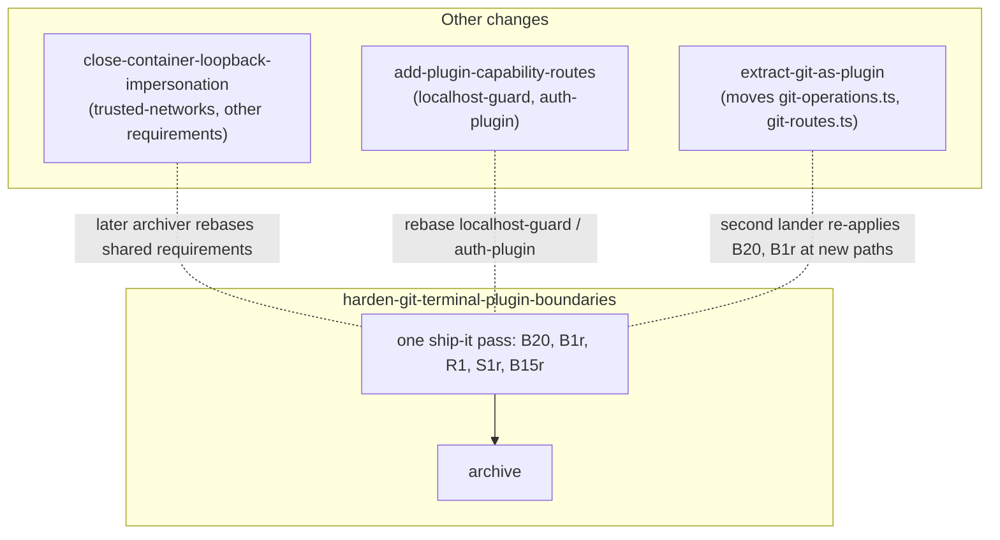

# Design — harden-git-terminal-plugin-boundaries

## Context

See proposal.md (Why / What Changes). Split out of `close-residual-audit-findings`; this doc fixes the *how* for the five server-side git, terminal and plugin boundary findings (B20, B1r, R1, S1r, B15r). Decisions keep their umbrella numbers (D12–D16). The umbrella's `design.md` keeps the rest.

Constraints that shape the approach:

- **No server logger.** Fastify runs `logger: false` (`packages/server/src/server.ts:1905-1906`), so `request.log.*` is a no-op (`routes/provider-auth-routes.ts:306,340`). Log lines use `console.*`, as pairing does (`pairing/pairing.ts:542,581,586,604`).
- **Plugin cwd admission already exists.** Its primitives are `host.knownFolderCwds` (`server.ts:1595`), `host.cwdAdmissionOnIndeterminate` (`server.ts:1601`) and `admitCwd` (`packages/shared/src/cwd-guard.ts:405`). Precedents: `mcp-client-plugin/src/server/routes.ts:152`, `goal-plugin/src/server/index.ts:224`.
- **Shared spec text.** `trusted-networks` "Network guard threaded to all protected routes" is MODIFIED here and its capability is also MODIFIED by other active changes. Every MODIFIED block is written on **baseline** text (`openspec/specs/**`); rebase rules are in Sequencing. Requirement wording lives in `specs/` and is referenced here, not restated.
- Scenario-level gap answers live in `scenario-gap-decisions.md`.

## Goals / Non-Goals

**Goals**
- Close B20, B1r, R1, S1r and B15r with test-backed changes.
- Keep every new check fail-closed on the server, the single trust point.
- Sequence against overlapping changes so that no MODIFIED requirement or moved file gets clobbered.

**Non-Goals**
- The auth, CORS, CSP, bridge, media and Electron items, which stay in `close-residual-audit-findings`.
- `--end-of-options` for git (D13 uses a validator).
- Bridge-side event enforcement (the bridge has no manifests, D16).
- Pattern redaction of bash output (R5, docs-only in the umbrella).
- Hardening against a hostile **trusted** plugin (Risks).

## Decisions

**D12 · B20 — `redactGitText()` on every outbound string, after mapping.**

Rules, in order:
1. Strip **any** userinfo from `http(s)` URLs, password-less `user@` included (pattern after `memory-eval/src/scrub.ts:16-37`).
2. Redact specific token shapes only: `sk-…`, `ghp_…`, `github_pat_…`, `glpat-…`, `Bearer …`. `redactSecrets` is **not** reused: its catch-all ≥40-char blob rule (`spawn-process/spawned-turn-log.ts:36`) would destroy commit SHAs. A scenario asserts a 40-hex SHA survives.
3. Make absolute paths under the **operation's repository root** relative. The root is resolved by the operation itself, not the request cwd at broadcast time.
4. Replace home with `~`.
5. Replace other absolute paths (POSIX or drive-letter) with `<path>`.

Where: every outbound `error` / `message` / `stderr` string in `routes/git-routes.ts`, applied **after** server-side mapping, so mappers still see raw text.
- `err.message` at `:285,309,329,369,406,408,472,490,609,1203`; `result.message` at `:708,756,1152`.
- `stderr` at `:662,709,846,958,1012,1040,1085,1116,1153,1181`.
- `worktree_init_failed` (WS `:660`) and the REST body (`:662`): both `message` — the `mapInitStderrToHint` result (`:658`) — and `stderr`.

The client branches only on `code` (`client/src/lib/api/server-error.ts:40`), so `stderr` stays: hook output is useful UX. Users still see redacted messages (accepted).

*Path move:* `extract-git-as-plugin` moves `git-operations.ts` and `routes/git-routes.ts` into `packages/git-plugin/` (its `proposal.md:15`). Citations in D12/D13 are pre-move; whichever change lands second re-applies B20/B1r at the new path.

ADDS git-operations-api "Git error bodies are redacted", "Redaction follows mapping and the operation's repository root".

*Alternative:* drop stderr (loses hook diagnostics).

**D13 · B1r — `assertRefArg()` on caller and derived git arguments.**
- Rejects non-string, empty, leading `-`, or control characters → 400 `invalid_ref`, before git runs. Precedent: `packages/kb/src/sources.ts:184`. The validator is the control; no `--end-of-options`.
- Missing `cwd`/`branch` on checkout keeps the existing 400 `cwd_and_branch_required` (`git-routes.ts:295-297`); present-but-invalid → `invalid_ref`.
- Applies to:
  - checkout `branch` (`git-worktree/git-operations.ts:520`) **and** the derived `localName` after remote-prefix strip (`:508`, used at `:510-516`). An empty derived name (`origin/`) → `invalid_ref`;
  - addWorktree `newBranch` (the `-b` value, `:820`), `base` / checkout commit-ish (`:821`);
  - worktree `path`: optional; absent → default `.worktrees/<slug>` (`:786-796`) or `.worktrees/pr-<n>` for PR worktrees (`:1976`, body at `git-routes.ts:1135`); validated when present (`git-routes.ts:694`);
  - `baseHint`: arrives over WS (`browser-handlers/session-action-handler.ts:826`, `gitWorktreeBase`). An invalid hint is not stored and is logged; no client error (it is a hint). It is re-validated where used (`mergeWorktreeImpl` `:1342-1358`, `worktreeDiffStatImpl` `:1437-1448` → `resolveDefaultBaseStrict` `rev-parse --verify <hint>` `:1278`).

MODIFIES git-operations-api "Checkout endpoint". ADDS "Caller-supplied refs are never parsed as options", "Derived and optional git arguments are validated".

*Alternative:* `--end-of-options` (needs per-subcommand verification on the git ≥2.31 floor; no early 400).

**D14 · R1 — terminal cwd admission.**

Current state: both handlers are sync and spawn at `msg.cwd` unchecked — standalone `terminal-handler.ts:66`, inline `:92`. Caps are the only check (`terminal/terminal-manager.ts:303-339`).
- *Inline* (`handleOpenInlineTerminal`): spawns at the session's own cwd from `sessionManager`; `msg.cwd` is ignored (stays in the protocol for old clients). Unknown session → refuse.
- *Standalone* (`handleCreateTerminal`): becomes async and awaits `admitCwd(msg.cwd, () => listKnownFolderCwds(...))` (`lib/route-admission.ts:25`, `cwd-guard.ts:405`) before `spawn`.
- *Race:* the cap is re-checked after the await (or a slot is reserved synchronously before it), so two concurrent creates cannot exceed it.
- *Callers:* `pairing/browser-gateway.ts:2481,2484` handle the returned promise (`.catch` → log), so no unhandled rejection. Sync-throw tests adapt to the async form.
- *Denial message:* existing shapes do not fit — `terminal_limit_reached` is cap-specific (`shared/src/browser-protocol.ts:765`), `folder_refused` carries a fixed `reason: "outside_allowed_roots"` literal (`:779-782`, `folder-gate.ts:33`). A new `terminal_error { code: "cwd_not_admitted" | "cwd_admission_unavailable" | "session_not_found", cwd, inline, message }` goes to the requesting socket only; the client shows it as a dismissible notice next to the `terminal_limit_reached` handling (`client/src/hooks/useMessageHandler.ts:1941`).

MODIFIES terminal-emulator "Server-side PTY management".

*Alternative:* sync `isAllowedCwd` (`cwd-guard.ts:86`). It skips the tri-state indeterminate handling the plugins use.

**D15 · S1r — plugin cwd admission, plus the post-start registration invariant.**

`cwd_required` (400, **before** admission) applies only where a folder is semantically needed. Any cwd that **is** supplied is admitted tri-state: 403, or 503 `cwd-admission-unavailable` with `Retry-After`. `scopeBaseFor` (`automation-plugin/src/server/routes.ts:37-38`) drops the `process.cwd()` fallback; global scope keeps `os.homedir()`. Automation admit set: `host.knownFolderCwds` ∪ `automation.folderscope.*` (`automation-plugin/src/server/index.ts:293-310`).

| Route (`routes.ts`) | No cwd | cwd supplied |
|---|---|---|
| `POST /run` `:124`, `POST /stop` `:146`, `GET /actions` `:168` | unchanged | admitted |
| `GET /trigger-kinds` `:174` | unchanged (takes no cwd) | n/a |
| `GET /git-capable` `:182` | `{gitCapable:false}` as today (`:184`) | admitted |
| `GET /list` `:199` | global only | admitted |
| `GET /runs` `:216`, `GET /result` `:229`, `POST /create` `:274`, `POST /update` `:312`, `GET /definition` `:351`, `DELETE /` `:395` | scope `folder`/non-global → `cwd_required`; `global` → home | admitted |
| flows `GET /flow-inputs` (`flows-plugin/src/server/index.ts:64-68`) | `cwd_required` | admitted |

- *MCP callers:* 12 generated automation tools call these routes (`mcp-server-plugin/src/server/generated/tools.ts:92-95,133,164-168,189-190`). The generated tool manifest marks `cwd` **required** for the folder-scope automation tools (a task regenerates it); a folder-scope call without `cwd` gets 400 `cwd_required`.
- *Flow ids:* exactly `.` or `..` are refused; the regex `[\w.-]+` (`flow-inputs.ts:29`) already excludes separators, and `team.review` / `a..b` stay valid.
- *Post-start registration:* verified against fastify@5.12.1 — `route()` calls `throwIfAlreadyStarted('Cannot add route!')` (`node_modules/fastify/lib/route.js:205`), which throws once `ready()` has started the instance (`fastify.js:378,468-469`). So the caveat at `server.ts:3512-3519` is enforced today. The trusted-networks requirement states behaviour, not Fastify internals: a route registered after start fails, nothing serves a sensitive-namespace route without the guard. A task adds a regression test proving post-start registration throws in this server. Re-verify after the fastify bump.
- *Overlap checked:* neither `close-container-loopback-impersonation` nor `add-plugin-capability-routes` modifies trusted-networks "Network guard threaded to all protected routes" (they modify other trusted-networks requirements); our block is written on baseline text.

ADDS plugin-cwd-admission "Automation and flows plugin routes admit the request cwd", "Automation admit set includes folder-scope contributions", "Flow ids cannot traverse". MODIFIES trusted-networks "Network guard threaded to all protected routes".

*Alternative:* per-plugin allowlist config (duplicates host admission).

**D16 · B15r — static `emits` manifest enforced at the server seam.** *(user-confirmed)*
- Manifests gain `emits: string[]`, matched exactly — distinct from the inbound `eventTypes`. The validator (`dashboard-plugin-runtime/src/manifest-validator.ts:805-817`, the `eventTypes` block) gains an `emits` block: an array of exact event names.
- `emitEventToSession` (`plugin-event-seam.ts:11-25`, wired at `server.ts:4311-4316`) refuses anything not in the calling plugin's allowlist, and still refuses reserved prefixes.
- *Provider attribution:* `ctx.provide` (`server.ts:4329`) records the **provider plugin id**; `consumeAll` (`:4334`) entries gain an additive `provider` field (host-set entries carry provider `host`). The host never trusts a registration key's source segment.
- *Key ownership:* for an `automation.action.<source>` key the provider plugin id MUST equal `<source>`; otherwise the provide is refused and logged. This prevents key spoofing and overwrite.
- *Automation allowlist,* computed by the host with no runtime channel: automation's manifest `emits` ∪ the manifest `emits` of every plugin that provides an accepted `automation.action.*` registration. A registration whose `emits` is not a subset of **its actual provider's** manifest `emits` is refused with a warning. The engine's per-action check (`engine.ts:128`) stays.
- *Inventory task:* every in-tree `emitEventToSession` caller gets manifest `emits`: automation (`automation-plugin/src/server/index.ts:449`); flows declares `flow:run` (`flows-plugin/src/server/index.ts:147`, consistent with `openspec/specs/flows-plugin/spec.md:114`) and `dashboard-flows:report-files` (`flow-files.ts:202`, via `index.ts:82`). `mcp-server-plugin/src/server/tools.ts:29,76` lists the seam in denylists only — not an emitter; recorded.
- *Out-of-tree plugins:* one warning per (plugin, eventType) per process, naming the plugin, the event type and the missing manifest field `emits`. CHANGELOG carries a migration note.
- The bridge (`extension/src/bridge-handlers/dispatch.ts:326-332`) stays a relay; the server is the trust point.

ADDS dashboard-plugin-loader "Plugin manifest declares emitted event types", "Provide records the provider plugin"; MODIFIES "Cross-plugin service seam" (baseline `:1524-1530`), "Prefix enumeration over the service board" (`:42-46`, additive `provider` field), "Emit a configured event into a session", automation-action-registry "Plugin-registered automation actions" and "Event-dispatch actions", bridge-extension "Relay plugin-emitted events into the session bus".

*Alternative:* bridge-side enforcement (the bridge has no manifests).

## Sequencing

- *Spec rebase rule:* every MODIFIED block here is written on **baseline** text (`openspec/specs/**`), including the S1r block in trusted-networks. Whichever of this change / `close-container-loopback-impersonation` archives **later** rebases the shared requirements on the earlier archiver's text.
- *Path moves:* `extract-git-as-plugin` moves `git-operations.ts` and `routes/git-routes.ts` (B20, B1r). Whichever lands first, the other re-applies at the new path; citations here are pre-move.
- *Overlap checked (S1r):* neither `close-container-loopback-impersonation` nor `add-plugin-capability-routes` modifies trusted-networks "Network guard threaded to all protected routes" (they modify other requirements).
- Archive is the last task.

## Risks / Trade-offs

- **[Risk]** B15r refuses an out-of-tree plugin's undeclared emit. → one actionable warning per (plugin, eventType); CHANGELOG migration note.
- **[Trade-off] B15r trust tier.** The allowlist and the `automation.action.<source>` = provider rule target mistakes and confused deputies. A malicious **trusted** plugin can still declare arbitrary non-reserved event types in its own manifest; trusted plugins are assumed non-hostile.
- **[Risk]** B20 hides a path the user needs. → repo-relative paths and `~` stay; only foreign absolute paths become `<path>`.
- **[Risk]** S1r turns a missing cwd into 400 for clients that relied on `process.cwd()`. → only folder-scoped routes require it (D15 table); a task audits client callers first; the server cwd is not a user folder.
- **[Risk]** S1r breaks MCP agents that relied on the server-cwd fallback. → they must pass `cwd`; the regenerated tool manifest marks it required. The fallback was the hole.
- **[Risk] R1 old clients.** Their inline terminals now open at the session cwd, not the `msg.cwd` they sent. Usually identical; accepted.
- **[Risk]** Overlapping changes conflict. → Sequencing and rebase rules above.

## Migration Plan

One landing: every row below ships in one ship-it pass, then the change archives. No database; all persistence is JSON with optional fields.

| Item | Data / config migration | Rollback |
|---|---|---|
| B20 | None. | Revert the boundary call. |
| B1r | None. | Revert the validator. |
| R1 | New `terminal_error` browser message (old clients ignore it). | Revert the handler. |
| S1r | None. | Revert the admission calls. |
| B15r | Manifest `emits` added (in-tree plugins); provider id recorded on `provide`. | Revert the seam check; manifests stay harmless. |

*Compatibility:*
- Old bridge, new server: B15r is server-side; the bridge stays a relay.
- Old client, new server: `msg.cwd` on inline terminals ignored; `terminal_error` ignored.
- MCP agents and out-of-tree plugins: see proposal Compatibility (CHANGELOG notes).

## Open Questions

- None. Scenario-level gaps are answered in `scenario-gap-decisions.md`.
