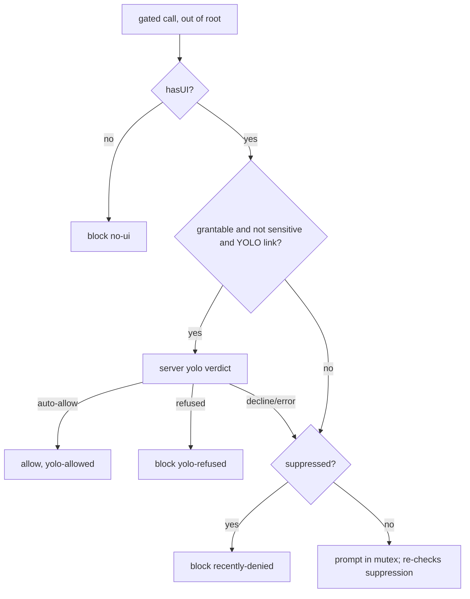

## Context

Three independent fixes, one theme (a guard missing on a sibling road). Only #1115 and the
#1103 escalation involve a design choice; #1104 is "reuse `admitRouteCwdParam`".

## D1 — #1104: reuse the REST admission, do not fork it (decided)

`plugin_action` `create`/`run` call `admitRouteCwdParam(p.cwd, { required: scope !== "global" for
create, false for run, knownCwds, admitOptions })` exactly as the WS `stop` branch already does
(`index.ts:194-208`), `release()` in `finally`. `create` loses the `process.cwd()` fallback
(`index.ts:224`), matching REST `cwd_required`. `run` without a cwd keeps its current behaviour
(REST `/run` spec: "unchanged"), so only a *supplied* cwd is newly gated.

## D2 — #1115: order of YOLO vs recent-denial (confirmed — owner, 2026-11-20)

Options (full evidence in `/tmp/issue-batch/harden-path-and-process-guards-DECISIONS.md`):

| | Option | Effect |
|---|---|---|
| A | Keep as is (close issue, document) | Spec-conformant; user waits 120 s |
| **B (chosen)** | Ask YOLO verdict before the suppression check for grantable, non-sensitive paths | timeout → overridable; explicit Deny → still `yolo-refused` via server memory |
| C | YOLO activation clears bridge suppression | Overrides explicit Deny too; needs new server→bridge message |

Why B: the server already encodes "operator said no" durably (Deny → remembered refusal →
`refused`), so the ordering change only releases the case where *nobody* said no (timeout). The
in-mutex re-check inside `ask()` (`handler.ts:122`) stays, so non-YOLO sessions are unchanged.
Residual: the Deny report is fire-and-forget (`handler.ts:211-217`); a report lost before the next
call lets that one call auto-allow. Same-host WS ordering makes this a narrow race; the
suppression still covers the non-YOLO case.
Behavioural note for the issue reporter: after an explicit **Deny** the retry is still refused
(now with the clearer `yolo-refused … clear it in Settings ▸ Access`), per shipped spec.

## D3 — #1103: forward + escalate (decided)

Forward-only (issue's option C) would turn a leaked orphan into a live `exec` + wedged child still
heartbeating its lease, because `BridgeManager.terminate` sends one SIGTERM and forgets
(`bridge.ts:175`). So `exec` owns the ladder: SIGTERM/INT/HUP forwarded → 5 s grace
(`deps.killGraceMs`, test seam) → SIGKILL to the child → release lease → exit. Second signal skips
the grace. Exit status: the child's own (existing mapping `signal → 128+n`); no synthetic code.
`stdio:"inherit"` is kept so stdin EOF still reaches the child. Process-group spawn in
`BridgeManager` stays out of scope (Non-goals).
