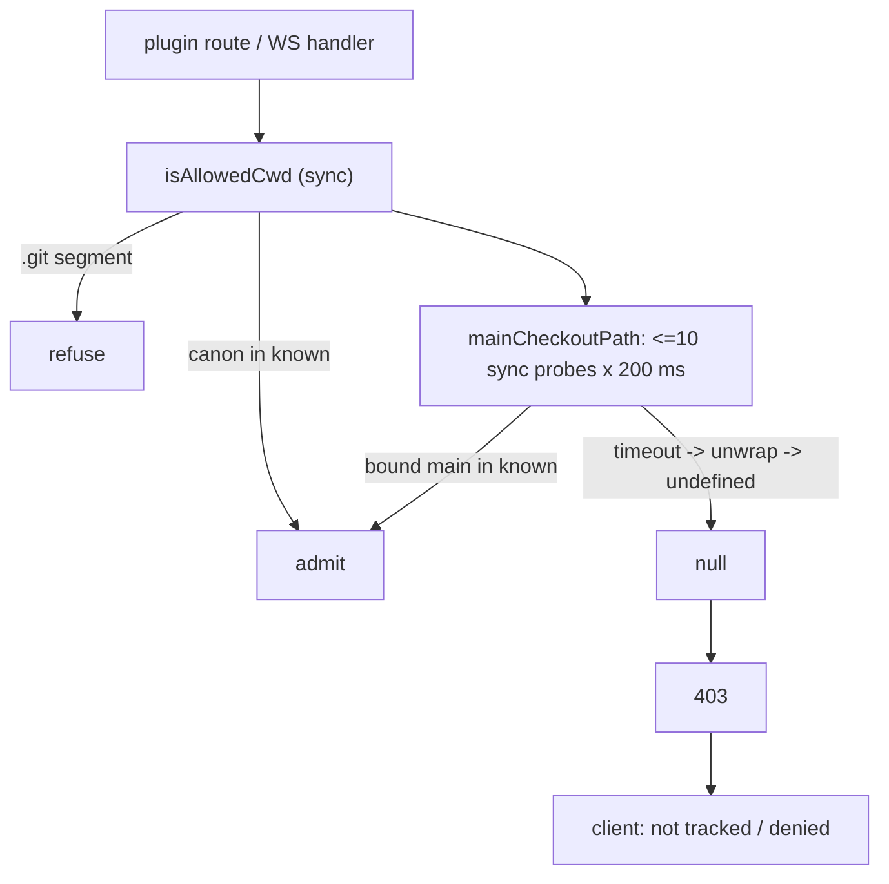

## Context

**Observed.** In the Electron app (single server, `:8000`), `GET /api/mcp-client/effective?cwd=<repo>/.worktrees/os-improve-gmail-settings-ux` returned `403 {"error":"not-allowed",…}`. At the time `<repo>` was pinned (`~/.pi/dashboard/preferences.json` `pinnedDirectories`), and the same request returned `200` moments later.

**Measured ad hoc during exploration (idle machine, pins only, no session cwds; task 1.2 formalizes it).** `mainCheckoutPath` + `isAllowedCwd` for four worktrees of the pinned repo admitted all four, taking 260–443 ms for the pair, about 130–220 ms per admission. The per-probe budget is 200 ms (`packages/shared/src/cwd-guard.ts:66-71`). One sidebar 403 (`.worktrees/os-add-service-registry-core`) was **correct**: the directory no longer exists.

**Why a timeout becomes a refusal.**
- `run` / `runAsync` return `{ ok:false, error:{ kind:"timeout" } }` and never throw (`packages/shared/src/platform/runner.ts:68,314,321`).
- `checkoutRoots` / `checkoutRootsAsync` adapt every probe with `unwrap(result, undefined)` (`runner.ts:499`; `git.ts:605-607,711-713`). A timeout is therefore indistinguishable from a definitive non-zero exit.
- `isBoundCheckoutAsync` returns a bare `boolean` (`git.ts:861`).
- The guard answers `403` (`mcp-client-plugin/src/server/routes.ts:89`; `kb-plugin/src/server/kb-routes.ts` 7 sites; `kb-plugin/src/server/index.ts:91` WS).
- The mcp client caches a 403 in `notTracked` (`mcp-client-plugin/src/client/hooks.ts:31-73`). The kb client maps `403 cwd not allowed` to `KbCwdDeniedError` (`kb-plugin/src/client/kb-api.ts:99`).

**Burst shape.** The mcp client single-flights per cwd (`hooks.ts`), so the burst is about 25 **distinct** cwds. Each needs up to 10 sequential sync probes, and these serialize on the event loop.

**Second synchronous check on the write path.** `config-writer.ts:98-100` `targetPath` re-runs sync `isAllowedCwd` and throws `NotAllowedCwdError`. It is reached from the save/remove/enable/convert writers, and from `/live` via `service.ts:92`.

**Prompt seam is core-only.** `holdDenial` (`packages/server/src/access/denial-hold.ts`) has one cwd caller, `file-routes.ts:1416` `unknownCwdVerdictAdmits`. That re-run checks pins only, with `path.resolve` (`file-routes.ts:1424`).

**Static analysis depends on the call shape.** `.github/codeql/extensions/cwd-guard.model.yml` models `isAllowedCwd(cwd, …)` as a `js/path-injection` barrier guard. The routes call it directly for that reason (`kb-routes.ts:78-80`).

## Goals / Non-Goals

**Goals:**
- A failure to *decide* admission is never a `403` refusal, and never admits.
- No synchronous git or synchronous `realpath` on any plugin **route** request path. This covers routes, the writer, and `/live` when called from a route.
- One admission decision per request.
- A user-initiated plugin write on an unknown cwd raises the `cwd`-plane dialog. Background reads and WS actions never do.
- CodeQL keeps a modelled path-injection barrier on every route.

**Non-Goals:**
- Changing *who* is admitted. The known set, the git-repo-main rule, binding, the `.git` rule, and submodule isolation are unchanged.
- Changing the unclassified resolvers `checkoutRoots` / `checkoutRootsAsync` / `isBoundCheckout*` in any way. Their consumers (file-read containment, git-operations) are untouched.
- Caching admission across requests.
- Orphaned or deleted `.worktrees/*` directories (they stay 403).
- Non-route consumers of the provided `mcp-client.config` service. They keep the sync fallback (D4).

## Decisions

### D1 — A separate classified resolver; per-probe failure rules
New `checkoutRootsClassifiedAsync` and `bindCheckoutClassifiedAsync` share the existing resolution core (`resolveCheckoutRootsFromAsync`) through a classified probe adapter. The existing exports and their outputs are **byte-for-byte unchanged**, including today's `core.worktree` fall-through. The adapter reads `Result.error.kind`:

| Probe | Definitive (existing semantics) | **Failed** |
|---|---|---|
| `--git-dir`, `--git-common-dir` (required) | `exit` → not a repository → no result | `timeout`, `spawn-failure`, `not-found`, `output-too-large` |
| `--show-toplevel` | `exit` → `thisCheckout = null` (bare by design) | same non-exit kinds |
| `config core.worktree`, `config core.bare` | tolerated exit 1 → `ok(undefined)` (unset) | **any other `exit`** (e.g. 128 for corrupt config) and every non-exit kind |
| binding re-resolution | as above, recursively | as above |

Exit codes other than the tolerated unset (1) on the config probes count as failures, not as definitive answers: a corrupt config must never be read as "unset" and fall through. In the classified form, any **failed** probe makes the resolution `failed`. Nothing falls through to a weaker rule; in particular a failed `core.worktree` or `core.bare` read never reaches the `dirname(commonDir)` rule (`git.ts:563-588`).

### D2 — `admitCwd`: async, tri-state, checks existence first
`admitCwd(cwd, known, opts): Promise<Admission>`. `Admission` is `{kind:"admit", token} | {kind:"refuse"} | {kind:"indeterminate", failedProbes, elapsedMs}`. Order:
0. An absent or non-string `cwd` is never passed in: callers keep their existing `400` first (`kb-routes.ts:81-84` `denyCwd`; `routes.ts:84-89`).
1. `realpath` asynchronously, using a newly exported `realpathAsync` that reports the errno; the private `realpathOrNullAsync` (`git.ts:740`) swallows all errors. `ENOENT` / `ENOTDIR`, and not in `known()` by lexical compare, → `refuse`. This is a deleted worktree, decided without spawning git, which would otherwise surface as `spawn-failure`. Any other realpath error (`EACCES`, `ELOOP`, …) → `indeterminate`.
2. A `.git` segment in the canonical path → `refuse`.
3. The canonical path in canonicalized live `known()` → `admit`. Canonicalization uses `canonicalAsync` (`git.ts:762`), which is private today and is exported by this change.
4. `checkoutRootsClassifiedAsync` → `failed` ⇒ `indeterminate`. A `mainCheckout` with `bindCheckoutClassifiedAsync` → `failed` ⇒ `indeterminate`, `bound` and in live `known()` ⇒ `admit`, otherwise ⇒ `refuse`.

There is **no cross-request cache**, because a cached verdict or derivation would have to defend against path reuse and inode recycling. In-flight requests for the same canonical cwd share one promise, and the entry is removed on settle. The sync `isAllowedCwd` is unchanged.

### D3 — Budget, cap, abort
- **Runner.** `runAsync` gains an optional `signal?: AbortSignal` that SIGTERMs the child, reusing the existing timeout kill path (`runner.ts:409-414`). This is additive.
- **Per-probe timeout.** 1000 ms.
- **Concurrency cap.** A global semaphore of 4 derivations.
- **Deadline.** Each decision has a 3000 ms deadline counted from entry (it includes the semaphore wait). At the deadline: the decision resolves `indeterminate` immediately, and the derivation's `AbortController` fires. That sends SIGTERM to in-flight git children and SIGKILL 3 s later (`runner.ts:409-424`). The semaphore slot is released only when the derivation's last child has **exited**, so the cap bounds live git processes, not just derivations started. A probe result that arrives after abort is ignored.

### D4 — One decision per request: a request-scoped admission token (mcp-client only)
- **Where tokens exist.** Only the mcp-client plugin needs a token, because only its route hands a `Scope` to a downstream component that re-checks admission: `config-writer.ts:98-100` `targetPath` and `service.ts:90-93` `getLiveState`. The kb routes take a raw `cwd` and call no downstream re-check. They branch on `admissionAllows(await admitCwd(…), cwd)` and use no token. A kb reindex job admitted at start runs to completion under that admission, which is today's semantics (`kb-routes.ts:384-406`).
- **Issue.** `admitCwd` → `admit` carries an `AdmissionToken`: a frozen `{ canonCwd, rawCwd }` registered in a module-private `WeakMap<AdmissionToken, { live: boolean }>` in `cwd-guard.ts`. The token is minted and checked inside **one plugin's** module graph: mcp-client routes and the mcp-client writer import the same `cwd-guard` instance. The host never mints a token for a plugin (D6), so duplicate shared-module instances (for example the Electron server bundle) cannot split trust.
- **Lifetime is one route request.** The mcp-client route builds the project `Scope` server-side as `{ kind:"project", cwd: rawCwd, admission: token }`. It uses the same string it admitted, so the writer compares `scope.cwd === token.rawCwd` exactly, and aliasing cannot arise within a request. The route passes the scope to the writer or live reader and calls `releaseAdmission(token)` in a `finally` once the response is produced. Every `targetPath` call inside that request accepts the live token without consuming it; one `saveServer` / `ensureServerEntry` checks twice (`prepare` `config-writer.ts:112-115`, `validateEntry` `:151-174`). A retained token is dead afterwards.
- **Never on the wire.** `parseScope` / `queryScope` ignore any client `admission` field, and `scopeToWire` (`mcp-client-plugin/src/client/api.ts`) never serializes one, which a test asserts. Route-built scopes are not handed to other plugins through the provided `mcp-client.config` service; that service's external callers pass their own scopes and get the sync fallback.
- **Fallback.** A project scope without a live token → sync `isAllowedCwd`. This is only for non-route consumers.
- **Enforcement.** Writer tests count sync probes and assert zero during token-bearing `saveServer`, `ensureServerEntry`, `removeServer`, `setEnabled`, `convertAdapterLeftovers`, and `getLiveState`. A route test asserts every mcp-client handler that reaches the writer or live reader passes a live token.

### D5 — Route call shape, HTTP / WS mapping, ordering, client handling
- **Call shape (CodeQL).** Routes branch on a **sync boolean** predicate over the decided admission: `const adm = await admitCwd(cwd, known); if (!admissionAllows(adm, cwd)) …`. `admissionAllows(adm, cwd)` is true iff `adm.kind === "admit"` and the token is bound to `cwd`. `cwd-guard.model.yml` gains `Member[admissionAllows].Argument[1]` rows for **both** package paths (`…/cwd-guard.js` and `…/cwd-guard`), matching the existing two `isAllowedCwd` rows, which stay. `admitCwd` itself spawns git with `cwd`, which precedes the branch; a CodeQL run must confirm no new `js/path-injection` alert, or else `admitCwd`'s Argument[0] is modelled too.
- **Order.** Missing cwd → 400. Then `admitCwd`, before `preflightWrite`, `loadConfig`, `readLayer`, a store open, or a trust-store read (kb guard sites `kb-routes.ts:359,394,420,454,503,542,562`, before `preflightWrite` at `:110-130`; mcp-client write handlers in `routes.ts`).
- **HTTP.** `indeterminate` → `503 { error:"cwd-admission-unavailable", message, retryAfterMs: 1000 }` with `Retry-After: 1`. `refuse` → each plugin's existing 403 body, unchanged.
- **WS.** The kb `plugin_action` handler (`index.ts:88-108`, a `registerBrowserHandler` callback returning `void`) has no response channel. On `indeterminate` it logs `kb <action>: cwd admission unavailable (<cwd>)` and returns without running the action. `refuse` keeps today's warn-and-return. It never prompts.
- **Client (mcp-client).** `ApiError.isTransient` matches the 503 code. `loadEffective` runs **one retry chain per key**, extending the existing per-key single-flight, so N pills on one cwd make one chain. Delay is `retryAfterMs × 2^n × (0.75 + random × 0.5)` (about 1 s, 2 s, 4 s ±25 %), with 3 retries. While retrying, the pill keeps its placeholder and the folder page keeps its loading state. After exhaustion, the pill shows its error marker and the page shows an error state with a Retry action. A transient error is never written to `notTracked`.
- **Client (kb).** `kb-api.ts:99` `parseJson` maps the 503 code to a new `KbAdmissionUnavailableError`. Idempotent stats GETs treat it as transient: same backoff, never "denied", and "failed + Retry" only after exhaustion. A 503 on the reindex **trigger** POST is not retried automatically. It clears the optimistic state and shows failed + Retry (user-driven), per the existing "Rejected client reindex surfaces an error" scenario.
- **Client (`/live`).** `useLiveState` already maps any failure to `live = null` ("state unknown"). That is unchanged: no automatic retry on the slow live command.

### D6 — `holdCwdDenial` seam
- **Signature and gate.** `ServerPluginContext.holdCwdDenial?(request, reply, { cwd, origin }): Promise<CwdHoldDecision>`, where `CwdHoldDecision = { kind:"admit"; canonCwd } | { kind:"indeterminate" } | { kind:"refuse" }`. It returns a **decision, never a token**: the plugin mints the token from its own `cwd-guard` instance via `issueHeldAdmission(decision, rawCwd)`, which requires `decision.canonCwd` to equal the async canonical form of `rawCwd`. An untrusted caller, a missing / `.git` / ungrantable subject, or a bad origin resolve `{ kind: "refuse" }`. is optional, so third-party plugins compile unchanged. It is gated to **first-party / trusted plugins**, the same gate as `registerCwdPolicy` / `spawnSession`: `plugin.manifest.priority <= 100`, bound per plugin at `packages/server/src/server.ts:3353-3356`. An untrusted plugin's hook resolves `{ kind: "refuse" }` without raising anything.
- **Host binding:**
  1. The caller has already got `refuse` for this cwd. `realpath` it; a missing path → refuse (nothing to pin). A `.git` segment or `isUngrantableSubject(canon)` → refuse, without raising a hold.
  2. `origin` must belong to the closed set `"mcp:save" | "mcp:delete" | "mcp:enable" | "mcp:convert" | "kb:reindex" | "kb:config" | "kb:trust"`. Anything else → refuse and a warn. The registry origin is `plugin:<pluginId>:<origin>`.
  3. `holdDenial({ plane:"cwd", rawSubject: canon, origin }, { request, reply })`.
  4. **allow-always** (the plane pins `canon`) → re-run `admitCwd` against live `known()`. The seam maps the re-run: `admit` → `{ kind:"admit", canonCwd }`; `indeterminate` → **503**, not 403 (the operator allowed, but git could not confirm); `refuse` → 403.
  5. **allow-once** (nothing persisted, `access-plane.ts:184`) → re-run the cwd plane's own guard at release time: `realpath(cwd)` **now** must equal the verdict subject (a swapped symlink fails), the path must still exist, and the `.git` and ungrantable rules must still pass. Then it returns `{ kind:"admit", canonCwd: canon }`. This is the cwd plane's existing allow-once rule (`file-routes.ts:1424-1431`), and this change codifies it in an `access-grant-registry` MODIFIED delta. For the cwd plane, the release-time re-run covers real path, existence, the `.git` rule, and the forbidden rule. Known-folder membership is the layer the verdict itself answers, and an allow-once answer admits for the single held request only.
  6. **deny / expiry / no coordinator** → 403.
- **Core site.** `unknownCwdVerdictAdmits` moves to `packages/server/src/access/` on the same rules, with canonical comparison. `file-routes:exists` uses it. This **widens** its post-allow check from pins-only to sessions ∪ pins, and replaces raw `Set.has` / `path.resolve` with canonical comparison. A session started for that cwd while the dialog was open now also admits, which is intended.

| Route | On `refuse` |
|---|---|
| mcp-client `PUT /servers/:name` (`mcp:save`), `DELETE /servers/:name` (`mcp:delete`), `PUT …/enabled` (`mcp:enable`), `POST …/convert` (`mcp:convert`) | `holdCwdDenial`; `admit` → mint the token, proceed; `indeterminate` → 503; `refuse` → 403 |
| kb `POST /api/kb/reindex` (`kb:reindex`), `PUT /api/kb/config` (`kb:config`), `POST /api/kb/source-trust` (`kb:trust`, `kb-routes.ts:540`) | same. `kb:trust` still applies the saved-config-only trust rule after admission |
| mcp-client `/effective`, `/live`, `/schema`; kb GET routes; kb `DELETE /api/kb/source-trust` (no cwd, unchanged); kb WS `plugin_action` | no seam is reachable from these handlers |

An untrusted caller, a missing / `.git` / ungrantable subject, or a bad origin resolve as `refuse`, with no hold raised. Global-scope (no-cwd) requests skip admission, as today. Allowing a worktree pins the worktree itself (the `cwd` plane has no ladder, `planes.ts:110`). This is a documented trade-off.

**Doubt-review verdict (task 4.3, on the shipped code).** An independent read-only adversarial pass (isolated `Audit` subagent) over `createCwdHold`, `resolveCwdVerdict`, `admitCwd`, `issueHeldAdmission` and both callers returned **HOLDS-WITH-CAVEATS**: no invariant breakable from the wire. Findings and dispositions:

| Finding | Disposition |
|---|---|
| kb tokens never released at request end | **Fixed.** `endWithRequest` releases on `reply.raw` `close`. |
| "One allow-once admits up to 8 coalesced requests" | **Rejected as a false positive.** `grant-coordinator` resolves a coalesced joiner `deny allow-once-not-shared`; only the raiser is admitted (see Risks). |
| Check-then-use gap: writes use the raw cwd after the canonical check | **Accepted, documented.** Needs local write access to a parent of the folder; the superseded synchronous guard had the identical window. Narrowing it would mean writing through `token.canonCwd`, which changes the paths the writer reports. Not in scope. |
| Relative `cwd` admitted on the non-hold path | **Accepted, unchanged.** `canonPath` always resolved against the server cwd; this change does not alter *who is admitted*. The hold seam itself rejects relative paths. |
| YOLO auto-allow bypasses the dialog | **By design** (explicit operator opt-in); `resolveCwdVerdict` still re-resolves and compares the real path. |

Verified to hold: trust gate evaluated first; closed origin set enforced at runtime; missing / `.git` / ungrantable subjects never reach `holdDenial`; a decision for one path cannot mint a token for another; every refuse→admit path goes through the real-path re-resolution; every route branches on `admissionAllows`.

### D7 — Logging
`admitCwd` takes an optional `onIndeterminate({ cwd, failedProbes, elapsedMs })` callback, so `packages/shared` gains no logger dependency. `failedProbes` lists recipe names; `elapsedMs` is decision wall time including the semaphore wait. The server logs `[cwd-admission] indeterminate`, rate-limited to one line per canonical cwd per 60 s. The throttle map is capped by LRU at 512 entries.

## Risks / Trade-offs

- [No cache: every pill load re-derives] → async and capped, about 150 ms off-loop per cwd. Correctness over speed: a cache would need path-identity defences that are easy to get wrong.
- [Retry load during overload] → one jittered chain per cwd, 3 retries, behind a cap of 4.
- [allow-once mints a token without known-set membership] → by design: the operator's answer is the admission. It is request-scoped and bound to the real path re-resolved at release time, and the `.git` / ungrantable checks still apply (`file-routes.ts:1424-1431` precedent).
- [`file-routes:exists` re-run widened to sessions] → intended. It matches the pre-hold guard at `file-routes.ts:763`, which already uses sessions ∪ pins.
- [Concurrent writes for one cwd coalesce onto one prompt; on allow-once only the first is admitted] → existing registry rule (`grant-coordinator.ts` `allow-once-not-shared`). A joiner gets 403 and the user retries.
- [Raw-string client cache keys] → aliased paths double-track. Accepted: an extra request, never a wrong verdict.
- [Old client meets new server] → a 503 renders as a generic error instead of a false "not tracked". Ship them together.

## Migration Plan

No data migration. Shared, server, both plugins, the clients, and the CodeQL model ship in one release. Rollback = revert.

## Open Questions

None.
