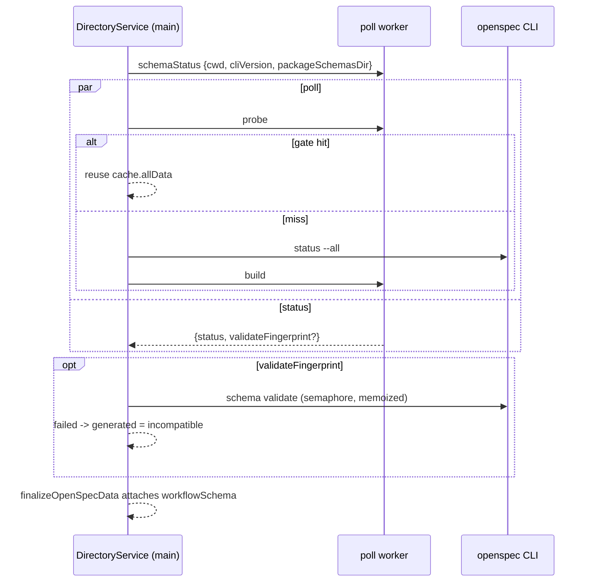

## Context

- **What the first change shipped.** `workflowSchemaStatusFor` builds the status on the main thread with async fs reads, started right after the CLI version resolves and awaited at `finalizeOpenSpecData` (`packages/server/src/directory-service.ts`, `pollOne` → `finalizeOpenSpecData`, all four success paths). Spec and design D5 of `add-pi-spec-driven-schema` say the filesystem part runs in the poll worker.
- **What the gate tracks.** `statusAllGateHit` compares the cwd stamp and per-change mtimes; the cwd stamp is the max effective mtime over the openspec dir, `changes/`, `config.yaml` and the whole `schemas/` tree (`packages/server/src/openspec/openspec-poll-fs-helpers.ts:185-192`), per-change over `.openspec.yaml` and artifacts. So enable/disable/update and a teammate's pull normally miss the gate and rebuild.
- **What the gate does not track but the status depends on.** The resolved CLI version (stamp comparison, `newer`/`conflict` validate memo key), `openspec/config.yml`, the user and package schema directories (`missing`), and the fallback `list` path, whose build never consults the status-all gate. A compute that runs only when the poll rebuilds is stale on a gate hit for these inputs, and needs a second mechanism for the fallback path.
- **The worker pool already has the right shape.** `probe` and `build` are request kinds with a worker body and an in-process async fallback (`packages/server/src/openspec/openspec-poll-worker-pool.ts`: `runAsyncInProcess`, `fallbackSettle`, timeout → terminate → fallback). A third kind is a small, consistent addition.
- **Cost reality.** The status is a config read + stamp parse + one `readdir` of `changes/` with a `.openspec.yaml` read per change. The first change's implementation also hashes every file of `schemas/pi-spec-driven/` (`fingerprintDir`, `packages/server/src/openspec/workflow-schema.ts`) on every evaluation and fans out one read per change with no bound; both were fine on the main thread only because the cost was small per tick, and neither is acceptable per tick in the hot path (D2). Off the main thread the reads cannot add to the event-loop turn that `directory-service-eventloop-turns` guards (150 ms budget), but the worker pool is shared with the poll, so the work is kept lean.

## Goals / Non-Goals

**Goals:**
- The filesystem part of `workflowSchema` is computed in the poll worker, fresh on every tick (gate hit included), on one code path for worker and in-process fallback.
- The `newer` / `conflict` validate stays main-thread, semaphore-bound and memoized.
- One spawn semaphore for poll and route.

**Non-Goals:**
- Changing the gate signature, the wire format, or any readiness behaviour.
- The two client-side selector limitations (see proposal).

## Decisions

### D1. A dedicated `schemaStatus` request every tick, not a gate-signature fold

- **Chosen:** one request per poll tick, enqueued right after the tracked-path `probe` request (never before it, so on a one-slot pool it cannot delay the probe or the build) and awaited at finalize, for every success path. Gate-hit freshness is then free; no new cache or signature state.
- **Alternative A (compute inside the worker `build`, cache in `allData`).** The original spec's wording, and cheapest per tick: the status rides the rebuild and survives gate hits in the cache. Rejected: it is stale for the untracked inputs above, so each would need its own invalidation (CLI-version key in the cache, `config.yml` and user-dir stamps in the probe, a separate build hook in the fallback path). That is three small mechanisms to avoid one cheap request. If the extra per-tick round trip ever measures as a problem, this is the fallback design.
- **Alternative A2 (extend the gate signature).** Add `config.yml`, the CLI version and the user/package schema dirs to `statusAllGateHit` so they force a rebuild. Rejected: it spawns `openspec status --all` (30 s budget, semaphore) to learn something the CLI's own status does not depend on, and still does not cover the fallback path. (The `config.yml` gap also exists for the CLI's own status; out of scope.)
- **Alternative B (piggyback on `probe`).** Return the status in the probe response. Rejected: only the status-all path probes; the fallback list path would need a second mechanism, which is the two-path problem this change removes.
- **Alternative C (keep main thread, amend the spec).** Considered and declined by the owner of `add-pi-spec-driven-schema`: the worker is where the repo keeps poll fs work, and a 100+-change directory's reads should not compete with the event loop.

**Cached payload hygiene.** A gate hit reuses `cache.allData`, which already carries the previous tick's `workflowSchema` (`finalizeOpenSpecData` spreads the cached object, `directory-service.ts` `pollOneStatusAll` gate-hit branch). `finalizeOpenSpecData` SHALL therefore drop any `workflowSchema` from the object it is given and set the key only from this tick's request result; a failed or absent result leaves the key out (never the cached one). The same applies to the `reconfigurePolling` rebroadcast, which re-derives readiness from cached data and today keeps `d.workflowSchema` when readiness allows it: it keeps the last attached value only because no fresh tick has happened yet, and that stays correct (the value is at most one tick old, replaced on the next).

### D2. Worker-safe module, lean per-tick work, validate verdict stays on main

The worker request body must not pull `workflow-schema.ts`' CLI recipes, semaphore or `yaml`-writing paths into the worker bundle. The filesystem-only pieces (`readConfigFile`, `parseStamp`, `inspectSchema` without the validate callback, `enumerateActiveChanges`, the resolution checks, `computeWorkflowSchemaStatus`'s assembly) move to `packages/server/src/openspec/workflow-schema-status.ts`; `workflow-schema.ts` imports them back, so the REST path and the poll path share one implementation (no duplicated stamp or enumeration logic).

**Request inputs.** The main thread passes `{ cwd, localVersion, packageSchemasDir, userSchemasDir }` (resolved once on main: `resolveOpenSpecPackageSchemasDir()` reads `package.json` files only and `resolveExecutorArgv` uses the main-thread registry, so the worker must not call them). The worker body imports no CLI recipe, semaphore or `resolveExecutorArgv`.

**Lean per tick.**
- The shared inspection takes a `fingerprint: "full" | "when-needed"` option. The poll request uses `"when-needed"`: the whole-directory content fingerprint (`fingerprintDir`) is computed only when the stamp comparison is `newer` or `conflict` (the only statuses that need a validate memo key); for `current` / `outdated` / `unmanaged` / `none` the worker reads `schema.yaml` and stats the directory only. The writing-action path (`runWorkflowSchemaAction` → `generateWorkflowSchema`, which compares the fingerprint it was handed with a fresh one before the destructive rename) keeps `"full"`, so Update, Adopt and the swap pre-check are unchanged.
- The per-change `.openspec.yaml` reads are bounded (`mapLimit` of 16, as `probeTrackedPaths`), not one in-flight read per change.

Because a callback cannot cross the thread boundary, the worker returns `generated` as computed from the stamp comparison alone plus `validateFingerprint` (the whole-directory fingerprint, only when the comparison is `newer` or `conflict`). The main thread runs `makeValidateLocal(cwd, version, { semaphore })` with that fingerprint and rewrites `generated` to `incompatible` on failure; a passing or memoized verdict leaves it. Net behaviour equals the current `validateLocal` callback. The verdict is advisory display state: every writing action re-evaluates the status under its lock with a fresh fingerprint, so a directory edited between the worker's read and the validate can at worst cache a verdict under a stale fingerprint for one tick (the next tick computes a new fingerprint and key).

### D3. Failure handling

- The pool already guarantees the request resolves (worker failure → in-process fallback). An in-process throw yields `undefined` and the `workflowSchema` key is omitted for that tick, exactly as the main-thread implementation behaves on a compute error.
- A failure (not a normal "no schema" result) is logged once per cwd per process with the path taken, so a payload without `workflowSchema` is diagnosable.

### D4. One spawn semaphore

`server.ts` currently builds `createSemaphore(maxConcurrentSpawns)` for the REST route's validate, separate from `DirectoryService`'s (`packages/server/src/server.ts`; the pool in `packages/server/src/directory-service.ts`). `DirectoryService` exposes its `semaphore` and `server.ts` passes that instance, so the poll, the route and every other `openspec` spawn share one cap, including after `reconfigurePolling` resizes it.

## Risks / Trade-offs

- **One extra worker round trip per tick per cwd.** With more than one pool slot it runs concurrently with the probe; with `maxConcurrentSpawns = 1` the pool queues FIFO, so on a gate-hit tick the status request runs after the probe and the tick's latency is probe + status (both small, lean per D2), while on a rebuild tick it completes during the CLI spawn, before `build` is enqueued. Measured by the event-loop turn test and a cold 100-change fixture (see tasks).
- **The packaged worker bundle must contain the new module.** Worker entry resolution is by URL (`workerUrlOverride`, `openspec-poll-worker-pool.ts`); the new module is imported statically by `openspec-poll-worker.ts` so it rides the same bundle. A unit test asserts the worker body imports no CLI/semaphore symbol.
- **Stale-by-one-tick window.** The status is read at the start of the tick, the swap rename gap (spec of the first change) can show a transient `none`/`missing`; the forced refresh after every action supersedes it, unchanged.

## Migration Plan

No data migration, no config change. Ships behind no flag; rollback is a revert (behaviour returns to the main-thread compute of the first change).

## Open Questions

_None._
