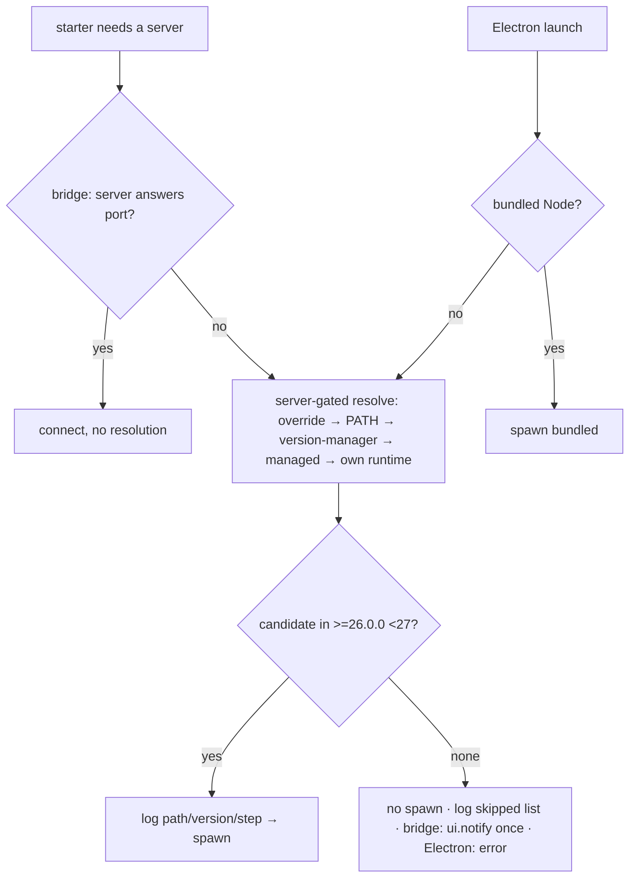

> Exploration 2026-10-11; open questions resolved 2026-10-13; revised after doubt-review cycle 1.

## Context

**Node release state (2026-10-11, `nodejs/Release` `schedule.json` + nodejs.org `index.json`):**

| Line | Status | Next | EOL |
|---|---|---|---|
| 22 "Jod" | Maintenance LTS | — | 2027-04-30 |
| 24 "Krypton" | Active LTS (24.21.0) | Maintenance 2026-10-20 | 2028-04-30 |
| 26 | Current (26.11.1) | **Active LTS 2026-10-28** | 2029-04-30 |

**Verified on Node 26.11.1:** `node-pty` 1.2 (N-API), `sharp`, and `node:sqlite` load and run;
`fs-xattr` / `macos-alias` are build-time only (pulled in by `appdmg`).

**Which Node runs the server today:**

| Launch path | Node | Source |
|---|---|---|
| Electron, packaged | bundled `BUNDLED_NODE_VERSION` v24.22.0 | `packages/electron/scripts/_node-version.sh:17` |
| Electron, no bundled Node (dev / localLink / overlay) | Electron's own executable with `ELECTRON_RUN_AS_NODE=1`, embedded Node **24.22.0** (checked with `ELECTRON_RUN_AS_NODE=1 electron -p process.versions.node`, electron 44.9.0) | `packages/electron/src/lib/pick-node.ts:46-63`, `launch-source.ts:501` |
| `pi-dashboard` CLI | the user's Node (`process.execPath` of the wrapper; the guard runs in `cmdStart` before any spawn) | `packages/server/bin/pi-dashboard.mjs:188` |
| Bridge auto-start | **pi's** Node: `launchDashboardServer` defaults `nodeBin` to `process.execPath` (`packages/shared/src/server-launcher.ts:232`); the bridge passes none (`packages/extension/src/server-launcher.ts:162`) | — |

pi declares `engines.node >=22.19.0` (`@earendil-works/pi-coding-agent@1.1.0`). With a 26 floor, a
pi session on 22/24 would spawn a server that `node-guard` refuses — today a silent auto-start
failure visible only in `server.log`.

**Existing building blocks:**
- `MIN_SUPPORTED_NODE` (`packages/shared/src/node-version.ts`) is *both* the dashboard floor and
  the pi-session ladder's fallback floor (its own doc comment says so).
- The spawn-runtime ladder already lives in `packages/shared/src/platform/spawn-runtime.ts`
  (override → user Node via login shell / `PATH` → version-manager FS probe at `:427-458` covering
  nvm, volta, asdf, mise, fnm → managed → own runtime). It is total and its own-runtime rung is
  not version-probed.
- `node-guard.ts:47-68` `buildEnginesRangeMessage` hard-codes `Required: >=22.19.0 <27`,
  `nvm install 24`, `brew install node@24`; `:72-87` `buildNodeUpgradeMessage` is the #58515
  message.
- `packages/claude-plugin/skills/pi-dashboard-bootstrap/scripts/ensure-dashboard.sh:21-26`
  carries its own copy of the range (lint-pinned to `engines.node`).
- `_smoke.yml:177-214` has an EOL-Node-23 job that **boots the server** on 23.1/23.4 to cover the
  loader's older tiers.
- `preload-fastify.cjs` / `resolvePreloadFastifyPath` are **not in the source tree**; stale
  mentions remain in `docs/architecture.md:4533-4539`, `docs/architecture.agent.md:119`,
  `docs/faq.md:1129`, `.github/workflows/AGENTS.md:13`, `packages/server/src/rpc-keeper/keeper.cjs:10`
  and `openspec/specs/rpc-keeper-sidecar/spec.md:11`. There is no code to remove.
- `installManagedNode` was removed by `eliminate-electron-runtime-install`
  (`packages/electron/src/lib/doctor.ts:42`); a managed runtime under `<managedDir>/node/` exists
  only on machines that ran an older build.

## Goals / Non-Goals

**Goals:** a single supported Node line for the server; no starter ever spawns a server the guard
will refuse; removal of the 22/24-specific server-side handling.

**Non-Goals:** changing pi's own Node requirement; changing loader **code**
(`strip-only-native-ts-loader`; only its spec's boot matrix narrows); changing the pi-session
spawn ladder's behaviour.

## Decisions

- **D1 — Policy:** raise the floor to Node 26 once 26 is Active LTS (2026-10-28). Accepted trade:
  maintenance simplification over continued 22/24/25 support for npm-installed users.
- **D2 — Exact minimum:** `26.0.0`. Root `engines.node` `>=26.0.0 <27`; server `engines.node`
  `>=26.0.0` (no cap, as today — pre-existing pattern kept).
- **D3 — Two floors:** split `MIN_SUPPORTED_NODE` into a dashboard server floor (`26.0.0`) and a pi
  spawn floor (`22.19.0`). The pi-session ladder keeps the pi floor and `isAffectedNode`. The
  floor-vs-pi lint reads pi's `engines.node`, not `piCompatibility.minimum` (a pi semver).
- **D4 — One resolver, two modes:** extend `spawn-runtime.ts` with a server-gated, non-total mode.
  Same probes; gate = server engines range; the own-runtime rung is gated too, reading the version
  from the running process (`process.version` / `process.versions.node`) — no spawn. Consumers:
  bridge auto-start (`packages/extension/src/server-auto-start.ts`, inside the lock taken via
  `autostart-lock.ts`) and Electron. `pick-node.ts` stays pure and synchronous: it gains inputs
  for a pre-resolved system candidate and the embedded Node version; `launch-source.ts` runs the
  async resolver only when the bundled binary is missing and passes the result in.
- **D5 — No login shell:** server mode skips the login-shell probe. Resolution runs only on the
  auto-start path (inside the single-flight lock) or an Electron non-bundled launch, never on a
  normal session start. Cost: at most one `node --version` spawn per candidate — override, `PATH`
  first hit, each existing version-manager default (so a below-floor nvm default cannot hide a
  Node 26 volta shim), managed — so ≤ 8 in the worst case; the own runtime needs none. Accepted gaps: a Node 26 reachable only via shell init (nvm
  without `alias/default`) is not found; terminal-launched pi inherits the activated `PATH`, and
  dashboard-spawned pi never auto-starts. Electron dev runs are launched from a terminal
  (`npm run electron:dev`), so they inherit `PATH` too; a Dock-launched unpackaged build sees a
  sparse `PATH` and relies on the version-manager probe.
- **D6 — Refuse and explain:** unresolved → no spawn; one `appendAutoStartLog` line with the
  required range and skipped candidates; one `ui.notify` per session with range, pi's version,
  remediation and the `server.log` path. A successful resolution also logs path, version, step.
- **D7 — Electron:** `pickNodeForServer` order becomes bundled → system (D4) → Electron
  executable (only if embedded Node qualifies) → unavailable + user-facing error, with no
  `launchDashboardServer` call (`server-launch` delta).
- **D8 — Docker:** `node:26-bookworm-slim`, after verifying `node-pty` prebuilds load there.
- **D9 — Guard messages:** `buildEnginesRangeMessage` names `>=26.0.0 <27`, `nvm install 26`,
  `brew install node`; managed hint only when the managed runtime exists **and** its
  `<managedDir>/node/.version` marker meets the floor (marker read, no spawn). Since nothing
  installs a managed runtime any more, legacy 22/24 managed runtimes stop being advertised.
  The `isAffectedNode` startup check and `buildNodeUpgradeMessage` are removed.
- **D10 — Loader coverage:** loader code unchanged. Its server-boot coverage is Node 26; the
  23.x tiers move to unit tests with a stubbed `node:module` API, and the EOL-23 smoke job is
  removed (it boots the server, which the guard now refuses).
- **D11 — Stale preload references:** no code change; fix `docs/architecture.md` (via DocScribe).
  The `rpc-keeper-sidecar` spec's precedent pointer is out of scope (noted, not changed).

## Risks / Trade-offs

- npm users on Node 22/24/25 lose auto-start until they install Node 26. Mitigation: explicit
  notice with remediation; major version bump and release note.
- Electron contributors need Node 26 on `PATH` or a version manager (D7).
- Shell-only Node installs are not found by the bridge (D5).
- Splitting the floor constant touches the single-defining-occurrence lint. Mitigation: the lint
  covers both constants in `node-version.ts`.
- Removing the 22/24/25 smoke legs drops coverage for those lines — intended, since the server
  refuses them.
- The floor `26.0.0` admits early 26.x releases that were not individually probed; one boot check
  on `26.0.0` is tasked.
- With Electron 44 (embedded Node 24.22.0) the Electron-executable rung never qualifies; it is
  kept so a future Electron that embeds Node 26 needs no spec change.
- Loader tiers for Node 23.x stay in code but are unreachable through the server; removing them is
  a follow-up, not this change.
- The `Release-gate` requirement's old "skipped predecessor = success" wording is corrected in
  passing to the explicit-`if:` mechanism already required by "Publish workflow on version tags".
- No spawn-time re-validation for server-mode resolution: it runs immediately before the spawn,
  so the retarget window is negligible; the guard still refuses a wrong Node.
- The server-package `engines.node` stays uncapped (npm warns nothing on Node 27; the guard
  refuses at runtime) — pre-existing pattern.
- Main-spec Purpose of `server-startup-node-version-guard` is rewritten at archive time.
- Bundled Node 24 → 26 changes the module ABI of natively built server dependencies in the
  packaged app; the Electron build rebuilds them against the bundled Node — verified by a task.
- Marketing-site workflows keep their own Node pin (they never run the dashboard).

## Migration / Rollback

No persisted data changes. Rollback = revert the release commit, which restores `engines.node`,
the guard, the bundled Node, Docker base and CI. The floor split and resolver mode are
behaviour-neutral on their own.
