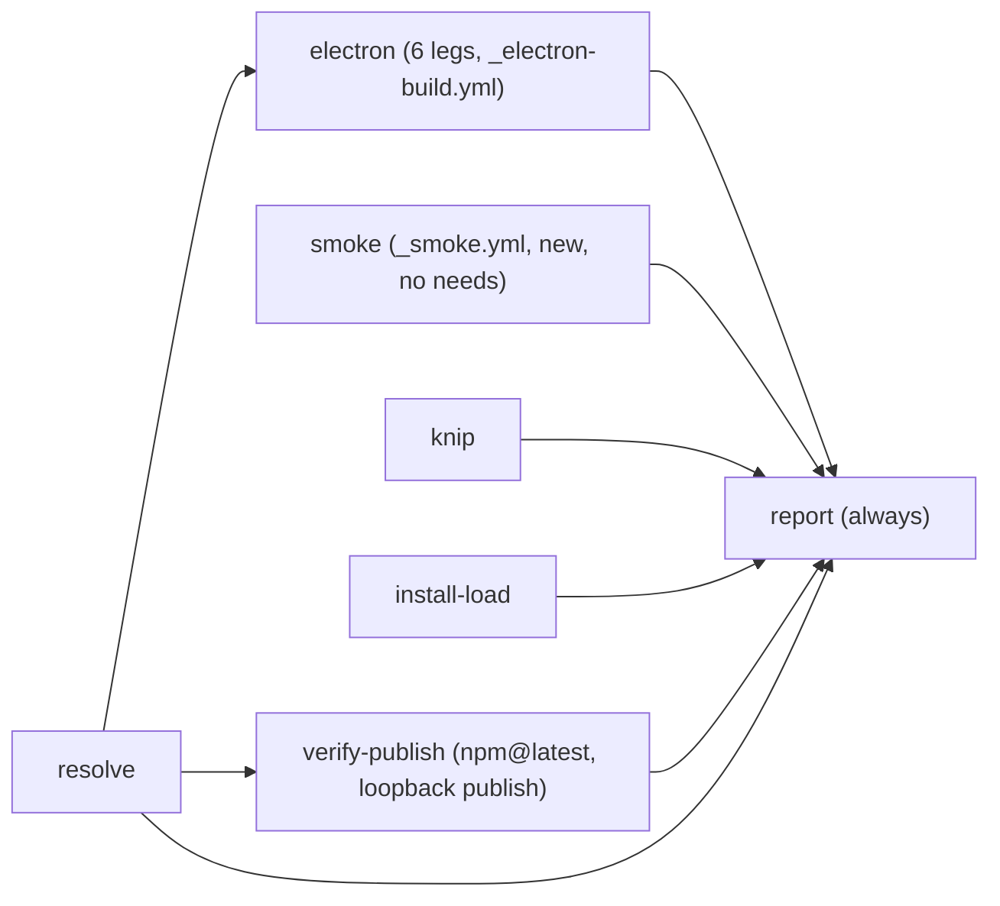

# Design: schedule-release-rehearsal

## Context

See proposal.md (Why). Current state, verified against the tree on 2026-11-22:

- `nightly.yml` runs only on `workflow_dispatch`. The cron line `# schedule: - cron: '0 7 * * *'` is commented out, with a land-dark note (`.github/workflows/nightly.yml:21-24`). The live trigger is `workflow_dispatch: {}` (`:25`). Archived change `add-nightly-verdaccio-build` set the enabling condition as "after ONE clean manual run" (`nightly.yml:21-22`). Run 39560713514 (2026-10-21, `c75ebbe16`) was green (run history, `unverified` in this pass), so the condition was met. The cron was never uncommented.
- Spec drift: `openspec/specs/nightly-verification/spec.md:10` already says "triggered on a daily `cron`".
- `nightly.yml` sets `concurrency: { group: nightly, cancel-in-progress: true }` (`:28-30`) and top-level `permissions: contents: read` (`:32-33`).
- Jobs today: `resolve` (`:42`), `verify-publish` (`:75`), `knip` (`:112`), `install-load` (`:155`), `electron` (`:178-192`, `_electron-build.yml`, `needs: [resolve, verify-publish]`, `legs: all`, `registry_url: http://localhost:4873`, `release_lock: true`, no `secrets:`), `report` (`:195-250`).
- `verify-publish` (`:75-104`) runs checkout, pnpm, setup-node 26 with `cache: pnpm`, `pnpm install --frozen-lockfile`, `npm pkg set version=<nightly>` (`:96`), `sync-versions.js`, `npm run build`, `npm publish --workspaces --include-workspace-root --dry-run` (`:104`), all with the runner's npm. Its comment calls it a "cheap pack+validate pre-gate" (`:70-74`). The release `publish` job runs `npm install -g npm@latest` (`publish.yml:271-272`) before `pnpm install`, then `npm pkg set` (`:293-296`) and `sync-versions.js`.
- `report` has `needs: [resolve, verify-publish, electron, install-load]` and `if: failure()` (`:196-197`). It uses inline `actions/github-script` that lists the jobs with `conclusion === 'failure'` (`:213`), then updates or creates one open issue labelled `nightly` (`:202-250`). Its body has the run URL, the commit and the failed jobs, and no commit range (`:216-226`). It never closes the issue. `knip` is not in `needs`, so a knip failure never reaches the issue. That contradicts `ci-cd-pipeline/spec.md:413-417` ("the job fails so the regression is visible in the nightly report").
- Each electron leg starts its own loopback Verdaccio (`_electron-build.yml:316-335`: `npm install -g verdaccio@6.11.1`, `node scripts/nightly-verdaccio-serve.mjs`, `node scripts/nightly-verdaccio-publish.mjs`). It then routes npm to that registry through `GITHUB_ENV` (`:337-341`). The publish script refuses any non-loopback `REGISTRY` (`scripts/nightly-verdaccio-publish.mjs:147-151`) and any version that is not a nightly slug (`:64-65`, check at `:178-180`). It bumps the version with `npm pkg set` (`:183-189`), syncs, regenerates the workspace lockfile with `npm install --package-lock-only` (`:193`) and verifies it (`:195`), and publishes in release order with a fake token and `--no-provenance` (`:203-218`). It runs `generate-runtime-lock.mjs --registry` and `lint-runtime-lock.mjs` before the server (`:229-230`). Its header says it runs inside `_electron-build.yml` (`:6`). Verdaccio serves `@blackbelt-technology/*` only from local publishes, with no uplink (`.github/verdaccio/config.yml:33-37`).
- `_smoke.yml` takes only `ref` (`:24-28`). It defines `standalone-install-smoke-linux` with 3 images (`:40-55`: `node:26-bookworm-slim`, `node:26-alpine`, `node:26.0.0-bookworm-slim`), `standalone-install-smoke-windows` with Node 26 (`:108-116`), and `standalone-install-upgrade-continuity` on Node 26 from the pinned release `0.9.0` (`:169-173`). No job sets `timeout-minutes`. Its header lists two consumers (`:10-12`). It packs the working tree and installs the tarballs (`scripts/test-standalone-npm-install.sh:82-108`). Callers today are `publish.yml:126-130` and `ci-smoke.yml:32`.
- `_electron-build.yml` has no job-level `timeout-minutes`; the only one is step-level (`:195`). A hung job there or in `_smoke.yml` runs up to GitHub's 6-hour job limit.
- `publish.yml` `ci-checks` (`:94-121`) runs `pnpm install --frozen-lockfile`, `pnpm run lint`, `pnpm test` (`:120`), `pnpm run build`. Its comment says "The FULL unit suite" (`:90-93`). Root `pnpm test` is `npm run test:parallel && npm run test:real-process` (`package.json:70`, `:71`, `:73`). No workflow and no root script sets `RUN_BUDGET_TESTS` today (grep of `.github/workflows/*.yml` and `package.json`). The pins are in `publish-workflow-contract.test.ts`: `:526-544` (`needs: [resolve]`, runs lint/test/build), `:583-596` (publish needs the gate jobs) and `:597-630` (`needs.ci-checks.result == 'success'`).
- `scripts/test-selection/nightly-report.mjs` (pre-A version) hard-codes `ISSUE_LABEL = "nightly-tests"` (`:25`) and `WORKFLOW_FILE = "nightly-tests.yml"` (`:26`). `WORKFLOW_FILE` is used only by the bisect-anchor query `api.runs()` (`:124`: last green scheduled run on `develop`), which `main` awaits unguarded (`:178`); a failure there rejects `main` and exits 1 before the step summary and before any issue call (`:179-195`). User-visible strings: headline "Nightly full suite is red|green" (`:86`), sections "### Failing test files", "### Jobs that did not succeed", "### Jobs with no report" (`:87-92`), "Still red at" (`:103`), issue title "Nightly full test suite is failing" (`:105`), close comment "Nightly full suite is green again" (`:108`), step-summary heading "## Nightly tests:" (`:181`). `main` reads flags with `arg(k) = argv[argv.indexOf(k) + 1]` (`:157`); a missing flag yields `argv[0]`, not `undefined`, so a missing `--expected` does not throw unless `argv` is empty (`:157-159`). `main` always writes `timings.json` (`:166-167`). `summarizeReports` lists every `needs` entry whose result is not `success` with its result string, e.g. `electron: skipped` (`:60-62`). `syncIssue` acts on `open[0]` of the issues with the label (`:98-99`, list at `:126`). Only a scheduled run touches the issue (`:184`).
- Safety pins in `nightly-workflow-contract.test.ts` scan only `nightly.yml` and `_electron-build.yml` (`:33-39`). They check: loopback or `--dry-run` for `npm publish` (`:51-64`), no `softprops/action-gh-release` (`:66-69`), no `git push` (`:71-80`), no `git commit` (`:82-89`), and that the first `registry_url:` is loopback (`:91-96`). Dispatch-only is not pinned. The `nightly.yml` block (`:47-97`) does not check `actions/create-release`. The `_electron-build.yml` block (`:99-124`) is stricter: it forbids every `npm publish` (`:103-111`) and checks both `softprops/action-gh-release` and `actions/create-release` (`:113-119`).
- I found no test that scans `_smoke.yml` for publish or release actions, although `ci-cd-pipeline/spec.md:257-259` ("Reusable workflow is publication-free") says one does.
- Job-order slices: `scripts/__tests__/nightly-verdaccio-publish.test.mjs:190-195` slices `verify-publish:`→`knip:`. `knip-workflow-contract.test.ts:80-87` slices `knip:`→`electron:`. New jobs must therefore go after `electron:`. No test pins `electron.needs` (grep for `verify-publish` in `packages/` and `scripts/` tests: only the slice above).
- `codeql-baseline.json` carries `actions/cache-poisoning/poisonable-step` entries for `_electron-build.yml` (11, incl. the Verdaccio install step) and `_smoke.yml` (7), and none for `nightly.yml`. A new alert stops a headless ship-it at step 4.4b (`.pi/skills/ship-it/SKILL.md:409-412`).
- Crons: `nightly-tests.yml:14` `0 3 * * *`, `ci-e2e-electron.yml:46` `17 3 * * *`, `codeql.yml:18` `17 4 * * 1`, `site-drift-check.yml:25` `23 5 * * *`.
- Measured timings (run history, `unverified` in this pass). Nightly run 39560713514: electron legs took 8.1-23.1 min, and the per-leg Verdaccio overhead (install + build client + install Verdaccio + publish) was 4.2-9.0 min. `smoke` jobs in the v0.11.0 publish runs took about 5-6 min on Linux and 24 min on Windows. `nightly-tests.yml` scheduled runs: 03:03-03:23 UTC. `ci-e2e-electron.yml` scheduled runs: 03:23-03:31 UTC.
- Change A's budget lane contract (`openspec/changes/stabilize-blocking-test-lanes/design.md`, section `## Budget lane contract (consumed by schedule-release-rehearsal)`): lane `budget`; files `<name>.budget.test.<ext>`. The lane switch is in the vitest configs, not in the test files: `vitest.workers.ts` exports `BUDGET_TEST_EXCLUDE` (`["**/*.budget.test.*"]`, or `[]` when `RUN_BUDGET_TESTS=1`), and every config whose project collects a budget file spreads it into `test.exclude`. A run without the variable therefore does not collect budget files at all; none of their code runs. A BLOCKING check, `scripts/check-budget-lane.mjs`, runs as a step of the `ci.yml` `ci` job (needed by `ci-result`) and inside `npm test` through `scripts/__tests__/budget-lane.test.mjs`. It fails when the root config or `packages/server/vitest.real-process.config.ts`, listed with `vitest list --filesOnly` and `RUN_BUDGET_TESTS` removed from the environment, collects any `*.budget.test.*` file, or when a tracked budget file is in no root-config project that excludes it with the budget entry (judged statically from the resolved project configs), or when that static judgment disagrees with vitest's own collection on the other tracked test files. The check never sets `RUN_BUDGET_TESTS`. Where the variable is set, in A's words: "Of the repo's scripts, configs and workflows, only the `test:budget` script in `package.json` sets it; the nightly `budget` job runs that script, and a developer may also set the variable by hand to run one budget file. No vitest config, test, script, selector step or workflow step that `npm test`, PR `ci.yml` or `publish.yml` runs sets it." A states the same rule as a requirement (A spec `parallel-test-execution`, "Budget test files run only in the nightly budget lane": "only `test:budget` SHALL set `RUN_BUDGET_TESTS`"; scenario "Blocking runs never set the lane variable"). `publish.yml:120` needs no edit; "`schedule-release-rehearsal` must only ensure `RUN_BUDGET_TESTS` is never set in `publish.yml`"; only `pnpm run test:budget` runs the lane. A's requirements: "Budget test files run only in the nightly budget lane" and "A blocking lane check refuses a budget file outside the budget lane" (A spec `parallel-test-execution`). The names `budget`, `RUN_BUDGET_TESTS`, `test:budget`, `*.budget.test.*` and `BUDGET_TEST_EXCLUDE` are A's stable interface.
- The runtime-asset rehearsal (the Windows `tar`/`EXDEV` class) is not part of this change. It moved to `rehearse-runtime-asset-matrix`, which depends on this change and is blocked on a spike (see that change's proposal.md).

## Goals / Non-Goals

Goals: the nightly rehearsal actually runs every night. It covers the install smoke and runs the release `publish` job's npm commands under `npm@latest`. Its red and green state shows up as one issue that also closes; only a scheduled night's first attempt closes it, and a red re-run can still open it. The tag gate never runs the budget lane: A's blocking lane check and clause 6 enforce it (D5 lists what neither enforces).

Non-goals (design level, beyond proposal.md Non-Goals):
- No runtime-asset rehearsal (`rehearse-runtime-asset-matrix`).
- No edit to `_electron-build.yml`, and a header-comment edit only to `_smoke.yml`. One behaviour of the `electron` legs does change, through the shared script: step (c) of `nightly-verdaccio-publish.mjs`, which every leg runs (`_electron-build.yml:329-335`), gains `--allow-remote=all` (D8). Spike task 1.1 runs that command on every leg's runner image before any other task.
- No change to how `nightly-tests.yml` calls the reporter. Every new reporter flag is off by default.

## Accepted decisions (owner)

- B1. Enable the `nightly.yml` cron, with an issue-on-red and close-on-green report that reuses the existing report script. Do not touch `ci-electron.yml`.
- B2 (split). This change holds the cron, the report, the `npm@latest` rehearsal publish, the install-smoke legs via `_smoke.yml` (B2-ii), the tag-gate pin, the residual and the doc tasks. All macOS legs in the rehearsal run nightly. The runtime-asset matrix moved to `rehearse-runtime-asset-matrix`; the residual table lists it as not covered.
- B3. The tag gate keeps `pnpm test` but excludes the budget lane from change `stabilize-blocking-test-lanes`. This change depends on that one.
- B4. State the residual risk honestly. Never publish publicly, push a tag or create a release.
- B5. Docs that track the gate get tasks, not edits now.
- B6. The rehearsal publish runs under `npm@latest`, as `publish.yml` does before publishing, so npm drift surfaces on `develop`. D8 states exactly which commands that covers and that the one measured `EALLOWREMOTE` would not have been caught.
- B7. A manually dispatched rehearsal shows its verdict in the run summary only and opens no issue, the same as `nightly-tests.yml`.

B6 rests on a mechanism that has never run on the current tree (D8). Task 1.1 proves it before any other task. If it fails, the change does not ship without the owner (D8, "If the spike fails").

## Reporter interface (on top of stabilize-blocking-test-lanes)

The base is the section `## Reporter interface (consumed by schedule-release-rehearsal)` of `openspec/changes/stabilize-blocking-test-lanes/design.md`. It defines the flag reader, the report and watchdog modes, the flags `--reports` and `--expected` (required in report mode) and, from A's rerun task group, `--defer-first-attempt`, `--previous`, `--watchdog` and `--dry-run`, plus their exit codes. That section allows a later change to add a mode, selected only by its own flag, in which `--reports` and `--expected` are not required.

This change adds four flags: `--jobs-only`, `--label`, `--name` and `--no-close-on-rerun` (D2). They do not change the meaning, default or exit code of any flag of A's section, the behaviour of a call that passes none of them, or the watchdog's binding to `nightly-tests.yml`. `--jobs-only` is the added mode: `main` selects it before A's mode selection and before A's required-flag check. The other three flags are read only in that mode.

A's rerun flags exist only if A's rerun task group ships; its spike can fail, and then A's interface is the two report-mode flags, the reader fix and the exit codes. This change behaves the same in both cases: `nightly.yml` passes none of A's flags, and the `--jobs-only` branch returns before any of A's report, watchdog or attempt code. `--no-close-on-rerun` reads `GITHUB_RUN_ATTEMPT` itself and uses nothing from A's rerun group.

## Decisions

### D1. Cron `13 4 * * *` (04:13 UTC)

```mermaid
gantt
  dateFormat HH:mm
  axisFormat %H:%M
  section measured
  nightly-tests.yml, measured 0303 to 0323 :03:03, 20m
  ci-e2e-electron.yml macOS, 0323 to 0331 :03:23, 8m
  section change A rerun, typical (estimate)
  nightly-tests rerun window :03:23, 22m
  section change A worst case (A design D7 Timing)
  attempt 1 up to the deferral deadline 0405 :03:00, 65m
  rest of report job and rerun job, 10 + 5 min :04:05, 15m
  attempt 2, up to 75 min, ends 0535 :04:20, 75m
  A watchdog cron 0747 :milestone, 07:47, 0m
  section this change
  nightly.yml rehearsal, est. 30-45 min, no upper bound (T-B2) :04:13, 40m
```

Why 04:13:
- It starts after a typical `nightly-tests.yml` night has finished. Measured runs end by 03:23; change A's rerun of failed jobs adds about one more shard length, so about 03:45 (estimate). It also starts after the macOS-only `ci-e2e-electron.yml`. It does NOT start after A's worst case, and no start time short of 05:35 could.
- A bad night, stated plainly. A's worst case comes from its `timeout-minutes` (A design.md D7, "Timing, worst case"): attempt 1's reporter may still defer at the deferral deadline 04:05 UTC, then the rest of its `report` job (10 min) and the `rerun` job (5 min) run, then attempt 2 lasts up to 75 min, so `nightly-tests.yml` can end as late as 05:35 UTC. That bound assumes A's `budget` job keeps `timeout-minutes` at or below 50 (provisional 40 in A task 5.1, sized by A task 3.8, checked by A task 6.4); a larger value moves it later. A's watchdog runs at 07:47 UTC and watches only `nightly-tests.yml`. On such a night the two nightlies run at the same time from 04:13 until up to 05:35. They compete for runners, so the rehearsal's jobs can queue and its `report`, and with it the `nightly` issue, can come later than 04:13 plus the rehearsal's own duration; by how much depends on the org's concurrency limits, which are `unverified`. They write no common file, artifact or issue (`nightly-tests.yml` writes the `nightly-tests` issue and its own artifacts; `nightly.yml` writes the `nightly` issue, and its Verdaccio registries live on their own VMs), so the overlap cannot change either verdict. On Mondays `codeql.yml` (`17 4 * * 1`, `codeql.yml:18`) also runs inside the window. All overlaps are accepted (T-A6 in A records the same fact from its side).
- The two nightlies can test different SHAs, on any night. Each scheduled run tests `develop` HEAD at the time GitHub creates it, and a re-run (A's attempt 2) keeps its original run's SHA (GitHub docs, "Re-running workflows and jobs"; not re-read in this pass, `unverified`). So the night's `nightly-tests.yml` verdict, attempt 2 included, is for the SHA of its 03:00 run, and the rehearsal's verdict is for the SHA of its 04:13 run. They match only if no merge to `develop` lands between the two runs' actual starts; GitHub can delay a scheduled start (A design D7 reasons about start delays of hours), so that window is not always 03:00-04:13. How often merges land there is `unverified` (not measured). Each report names its SHA (headline "`<name>` is red|green at `<sha>`", D2), so a releaser compares SHAs, not times (task 5.1).
- It ends before the European working day (team timezone `unverified`), so the issue is there in the morning.
- Minute 13 avoids the top-of-hour schedule load that GitHub documents as a cause of delayed or dropped scheduled runs.

The time is a design choice, not a spec rule. The spec requires only an active daily cron.

Alternatives:
- `0 7 * * *`, the archived plan (`add-nightly-verdaccio-build` proposal.md:21). Rejected: at 07:00 UTC the working day has already started in Europe, and the longer gap after 03:00 makes it more likely that the two nightlies test different SHAs.
- 03:30, next to the others. Rejected: it competes for runners with `nightly-tests` and the change A rerun.

### D2. Report: generalise `nightly-report.mjs` with four flags, defaults unchanged

New optional flags on `scripts/test-selection/nightly-report.mjs`, read with A's flag reader (absent flag `undefined`, boolean flag true when present; A's section "Reporter interface"). With none of them, every output string, file, exit code and API call stays what it is in A's version.

| Flag | Effect | Default |
|---|---|---|
| `--jobs-only` | selects the jobs-only mode described below | off: A's modes |
| `--label <label>` | replaces `ISSUE_LABEL` in issue list and create (`:25`, `:126-127`) | `nightly-tests` |
| `--name <text>` | replaces the four named strings below | today's literals |
| `--no-close-on-rerun` | when `GITHUB_RUN_ATTEMPT` is greater than 1: a red verdict comments on the open issue (or opens one), a green verdict makes no issue call; never closes | off |

`--label`, `--name` and `--no-close-on-rerun` are read only in jobs-only mode. A's report and watchdog modes ignore them, so those modes behave exactly as A defines them whatever else is passed.

String mapping when `--name N` is given:
- Step-summary heading (`:181`): `## N: RED` or `## N: green`.
- Headline (`:86`): `N is red at <sha>.` or `N is green at <sha>.`
- Issue title (`:105`): `N is failing`.
- Close comment (`:108`): `N is green again at <sha>. Closing.`
- "Still red at `<sha>`." (`:103`) has no name and does not change.

`--jobs-only` is an explicit mode, chosen by its own flag, not by the absence of `--reports`. `main` branches to it right after argument parsing, before A's mode selection and before A's check that `--reports` and `--expected` are present. So jobs-only mode needs neither flag, ignores every flag of A's table (`--watchdog` included), and never reaches report reading, `timings.json`, A's attempt or watchdog code, or the bisect-anchor query. In this mode:
- No vitest reports, no `--previous` record, no `timings.json`, no "### Failing test files" or "### Jobs with no report" sections, no passed-on-rerun lists.
- No bisect-anchor query (`api.runs()`, `:124`, `:178`) and no commit-range line. Today's inline `nightly.yml` body has no range either (`nightly.yml:216-226`), so nothing is lost, the unguarded call is gone from this path, and checkout needs no history.
- The verdict comes from `NEEDS_JSON`. If `NEEDS_JSON` is unset, empty, not valid JSON, or an object with no entries, the verdict is red and the report says "job results unavailable"; it never reports green without job results (today `JSON.parse(env.NEEDS_JSON || "{}")`, `nightly-report.mjs:164`, would yield green). A `skipped` job counts as red and is printed with its result, e.g. `electron: skipped` (`:60-62`): a skipped rehearsal job did not exercise its path.
- A "### Failed jobs and legs" section lists every job of the run whose `conclusion` is `failure`, `cancelled` or `timed_out`, by full name, from `GET /repos/{repo}/actions/runs/{run_id}/jobs?per_page=100`, paginated. Matrix legs appear by their full job name. `cancelled` is included because GitHub marks a timed-out job `cancelled` (`publish.yml:100-102`). The inline script lists `failure` only (`nightly.yml:213`). If the request fails, the section says "failed-job list unavailable: <error>" and the verdict still comes from `NEEDS_JSON`. The report never turns green because it could not read the jobs.
- The only other API calls are the issue calls. If one of them fails, `main` appends "Issue call failed: <error>. The `<label>` issue may not reflect this run; re-run the `report` job." to the step summary, prints the same text as a `::error::` annotation, and exits 1. A red night whose issue was written and a red night whose issue call failed therefore look different in the run summary, although both show a red `report` job.
- Exit codes, the same rule as A's report mode: 0 when the verdict is green and every issue call succeeded; 1 when the verdict is red (job results unavailable included), when an issue call fails, or on any uncaught error (`nightly-report.mjs:191-193`). A red night therefore also shows a red `report` job; the issue (or, for a dispatch or re-run, the step summary) names the jobs that failed. A failed jobs-list request alone does not change the exit code.
- Test seam: `main` is exported (or delegates to an exported function) so that a test can run the jobs-only path with an injected GitHub API (the issue calls and the jobs endpoint with `Link` pagination), env and step-summary sink, as the existing `syncIssue` tests do with `fakeApi` (`scripts/__tests__/nightly-report.test.mjs:150-169`). Run as a CLI, `main` keeps building the `fetch`-based API (`nightly-report.mjs:113-133`, `:156-186`).

`--no-close-on-rerun` decides what a re-run attempt may do. It is applied after the existing `GITHUB_EVENT_NAME === "schedule"` gate (`:184`), so a dispatch never writes the issue (B7). For a scheduled run:
- Attempt 1 behaves as today: red opens or updates the one open issue and comments "Still red"; green comments and closes. The issue write counts as a whole (owner decision G2): the updated body names every failing job and leg and links the run, so the comment stays "Still red at `<sha>`." (`nightly-report.mjs:103`), which meets the spec's "every issue write" rule.
- Attempt 2 or later, red: if a `nightly` issue is open, add one comment "Re-run attempt <n> of <run url> is red at `<sha>`." followed by that attempt's "### Failed jobs and legs" section; when the jobs request failed, that section is the "failed-job list unavailable: <error>" line plus the failing jobs from the job results (`NEEDS_JSON`, e.g. `smoke: failure`), listed only in that fallback case (owner decision G1). Leave the body alone; if none is open, open it with the full body. So a red night whose attempt-1 `report` job failed becomes visible as soon as someone re-runs the failed `report` job (or the run).
- Attempt 2 or later, green: no issue call. The step summary gets "Re-run attempt <n>: a re-run never closes the `<label>` issue; the next green scheduled night does."
- The jobs-only branch implements this itself; `syncIssue` and its behaviour for `nightly-tests.yml` are unchanged.
- Why a re-run may open but never close. Attempt 1 of night N finishes its report before attempt 1 of night N+1 starts its report, because nights start 24 h apart and GitHub caps a job at 6 h. A re-run of an old night can finish at any time. If it could close, a green re-run of night N could close the issue that a red night N+1 opened, and a red night would be hidden (B1). If it may only open or comment, the worst case is a false red: a red re-run of night N after a green night N+1 opens an issue that names the old SHA and the attempt; the next green scheduled night closes it. The error is toward visibility.
- Why attempts, not "newest scheduled run". The earlier draft compared run ids through a second runs query. That needed an API call whose failure had to be special-cased. The attempt rule needs no API call.
- Not covered: a red night whose attempt-1 `report` job fails and that nobody re-runs. If the failure happened inside the script, the summary line and annotation above say so; if the job died before the script ran (checkout, setup-node, runner loss), only the red `report` job shows it. In both cases no issue exists until the next red night or a re-run. Trade-off T-B18.
- Platform assumption, `unverified`: `GITHUB_RUN_ATTEMPT` is 1 on the first attempt and grows by one with every re-run, for "Re-run all jobs" and "Re-run failed jobs" alike (GitHub docs, variables reference; change A relies on the same variable). Spike task 1.1 observes it. Fail-closed fallback if it does not hold: do not ship `--no-close-on-rerun`; the change stops and the owner decides (D8, "If the spike fails").
- Platform assumption, `unverified` and not observable before merge: a re-run of a scheduled run keeps `GITHUB_EVENT_NAME` `schedule` (the spike's runs are dispatches). If it does not, a re-run attempt writes no issue at all; that is the behaviour of the earlier draft, so nothing is hidden that was visible before, but the re-run recovery path above is lost and the issue must be opened by hand. Trade-off T-B18.
- `nightly-tests.yml` must never pass this flag: A's rerun attempt 2 is the one that reports a deferred night.

`nightly.yml` `report` becomes: `needs:` every other job, `if: always()`, `timeout-minutes: 10`, `permissions: { contents: read, issues: write, actions: read }`, checkout (default depth), setup-node 26 with no cache, then `node scripts/test-selection/nightly-report.mjs --jobs-only --no-close-on-rerun --label nightly --name "Nightly Verdaccio build"`, with `GITHUB_TOKEN` and `NEEDS_JSON: ${{ toJSON(needs) }}`. `actions: read` is for the jobs list.

Behaviour changes, stated:
- A dispatched run no longer opens an issue. It writes the step summary only (`:184` rule, B7). Today a red dispatch opens an issue.
- The first attempt of a scheduled run closes the `nightly` issue when green. A re-run attempt never closes it.
- A red re-run attempt of a scheduled run comments on the open issue, or opens it when none is open. Today's inline script writes on any red run, re-runs included (`nightly.yml:202-250`).
- `knip` failures now reach the issue.
- Kept from today's requirement (`openspec/specs/nightly-verification/spec.md:70`): one tracking issue labelled `nightly`, the failing leg named, the run linked. Every issue write keeps all three, the re-run comment included (it carries that attempt's "### Failed jobs and legs" section and the run URL). Narrowed on purpose: only a scheduled run writes the issue (B7).
- The `nightly` label belongs to the reporter. A human-filed issue with that label would be adopted and closed on green. This is today's adoption rule (`nightly.yml:202-250` also picks any open `nightly` issue). Task 2.3 documents the label as reserved. Filtering by author is trade-off T-B1.

Overlap with change A: A rewrites the flag reader and `main` (`:156-186`), and, if its rerun task group ships, adds attempt logic and the watchdog (A's section "Reporter interface"). This change edits `main` too (the `--jobs-only` branch, the `--name` strings, the attempt check of `--no-close-on-rerun`). Ship order: A first (`dependencies.yaml`). For `nightly-tests.yml` A's behaviour is unchanged. A's watchdog does not watch `nightly.yml`: A's section keeps it bound to `nightly-tests.yml` and forbids a later change to rebind it, and it exists only if A's rerun group ships (trade-off T-B4).

Alternatives:
- Add a close step to the inline github-script. Rejected by B1: that would be a second mechanism.
- One flag per string (`--title`, `--headline`, ...). Rejected: four flags for one name.
- Make `--reports` optional and infer the mode from its absence. Rejected: a `nightly-tests.yml` edit that drops `--reports` would silently lose the "no report" detection.
- Keep the bisect anchor in `--jobs-only` and guard it. Rejected: it adds a `--workflow` flag, a guarded API call and `fetch-depth: 0` for a line today's `nightly` issue does not have.
- Ownership by highest scheduled run id (the cycle-3 draft). Rejected above.
- No rerun rule at all, relying on the event gate. Rejected: if a re-run keeps the event `schedule` (`unverified`), a green re-run of an older night would close an issue that describes a newer red night.
- A reusable `_nightly-report.yml` workflow, or a new script. Rejected by B1 and for surface.

### D3. Job graph: `verify-publish` gates nothing

`electron` changes from `needs: [resolve, verify-publish]` (`nightly.yml:179`) to `needs: [resolve]`. It uses only `needs.resolve.outputs.version` (`:182`). Each electron leg already publishes to its own loopback Verdaccio inside `_electron-build.yml` (`:316-335`), so it never needed anything `verify-publish` produced.

Why. `verify-publish` was a cheap dry-run pre-gate (`nightly.yml:70-74`). D8 makes it the `npm@latest` canary. If it still gated `electron`, any `npm@latest` breakage (the class B6 wants red) would skip all 6 electron legs, which run on the runner's npm and are not affected by it. For as long as `npm@latest` stays broken, the Electron rehearsal would not run at all. With no edge, an `npm@latest` failure shows as `verify-publish` red and every other job still runs.

Cost. A manifest or pack error that `verify-publish` used to catch first now also fails each electron leg at its own publish step, after its install and build (about 4-9 min per leg, measured overhead). Accepted: such nights are rare, and the report names every failing leg (trade-off T-B12).

No per-leg republish is added by this change. The only Verdaccio this change adds is the single one in `verify-publish` (D8). The per-leg Verdaccio in `_electron-build.yml` exists already and is untouched.

Rejected:
- Keep `electron` behind `verify-publish`. Rejected for the masking above.
- A separate `publish-npm-latest` job next to a cheap `verify-publish` pre-gate. Rejected: one more job that duplicates checkout, install and build, for a pre-gate whose only benefit is saving runner time on rare nights.

### D4. Install smoke: call `_smoke.yml` directly from `nightly.yml`

The `smoke` job has no `needs` (it uses no nightly version), `uses: ./.github/workflows/_smoke.yml`, `with: { ref: ${{ github.sha }} }`. The tag gate passes the same kind of `ref` (`publish.yml:126-130`, `ref = github.sha` at `resolve`).

What the smoke legs can and cannot rehearse:
- They cannot target the Verdaccio registry or install the unpublished nightly version. `_smoke.yml` has no registry input. Its scripts install `npm pack` tarballs of the working tree at the current `package.json` version.
- This is what the tag gate runs. On dispatch entry the tag gate packs `ref` = the branch HEAD at `resolve` time, before any version bump, the same kind of tree as the nightly. On tag-push entry `ref` is the tagged commit (`openspec/specs/ci-cd-pipeline/spec.md:302`), whose versions were set by whoever pushed the tag (`unverified`). So the nightly smoke rehearses the release `smoke` job for dispatch entry, and for tag-push entry up to the version string in `package.json`. It does not rehearse "install the published package from a registry". The electron Verdaccio legs cover that path.
- Third-party dependencies and the pinned upgrade-from release (`0.9.0`, `_smoke.yml:173`) come from npmjs, by design and the same as the release.
- `_smoke.yml` jobs have no `timeout-minutes`, so a hung leg runs up to GitHub's 6-hour limit and delays the `report` by as long. With D6 a hang cannot delay the next night. Adding timeouts would also change the tag gate's jobs; that is trade-off T-B2.

The nearest higher-fidelity option is to add a `registry_url` input to `_smoke.yml` and install `@blackbelt-technology/pi-agent-dashboard@<nightly>` from a per-leg Verdaccio. That changes what the tag gate's smoke means and adds about 4-9 min per leg. It is out of scope (not in B2) and recorded as a follow-up idea.

Calling `_smoke.yml` instead of scheduling `ci-smoke.yml`: `ci-smoke.yml` is spec'd as `on: workflow_dispatch` with a re-dispatch cancel group (`ci-cd-pipeline/spec.md:265-269`, `ci-smoke.yml:21-22`). Adding a schedule there would need a MODIFIED delta and would put a second schedule into the system. Rejected.

### D5. Tag gate: no workflow edit, a contract clause instead

B3 is resolved by change A's budget lane contract (see Context). Plain `pnpm test` is `npm run test:parallel && npm run test:real-process` (`package.json:70-73`): the root vitest config and `packages/server/vitest.real-process.config.ts`. With `RUN_BUDGET_TESTS` unset, neither collects a `*.budget.test.*` file. `publish.yml:120` is the only vitest call on the release path (grep for `vitest`, `pnpm test`, `npm test` in `publish.yml`, `_smoke.yml`, `_electron-build.yml`), so it already runs the suite without the lane. The only way the tag gate could run the lane is if something on the release path sets `RUN_BUDGET_TESTS` or calls `test:budget`. A states that today nothing does: only the `test:budget` script in `package.json` sets the variable, and no vitest config, test, script, selector step or workflow step that `npm test`, PR `ci.yml` or `publish.yml` runs sets it (A design "Budget lane contract", "Where `RUN_BUDGET_TESTS` is set"). A leaves the release-path half of that to this change: "`schedule-release-rehearsal` must only ensure `RUN_BUDGET_TESTS` is never set in `publish.yml`, and may pin that in a contract test." So this change adds release-gate contract clause 6 to `publish-workflow-contract.test.ts` (an assertion folded from the scenario "Test fails when the release path enables the budget lane"). The clause inspects exactly these texts:

- `publish.yml`, whole file, comments excluded.
- Each reusable workflow `publish.yml` calls through a local `uses: ./.github/workflows/<file>`, found by parsing `publish.yml`, not from a fixed list. Today: `_smoke.yml` (`publish.yml:128`) and `_electron-build.yml` (`:577`). Whole file, comments excluded.
- The root `package.json` scripts those jobs run: every name in a `pnpm test`, `pnpm run <name>` or `npm run <name>` line of the files above that is a root script, followed through `npm run <name>` inside root scripts, plus the root `postinstall` (`package.json:67`), which `pnpm install` runs on the release path unless `--ignore-scripts` is passed. A name that is not a root script, and any `npm run <name> --workspace=<pkg>` call, is not followed: workspace `package.json` scripts are not scanned. Today: `test`, `lint`, `build`, `postinstall` (`publish.yml:119-121`, `:301`; `_smoke.yml:91`, `:127`, `:186`; `_electron-build.yml:306`) and, through `test`, `test:parallel` and `test:real-process` (`package.json:70-73`). `build` reaches `build:app` only through `--workspace` (`package.json:69`), so `build:app` is not followed.

None of them may contain `RUN_BUDGET_TESTS` or `test:budget`. "Comments excluded" means full-line `#` comments only, as the existing `codeLines` helper (`packages/shared/src/__tests__/nightly-workflow-contract.test.ts:43-45`); a name in a trailing comment on a code line fails the clause (owner decision G4: a false alarm is possible, nothing slips past).

Why a whole-file text scan: the variable can be set at workflow, job or step level, or written to `GITHUB_ENV`. Each of those puts the name in the YAML text.

What enforces B3, and what does not:
- Enforced, blocking, by A: the two vitest commands of `pnpm test`, run without the variable, collect no budget file. A's `scripts/check-budget-lane.mjs` fails the `ci.yml` `ci` job and `npm test` otherwise. It therefore also runs inside the tag gate's own `pnpm test`. A vitest config that turns the lane on without the variable, or a budget file in a package whose config lacks the exclusion, fails it. This is the runtime half of the scenario "ci-checks does not run the budget lane" (A scenarios "The local suite does not collect budget files" and "A budget file a blocking run would collect fails the check"); no host test is added here.
- Enforced, blocking, here: clause 6. A's check lists files with the variable removed from its environment, so it cannot see a workflow that sets it; clause 6 covers that half. Because `test:budget` is the one place the variable is set, clause 6 forbids both names: a release-path text that calls `test:budget` would set it through that script.
- Stated by A, checked when A lands, not pinned by a lasting test here: that no vitest config, test, script or selector step `npm test` or PR `ci.yml` runs sets the variable (A spec scenario "Blocking runs never set the lane variable"; A tasks 2.1 and 2.7 verify it with `grep`). A vitest config that sets it in-process is caught by A's lane check, which then lists a budget file. Whether A's scenario manifest adds a lasting test for the rest is A's decision (`unverified` here).
- Not enforced by anything in this change or in A:
  - A wall-clock or memory upper bound in a file not named `*.budget.test.*`. A moves only the observed-failing cases (A9); every other such assertion stays in a blocking file, and so in the tag gate's `pnpm test`, until `migrate-budget-assertions` makes A's guard blocking (A10). Until then B3's "deterministic lanes only" holds for budget files, not for every budget assertion. This is the largest gap.
  - The variable set outside the repo (a self-hosted runner's environment) or, in a later edit, inside a script file a release workflow step runs (for example `scripts/test-standalone-npm-install.sh`). A states that no such script sets it today; clause 6 scans only workflow text and root `package.json` scripts.
  - A workspace script reached through `--workspace` (see the follow rule above).
  - A test file outside `*.budget.test.*` that skips its cases unless `RUN_BUDGET_TESTS=1`, which would silently drop a functional case from the tag gate. A's warn-only guard reports budget assertions, not such gates.

Trade-off T-B15 records the gaps.

The `ci-checks` comment "The FULL unit suite" (`publish.yml:90-93`) is corrected to "the full unit suite except the budget lane" (comment only). These stay unchanged: `needs: [resolve]`, `publish.needs` containing `ci-checks`, `needs.ci-checks.result == 'success'`, `timeout-minutes: 75` and the step order.

If A renames the variable or the script, A's stability promise makes that a breaking change for this clause.

Alternatives:
- Add an explicit `RUN_BUDGET_TESTS: ""` or `--exclude` to the `ci-checks` step. Rejected: A's contract makes the default safe, and a redundant setting invites the wrong value.
- Remove `pnpm test` from the tag gate. Rejected by B3.
- Use affected-only selection in the tag gate. Rejected: there is no PR diff on a tag.

### D6. No concurrency group on `nightly.yml`

B1 requires a red night to be visible. The requirement states the outcome: another run can neither cancel a scheduled `nightly.yml` run nor keep it from starting, and cannot cancel or skip its `report` job. The mechanism is this: `nightly.yml` drops its `concurrency` block (`:28-30`) and declares no `concurrency` key at workflow or job level. Every run then starts on its own.

Why no group at all. GitHub keeps at most one pending run per group: "When a new job or workflow run is queued, any existing `pending` job or workflow run in the same group is canceled and replaced" (GitHub docs, "Control the concurrency of workflows and jobs", read 2026-11-22). Every shape of group shared by a scheduled run can lose or delay a night:
- One group, `cancel-in-progress: true` (today): a dispatch cancels a running scheduled run.
- One group, `cancel-in-progress: false`: a dispatch in progress holds the 04:13 run pending, and a second dispatch replaces it. The night has no `report` and no issue.
- Per-event groups: a manual re-run of an older scheduled night joins the `schedule` group if a re-run keeps its event (`unverified`), and can hold or replace tonight's run.

With no group, a scheduled run, dispatches and re-runs can run at the same time. That is safe: each Verdaccio is a loopback on its own VM, no job writes shared state, and the issue rules of D2 hold whatever the order: a re-run never closes the issue, so it cannot hide a newer red night. Two scheduled `nightly.yml` runs do not overlap in practice: they start 24 hours apart and GitHub caps each job at 6 hours. (This is about `nightly.yml` with itself; it can overlap with `nightly-tests.yml` on a bad night, D1.) The longest jobs are those of `_electron-build.yml` and `_smoke.yml`, which have no job-level timeout (Context); a hung leg there can burn up to 6 hours and delay the night's report by as long (trade-off T-B2). The cost of parallel manual runs is runner time, which is acceptable for a manual action.

The reusable workflows `nightly.yml` calls are not constrained. Today neither declares a group (`_electron-build.yml`, `_smoke.yml`: no `concurrency:` key, grep). A job-level group added there later could hold or cancel one nightly job, never the whole run and never `report`, which is a job of `nightly.yml`. With `if: always()` the `report` job still runs and reports such a job as `cancelled`, which counts as red (D2). That is a false red, not a hidden night, so B1 does not need the rule, and the callees, which `publish.yml`, `ci-electron.yml` and `ci-smoke.yml` also call, keep their freedom (trade-off T-B17). The `nightly-tests.yml` change A makes the same choice for its own workflow (A design D7, "Concurrency").

Alternatives:
- The three shapes above. Rejected for the reasons given.
- One group with `queue: max`. Rejected: the scheduled run still waits behind a long dispatch or re-run, and whether `actionlint` accepts the property is `unverified`.
- Keep `cancel-in-progress: true` and treat `cancelled` as neutral in the report. Rejected: it hides a hung or killed leg.
- Forbid `concurrency` in the called reusable workflows too (an earlier draft of this change). Rejected: wider than B1 needs (above), and it would constrain the release gate's callees.
- Detect a scheduled run that GitHub itself drops or delays. Not here: no mechanism in this change or in A watches `nightly.yml` (trade-off T-B4).

### D7. Extend the safety contract to everything the nightly runs

The scenario fold adds these assertions to `nightly-workflow-contract.test.ts`:
- The forbidden-pattern checks run on every local `uses: ./.github/workflows/*.yml` that `nightly.yml` calls: today `_electron-build.yml` (already scanned, `:33-39`) and `_smoke.yml` (new). `_smoke.yml` gets the stricter set of the `ci-cd-pipeline` scenario "Reusable workflow is publication-free" (`openspec/specs/ci-cd-pipeline/spec.md:257-259`): any non-comment line containing `npm publish`, with no `--dry-run` or loopback exception (the header comment at `_smoke.yml:12` names `npm publish` and must not trip it), plus `softprops/action-gh-release`, `actions/create-release` and `git push`. `_electron-build.yml` keeps its checks (`:99-124`) and its `git push origin v…` check is replaced by the `nightly.yml` block's two checks (`:71-89`): no non-comment line matching `git\s+push` without `--dry-run`, and none matching `git\s+commit`. `_smoke.yml` gets the same two checks. Neither file has such a line today (grep for `git\s+(push|commit)` in both), so every scanned file implements "No Release, tag, or version commit" with one pattern set. The `nightly.yml` block (`:47-97`) gains an `actions/create-release` check, so every scanned file forbids both release actions. This is the first test that implements that scenario for `_smoke.yml`.
- Every `REGISTRY`, `npm_config_registry` or `registry_url` value in `nightly.yml` is loopback, not only the first `registry_url:` (`:91-96`).
- `verify-publish` contains no `npm publish --workspaces` line, and no job other than `report` lists `verify-publish` in `needs`.
- `on.schedule` holds an uncommented cron, so the nightly cannot go dark again unnoticed. The same rule exists for `nightly-tests` at `nightly-tests-workflow-contract.test.ts:39-43`.
- `nightly.yml` has no non-comment line matching `^\s*concurrency:` (D6; the called workflows are not checked).
- `report.needs` equals the set of all other job ids of `nightly.yml`, and `report.if` is `always()`. Today's defect (`knip` missing, `nightly.yml:196`) is exactly a job dropping out of `needs`.
- Only `report` declares `issues: write`. Its run step invokes `scripts/test-selection/nightly-report.mjs` with exactly the flags `--jobs-only`, `--no-close-on-rerun`, `--label nightly` and `--name "Nightly Verdaccio build"`, and with none of A's flags. (scenario "The report uses the shared reporter")
- The `smoke` job is `uses: ./.github/workflows/_smoke.yml` with `ref: ${{ github.sha }}`, and `nightly.yml` defines no `standalone-install-smoke` job itself.
- In `verify-publish`, `npm install -g npm@latest` comes before `pnpm install`, before `npm pkg set` and before the step that runs `nightly-verdaccio-publish.mjs`.

### D8. `npm@latest` and a real loopback publish in `verify-publish` (B6)

What the release `publish` job runs under `npm@latest` (`publish.yml:237-446`, `runs-on: ubuntu-latest` at `:244`). After `npm install -g npm@latest` (`:271-272`) it runs `pnpm install` (`:274`), `npm pkg set` (`:293-296`), `sync-versions.js` (`:298-299`), `pnpm run build` (`:301`) and then a per-package loop (`:421-446`): `npm view` per package, and for the server `assert-bundled-plugins-published.mjs`, `generate-runtime-lock.mjs` and `lint-runtime-lock.mjs` (`:432-440`), then `npm publish [--workspace=<pkg>] --provenance --access public` (`:444-446`). `generate-runtime-lock.mjs` runs `npm pack` and `npm install --package-lock-only --allow-remote=all` (`:113`, `:122`) through `runNpm` (`scripts/lib/runtime-release.mjs:146`), which runs the `npm-cli.js` that `npmArgv` finds next to `process.execPath` (`:134-143`). Whether that is the globally upgraded npm on the runner is `unverified` (the release relies on the same layout); spike task 1.1 prints the version `npmArgv` resolves.

The change. `verify-publish` runs the rehearsal's copies of those commands under `npm@latest`, on the same runner image:
1. checkout, pnpm, setup-node 26 with `cache: pnpm` (unchanged);
2. new: `name: Upgrade npm like the release publish job (publish.yml)`, `run: npm install -g npm@latest`;
3. `pnpm install --frozen-lockfile`, `npm pkg set …` and `sync-versions.js` (unchanged);
4. `pnpm run build`, replacing `npm run build` (`nightly.yml:101`), as `publish.yml:301` runs it;
5. new: `npm install -g verdaccio@6.11.1`, `node scripts/nightly-verdaccio-serve.mjs`, then `node scripts/nightly-verdaccio-publish.mjs` with `REGISTRY=http://localhost:4873`, `NIGHTLY_VERSION` and `GITHUB_SHA`. This publishes every workspace one at a time in release order, generates and lints the runtime lock before the server, and publishes the server and the root last (`nightly-verdaccio-publish.mjs:211-233`);
6. removed: the bulk dry-run step (`:103-104`), which the release no longer runs (`publish.yml:304`). The real per-package publish to loopback packs and validates every package;
7. `timeout-minutes` 20 → 35 (+4-9 min of Verdaccio publish, measured on the electron legs).

`nightly-verdaccio-publish.mjs` step (c) (`:193`) regenerates a workspace `package-lock.json` with `npm install --package-lock-only`. The release never does that (it uses pnpm, `publish.yml:185`). Under npm 12 defaults (`allow-remote=none`) that step would fail with `EALLOWREMOTE` on the server's remote-tarball dependency `xlsx` (`packages/server/package.json:113`; `fix-npm12-remote-tarball-install` proposal "Why"), a red night for a path the release does not take. Task 3.1 adds `--allow-remote=all` to that call, with a comment that names the `xlsx` remote tarball and `fix-npm12-remote-tarball-install`. (`generate-runtime-lock.mjs:120-121` passes the same flag for a different reason, `bundleDependencies` tarballs of `@tailwindcss/oxide-wasm32-wasi`.) Whether the runner's bundled npm in the electron legs accepts the flag on this call is `unverified`; `generate-runtime-lock.mjs` already passes it there in every electron leg. Spike task 1.1 proves it with a probe job on each electron runner image (`macos-14`, `macos-15-intel`, `ubuntu-latest`, `ubuntu-24.04-arm`, `windows-latest`; `_electron-build.yml:122-127`), because the spike does not run the `electron` job. Fail-closed: a probe failure stops the change like any spike failure.

What running under `npm@latest` rehearses, exactly:
- `npm@latest` executing the commands the rehearsal runs on the release's runner image: `npm pkg set version=… --workspaces --include-workspace-root` (`nightly.yml:96`, the same command text as `publish.yml:296`, in a separate copy); `npm pack` and `npm install --package-lock-only --allow-remote=all` inside `generate-runtime-lock.mjs`, the same script the release runs (`publish.yml:432-440`); `lint-runtime-lock.mjs`; and `npm publish --workspace <pkg>` to loopback with a fake token and `--no-provenance` (`nightly-verdaccio-publish.mjs:203-218`).

What it does not rehearse:
- The step text of `publish.yml`. The rehearsal runs `nightly.yml` steps and `nightly-verdaccio-publish.mjs`, never `publish.yml`'s inline bash (`:293-301`, `:303-450`: its `PACKAGES` list, `$TAG_ARG`, the `set +e` loop).
- The one measured `EALLOWREMOTE`. It failed v0.9.0 in "Set version from resolved tag", from `publish.yml`'s own `npm version … --workspaces`, which reifies the tree and refused the `xlsx` remote tarball under `npm@latest`. Commit 60a155465 (2026-10-06) replaced it with `npm pkg set` in both `publish.yml` stamps (comments at `publish.yml:169-170`, `:294-295`), pinned by `packages/shared/src/__tests__/publish-version-step-contract.test.ts`. `nightly.yml` and `nightly-verdaccio-publish.mjs` never contained `npm version` (`git log -S"npm version"` on both: no hit). A nightly under `npm@latest` would therefore not have caught that failure, and would not catch the next failure of that kind: a release-only step that runs an npm command the rehearsal does not run.
- An `npm@latest` refusal that `--allow-remote=all` suppresses, in the rehearsal's step (c) and in `generate-runtime-lock.mjs`.
- An authenticated upload to the real registry: OIDC token exchange, `--provenance`, `--access public`, `403`/`409` (`publish.yml:265-271`, `:444-446`).
- `assert-bundled-plugins-published.mjs` and the per-package `npm view` idempotency check (`publish.yml:422`, `:433`). The publish script does not run them.
- An `npm@latest` that is broken only for some hours: `latest` is resolved at run time, 04:13 for the rehearsal and at tag time for the release.
- The Verdaccio publishes inside the `electron` legs stay on the runner's npm. They are scaffolding: the release `electron` job does not publish. `_electron-build.yml` stays untouched (trade-off T-B13).

B6 is therefore preventive: no measured release failure is known that this rehearsal would have caught. It turns red when a new `npm@latest` breaks a command that both paths run. Trade-off T-B11 records how the release's own step text could be rehearsed.

Not a new failure surface for the release: the rehearsal adopts the release's own npm. Steps (c) and (d) of the publish script (`:193-195`, workspace lock and `verify-lockfile-versions.mjs`) are rehearsal-only scaffolding that now also run under `npm@latest`; a red night there is a false alarm for the release (trade-off T-B8).

#### If the spike fails

The spike (task 1.1) can fail. A failure is a design issue found during implementation, so the change stops there: no other task starts, and ship-it writes `SHIP_IT_BLOCKED.md` naming the failing job or step (`.pi/skills/ship-it/SKILL.md:403-420`). Nothing ships without the owner. The owner chooses:
- (a) Fix the blocker (publish script, `npm@latest` behaviour) in a separate change, then retry the spike.
- (b) Ship B6 as an `npm@latest` dry run only: `npm install -g npm@latest`, `npm pkg set`, build and `npm publish --workspace <pkg> --dry-run` per package, no Verdaccio. This narrows B6 and needs the owner's explicit approval, recorded here. It withdraws the scenario "verify-publish publishes only to loopback" and the runtime-lock and per-package-publish parts of "npm drift fails the night".
- If only the attempt probe fails (`GITHUB_RUN_ATTEMPT` does not grow on a re-run): the owner chooses between holding the report change and shipping without `--no-close-on-rerun`. Shipping without it makes every attempt behave as attempt 1, so a green re-run of an old night can close an issue that a newer red night opened. It withdraws: the requirement sentences on re-run attempts in "A red nightly SHALL be visible without watching CI"; the scenarios "A red re-run makes a red night visible", "A red re-run comments and keeps the body" and "A re-run never closes the issue"; the `--no-close-on-rerun` flag in the scenario "The report uses the shared reporter", in the D7 exact-flags pin and in the command of task 4.1; and the `--no-close-on-rerun` rows of the D2 flag table and of task 2.1. Each withdrawal is a spec edit in this change before it ships, recorded here with the owner's choice.

Alternatives:
- `npm@latest` for `npm pkg set` and a bulk dry-run only. Rejected: runtime-lock generation and per-package publishing run under `npm@latest` in the release and would stay unrehearsed under it, and the bulk dry-run is a command the release no longer runs.
- `npm@latest` in the `electron` legs. Rejected: it edits `_electron-build.yml`, which the release calls, and the release `electron` job does not publish.

## Prior decisions amended

- `add-nightly-verdaccio-build`: land dark → cron on. 07:00 → 04:13 UTC. Report on failure only → always, closing on green, only a scheduled run's first attempt closes the issue, a red re-run comments or opens, dispatch never touches it. `group: nightly`, `cancel-in-progress: true` → no concurrency group. Electron-only rehearsal → also smoke. `verify-publish` "cheap pack+validate pre-gate" with a bulk dry run under the runner's npm (`nightly.yml:70-74`) → a real per-package loopback publish under `npm@latest` that gates no other job.
- `gate-publish-on-smoke-and-tests`: "cost where the risk is: release time" (proposal.md:5). Smoke now also runs nightly, but still not per PR. `ci-checks` "full unit suite" becomes the full suite minus the budget lane.
- `speed-up-ci-affected-tests` (D6): the reporter's `nightly-tests` label and strings become defaults of flags, with the same behaviour for `nightly-tests.yml`.

## Pins for the scenario manifest

New assertions are test tasks folded later from the scenario-design manifest, not tasks here. Host files:

| Spec scenario | Host test |
|---|---|
| Cron is active; no concurrency key in `nightly.yml` (non-comment lines); report waits for every job; only `report` writes issues; the report uses the shared reporter with the exact flag set; called workflows publication-free (strict set for `_smoke.yml`); every registry loopback; no bulk `npm publish --workspaces`; verify-publish gates no other job; smoke runs against the tested commit; `npm@latest` order in `verify-publish` | `packages/shared/src/__tests__/nightly-workflow-contract.test.ts` |
| Smoke matrix is defined exactly once (`nightly.yml` clause) | `packages/shared/src/__tests__/nightly-workflow-contract.test.ts` |
| Tag gate never enables the budget lane (clause 6) | `packages/shared/src/__tests__/publish-workflow-contract.test.ts` |
| Reporter defaults unchanged; `--name` strings; `--jobs-only` (no reports, no anchor query, no `timings.json`, skipped job is red); failed-job list incl. `cancelled`/`timed_out`; job-list API failure keeps the verdict; dispatch never touches the issue; `--no-close-on-rerun`: attempt 1 syncs as today; attempt >= 2 red comments (naming the failed jobs and legs and linking the run) or opens, and never edits the body; attempt >= 2 green makes no issue call; a failed issue call writes the summary line and the `::error::` annotation | `scripts/__tests__/nightly-report.test.mjs` |

"ci-checks does not run the budget lane": its static half is clause 6; its runtime half is A's blocking lane check (A scenarios "The local suite does not collect budget files" and "A budget file a blocking run would collect fails the check", A spec `parallel-test-execution`), with no new host test here. Its second clause (cases gated on other variables that `pnpm test` does not set, such as `RUN_CI_SCENARIOS`, skipped exactly as before) has no host test either (owner decision G3): it holds by construction, because this change edits no release-path workflow step or root script beyond one comment (D5, task 3.7). "Zero public npm writes" and "No run can cancel, hold or replace a scheduled run" (runtime part) are runtime behaviour: the spike (task 1.1) and the pre-merge dispatch (verify step of task 4.5) observe them; no host test.

## Risks / Trade-offs

- [Red nights become routine at first. The cron has 3 runs of history, 1 green] → Treat the first week as burn-in. The issue closes on the first green night. The spike and the pre-merge dispatch (task 1.1 and the pre-merge dispatch in task 4.5) run before the cron lands.
- [The `npm@latest` loopback publish does not work on the current tree] → Spike first (task 1.1); on failure the change stops (D8, "If the spike fails").
- [The first execution of the issue path is the first scheduled run] → A dispatch never touches the issue (B7), so nothing before merge exercises create/update/close with `--label nightly`. The reporter's `syncIssue` is shared with `nightly-tests.yml`, which runs it every night, and the scenario fold covers the new flags with a fake API. If the first scheduled report fails, the `report` job is red in the Actions UI. Rollback below.
- [A red night whose attempt-1 `report` job fails opens no issue] → A failure inside the script is named in the run summary and an `::error::` annotation; a re-run of the `report` job opens the issue (D2). A job that dies before the script runs, with nobody re-running it, stays without an issue until the next red night (T-B18).
- [A green re-run does not close the issue; a red re-run of an old night can reopen it] → The next green scheduled night closes it; a stale red names its SHA and attempt (D2).
- [Electron legs run on nights when a pack error would have stopped them] → D3 cost, accepted.
- [New CodeQL alerts on `nightly.yml`] → `verify-publish` gains `npm install -g` steps after `cache: pnpm` under a new `schedule` trigger, the pattern behind the existing `actions/cache-poisoning/poisonable-step` entries for `_electron-build.yml` and `_smoke.yml`. Whether CodeQL flags it in `nightly.yml` is `unverified`. Task 4.5 runs the local ratchet and records any new alert with the existing precedent's reason or stops.
- [macOS runner cost] → No macOS job is added; the existing electron legs (2 macOS) start running nightly. The repo is public; GitHub's standard hosted runners are free for public repos (`unverified` against current billing). Rollback: comment out the cron.
- [The reporter change collides with change A] → Declared `blocked_by`. Flags are additive with defaults (see "Reporter interface (on top of stabilize-blocking-test-lanes)").
- [A green rehearsal is read as release proof] → The residual table in proposal.md is copied into `docs/release-process.md` and the release-cut skill (tasks 5.1, 5.3).
- [The issue is written by a scheduled job] → `issues: write` on `report` only. Its only inputs are job results and the jobs API. No third-party action is added.
- [Rehearsal-only publish scaffolding goes red under `npm@latest`] → `--allow-remote=all` on step (c) removes the known cause. Any other red there is visible as `verify-publish` and its step name (T-B8).
- [Parallel manual runs cost runners] → Accepted for manual actions (D6).
- [Nightly slug that is not valid semver] → `<sha7>` made only of digits with a leading `0` is a numeric prerelease identifier with a leading zero, which semver forbids. Roughly 1 night in 270 (estimate). This already affects the electron legs today and is out of scope. `unverified` whether npm and Verdaccio reject it.
- Trade-offs left to the owner: see the next section.

## Accepted trade-offs (owner decision, 2026-11-22)

The owner accepted the recommended option on every trade-off.

- **T-B1. Issue adoption by label only** (D2): keep it, with the `nightly` label documented as reserved for the reporter (task 2.3).
- **T-B2. No job-level `timeout-minutes` in `_smoke.yml` and `_electron-build.yml`** (D4, D6): per-job timeouts come in a separate change that covers every caller.
- **T-B4. A scheduled `nightly.yml` run that GitHub drops or delays is not detected** (D6): accepted; a missing night shows as a gap in `gh run list --workflow nightly.yml`, and a follow-up can add a watchdog for `nightly.yml`.
- **T-B8. Rehearsal-only scaffolding runs under `npm@latest`** (D8): accepted; a red `verify-publish` names the step.
- **T-B11. The rehearsal does not run `publish.yml`'s own step text** (D8): accepted, with the residual row in proposal.md.
- **T-B12. No pack pre-gate before the Electron legs** (D3): accepted; a pack error fails each electron leg after its install and build.
- **T-B13. B6 covers `verify-publish` only** (D8): accepted as the reading of B6; the electron legs stay on the runner's npm.
- **T-B14. Pre-existing `_smoke.yml` leg-count drift is corrected** (Spec-collateral notes): keep the correction (text only, no behaviour).
- **T-B15. What the tag-gate pin and A's lane check cannot see** (D5): accepted; a wall-clock or memory bound in a non-budget file still runs in the tag gate until `migrate-budget-assertions` makes A's guard blocking (A10), and that change adds the rule "no `RUN_BUDGET_TESTS` outside `vitest.workers.ts` and `test:budget`" for a non-budget file that skips its cases unless `RUN_BUDGET_TESTS=1`.
- **T-B16. `verify-publish` installs Verdaccio globally** (D8): accept the pinned global install, as the electron legs do.
- **T-B17. The called reusable workflows may declare a `concurrency` group** (D6): accepted, so the release gate's callees stay unconstrained.
- **T-B18. A red night can still end without an issue** (D2): accepted; whether a re-run of a scheduled run keeps `GITHUB_EVENT_NAME` `schedule` is checked on the first re-run after merge and recorded in `docs/ci.md`.

## Migration / Rollback

Rollout:
1. Spike (task 1.1). If it fails, stop (D8, "If the spike fails").
2. Implement after A is merged (task groups 2-5).
3. Pre-merge dispatch of the final workflow (verify step of task 4.5).
4. Merge. After the first scheduled run, `gh run list --workflow nightly.yml` shows `event: schedule`. A red night opens the `nightly` issue; the first green night closes it.

Rollback:
- Fast stop (no data, no spec edit needed for an emergency): comment out `on.schedule` in `nightly.yml` and, in the same commit, skip the "Cron is active" assertion in `nightly-workflow-contract.test.ts`. Re-enabling reverts that commit.
- Full rollback: revert the change's commits as one unit. The contract-test assertions folded from this change's scenarios revert with them; the reporter flags are inert when unused and may stay.
- Partial rollback (only the report, only the concurrency removal, only `smoke`, only the `verify-publish` rewrite) breaks an assertion and a requirement this change adds (for example "no `concurrency:` key", "report runs `nightly-report.mjs`", "verify-publish gates no other job"). Each needs that assertion removed in the same commit and, once this change is archived, a spec change for the requirement.
- No data migration. An existing open `nightly` issue is adopted by label, as today.

## Spec-collateral notes

- `ci-cd-pipeline` "CI workflow on push and PR" said the smoke matrix is consumed "by `ci-smoke.yml` (manual dispatch) and `publish.yml` (release gate) only" (`openspec/specs/ci-cd-pipeline/spec.md:31`). Now a MODIFIED delta that adds `nightly.yml`; the rest of the text is reproduced unchanged.
- `ci-cd-pipeline` "Reusable standalone-install-smoke workflow" said "Linux × 2 … plus Windows × 1". `_smoke.yml` has 3 Linux legs including the `26.0.0` floor (`_smoke.yml:49-55`) and an upgrade-continuity job (`:169`). The MODIFIED delta corrects this pre-existing drift and adds the `nightly.yml` consumer.
- `ci-cd-pipeline` "On-demand smoke workflow via workflow_dispatch" said "the full 7-leg matrix" (`spec.md:271`). Its MODIFIED delta names the jobs `_smoke.yml` defines. Tasks 3.6 and 5.3 fix the same wording in the skills. No owner decision asks for these drift corrections (trade-off T-B14).
- `ci-cd-pipeline` "No `shell: bash` on Windows-runnable workflow steps" (`spec.md:136-149`): this change adds no Windows job to `nightly.yml` (the `smoke` Windows leg lives in `_smoke.yml`, already scanned by `no-bash-on-windows.test.ts:47-56`). Left unmodified.
- `node scripts/spec-collateral.mjs --change schedule-release-rehearsal --top 40 --json` (the default `--top 10` hides 15 T2 candidates). T2 has 25 candidates, all listed below. T1 has 148 (40 shown with `--top 40`, 108 omitted; re-run after the d2 edits, same 25 T2 entries); the 10 highest are listed below. All checked:
  - T2 "Publish workflow on version tags": `ci-checks` is still lint+test+build and the gate shape is unchanged (one comment edit). False positive.
  - T2 "Workflows declare explicit least-privilege token permissions" and "Release-privileged jobs do not restore a dependency cache": `nightly.yml` keeps top-level `contents: read`. `verify-publish` and the `smoke` call are read-only and hold no secret, so `cache: pnpm` is allowed (`_smoke.yml` is evaluated per call site). `report` declares its own block (`issues: write`, `actions: read`) and restores no cache. `nightly.yml` still passes `use_dependency_cache: true` to `_electron-build.yml`. False positive.
  - T2 "Reusable Electron build workflow", "Reusable workflow MUST NOT publish or release": `_electron-build.yml` is untouched; the requirement does not mention `electron.needs`. False positive.
  - T2 "Release lockfile MUST mirror workspace versions", "Prerelease versions publish to `next`…": not touched. The publish-script flag of D8 affects only the rehearsal's own `package-lock.json`. The requirement is pinned in `publish-workflow-contract.test.ts`, whose release-gate header comment task 3.8 edits; that edit touches no assertion of this requirement. False positive.
  - T2 "Sharded browser-E2E workflow runs on schedule, dispatch, and label", "Repo-lint pins the browser-E2E workflow contract": task 3.5 edits only comments at `ci-e2e-browser.yml:32` and `e2e-browser-workflow-contract.test.ts:89-90`; the land-dark condition the test matches (`:91-92`) stays. False positive.
  - T2 `nightly-verification` "A scheduled nightly SHALL run the full unit suite" (modified by change A): `nightly-tests.yml` still does not depend on `nightly.yml`; task 3.5 edits one comment line in it. False positive.
  - T2 `ci-cd-pipeline` "The pi-requiring browser-E2E configurations each have a variant leg": `ci-e2e-browser.yml` gets a comment edit only (task 3.5). False positive.
  - T2 `ci-cd-pipeline` "Update-metadata files attached to GitHub Release", "Prerelease wiring is asserted by the publish-workflow contract test", "npm provenance", "Production tags publish GitHub Releases (not draft)": release-only `publish.yml` steps; this change edits one `publish.yml` comment and adds clause 6, which leaves the prerelease assertions untouched. False positive.
  - T2 `ci-cd-pipeline` "CI and publish workflows run on the supported Node line": every new `setup-node` in `nightly.yml` (`report`, D2) uses Node 26, and `verify-publish` keeps Node 26. Conforms.
  - T2 `ci-cd-pipeline` "Workflow build tools are declared dependencies" (`openspec/specs/ci-cd-pipeline/spec.md:571-575`): `verify-publish` adds `npm install -g verdaccio@6.11.1`, the same pinned global install as `_electron-build.yml:316-335`. Real candidate: trade-off T-B16.
  - T2 `ci-cd-pipeline` "CI uploads the vitest JSON report on every run", "CI gates OpenSpec main-spec integrity", "The marketing site stays dependency-free", "No `shell: bash` on Windows-runnable workflow steps", "Repo-lint test enforces the no-bash-on-Windows invariant": `ci.yml`, `nightly-tests.yml` and the site are not touched, and no Windows step is added to `nightly.yml`. False positive.
  - T2 `ci-cd-pipeline` "Nightly Knip pass reports, it does not gate": its scenario says a failing knip job "is visible in the nightly report" (`openspec/specs/ci-cd-pipeline/spec.md:413-417`). Today it is not (`nightly.yml:196`); the new `report.needs` includes `knip` and gates nothing on it. This change brings the code in line. No delta needed.
  - T2 `nightly-verification` "A red test nightly SHALL name the failing tests and the commit range": `nightly-tests.yml` passes none of the new flags; its output is unchanged (D2). False positive.
  - T2 `nightly-verification` "The nightly SHALL resolve bundled scoped dependencies from the ephemeral registry, not the public one": it governs the Electron bundle, which still reads its leg's Verdaccio (`_electron-build.yml` untouched). The `verify-publish` Verdaccio builds no bundle. False positive.
  - The other T1 entries share only generic identifiers (`--dry-run`, `GITHUB_TOKEN`, `GitHub`, `design.md`, `*.yml`; for example `tool-registry`, which matches only `*.yml`). The rank order shifts slightly between runs. The ones that touch the release path were read: `codeql-local-ratchet` (task 4.5 uses its existing accept path, unchanged); `electron-runtime-release` (runtime-lock generation unchanged; `verify-publish` only runs it against loopback); `publish-correctness-verification` (modified by change A, not here). `monorepo-workspace-structure` "Package-manager role split" (`openspec/specs/monorepo-workspace-structure/spec.md:139-150`) lists the allowed npm uses and does not list the rehearsal publish script's `npm pkg set`, `npm install --package-lock-only` and loopback `npm publish`, nor `publish.yml`'s `npm pkg set` and `npm view`. That drift predates this change (`nightly-verdaccio-publish.mjs` already runs in every electron leg); `verify-publish` runs the same script because B6 requires npm here. Not fixed here; recorded as pre-existing drift.
  - T1 `packaging`, `ci-electron-on-demand-build`, `marketing-site`, `electron-qa-coverage`, `server-startup-node-version-guard`, `electron-build-pipeline`, `release-notes`: they share identifiers only (`publish.yml`, `_smoke.yml`, `_electron-build.yml`, `workflow_dispatch`). None of their requirements change. `ci-electron.yml` is deliberately not scheduled (Non-Goals). False positive.
  - T1 `workspace-publishing`: not a pure identifier match. Its scenarios "Publish dry-run lists every non-private workspace before merge" and "Dry-run output shows no workspace protocol strings" (`openspec/specs/workspace-publishing/spec.md:33-37`, `:123-126`) name `npm publish --workspaces --include-workspace-root --dry-run`, and `nightly.yml:104` is the only workflow line that runs it (grep of `.github/workflows`). Task 3.1 deletes it. The scenarios say "on a pull request" and "locally"; no PR workflow ever ran the command, so they stay manual checks and need no delta. What the nightly loses: an automated listing of the publish set. What replaces it: `nightly-verdaccio-publish.mjs` publishes every non-private workspace one by one (`:68-78`, `:197`), which fails on a package that cannot be packed. A `workspace:` specifier is not checked by the per-package publish itself; the electron legs' install from Verdaccio would fail on one (`unverified`). The D7 pin forbids `npm publish --workspaces` in `verify-publish` only; another job or a PR workflow may still run the dry run.
  - T1 `ship-it-orchestrator` "Boundary-reverse escape hatch" and "Steps 4.4 and 4.5 sit between the harness gate and the inline ship-change drive", `local-review-gate`: this change only refers to `SHIP_IT_BLOCKED.md` and the step-4.4b CodeQL stop as existing paths (tasks 1.1 and 4.5) and changes nothing in ship-it. False positive.
  - Post-fold re-scan (2026-11-22, `--top 200 --json`, after the test-plan.md fold into task group 6): T2 is the same 25 candidates, all recorded above; T1 has 158. The fold adds four identifiers: `test-plan.md`, `headSha`, `startedAt`, `createdAt`. T1 candidates carrying them: `plan-proposal-orchestrator` "Stop at the worktree boundary" (`test-plan.md`: this change writes the manifest that requirement expects); `command-executor` "platform/git.ts exports a Recipe-based API" (`headSha`: here a field of `gh run list --json` output read by manual row E79, not the git module); `startedAt`/`createdAt` matches in session, spawn, lock, goal and persona capabilities (`event-reducer`, `session-listing`, `instance-coordination`, `goals-folder-page`, `team-personas` and the rest of that tail): here they are fields of `gh run list --json` and `gh run view --json jobs` output read by manual rows E79 and E84. All verified false positives; no delta or correction.

## Open Questions

- None. Owner trade-offs are recorded under "Accepted trade-offs (owner decision, 2026-11-22)".
