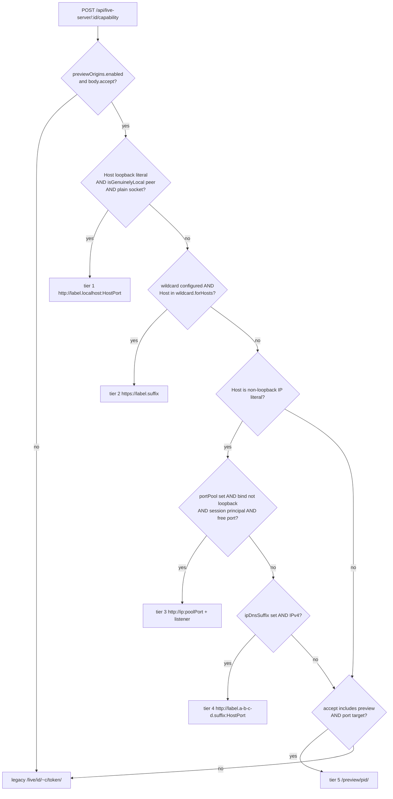
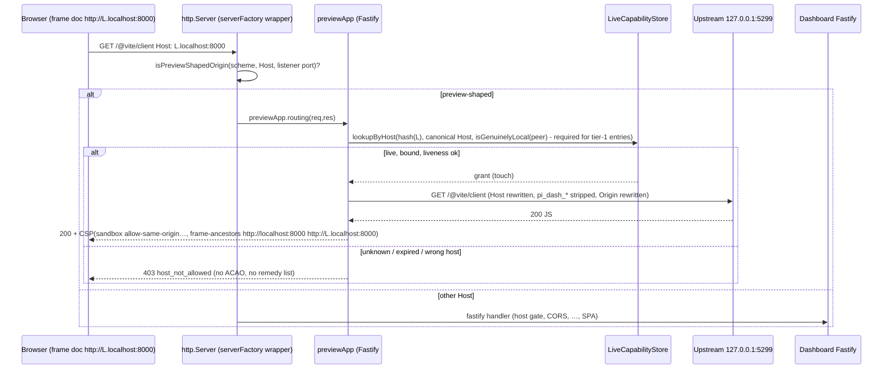

# Design — serve-live-previews-on-capability-origin

## Context

The live viewer frames every preview under `/live/<id>/~c/<token>/` on the dashboard origin
(`packages/server/src/live-server/live-server-proxy.ts:314-315`). The frame is opaque: no
`allow-same-origin` (`packages/client/src/lib/live-preview/preview-policy.ts:26-31`), and the
response CSP carries the same `sandbox` directive (`packages/server/src/live-server/live-csp.ts:41-46`).
Dev servers break in two ways. Root-absolute URLs (`/@vite/client`) leave the prefix. Module
scripts sent from an opaque document carry `Origin: null`, and `null` never gets an ACAO
(`packages/server/src/auth/cors-origin.ts:169`).

Facts that constrain the design:
- **No routing by Host.** Host is used only for admission (`packages/server/src/auth/host-admission.ts:100-119`).
  Admission matches exact names; a wildcard is never admitted (`host-admission.ts:31-35`).
- **Same-origin trust is coupled to admission.** `corsOpts()` shares the host-admission fields
  (`packages/server/src/server.ts:2235-2255`). Any admitted Host vouches for `Origin == Host`
  (`cors-origin.ts:281`, `:303`). So admitting a preview host on the dashboard routes would hand
  the preview dashboard authority.
- **Trusted networks admit any port.** The trusted-network CORS branch matches the Origin's IP
  with any port (`cors-origin.ts:207-209`). A pool-port preview origin would therefore be admitted.
- **Cookies.** Every dashboard cookie is HttpOnly and host-only, and the names are unique:
  `pi_dash_token` `/`, `pi_dash_local` `/`, `pi_dash_device` `/api/`, `pi_dash_oauth_state` `/auth/`
  (`packages/server/src/auth/auth.ts:261`, `auth/local-proof.ts:20`, `auth/bearer-auth.ts:45,164-170`,
  `auth/auth-plugin.ts:135`). `pi_dash_device` has had `Path=/api/` since its first commit (27d6391e7).
  Cookies ignore ports.
- **No `trustProxy`.** Fastify runs without it on purpose (`packages/server/src/auth/auth-plugin.ts:410-416`).
  The socket peer and the raw `Host` header are the only inputs a client cannot inflate through
  forwarding headers.
- **Capabilities.** A capability is path-shaped. It is minted at
  `packages/server/src/routes/live-server-routes.ts:296-330`, validated with liveness, `localBound`
  and touch-on-use (`packages/server/src/live-server/live-capability.ts:227-251`), and redacted by a
  path-only regex (`packages/server/src/live-server/capability-redact.ts:10`).

User decisions D-U1..D-U7 and the brief's tier order are final. D-U5 supersedes "per (target, principal)" in D-U3 (one pid per target with a holder set, D8); D-U6 makes tier 2 explicit-only (`forHosts`, D1); D-U7 drops the shared tier-5 pid when any holder's device is revoked or its session ends (D8, T3). Two lines in the proposal predate
them and are superseded here:
- the proposal limits tier 3 to "only when every cookie is HttpOnly" and adds a `__Host-` rename
  (proposal "Sandbox per tier", "Same-site caveat"). D-U1/D-U2 replace both with the
  duplicate-cookie refusal; there is no rename.
- the proposal lists tier-5 credential "candidates". D-U3 replaces them: the path label is the credential.

## Goals / Non-Goals

**Goals**
- Dev servers (Vite, Next, the mock site) render and hot-reload in the pane, both locally and remotely.
- Each preview gets its own origin wherever the network allows one. Where it cannot, it gets a
  stable base path (tier 5).
- The dashboard's authority surface does not grow. No preview origin can reach a dashboard
  route, trusted CORS, the same-origin-by-Host rule, or WS scopes.
- Old clients and old servers keep working (negotiated). One config flag rolls back to today's behaviour.

**Non-Goals**
- Renaming cookies to `__Host-` (D-U2).
- TLS for preview origins on tiers 1, 3 and 4 (plain HTTP).
- DNS, certificates or reverse proxy for tier 2. The operator provides them.
- Changing `serve_mockup` (`mockup-loop-preview-and-capture`).
- Making opaque tier-5 documents get storage or origin-checked `postMessage`.

## Decisions

### D1 — Tier selection at mint (raw Host + socket peer), negotiated

The mint route (`routes/live-server-routes.ts:296-330`) picks the tier. Its inputs are
`request.headers.host` (raw), `request.raw.socket.remoteAddress` plus the absence of proxy-forwarding
headers (`isGenuinelyLocal`; no header can confer locality) and `liveServer.previewOrigins`. The first match wins.
All tier predicates and `originHost`/`ancestors` comparisons use `parseHostname` (lower-case, one trailing
dot stripped, brackets stripped) plus default-port elision; IP literals are compared after a `net.isIP`/`URL`
round-trip; the `forHosts` match is exact after this normalisation (case-insensitive). The same canonical form (lower-case, one trailing dot stripped) is applied to config suffixes (D12, Q14), so D1 matching and the D12 overlap check agree.

Tier selection uses `isGenuinelyLocal` as a *reachability* predicate (can this browser resolve
`*.localhost` to the dashboard?), not a trust grant. Authorization stays with the principal, the
`localBound` rule and `requireLocalProof` exactly as today (parity with `live-capability.ts:445`).

| Tier | Predicate | Preview origin |
|---|---|---|
| 1 | `parseHostname(Host)` ∈ {`localhost`,`127.0.0.1`} (exact set; `::1` is dropped, Q7) **and** `isGenuinelyLocal(peer, headers)` (`auth/localhost-guard.ts:83-85`) **and** the socket is not TLS | `http://<label>.localhost:<port>`, where `<port>` is the Host's port, or the accepting socket's local port when Host carries none; omitted when it is the scheme default |
| 2 | `wildcard` configured **and** the Host's hostname ∈ `wildcard.forHosts` (exact, case-insensitive; no default, never derived from `publicBaseUrls` or `allowedHosts`, D-U6) **and**, when `wildcard.scheme === "http"`, the minting socket is not TLS and the mint's `ancestors` scheme is `http`; when the effective scheme is `https`, the mint's `ancestors` scheme is `https` (the label is the secret and the mint response carries it; `ancestors`, not socket TLS, because TLS-terminating proxies are supported and `trustProxy` stays off) | `<wildcard.scheme ?? https>://<label>.<wildcard.suffix>[:wildcard.port]` |
| 3 | `portPool` configured **and** Host is an IP literal (`net.isIP`) that is not loopback (`auth/loopback.ts:32-40`) **and** the bind host is not loopback **and** the Host IP equals the bind address (or, for a wildcard bind, a local interface address) **and** a pool port is free **and** neither the Host nor the mint's `ancestors` host is an IPv6 literal (Q7) **and** the minting principal is a login-session principal with a `Path=/` cookie (D5) **and** the minting socket is not TLS and the `ancestors` scheme is `http` | `http://<ip>:<poolPort>` (IPv4 only, Q7) |
| 4 | `ipDnsSuffix` configured **and** Host is an IPv4 literal that is not loopback **and** the mint's `ancestors` host is not an IPv6 literal (Q7) **and** the minting socket is not TLS and the `ancestors` scheme is `http` | `http://<label>.<a-b-c-d>.<suffix>:<Host port>` |
| 5 | otherwise, the client accepts `preview` **and** the target is a port target | `/preview/<pid>/` on the dashboard origin |
| legacy (static on tier 5) | otherwise and the target is a static target | `/live/<id>/~c/<token>/` |
| legacy | `previewOrigins.enabled === false`, or the client sent no `accept` | `/live/<id>/~c/<token>/` (unchanged) |

- **IPv6 literals skip tiers 1-4 (Q7).** The CSP host-source grammar has no IPv6 literal form
  (Chromium ignores `http://[::1]:*` as an invalid source), so `frame-ancestors <ancestors>` for an IPv6
  dashboard and `frame-src http://<IPv6>:*` cannot work, and every such frame would be blocked silently.
  When the Host, or the host of the mint's `ancestors`, is an IPv6 literal (bracketed or IPv4-mapped
  form included), tiers 1-4 are skipped: the mint falls to tier 5 (`frame-ancestors 'self'`) or legacy.
  The tier-1 set is therefore exactly `localhost` and `127.0.0.1`, and the dashboard `frame-src` never
  emits an IPv6 entry (D6). Recorded as T18.
- **Tier 1 uses the Host's port.** It follows the address the client actually used. With
  `ssh -L 9000:127.0.0.1:8000` the request arrives with a loopback peer, a loopback Host and no
  forwarding headers. Tier 1 yields `<label>.localhost:9000`. The remote browser resolves
  `*.localhost` to its own loopback, so the frame travels the same forward (the P14 interim works
  with any local port).
- **Not-TLS is a raw-socket signal.** "Socket is not TLS" means `request.raw.socket.encrypted` / the
  accepting listener, never `request.protocol` (`auth/auth-plugin.ts:410-416`). This stops
  `http://…sslip.io:<tlsPort>` and https-page→http-frame (mixed-content) frames: on an https dashboard
  tiers 3/4 (and tier 2 with `scheme:"http"`) fall through.
- **Peers that are not local.** A zrok-style tunnel connects from a loopback peer but sends its own
  Host, so it is not tier 1. A same-host reverse proxy that adds `X-Forwarded-For` makes the peer
  non-genuine, so tier 1 never matches (mint log `reason=forwarding-headers`, D13). Docker port-publishing makes the peer the bridge gateway, which is
  not loopback. A local Docker user therefore gets tier 5, or tier 3 by browsing the LAN IP.
  This is documented, not worked around.
- **Tiers 3 and 4 both configured: tier 3 wins** (P-default; it works offline). Tier 3 falls
  through to tier 4, and then to tier 5, when the pool is exhausted (D5).
- **Negotiation (P8).** The client sends `accept: ["origin","preview"]` in the mint body.
  - Malformed `accept` (not an array, empty, unknown or wrong-case tokens, a huge array) → legacy 200, never an error (Q22): unknown tokens are ignored, matching is case-sensitive and only the first 8 entries are read. An odd client must not lose its capability.
  - No `accept` → legacy shape. This covers old clients and `packages/client/src/lib/canvas/probe-loopback.ts:23-33`, whose
    same-origin `fetch` must stay on the path form.
  - `accept: ["origin"]` → tiers 1-4, otherwise legacy.
- **Static targets.** They use tiers 1-4 where those match (served at the origin root through the shared forwarder). On a tier-5 host they get the legacy `/live/<id>/~c/<token>/` path: a static file tree has no upstream that could be started with a `/preview/<pid>/` base, and tier-5 pids are per port target (D8). This is the specs' rule; it replaces the earlier line in D8 that served static targets under `/preview/`.
- **The tier is a mint-time fact.** It is never re-derived per request. The capability is bound
  to its origin (D2).
- Alternatives considered:
  - Trusting `X-Forwarded-Host` — rejected: it needs `trustProxy`, which is exactly what is
    refused at `auth-plugin.ts:410-416`.
  - A per-viewer manual tier picker — rejected: it is error-prone and leaks topology into the UI.



### D2 — Capability bound to its origin; label format; store changes

- **Label.** 128 random bits, base32 lowercase (`[a-z2-7]{26}`). It is DNS-safe, at most 63
  characters, and case-insensitive under Host normalisation.
  - For tiers 1, 2 and 4 the label **is** the secret (P1). The path carries no token, so
    root-absolute URLs resolve.
  - Tier 3 has no label. Its credential is the pool port bound to the exact `<ip>:<port>`, the minting session and a per-capability secret (D5).
  - The lookup index is keyed by `hash(label)` (resp. `hash(pid)`), the way tokens are today
    (`live-capability.ts:145`, `:187`). The entry keeps the plaintext label/pid and the full `origin`
    in memory only (needed to return the same origin on re-mint; `Entry.origin` already holds it).
    It is never persisted, never logged unredacted, and never returned to a principal that is not a
    holder/minter.
- **`Entry` (`live-capability.ts:79-97`) gains these fields:**
  - `tier: 1|2|3|4|"legacy"`
  - `originHost?: string` — canonical `host[:port]` of the preview origin; lookup key for tiers 1-4
  - `origin?: string` — full origin; CSP sources come from here, never from the request (D6)
  - `ancestors: string[]` — canonical `Origin` of the mint request; falls back to
    `scheme://Host` when `Origin` is absent. The fallback scheme comes from the raw socket only
    (`request.raw.socket.encrypted` → `https`, else `http`), never from `X-Forwarded-Proto`
    (`trustProxy` stays off, `auth/auth-plugin.ts:410-416`), so an https tier 2 mint without `Origin` falls
    through. Browsers always send `Origin` on POST, so this fails safe (Q13)
  - `poolPort?: number`
- **Binding.** A request on a preview origin is admitted only when its canonical Host equals
  `entry.originHost`. For tier 3 it must also arrive on the listener for `entry.poolPort`.
  - Tier-1 entries are admitted only when the request peer is genuinely local (`isGenuinelyLocal`),
    whatever the principal kind. A LAN peer forging `Host: <label>.localhost` gets 403.
  - A link minted locally therefore fails remotely, and the reverse also holds: the host would not
    resolve or would not match.
  - `localBound` (`live-capability.ts:246-248`) and the identity-floor rule of the live scope
    (`openspec/specs/live-server-preview/spec.md:233-245`) apply unchanged.
- **Re-mint and reuse (refines P1).** A mint for tiers 1-4 **returns the existing live entry**
  when all of the following hold:
  - it has the same `targetId`, `minterKey`, policy, `tier` and `ancestors` (no `viewerId`: `LiveFrame.tsx:110` mints a new id per mount, so a viewer-keyed reuse would never hit);
  - its absolute expiry is more than 20 minutes away, i.e. twice the 10-minute re-mint lead
    (`packages/client/src/components/editor-pane/live/useLiveCapability.ts:18`).

  Per-viewer allow-once sets carry across re-mints unchanged.

  **Tier 3 re-mint.** Every tier-3 mint, including a reuse hit, issues a **fresh** one-shot `k` for the
  entry and invalidates every earlier unconsumed `k` of that entry. A consumed or unknown `k` that
  arrives with a valid pool cookie and session redirects to the clean URL; without them it gets 404
  (D5, D7).

  Today every mint makes a fresh token (`live-capability.ts:171-216`). The reason for the change:
  a new label means a new origin, which wipes `localStorage` and forces a reload on every reopen
  (the viewer mints on every reopen, `openspec/specs/live-server-preview/spec.md:233-245`). With reuse, the origin changes only near the absolute expiry
  (12 h for port targets, 2 h for static ones).
- **Unchanged:**
  - touch (`live-capability.ts:272-289`) and idle/max (`live-capability.ts:29-33`) apply per entry;
  - revocation by target, device or session (`:318-337`) deletes the entry; for tier 3, deletion
    also releases the listener (D5).
- **Tier 5 uses a separate `PreviewPathStore`** (D8).
- **Redaction.** `capability-redact.ts:10` is extended. It is the ONE choke point for every log line:
  - a `[a-z2-7]{26}.` label anywhere in a logged value becomes `<redacted>.` (the canonical format, full
    redaction; no `k7q4…`-style prefixes). The match is **case-insensitive and position-independent**:
    `/\b[a-z2-7]{26}\./gi`. The gate logs print the raw `Origin`, so an attacker-cased
    `Origin: http://K7Q4…LOCALHOST.:8000` would otherwise leak a live label (Q6); a test pins it;
  - `/preview/<pid>` becomes `/preview/<redacted>`;
  - the tier-3 query value `([?&]k=)[^&#]*` becomes `$1<redacted>`.

  Pool ports are not redacted: they are not secret (T8).

  Mint and refusal logs carry `tier=`, `reason=` and a short hash `h=<first 8 hex of sha256(label|pid)>`,
  never the raw `origin`, `path` or `url`. The pool listener and `previewApp` log no `request.url`
  except through `redactCapability`. A test feeds a tier-3 mint and a refusal and asserts that no log
  line contains the label, the pid or `k`.

  Every log line that can carry a preview Host or Origin passes through `redactCapability`. That
  includes the existing `[csrf-gate] … origin=` line (`auth/mutation-origin-gate.ts:49-51`) and the
  `[ws-gate] rejected upgrade origin=` line (`server.ts:5018-5019`), which are routed through it.

### D3 — Dispatch by Host and listener before dashboard routing; previews never enter the dashboard app



- **Seam.** Fastify's documented `serverFactory` option (`node_modules/fastify/fastify.d.ts:144`)
  is added to `Fastify({...})` (`server.ts:2083-2090`).
  - The wrapper hands preview-shaped Hosts to `previewApp.routing(req, res)`
    (`node_modules/fastify/types/instance.d.ts:184`). Everything else goes to the dashboard handler.
  - The TLS listener dispatches by emitting on `fastify.server` (`server.ts:2104-2105`,
    `tls/tls-listener.ts:233`), so it inherits the split.
  - Upgrades: the first branch of `onUpgrade` (`server.ts:4895`), ahead of the host gate at
    `:4915-4926`, applies the same predicate and calls the preview upgrade handler.
- **Preview-shaped origins** are defined by ONE shared predicate, `isPreviewShapedOrigin(scheme, host, port)`.
  D1 tier selection, this dispatch and D4 (CORS and both gates) all call it, so they cannot disagree. It holds when:
  - (a) `host` is an IP literal **and** `port ∈` the *resolved* `portPool` (a valid pool only; an invalid pool disables tier 3 and leaves nothing preview-shaped here) using the scheme-default effective port (`http://192.168.16.242` is port 80 and `https://…` is 443, so neither is pool-shaped; `http://[::ffff:192.168.16.242]:8101` is the IPv4 pool origin, Q5) → preview-shaped. This test is **evaluated
    first and is never subject to the static exemption**. `classifyAdmittedHostname` returns
    `"ip-address"` for every IP literal and ignores the port (`host-admission.ts:108`), so an exemption
    applied before this test would exempt every tier-3 origin `http://<ip>:<poolPort>`. CORS would then
    reach the trusted-network branch, which matches the IP only (`cors-origin.ts:207-209`);
  - otherwise (b) the leftmost label matches `^[a-z2-7]{26}$` **and** the rest is exactly `localhost`,
    `<wildcard.suffix>` or `<a-b-c-d>.<ipDnsSuffix>` **and** the hostname is NOT admitted by any static
    row of `classifyAdmittedHostname` (`host-admission.ts:100-119`: loopback, ip-address, bind-address,
    local (`*.local`, `isLocalName`, `:110`), public-base-url, cors-origin, live-tunnel, tls-listener,
    allowed-host). The static exemption applies to **non-IP names only**.
  - **Input normalisation (all callers).** `parseHostname` (lower-case, one trailing dot stripped,
    brackets stripped) plus default-port elision. An IPv4-mapped IPv6 literal (`[::ffff:a.b.c.d]`) is
    compared as its IPv4. One shared helper serves all three callers.
  - `.localhost` label-shaped hosts are preview-shaped whether or not tier 1 or `enabled` is on
    (`previewApp` then answers 403), so `enabled:false` and report mode never route a label host to
    the dashboard app. The same holds for every *valid configured* wildcard suffix, `ipDnsSuffix` label host and IP+pool-port host: they stay preview-shaped regardless of `enabled` (Q11).
  - Non-label `name.localhost` / `x.sslip.io` dashboards keep working: no 403 on their own
    mutations or `/ws`. The static exemption also keeps any current `name.localhost` operator setup
    (e.g. an `allowedHosts` entry) with the dashboard.
  - Explicit `cors.allowedOrigins` entries do NOT override the preview denial (P2); the static
    exemption covers the legitimate overlap (a label-shaped `cors.allowedOrigins` entry is rejected
    at validation, D12).
- **`previewApp` is a second, route-less Fastify instance.** It has:
  - one catch-all route;
  - `@fastify/reply-from`;
  - the CSP-report parsers;
  - its own `onRequest` exact-host admission.

  It never registers dashboard hooks, routes, plugins or the SPA. **On a preview origin every
  path belongs to the upstream**: `/api/x` is the previewed app's `/api/x`. Reserved interceptions,
  the only exceptions: `/__pi/csp-report` on tiers 1-4 (D6), and on a pool listener (tier 3) the
  one-shot `?k=` / `to=` query on `/` (D5, D7), which is consumed and never forwarded. The dashboard's
  `/api`, `/ws`, `/auth`, SPA and plugin routes are unreachable by construction.
  - This refines P2's "404 /api": a 404 would break previewed apps that have their own `/api`.
  - An unknown, expired or mis-bound preview host gets 403 `host_not_allowed`. The HTML or JSON
    names no remedy keys, because a capability host is not something to add to `allowedHosts`.
  - `previewApp` refusals never call `recordRefusal` (`auth/host-gate.ts:134-147`) and never enter the
    `/api/host-gate` `recent` ring; they log only the redacted `[live-preview] refuse` line (D13).
    Random `*.localhost` probes therefore cannot flush the ring. Operators debug preview 403s from the
    redacted log (tier + reason), not from `/api/host-gate`.
- **Admission is dynamic and exact (host-admission delta).** Only `originHost` values of live
  entries are admitted, never a pattern. That keeps the rule that a wildcard never admits a host
  (`host-admission.ts:31-35`).
  - `GET /api/host-gate` gains one pattern row, `live preview capability hosts / live-preview`,
    present whenever previews are enabled (even with zero live entries) and absent when `enabled:false` (Q23).
    It never enumerates labels, since `admitted` is readable by every `GET /api/config` caller
    (`openspec/specs/host-admission/spec.md:118-120`).
  - The dashboard host gate (`server.ts:2388`) never sees these hosts.
- **Forwarding** reuses `forwardPort` / `forwardStatic` (`live-server-proxy.ts:225-292`) with
  prefix `""`. Those functions are extracted from `registerLiveServerProxy` into a shared forwarder.
  - `stripDashboardCredentials` (`:60-82`) and `filterSetCookie` (`:41-46`) are unchanged.
  - The shared forwarder sets `Referrer-Policy: no-referrer` whenever a grant exists (tiers 1-5),
    replacing any upstream value (on tiers 1-4 the origin itself is the secret, so even
    `strict-origin` would leak it). The legacy path keeps today's "only when unset" rule. The
    `capabilityPrefix &&` guard at `:281` is changed accordingly.
  - **New (tiers 1-4):** the forwarder refuses (502) or rewrites to the preview origin any upstream
    absolute `Location` whose origin is a dashboard-admitted origin (see D7, frame navigation). The same
    rule applies to the upstream `Refresh` header: it is dropped when its target is a dashboard-admitted
    origin. `Location` is the only redirect header the forwarder rewrites today (`live-server-proxy.ts:287`).
    JS and `<meta refresh>` navigation are NOT contained by header rewriting; D6 (a) and (b) contain them.
  - `rewriteLocation` with `prefix ""` keeps root-relative redirects as they are (`:91-104`).
  - **New:** an `Origin` equal to `entry.origin` is rewritten to `http://127.0.0.1:<port>` before
    forwarding. Host is already rewritten (`:262-273`), so upstream checks that compare Origin
    with Host (Vite HMR, Next server actions) see a consistent pair. Any other Origin passes through.
- **WebSocket.** The core of `handleLiveServerUpgrade` (`live-server-proxy.ts:349-415`) is split
  out of its `/live/` regex (`:359`).
  - A preview upgrade is admitted when its Origin is absent or equals `entry.origin`; otherwise
    it gets 403.
  - It never reaches `isWsOriginTrusted` (`cors-origin.ts:317-326`) or any dashboard scope.
- Alternatives considered:
  - Fastify `rewriteUrl` onto an internal prefix — rejected: every dashboard hook would still run
    and must then be taught to skip it.
  - An `onRequest` hook on the dashboard — rejected: routing has already matched dashboard routes,
    and the hook order (`server.ts:2384-2452`) would need carve-outs in five gates.
  - A separate port for every tier — rejected: it breaks tiers 1, 2 and 4 behind one forwarded port.

### D4 — Preview origins never gain dashboard trust

- **CORS check.** `classifyCorsOrigin` (`cors-origin.ts:160-219`) gets a new first branch after
  the `null` check: `isPreviewOrigin(origin)` → deny, `kind: "preview"`. It is a pattern match on
  configuration, not on live entries, so expired origins stay denied. It delegates to the same
  `isPreviewShapedOrigin(scheme, host, port)` predicate as dispatch (D3), including its input
  normalisation, so the two can never disagree. It matches:
  - `<label>.localhost` hosts (leftmost label `^[a-z2-7]{26}$`), whether or not tier 1 or `enabled` is on;
  - `<label>.<wildcard.suffix>`;
  - `<label>.<a-b-c-d>.<ipDnsSuffix>`;
  - any IP-literal origin whose port lies in `portPool` (always preview-shaped, never exempted);

  except a **non-IP** hostname that a static admission row admits (D3 exemption). Non-label
  `name.localhost` or `x.sslip.io` dashboards are therefore not denied. An explicit
  `cors.allowedOrigins` entry does not override the denial (P2).

  **Branch order: `null` → preview-deny → loopback (`:177`) → trusted-network (`:207-209`) → configured.**
  The preview-deny branch runs before the others.
  Because `isOriginAdmitted` (`:292-305`) and `isWsOriginTrusted` (`:317-326`) both derive from
  this decision, the mutation gate (`auth/mutation-origin-gate.ts:47-53`) and the WS gate
  (`server.ts:5017`) refuse preview origins as well.
- **Same-origin-by-Host.** It cannot vouch for a preview Host: those Hosts never reach the
  dashboard app (D3).
- Preview hosts are never added to `corsOpts()` (`server.ts:2235-2255`), `allowedHosts`,
  `publicBaseUrls` or the trusted networks.
- **Tests.**
  - A unit test where `trustedNetworks ∋ ip` and `Origin = http://ip:poolPort` is denied in CORS, the
    mutation gate and the WS gate.
  - Adversarial Host forms: `LABEL.LOCALHOST`, `label.localhost.:8000` and `label.localhost:80` vs `:8000`,
    plus an IPv6 / default-port pool origin.
- Spec deltas:
  - `cross-site-request-gate`: ADDED "Preview origins are never trusted origins".
  - `host-admission`: ADDED "Live preview capability hosts are admitted dynamically and exactly".

### D5 — Port-pool listeners (tier 3)

- **Config.** `liveServer.previewOrigins.portPool: "8100-8199"`. The parser enforces:
  - strict grammar `a-b` (Q15): integers, no whitespace or leading zeros, `1024 ≤ a ≤ b ≤ 65535`, at most 100 ports; `8100-8100` is allowed and a bare `8100` is rejected (P4 cap);
  - every port ≥ 1024;
  - the range must not contain `port`, `piPort` or the TLS/model-proxy ports; the TLS and model-proxy ports are reserved only when those listeners are configured (an unbound listener cannot collide), and the log names the colliding key (Q15);
  - an invalid value (malformed, inverted, more than 100 ports, any port < 1024, or one containing the
    dashboard port, `piPort`, the TLS listener port or the model-proxy port) disables tier 3 and logs
    once. The suffix-overlap rules of D12 are validated in the same pass.
- **Allocation at mint.**
  - The lowest free port is bound with `http.createServer`, then `listen({ port, host: config.host })`.
    This is the same bind host as the dashboard (`server.ts:446`, `:5268`).
  - Its request and upgrade events go straight to `previewApp` (the dispatch pattern of
    `tls/tls-listener.ts:233-234`).
  - Each pool listener has a fixed binding: it serves only `entry.originHost` and refuses any
    other Host with 403.
  - **Extra credential (D-U1).** Pool ports are guessable (a small range on a known IP), and
    cookies are host-keyed and port-blind, so the browser sends the dashboard session cookie AND every
    pool cookie to every pool port, from any same-site page, including pages served by other pool
    ports on the same IP. A cookie name cannot scope a cookie to a port. Three checks are therefore
    all required on every pool-port HTTP request and upgrade:
    1. The *minting* principal's credential: `sessionKeyOf(pi_dash_token) === entry.principal.sessionKey`
       (`live-capability.ts:148`). Any other valid session is refused with 404.
    2. A per-capability secret. The mint response carries a one-shot `?k=<secret>` (D7); the first
       navigation presents it, the listener answers with a host-only, `HttpOnly`, `SameSite=Strict`,
       `Path=/` cookie named **`pi_dash_pool_<port>`** and redirects to the clean URL (or to `to`, D7). `to` must match `^/(?!/)`, contain no `\` or control character and be ≤ 2048 characters, else the redirect goes to `/`; `k` is consumed either way (Q32).
       The port in the name only avoids collisions between pool cookies; it does not scope the cookie.
    3. An **Origin check**: when `Origin` is present it must equal `entry.origin`, otherwise 404
       (upgrades 403). `Sec-Fetch-Site` is not relied on: it is absent on http IP origins.

    A request missing check 1 or 2 gets 404. `stripDashboardCredentials`
    (`live-server-proxy.ts:32-38`) strips by the `pi_dash_` prefix, so every `pi_dash_pool_*` cookie is
    removed before forwarding, and `filterSetCookie` already stops an upstream from planting one.
    - **Duplicates.** A `Cookie` header that repeats `pi_dash_token` or any `pi_dash_pool_*` name is
      treated as missing the credential (404, nothing forwarded). `previewApp` keeps its exemption from
      the dashboard 400 rule (D10 "Scope"); this rule makes `sessionKeyOf` deterministic.
    - **Residual (T12).** No-cors GETs and navigations from other same-IP pages still reach the
      upstream. The browser keeps those responses opaque to the caller, and framing is blocked by
      `frame-ancestors` (D6).
  - **Who gets tier 3.** Only login-session principals with a `Path=/` cookie. `local` principals
    (the hairpin peer is never loopback on a LAN-IP listener), `network` principals
    (`live-capability.ts:50`) and device-cookie principals (`pi_dash_device` has `Path=/api/`, so
    the browser does not send it for non-API paths) fall through to tier 4 or 5 (D1).
  - **Host IP must be the bind address**, or, when bound to a wildcard address, a local interface
    address; otherwise tier 3 is skipped.
  - **Per-principal cap** (e.g. 8 listeners) so two principals cannot exhaust a 100-port pool.
  - A live pool listener answers 404 to an unauthenticated request. A live listener is
    distinguishable from a closed port (T8); liveness is not secret, content is.
  - `EADDRINUSE` skips to the next port.
- **Release.** The store gains one `onDelete(entry, reason)` callback, called by every deletion path
  (`validateGrant` `:239-243`, `findByTokenId` `:259`, revoke `:322-338`, eviction `:207-213`, sweep `:351-355`). It closes the
  listener and destroys open sockets. `sweep` is private today (`live-capability.ts:351`) and runs
  only from `mint` (`:177`); it stays private and the **store owns a 60 s `unref()`'d interval**, cleared on
  dashboard close (Q12), so idle entries release their ports without waiting for a mint. A pool port is
  released ≤ expiry + 60 s, and tests drive the interval with fake timers.
  - **Listener error or close outside the store's control (Q36):** the entry is deleted through `onDelete`
    (reason `listener-error`) and the next mint reallocates. No rebind, so there is no zombie entry
    holding a listener-cap slot.
  - **Live config change (Q8):** an entry whose `originHost` no longer matches its tier's current
    resolved config has its pool listener closed with the entry (reason `config-changed`, D12).
  - `onClose` of the dashboard closes all pool listeners.
  - Pool ports are added to `ownPorts` (`live-server/live-server-manager.ts:70-86`,
    `server.ts:1481`) so no target can point at them, and to `forbiddenPorts`
    (`packages/mockup-loop/src/mock-site-serve.ts:26-38`).
- **Exhaustion.** Tier 3 is skipped. The mint falls to tier 4 or 5 and logs
  `[live-preview] pool exhausted`. A mint never fails because the pool is full.
- **Docker.** `docker/compose.yml:22-28` maps the dashboard and gateway ports only. Tier 3 needs an opt-in
  range mapping (`"${PREVIEW_POOL:-8100-8199}:…"`) documented in `docker/README.md`. Without the
  mapping, operators leave tier 3 off.
- Alternative considered: one listener per target rather than per capability — rejected: two
  principals would share one origin, and its storage.

### D6 — CSP per tier

- **Capability responses (`live-csp.ts`).** `LiveCspInput` (`:16-26`) gains `origin?` and
  `ancestors?`.
  - **Tiers 1-4:**
    - The `sandbox` directive (`:41-46`) adds `allow-same-origin` whenever scripts are on (P3).
      Without it the header would force an opaque origin whatever the frame attribute says.
    - `frame-ancestors <entry.ancestors…> <entry.origin>`: the exact minting dashboard origins
      (never an IPv6 literal: those mints skip tiers 1-4, D1/Q7), validated
      by a new `SAFE_ANCESTOR` (`^https?://` + `SAFE_HOST`; `SAFE_ORIGIN` (`:34`) is https-only), **plus
      the capability origin itself**. CSP checks every ancestor, and a same-origin nested pane (the mock
      site's panes, the motivating use case) has the preview origin as its parent. It is an explicit
      origin, never `'self'` and never a wildcard.
    - Restricted sources use `p = <entry.origin>/` and `pws = ws(s)://<originHost>/`. They come
      from the entry, never from the request Host or scheme (`schemeOf`, `live-server-proxy.ts:160`),
      because a TLS-terminating proxy on tier 2 would otherwise yield `http:`.
    - Restricted `frame-src 'none'` (`:82`) becomes `frame-src 'self'` (Q2), so the mock site's
      same-origin pane iframes load. On the capability origin `'self'` equals `<entry.origin>`; it is shorter and gives the test one exact string.
    - `report-uri /__pi/csp-report` is served at the preview origin's root.
    - `ownOriginsOf` (`live-csp-report.ts:40`) returns `entry.origin`.
  - **Tier 5:** the sandbox stays opaque and sources keep their path scope with
    `prefix = /preview/<pid>`. `frame-src` becomes `p` (path-scoped) instead of `'none'`.
    `frame-ancestors 'self'` stays, because the dashboard is the parent there. For a nested same-pid
    pane the parent is an opaque document, and whether `'self'` matches an opaque ancestor is
    browser-dependent (unverified). D14 therefore adds a required Chromium + Firefox E2E: a nested
    same-pid pane loads under tier 5. **Pre-declared fallback** if that E2E shows a block: tier-5
    responses omit `frame-ancestors` (the sandbox CSP still forces an opaque origin). Recorded as T11.
  - **Legacy:** byte-identical to today.
- **Dashboard page CSP (`packages/server/src/auth/csp.ts:72`).** `frame-src` becomes per-request. The
  canonical list (the `baseline-content-security-policy` delta is authoritative):
  - `'self' https:`;
  - `http://*.localhost:<HostPort>` while previews are enabled (never `:*`);
  - `http://*.<a-b-c-d>.<ipDnsSuffix>:<HostPort>` when tier 4 is configured and the Host is an IPv4 literal;
  - `http://<HostIP>:*` when tier 3 is configured, `portPool` is valid and the Host is an IPv4 literal (no other IP host-source is ever emitted);
  - `http://*.<wildcard.suffix>[:<port>]` only while `wildcard.scheme` is `http`.

  `<HostPort>` follows the tier-1 rule (Q30): the Host's port, else the accepting socket's port, elided when it is the scheme default; it applies to the localhost, ipDns and wildcard entries, so the frame source equals the minted origin (D1). Dashboard `frame-src` never emits IPv6 entries (Q7).

  The tier-3 entry refines P4. CSP has no port ranges, and 100 explicit sources bloat every
  response. A frame source on the dashboard's own IP adds no reach, because untrusted markup
  cannot create frames (`csp.ts:69-71`). Tier 2 is already covered by `https:`.
  Tier 2 with `wildcard.scheme: "http"` is possible only on an http dashboard (D1).
- **Dashboard documents framed by a preview (F8), defence in depth.** A preview that navigates its own
  frame lands on a dashboard document that runs dashboard code, not preview code. Three layers keep
  that harmless even for a dashboard route that renders untrusted HTML without a sandbox CSP:
  - **(a) Server sandbox.** A dashboard response requested with `Sec-Fetch-Dest` ∈ `iframe`, `frame`,
    `object`, `embed` or `fencedframe`, outside an explicit allowlist of dashboard-framed routes
    (`/live/`, `/preview/`, and the editor/raw routes that already set a sandbox CSP), gets
    `Content-Security-Policy: sandbox` **without** `allow-same-origin`.
  - **(b) Fetch-Metadata-independent client guard.** Fetch Metadata is sent only to potentially
    trustworthy URLs, so on the plain-http IP dashboards that tiers 3 and 4 (and tier 2 with
    `scheme:"http"`) exist for, (a) never fires.
    - The SPA bootstrap (first module `packages/client/src/main.tsx`, before render) stops and renders
      nothing when `window !== top` and either `window.frameElement?.hasAttribute("data-pi-live-frame")`
      (a dashboard-origin document directly inside a live frame) or `window.frameElement === null` (the
      parent is cross-origin, e.g. a tier 1-4 preview that nests `<iframe src="http://<dashIP>:8000/…">`;
      there `frameElement` is `null`, so the attribute test alone never fires at depth ≥ 2). This
      matches the intended `frame-ancestors 'self'` (`auth/csp.ts:75`), which is Report-Only in the
      default `report` mode (`csp.ts:89-91`). T13 records the cost.
    - `LiveFrame` sets `data-pi-live-frame` on its iframe (`LiveFrame.tsx:82-88`).
    - After each `load`, `LiveFrame` probes `frame.contentWindow.location.href`. If it is readable the
      frame is same-origin with the dashboard, so the viewer sets `src="about:blank"` and shows "preview
      navigated to the dashboard; blocked". The notice stays until Reload, which re-frames the capability
      and clears it; the guard fires again on a repeat and there is no auto re-mint (Q43).
  - **(c) Header rewriting** covers `Location` and `Refresh` only (D3). JS and `<meta refresh>`
    navigation are contained by (a) and (b), not by header rewriting. T13 records the residual.
- **`SKIP_PREFIXES`** (`csp.ts:50`) becomes `["/live/", "/preview/"]`. `previewApp` responses
  never pass the dashboard CSP hook at all.

### D7 — Client

- **Mint.** `mintLiveCapability` (`packages/client/src/lib/api/live-server-api.ts:111-125`) sends
  `accept: ["origin","preview"]`.
  - `CapabilityResult` (`:72-82`) gains `tier` and `origin?`.
  - The `CAPABILITY_PATH` regex check (`:85`, `:134`) is replaced by `parseCapabilityResponse`. It
    accepts exactly one of:
    - legacy: the current regex, `tier` absent or `"legacy"`;
    - tier 5: `path` matching `^/preview/[A-Za-z0-9_-]{22,}/$`;
    - tiers 1, 2 and 4: `path === "/"` (or the optional `base`, below) and an `origin` that parses as
      an http(s) URL with no userinfo/path/query **and equals neither `window.location.origin` nor the
      apiBase origin**;
    - tier 3: `path` matching `^/\?k=[A-Za-z0-9_-]{22,}$` (the one-shot secret, D5), with the same `origin` rules;
    - a tier-5 or legacy response that carries `origin` or `base` is rejected (fails closed), as is a tier 1-4 `base` that is not in pid shape: exactly one shape per response (Q37);
    - an optional `base` on tiers 1-4 matching the tier-5 path shape (see "Frame source").

    The origin check is a hard stop, so `allow-same-origin` can never be applied to a dashboard origin.
    A validator rejection is terminal (Q42): the viewer shows "preview response rejected" with a manual Retry and never auto-retries. The mint timeout stays as today (out of scope).
    - **Shared canonicaliser.** `canonicalOrigin` exists only in `packages/server/src/auth/cors-origin.ts:87`
      today (lower-case host, default-port elision, trailing dot). It moves to `packages/shared/src`, and
      the server re-exports it, so the client validator and the server share one implementation. A plain
      string compare is not enough.
    - The client resolves `apiBase` to an absolute origin first (`new URL(apiBase, location.href).origin`).
      An origin that does not canonicalise, or is `null` or opaque, rejects the mint (fail closed).
    - **Frame navigation.** `allow-same-origin` must survive a preview that navigates its own frame to
      the dashboard origin. Three layers keep that safe (D3, D6): the forwarder refuses or rewrites an
      absolute `Location` (and `Refresh`) that targets a dashboard-admitted origin; dashboard documents
      requested with a nested-document `Sec-Fetch-Dest` outside an explicit allowlist get
      `Content-Security-Policy: sandbox` without `allow-same-origin`; and the Fetch-Metadata-independent
      client guard (D6 (b)) blanks a frame that turns out to be same-origin with the dashboard.
- **Frame source.** `frameSrc` (`preview-policy.ts:96-98`) takes the capability. With `deep` the
  deep link, and `base` the optional mint-response base (default `/`):
  - tiers 1, 2, 4: `origin + base + deep`;
  - tier 3: `origin + "/?k=<k>&to=" + encodeURIComponent(base + deep)`. The pool listener validates `to` as
    a same-origin root-relative path (`^/(?!/)`, no `\` or control character, ≤ 2048 characters; else `/`, D5/Q32) and redirects there after setting the
    cookie (D5);
  - tier 5 and legacy: `apiBase + path + deep`.

  **`base` (G9).** When the target's port has an adopted reservation or a live tier-5 pid (D9), tier 1-4
  mint responses carry `base: "/preview/<pid>/"` and add the minter as a revocation-only holder of
  that pid (D8), because a site started under a base refuses
  `origin + "/"` (`mockup-site-environment` spec: the entry is not served at the root). The parser
  accepts `base` only in the tier-5 path shape.

  `LiveFrame.tsx:185-191` passes the capability.
- **Sandbox.** `sandboxFor(policy, tier)` (`preview-policy.ts:26-31`):
  - tiers 1-4 with scripts on: `allow-scripts allow-same-origin allow-forms allow-popups allow-downloads`
    (open), or `allow-scripts allow-same-origin allow-forms` (restricted);
  - scripts off: `""`;
  - tier 5 and legacy: unchanged (P5).

  The `LiveFrame.tsx:85-87` comment and the tests that assert "no `allow-same-origin`" are updated
  per tier (`LiveServerViewer.test.tsx:51-73`, `LiveServerViewer.static.test.tsx:204-208`,
  `preview-policy.test.ts:9`, `HtmlPreview.test.tsx:44`, `tests/e2e/canvas-static-mockup.spec.ts:56-62`).
- **Open ↗.** `useOpenExternal` (`useOpenExternal.ts:21-34`) opens the URL the frame uses (P9).
  `classifyUrl` (`:28`) must classify an origin from the mint response as allowed. Local operators
  on user-added targets keep the direct `localhost:<port>` link (`LiveFrame.tsx:134-135`).
- **Root-absolute hint** (`LiveFrame.tsx:172`, `LiveFrameParts.tsx:117-130`). It shows only for
  tier 5 and legacy (P10). On tier 5, a port target always shows a base strip:
  - the `/preview/<pid>/` path, with a copy button;
  - "restart your server with this base" (`vite --base`, Next `basePath`).
  - Copy failure or no `navigator.clipboard` (plain-http tier 5): announce "Copy failed — select the path" via `aria-live="polite"` and keep the path as selectable text; no `execCommand` fallback (Q44).

  The static-target hint keeps its current text.
- **Cookie-reset banner (Q10).** On any `duplicate_dashboard_cookie` response (D10) the client blanks all open tier-2/3 live frames and shows "a preview reset dashboard cookies; reopen it to continue". It does not reopen them automatically, which ends the re-toss loop without manual cookie surgery.
- `packages/client/src/lib/canvas/probe-loopback.ts:23-33` keeps minting without `accept` (legacy path; same-origin `fetch`).
- **Parser tests.** Tier 3 accepts only `/?k=<secret>`; tiers 1, 2, 4 reject it. Tier 3 rejects `/`.
  A tier 1-4 response with `base` frames `origin + base + deep`; a malformed `base` is rejected. An origin
  that is unparseable, `null`, opaque, or equal to the dashboard origin after canonicalisation rejects
  the mint.

### D8 — Tier 5: stable `/preview/<pid>/`

- **One *current* pid per target (refines D-U3).** A pid is 128 bits of randomness, base64url, 22
  characters (`TOKEN_SHAPE`, `live-capability.ts:41`). `PreviewPathStore` keeps a lookup index
  keyed by `hash(pid)`; the entry holds the plaintext pid in memory only (never persisted, never
  logged unredacted, never returned to a non-holder), so a re-mint can return the same pid:
  `{ targetId|port, holders (below), policy, mintedAt, lastUsedAt, idleMs, maxMs }`.
  - **Why per target and not per (target, principal):** the upstream runs under one base. If two
    viewers, or a reservation made by the bridge (D9) plus a viewer, held different pids, all but
    one would be broken.
  - The binding to each principal survives as the **holder set** (D-U5: every principal that minted
    or reserved it). Holders are of two kinds, `holders: Map<principalKey,{kind, principal, localBound?, mintExposure?, policy?}>`:
    - **mint holder**: a tier-5 mint by principal P adds or refreshes P as a mint holder and returns the
      existing pid ("re-mint returns the same pid"). Mint holders admit requests and contribute policy;
    - **revocation-only holder**: every other principal the server tells the pid to, namely the
      reserver of an adopted reservation (`reservedBy`, D9), a reserve call answered with the live pid
      (D9), and a tier 1-4 minter whose response carries `base` (D7). It admits no request and
      contributes no policy; it exists so D-U7 covers everyone who knows the pid. A later tier-5 mint by
      the same principal upgrades it to a mint holder;
    - **Named exception to D-U5 stability (D-U7, user decision UD1 = A).** Revoking a holder's device
      or ending a holder's session, for either holder kind (`revokeByDevice` / `revokeBySessionKey` paths,
      `live-capability.ts:330-338`; for a bridge reserver, its `ticketDeviceId` revoked or its
      registered session unregistering) **drops the shared pid for every holder**, because the revoked
      party knows it. This is parity with `/live/` tokens. Re-minting then issues a **new** pid, and
      the upstream must restart with the new base: the viewer shows "restart with the new base" (T3);
    - removal of the target, or expiry, also drops the pid (the pid is otherwise stable while the
      target is registered and the capability alive).
- **Request validation.** A request is valid while all of these hold:
  - the target is live;
  - the pid is within its idle and maximum lifetime (port targets: 30 min / 12 h,
    `live-capability.ts:29-30`); the absolute expiry is fixed at the first mint, and a mint when
    `absoluteExpiry - now ≤ 20 min` (the tier 1-4 window, twice the 10-minute viewer lead
    `REMINT_LEAD_MS`, so there is no race with the viewer's re-mint), or after it, issues a new pid. The superseded pid keeps serving until its own absolute expiry and is never returned by a mint again; the mint that issued the new pid answers with the "restart with the new base" message (Q9), because the running site was started under the old base;
  - at least one mint holder admits the request. A `localBound` holder admits only genuinely local
    requests (`live-capability.ts:246-248`).

  Policy is stored on the pid (D-U3: mutable without changing the pid). Each mint holder's mint records
  *that holder's* requested policy; **the enforced policy is the most restrictive across live
  mint holders** (scripts off beats on; restricted egress beats open; exposure narrowest). A holder can
  only change its own requested policy; the pid never changes. The per-viewer frame `sandbox`
  attribute still intersects with it.
- **Routing.** Dashboard routes are `/preview/:pid/*` and `/preview/:pid`, next to `/live/`
  (`live-server-proxy.ts:314-315`).
  - Any request (browser-originated or not) without a valid pid gets 404 (the `/live/` rule at
    `:298`, applied to every caller).
  - **Raw-path validation (parity with legacy).** The pid is matched segment by segment on the raw
    pathname. A dot-segment, or a percent-encoded `/`, `~`, `.` or `\` (`%2F %7E %2E %5C`, hex case-insensitive) anywhere in the path, and a raw `\` or `%00`, is refused with
    404 and never forwarded (so `/preview/<pid>/..%2F..%2Fx` is refused). Everything else is forwarded raw (`//`, `%252e`): nothing is decoded, so double encoding is inert (Q31).
  - `/preview/` is added to:
    - the guard jurisdiction (`auth/localhost-guard.ts:532`);
    - the route tier gate (`auth/route-tier-gate.ts:126`);
    - road classification (`identity/http-road-classification.ts:172`);
    - the WS scope `live` in `routeScopeForUrl` (`auth/ws-ticket.ts:120`).
- **Forwarding.** The full `/preview/<pid>/…` path goes upstream with no strip (P7), because the
  upstream was started with that base.
  - `rewriteLocation` (`live-server-proxy.ts:91-104`) leaves a `Location` already inside the
    prefix unchanged instead of prefixing it again.
  - The pid is still a secret, so the shared forwarder's `Referrer-Policy: no-referrer`
    (replacing any upstream value, D3) and log redaction (D2) apply.
  - Static targets do not use tier 5 (D1): a static-target mint on a tier-5 host returns the legacy `/live/<id>/~c/<token>/` path.
- **CORS (P6).** Only on responses to a **valid** `/preview/<pid>/` request carrying
  `Origin: null`, the forwarder adds `Access-Control-Allow-Origin: null` and `Vary: Origin`, with
  **no** `Access-Control-Allow-Credentials`.
  - `@fastify/cors` (`server.ts:2407-2420`, `credentials: true`) denies `null` and so sends no
    headers. Ours are added in `rewriteHeaders`.
  - A preflight (`OPTIONS` + `Origin: null` + a valid pid) is answered 204 by a `previewPreflight`
    `onRequest` hook registered before `@fastify/cors`, with the same no-credentials rule.
  - `/api`, `/ws` and `/auth` are unchanged.
  - Spec deltas: `server-cors` ":85-88 null origin still refused" and live-server-preview `:118`
    are scoped to dashboard routes.
- **WS.** An upgrade under `/preview/<pid>/` is a `live` scope upgrade. The carve-out
  `scope==="live" && origin==="null"` → capability valid (`cors-origin.ts:324`) takes the pid's
  validity. The full path is forwarded.
- **Bounds.** Each principal can hold at most 32 pids and the server at most 256 (cf. 16/32 per
  session, spec `live-server-preview/spec.md:519-527`). At either cap a new pid is **refused** and the
  mint falls back to legacy `/live/`; live pids are never evicted (a pid is never unheld).
  - A pid counts against the principal that **created or adopted** it only.
  - Joining an existing live pid is always allowed at the cap, because it creates no pid.
  - Adoption of a reservation counts against the adopter (Q33). At the 32 or 256 cap adoption is refused and the mint falls back to legacy; the reservation stays for its normal lifetime.

### D9 — Reserve-path API (REST + bridge)

- **REST.** `POST /api/live-server/preview-path` `{port}|{targetId}` → `{path, expiresAt, tier5Viewers: true}`,
  or `{path: null, tier5Viewers: false}` with **no reservation created** when no tier-5 viewer exists.
  The server decides in the request handler (see "`tier5Viewers`"). `DELETE /api/live-server/preview-path/:pid`
  releases an unbound reservation (reserver only).
  - It uses `networkGuard` (`routes/route-deps.ts:13`) and requires the `control` tier, like
    `portMintRefused` (`live-server-routes.ts:306`).
  - SSRF validation is the port-target gate: loopback only, never `ownPorts`
    (`live-server-manager.ts:85-86`): never an `ownPorts` port (pool ports are in `ownPorts`, D5). It
    is re-run at adoption (TOCTOU).
  - When the port's target already has a live pid, the call returns that pid as `path`, creates no
    reservation and adds the caller as a revocation-only holder (D8). A restart of a site on the same
    port therefore keeps its base, and precedence (1) below never discards a base a site was started with.
  - Bounds: see "Bounds" below. At a cap REST answers `429 {success:false, error:"reservation_limit"}`.
- **Bridge.**
  - A new `preview_path_request {requestId, sessionId, port}` / `preview_path_result` pair follows
    the `path_grant_request` / `path_grant_result` pattern (`packages/shared/src/protocol.ts:836-846`).
    The bridge's authenticated socket is the principal. The server applies the same `control`
    requirement as REST: a connection whose principal does not hold `control` (a `device-ticket`
    admission takes the tier of `ticketDeviceId`, `pi/bridge-channel.ts:11-28`) gets
    `{path: null, tier5Viewers: false, error: "insufficient_scope"}` and nothing is reserved or disclosed.
    Otherwise the result is `{path: null, tier5Viewers: false}`
    when the server found no tier-5 viewer (no reservation), `{path: null, tier5Viewers: true, error: "reservation_limit"}`
    at a bound, else `{path, expiresAt, tier5Viewers: true}`. On an `error` the bridge rejects the probe's
    `pending` with that reason, so the tool reports "base reservation unavailable" and why.
    A `preview_path_release {requestId}` message releases a reservation whose probe was aborted (below).
    The bridge forwards the server's answer; it decides nothing.
  - **In-process seam (host-agnostic).** `pi.events.emit` is synchronous fire-and-forget
    (`node_modules/@earendil-works/pi-coding-agent/dist/core/event-bus.js:5-7`: `emitter.emit` returns
    nothing; the async handler wrapper's promise is not visible to the emitter), so a probe cannot
    return an async result the way `model:resolve` appears to. Instead the listener sets
    `probe.pending = Promise<{base}|null>` synchronously, and the emitter awaits `probe.pending`
    with a **2 s timeout (canonical)**, treating timeout, a malformed answer or absence as "no
    reservation".
  - The mockup-loop package owns a neutral event name, `mock-site:base-reservation`, payload
    `{port, pending, signal}` (`signal` is an `AbortSignal`, host-agnostic) → `{base}`; the dashboard
    bridge answers it. The tool aborts `signal` on timeout or a malformed answer. No `dashboard:` event name and no
    `tier5Viewers` appear in the package source, and there is no import dependency on the bridge. A
    missing listener means "no reservation".
  - **Several listeners (Q41).** The first listener to set `pending` wins; later listeners must not overwrite it (`pending === undefined` check). A losing listener that already reserved releases its own reservation.
  - **Site fails to start after a reserved base (Q40).** The tool checks that the port is free *before* emitting the probe. On any later failure (spawn error, crash, `READY_TIMEOUT_MS`) it aborts `signal`, so the host releases the reservation (`preview_path_release` / `DELETE`) and no orphan pid remains.
  - **Late reservation after an abort.** A bridge whose reservation resolves after the abort sends
    `preview_path_release {requestId}` (REST callers use the `DELETE` route above). The server drops an
    unbound released reservation, so a site that started at root is never later adopted and proxied
    under `/preview/<pid>/`.
  - **The decision lives on the server.** The server returns a base only when a tier-5 viewer
    socket exists and then reserves; otherwise it returns `path: null` and reserves nothing, so no
    bound is wasted. The bridge only forwards the answer.
- **What a reservation is.** It is only `{pid, port, reservedBy, expiresAt}` (lifetime: see
  "Lifetime"). A reserved-but-unadopted pid is **indistinguishable from an unknown pid**: HTTP gets 404,
  upgrades get `HTTP/1.1 403`.
  - It has **no target, no proxying and no holders**, so `/preview/<pid>/` returns 404 until a
    port target for that port exists **and** a control-tier principal mints on tier 5 (D8). That
    mint adopts the reserved pid and becomes its first mint holder; `reservedBy` becomes a
    revocation-only holder (D8, D-U5 "minted or reserved").
  - The agent cannot use a reservation to make anything viewable or to exfiltrate. A reservation
    still discloses the pid to its reserver, which is why the reserver is a holder for D-U7.
  - An unbound reservation is dropped when its reserver's device is revoked or its session ends.
  - **Linkage.** A tier-5 mint for target `:id` resolves the target's loopback port and looks up a
    live reservation for that port. Once a site runs under a base (adopted reservation or live pid), a
    tier 1-4 mint for the same port returns `base: "/preview/<pid>/"` and the client frames the base (D7).
  - **Ownership.** Any principal that passes the tier-5 mint admission for the target (`control` tier,
    the target is a loopback port target, the SSRF re-check passes) adopts the newest live reservation
    for that port. `reservedBy` (the bridge's server-known session) is kept for bounds, logging and
    D-U7 revocation (as a revocation-only holder after adoption). Rationale: the reserver already knows
    the pid, and D-U5 already makes the target's pid shared by every holder. An observe-tier principal never adopts (its mint is refused before adoption).
    Adoption is single-flight.
  - **Precedence.** (1) An existing live pid for the target wins and the reservation is discarded
    (rare: the reserve call already returns a live pid instead of reserving, see "REST");
    (2) else the newest matching reservation is adopted and older ones for the same port are dropped;
    (3) else a new pid.
  - **Lifetime.** An unbound reservation expires 10 min after creation unless a port target for that
    port exists. While a target exists it lives up to 12 h absolute. A listening port alone does not
    extend it. The deadline is always measured from creation (+10 min with no target, +12 h while a target exists); on target removal it reverts to creation + 10 min and is dropped at the next sweep if already past (Q34).
  - **SSRF re-check.** The loopback/allowlist/`ownPorts` validation is re-run at adoption (TOCTOU). A reservation that fails it is dropped immediately and logged `pid dropped reason=adoption-refused`; the mint is refused as today, because that port can never adopt validly (Q35).
  - **Bounds.** Per principal, keyed on server-known identity: REST key = `principalKeyOf`
    (`live-server-routes.ts:341`); bridge key = the session registered on that authenticated bridge
    connection (a `sessionId` not registered on the requesting connection is refused). 8 unbound
    reservations per principal; globally 64. A new reservation by the same principal for the same port
    **replaces** that principal's previous unbound one for the port, so restarts do not accumulate.
    Beyond a cap: REST `429 {error:"reservation_limit"}`; bridge `{path: null, tier5Viewers: true,
    error: "reservation_limit"}` (the site starts at root and the tool says why). A reservation is never
    evicted, so another principal's reservation, whose site may already run under that base, is never
    lost (T16).
- **`tier5Viewers`.** It is decided server-side, in the request handler. It is true when any connected
  browser socket (a) announced preview support and (b) classifies to tier 5 under D1.
  - (a) A new client sends one `live_preview_accept {accept: ["origin","preview"]}` browser message after
    connect (the same token set it sends on mint, D7). Old clients never send it and are not counted, so a
    legacy-framing client never causes a site to start under a base it cannot render.
  - (b) The `/ws` upgrade already reads the Host at `server.ts:4915-4926`. The socket's tier is computed
    with D1's predicates from that Host, the peer, the socket's principal kind (the tier-3 login-session
    rule) and the live config (`ipDnsSuffix`, `portPool`), and recorded on the socket. Per-mint pool
    exhaustion is not anticipated (T17). This is how the extension learns that "the dashboard is
  reached through a tier-5 host".

### D10 — Duplicate `pi_dash_*` cookie refusal; tier-2 warning

- **Hook placement.** `refuseDuplicateDashboardCookies` is an `onRequest` hook registered right
  after the host gate (`server.ts:2388`), before the CORS observer and `@fastify/cors`, so a
  refusal carries no ACAO. The same check runs in `onUpgrade` right after the host gate
  (`server.ts:4926`).
- **What it refuses.** The raw `Cookie` header is parsed into name/value pairs. If any name with
  prefix `pi_dash_` (`live-server-proxy.ts:25`) appears more than once, the request gets **400**:
  - JSON `{success:false,error:"duplicate_dashboard_cookie",cookie:<name>}`;
  - or, for navigations, a static HTML page asking the user to clear the site's cookies;
  - upgrades get `HTTP/1.1 400` and the socket is destroyed.

  400 rather than 401, because a 401 would send the client into re-auth, which cannot clear a
  tossed cookie.
- **The refusal self-heals.** Cookie identity is (name, domain, exact path), so the 400 response (JSON
  and HTML variants) expires the duplicated name at the complete set:
  - every `/`-boundary prefix of the request path, both with and without a trailing slash, plus the
    exact request path (`GET /api/sessions/abc/events` → `/`, `/api`, `/api/`, `/api/sessions`,
    `/api/sessions/`, `/api/sessions/abc`, `/api/sessions/abc/`, `/api/sessions/abc/events`);
  - plus the canonical dashboard cookie paths `/`, `/api/`, `/auth/`;
  - each host-only, as `Set-Cookie: <name>=; Max-Age=0; Path=<p>`;
  - when tier 2 is configured, each also with `Domain=<d>` for every ancestor domain `d` of the request
    host that has ≥ 2 labels (browsers ignore public-suffix ones). `dash.a.example.com` with suffix
    `preview.a.example.com` expires at `a.example.com` and `example.com`.

  The same `Set-Cookie` lines go into the `HTTP/1.1 400` upgrade head. The body follows the host-gate
  `Accept` rule (first media type; `text/html` → HTML page, otherwise JSON;
  `openspec/specs/host-admission/spec.md:166-180`).
  The client's next request then carries at most the canonical cookie (the user re-authenticates if
  needed). The 400 page says "cookies were reset, reload". It applies uniformly, so the OAuth
  callback (`pi_dash_oauth_state`) and `POST /api/pair/challenge` recover on the next attempt. The
  log keeps the one-line-per-name-per-minute limit and `route=<scope>` (method + route pattern,
  never values).
- **Bounds on attacker-controlled input (Q28).** The JSON `cookie` field and the log echo truncate names to 128 characters. Self-heal covers prefixes of the first 16 path segments, with a hard cap of 64 `Set-Cookie` lines. The log limiter is an LRU over ≤ 256 names (`MAX_LOG_HOSTS` parity, `auth/host-gate.ts:95`).
- **`Domain=` variants (Q29).** Emitted only for a hostname Host (never an IP literal, which has no parent domain), only for ancestors with ≥ 2 labels, and only while tier 2 is active.
- **Residual: a preview that keeps re-tossing the cookie** locks the operator out with repeated 400s. The client handles it (D7, Q10): on any `duplicate_dashboard_cookie` response it blanks all open tier-2/3 frames and shows a banner; it never reopens them automatically.
- **Legitimate duplicates: none.** The four names are unique and each has one path (Context).
  A browser sends two cookies with the same name only when a second Path or Domain scope planted
  one. That is exactly the shadowing and fixation from a shared jar (tier-3 ports) or a parent
  `Domain=` (tier 2) that D-U1/D-U2 target.
- **Scope.** Requests on `previewApp` are exempt; their `pi_dash_*` cookies are stripped anyway
  (`live-server-proxy.ts:60-82`).
- **Log.** `[cookie-gate] refused duplicate cookie name=<n> count=<k> route=<redacted> peer=<ip>`,
  rate-limited like the host gate (one line per name per minute, `auth/host-gate.ts:93-96`).
- **Tier-2 parent-domain warning.** It is evaluated at boot **and** on every live config change of
  `previewOrigins` / `forHosts` (values are read live, D12), and only when tier 2 resolves *active* (valid suffix, non-empty `forHosts`, `enabled` true; no cookie-tossing surface exists otherwise, Q21). It fires when `wildcard.suffix` and any `forHosts` entry share
  their last two labels, or when one is a suffix of the other's parent. Example: dashboard
  `dash.example.com` with suffix `preview.example.com` shares the parent `example.com` → warning;
  dashboard `dash.example.com` with suffix `example-preview.net` → no warning:
  `[live-preview] wildcard suffix shares a parent domain with <host>: previews can set Domain= cookies…; use a separate registrable domain`.
  - The check is a heuristic with no public-suffix-list dependency. It over-warns on
    `co.uk`-style suffixes, which is accepted.
  - The docs repeat the warning, and also cover `ipDnsSuffix`: cross-preview `Domain=` cookie tossing
    between tier-4 previews when the suffix is not on the public-suffix list.

### D11 — Mock site under a base path; `serve_mock_site`

The 10 fixes below cover the breakages found under a Vite `base` (Vite 6.4.3 mounts `configureServer`
middlewares before `baseMiddleware`). `base` always ends with `/`.
1. **Plugin mount and HTML entry** (`packages/mockup-loop/src/mock-site/plugin.mjs:153`,
   `:159-167`). Read `config.base` in `configResolved` and match the plugin's paths under it.
   The plugin mounts before Vite's `baseMiddleware`, and requests reach it unstripped, so the
   prefixed form is sufficient: it matches only `<base>` / `<base>index.html` and `<base>__mock/*`.
   Vite's `baseMiddleware` handles `/` (302/404), consistent with mockup-site-environment "SHALL
   NOT serve its entry at the root".
2. `fsUrl` (`plugin.mjs:37`, `:165`) is fine once (1) is fixed: `transformIndexHtml` joins the base.
3. `Site.tsx:352` uses `import.meta.env.BASE_URL + "__mock/decisions"`.
4. **Readiness probes** use `${base}__mock/decisions`:
   - `mock-site-serve.ts:45-57`;
   - `tests/e2e/mock-site/global-setup.ts:20`;
   - `headless.mjs:56`.

   `headless.mjs:84`, `:105` and `DEFAULT_URL` (`:16`) join with the base without a double slash.
5. **`DEV_PATHS`** (`site/fixtures.ts:37`, `:59`, `:131`) match after stripping
   `import.meta.env.BASE_URL`. The base is stripped **only** to test DEV_PATHS passthrough; fixture matching sees the raw path (with base `/api/`, an app request to `/api/roles` is a fixture hit or app route, not a dev path), and the missing-fixture report strips the base only from paths under it (Q39).
6. `Site.tsx:303` relative `?pane=` needs the trailing-slash URL. The viewer always frames
   `…/preview/<pid>/` with the slash.
7. **The app's own `base` leaks in** (`env.mjs:113-124`). Today `inheritAppConfig` deletes
   `server`, `build`, `root` and `preview` but **not** `base`, so an app `base: "/app/"` moves a site
   started without `--base` to `/app/`, which tier-1 and legacy frames load at `/`. This change adds
   `delete out.base`: without `--base` the site always serves at `/`. The mock site's `base` is passed **only** via `--base` on the launcher command
   line, never through `writeGeneratedConfig` (`env.mjs:192-204`): its file is per project root
   (`env.mjs:194`, hash of `root`) and would race concurrent sites.
   Without `--base` the site serves at `/` (mockup-site-environment "Site runs under a base path").
8. **Launch.** The Vite CLI's `--base` option is passed through, and CLI-flag precedence over a
   config `base` is stated and relied on. `serve-cli.mjs` usage (`:5`) gains `--base`. For
   non-Vite launchers the adapter must map `--base`, or the tool refuses an explicit `base` with an
   actionable message, starts nothing, and emits no reservation probe when `base` is absent (so it
   never reserves a base it cannot apply).
9. **Tier 5 is still opaque.** `postMessage(…, location.origin)` and the
   `e.origin !== location.origin` checks (`Site.tsx:226-357`, `pane-runtime.ts:33,64`) fail with
   `"null"`. When `location.origin === "null"` they switch to `"*"` plus a source-window check
   (`e.source === frame.contentWindow`). `localStorage` **and `sessionStorage`** (`Site.tsx:263`,
   `:279`) are wrapped in try/catch. Messaging rule, both directions:
   - pane→shell (height, ready, found, health, missing) posts to `parent` only, with `"*"` only when the
     origin is opaque, and is received only when `e.source === frame.contentWindow`. The `mkMissing`
     receiver (`Site.tsx:357`) gains that `e.source` check;
   - shell→pane (`mkHidden`, `mkPause`, `mkFind`, `Site.tsx:282-330`) posts to `frame.contentWindow`
     only, with `"*"` only when opaque, and the pane accepts it only when `e.source === parent`
     (already so at `pane-runtime.ts:64`, `Site.tsx:230`);
   - payloads carry no decisions, fixtures or URLs, with one exception: `mkMissing` keeps `method` and
     the request path made **base-relative** (the base stripped, so no `<pid>`), because the baseline
     "Unhandled requests are reported as missing fixtures" lists method and path. Embedders are bounded
     by tier-5 `frame-ancestors 'self'`. Tiers 1-4 need none of this.
10. Proxy forwarding of the full path is D8. `refUrl` is built from `location.href` minus the hash:
    `kit.tsx:91` (`${location.origin}${location.pathname}#…`) yields `null/…` on tier 5, so it is
    **not** base-safe as written. The `storage`-event highlight sync (`Site.tsx:224`) is dead on
    tier 5 and is listed in the viewer notice. The hash links are base-safe.

`serve_mock_site` (`packages/mockup-loop/src/extension.ts:341-369`) gains `base?`:
- an explicit `base` is used as given;
- otherwise the tool emits the neutral `mock-site:base-reservation` probe (D9) for the port;
  - if the bridge answers with a base (it does so only when a tier-5 viewer exists and then
    reserves), the site starts with the reserved path as its base;
  - otherwise it starts at the root.

**Base validation.** `base` (explicit or host-answered) SHALL match the allowlist `^/([A-Za-z0-9._~-]+/)+$`, contain no `.` or `..` segment, and be ≤ 256
characters (Q38). The allowlist subsumes the earlier refusals (`//evil.example/`, `?`, `#`, `\`, `%5C`, `%252F`, control characters, non-ASCII). An explicit `/` means "no base": the site starts at root and no probe is emitted. A malformed host-answered base means "leave the site at root".

**Failure after reservation (Q40).** The tool checks the port is free before emitting the probe; on a later failure it aborts `signal` so the host releases the reservation (D9).

The result text prints the local URL with the base. The result URL contains `/preview/<pid>/`, so the
pid reaches the transcript inside that URL; the tool never prints it outside the URL and never explains
host specifics (T6).
 Spec deltas go to `mockup-live-component-site`
(Serve tool, `:256`) and `mockup-site-environment`, not to `mockup-loop-preview-and-capture`.

### D12 — Config and rollback

`DashboardConfig.liveServer` (`packages/shared/src/config.ts:1294`) gains:
```ts
previewOrigins?: {
  enabled?: boolean;                 // default true; false = legacy path only (P11)
  wildcard?: { suffix: string; forHosts: string[]; scheme?: "https" | "http"; port?: number }; // forHosts required, no default; empty = tier 2 off
  portPool?: string;                 // "8100-8199", ≤100 ports
  ipDnsSuffix?: string;              // e.g. "sslip.io"
};
```
- The `liveServer` parse branch (`config.ts:2771`, today kept only when `previewExposure === "exposed"`)
  is restructured so `previewOrigins` is kept independently of `previewExposure`. Invalid tiers are
  disabled (not the whole block) with a boot log.
- **Normalisation (Q14).** `wildcard.suffix`, `ipDnsSuffix` and `forHosts` entries are lower-cased with one trailing dot stripped. Any scheme, port, path, `*.` prefix, empty label or IP literal in a suffix disables the tier and logs the key.
- **Scalar validation.** `wildcard.port` is an integer 1-65535, elided when equal to the scheme default (so `originHost` equals the browser's Host); anything else disables tier 2 (Q16). A non-boolean `enabled` (e.g. `"false"`) is treated as `false` (legacy only) and logs the key, because it is the rollback switch (Q17).
- **Overlap validation** (disables the tier + boot log, re-evaluated on live change):
  - `ipDnsSuffix` or `wildcard.suffix` is rejected when the normalised suffix `=== "localhost"` or ends with `.localhost` (label boundary, Q4; `mylocalhost.dev` and `foolocalhost.dev` are accepted: only a label boundary resolves to loopback);
  - `wildcard.suffix === ipDnsSuffix` (after normalisation) disables **both** tier 2 and tier 4, with one log line naming both keys (Q18);
  - the live-tunnel origins and the TLS-listener names are part of the overlap set too, re-evaluated on tunnel connect and certificate change; an overlap disables the tier and logs (Q19);
  - a suffix that covers a `forHosts`, `publicBaseUrls`, `allowedHosts` or `cors.allowedOrigins`
    hostname with a 26-character base32 leftmost label is rejected (such an entry would be
    preview-shaped, D3);
  - the `portPool` rules are in D5.
- **Suffix under a static admission row.** `wildcard.suffix: "preview.local"` makes every
  `<label>.preview.local` statically admitted (`isLocalName`, `host-admission.ts:110`), so it is never
  preview-shaped and tier 2 would silently frame the dashboard SPA. Tier 2 (resp. tier 4) is therefore
  disabled, with a log line, when `classifyAdmittedHostname("<26×a>.<suffix>")` (resp.
  `<26×a>.1-2-3-4.<ipDnsSuffix>`) is non-null.
- **Live config change while entries are live (Q8).** Every entry whose `originHost` no longer matches its tier's current resolved config (suffix changed or removed, `forHosts` emptied, a new overlap, `portPool` changed) is revoked and its pool listener closed, reason `config-changed` (D13). Dispatch and CORS are config-driven, so a stale entry could otherwise turn an old pool port into a trusted-network origin.
- **Config logging (Q20).** Log at boot, and afterwards only when the validation result or the resolved tier set changes; unrelated config writes do not log.
- Explicit `cors.allowedOrigins` entries never override the preview denial (P2, T9).
- Values are read live through `config-snapshot.ts`, like `livePreviewExposureOverride`
  (`config-snapshot.ts:158-160`).
- Tier 1 needs no config. Tiers 2-4 are opt-in.

### D13 — Observability

All lines are redacted (D2).
- `[live-preview] mint tier=<n> target=<id> h=<hash8> via=<host> peerLocal=<bool> reason=<first-match|pool-exhausted|no-accept|disabled|forwarding-headers|non-local-peer>` (`non-local-peer` = loopback Host, non-local peer, no forwarding headers: the Docker case, Q24) (`h` = first 8 hex of sha256(label|pid); never the raw origin, path or URL, D2)
- `[live-preview] pool bind port=<p> host=<bindHost>`
- `[live-preview] pool release port=<p> reason=<expired|revoked|evicted|shutdown|config-changed|listener-error>` (Q8, Q36); non-pool entries revoked by a config change log `[live-preview] revoke tier=<n> h=<hash8> reason=config-changed`
- `[live-preview] pool exhausted range=<a-b>`
- `[live-preview] refuse h=<hash8> reason=<unknown|expired|wrong-host|wrong-port>` (`expired` only while the entry still exists between expiry and sweep, otherwise `unknown`; no tombstones, the response is identical, Q25) and
  `admit h=<hash8> tier=<n>` (first admit per entry only). Both are rate-limited like
  `auth/host-gate.ts:109-200`.
- `[live-preview] reserve port=<p> session=<id> h=<hash8>` and `pid dropped reason=<holder-revoked|expired|target-removed|adoption-refused>`
- Boot: `[live-preview] tiers: 1, 3(8100-8199), 5` plus the tier-2 warning (D10).
- `[cookie-gate] refused duplicate cookie …` (D10).

### D14 — Electron, Docker, E2E

- **Electron needs no code change (P13).**
  - Protocol, resolver, proxy and `webRequest` hooks are absent from `packages/electron/src`
    (no `protocol.handle`, `host-resolver-rules`, `setProxy`, `onBeforeRequest`/`onHeadersReceived`).
  - `will-navigate` covers the main frame only (`packages/electron/src/main.ts:629-638`).
  - The window loads `http://localhost:<port>` (`main.ts:887`), so `ancestors` is exact.
  - Open ↗ goes through `safeOpenExternal` (`main.ts:625-628`; the client side is `useOpenExternal.ts:33-34`).
  - Chromium resolves `*.localhost`; a manual check is a task.
- **Docker.** D1 explains the tier-5 fallback for published ports. D5 covers the opt-in pool
  mapping. `compose.test.yml:26-28` stays loopback.
- **E2E.**
  - **Tier 1 cannot pass against the docker harness (Q1).** With published ports the peer is the bridge gateway, which is not loopback, so `localhost` gets tier 5 (D1). The tier-1 spec therefore runs against a **host-run isolated server** (`HOME=<tmp>`, `restart-server.ts`, a non-8000 port), which has a real loopback peer (`BASE_URL` `http://localhost:<port>`, `tests/e2e/lifecycle.ts:42`). The docker-harness spec asserts that `localhost` gets tier 5.
  - **Where the mock site runs (Q46).** Tier 1: on the host, next to the host-run server. Tier 5: inside the container via `docker exec … serve-cli.mjs --base <path>`, with the path from `POST /api/live-server/preview-path`, because the proxy only reaches loopback in the dashboard's own namespace. The agent probe path is covered at L1.
  - **Firefox (Q47)** runs against the docker harness at `localhost`: the peer is the gateway, so the dashboard picks tier 5 automatically; no resolver prefs.
  - Tiers 2 and 5 run in a Chromium project launched with
    `--host-resolver-rules="MAP *.preview.test 127.0.0.1, MAP dash.test 127.0.0.1, MAP dash5.test 127.0.0.1"`, plus
    `allowedHosts: ["dash.test", "dash5.test"]` and `wildcard {suffix:"preview.test", scheme:"http", forHosts:["dash.test"]}`.
    `dash.test` is listed in `forHosts`, so it gives tier 2; `dash5.test` is not, so it gives tier 5
    (loopback peer, Host that is not loopback).
  - **Required gate (Chromium + Firefox):** a nested same-pid pane loads under tier 5 with
    `frame-ancestors 'self'` (D6, T11). A failure triggers the pre-declared fallback.
  - Manual check: `*.localhost` resolution on Safari/WebKit (T14), and whether Chromium, Firefox and
    WebKit accept a `Domain=localhost` cookie set by a `<label>.localhost` document (T1).
  - Tiers 3 and 4 are covered by server integration tests that inject the Host and use a real
    pool listener, because the harness binds loopback.
  - Acceptance is the mock site in the pane on tier 1 and on tier 5. **Budget (decision):** the
    Playwright test timeout for the tier-5 acceptance is raised to ≥ 60 s, and `READY_TIMEOUT_MS`
    (30 s, `packages/mockup-loop/src/mock-site-serve.ts:16`) is left unchanged. The resolver rules
    (`--host-resolver-rules`, `allowedHosts`, `wildcard`) and this timeout are written into the
    tasks' test plan.

### D15 — Interactions with active changes

- **`harden-http-auth-boundaries`.**
  - Its D1 trusts loopback Origins only on dashboard listener ports (`listenerPorts`). Pool ports
    MUST NOT be listener ports. `isPreviewOrigin` (D4) runs before its loopback branch, and
    `*.localhost` is never an exact loopback literal. Both agree.
  - Its D2 stops capabilities of capped network-only principals from validating. That flows
    through `isPrincipalLive` (`server.ts:2476-2486`) for every tier, tier-5 holders included.
  - The cookie gate (D10) reads cookies; on a refusal it only expires duplicate cookies
    (`Max-Age=0`). It sets no live cookie attributes and does not conflict with its cookie scoping.
  - Either change can land first. The `classifyCorsOrigin` branch order is rebased on whichever
    lands second.
  - **Spec-text collisions (six requirements).** This change's deltas carry the **baseline text plus
    this change's additions only**: no scenario or clause copied from another change (so no
    "never admits a loopback origin on another port" scenario and no plugin-public-namespace text in
    `server-cors`, and the baseline WS loopback scenario is kept unchanged in `cross-site-request-gate`).
    The six requirements below are MODIFIED by this change and by another; each carries the rule that
    **whichever archives second re-merges the other change's scenarios into the requirement text**, not
    only a `classifyCorsOrigin` rebase. **Archive order:** this change archives **after**
    `harden-http-auth-boundaries` and `add-plugin-isolation-and-public-routes`, and re-merges their
    archived text into these blocks before its own archive; the rule is stated only here because this
    change may edit only its own directory (residual: the owners of those two changes add a reciprocal
    note if the order must flip):
    - `server-cors` "Trusted-network origins allowed for LAN-to-LAN switching" (harden);
    - `server-cors` "CORS credentials support" (add-plugin-isolation-and-public-routes);
    - `cross-site-request-gate` "WebSocket upgrades reject untrusted Origins" (harden);
    - `cross-site-request-gate` "Mutating API requests reject untrusted Origins" (add-plugin-isolation-and-public-routes);
    - `trusted-networks` "Network guard threaded to all protected routes" (harden);
    - `trusted-networks` "Guard jurisdiction and in-namespace public exceptions" (harden and add-plugin).

    The `trusted-networks` delta adds `/preview/*` to the guard jurisdiction (D8, `auth/localhost-guard.ts:532`);
    its third block, "No dangerous route outside the guarded namespaces", collides with no active change.
- **`enforce-strict-csp-default`.** It flips the default CSP mode to `enforce`. Today the
  default is `report` (`csp.ts:89-92`). Once enforced, tier-1/3/4 frames are blocked unless
  `frame-src` carries D6's sources. **Ordering only, no text collision:** that change MODIFIES
  "Staged CSP mode resolution", this one MODIFIES "Baseline policy directives". This change's frame-src
  sources land before the enforce flip, or with it.
- **`add-plugin-isolation-and-public-routes`.** It excludes `/api/plugins/<id>/public/*` from
  the global CORS decision. That is the same "namespace answered before `@fastify/cors`" seam as
  `previewPreflight` (D8); whichever lands second reuses the helper. Plugin routes live on the
  dashboard app, which preview hosts never reach (D3), so the Host direction has no conflict.
  **Origin direction (precedence stated):** a tier 1-4 document calling the dashboard host with a
  preview-shaped `Origin` is denied by the preview-deny branch **before** the plugin public-namespace
  decision, including under `/api/plugins/<id>/public/`; a plugin `allowedOrigins` entry cannot admit a
  preview-shaped origin (same as T9). Both deltas (`cross-site-request-gate`, `server-cors`) say so.
- **`close-loopback-legacy-window`.** It flips `acceptLegacyToken` and `requireTicketOnLoopback`.
  `previewApp` accepts no local token or bridge ticket; the capability is its only credential.
  Tier 1 uses `isGenuinelyLocal`, which that change does not alter. There is no contradiction and
  no ordering constraint.

## Risks / Trade-offs

- **Shared cookie jar.** On tier 3 the `allow-same-origin` document shares the jar with the
  dashboard's IP; on tier 2 it can set `Domain=` cookies.
  → Duplicate-name refusal (D10), HttpOnly host-only cookies, the warning, and docs that
  recommend a separate registrable domain.
- **Cookie bomb.** A preview could set many non-`pi_dash_` cookies on the dashboard IP or parent
  domain and cause 431s. → Residual, documented: the user clears that site's cookies. This is
  the same exposure as any app on the same IP today.
- **Report-mode host gate.** The gate admits unknown hosts in report mode today (`cors-origin.ts:281-282`).
  → Preview-shaped Hosts never reach the dashboard app in either mode (D3), which is tighter than today.
- **`*.localhost` setups.** An operator might reach the dashboard on a `*.localhost` name.
  → The static admission rows keep precedence (D3).
- **Tier-5 pid.** The pid is a bearer path shared by its holders.
  → Revoking any holder drops it, its lifetime is bounded, it is hidden from logs and referrers;
  visible to the agent and in its transcript (the upstream must be started with it) — see T6;
  a reservation makes nothing viewable, and everyone the pid is disclosed to (reserver, tier 1-4
  `base` recipient) is a revocation-only holder (D8, D9). The cost: a revoked holder forces an upstream
  restart with the new base (T3).
- **Isolation after self-navigation.** `allow-same-origin` on tiers 1-4 survives a preview navigating
  its own frame to a dashboard origin only because of three layers: the forwarder's `Location` and
  `Refresh` refusal/rewrite (D3), the nested-destination `Sec-Fetch-Dest` sandbox rule on dashboard
  documents (D6 (a)), and the Fetch-Metadata-independent client guard (D6 (b)).
  → All are tested; the client origin hard stop (D7) is the fourth. See T13 for the http residual.
- **Upstream assumptions.** Tier-5 `ACAO: null` is readable by any opaque document that knows
  the pid. → There are no credentials (no ACAC), it applies only to valid pids, and the pid is
  unguessable.
- **Pool listeners.** They hold ports for up to 60 s past expiry. → Validation refuses requests
  in that window, and the sweep closes them.
- **Origin change.** A frame's origin changes once per absolute lifetime and storage resets.
  → Mint reuse (D2) and documentation.
- **Docker local users get tier 5, not tier 1.** → Documented. Linux `network_mode: host`, or
  browsing the LAN IP with the pool enabled, gives a distinct origin.
- **Second app and routing seam.** A second Fastify app and `serverFactory` mean more surface.
  → `previewApp` has one route and no dashboard plugins. Integration tests assert that `/api/*`
  on a preview Host reaches the upstream, never the dashboard.

Accepted trade-offs (each recorded with its mitigation; none breaks a listed invariant):

- **T1 — Cookie planting into an empty jar (fixation / login CSRF) on tiers 2-3 (and possibly 1).**
  Tier 1 (unverified): a `<label>.localhost` document may be able to set `Domain=localhost` cookies,
  depending on the browser; the D14 manual check covers Chromium, Firefox and WebKit, and the docs
  extend this residual to tier 1 if any accepts it. Tier 1 serves only genuinely local peers. A duplicate-name
  rule cannot see a single planted `pi_dash_device` / `pi_dash_token` / `pi_dash_oauth_state` when the
  victim has none, and cookie-jar overflow can evict an HttpOnly cookie first. D-U1/D-U2 fix the
  mitigation as the duplicate refusal (D10); this is the residual. → HttpOnly + host-only cookies;
  docs recommend tier 3 only on trusted LANs and a separate registrable domain for tier 2.
  Follow-up candidate, **not this change**: refuse requests whose `pi_dash_device` and `pi_dash_token`
  resolve to different principals. User decision: no (a preview still cannot read cookies or make
  credentialed calls itself).
- **T2 — Label exposure outside logs.** Tiers 1-4 send `Origin: http://<label>…` to third parties
  when egress is open, and tier 4 resolves each label through the public `ipDnsSuffix` DNS. Inherent
  to label-in-host (P1) and to tier 4 (user-chosen). → Documented; restricted egress is recommended
  for sensitive previews; labels expire with the capability. User decision: no.
- **T3 — Tier-5 base breaks on idle expiry and on holder revocation.** D-U3 fixes idle/max "as today"
  (30 min / 12 h), so an upstream started with a base must restart after a 30-minute idle gap. Per
  UD1 = A (D-U7), revoking **any** holder's device or ending **any** holder's session drops the
  shared pid for every holder: a **named exception to D-U5 stability** (D8), at parity with `/live/`
  tokens. Revocation-only holders count too (the bridge reserver's session ending, a tier 1-4 `base`
  recipient's session ending), so an agent session's end also drops the pid its site runs under; the
  site is stopped with that session anyway. → Open viewers touch (keepalive); `serve_mock_site` re-reserves on restart; the viewer shows
  "restart with the new base" and the new path.
- **T4 — Dashboard `frame-src http://<HostIP>:*` breadth.** User-confirmed. → Only the page's own IP;
  untrusted markup cannot create frames (`csp.ts:69-71`); only when `portPool` is configured.
- **T5 — Tier-2 shared parent: warn, do not refuse.** Refusing tier 2 or requiring an
  acknowledgement flag would reverse D-U2. → Reload-time warning (D10) plus the self-healing duplicate
  refusal. The no-public-suffix-list heuristic over-warns; accepted.
- **T6 — Tier-5 pid is visible to the agent and its transcript.** D-U4 requires the agent to reserve the
  base, so the pid reaches the agent; observe-tier transcript readers could open `/preview/<pid>/`
  after a control-tier mint adopts it. → The result URL contains `/preview/<pid>/`, so the pid reaches the
  transcript inside that URL; the tool never prints it outside the URL and never explains host
  specifics (D11); the pid dies with the
  target, expiry or holder revocation; docs say the base is shared with transcript readers. User
  decision: no (the pid is the capability by design) — revisit if observe-tier isolation for previews
  becomes a requirement.
- **T7 — Rollback revokes everything at once.** Draining instead would keep previews on capability
  origins after operators turned them off. → Accept immediate revoke; frames re-mint to `/live/`
  (Migration step 5).
- **T8 — Tier-3 pool-port liveness is observable.** A live pool listener answers 404 where a closed
  port refuses the connection, so liveness is visible on the LAN. → Accepted: liveness is not a
  secret; content needs the minting session plus the per-capability secret (D5).
- **T9 — Explicit `cors.allowedOrigins` cannot admit a preview-shaped origin.** Deliberate (P2:
  preview origins never enter CORS allowances). → Legitimate overlaps (dashboard names) are handled by
  the static exemption (D3); a label-shaped entry is rejected at validation (D12).
- **T10 — Shared tier-5 pid weakens per-holder binding.** With one pid per target (D-U5), a request is
  admitted while any one holder admits it, so a remote holder makes the pid usable remotely even when
  another holder is `localBound`. A stale `restricted` holder keeps the pid restricted until the pid
  drops (D-U7 drops it when any holder's session ends or its device is revoked, so stale holders are
  bounded). Restrictive is the safe direction; no invariant breaks. → Documented; the viewer shows the
  effective policy.
- **T11 — Tier-5 nested frames vs `frame-ancestors 'self'`.** Behaviour with an opaque ancestor is
  browser-dependent. If the D14 Chromium + Firefox E2E fails, tier 5 drops `frame-ancestors` (D6). A
  third party that knows the pid could then frame the preview, but the document stays opaque-sandboxed
  by CSP, so it has no dashboard access.
- **T12 — Tier-3 no-cors / navigation residual.** Same-IP pages can still send no-cors GETs and
  navigations that carry the pool cookie and the session to a pool listener (D5 Origin check refuses
  CORS requests, not navigations). Responses stay opaque to them, framing is blocked, and credentials
  are stripped upstream; the upstream may still see CSRF-style GETs. → Docs: tier 3 only on trusted LANs.
- **T13 — Http dashboards rely on client guards for frame-navigation containment.** Without Fetch
  Metadata, D6 (b) is the only guard. A dashboard route that serves untrusted HTML without a sandbox CSP
  and without the SPA bootstrap would render briefly before the viewer blanks the frame. → The
  allowlist audit in tasks; prefer https for tiers 2-4. Cost of D6 (b): the SPA renders nothing under
  any cross-origin parent, so third-party embedding of the full dashboard stops; that embedding is
  already outside the intended `frame-ancestors 'self'` (`csp.ts:75`), and no shipped surface does it
  (Electron loads the dashboard top-level, `webviewTag: false`).
- **T14 — `*.localhost` resolution is not universal (unverified).** Tier 1 is on by default with no
  client resolution signal. A browser or OS resolver that does not map `*.localhost` to loopback gets a
  dead frame. → D14 manual check on Safari/WebKit; docs: `previewOrigins.enabled:false` or a
  non-`localhost` Host falls back to tier 5; follow-up candidate: a client `accept` token gated on a
  resolution probe.

- **T15 — Preview admission is scheme-blind.** Admission compares the canonical `host[:port]` (no
  `trustProxy`, so a TLS-terminating proxy makes every request arrive plain). An https-minted tier-2
  label is therefore also accepted over plain http wherever the name reaches a dashboard http
  listener. → The mint-side rule (D1 row 2: https effective scheme needs https `ancestors`) keeps the
  label off plaintext at issue; docs: the proxy for the wildcard suffix redirects http→https with HSTS.
- **T16 — Reservation table exhaustion.** Control-tier callers (one quota per bridge session) can fill
  the 64-entry table; reservations are never evicted, because one may back a running site. → Same-port
  replacement and live-pid reuse (D9) stop accumulation; exhaustion is reported (REST 429, bridge
  `error`, tool "unavailable and why") and unbound entries expire after 10 min without a target.
- **T17 — `tier5Viewers` does not anticipate pool exhaustion.** A tier-3 socket whose mint later falls
  to tier 5 because the pool is full was not counted, so its site may run at root. → The viewer shows
  the tier-5 base strip and "restart your server with this base".

- **T18 — IPv6 dashboard origins get no tiers 1-4 (Q7).** CSP cannot express an IPv6 literal host-source (Chromium ignores `http://[::1]:*`), so `frame-ancestors` and `frame-src` cannot admit an IPv6 dashboard or a tier-3 IPv6 origin. → Tiers 1-4 are skipped when the Host or the mint's `ancestors` host is an IPv6 literal; those mints land on tier 5 or legacy (D1). Operators on IPv6 use a hostname (tiers 2/4 with a name Host) or tier 5.
- **T19 — A same-host reverse proxy that adds no forwarding headers looks local (Q26).** The peer is loopback, the Host loopback and no `X-Forwarded-*` header is present, so the mint is tier 1 and a remote user gets a dead `<label>.localhost` frame. No server-side signal exists without trusting headers. → Accepted as a documented limitation: docs say to make the proxy add `X-Forwarded-For` (then `reason=forwarding-headers`, tier 5) or to set `enabled:false`; a pinned-behaviour test records it (task 6.1).

T1-T9 stand unchanged except T6, which is reworded for G19 (the pid appears inside the result URL).

## Migration Plan

1. **Server first.** Without `accept`, the mint is byte-identical to today
   (`live-server-routes.ts:321-328`). Old clients keep `/live/` frames.
2. **New client on an old server.** The server ignores `accept` and returns the legacy shape,
   which `parseCapabilityResponse` accepts. The client keeps today's sandbox.
3. **Defaults.** Tier 1 is on by default; tiers 2-4 need config; tier 5 needs a client that
   sends `accept: preview`.
4. **No persisted state changes.** Capabilities, pids and reservations are in memory and die on
   restart, as today (spec `live-server-preview/spec.md:233-245`).
5. **Rollback** is `liveServer.previewOrigins.enabled: false`, read live:
   - new mints return legacy paths;
   - on the flip, every tier 1-4 entry and every pid is revoked and pool listeners close;
   - the viewer's touch fails, which sets `touchFailedRef` and forces a re-mint
     (`useLiveCapability.ts:126-130`), and the frame moves to `/live/`. The revoke is immediate and
     total on purpose (T7).

   Code rollback is reverting the release. There is no data migration.
6. **Docs (DocScribe):** the "Live Preview" section of `docs/architecture.md`, the remote-access
   and tunnel FAQ (tiers, ssh -L, Docker, wildcard DNS and TLS, the parent-domain warning), and
   `docker/README.md` (pool mapping).

## Open Questions

None. D-U5 (one tier-5 pid per target with a holder set), D-U6 (tier 2 only for hosts listed in `wildcard.forHosts`) and D-U7 / UD1 = A (the shared tier-5 pid is dropped when any holder's device is revoked or its session ends, D8/T3) were confirmed by the user on 2026-11-23.
